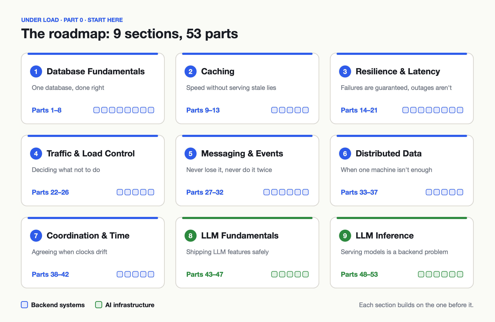
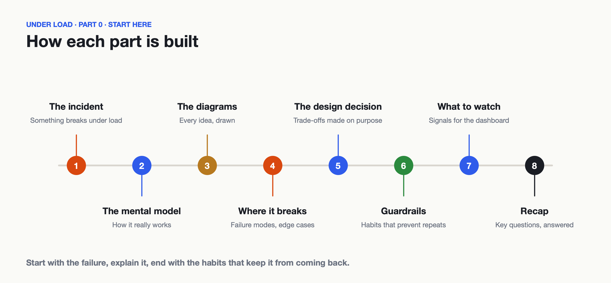

# Under Load: A Series on How Real Systems Break — and How Good Teams Keep Them Standing

### 53 backend and AI infrastructure concepts, explained the way they show up in production, design reviews and postmortems.

*Under Load · Part 0 · Start here*

---

Most systems are fine on day one.

The schema is clean, the cache hit rate is great, every request finishes well under its timeout. Then the product works. Traffic doubles, a large customer imports five years of history over a weekend, a downstream service gets slow on a Monday morning — and the system starts behaving in ways nobody designed for.

Most postmortems have the same shape. The root cause is rarely exotic. It's a well-known concept — a missing index, a retry without jitter, a cache that expired for everyone at the same second, two writers that both thought they held the lock. The team had *heard of* the concept. What they didn't have was an intuition for how it behaves when the system is **under load**.

That intuition is what this series is about.

---

## Why this series

The further an engineering career goes, the less the hard part is writing code and the more it's judgment: looking at a design and asking "what happens when this is ten times bigger?", or keeping an incident call focused on the right hypothesis.

That judgment comes from understanding a small set of core ideas deeply — how they work mechanically, where they fail, what they cost, and how to operate them. That's what each part of this series covers, one idea at a time.

---

## How each part works

Every part starts with something going wrong in one running example — a B2B customer-support product and its largest customer, Halcyon — and ends with how to prevent it, and how to notice it early if it happens anyway.

Each part explains its topic from the ground up — how it works mechanically, where it breaks, what it costs and how to run it in production — with diagrams for every important idea, and SQL and code where they help. Then come practical guardrails that can be adopted as they are, a list of what to keep on the dashboard, and a recap that answers the topic's key questions, one short answer each. No part assumes the others have been read, but they build on each other when read in order.

Where it helps, a topic also has a **lab** in the public [`under-load`](https://github.com/b-basoglu/under-load) repo: runnable scripts, a measured write-up (`article.md`), and charts in the same folder as the code. Theory lives here; labs live there — open either.

---

## Labs

Each lab folder under [`b-basoglu/under-load`](https://github.com/b-basoglu/under-load) holds the scripts, README, measured results, and the lab write-up with charts. Labs ship after they have been run and reviewed on the machine noted below.

**How the numbers were produced (so far):** PostgreSQL 17 in Docker on an **Apple MacBook Pro (M2 Pro, 12-core, 16 GB)**. Timings are medians of warm `EXPLAIN (ANALYZE, BUFFERS)` unless noted; concurrent load uses `pgbench`. Absolute milliseconds are laptop-class and will move on another machine; what should stay stable is *which* plan wins and by roughly how much. LLM labs (later parts) use small open instruct models on the same machine — details sit in each lab's README.

---

## The roadmap

### Section 1 — Database Fundamentals
*One database, done right. Everything else builds on this.*

1. [Database Indexes & the Query Planner](../01-database-indexes/article.md)
    - Lab: [`01-database-indexes`](https://github.com/b-basoglu/under-load/tree/main/01-database-indexes)

2. [Transactions & Isolation Levels](../02-transactions/article.md)
    - Lab: [`02-transactions`](https://github.com/b-basoglu/under-load/tree/main/02-transactions)

3. [MVCC: How Databases Let Readers and Writers Coexist](../03-mvcc/article.md)
    - Lab: [`03-mvcc`](https://github.com/b-basoglu/under-load/tree/main/03-mvcc)

4. [Write Skew: The Anomaly Your Tests Won't Catch](../04-write-skew/article.md)
    - Lab: [`04-write-skew`](https://github.com/b-basoglu/under-load/tree/main/04-write-skew)

5. [Optimistic vs Pessimistic Locking](../05-locking/article.md)
    - Lab: [`05-locking`](https://github.com/b-basoglu/under-load/tree/main/05-locking)

6. [The Write-Ahead Log](../06-wal/article.md)
    - Lab: [`06-wal`](https://github.com/b-basoglu/under-load/tree/main/06-wal)

7. [Connection Pooling](../07-connection-pooling/article.md)
    - Lab: [`07-connection-pooling`](https://github.com/b-basoglu/under-load/tree/main/07-connection-pooling)

8. [Pagination: Offset vs Cursor](../08-pagination/article.md)
    - Lab: [`08-pagination`](https://github.com/b-basoglu/under-load/tree/main/08-pagination)

### Section 2 — Caching
*Speed is easy. Correctness is the hard part.*

9. [Caching Strategies & Invalidation](../09-caching/article.md)
    - Lab: [`09-caching`](https://github.com/b-basoglu/under-load/tree/main/09-caching)

10. [Write-Through vs Write-Back](../10-write-through-back/article.md)
    - Lab: [`10-write-through-back`](https://github.com/b-basoglu/under-load/tree/main/10-write-through-back)

11. [When Caches Fail: Stampedes, Penetration and Avalanches](../11-cache-failures/article.md)
    - Lab: [`11-cache-failures`](https://github.com/b-basoglu/under-load/tree/main/11-cache-failures)

12. [Request Coalescing](../12-request-coalescing/article.md)
    - Lab: [`12-request-coalescing`](https://github.com/b-basoglu/under-load/tree/main/12-request-coalescing)

13. [Cache Coherence vs Consistency](../13-cache-coherence/article.md)
    - Lab: [`13-cache-coherence`](https://github.com/b-basoglu/under-load/tree/main/13-cache-coherence)

### Section 3 — Resilience & Latency
*Failures are guaranteed. Outages aren't.*

14. [Idempotency](../14-idempotency/article.md)
    - Lab: [`14-idempotency`](https://github.com/b-basoglu/under-load/tree/main/14-idempotency)

15. [Retries, Backoff & Jitter](../15-retries/article.md)
    - Lab: [`15-retries`](https://github.com/b-basoglu/under-load/tree/main/15-retries)

16. [Circuit Breakers & Cascading Failures](../16-circuit-breakers/article.md)
    - Lab: [`16-circuit-breakers`](https://github.com/b-basoglu/under-load/tree/main/16-circuit-breakers)

17. [Bulkheads](../17-bulkheads/article.md)
    - Lab: [`17-bulkheads`](https://github.com/b-basoglu/under-load/tree/main/17-bulkheads)

18. [Tail Latency: Why P99 Is the Number That Matters](../18-tail-latency/article.md)
    - Lab: [`18-tail-latency`](https://github.com/b-basoglu/under-load/tree/main/18-tail-latency)

19. [Request Hedging](../19-hedging/article.md)
    - Lab: [`19-hedging`](https://github.com/b-basoglu/under-load/tree/main/19-hedging)

20. [Graceful Degradation](../20-graceful-degradation/article.md)
    - Lab: [`20-graceful-degradation`](https://github.com/b-basoglu/under-load/tree/main/20-graceful-degradation)

21. [Continuous Profiling](../21-continuous-profiling/article.md)
    - Lab: [`21-continuous-profiling`](https://github.com/b-basoglu/under-load/tree/main/21-continuous-profiling)

### Section 4 — Traffic & Load Control
*Deciding what not to do is a feature.*

22. [Token Bucket vs Leaky Bucket](../22-token-leaky-bucket/article.md)
    - Lab: [`22-token-leaky-bucket`](https://github.com/b-basoglu/under-load/tree/main/22-token-leaky-bucket)

23. [Distributed Rate Limiting](../23-distributed-rate-limiting/article.md)
    - Lab: [`23-distributed-rate-limiting`](https://github.com/b-basoglu/under-load/tree/main/23-distributed-rate-limiting)

24. [Backpressure](../24-backpressure/article.md)
    - Lab: [`24-backpressure`](https://github.com/b-basoglu/under-load/tree/main/24-backpressure)

25. [Load Shedding](../25-load-shedding/article.md)
    - Lab: [`25-load-shedding`](https://github.com/b-basoglu/under-load/tree/main/25-load-shedding)

26. [Head-of-Line Blocking](../26-head-of-line-blocking/article.md)
    - Lab: [`26-head-of-line-blocking`](https://github.com/b-basoglu/under-load/tree/main/26-head-of-line-blocking)

### Section 5 — Messaging & Events
*Moving data between services without losing it — or doing it twice.*

27. [Message Queues & Delivery Guarantees](../27-message-queues/article.md)
    - Lab: [`27-message-queues`](https://github.com/b-basoglu/under-load/tree/main/27-message-queues)

28. [Dead Letter Queues](../28-dead-letter-queues/article.md)
    - Lab: [`28-dead-letter-queues`](https://github.com/b-basoglu/under-load/tree/main/28-dead-letter-queues)

29. [The Transactional Outbox](../29-transactional-outbox/article.md)
    - Lab: [`29-transactional-outbox`](https://github.com/b-basoglu/under-load/tree/main/29-transactional-outbox)

30. [Change Data Capture](../30-change-data-capture/article.md)
    - Lab: [`30-change-data-capture`](https://github.com/b-basoglu/under-load/tree/main/30-change-data-capture)

31. [Sagas: Orchestration vs Choreography](../31-sagas/article.md)
    - Lab: [`31-sagas`](https://github.com/b-basoglu/under-load/tree/main/31-sagas)

32. [CQRS & Read Models](../32-cqrs/article.md)
    - Lab: [`32-cqrs`](https://github.com/b-basoglu/under-load/tree/main/32-cqrs)

### Section 6 — Distributed Data
*What changes when the data no longer fits on one machine.*

33. [Replication & Consistency](../33-replication/article.md)
    - Lab: [`33-replication`](https://github.com/b-basoglu/under-load/tree/main/33-replication)

34. [Read-Your-Writes](../34-read-your-writes/article.md)
    - Lab: [`34-read-your-writes`](https://github.com/b-basoglu/under-load/tree/main/34-read-your-writes)

35. [Sharding & Hot Partitions](../35-sharding/article.md)
    - Lab: [`35-sharding`](https://github.com/b-basoglu/under-load/tree/main/35-sharding)

36. [Consistent Hashing](../36-consistent-hashing/article.md)
    - Lab: [`36-consistent-hashing`](https://github.com/b-basoglu/under-load/tree/main/36-consistent-hashing)

37. [Rebalancing Partitions](../37-rebalancing/article.md)
    - Lab: [`37-rebalancing`](https://github.com/b-basoglu/under-load/tree/main/37-rebalancing)

### Section 7 — Coordination & Time
*Agreeing on anything when clocks drift and networks drop packets.*

38. [Clock Skew](../38-clock-skew/article.md)
    - Lab: [`38-clock-skew`](https://github.com/b-basoglu/under-load/tree/main/38-clock-skew)

39. [Vector Clocks](../39-vector-clocks/article.md)
    - Lab: [`39-vector-clocks`](https://github.com/b-basoglu/under-load/tree/main/39-vector-clocks)

40. [Leader Election](../40-leader-election/article.md)
    - Lab: [`40-leader-election`](https://github.com/b-basoglu/under-load/tree/main/40-leader-election)

41. [Split Brain](../41-split-brain/article.md)
    - Lab: [`41-split-brain`](https://github.com/b-basoglu/under-load/tree/main/41-split-brain)

42. [Distributed Locks vs Leases](../42-locks-vs-leases/article.md)
    - Lab: [`42-locks-vs-leases`](https://github.com/b-basoglu/under-load/tree/main/42-locks-vs-leases)

### Section 8 — LLM Fundamentals
*What every engineer shipping an LLM feature should understand.*

43. [Sampling: Temperature, Top-K and Top-P](../43-sampling/article.md)
    - Lab: [`43-sampling`](https://github.com/b-basoglu/under-load/tree/main/43-sampling)

44. [Hallucinations & Grounding](../44-hallucinations/article.md)
    - Lab: [`44-hallucinations`](https://github.com/b-basoglu/under-load/tree/main/44-hallucinations)

45. [Structured Outputs & Constrained Decoding](../45-structured-outputs/article.md)
    - Lab: [`45-structured-outputs`](https://github.com/b-basoglu/under-load/tree/main/45-structured-outputs)

46. [Retrieval-Augmented Generation: Chunking & Retrieval](../46-rag/article.md)
    - Lab: [`46-rag`](https://github.com/b-basoglu/under-load/tree/main/46-rag)

47. [Tool Calling, MCP and RAG: Which One When](../47-tool-calling-mcp/article.md)
    - Lab: [`47-tool-calling-mcp`](https://github.com/b-basoglu/under-load/tree/main/47-tool-calling-mcp)

### Section 9 — LLM Inference Infrastructure
*Serving models fast and affordably is a backend problem.*

48. [The KV Cache](../48-kv-cache/article.md)
    - Lab: [`48-kv-cache`](https://github.com/b-basoglu/under-load/tree/main/48-kv-cache)

49. [Context Caching](../49-context-caching/article.md)
    - Lab: [`49-context-caching`](https://github.com/b-basoglu/under-load/tree/main/49-context-caching)

50. [Continuous Batching](../50-continuous-batching/article.md)
    - Lab: [`50-continuous-batching`](https://github.com/b-basoglu/under-load/tree/main/50-continuous-batching)

51. [Speculative Decoding](../51-speculative-decoding/article.md)
    - Lab: [`51-speculative-decoding`](https://github.com/b-basoglu/under-load/tree/main/51-speculative-decoding)

52. [Quantization](../52-quantization/article.md)
    - Lab: [`52-quantization`](https://github.com/b-basoglu/under-load/tree/main/52-quantization)

53. [Model Routing](../53-model-routing/article.md)
    - Lab: [`53-model-routing`](https://github.com/b-basoglu/under-load/tree/main/53-model-routing)

---

## Start here

👉 **[Part 1 — Database Indexes & the Query Planner](../01-database-indexes/article.md):** how indexes really work, why the query planner ignores them, and the guardrails that keep it from happening again.

Lab for Part 1: [`under-load/01-database-indexes`](https://github.com/b-basoglu/under-load/tree/main/01-database-indexes).

This page is the series index. Every part below links to its long write-up in this repo; labs are in [`under-load`](https://github.com/b-basoglu/under-load).
