# Database Indexes & the Query Planner

### How database indexes really work, why the database sometimes ignores them, and how to design the right one.

*Under Load · Part 1 · Database Fundamentals*

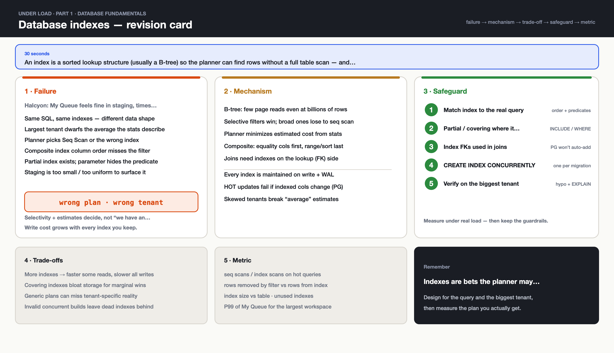

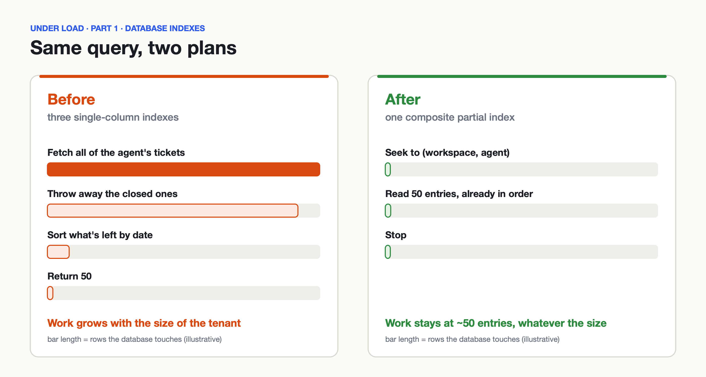

---

A B2B customer-support product has one screen every agent opens first thing in the morning: **My Queue** — the open tickets assigned to them, most recently updated first. It's the most visited page in the product, and for a long time it loads instantly.

```sql
SELECT id, subject, priority, updated_at
FROM tickets
WHERE workspace_id = $1        -- the customer company
  AND assignee_id  = $2        -- the agent looking at the page
  AND state       <> 'closed'  -- <> means "not equal"
ORDER BY updated_at DESC       -- newest first
LIMIT 50;
```

(`$1` and `$2` are placeholders. The application fills in the real values when it sends the query.)

Then sales signs the biggest customer in the company's history — call them Halcyon. Over a weekend, Halcyon's migration script imports millions of historical tickets, almost all of them long closed. Suddenly more than half of the `tickets` table belongs to one customer. On Monday morning Halcyon's agents open My Queue at the same time, the database's CPU sits at 100%, and the page crawls.

The first message in the incident channel: *"But we have indexes on all three columns."*

They did — one on `workspace_id`, one on `assignee_id`, one on `state`. None of them was the right one.

This article explains why, and what the right index looks like. Only basic SQL (`SELECT`, `WHERE`, `ORDER BY`, `JOIN`) is assumed; everything else is explained along the way. The examples use PostgreSQL, but the ideas apply to MySQL, SQL Server and most other relational databases.

---

## What an index actually is

An index is a **separate data structure that helps the database find rows without reading the whole table** — in practice, a sorted copy of one or more columns, where every entry also stores the address of the full row.

Think of the index at the back of a book. It lists topics in alphabetical order, and next to each topic the page numbers where it appears. To find "replication," nobody reads the whole book: jump to the R section, read the page numbers, go straight there.

A database index works the same way. Without one, the only way to find "the ticket with external reference EXT-48213" is to read every row and check. That's a **full table scan** (also called a **sequential scan**), and its cost grows with the size of the table. With an index on that column, the database jumps straight to the matching entry and follows its address to the row — a handful of reads, whether the table has a thousand rows or a billion.

The key word is **sorted**. Sorting is what lets the database skip almost everything.

### How the sorted copy is stored: the B-tree

Databases store data in fixed-size blocks called **pages** — 8 KB each in PostgreSQL, 16 KB in MySQL's InnoDB. A table is a long list of pages full of rows. An index is also made of pages, organized as a **B-tree**, the default index type in almost every relational database.

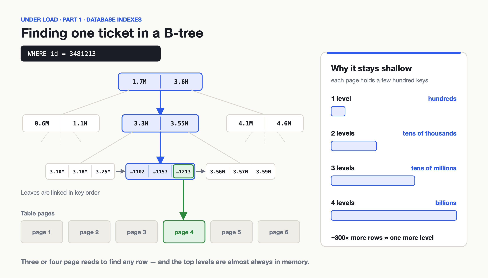

A B-tree looks like an upside-down tree:

- The **root** page at the top holds a few dividing values: "ids below 1.7 million are on the left, 1.7–3.6 million in the middle, above that on the right."
- Each **middle** page divides its range further, the same way.
- The **leaf** pages at the bottom hold the actual sorted values, each with the address of its row in the table.

To find one ticket by its id, the database reads the root, picks a branch, reads that page, picks a leaf, finds the entry, and follows the address to the table page that holds the row.

What makes this powerful is how many entries fit on one page: **hundreds**. Every level multiplies capacity by a few hundred:

- 1 level ≈ hundreds of entries
- 2 levels ≈ tens of thousands
- 3 levels ≈ tens of millions
- 4 levels ≈ billions

Growing from one million to a hundred million rows adds about one level. The top levels are read so often that they almost always stay in memory, which is why a lookup through a good index feels instant no matter how big the table gets.

Two properties of this structure explain nearly everything else in this article:

1. **It's sorted by the column's value exactly as stored.** If a query asks about something calculated from the column — its lowercase version, the day part of a timestamp — the sort order is useless.
2. **The leaves are kept in order and linked to each other.** Once the database finds the first matching entry, reading the next 50 in order is cheap. That's what makes `ORDER BY ... LIMIT` fast when the index is sorted the same way as the query.

Jumping straight to the first matching entry is called a **seek**. The word comes up a lot below.

---

## How the database decides whether to use an index

Having an index doesn't mean the database will use it. Before running a query, a component called the **query planner** (or optimizer) decides *how* to run it. It considers the possible strategies — scan the whole table, use this index, use that index, combine two — estimates the cost of each, and picks the one it believes is cheapest.

Its choices rest on one fact about storage: **reading pages in order is much cheaper than jumping between them.**

- A **sequential read** goes through pages one after another. Disks and operating systems are optimized for this: they read ahead, so the next page is already waiting.
- A **random read** jumps around: page 8,412, then page 17, then page 3,901. Every jump is a separate trip.

An index lookup leads to random reads. For each matching entry, the database jumps from the index to wherever that row lives in the table. For a few rows, that's nothing. For millions of rows, it's millions of jumps — often landing on the same pages again and again, in no particular order.

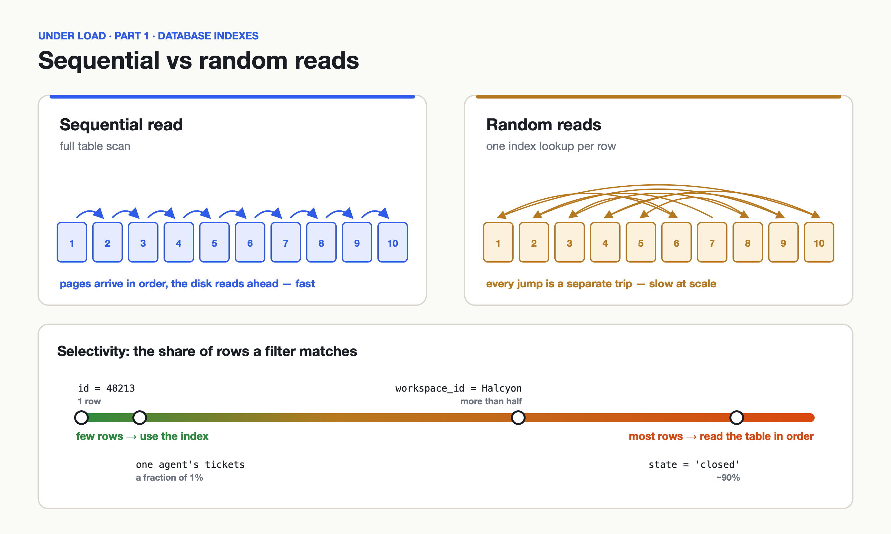

That's where **selectivity** comes in: the share of rows a filter matches.

- A **highly selective** filter matches very few rows. `id = 48213` matches one row out of millions. An index is perfect for this.
- A **poorly selective** filter matches a large share. In a mature support product, `state = 'closed'` might match 90% of tickets. Using an index there means jumping to almost every page of the table, so reading the table straight through is genuinely cheaper.

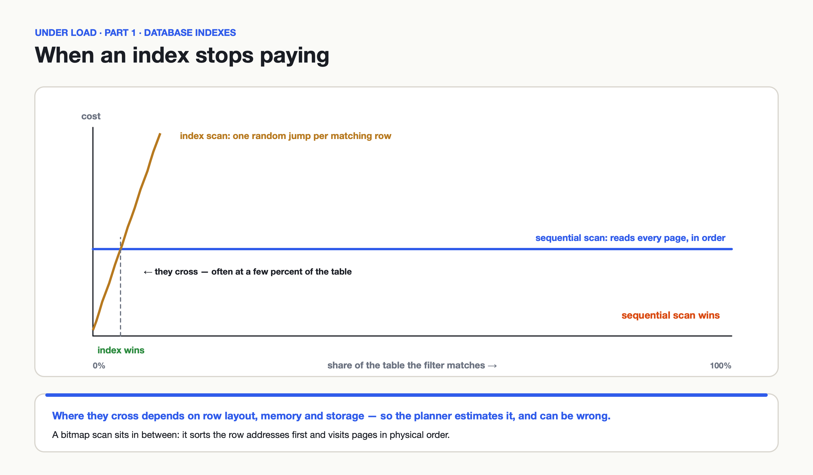

The cost of an index scan grows with every matching row; the cost of a sequential scan is roughly fixed — it always reads the whole table, but in order. Somewhere along the way the two lines cross. Where exactly depends on how rows are laid out on disk, how much of the table is in memory and how fast random reads are on the hardware, but it's usually at a small percentage of the table — often a few percent or less, not "half the rows."

Between the two extremes, PostgreSQL has a middle option, the **bitmap scan**: it first collects all matching row addresses from the index, sorts them by their position in the table, and then visits the table pages in physical order. It still reads only the pages it needs, but without jumping back and forth — which is why it's often chosen for filters that match a moderate number of rows.

So when the planner ignores an index on a poorly selective filter, it's usually *right*. It also skips indexes on very small tables: if the whole table fits in a few pages, reading it is cheaper than walking a tree. And because the planner works from **estimates**, it's sometimes wrong — which is why plans should be checked, not assumed (see "Reading the plan" below).

> **Rule of thumb:** an index is a tool for finding a *small* number of rows in a *large* table.

---

## Why three indexes weren't enough

Back to My Queue. The query wants:

> *In Halcyon's workspace, for this agent, the open tickets, newest first — just the top 50.*

The team had three indexes, which can be pictured as three separately sorted lists:

- **List A:** tickets sorted by workspace
- **List B:** tickets sorted by agent
- **List C:** tickets sorted by state

None of them is sorted by "workspace, then agent, then newest." So whichever one the planner picks, it does a lot of extra work.

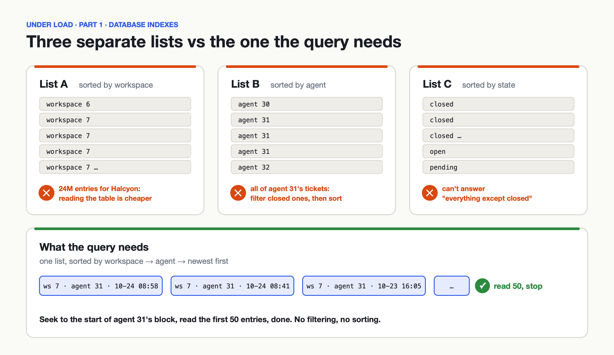

- **Use list A (workspace).** For Halcyon, that's millions of tickets — most of the table. Poorly selective, so the planner won't follow it alone.
- **Use list B (agent).** This finds all of the agent's tickets — open and closed. After a big import, an agent can have thousands of old closed tickets and only a few dozen open ones. The database fetches all of them, throws away the closed ones, and **sorts what's left** by date before it can return the first 50.
- **Combine lists A and B.** PostgreSQL can intersect two indexes (a *bitmap AND*). That narrows things to the right tickets, but they come out in table order, not date order, so it still has to sort them.
- **Use list C (state).** Indexes are good at "give me the rows with value X," bad at "give me everything *except* X." `<> 'closed'` is exactly that, so this list rarely helps.

The planner typically picks option B. The query still returns the right 50 rows — it just reads, filters and sorts thousands of rows to get them, and because the agent's tickets are scattered across the table, those thousands of rows sit on thousands of different pages.

On a quiet database, that can still take only a few milliseconds, because the pages happen to be in memory. The trouble starts when hundreds of agents load the page at the same time: every one of those requests does the same thousands of reads, and together they saturate the database. **Work per request is what decides capacity.** A query's latency on a quiet database says little about how it behaves under load.

What the query really needs is **one list that's already sorted by workspace, then agent, then newest.** Then the database could seek to "Halcyon, this agent," read 50 entries and stop. No filtering, no sorting.

---

## Why only the biggest customer broke

One question remains: why did My Queue stay fast for every other customer, and break only for Halcyon?

An ordinary workspace has a few thousand tickets in total; each agent has a few hundred. With numbers like that, even the poor plan reads a few hundred rows — fast enough that nobody notices. Halcyon is thousands of times bigger than a typical workspace, so the same plan does thousands of times more work. The plan didn't change. The data did.

There is a second effect: the planner's decisions are based on **estimates**, and estimates describe what's typical.

The database keeps statistics about each column: roughly how many distinct values it has, which values are most common, how they're distributed. A navigation app works similarly: it picks a route before the trip, based on what traffic is *usually* like. When reality matches the usual, the trip is fast. When a stadium is emptying onto the street, the route is wrong.

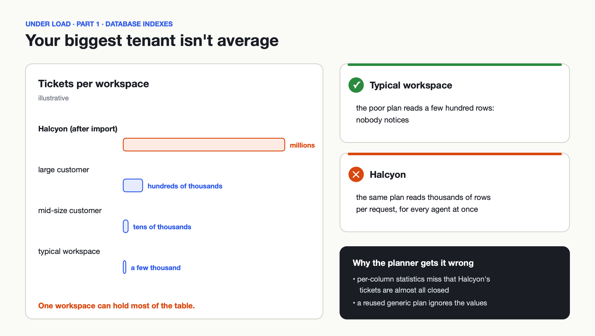

In a **multi-tenant** system — one database shared by many customer companies (tenants) — this skew is normal. The biggest tenant is often hundreds or thousands of times larger than the median one. That's why "it's fast in **staging**" (the pre-production test environment) proves very little: staging rarely has a tenant shaped like the biggest one in production.

### Two ways the estimates fail

**Statistics are kept per column, not per combination.** PostgreSQL knows what share of rows belongs to Halcyon and what share of all tickets is open, and by default it multiplies those two fractions as if the columns were unrelated. But they *are* related: almost all of Halcyon's imported tickets are closed. So the planner can overestimate the number of open Halcyon tickets by a factor of ten or more, and choose a plan built for a result that doesn't exist. `CREATE STATISTICS` tells PostgreSQL to study columns together:

```sql
CREATE STATISTICS tickets_ws_state (mcv) ON workspace_id, state FROM tickets;
ANALYZE tickets;
```

(`mcv` means "most common values": PostgreSQL records the most frequent *combinations* of the two columns, so its estimate for "Halcyon and open" comes from real data instead of multiplication.)

**A reused plan doesn't look at the values.** Applications often send queries as **prepared statements**: the query is parsed once and run many times with different values. After five executions, PostgreSQL may switch to a **generic plan** — one plan for all values, built for an "average" workspace — if it estimates that the generic plan is about as good as a plan for each value. A plan that's fine for a typical tenant can be a poor one for Halcyon. Setting `plan_cache_mode = force_custom_plan` makes PostgreSQL plan with the real values every time, at the cost of planning on every call.

Both are worth knowing, but the real fix is an index that makes the best plan the same for every customer.

---

## Designing the right index

The index that fixes My Queue:

```sql
CREATE INDEX CONCURRENTLY tickets_my_queue_idx
  ON tickets (workspace_id, assignee_id, updated_at DESC)
  WHERE state <> 'closed';
```

With it, the plan becomes a single index scan: seek to the agent's block, read the first 50 entries — already in the right order — fetch those 50 rows, stop. The work is about the same for a 2,000-ticket workspace and a 3-million-ticket one.

There are three decisions in that statement.

**1. A composite index in the right order.** An index on several columns is a **composite index**. It's sorted by the first column, then by the second within each value of the first, then by the third — like a phone book sorted by last name, then first name. Here: by workspace, then by agent within each workspace, then by most recently updated within each agent. All of one agent's open tickets sit next to each other, already in the order the page shows them.

**2. A partial index that skips closed tickets.** The `WHERE state <> 'closed'` at the end makes this a **partial index**: it only contains rows that match the condition. Most tickets in a mature support product are closed, and closed tickets never appear in My Queue. Leaving them out can make the index a small fraction of the size of a full one. A small index stays in memory, and reading from memory is far faster than reading from disk.

**3. `CONCURRENTLY`.** A plain `CREATE INDEX` blocks writes to the table until the index is built. `CONCURRENTLY` builds it while the table stays fully usable (more on this below).

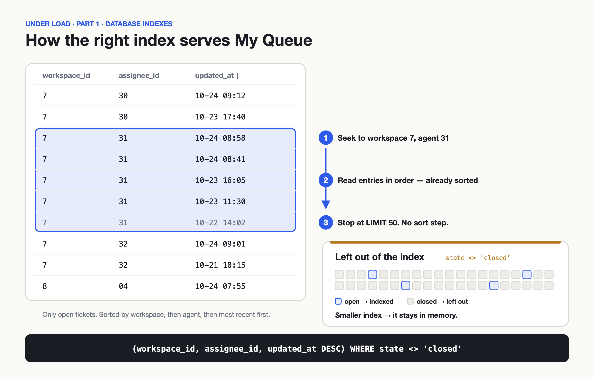

### Column order is the most important decision

A composite index can only be used from its first column onwards. This is the **leftmost prefix rule**: an index on `(workspace_id, assignee_id)` can serve queries that filter on `workspace_id`, or on `workspace_id` and `assignee_id`, but it can't seek on `assignee_id` alone. Sorted by last name, a phone book can't find everyone whose first name is "Ali." (Some databases can do a limited "skip scan" over the first column — Oracle, MySQL 8 and PostgreSQL 18 — but it's only efficient when the first column has few distinct values.)

Different orders of the same three columns serve different queries:

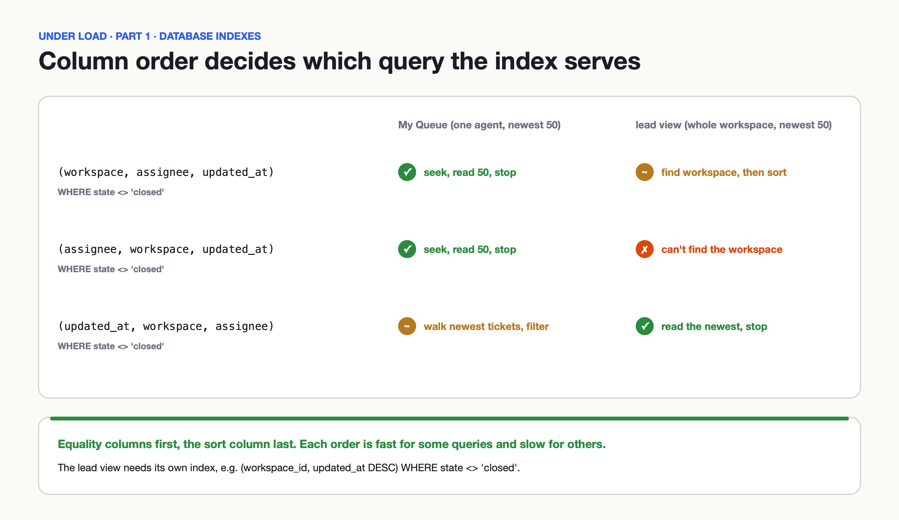

- **(workspace, assignee, updated_at):** perfect for My Queue. For a team lead's view — all open tickets in the workspace, newest first — it can find the workspace, but the tickets inside it are sorted by agent first, so they must be collected and sorted.
- **(assignee, workspace, updated_at):** just as good for My Queue, but the lead view can't use it at all, because it doesn't start with the workspace.
- **(updated_at, workspace, assignee):** poor for My Queue — the database walks through all open tickets, newest first, picking out this agent's. But it serves "newest open tickets anywhere" well.

No order is best for everything. A reliable way to choose:

1. **Start from the query, not the table.** Look at the exact `WHERE` and `ORDER BY` of the page being optimized.
2. **Columns compared with `=` go first.** Among those, put first the ones other queries also filter on, so they can reuse the index.
3. **The range or sort column goes last.** Once the index hits a range (`>`, `<`, `BETWEEN`) or a sort, the columns after it can't be used for seeking.

The lead view gets its own index, `(workspace_id, updated_at DESC) WHERE state <> 'closed'`, if it's used often enough to deserve one.

### Watch out: partial indexes need a matching query

The planner uses a partial index only when it can prove that the query's condition fits the index's condition. `state <> 'closed'` written in the query matches the index exactly. But some ORMs (libraries that generate SQL from code) send `state <> $3` and pass `'closed'` as a separate value. In a generic plan the value is unknown, so the planner can't prove it matches, and it falls back to another plan — sometimes a full table scan. It's a silent failure: the query still returns the right rows, just slowly. Check the SQL the ORM actually sends.

### Should it also be a covering index?

The query returns `subject` and `priority`, which aren't in the index. So for each of the 50 entries, the database still follows the address to the table to fetch them. They can be added to the index:

```sql
CREATE INDEX tickets_my_queue_cov
  ON tickets (workspace_id, assignee_id, updated_at DESC)
  INCLUDE (subject, priority)
  WHERE state <> 'closed';
```

`INCLUDE` stores extra columns in the index without sorting by them. Now the index contains everything the query needs, and the database doesn't need to touch the table. This is a **covering index**, and the plan is an **index-only scan**. (PostgreSQL still checks a small **visibility map** to confirm the rows are visible to every transaction; it's kept current by `VACUUM`. On a table with many recent changes, an index-only scan may still visit some table pages.)

For a query that returns 50 rows, 50 extra table lookups cost almost nothing, so a covering index rarely pays for its extra size. For a query that reads thousands of rows per call — an export, a report — skipping the table can make it many times faster.

---

## Indexes and joins

Indexes don't only serve `WHERE`. They matter just as much for **joins**.

When a ticket is opened, the page also loads its comments:

```sql
SELECT c.body, c.created_at
FROM tickets t
JOIN comments c ON c.ticket_id = t.id
WHERE t.id = $1
ORDER BY c.created_at;
```

The database has to find the comments whose `ticket_id` matches. With an index on `comments (ticket_id, created_at)`, it seeks straight to that ticket's comments, already in order. Without one, it reads the entire `comments` table every time someone opens a ticket.

A trap many teams fall into: **PostgreSQL does not index foreign keys automatically.** Declaring `comments.ticket_id REFERENCES tickets(id)` relies on the index on `tickets.id` (the primary key), but creates *none* on `comments.ticket_id`. That hurts twice:

- **Every join** on that column scans the child table.
- **Every delete** of a ticket scans it too: before removing the ticket, the database must check that no comment still points to it.

(MySQL's InnoDB engine does create an index for foreign keys automatically.)

The rule: **columns used to look up rows during a join — usually the foreign key — almost always need an index.**

---

## Queries that can't use an index

Remember the first property: the index is sorted by the column's value **exactly as stored**. A query that asks about a *calculated* version of the column can't seek, even when the index exists. Queries written so that an index can be used are sometimes called **sargable** (from "search argument able").

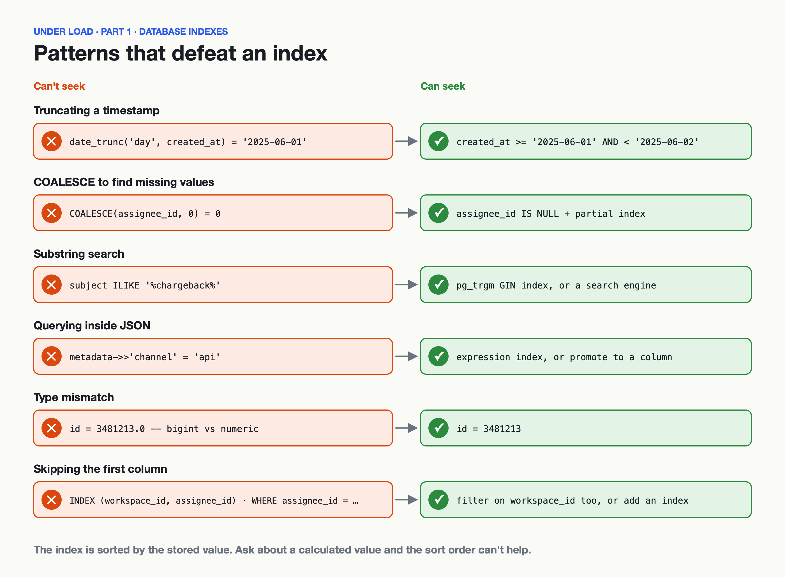

**Calculating on the timestamp.** `date_trunc('day', created_at)` cuts a timestamp down to its date. The index is sorted by the full timestamp, so the database has to calculate this for every row.

```sql
-- Can't seek: the calculation runs on every row
WHERE date_trunc('day', created_at) = '2025-06-01'

-- Can seek: a range on the stored value
WHERE created_at >= '2025-06-01' AND created_at < '2025-06-02'
```

**Replacing NULLs before comparing.** `COALESCE(assignee_id, 0)` means "use `assignee_id`, or 0 if it's empty (NULL)." It's a common way to write the "unassigned tickets" view, and it hides the column from the index.

```sql
-- Can't seek
WHERE COALESCE(assignee_id, 0) = 0

-- Can seek, especially with a small partial index for unassigned tickets
WHERE assignee_id IS NULL
-- CREATE INDEX ON tickets (workspace_id, created_at) WHERE assignee_id IS NULL;
```

**Comparing different types.** If the value's type doesn't match the column's, the database may convert every row's value before comparing — and then the index is skipped. In PostgreSQL, comparing a `bigint` column with a `numeric` value (`WHERE id = 48213.0`) converts the column. In MySQL, comparing a text (`VARCHAR`) column to a number (`WHERE external_ref = 48213`) converts every row's text to a number. Send values in the column's own type; ORMs and drivers sometimes get this wrong.

**Searching inside text.** `WHERE subject ILIKE '%chargeback%'` means "subject contains *chargeback*, ignoring case." A sorted list can find values that *start* with something, but not values that *contain* it: there's no place in alphabetical order to start looking. PostgreSQL's **trigram index** (the `pg_trgm` extension — an optional add-on enabled per database — with a **GIN** index, a type built for searching inside values) indexes every three-letter chunk of the text. It works, but it's large and slow to build on big tables. For serious search, a search engine like Elasticsearch or OpenSearch is the better tool.

**Querying inside JSON.** `WHERE metadata->>'channel' = 'api'` reads the `channel` field from a JSON column. An index on the whole column can't help with that comparison. An **expression index** — an index on the result of a calculation — can:

```sql
CREATE INDEX ON tickets (workspace_id, (metadata->>'channel'));
```

If the field is queried often, turning it into a regular column is usually cleaner.

**Skipping the first column of a composite index.** Covered above: the leftmost prefix rule.

**`OR` across different columns.** `WHERE assignee_id = $1 OR requester_id = $2` can't be answered from one sorted list. PostgreSQL can combine two indexes with a *bitmap OR*; other databases may give up and scan. Rewriting it as two separate queries combined with `UNION ALL` (which appends the results of both, with care not to return a row twice) gives each half its own index and a more predictable plan.

---

## What indexes cost

Every index makes some reads faster and every write slower. Each one is another sorted structure the database must update whenever a row is inserted, deleted, or an indexed column changes. Deleted rows leave entries behind that are cleaned up later — in PostgreSQL by **VACUUM**, the background cleanup process. Indexes also take disk space and memory that could otherwise hold table data.

That cost is easy to miss, because it doesn't show up on the page that was optimized. It shows up on everything that writes.

Each change is also recorded in the **write-ahead log (WAL)** — the database's journal of every change, used for crash recovery and to feed replicas (Part 6). More indexes mean more WAL, which means more disk traffic and more data to ship to replicas. This multiplication of one logical write into many physical writes is called **write amplification**.

### HOT updates

There's a PostgreSQL detail that matters a lot for a table like `tickets`, which is updated constantly. When an update doesn't change any indexed column, PostgreSQL can often do a **HOT update** (heap-only tuple — "heap" is PostgreSQL's name for the table's own storage). It writes the new version of the row next to the old one, on the same page, and doesn't touch any index. When an update changes an indexed column, the new row version needs a new entry in **every index on the table**, not just the one containing that column.

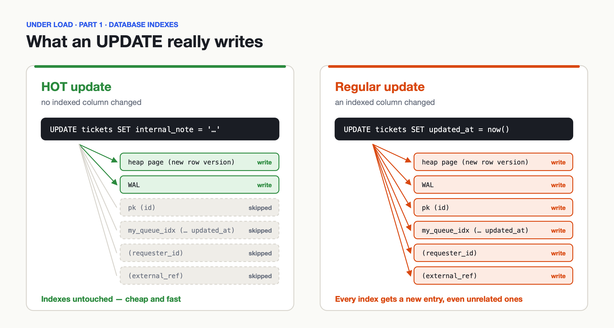

The new My Queue index includes `updated_at`, and every change to a ticket updates `updated_at`. So the fix turns every ticket update from a HOT update — no index work at all — into one that writes an entry into every index on `tickets`. With a few indexes that's acceptable; with many, every update gets noticeably heavier.

(HOT also needs free space on the row's page. A table created with `fillfactor = 90` leaves 10% of each page empty for this; the default of 100 fills pages completely, and HOT updates then often have nowhere to go. Frequently updated tables usually benefit from a lower fillfactor.)

For My Queue, the trade is right — the page is read far more often than tickets are written. But it should be a **decision**, made while watching write latency and WAL volume, not a side effect discovered a month later.

The same fix should remove the three old single-column indexes. Two are made redundant by the new one, and the `state` index is barely used. The table ends up with *fewer* indexes than before the incident, which pays back part of the write cost.

### Finding unused indexes

```sql
SELECT relname AS table_name,
       indexrelname AS index_name,
       idx_scan,                                          -- times the index was used
       pg_size_pretty(pg_relation_size(indexrelid)) AS size
FROM pg_stat_user_indexes
ORDER BY idx_scan ASC, pg_relation_size(indexrelid) DESC;
```

An index with zero scans over a long period, especially a large one, costs on every write and pays back nothing. Before dropping anything, check the **read replicas** too — copies of the database that serve read-only traffic — because usage statistics are kept per server, and an index unused on the main database may be serving reports on a replica. Also check that the statistics cover a full business cycle: an index used only by a month-end report looks unused for 29 days.

---

## Reading the plan: EXPLAIN

There's never a need to guess whether an index is used. `EXPLAIN` in front of a query shows the plan the database chose. `EXPLAIN (ANALYZE, BUFFERS)` goes further: it actually runs the query and reports what happened, including how many pages it touched.

A simplified version of what PostgreSQL shows for My Queue with the three single-column indexes:

```
Limit (actual rows=50)
  ->  Sort
        Sort Key: updated_at DESC
        ->  Index Scan using tickets_assignee_idx on tickets (actual rows=150)
              Index Cond: (assignee_id = 100005)
              Filter: ((state <> 'closed') AND (workspace_id = 7))
              Rows Removed by Filter: 14000
  Buffers: shared hit=12750
```

A plan is a tree, read **from the most indented line outwards**:

1. **`Index Scan using tickets_assignee_idx`:** it used the agent index. `Index Cond` is the condition used to seek into the index.
2. **`Filter` and `Rows Removed by Filter`:** conditions checked *after* fetching each row. Here, it fetched about 14,000 tickets just to throw most of them away.
3. **`Sort`:** it sorted the remaining rows by date.
4. **`Limit`:** finally, it kept 50.
5. **`Buffers`:** `shared hit` counts pages found in PostgreSQL's memory, `read` counts pages it had to fetch from the operating system or disk. Thousands of pages for 50 rows is the warning sign — and if those pages had to come from disk, the query would be far slower.

And with the composite partial index:

```
Limit (actual rows=50)
  ->  Index Scan using tickets_my_queue_idx on tickets (actual rows=50)
        Index Cond: ((workspace_id = 7) AND (assignee_id = 100005))
  Buffers: shared hit=53
```

One `Index Scan` on the new index, no filter, no sort, 50 rows, a few dozen pages.

What to look for in any plan:

- **`Seq Scan` on a large table** for a query that should return few rows: an index is missing or can't be used.
- **`Rows Removed by Filter`** with a big number: the database is reading many rows to throw them away.
- **`Sort`** right under a `Limit`: an index in the right order could remove it.
- **Estimated rows vs actual rows**: a big gap means the planner's estimates are wrong, as with Halcyon's open tickets.
- **`Buffers`**: how much data the query touched. That's usually where the time goes, and it's more stable than timing.

---

## Shipping an index change without causing an incident

On a large, busy table, adding an index is a production change like any other.

**Always build with `CONCURRENTLY`** in PostgreSQL, or with an online schema-change tool in MySQL (such as `gh-ost` or `pt-online-schema-change`, which build the change on a copy of the table and swap it in). A plain `CREATE INDEX` holds a lock that blocks every `INSERT`, `UPDATE` and `DELETE` on the table until the build finishes — on a big table, that can be minutes or hours of the product being read-only. `CONCURRENTLY` takes a weaker lock that allows writes; in exchange, it scans the table twice, waits for running transactions to finish, and takes longer.

`CONCURRENTLY` can't run inside a transaction (a group of statements applied all-or-nothing — the topic of Part 2), so the **migration** tool (the tool that applies schema changes) has to support that.

**Check that the build succeeded.** If a concurrent build fails partway — a deadlock, a unique violation, a canceled session — PostgreSQL leaves an **invalid** index behind. The planner never uses it, but PostgreSQL keeps updating it on every write. After each build, check `pg_index.indisvalid`; if it's false, drop the index and try again.

**Plan for time and disk space.** A build needs free disk space roughly the size of the new index. Run big builds off-peak.

**One index per migration.** Easier to watch, easier to roll back.

**Try the plan before building.** The `hypopg` extension creates *hypothetical* indexes that exist only for `EXPLAIN`, so it's possible to check whether the planner would use an index before spending an hour building it.

**Verify afterwards** with `EXPLAIN (ANALYZE, BUFFERS)`, using the values of the **largest** tenant, not a small test account.

---

## Guardrails that prevent the next one

Each of these is cheaper than the outage it prevents.

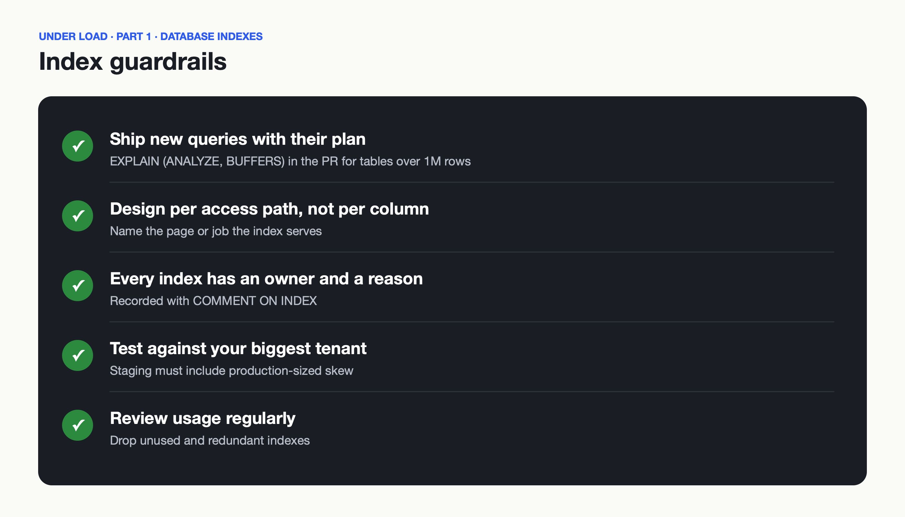

1. **New queries on large tables ship with their plan.** A pull request that adds a query on a table with more than a million rows includes its `EXPLAIN (ANALYZE, BUFFERS)` output against realistic data.
2. **Indexes are designed per query, not per column.** "Add an index on `assignee_id`" is not a design. "Serve My Queue for one agent, newest first" is.
3. **Every index has an owner and a reason.** Record which query it serves with `COMMENT ON INDEX`. If nobody can say why an index exists, it's a candidate for removal.
4. **Test against the biggest customer.** Staging data needs at least one tenant as large as the largest in production. Skew is where plans change.
5. **Review index usage regularly.** Drop unused and duplicate indexes. They slow down every write and never pay it back.

---

## What to keep on the dashboard

- **Slowest queries by total time.** The `pg_stat_statements` extension records every query's call count and total time. Sort by *total* time, not average: a 3 ms query run a million times an hour costs more than a 2-second query run twice a day.
- **Pages touched per call** (`shared_blks_hit + shared_blks_read` in `pg_stat_statements`). A query whose work per call grows with a tenant's size is the next incident.
- **Sequential scans on large tables.** `pg_stat_user_tables` counts them per table. A sudden jump usually means a plan changed.
- **Cache hit ratio.** The share of page reads served from memory. When it drops, the hot indexes and data no longer fit in memory.
- **HOT update ratio and WAL volume** on heavily updated tables, especially right after adding an index.
- **Index size and bloat.** On tables with many updates and deletes, indexes collect dead entries and grow larger than they need to be ("bloat"), pushing useful data out of memory.
- **Plans of slow queries.** The `auto_explain` module logs the plan of any query slower than a threshold — exactly the evidence needed during an incident.

---

## Recap

### What is an index, really?
An auxiliary data structure that lets the database find rows without scanning the whole table — usually a B-tree, a sorted copy of one or more columns with each entry pointing to its row. Each page holds hundreds of entries, so even billions of rows are only a few levels deep, and any row can be found in a handful of page reads.

### What is selectivity, and why does it matter?
The share of rows a filter matches. Indexes win on highly selective filters — few rows out of many. On poorly selective filters, following the index means jumping to almost every page of the table, and reading the table in order is cheaper.

### Why might a database ignore an existing index?
Because the planner picks the plan it *estimates* is cheapest. Common reasons: the filter matches too many rows, the table is small, the estimates are wrong for this data, the query wraps the column in a function or a different type, it uses a leading wildcard, it skips the first column of a composite index, or a parameter hides the condition a partial index needs.

### How do you choose the column order in a composite index?
Start from the exact query. Columns compared with `=` go first, the range or sort column last, because nothing after a range or sort can be used to seek. Then think about which other queries could reuse the index's leading columns — each order serves different queries.

### When is a partial index the right tool?
When most rows never appear in the queries that matter: closed tickets, deleted users, finished jobs. Leaving them out keeps the index small enough to stay in memory. The query's condition must visibly match the index's, which a parameterised condition can break.

### When is a covering index worth it?
When a query reads many rows and needs only a few extra small columns. `INCLUDE` lets the database answer from the index alone, at the price of a bigger index. For queries that return a handful of rows, it rarely pays.

### Do joins need indexes?
Yes. The column used to look up rows during a join — usually the foreign key — almost always needs one. PostgreSQL doesn't create it automatically, and without it every join and every delete of the parent row scans the whole child table.

### Why is a query fast in staging and slow in production?
Staging lacks production's size and skew. The largest tenant can be thousands of times bigger than a typical one, so the same plan does that much more work, and the planner's estimates — built from per-column statistics and sometimes reused generic plans — describe the average tenant, not the biggest one.

### What is the trade-off between read performance and write amplification?
Every index speeds up some reads and is updated on every insert, delete and change to its columns, writing more data and more WAL. In PostgreSQL, indexing a frequently updated column can also prevent HOT updates, so every update touches every index. Add indexes on purpose, and drop the ones that don't earn their keep.

### How do you add an index to a busy table safely?
Build it `CONCURRENTLY` (or with an online schema-change tool in MySQL), one per migration, off-peak, with enough disk. Check `indisvalid` afterwards, since a failed concurrent build leaves an invalid index behind, try the plan first with a hypothetical index, and verify it with the largest tenant's values.

---

## Next

- **Lab (run + measured write-up):** [01-database-indexes](https://github.com/b-basoglu/under-load/tree/main/01-database-indexes)
- **Next:** [Transactions & Isolation Levels](../02-transactions/article.md) — Two agents click "Take ticket" at the same millisecond. Both get it. Why — and which isolation level would have stopped it?
