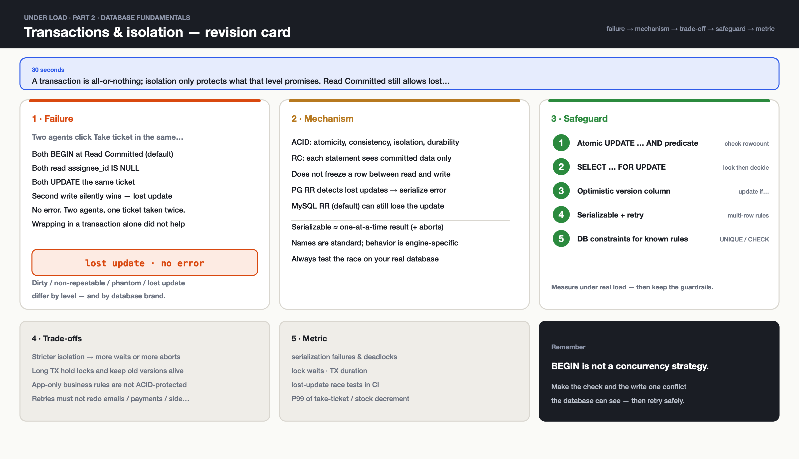
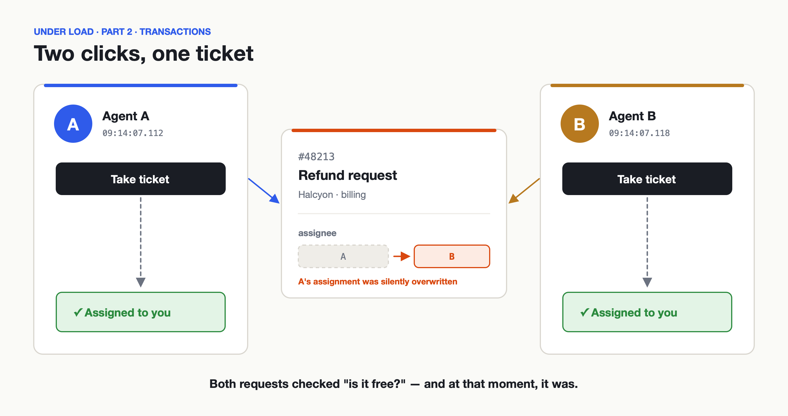
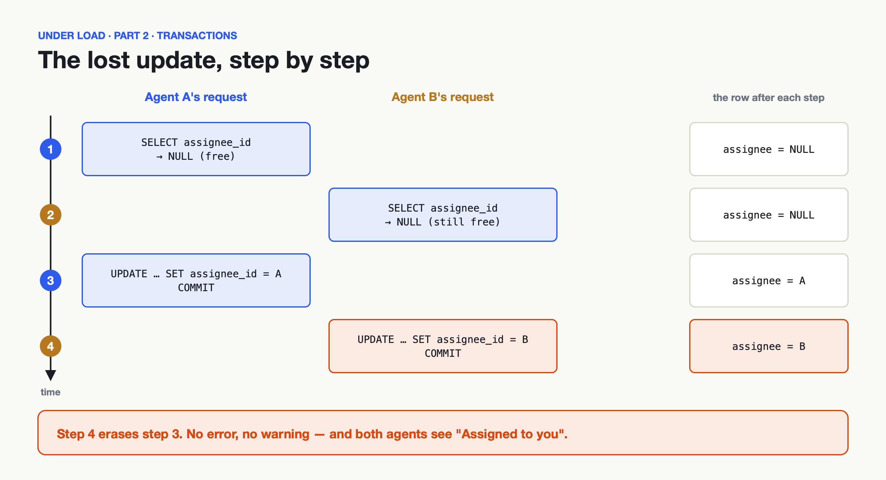
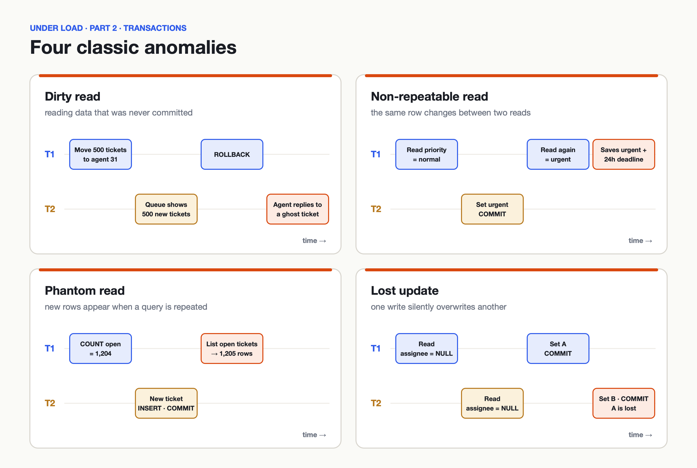
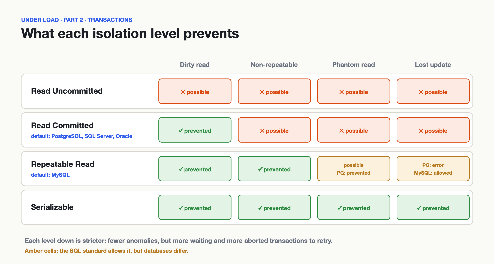
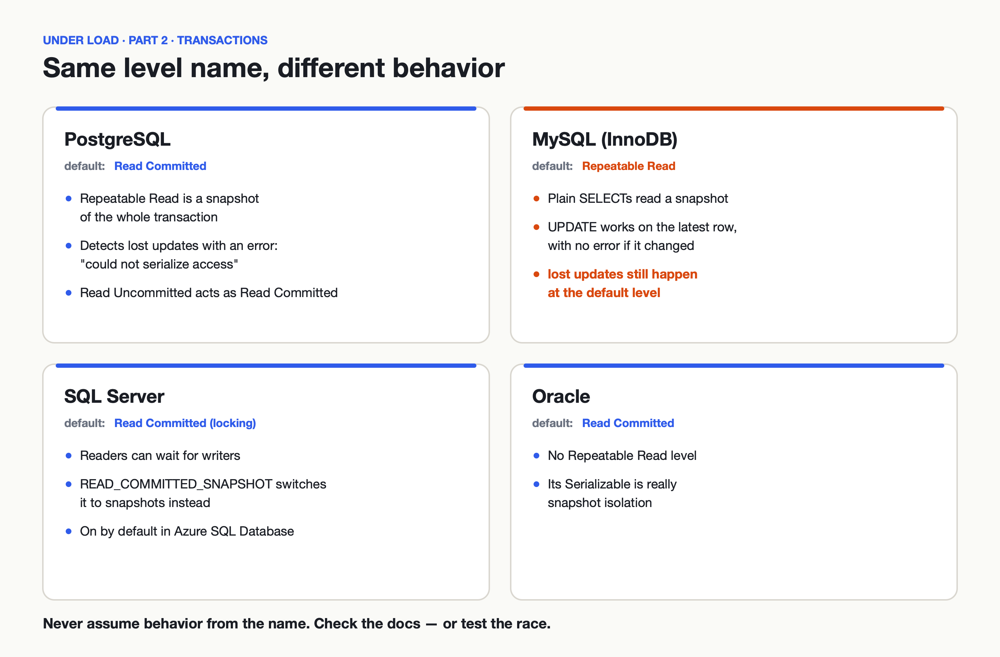
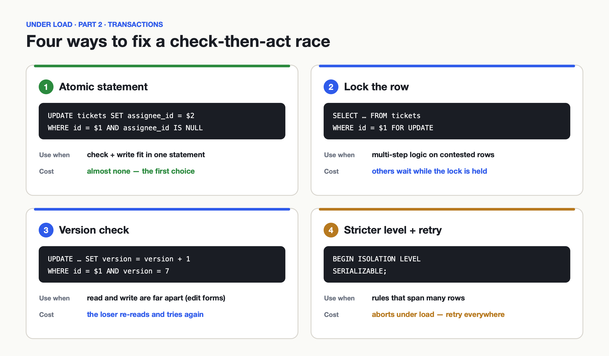
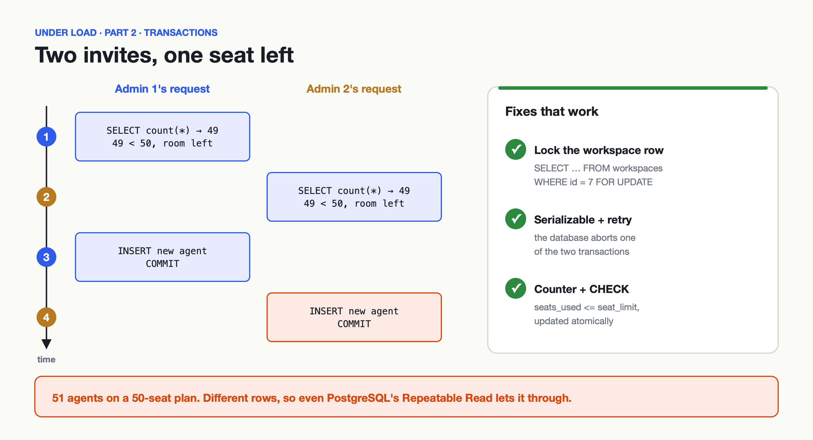
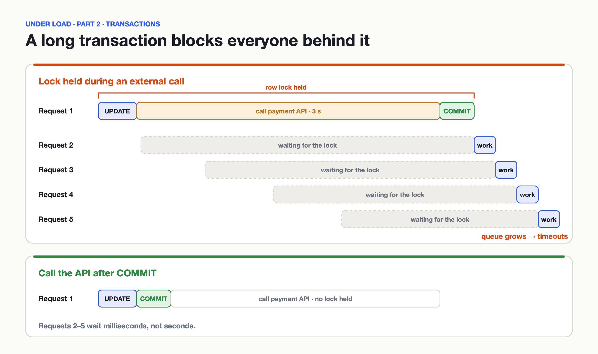
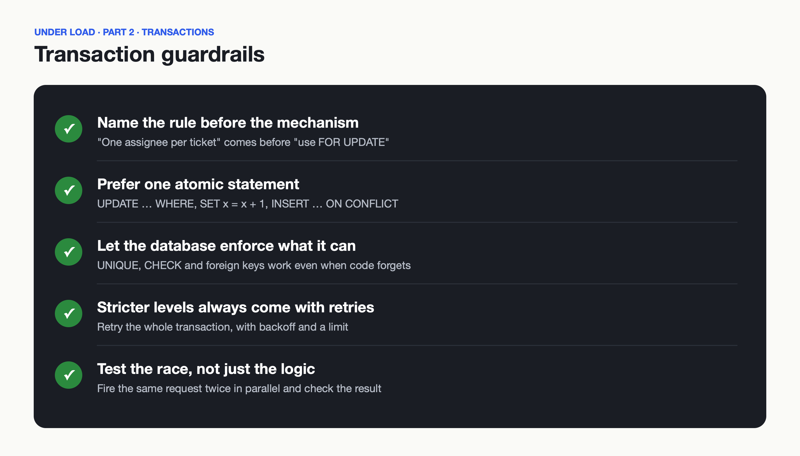

# Transactions & Isolation Levels

### What transactions really guarantee, what isolation levels do, and how to stop concurrent requests from corrupting your data.

*Under Load · Part 2 · Database Fundamentals*





---

Halcyon — the giant customer from Part 1 — has been live for a few weeks. My Queue is fast again. Then a new kind of complaint starts arriving.

A customer writes in about a billing problem. Two Halcyon agents reply within a minute of each other, with *different* answers. One promises a refund, the other says refunds aren't possible. When the support lead investigates, both agents insist the ticket was assigned to them. And both are right: each of them clicked **Take ticket**, and each of them saw "Assigned to you."

The code behind the button looks perfectly reasonable:

```python
def take_ticket(ticket_id, agent_id):
    with db.transaction():
        ticket = db.query_one(
            "SELECT assignee_id FROM tickets WHERE id = %s", ticket_id)

        if ticket.assignee_id is not None:
            raise AlreadyTaken()

        db.execute(
            "UPDATE tickets SET assignee_id = %s WHERE id = %s",
            agent_id, ticket_id)
```

Read the ticket. If nobody has it, assign it. And it's all inside a transaction. In the incident review, someone says what most engineers would think: *"How can this happen? It's in a transaction."*

It can happen because a transaction doesn't mean what most people think it means. This article explains what transactions actually guarantee, what **isolation levels** control, why the same level behaves differently in PostgreSQL and MySQL — and four reliable ways to fix the button.

You only need basic SQL. Everything else is explained along the way.

---

## What a transaction is

A **transaction** groups several database operations into one unit that either happens completely or not at all. You start it with `BEGIN`, and end it with `COMMIT` (make everything permanent) or `ROLLBACK` (undo everything).

Say an agent moves a ticket to another team. That's two writes: update the ticket, and add an entry to the audit log.

```sql
BEGIN;
UPDATE tickets   SET team_id = 12 WHERE id = 48213;
INSERT INTO audit_log (ticket_id, action) VALUES (48213, 'moved to team 12');
COMMIT;
```

If the server crashes between the two statements, you never end up with a moved ticket and no audit entry. Either both writes exist, or neither does.

Transactions are usually described with four properties, known as **ACID**:

- **Atomicity — all or nothing.** If any part fails, the whole transaction is rolled back. That's the ticket-and-audit-log example above.
- **Consistency — the rules you declared hold.** Constraints you defined in the schema — `NOT NULL`, `UNIQUE`, foreign keys, `CHECK` — are true before and after every transaction. Note the word *declared*: the database can only protect rules it knows about.
- **Isolation — concurrent transactions don't step on each other.** *How much* they're protected from each other is configurable. That's the part this article is about.
- **Durability — committed means saved.** Once `COMMIT` returns, the data survives a crash. (The database writes it to its write-ahead log first — Part 6 covers how.)

Most of the confusion comes from the "I". People assume isolation means "my transaction behaves as if it were the only one running." That's only true at the strictest setting — and almost no database uses that setting by default.

---

## Why the transaction didn't help

Two things happen at the same time all the time in a web application. Thousands of requests are handled in parallel, and many of them touch the same rows. This is called **concurrency**, and it's exactly what transactions don't fully protect you from by default.

Here's what happened when both agents clicked **Take ticket** a few milliseconds apart:



1. Agent A's request reads the ticket: `assignee_id` is empty.
2. Agent B's request reads the same ticket: still empty, because A hasn't written anything yet.
3. A's request assigns the ticket to A and commits.
4. B's request assigns the ticket to B and commits — overwriting A's assignment.

Both requests passed the "is it free?" check, because at the moment each one checked, it was. Both transactions were perfectly atomic and durable. But nothing stopped B from acting on information that was already out of date by the time it wrote.

This bug has a name: a **lost update**. Two transactions read the same value, both decide what to write based on it, and the second write silently erases the first. The general pattern — *check something, then act on it* — is called a **check-then-act race**, and it's one of the most common concurrency bugs in backend code.

The database didn't malfunction. It did exactly what the default isolation level promises — which is less than most people assume. The next two sections look at what each level actually promises.

---

## The four classic anomalies

An isolation level is defined by which **anomalies** it allows: situations where concurrent transactions see or produce results that couldn't happen if they ran one after another. There are four classic ones, and each has a ticket-system version.



**Dirty read — reading data that was never committed.** An admin starts a bulk reassignment that moves 500 tickets to agent 31, then hits an error and rolls back. If agent 31's queue could read uncommitted data, it would briefly show 500 tickets that were never really assigned — and the agent might reply to one of them.

**Non-repeatable read — the same row changes between two reads.** A job that calculates response deadlines reads a ticket's priority (`normal`) and computes a 24-hour deadline. Meanwhile, someone changes the priority to `urgent` and commits. When the job reads the ticket again in the same transaction to save the result, it sees `urgent` — and saves an urgent ticket with a 24-hour deadline.

**Phantom read — new rows appear in a repeated query.** A daily report counts open tickets (1,204), then fetches the list of open tickets to export. In between, a customer opens a new ticket. The export has 1,205 rows, and the totals don't match the list. The new row is the "phantom."

**Lost update — one write silently overwrites another.** The Take ticket bug. Two transactions read the same row, both write based on what they read, and the first write disappears.

---

## Isolation levels: how much protection you get

The SQL standard defines four isolation levels. Each one prevents more anomalies than the one before — and costs more, because preventing anomalies means making transactions wait for each other, or making some of them fail.



- **Read Uncommitted** allows everything, including dirty reads. It's almost never used. (PostgreSQL doesn't even implement it: asking for it gives you Read Committed.)
- **Read Committed** prevents dirty reads. Every *statement* sees only data that was committed before that statement started. But two statements in the same transaction can see different data, because someone may commit in between. **This is the default in PostgreSQL, SQL Server and Oracle.**
- **Repeatable Read** also prevents non-repeatable reads. The transaction works with a consistent view of the data for its whole duration. **This is the default in MySQL.**
- **Serializable** prevents all anomalies. The result is guaranteed to be the same as if the transactions had run one after another, in some order.

The Take ticket code ran in PostgreSQL's default, Read Committed. Each statement saw committed data — and that's all it promised. Nothing in Read Committed says "the row you read a moment ago is still the same when you write."

You can choose the level per transaction:

```sql
BEGIN ISOLATION LEVEL SERIALIZABLE;
-- ...
COMMIT;
```

…or change the default for the whole database or connection. Most ORMs (libraries that generate SQL from code) and frameworks let you set it too.

The important habit is to choose the level based on the rule you need to protect — "a ticket has exactly one assignee" — not to accept whatever the default happens to be. The default was chosen for speed, not for your business rules.

---

## Same name, different behavior

Here's the part that surprises experienced engineers: **isolation levels with the same name behave differently in different databases.** The SQL standard only says which anomalies must be prevented. Each database implements that its own way, and often prevents more than the minimum.



The difference that matters most for the Take ticket bug is **Repeatable Read** in PostgreSQL versus MySQL.

**In PostgreSQL**, Repeatable Read gives each transaction a **snapshot**: a frozen view of the database as it was when the transaction started. If you try to update a row that another transaction changed and committed after your snapshot was taken, PostgreSQL refuses:

```
ERROR:  could not serialize access due to concurrent update
```

So under PostgreSQL's Repeatable Read, agent B's update fails instead of silently overwriting A. The lost update is *detected*. B's request can then retry, re-read the ticket, see it's taken and show "Already taken." PostgreSQL's Repeatable Read also prevents phantoms, which the standard doesn't require.

**In MySQL** (with InnoDB, the default storage engine — the part of MySQL that actually stores and locks the data), plain `SELECT`s in a Repeatable Read transaction also read from a snapshot. But `UPDATE` statements always work on the *latest* committed version of the row, and MySQL doesn't raise an error when that version changed since your snapshot. So agent B's update simply goes through. **The lost update still happens** — at MySQL's default level, which many people assume is the "safe" one.

Other differences worth knowing:

- **SQL Server's** Read Committed traditionally uses locks, so readers can wait for writers. With the `READ_COMMITTED_SNAPSHOT` option turned on (the default in Azure SQL Database), it uses snapshots instead, like PostgreSQL.
- **Oracle** has no Repeatable Read at all. Its Serializable is actually snapshot isolation, similar to PostgreSQL's Repeatable Read.

The lesson: never assume behavior from the level's name. Check your database's documentation for the exact level you use — and when a rule matters, test the race itself: two connections, the same two transactions, interleaved by hand.

---

## Four ways to fix Take ticket

There are four reliable fixes, and they show up again and again in backend systems.



### 1. Make the check and the write one atomic statement

Instead of reading in one statement and writing in another, put the condition inside the `UPDATE`:

```sql
UPDATE tickets
SET assignee_id = $2
WHERE id = $1
  AND assignee_id IS NULL     -- only if nobody has it
RETURNING id;
```

If the ticket is free, the update succeeds and returns the id. If someone else already took it, the `WHERE` doesn't match and zero rows are updated — the application shows "Already taken."

Why does this work, even at Read Committed? When two transactions try to update the same row, the database makes the second one **wait** until the first commits. Then it re-checks the `WHERE` condition against the new version of the row. Agent B's update waits for A's, sees that `assignee_id` is no longer `NULL`, and updates nothing. This works in PostgreSQL and MySQL alike.

**When to use it:** whenever the check and the change can be expressed in a single statement. It's the simplest and fastest fix, and it should be your first choice. Counters work the same way: `SET reply_count = reply_count + 1` instead of reading the count, adding one in code and writing it back.

### 2. Lock the row before reading it

When the logic is too complex for one statement, you can lock the row as you read it:

```sql
BEGIN;
SELECT assignee_id FROM tickets WHERE id = $1 FOR UPDATE;
-- application logic: check skills, check workload, etc.
UPDATE tickets SET assignee_id = $2 WHERE id = $1;
COMMIT;
```

`FOR UPDATE` takes a **row lock**: until this transaction ends, any other transaction that tries to lock or update the same row has to wait. Agent B's `SELECT ... FOR UPDATE` waits for A's transaction to finish, then reads the *new* value and sees the ticket is taken. This is called **pessimistic locking** — assume a conflict will happen and prevent it up front.

**When to use it:** multi-step logic on a few rows that are often contested. The cost is waiting: while one transaction holds the lock, everyone else queues behind it. Part 5 covers locking strategies in depth.

### 3. Detect conflicts with a version number

Add a `version` column that increases on every update, and only write if it hasn't changed since you read it:

```sql
-- read: version = 7
UPDATE tickets
SET assignee_id = $2, version = version + 1
WHERE id = $1 AND version = 7;
```

If someone else updated the ticket in between, the version is now 8, zero rows match, and the application knows it lost the race. It can then re-read and decide again. This is **optimistic locking** — assume conflicts are rare, and detect them instead of preventing them. Many ORMs support it out of the box (`@Version` in JPA/Hibernate, for example).

**When to use it:** when the read and the write are far apart — for example, an agent opens a ticket edit form, and saves it two minutes later. Holding a database lock for two minutes isn't an option; a version check is.

### 4. Use a stricter isolation level and retry

Run the original code under `SERIALIZABLE` (or PostgreSQL's `REPEATABLE READ`). The database detects that B's update conflicts with A's and aborts B's transaction with a **serialization failure**. B's request catches the error, retries the whole transaction, re-reads the ticket, and sees it's taken.

**When to use it:** when the rules involve many rows or complex queries, and figuring out the right locks by hand is error-prone. The cost: transactions can fail at any time under load, so *every* transaction at that level needs retry logic.

---

## When the rule spans many rows

The Take ticket bug involved one row. Some rules involve many — and those are harder.

Halcyon's plan includes **50 agent seats**. When an admin invites a new agent, the code checks the seat count first:

```sql
BEGIN;
SELECT count(*) FROM agents WHERE workspace_id = 7;   -- 49
-- 49 < 50, so there's room
INSERT INTO agents (workspace_id, email) VALUES (7, 'new.agent@halcyon.example');
COMMIT;
```

Two admins invite agents at the same moment. Both transactions count 49. Both insert. Halcyon now has 51 agents on a 50-seat plan.



This one is sneakier than the lost update, because the two transactions don't touch the same row. Each inserts a *different* new row. So:

- The atomic-statement trick doesn't fit naturally: the rule is about a count, not a single row's value.
- `FOR UPDATE` on the `agents` rows doesn't help: the new rows don't exist yet, so there's nothing to lock.
- **Even PostgreSQL's Repeatable Read lets this through.** Each transaction reads a consistent snapshot, and neither updates a row the other changed. (This specific pattern is called **write skew**, and it gets its own article in Part 4.)

Reliable fixes:

- **Lock a parent row.** Both transactions start by locking the workspace: `SELECT ... FROM workspaces WHERE id = 7 FOR UPDATE`. Now the second admin's transaction waits until the first one commits, then counts 50 and refuses. Everything that changes seats for a workspace goes through that one lock.
- **Use Serializable.** PostgreSQL's Serializable level tracks which rows each transaction *read*, not just which it wrote. It notices that each transaction's insert would have changed the other's count, and aborts one of them. That one retries, counts 50 and refuses.
- **Let the database enforce it.** Rules that can be declared as constraints — `UNIQUE`, `CHECK`, foreign keys — are enforced by the database no matter what the application does. A count limit can't be a simple constraint, but you can keep a `seats_used` counter on the workspace row with `CHECK (seats_used <= seat_limit)`, and increase it with an atomic `UPDATE` in the same transaction as the insert.

This is what "ACID doesn't protect your business rules" means in practice. The database guarantees the rules it knows about. A rule like "no more than 50 seats" only lives in your application code — unless you deliberately give the database a way to enforce it.

---

## Retries are part of the design

Stricter isolation and locks don't make conflicts disappear. They turn silent data corruption into **errors** — which is much better, but only if the application handles them.

Two errors deserve special handling:

- **Serialization failure** (SQLSTATE `40001` — SQLSTATE is the standard error code databases return): the database aborted your transaction to keep the result correct.
- **Deadlock** (SQLSTATE `40P01` in PostgreSQL, error 1213 in MySQL): two transactions were each waiting for a lock the other held, so the database picked one and killed it to break the cycle.

Both mean "try again," and both are safe to retry — *if* you retry correctly:

```python
def run_in_transaction(work, attempts=5):
    for attempt in range(attempts):
        try:
            with db.transaction(isolation="serializable"):
                return work()
        except (SerializationFailure, DeadlockDetected):
            sleep(backoff_with_jitter(attempt))
    raise TooMuchContention()
```

- **Retry the whole transaction**, starting from the first read. Retrying only the failed statement keeps the stale data that caused the conflict.
- **Wait a little before retrying, with some randomness.** Otherwise the same transactions collide again immediately. (Part 15 covers backoff and jitter.)
- **Keep side effects out of the transaction.** If the transaction sends an email or calls a payment API and then gets retried, the side effect happens twice. Do external calls after the commit, or make them safe to repeat (Part 14 covers idempotency).
- **Cap the attempts** and surface an error, so a hot spot can't loop forever.

---

## Keep transactions short

Every transaction holds resources until it ends. The longer it runs, the more it gets in everyone else's way.



- **Locks are held until commit.** If a transaction updates a ticket and then spends three seconds calling an external API, every other request that wants that ticket waits three seconds. Under load, those waits pile up into a queue, and the queue turns into timeouts.
- **Old row versions are kept around.** Databases like PostgreSQL keep old versions of rows so that running transactions can still see their snapshot. A transaction that stays open for an hour forces the database to keep an hour's worth of old versions, and the background cleanup (VACUUM) can't remove them. Tables and indexes grow, and everything slows down. Part 3 explains this mechanism.
- **Stricter levels conflict more.** The longer a Serializable transaction runs, the more likely it is to conflict with something and be aborted.

Practical rules:

- **Never wait on the network inside a transaction.** No HTTP calls, no message publishing, no waiting for user input. Read, decide, write, commit.
- **Watch out for framework defaults.** Some frameworks wrap an entire web request in a transaction (`@Transactional` on a controller, "atomic requests" settings). That makes every slow step of the request part of the transaction.
- **Set timeouts as a safety net.** In PostgreSQL, `idle_in_transaction_session_timeout` ends sessions (database connections) that opened a transaction and then stopped doing anything. `lock_timeout` limits how long a statement waits for a lock, and `statement_timeout` limits how long any statement can run.

---

## Guardrails that prevent the next one



1. **Name the rule before choosing the mechanism.** "A ticket has one assignee." "Seats never exceed the plan." Every concurrency fix starts with the rule it protects — engineers call these rules *invariants*.
2. **Prefer one atomic statement.** Conditional `UPDATE ... WHERE`, `UPDATE ... SET x = x + 1`, or `INSERT ... ON CONFLICT` (insert a row, or do something else if it already exists). Reach for locks or stricter levels only when one statement can't express the rule.
3. **Let the database enforce what it can.** Unique constraints, check constraints and foreign keys keep working even when someone forgets the rule in code.
4. **Every transaction at Repeatable Read or Serializable has retry logic.** Without it, the stricter level just turns bugs into errors users see.
5. **Test the race, not just the logic.** A concurrency test fires the same request twice in parallel and checks the result. It's the only kind of test that would have caught Take ticket.

---

## What to keep on the dashboard

- **Lock waits.** In PostgreSQL, `pg_stat_activity` shows which sessions are waiting for a lock (`wait_event_type = 'Lock'`) and `pg_locks` shows who holds what. A rising number of waiting sessions is an early sign of contention.
- **Deadlocks.** `pg_stat_database.deadlocks` counts them. A few are normal under load; a sudden increase usually points to a code change that takes locks in a different order.
- **Serialization failures and retries.** Count them in the application, per operation. A spike tells you exactly which workflow is fighting over the same data.
- **Long-running transactions.** Alert on transactions open longer than a few seconds (`now() - xact_start` in `pg_stat_activity`), and especially on sessions that are `idle in transaction`.
- **Rollback rate.** `xact_rollback` versus `xact_commit` in `pg_stat_database`. A steady increase means more work is being thrown away.

---

## Recap

### What is a transaction?
A group of operations that succeeds or fails as one unit, started with `BEGIN` and ended with `COMMIT` or `ROLLBACK`. It's described by ACID: all-or-nothing (atomicity), declared rules hold (consistency), concurrent transactions are protected from each other to a configurable degree (isolation), and committed data survives crashes (durability).

### Why didn't wrapping the code in a transaction fix Take ticket?
Because at the default level, Read Committed, a transaction only guarantees that each statement sees committed data. It doesn't guarantee that a row you read is unchanged when you write. Both requests read "unassigned," both wrote, and the second write erased the first: a lost update caused by a check-then-act race.

### What are dirty reads, non-repeatable reads, phantom reads and lost updates?
A dirty read sees data another transaction hasn't committed (and may roll back). A non-repeatable read gets different values when reading the same row twice. A phantom read sees new rows appear when repeating a query. A lost update happens when two transactions read the same row, both write, and one write silently disappears.

### What do the isolation levels prevent?
Read Uncommitted prevents nothing. Read Committed prevents dirty reads. Repeatable Read also prevents non-repeatable reads. Serializable prevents all anomalies, so the result is the same as running transactions one at a time. Stricter levels cost more waiting, more aborted transactions, or both.

### Do isolation levels behave the same in every database?
No. The names come from the SQL standard, but implementations differ. PostgreSQL's Repeatable Read detects lost updates and raises an error; MySQL's Repeatable Read, the default there, lets them happen. Oracle has no Repeatable Read, and its Serializable is really snapshot isolation. Always check the documentation, or test the race.

### How do you stop two agents from taking the same ticket?
Best: one atomic statement, `UPDATE ... WHERE id = $1 AND assignee_id IS NULL`, and check how many rows changed. Alternatives: lock the row with `SELECT ... FOR UPDATE` before checking, use a version column and update only if it hasn't changed, or run under a stricter isolation level and retry on failure. The same approach prevents selling the last item in stock twice.

### When should you choose Serializable?
When a rule depends on several rows or on queries like counts — such as "no more than 50 seats" — and there's no simple row to lock. Serializable catches conflicts that are easy to miss by hand. Use it with retry logic for every transaction and short transactions, because it aborts more of them under load.

### Does ACID protect your business rules?
Only the ones the database knows about: `NOT NULL`, `UNIQUE`, foreign keys, `CHECK` constraints. A rule that lives only in application code, like a seat limit, is not protected unless you add a lock, a stricter isolation level, or a constraint the database can enforce.

### Why should transactions be short?
Because locks are held until commit, so everyone who needs the same rows waits. Long transactions also force the database to keep old row versions, which bloats tables and slows down cleanup, and they're more likely to conflict and be aborted. Never wait on the network inside a transaction.

### How should failed transactions be retried?
Retry the whole transaction from the first read, after a short randomized wait, a limited number of times. Retry only on errors that mean "try again," like serialization failures and deadlocks. Keep emails, payments and other external side effects outside the transaction so a retry doesn't repeat them.

---

## Next

- **Lab (run + measured write-up):** [02-transactions](https://github.com/b-basoglu/under-load/tree/main/02-transactions)
- **Next:** [MVCC: How Databases Let Readers and Writers Coexist](../03-mvcc/article.md) — How can one agent read a ticket while another is updating it, without either of them waiting? The answer is that the database keeps more than one version of every row — and that has consequences.
