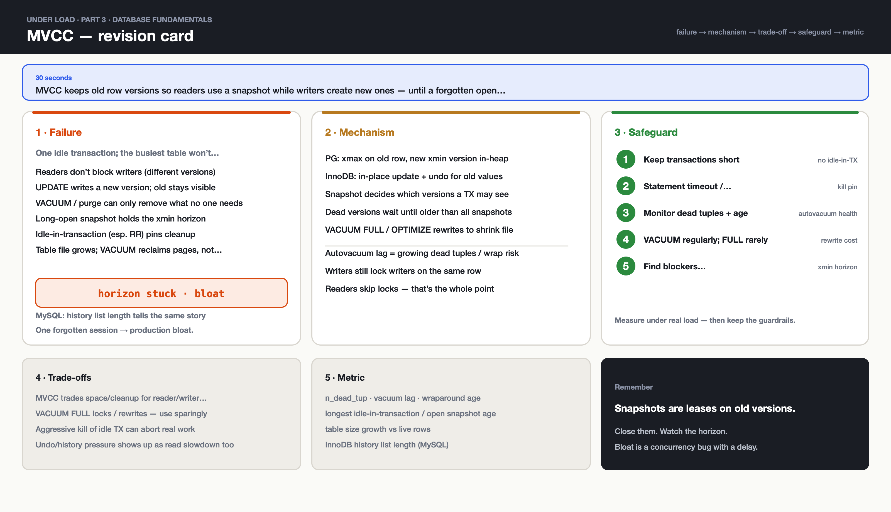
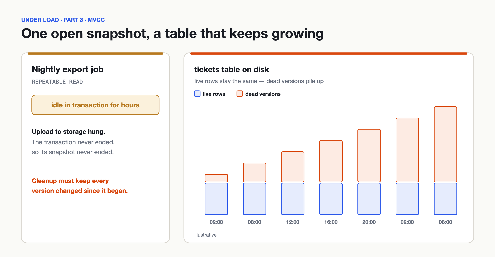
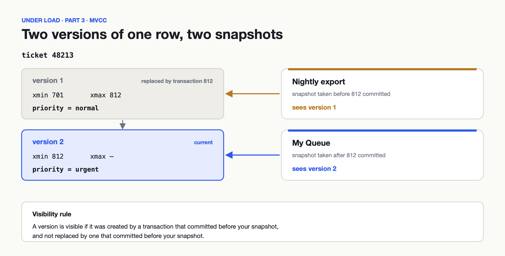
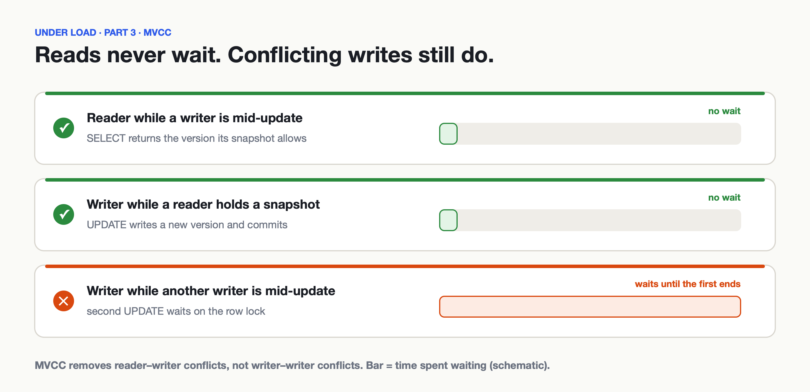
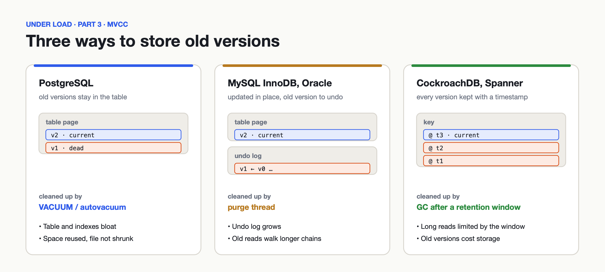
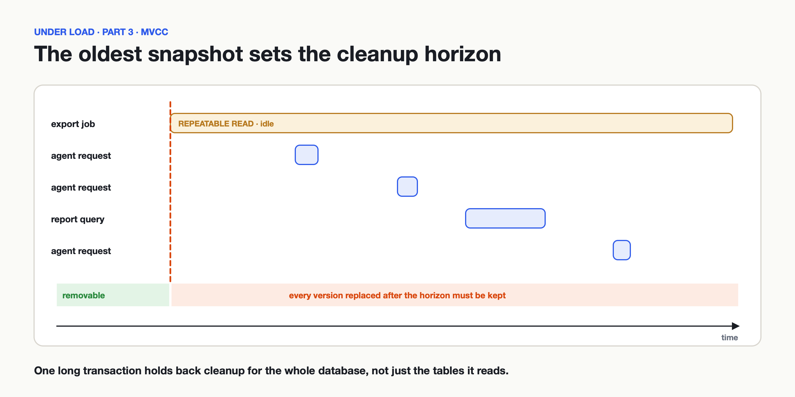
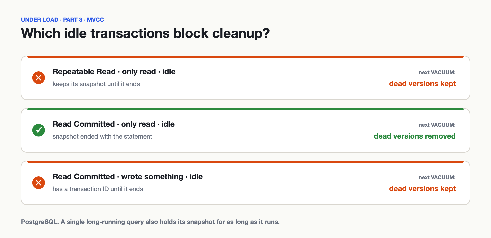
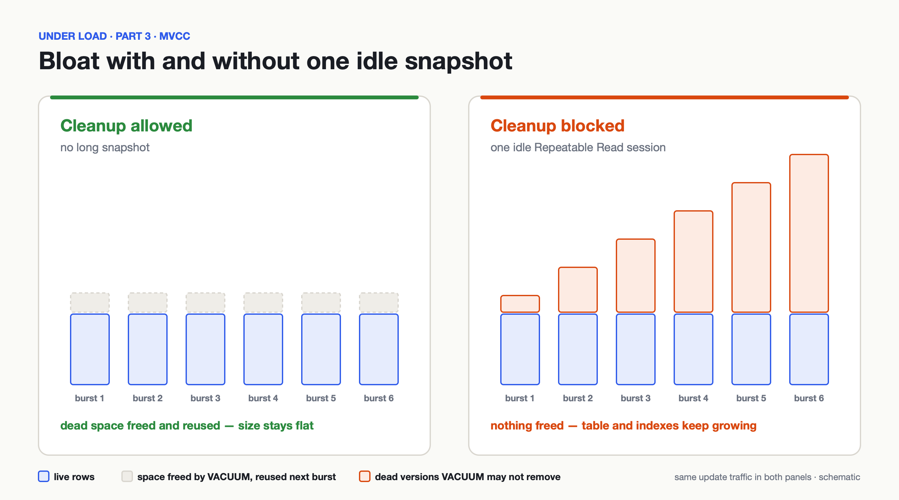
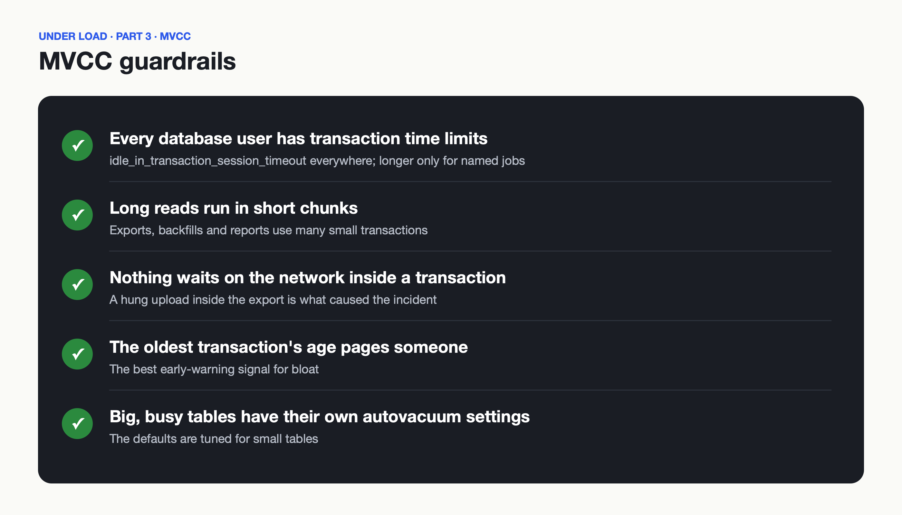

# MVCC: How Databases Let Readers and Writers Coexist

### How MVCC lets readers and writers work at the same time, where old row versions go, and why one forgotten transaction can bloat the busiest table in the system.

*Under Load · Part 3 · Database Fundamentals*





---

Halcyon's compliance team asks for something reasonable: a full export of all their tickets every night, so they can archive it in their own storage.

The team builds a nightly job. It opens a transaction, reads all of Halcyon's tickets — tens of millions of rows — in batches, and streams them to cloud storage. To keep the export consistent, so that no ticket is counted twice or missed while agents keep working, the job runs at **Repeatable Read**: the whole export sees the database exactly as it was when the job started. (Part 2 covered isolation levels.)

It works for weeks. Then, one night, the upload to cloud storage hangs. The job doesn't crash. It just sits there with its connection open and its transaction open, waiting for a network call that never returns.

Nobody notices for more than a day. Nothing is deployed in that time. But over the following hours:

- My Queue's response time creeps up, a little more every hour.
- The `tickets` table's disk usage grows far faster than the number of tickets.
- Autovacuum — the database's background cleanup — runs constantly, and nothing seems to get cleaned up.

When the on-call engineer finally finds the stuck job and kills it, queries recover within minutes. The disk space doesn't come back at all.

One idle transaction, which wasn't even writing anything, slowed down the busiest table in the product. Explaining how requires the mechanism behind almost every modern database: **MVCC**.

---

## The problem MVCC solves

Picture a database that stores exactly one copy of each row.

An agent is changing ticket 48213 from "normal" to "urgent," and their transaction hasn't committed yet. At the same moment, the export reads ticket 48213. What should it see?

- The **new** value? It might still be rolled back. Reading it would be a *dirty read* (Part 2).
- The **old** value? It has already been overwritten in the only copy that exists.

With one copy, the only safe answer is to **wait**. The traditional way to enforce that is with locks: a writer takes an *exclusive lock* on each row it changes, a reader takes a *shared lock* on each row it reads, and the two kinds of lock block each other. Readers wait for writers, and writers wait for readers. This design is called **two-phase locking**, and for decades it was how databases provided isolation.

For a support product it would be a disaster. A half-hour export would block every agent who tried to update a ticket during that half hour, and every update would make the export wait in turn.

**MVCC — multi-version concurrency control** — solves this by keeping **more than one version of each row**. An update doesn't overwrite the row. It creates a new version and keeps the old one for as long as anyone might still need it.

- The agent's transaction works on the **new** version.
- The export keeps reading the **old** version — the one that was committed when it started.
- **Neither waits for the other.**

That's the core promise: **readers don't block writers, and writers don't block readers.**

Every major relational database works this way today — PostgreSQL, MySQL's InnoDB engine, Oracle, SQL Server (when snapshot isolation is enabled), and distributed databases such as CockroachDB and Spanner. They differ a great deal in *where* the old versions live, and that difference decides how each one fails.

---

## How it works: versions and snapshots

PostgreSQL is the easiest place to see the mechanism, because the versions are visible in the table itself.

### Every row version records who created it

Each row in a PostgreSQL table carries a few hidden system columns. Two of them matter here:

- **`xmin`** — the ID of the transaction that created this version.
- **`xmax`** — the ID of the transaction that deleted or replaced it (zero while the version is still current).

Every transaction that writes is given a **transaction ID**, a number that increases over time. When ticket 48213 is updated, PostgreSQL:

1. Marks the current version as replaced, by setting its `xmax` to the updating transaction's ID.
2. Writes a **complete new copy** of the row, with `xmin` set to that same ID, often on a different page of the table.

The hidden columns can be queried directly. A sequence like this one is typical (the IDs are illustrative):

```sql
SELECT ctid, xmin, xmax FROM tickets WHERE id = 48213;
--  ctid   | xmin | xmax
--  (12,3) |  701 |    0

UPDATE tickets SET priority = 'urgent' WHERE id = 48213;

SELECT ctid, xmin, xmax FROM tickets WHERE id = 48213;
--  ctid    | xmin | xmax
--  (12,7)  |  812 |    0
```

`ctid` is the version's physical location: page 12, slot 3. After the update, the visible version lives in a different slot and was created by a different transaction. The old version is still sitting in slot 3 — invisible to new queries, but physically there and taking up space.



### A snapshot decides which version a reader sees

When a statement or a transaction begins, PostgreSQL takes a **snapshot**: a compact record of which transactions had already committed at that moment and which were still running. For every row version it comes across, a reader then asks one question:

> Was this version created by a transaction that had committed before my snapshot — and not replaced by one that had committed before my snapshot?

If yes, the version is visible. If not, the reader skips it and finds the other version of the same row that does fit.

That is how two transactions can read the same row at the same moment and get different answers, each perfectly consistent with its own point in time. The export, holding an old snapshot, sees "normal." My Queue, with a fresh snapshot, sees "urgent." Neither had to wait.

### Snapshots are how isolation levels are built

The isolation levels from Part 2 are, to a large extent, just rules about **how long a snapshot lives**:

- **Read Committed** takes a **new snapshot for every statement**. Each query sees everything committed before *that query* started, which is why two queries inside one transaction can see different data.
- **Repeatable Read** takes **one snapshot for the whole transaction**. Every query sees the database as it was when the transaction's first query ran. That's what made the export consistent — and, as the rest of this article shows, what made it dangerous.
- **Serializable** in PostgreSQL uses the same transaction-long snapshot as Repeatable Read, plus extra bookkeeping of what each transaction has read, so it can detect dangerous patterns that snapshots alone would miss (Part 4 is about one of them).

The three are related but not interchangeable. "Snapshot isolation" — the guarantee a transaction-long snapshot gives — is not the same as serializability, and engines don't even agree on what "Repeatable Read" means: MySQL's Repeatable Read uses a snapshot for plain reads but reads the latest committed version for `UPDATE` and locking reads, which PostgreSQL's does not. The general rule: **the longer a snapshot lives, the more consistent the view, and the more old versions the database has to keep for it.**

---

## MVCC doesn't mean "no locks"

A common misunderstanding is that MVCC removes the need for locking. It doesn't. It removes conflicts between **readers and writers**. Two **writers** changing the same row still conflict, because only one of them can create the next version — a row can't have two "latest" versions.



The rules in PostgreSQL:

- **A reader and a writer on the same row:** nobody waits. The reader takes the version that fits its snapshot.
- **Two writers on the same row:** the second one blocks on a row lock until the first commits or rolls back. Then, depending on the isolation level, it either re-checks its condition against the newly committed version and carries on (Read Committed), or fails with a serialization error that the application must retry (Repeatable Read and Serializable). This "the first writer wins, the second must deal with it" behaviour is often called **first-updater-wins**.
- **`SELECT ... FOR UPDATE`** is a read that takes a row lock on purpose, so it behaves like a writer and waits like one.

Other engines resolve write–write conflicts differently, but every one has to resolve them somehow:

- **Pessimistic locking** — take a lock and make the other writer wait. PostgreSQL, InnoDB and Oracle do this for row updates.
- **Timestamp ordering** — give each transaction a timestamp and abort or push back whichever one would violate that order. CockroachDB works this way.
- **Optimistic validation** — let both proceed, check at commit time whether anything they depended on changed, and abort the loser. PostgreSQL's Serializable level and many application-level "version column" schemes are built on this idea.

This is why the Take ticket fixes from Part 2 still matter in an MVCC database. MVCC makes reads cheap and non-blocking. It does nothing to make write conflicts go away.

---

## Where old versions go

Keeping old versions is what makes MVCC work. Getting rid of them is the price. Every engine has to answer two questions: *where are old versions stored, and who cleans them up?* The answers are very different.



### PostgreSQL: old versions stay in the table

In PostgreSQL, an `UPDATE` writes the new version into the table itself, and the old version stays where it was. Once no running transaction can see an old version any more, it becomes a **dead tuple** ("tuple" is PostgreSQL's word for a row version): still occupying space on its page, but useless to everyone. A `DELETE` works the same way — it only sets `xmax`; the row stays until cleanup removes it.

Dead tuples are cleaned up by **VACUUM**. It scans the table, finds versions no snapshot can see, removes them along with their entries in every index, and records the freed space in a *free space map* so that future inserts and updates can reuse it. **Autovacuum** runs VACUUM automatically in the background, table by table, once enough rows have changed. PostgreSQL also removes some dead versions opportunistically when it reads a crowded page (called *pruning*), but VACUUM does the full job, including the indexes.

Two consequences surprise most people:

- **Updates make a table grow even when the number of rows doesn't change.** Every update writes a full new copy of the row. If every row in a table is updated once and nothing has been cleaned up yet, the table holds two versions of every row — roughly twice its "real" size. Update every row three times before cleanup, and there are four versions of each. The indexes grow too, because each new version usually needs its own index entries.
- **VACUUM doesn't give space back to the operating system.** It makes space reusable *inside* the table file; the file itself generally stays the same size (only completely empty pages at the very end can be truncated). Shrinking the file requires rewriting the table: `VACUUM FULL` does that but locks the table against all reads and writes while it runs; the `pg_repack` extension does it online, with only a brief lock at the end.

This is also why **HOT updates**, from Part 1, matter so much: when an update doesn't change any indexed column and there's room on the same page, PostgreSQL can place the new version next to the old one and skip the indexes entirely. The dead version can then be pruned from the page without touching any index — far cheaper cleanup.

A table carrying a large share of dead space, or free space that isn't being reused, is said to be **bloated**. Bloat is harmful beyond disk cost: every query that walks a bloated table or index reads pages that are partly empty or full of dead versions, so it does more I/O and uses more of the memory cache for the same useful rows.

### MySQL InnoDB: old versions go to the undo log

InnoDB takes the opposite approach. It **updates the row in place** and copies the *previous* values into a separate area called the **undo log**. Each row points to its most recent undo record, which points to the one before, and so on. A reader with an older snapshot starts from the current row and follows that chain backwards until it reaches the version its snapshot is allowed to see.

Old versions are discarded by a background **purge** process once no snapshot (InnoDB calls it a *read view*) needs them. The backlog of undo waiting to be purged is reported as the **history list length** — counted in committed transactions' undo logs, not rows.

The table itself doesn't bloat the way PostgreSQL's does. A long-lived snapshot causes different trouble:

- **The undo log keeps growing**, and so does the disk space it occupies.
- **Reads of hot rows get slower.** A reader with an old snapshot looking at a row that has been updated thousands of times must walk thousands of undo records to reconstruct the version it's allowed to see.
- **Purge falls behind**, and when the long transaction finally ends, it has a large backlog to work through.

### Others

- **Oracle** works much like InnoDB: in-place updates, previous versions in *undo segments*. A query that needs a version already overwritten in undo fails with the well-known "snapshot too old" error, so a long read is limited by how much undo is retained.
- **SQL Server** keeps old versions only when snapshot isolation or `READ_COMMITTED_SNAPSHOT` is turned on. Traditionally they live in a shared *version store* in `tempdb` (the server's shared temporary database), which one long transaction can fill for every database on the server; with Accelerated Database Recovery enabled, versions are kept in the user database instead.
- **Distributed databases such as CockroachDB and Spanner** store every version with a timestamp and garbage-collect versions older than a configured retention window (for example CockroachDB's `gc.ttlseconds`, Spanner's version retention period). A long read can't hold cleanup back forever; instead, reading at a time older than the window simply isn't allowed.

The lesson from Part 2 applies again: the concept is the same everywhere, but the behaviour — and the failure mode — depends on the engine. "We use MVCC" says very little until it's clear which engine and which settings.

---

## How one transaction stops cleanup

Cleanup may only remove an old version when **no running transaction could possibly still need it**. So every MVCC engine tracks the **oldest snapshot still in use**. PostgreSQL calls the boundary it derives from that the **xmin horizon**: any version that was replaced *after* the horizon has to be kept, because the owner of the oldest snapshot might still look at it.

That has a far-reaching consequence. The horizon is shared: a single long-running transaction holds back cleanup for the **entire database**, not just for the tables it reads. The export only ever read `tickets`, yet every version of every row in every table that changed while it was open had to be kept until it ended.



### Not every open transaction holds a snapshot

Whether an idle transaction pins the horizon depends on what it holds. In PostgreSQL:

- **Repeatable Read or Serializable, read something, then went idle:** blocks cleanup. Its snapshot belongs to the whole transaction and lives until it commits or rolls back.
- **Read Committed, only read, then went idle:** doesn't block cleanup. At Read Committed the snapshot belongs to each *statement* and is released when the statement finishes, so an idle session between statements holds none.
- **Any isolation level, wrote something, then went idle:** blocks cleanup. A transaction that has written has been assigned a transaction ID, and versions newer than it can't be cleaned up until its fate — commit or rollback — is known.



So the dangerous sessions are:

- **Long or abandoned transactions at Repeatable Read or Serializable** — exports, reports, consistency checks, backups. `pg_dump` itself takes one consistent snapshot for the entire dump, so a multi-hour dump on the primary holds the horizon for multiple hours.
- **Any transaction that wrote something and then stayed open** — the classic "opened a SQL console, ran an `UPDATE`, went to lunch," or application code that forgot to commit on an error path.
- **A single very long query**, even at Read Committed. Its snapshot lives as long as the query runs.

A few things outside ordinary sessions can hold the horizon back too:

- **Replicas with `hot_standby_feedback` on.** A long query on a read replica can ask the primary to keep the old versions it's reading.
- **Abandoned replication slots.** A replication slot is a bookmark a replica or a change-data-capture tool uses to record how far it has read. A logical slot that nobody consumes any more can pin the horizon for system catalogs and make the primary keep write-ahead log indefinitely. Part 30 (CDC) returns to this.
- **Forgotten prepared transactions** (`PREPARE TRANSACTION`, the first half of a two-phase commit across several systems). A prepared transaction that is never committed or rolled back stays open across restarts.

---

## What the stuck export actually did

Put the pieces together and the incident follows directly from the mechanism. A worked, illustrative timeline:

1. **At the start of the night**, the export opens its Repeatable Read transaction and takes its snapshot. The horizon is now fixed at that moment.
2. **Through the next day**, agents keep working. Every ticket update writes a new version. Each old version is replaced *after* the horizon, so autovacuum can't remove a single one of them. It runs, scans, finds the versions still "possibly needed," and leaves them all.
3. **The table and its indexes grow steadily.** Space that would normally be freed and reused within minutes is never freed, so every new version needs new space. If a busy day touches, say, a tenth of the table's rows several times over, the table can end up with several dead versions for every row that was touched.
4. **Queries slow down gradually.** My Queue still returns the same 50 tickets, but the index now holds entries for every dead version of those tickets, and for each entry PostgreSQL has to visit the table to discover that the version isn't visible. The work per request grows with the number of dead versions, hour by hour. Memory suffers too: pages full of dead versions crowd useful data out of the cache.
5. **The session is killed.** Its snapshot disappears, the horizon jumps forward, and the next autovacuum pass can finally remove the backlog. Queries recover quickly. The table file doesn't shrink: the space is now free *inside* the file and will be reused by future updates, but the operating system never gets it back without a rewrite.



Without the stuck session, the same day looks completely different: autovacuum frees the old versions from each burst of updates, the next burst reuses that space, and the table settles at a stable size a little above its live data. The update traffic is identical in both cases. The only difference is whether cleanup is allowed to run.

### The worst case: transaction ID wraparound

There is one more consequence, rare but serious. PostgreSQL's transaction IDs are 32-bit numbers, so they wrap around after about four billion transactions, and any given row can be compared safely only against IDs within roughly two billion of its own. To keep very old rows from suddenly appearing to be "in the future," VACUUM periodically **freezes** old rows, marking them as visible to everyone regardless of IDs. A transaction that holds the horizon back also prevents freezing. If that goes on long enough on a busy system, PostgreSQL first logs increasingly urgent warnings and, close to the limit, stops assigning new transaction IDs — refusing writes — to protect the data. Monitoring transaction ID age is how that stays theoretical.

---

## Detecting bloat before users do

Bloat develops slowly, which makes it easy to spot with the right numbers and easy to miss without them.

**Dead tuples per table.** `pg_stat_user_tables` reports `n_dead_tup` (an estimate of dead versions), `n_live_tup`, and when autovacuum last ran. Dead tuples that keep climbing *while autovacuum keeps running* are the signature of a pinned horizon: cleanup is working, but it isn't allowed to remove anything.

**What VACUUM says it couldn't remove.** `VACUUM (VERBOSE)` and autovacuum's log output (with `log_autovacuum_min_duration` set) report how many dead row versions "cannot be removed yet" and the oldest xmin that blocked them. That points straight at the horizon.

**The oldest snapshot holders.** The horizon has a small set of possible owners, and all of them are queryable:

```sql
-- sessions, oldest first
SELECT pid, usename, state, now() - xact_start AS running_for,
       backend_xid, backend_xmin, left(query, 60) AS query
FROM pg_stat_activity
WHERE backend_xmin IS NOT NULL OR backend_xid IS NOT NULL
ORDER BY greatest(age(backend_xmin), age(backend_xid)) DESC
LIMIT 5;

-- the other suspects
SELECT slot_name, active, xmin, catalog_xmin FROM pg_replication_slots;
SELECT gid, prepared FROM pg_prepared_xacts;
```

**Size against content.** Table and index size growing much faster than row count is bloat. For a precise measure on a specific table, the `pgstattuple` extension reports the exact share of dead and free space (it reads the whole table, so it belongs in off-peak investigation, not a dashboard).

**For InnoDB,** the history list length (in `SHOW ENGINE INNODB STATUS`, or `trx_rseg_history_len` in `information_schema.innodb_metrics`) climbing steadily means purge is being held back; `information_schema.innodb_trx` shows the oldest open transactions.

---

## Fixing it and preventing it

**In the moment:** find the session that owns the oldest snapshot and end it.

```sql
SELECT pg_terminate_backend(<pid>);   -- ends that session, rolling back its transaction
```

For a stale replication slot, the fix is `pg_drop_replication_slot` once it's confirmed that nothing still needs it; for a forgotten prepared transaction, `ROLLBACK PREPARED` (or `COMMIT PREPARED`, if the coordinating system says it should commit).

**Put time limits on transactions.** PostgreSQL has three settings that act as safety nets. All three can be set per database, per user or per session:

- `idle_in_transaction_session_timeout` ends sessions that opened a transaction and then stopped doing anything — exactly the stuck export.
- `statement_timeout` limits how long a single statement may run.
- `transaction_timeout` (added in PostgreSQL 17) limits how long an entire transaction may stay open.

A good pattern is a short default for the application's database user, and a separate user with longer limits for the few jobs that genuinely need them:

```sql
ALTER ROLE app_user    SET idle_in_transaction_session_timeout = '30s';
ALTER ROLE export_jobs SET idle_in_transaction_session_timeout = '10min';
```

**Keep slow work outside the transaction.** The export's real mistake wasn't Repeatable Read; it was calling the network while holding the transaction open. Read a batch, end the transaction, then upload. The same rule appeared in Part 2: a transaction should contain database work and nothing that can hang.

**Design exports and reports to be short.** Instead of one transaction that reads tens of millions of rows, read in chunks of a few thousand, each in its own short transaction, using the last ID of one chunk as the starting point of the next (this is *keyset pagination*, covered in Part 8). Each chunk is consistent on its own, and nothing pins the horizon for more than a moment. The cost is that the export as a whole no longer reflects one instant; for an archive, a ticket that changes mid-export is caught by the next night's run, which is usually acceptable. When one consistent snapshot really is required:

- **Run the job on a replica.** But know the trade-off: with `hot_standby_feedback` off, the replica may cancel a long query when the primary's cleanup removes versions it needs ("canceling statement due to conflict with recovery"); with it on, the long query pins the horizon on the primary again.
- **Export a snapshot once and share it.** `pg_export_snapshot()` lets several short parallel workers read from the same snapshot, so the consistent read finishes faster — but the snapshot still pins the horizon while it's in use.

**Get the space back only if it's needed.** Once the cause is gone, new versions will reuse the free space inside the table, so often nothing needs to be done. If the table is far larger than it should be and the space matters, `pg_repack` rebuilds it online. `VACUUM FULL` does the same while blocking all access, which on a busy table is an outage of its own. PostgreSQL 19 (GA planned for 19 November 2026; RC2 as of mid-November) brings this into core: a new `REPACK` command replaces `VACUUM FULL` and `CLUSTER`, and `REPACK (CONCURRENTLY)` rebuilds the table while it stays in use — with the documented caveat that the concurrent mode isn't MVCC-safe for transactions with snapshots taken before it finished.

**Help autovacuum keep up on big tables.** By default, autovacuum starts on a table once about 20% of its rows have changed (`autovacuum_vacuum_scale_factor = 0.2`, plus a small fixed threshold). On a table with hundreds of millions of rows, that's tens of millions of dead versions before cleanup even starts. A lower per-table setting makes it run more often, in smaller and cheaper passes:

```sql
ALTER TABLE tickets SET (autovacuum_vacuum_scale_factor = 0.02);
```

PostgreSQL 18 also caps the trigger point for every table: `autovacuum_vacuum_max_threshold` (100 million dead rows by default) starts a vacuum once that many rows have changed, however large the table, so the percentage no longer grows without limit on the biggest tables.

Autovacuum is also throttled by default so it doesn't overwhelm the disk (`autovacuum_vacuum_cost_limit` and `autovacuum_vacuum_cost_delay`). On fast storage with a heavily updated table, raising the limit lets it finish each pass sooner. Tuning only helps, though, when the horizon is free: no autovacuum setting can remove versions an open snapshot still needs.

---

## Guardrails that prevent the next one



1. **Every database user has transaction time limits.** `idle_in_transaction_session_timeout` everywhere, short for the application, longer only for named jobs with their own user.
2. **Long reads run in short chunks.** Exports, backfills and reports are split into many small transactions unless they truly need one snapshot — and then they run on a replica or with an exported snapshot and a hard time limit.
3. **Nothing waits on the network inside a transaction.** The upload hanging inside the export's transaction is what turned a slow job into an incident.
4. **The oldest transaction's age is a paged alert.** It's the single best early-warning signal for bloat, and it catches abandoned slots and prepared transactions too if they're included.
5. **Big, busy tables have their own autovacuum settings.** The defaults are tuned for small tables.

---

## What to keep on the dashboard

- **Age of the oldest open transaction and oldest snapshot** (`xact_start`, `backend_xmin` in `pg_stat_activity`). Alert when it passes a few minutes for application users.
- **Sessions idle in transaction.** How many have `state = 'idle in transaction'`, and how long the oldest has been there.
- **Dead tuples and autovacuum activity per table** (`n_dead_tup`, `last_autovacuum`, `autovacuum_count` in `pg_stat_user_tables`). Dead tuples that rise even though autovacuum runs mean something is holding the horizon.
- **Table and index size over time** for the busiest tables. Growth that outpaces row count is bloat.
- **Replication slots and prepared transactions.** Whether every slot is active, how far behind it is, and whether any prepared transaction is older than a few minutes.
- **Transaction ID age** (`age(datfrozenxid)` per database in `pg_database`), so wraparound never comes as a surprise.
- **Serialization failures and lock waits.** Write–write conflicts don't disappear under MVCC; a rising rate of serialization errors or time spent waiting on row locks shows where they hurt.
- **For MySQL: history list length.** A number that keeps climbing means purge can't keep up or is being held back.
- **P99 latency of hot queries.** Bloat shows up in the slowest requests first.

---

## Recap

### What is MVCC?
Multi-version concurrency control: instead of overwriting a row, the database creates a new version and keeps the old one as long as some transaction might still need it. Each transaction reads through a snapshot that decides which version it sees. Almost every modern database works this way.

### Why can readers avoid blocking writers under MVCC?
Because they never need the same version. A writer creates a new version; a reader keeps reading the version its snapshot allows, which was committed before the reader started. Neither has to lock the other out, so a long read and a stream of updates can run side by side.

### What happens when a row is updated?
In PostgreSQL, the old version is marked as replaced (`xmax`) and a complete new version is written into the table (`xmin`). In InnoDB and Oracle, the row is updated in place and the previous values go to the undo log. Either way, both versions exist until the old one is no longer needed.

### What happens to old row versions?
They're removed once no running transaction can see them: by VACUUM and autovacuum in PostgreSQL, by the purge thread in InnoDB, and by retention-window garbage collection in CockroachDB and Spanner. In PostgreSQL, VACUUM makes the space reusable but doesn't shrink the file; only a rewrite (`VACUUM FULL` or `pg_repack`) does.

### Does MVCC eliminate locks?
No. It removes reader–writer conflicts, but two writers on the same row still conflict. The second waits for the first and then proceeds or fails, depending on the isolation level; other engines resolve the same conflict with timestamps or commit-time validation. `SELECT ... FOR UPDATE` takes a lock on purpose. The concurrency fixes from Part 2 are still needed.

### How can a long-running transaction hurt database performance?
Cleanup can't remove any version replaced after the oldest snapshot still in use — across the whole database. Tables and indexes bloat, hot queries step over more and more dead versions, the cache fills with useless pages, and in InnoDB the undo log grows and old-snapshot reads walk longer chains. In PostgreSQL it can eventually block freezing and push toward transaction ID wraparound. Ending the transaction restores query speed quickly; the disk space stays allocated until the table is rewritten.

### Does every open transaction block cleanup?
No. In PostgreSQL, a Read Committed transaction that has only read and is idle between statements holds no snapshot. A Repeatable Read or Serializable transaction does, as does any transaction that has written something and any single long-running query. Replicas with `hot_standby_feedback`, unused replication slots and forgotten prepared transactions can hold cleanup back too.

### What causes version bloat, and how is it detected?
Updates and deletes produce dead versions faster than cleanup removes them — usually because something pins the horizon, sometimes because autovacuum is too infrequent or throttled for a large, busy table. Signs: `n_dead_tup` rising while autovacuum runs, VACUUM reporting rows that "cannot be removed yet," table size outgrowing row count, an old `backend_xmin` in `pg_stat_activity`, and in InnoDB a climbing history list length.

### How does MVCC relate to isolation levels?
Isolation levels are largely rules about snapshot lifetime. Read Committed takes a new snapshot per statement, Repeatable Read keeps one for the whole transaction, and PostgreSQL's Serializable adds conflict tracking on top. Snapshot isolation is not the same as serializability, and engines differ in how they define each level. The longer a snapshot lives, the more consistent the view and the more old versions must be kept.

### Does MVCC work the same in every database?
No. PostgreSQL keeps old versions in the table and needs VACUUM, so it suffers table bloat. InnoDB and Oracle keep them in undo and need purge, so long snapshots grow undo and slow reads of hot rows (Oracle may fail them with "snapshot too old"). SQL Server keeps them in a version store. Distributed databases expire them after a time window. Each engine fails differently.

### What should be monitored?
The age of the oldest transaction and snapshot, sessions idle in transaction, dead tuples and autovacuum activity per table, table and index growth, replication slots and prepared transactions, transaction ID age, serialization failures and lock waits, InnoDB history list length, and the P99 latency of hot queries.

---

## Next

- **Lab (run + measured write-up):** [03-mvcc](https://github.com/b-basoglu/under-load/tree/main/03-mvcc)
- **Next:** [Write Skew: The Anomaly Your Tests Won't Catch](../04-write-skew/article.md) — Two admins invite an agent at the same moment, and a 50-seat plan ends up with 51. No row was written twice, and Repeatable Read didn't help. Why?
