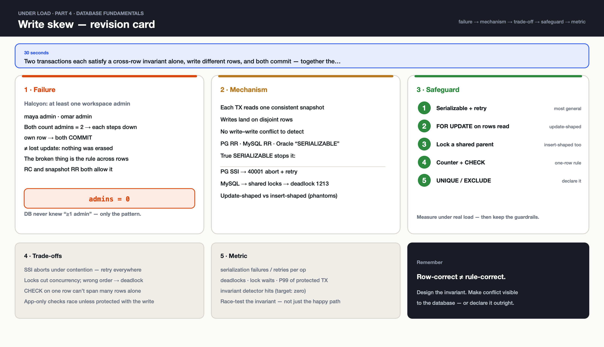
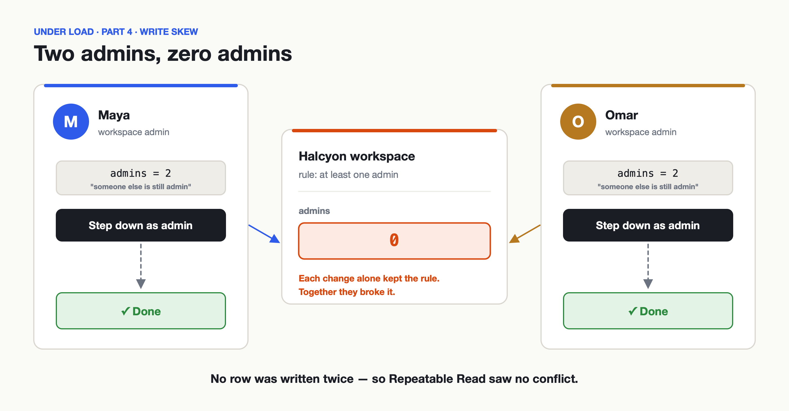
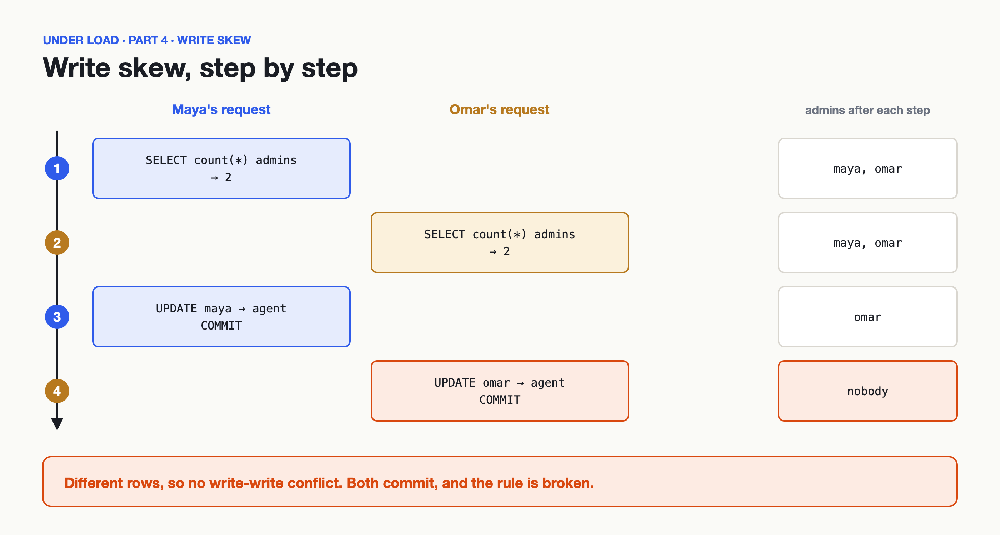
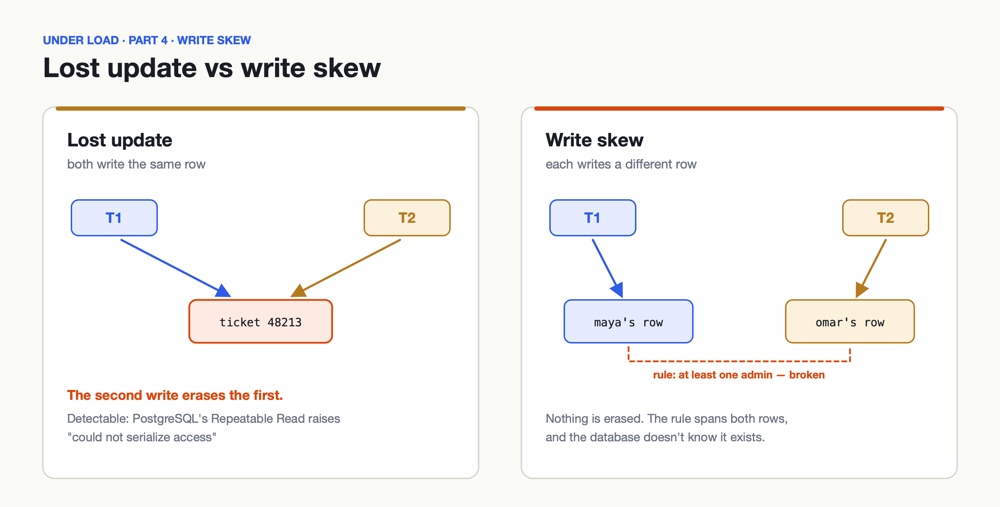
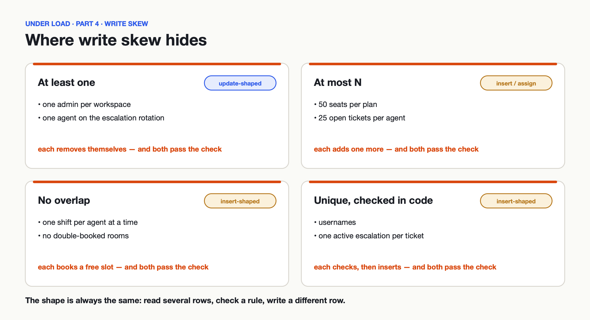
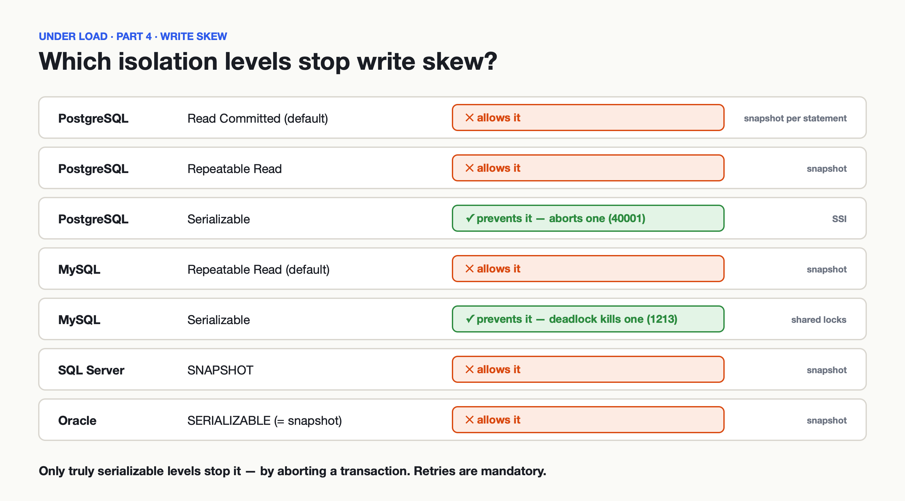
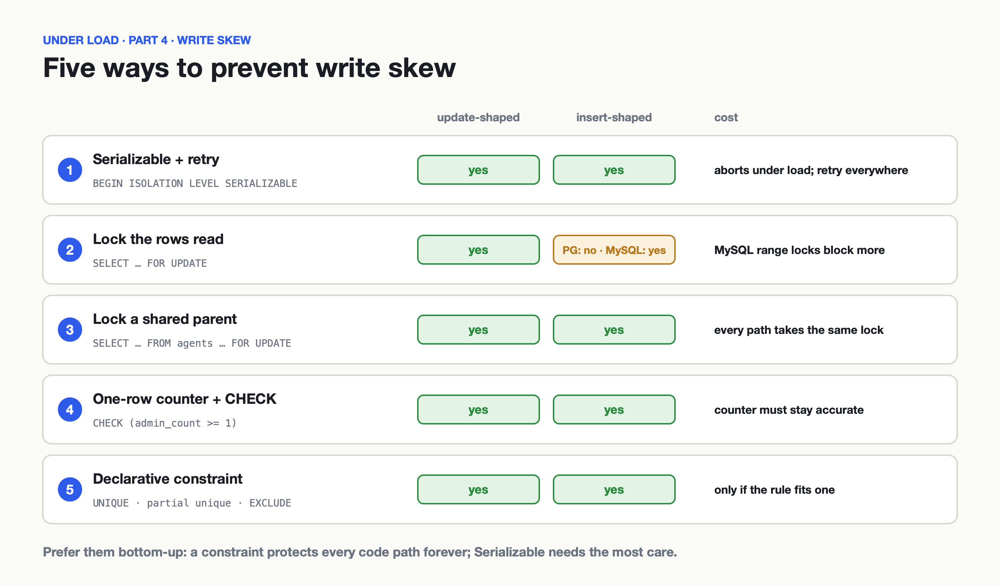
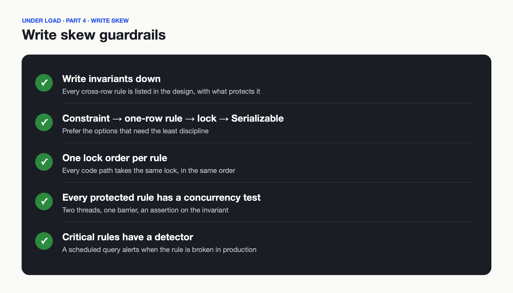

# Write Skew: The Anomaly Your Tests Won't Catch

### Write skew: why two correct transactions can leave data in an impossible state, why Repeatable Read doesn't catch it, and the patterns that do.

*Under Load · Part 4 · Database Fundamentals*





---

Halcyon's support organization is being reorganized. Maya and Omar, the two people with admin rights on Halcyon's workspace, are both moving to a new team. On the same afternoon, a few seconds apart, each of them opens the team settings page and removes their own admin role.

The product has a rule for exactly this situation: **a workspace must always have at least one admin.** Without one, nobody can manage billing, single sign-on or user access. The code enforces it:

```python
def step_down(workspace_id, user_id):
    with db.transaction():
        admins = db.query_one(
            "SELECT count(*) FROM members WHERE workspace_id = %s AND role = 'admin'",
            workspace_id)

        if admins <= 1:
            raise LastAdminError("A workspace needs at least one admin.")

        db.execute(
            "UPDATE members SET role = 'agent' WHERE workspace_id = %s AND user_id = %s",
            workspace_id, user_id)
```

Both requests succeed. Halcyon now has **zero admins**. Their next invoice payment fails because nobody can update the card, single sign-on can't be reconfigured, and it takes two days and a manual database fix by the support team to give them access back.

In the incident review, the team checks everything they learned in Part 2. No row was written twice — Maya's request changed Maya's row, Omar's changed Omar's. No lost update. Someone suggests switching to Repeatable Read, which in PostgreSQL detects concurrent updates.

They test it. Repeatable Read lets it happen too.

This anomaly is called **write skew**, and it's the one most teams don't know they have. This article explains what it is, why snapshot-based isolation levels can't catch it, where it hides in real systems, and five reliable ways to prevent it.

Basic SQL and the ideas from Parts 2 and 3 — transactions, isolation levels and snapshots — are assumed.

---

## What happened, step by step



1. Maya's transaction counts the admins: **2**. Two is more than one, so she can step down.
2. Omar's transaction counts the admins: **2**. Same conclusion.
3. Maya's transaction changes **Maya's** row to `agent` and commits.
4. Omar's transaction changes **Omar's** row to `agent` and commits.

Each transaction made a perfectly correct decision based on what it read. Each one, on its own, kept the rule: after Maya's change alone, one admin is left; after Omar's change alone, one admin is left. The problem is the **combination**. Each decision was based on a fact — "the other person is still an admin" — that the *other* transaction was about to make false.

That's **write skew**: two transactions read the same data, each checks a rule that involves **several rows**, each then writes to a **different** row, and both commit. Together they break a rule that each one respected individually.

These rules are often called **invariants**: things that must always be true about the data, like "at least one admin" or "no more than 50 seats."

---

## Write skew is not a lost update

Write skew looks a lot like the lost update from Part 2, and the difference is exactly why the usual protections miss it.



- **Lost update:** two transactions write the **same row**. The second write erases the first. The database *can* notice this: two transactions tried to change one row, and PostgreSQL's Repeatable Read raises an error when that happens.
- **Write skew:** two transactions write **different rows**. Nothing is erased. Each write survives. What breaks is a rule that spans both rows, and the database has no idea that rule exists.

Why can both commit? Because snapshot-based isolation — PostgreSQL's Repeatable Read, MySQL's default level, and others — only looks for **write-write conflicts**: two transactions changing the same row. Here there's no such conflict. Each transaction read from its own consistent snapshot, wrote one row nobody else touched, and committed. From the database's point of view, nothing went wrong.

This is documented behaviour, not an edge case. With the code above, two simultaneous `step_down` calls can leave **zero admins** at:

- PostgreSQL **Read Committed** (the default),
- PostgreSQL **Repeatable Read**,
- MySQL **Repeatable Read** (the default).

No errors and no warnings at any of the three.

---

## Where write skew hides

Once the shape is familiar — *read several rows, check a rule, write a different row* — it turns up everywhere.



- **"At least one" rules.** At least one admin per workspace. At least one agent on the escalation rotation. At least one active payment method. Each person removing themselves sees someone else still there.
- **"At most N" rules.** No more than 50 seats on the plan (Part 2). No more than 25 open tickets per agent: two team leads each assign one *different* ticket to an agent who has 24, both see 24, and the agent ends up with 26.
- **"No overlap" rules.** An agent can't have two overlapping shifts. A meeting room can't be double-booked. Two requests each check that the time slot is free, and each inserts its own booking.
- **"Unique" rules enforced in code.** "Check that the username isn't taken, then insert it." Two sign-ups with the same name both pass the check.

These examples come in two shapes, and the difference matters for the fixes:

- **Update-shaped:** the rows the rule depends on already exist (Maya's and Omar's rows). Each transaction changes a different existing row.
- **Insert-shaped:** the rule is about rows that **don't exist yet** (the 51st seat, the overlapping shift). Each transaction inserts a new row that the other one couldn't see. A row that appears in someone else's query like this is called a **phantom** — the phantom read from Part 2 turning into a phantom *write*.

---

## Which isolation levels allow it



- **Read Committed allows it**, in every database.
- **Snapshot-based levels allow it.** That includes PostgreSQL's Repeatable Read, MySQL's Repeatable Read, SQL Server's `SNAPSHOT` level — and **Oracle's `SERIALIZABLE`**, which despite its name is snapshot isolation and does not prevent write skew.
- **True serializable levels prevent it**, but in different ways:
  - **PostgreSQL's Serializable** uses a technique called *serializable snapshot isolation* (SSI). Transactions still read from snapshots without blocking, but the database also records **what each transaction read**. When it sees a dangerous pattern — transaction A read something B changed, and B read something A changed — it aborts one of them with a serialization failure (`40001`). Of two concurrent step-downs, one fails and one admin remains.
  - **MySQL's `SERIALIZABLE`** takes a different approach: it turns every plain `SELECT` into a locking read with a *shared* lock. Maya and Omar both hold shared locks on the admin rows, then both try to update, so each waits for the other — a **deadlock**. MySQL detects it and rolls back one transaction (error `1213`), so one admin remains.
  - **SQL Server's `SERIALIZABLE`** also uses locks, including locks on *ranges* of keys, so the second transaction waits or deadlocks.

So the only isolation level that reliably stops write skew is one that's truly serializable — and it does so by **aborting** one of the transactions. That brings back the retry requirement from Part 2.

---

## Five ways to prevent write skew



### 1. Run these transactions as Serializable — and retry

```sql
BEGIN ISOLATION LEVEL SERIALIZABLE;
SELECT count(*) FROM members WHERE workspace_id = 7 AND role = 'admin';
UPDATE members SET role = 'agent' WHERE workspace_id = 7 AND user_id = 'omar';
COMMIT;   -- one of two concurrent step-downs fails with 40001
```

The failed request retries the whole transaction, now counts **1** admin, and returns "A workspace needs at least one admin." This is the most general fix: nobody has to work out which rows to lock, and it protects rules nobody has written down yet.

Things to know:

- **Every transaction that touches the rule must run at Serializable.** In PostgreSQL, the guarantee only covers transactions running at that level. A Read Committed transaction changing admin roles on the side can still slip through.
- **It can abort transactions that weren't really in conflict.** SSI tracks reads at the level of rows, pages or whole tables. When the query can use an index, the tracking is precise; without one, it falls back to coarser tracking and aborts more often. Good indexes reduce false aborts.
- **Long-running reports can use `SERIALIZABLE READ ONLY DEFERRABLE`** in PostgreSQL. It waits for a moment when it can safely run without ever being aborted.

### 2. Lock the rows the rule depends on

When the rows already exist, lock them while reading them:

```sql
BEGIN;
SELECT user_id FROM members
WHERE workspace_id = 7 AND role = 'admin'
FOR UPDATE;                         -- locks Maya's and Omar's rows
-- application: if only one row came back, refuse
UPDATE members SET role = 'agent' WHERE workspace_id = 7 AND user_id = 'omar';
COMMIT;
```

Omar's `SELECT ... FOR UPDATE` waits for Maya's transaction to finish. When it continues, PostgreSQL re-checks each locked row against the `WHERE` clause — and Maya's row no longer has `role = 'admin'`. So Omar's query returns **only his own row**, and the code correctly refuses.

But this only works for **update-shaped** write skew. For insert-shaped rules, the rows that matter don't exist yet, so there's nothing to lock — and here PostgreSQL and MySQL behave differently:

- **In PostgreSQL**, suppose both team leads run `FOR UPDATE` on the agent's 24 open tickets. The second lead's query waits for the first lead's transaction — and then still counts **24**. PostgreSQL re-checks the rows it was waiting for, but the ticket the first lead just assigned wasn't part of the original result, so it isn't seen. The second lead assigns a 26th ticket.
- **In MySQL**, the same query counts **25**. Two InnoDB behaviours are involved. First, a locking read (`FOR UPDATE`) reads the **latest committed** rows, not the transaction's snapshot — that alone is why the second lead sees the new ticket once it stops waiting. Second, at Repeatable Read InnoDB's locking reads lock not just the rows they find but the **index range** they scanned (called *next-key locks* or *gap locks*), so another transaction can't put a new row into that range while the lock is held — the first lead's own change could, because it held the lock. The trade-off: those range locks block more inserts and cause more deadlocks.

Same SQL, different protection. Never assume `FOR UPDATE` covers rows that don't exist yet.

### 3. Lock one shared parent row

Instead of locking the rows the rule reads, make every transaction that could break the rule **lock the same single row first** — usually a parent object like the workspace, the agent or the plan:

```sql
BEGIN;
SELECT 1 FROM agents WHERE id = 31 FOR UPDATE;   -- everyone assigning to agent 31 queues here
SELECT count(*) FROM tickets WHERE assignee_id = 31 AND state <> 'closed';
-- if count < 25: assign the ticket
COMMIT;
```

Now the second lead waits on the agent row, and when it gets the lock, its count runs as a fresh statement and sees **25**. This works for insert-shaped rules too, because the lock doesn't depend on which tickets exist.

This is often called **materializing the conflict**: two transactions that would otherwise touch different rows are made to collide on one row the database *can* see. It's also how a cross-row rule can be protected without serializing everything: contention is limited to one workspace or one agent at a time, not the whole system.

The catch: **every** code path that can break the rule has to take the same lock, in the same order. A forgotten path silently reopens the hole, and two paths that take locks in different orders can deadlock.

### 4. Turn the rule into a rule about one row

Sometimes the thing the rule is about can be stored directly, so that a normal `CHECK` constraint can enforce it:

```sql
ALTER TABLE workspaces ADD COLUMN admin_count int NOT NULL,
                       ADD CHECK (admin_count >= 1);

-- in the same transaction as the role change:
UPDATE workspaces SET admin_count = admin_count - 1 WHERE id = 7;
```

Maya's decrement goes from 2 to 1. Omar's has to wait for Maya's (they're updating the same row), then tries to go from 1 to 0 and fails the `CHECK` with error `23514`, so his whole transaction rolls back. One admin remains.

The counter has to be kept accurate, so every change to admin roles must update it in the same transaction. A database **trigger** — code the database runs automatically on every insert, update or delete — is a common way to make sure nobody forgets.

### 5. Let a constraint do it

Some rules can be declared directly, and then the database enforces them no matter what the application does:

- **Uniqueness:** `UNIQUE (workspace_id, username)` makes the "check, then insert" race on usernames impossible.
- **"Only one" rules:** a *partial unique index* enforces uniqueness only for some rows. For example, "a ticket can have only one active escalation":

  ```sql
  CREATE UNIQUE INDEX one_active_escalation
    ON escalations (ticket_id) WHERE active;
  ```

- **"No overlap" rules:** PostgreSQL's **exclusion constraints** prevent two rows from overlapping on some condition. For agent shifts:

  ```sql
  CREATE EXTENSION btree_gist;   -- lets equality and ranges share one index
  ALTER TABLE shifts ADD EXCLUDE USING gist (agent_id WITH =, during WITH &&);
  ```

  `&&` means "overlaps." A second, overlapping shift inserted at the same moment waits for the first transaction and then fails with error `23P01` (exclusion violation).

When a rule fits a constraint, this is the strongest protection there is: it works for every code path, every script and every manual fix, forever.

---

## Trade-offs

- **Serializable aborts under contention.** The more transactions compete, the more get aborted and retried, which shows up as higher latency. It needs retry logic everywhere it's used (Part 2 shows how).
- **Explicit locks reduce concurrency and can deadlock.** Every transaction that takes the lock waits for the previous one. Taking locks in different orders on different code paths causes deadlocks, so pick one order (parent first, then children) and use it everywhere. Keep the locked section short — no network calls, no user think-time — so the queue behind each lock drains quickly.
- **A shared row can become a hot spot.** Locking the workspace row is fine when a few admins change roles a day. A single global counter that every request updates becomes a bottleneck.
- **Counters can drift.** If any path changes the underlying rows without updating the counter, the constraint protects a wrong number.
- **Constraints can't express everything.** A `CHECK` constraint only sees one row. Uniqueness, exclusion and foreign keys cover a lot, but not "at least one admin."
- **Application-only checks are never enough.** A check in code is only safe if the check and the write are protected together by one of the mechanisms above. On its own, `if count > 1` is just a race waiting for traffic.

---

## Test the race, not just the logic

None of the bugs in this article show up in a normal unit test, because a unit test runs one request at a time. The only way to catch write skew is to **run the conflicting operations at the same moment** against a real database.

A simple pattern: start two threads, make them wait at a barrier so they begin at the same instant, and check the invariant afterwards.

```python
from threading import Barrier, Thread

def test_last_admin_cannot_be_removed_concurrently(db):
    start = Barrier(2)
    def step_down_in_parallel(user_id):
        start.wait()                       # both threads go at the same time
        try:
            step_down(workspace_id=7, user_id=user_id)
        except (LastAdminError, SerializationFailure):
            pass

    threads = [Thread(target=step_down_in_parallel, args=(u,)) for u in ("maya", "omar")]
    for t in threads: t.start()
    for t in threads: t.join()

    assert db.count_admins(workspace_id=7) >= 1
```

Run it many times in a loop: a race that loses only occasionally still fails the build quickly.

For rules that matter a lot, also run a **detector**: a scheduled query that looks for broken invariants in production and alerts when it finds any.

```sql
-- workspaces with no admin
SELECT w.id FROM workspaces w
WHERE NOT EXISTS (
  SELECT 1 FROM members m WHERE m.workspace_id = w.id AND m.role = 'admin');
```

If the prevention ever fails, the team finds out in minutes, not when the customer is locked out.

---

## Guardrails that prevent the next one



1. **Write invariants down.** Every rule that spans rows — "at least one," "at most N," "no overlap" — is listed in the design, with the mechanism that protects it.
2. **Prefer a constraint, then a single-row rule, then a lock, then Serializable.** Each step down that list protects less automatically and needs more discipline.
3. **One lock order for each rule.** Every code path that can break the rule takes the same lock, in the same order.
4. **Every protected rule has a concurrency test.** Two threads, one barrier, an assertion on the invariant.
5. **Critical rules have a detector.** A scheduled query that alerts when the invariant is broken in production.

---

## What to keep on the dashboard

- **Serialization failures and retries, per operation.** A rising count shows where transactions are competing for the same data.
- **Deadlocks.** `pg_stat_database.deadlocks` in PostgreSQL; in MySQL, `SHOW ENGINE INNODB STATUS` reports the latest one. A jump usually follows a change in lock order.
- **Lock waits.** Sessions waiting on locks in `pg_stat_activity`, or `performance_schema.data_lock_waits` in MySQL.
- **Invariant detectors.** The number of broken rules found by each detector query. The target is always zero.
- **P99 latency of protected transactions.** Locks and retries make the slowest requests slower first.

---

## Recap

### What is write skew?
A concurrency anomaly where two transactions read the same data, each checks a rule that involves several rows, each writes to a different row, and both commit. Each decision was correct on its own, but together they break the rule — for example, two admins each stepping down because they saw the other one, leaving zero admins.

### How is write skew different from a lost update?
In a lost update, two transactions write the same row and one write erases the other. In write skew, they write different rows, nothing is erased, and what breaks is a rule that spans both rows. Databases can detect same-row conflicts, but they can't see a rule that only exists in application code.

### Why can both transactions commit?
Because snapshot-based isolation only looks for two transactions changing the same row. Each transaction read from its own consistent snapshot and changed a row nobody else changed, so from the database's point of view there was no conflict.

### Which isolation levels allow write skew?
Read Committed and every snapshot-based level: PostgreSQL's Repeatable Read, MySQL's Repeatable Read, SQL Server's `SNAPSHOT`, and Oracle's `SERIALIZABLE`, which is really snapshot isolation. True serializable levels prevent it: PostgreSQL's by aborting one transaction with `40001`, MySQL's and SQL Server's by locking, which leads to waits or a deadlock that kills one transaction.

### Does `SELECT ... FOR UPDATE` prevent write skew?
When the rule depends on rows that already exist, yes: the second transaction waits, then re-checks and sees the change. When the rule depends on rows being inserted, not in PostgreSQL — it can't lock a row that doesn't exist yet. MySQL's InnoDB locks the scanned index range at Repeatable Read, so there it does block the new row, at the cost of more blocking and deadlocks.

### How can a cross-row rule be protected without serializing every transaction?
Make the transactions that could break the rule collide on one row: lock a shared parent like the workspace or the agent before checking, or keep a counter on that row with a `CHECK` constraint. Contention is then limited to one workspace or one agent at a time. Or use Serializable only for the transactions that touch that rule.

### Can a `CHECK` constraint enforce a rule across rows?
Not directly — a `CHECK` constraint only sees the row being written. The rule's subject can be stored on one row (an `admin_count` with `CHECK (admin_count >= 1)`), or use constraints that do look across rows: `UNIQUE`, partial unique indexes, foreign keys and PostgreSQL's exclusion constraints.

### Why aren't checks in application code enough?
Because the check and the write happen at different moments, and another transaction can change the data in between. A check in code is only safe when it's protected together with the write by a lock, a constraint or a serializable transaction.

### How is write skew tested?
Run the conflicting operations at the same instant against a real database — two threads that start together at a barrier — and assert the invariant afterwards, many times in a loop. In production, add scheduled detector queries that alert when an invariant is broken.

### What should be monitored?
Serialization failures and retries per operation, deadlocks, lock waits, the results of invariant detector queries, and the P99 latency of the transactions that protect important rules.

---

## Next

- **Lab (run + measured write-up):** [04-write-skew](https://github.com/b-basoglu/under-load/tree/main/04-write-skew)
- **Next:** [Optimistic vs Pessimistic Locking](../05-locking/article.md) — Two agents edit the same ticket for five minutes each. Lock it for five minutes, or let them both edit and sort it out at save time?
