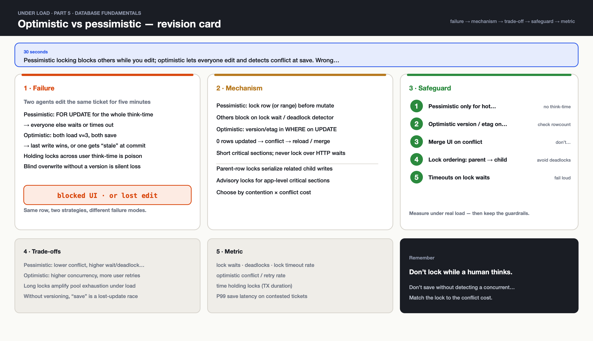
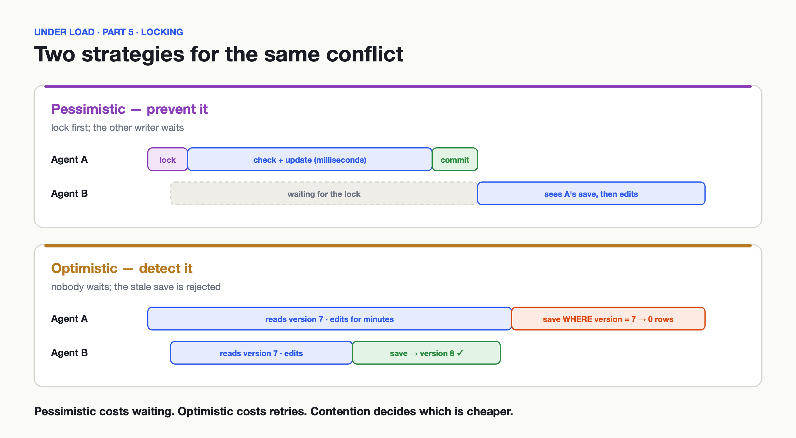
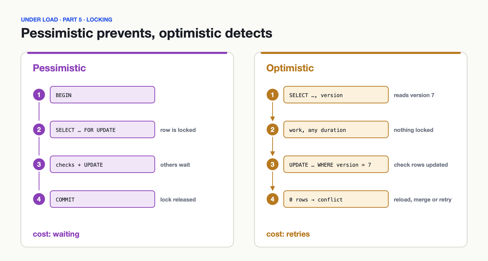
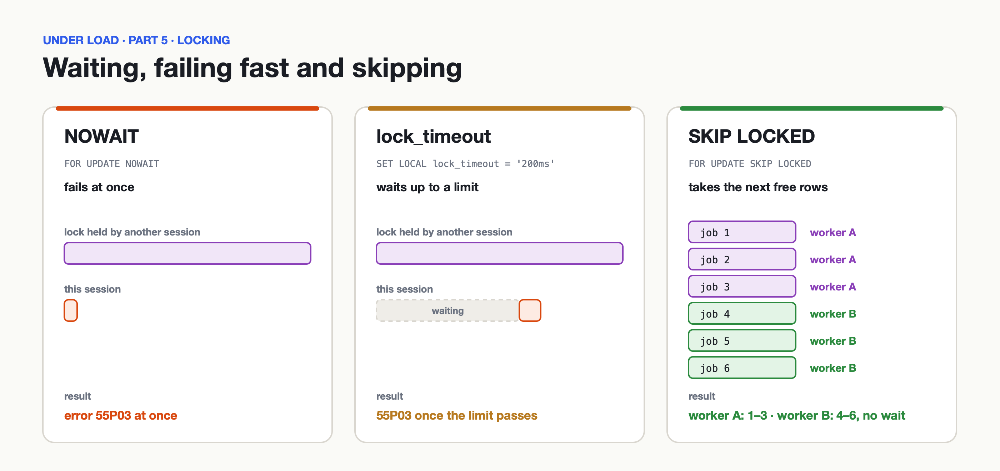
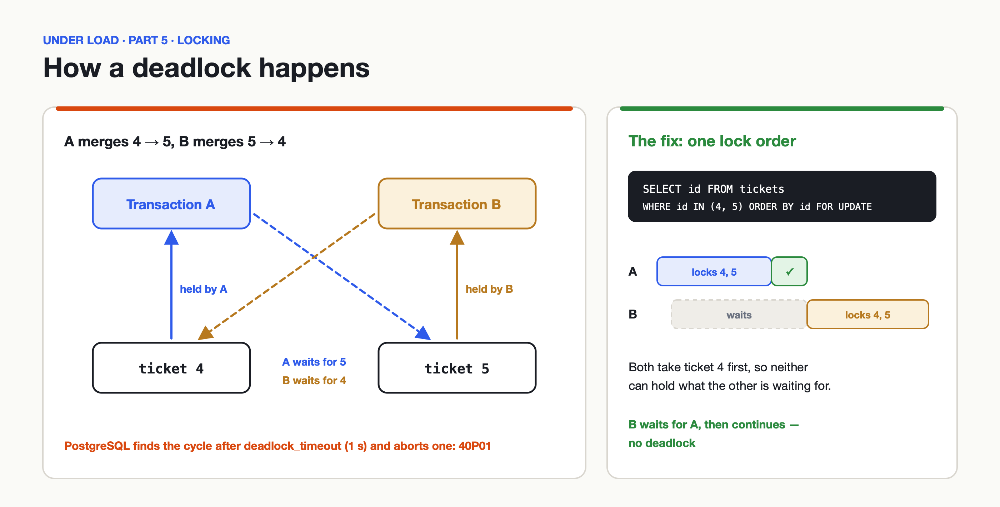
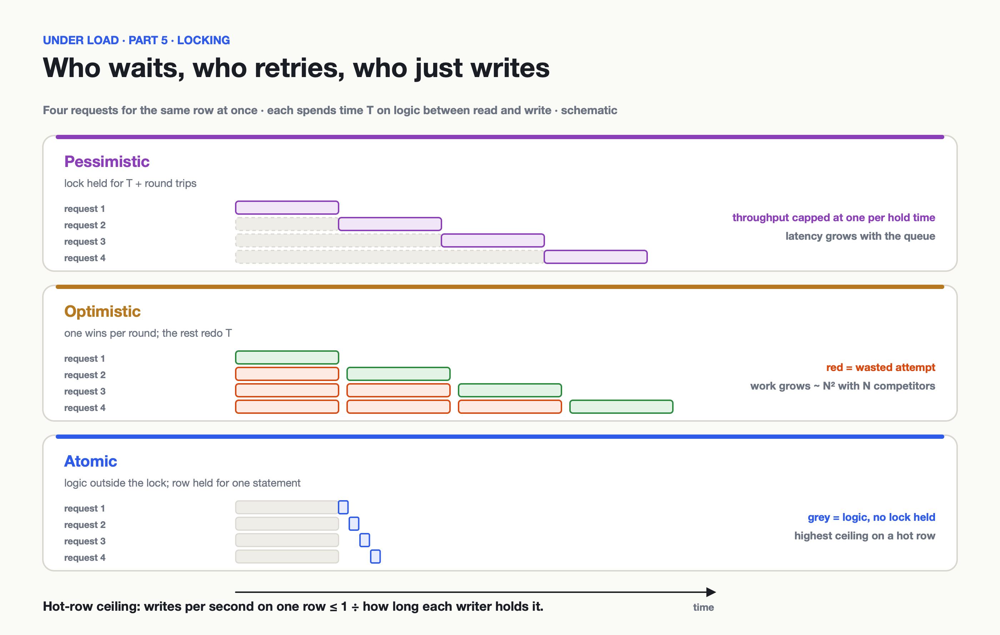
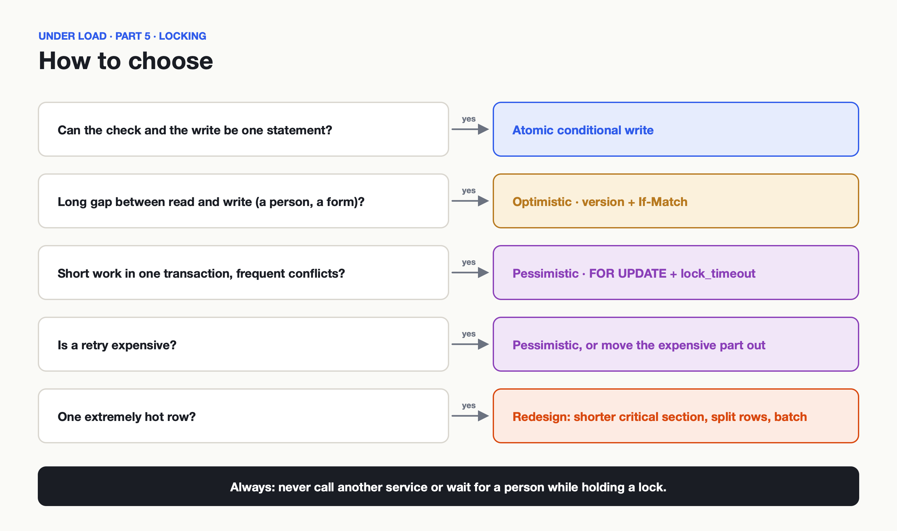
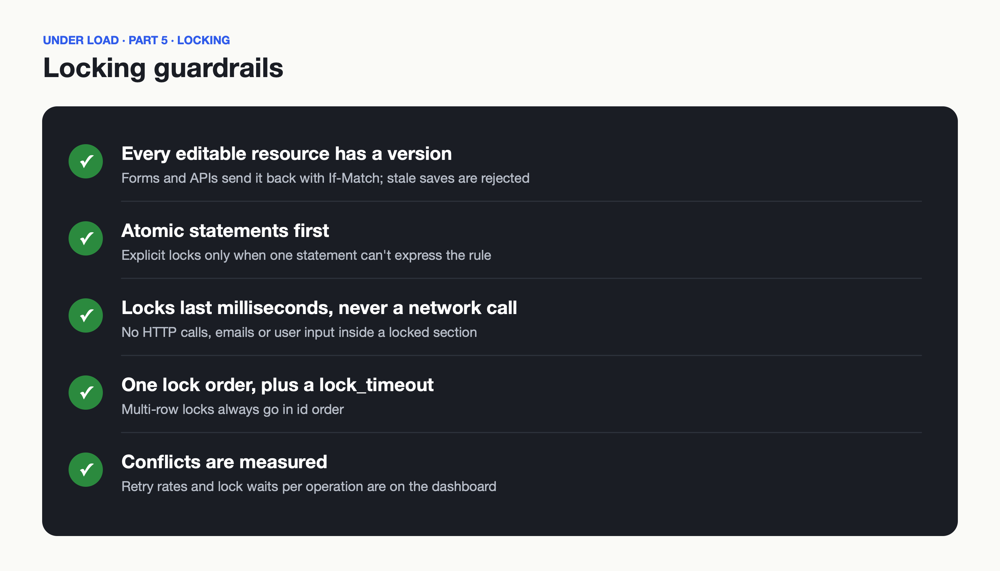

# Optimistic vs Pessimistic Locking

### Optimistic vs pessimistic locking: how each one works, how to carry them across HTTP and ORMs, and what happens to both when many writers fight over the same row.

*Under Load · Part 5 · Database Fundamentals*





---

Ticket 1182 is a long one: a Halcyon customer's refund has been stuck for a week. Two agents open it at almost the same time.

Agent A starts rewriting the subject and raises the priority to *high*. It takes her a few minutes to get the wording right. Meanwhile, Agent B, who has been talking to the customer by phone, sets the status to *pending* — "waiting on customer" — so the response-time clock stops. He saves. Two minutes later, Agent A saves too.

The ticket ends up with A's new subject, A's priority, and status **open** again. B's change is gone. The response-time clock restarts, the ticket shows up as overdue on the team lead's dashboard, and the customer receives an automatic "still working on it" email for a case that is waiting on *them*.

Nobody did anything wrong. The edit form loaded the whole ticket when A opened it, and when she saved, the application wrote the **whole ticket** back — including the status as it had been two minutes earlier. It's the lost update from Part 2, stretched over minutes instead of milliseconds.

The team's first idea is to lock the ticket while someone is editing it. But a database lock lives inside a transaction, and a transaction can't stay open for the minutes a person spends typing: Part 2 showed how held locks block everyone else, and Part 3 showed how a long-open transaction bloats the database.

So there are really two different strategies:

- **Pessimistic locking:** assume a conflict will happen, and *prevent* it by locking first.
- **Optimistic locking:** assume conflicts are rare, let everyone work, and *detect* a conflict at the moment of writing.

This article covers both in depth, plus a third option that often beats them, and then looks at what happens to each one under contention — because that is where the choice really matters.

---

## Two strategies, side by side



**Pessimistic** — "nobody else can change it while this work is in progress."

1. Begin a transaction and lock the row (`SELECT ... FOR UPDATE`).
2. Do the checks and the update.
3. Commit, which releases the lock.

Anyone else who wants the same row **waits** until the lock is released.

**Optimistic** — "go ahead, but the write only counts if nobody changed the row in the meantime."

1. Read the row, including a **version number**.
2. Do the work, for as long as it takes. Nothing is locked.
3. Write, but only if the version is still the same. If it changed, someone else got there first.

Nobody waits. Instead, the slower writer **loses** and has to try again or resolve the conflict.

Neither is better in general. Pessimistic locking costs **waiting**. Optimistic locking costs **retries**. Which is cheaper depends on how often conflicts happen, how long the work between read and write takes, and how expensive it is to redo that work.

One rule sits underneath both: **a read followed by a write is never atomic on its own.** Between the `SELECT` and the `UPDATE`, any other transaction can change the row. Unless a lock, a version check or a single conditional statement ties the two together, the write is based on data that may already be stale.

---

## Optimistic locking in depth

### The version column

Add a column that increases on every change:

```sql
ALTER TABLE tickets ADD COLUMN version int NOT NULL DEFAULT 1;
```

When the edit form loads, it reads the version along with everything else — say, version 7. When the agent saves:

```sql
UPDATE tickets
SET subject = $1, priority = $2, version = version + 1
WHERE id = 1182 AND version = 7;
```

Then the application checks **how many rows were updated**:

- **1 row:** nobody changed the ticket in the meantime. The save succeeded, and the version is now 8.
- **0 rows:** someone else saved first, so the version is no longer 7. This is a conflict.

That is how a version column prevents a lost update: a write based on stale data simply doesn't match any more. Replayed with the version check, B's save updates one row and moves the ticket to version 8; A's later save, still carrying version 7, updates **zero** rows, and B's status change survives.

Why is this safe even when both saves arrive at the same instant? Because the `UPDATE` itself takes a short row lock. If two transactions run `UPDATE ... WHERE version = 7` concurrently, the second waits for the first, then re-checks its condition against the newly committed row (in PostgreSQL's Read Committed), finds version 8, and updates nothing. The database's own locking makes the compare-and-increment atomic; the version column just carries the "what did I read" information across the long gap.

Use an **integer version**, not a timestamp like `updated_at`. Two saves in the same millisecond, or clocks that differ between application servers, can make a timestamp look unchanged when it isn't. Some databases offer a built-in alternative — SQL Server's `rowversion` column type changes automatically on every write.

### What to do when there's a conflict

Detecting the conflict is the easy part. What happens next is a product decision:

- **Show the agent what changed.** "Omar changed the status to *pending* while this was being edited. Pending edits: subject, priority." Then let them save again on top of the latest version. For human editing, this is usually the right answer.
- **Merge automatically when the changes don't overlap.** A changed the subject and priority; B changed the status. Those fields don't overlap, so the application can apply A's changes to the latest version and save again. When both changed the *same* field, ask a human.
- **Retry automatically** when the work is cheap and deterministic, like recalculating a counter — re-read, recompute, try again, with a cap on attempts.
- **Return an error** to API clients and let them decide.

The cost of a retry decides which of these is acceptable. Re-running a cheap `UPDATE` is nothing; re-running a long business workflow that called a payment provider and sent an email is a very different thing, and may not be safe to repeat at all.

Saving only the fields that actually changed also helps. Many ORMs (libraries that map database rows to objects in code) can be configured to write only modified columns instead of the whole row. That alone would have prevented this particular overwrite, because A's save wouldn't have touched the status. But it doesn't help when two people change the *same* field, so it complements a version check rather than replacing it.

### Across HTTP: ETag and If-Match

The edit form lives in a browser, and the save is a separate HTTP request minutes later. HTTP has a standard way to carry the version across that gap:

```http
GET /tickets/1182
→ 200 OK
  ETag: "7"

PUT /tickets/1182
If-Match: "7"
→ 412 Precondition Failed      (if the ticket is no longer at version 7)
```

The server sends the current version in the **`ETag`** response header. The client sends it back in the **`If-Match`** header when saving. If it doesn't match, the server rejects the request with **`412 Precondition Failed`** without changing anything. An API can also answer **`428 Precondition Required`** to clients that try to save without sending `If-Match` at all, so nobody can skip the check by accident. Both status codes are defined in the HTTP standards (RFC 9110 and RFC 6585).

The server must still do the version check in the `UPDATE` itself. Comparing the header to the current row in application code and *then* writing reintroduces exactly the read-then-write gap the version was meant to close.

### In the ORM

Most ORMs implement this pattern directly, so the SQL rarely needs writing by hand:

- **JPA / Hibernate:** a field annotated with `@Version`. A stale save throws `OptimisticLockException`.
- **Ruby on Rails:** a column named `lock_version`. A stale save raises `ActiveRecord::StaleObjectError`.
- **Entity Framework Core:** a property marked as a concurrency token (`[ConcurrencyCheck]`, or `[Timestamp]` for a database-generated row version). A stale save throws `DbUpdateConcurrencyException`.

What the ORM can't do is decide what happens next — that is still the product decision above.

---

## The third option: atomic conditional writes

Often the best answer is neither strategy, but a single statement that checks and writes at once. Part 2 used this to fix Take ticket:

```sql
UPDATE tickets SET assignee_id = $2 WHERE id = $1 AND assignee_id IS NULL;
UPDATE agents  SET open_count = open_count + 1 WHERE id = $2;
```

There is no separate read, so nothing can go stale, and the database holds the row lock only for the instant the statement runs. This is a **compare-and-swap**: change the value only if it is still what was expected. Checking the affected row count tells the application whether it won.

The pattern is especially natural for counters and stock levels. "Reserve one seat if any are left" is one statement:

```sql
UPDATE plans SET seats_used = seats_used + 1
WHERE workspace_id = $1 AND seats_used < seat_limit;
```

It is not just a SQL idea. The same pattern exists in most data stores:

- **DynamoDB:** a `ConditionExpression` on a write, like `attribute_not_exists(assignee)` or `version = :expected`. The write fails with `ConditionalCheckFailedException` if the condition is false.
- **Redis:** `WATCH` a key, then run the change in a `MULTI`/`EXEC` block. `EXEC` does nothing if the watched key changed. (For single operations, `INCR` or a Lua script are atomic by themselves.)
- **etcd:** transactions that compare a key's revision before writing.
- **Amazon S3:** conditional writes — `If-Match` with the ETag that was read, so the upload fails with `412 Precondition Failed` if someone else replaced the object in between, or `If-None-Match: *` to create an object only if it doesn't exist yet.

Whenever the check and the change can be expressed as one operation, use that first.

---

## Pessimistic locking in depth

### Lock, check, update, commit — quickly

```sql
BEGIN;
SELECT * FROM tickets WHERE id = 1182 FOR UPDATE;
-- checks that need the current row: permissions, workflow rules, limits
UPDATE tickets SET status = 'resolved', resolved_at = now() WHERE id = 1182;
COMMIT;
```

The rule that matters most: **the lock is held until the transaction ends, so keep the transaction short.** Never wait for a person, and never call another service, while holding a lock. Everyone else who needs that row waits for as long as the holder takes.

### Choosing the right lock

PostgreSQL has several row lock strengths, and picking the right one avoids blocking work that doesn't actually conflict:

- **`FOR UPDATE`** — the strongest. Blocks other row locks and all updates of the row. It also blocks *inserting child rows* that reference this row through a foreign key, because the foreign-key check needs a lock on the parent that `FOR UPDATE` conflicts with. Adding a comment to a ticket locked this way has to wait.
- **`FOR NO KEY UPDATE`** — the same, except it doesn't conflict with foreign-key checks. Use it when the row will be updated but its key won't change; the comment insert then goes straight through. (A plain `UPDATE` that doesn't change a key column takes this weaker lock automatically.)
- **`FOR SHARE`** — lets others read and share-lock the row, but nobody can change it until the holder is done. Useful for "this must not change while related data is being read."

MySQL's InnoDB has `FOR UPDATE` and `FOR SHARE` (formerly `LOCK IN SHARE MODE`), and at Repeatable Read its locking reads also lock the gaps between index entries, which blocks inserts into the scanned range (Part 4).

### Choosing how to wait

By default, a locked row means waiting — possibly for a long time. Three options change that:



- **`NOWAIT`** — fail immediately instead of waiting. The second session gets error `55P03` (lock not available) at once. Good for user-facing actions where "someone else is working on this, try again" is better than a spinner.
- **`lock_timeout`** — wait, but only up to a limit. With `SET LOCAL lock_timeout = '200ms'`, a session that can't get its lock gives up after about that long with the same error. A good default for application connections, so one stuck transaction can't freeze every request behind it.
- **`SKIP LOCKED`** — skip rows that are locked and take the next free ones. This is what makes a database table work as a job queue: two workers asking for "the next three pending jobs" get *different* jobs, immediately, with no waiting. MySQL 8 supports it too. (Part 27 on message queues builds on this.)

### Locks on things that aren't rows

Sometimes the thing to protect isn't a row: "only one export per workspace at a time," "only one migration running." PostgreSQL's **advisory locks** are locks on a number the application chooses, with no table involved:

```sql
SELECT pg_advisory_xact_lock(hashtext('export:workspace:7'));     -- waits until free
SELECT pg_try_advisory_xact_lock(hashtext('export:workspace:7')); -- returns false if taken
```

While one session holds the lock, a second can't take it; it gets the lock the moment the first transaction ends. The `_xact_` versions release automatically at the end of the transaction, which is much safer than the session-level versions that must be released by hand (and stay held if the code forgets — or if a connection pooler hands the session to someone else). Part 42 covers locks that span multiple machines.

---

## Deadlocks

Pessimistic locking has a classic failure mode. Two agents merge duplicate tickets at the same moment: one merges ticket 4 into ticket 5, the other merges 5 into 4.



1. Transaction A locks ticket 4.
2. Transaction B locks ticket 5.
3. A tries to lock ticket 5 — and waits for B.
4. B tries to lock ticket 4 — and waits for A.

Neither can ever continue. That is a **deadlock**: a cycle of transactions, each waiting for a lock the next one holds.

Databases detect this automatically. PostgreSQL checks for a cycle once a transaction has waited for `deadlock_timeout` (1 second by default), then aborts one of the transactions with error **`40P01`**, which releases its locks and lets the other continue. MySQL's InnoDB checks for cycles as soon as a lock wait begins and returns error `1213`, rolling back the transaction it judges cheapest to undo.

**How to prevent them:** lock rows in a consistent order. If every code path that locks several tickets locks them in order of their id, two transactions can't wait on each other in a circle:

```sql
SELECT id FROM tickets WHERE id IN (4, 5) ORDER BY id FOR UPDATE;
```

With both transactions locking in id order, both try ticket 4 first; the second simply waits for the first to finish and then continues. Keeping transactions short and taking all the needed locks at the start also help. Deadlocks don't only come from explicit locks: foreign-key checks, unique-index checks and, in MySQL, gap locks can all join a cycle.

**How to recover:** a deadlock error is safe to retry, because the aborted transaction was rolled back completely. Retry the **whole** transaction from the beginning — not just the failed statement — with a short random delay so the two don't collide again in lockstep (Part 2 covers retries, Part 15 covers backoff). Occasional deadlocks under load are normal. A steady stream of them means two code paths take locks in different orders.

---

## Under contention

Here is the question that decides between the strategies: **what happens when many requests fight over the same row?**

Take a concrete operation: "assign a ticket to agent 31," which bumps that agent's `open_count`. Between reading and writing, the request spends a few milliseconds on application logic — checking the agent's skills, their working hours, the workspace's rules. Call that time *T*. Now send many such requests at once, all for the **same** agent.



**Pessimistic.** Each request takes the row lock, spends *T* on logic, writes and commits. The lock is held for *T* plus a few network round trips (`SELECT ... FOR UPDATE`, `UPDATE`, `COMMIT`). Only one request can hold it at a time, so requests go through strictly one after another. Adding more workers doesn't add throughput; it only lengthens the queue. Latency grows with the queue: the twentieth request in line waits for nineteen others.

**Optimistic.** Every request reads version 7 at roughly the same moment, spends *T* on logic, and tries to write `WHERE version = 7`. Exactly one succeeds. All the others find zero rows updated, re-read (now version 8), spend *T* again, and try again — and again only one of them wins. With *N* requests competing, each round produces one success and *N − 1* wasted attempts, so the total work to get all of them through grows roughly with the square of *N*. Throughput stays at about one success per round of *T*, no better than pessimistic, while the database and the application servers do many times the work. This is what "optimistic locking collapses under contention" means: it doesn't break or lose data, it **wastes** most of its effort, and the waste grows with every extra competitor.

**Atomic.** Each request does its logic first, outside any lock, then runs `UPDATE agents SET open_count = open_count + 1 WHERE id = 31`. The row lock is held only for the instant that one statement executes. Requests still go through the row one at a time, but each one occupies it for a tiny fraction of *T*, so far more of them fit through per second.

When the same requests are **spread across many agents**, conflicts become rare and all three strategies scale. Optimistic then does very well — it almost never retries and never waits — while pessimistic still pays for its extra round trips and for holding locks during *T*.

### The hot-row ceiling

One rule falls out of this, and it holds whatever the hardware: **on a single hot row, throughput can never exceed one divided by how long each writer holds the row.**

- Hold the row for 5 ms per write, and that row tops out at 200 writes per second.
- Hold it for 50 ms — say, because a network call slipped inside the transaction — and the ceiling drops to 20 per second.
- Hold it for 0.2 ms, the time of one short `UPDATE`, and the ceiling rises to thousands.

That is why the atomic statement wins on a hot row: it doesn't avoid serializing on the row, it just makes each turn very short. And it is why the real fix for a truly hot row is usually a different design, not a better locking strategy:

- **Shorten the critical section** — move all logic and all I/O outside the lock.
- **Split the row** — for example, ten counter rows per agent, each request incrementing a random one, summed when read.
- **Batch** — collect increments in memory or a queue and apply them as one update every so often, accepting that the stored value lags slightly.

---

## How to choose



1. **Can the check and the write be one statement?** Use an atomic conditional write. It is the fastest and simplest option, at any level of contention.
2. **Is the time between reading and writing long — a person editing a form, a multi-step wizard?** Use **optimistic** locking. A lock can't be held that long, and conflicts between people are usually rare. Show the user what changed when a conflict happens.
3. **Is the work short, inside one transaction, and are conflicts frequent?** Use **pessimistic** locking. Waiting a few milliseconds is cheaper than redoing the work over and over. Lock in a consistent order and set a `lock_timeout`.
4. **Is a retry expensive** — a heavy calculation, a call to another service? Prefer pessimistic, or redesign so the expensive part happens outside the conflict.
5. **Is one row extremely hot?** Neither strategy will save it. Change the design: shorter critical sections, split rows, batching.

And in every case: **never call another service or wait for a person while holding a database lock.**

---

## Shipping it safely

Moving an existing codebase to versioned writes is a migration like any other.

- **Add the column with a default, then switch writers.** `ADD COLUMN version int NOT NULL DEFAULT 1` is cheap in recent PostgreSQL versions (the default is stored in the catalog, not written into every row). Then change every write path to check and increment it. A path that writes *without* incrementing silently defeats every path that checks.
- **Make the API accept `If-Match` before requiring it.** Ship the `ETag`, let clients start sending it, watch the share of saves that carry it, and only then turn on `428 Precondition Required`.
- **Give conflicts a real user experience before turning the check on.** A conflict that shows up as a generic "something went wrong" teaches agents to retry blindly and overwrite each other anyway.
- **Set `lock_timeout` per role.** A short default for the application's database user, longer only for maintenance jobs that knowingly take heavy locks.
- **Test the race.** Two threads, one barrier, both editing the same ticket — then assert that neither change was silently lost (Part 4 shows the pattern).

---

## Guardrails that prevent the next one



1. **Every editable resource has a version.** Forms and APIs send it back (`If-Match`), and a stale save is rejected, never silently applied.
2. **Atomic statements first.** Explicit locks only when one statement can't express the rule.
3. **Locks are held for milliseconds, never across network calls.** No HTTP requests, emails or waits for user input inside a locked section.
4. **One lock order everywhere.** Multi-row locking always goes in id order, and application connections have a `lock_timeout`.
5. **Conflicts are measured, not guessed.** Retry rates and lock waits are on the dashboard, per operation.

---

## What to keep on the dashboard

- **Optimistic conflict rate.** Failed version checks divided by attempts, per operation. A low steady rate is normal; a rising one means that resource is getting hot.
- **Retries per successful operation.** The clearest sign of optimistic locking collapsing. Anything well above one means requests are mostly redoing work.
- **Lock wait time.** In PostgreSQL, sessions waiting on locks show up in `pg_stat_activity` (`wait_event_type = 'Lock'`), and `log_lock_waits = on` logs every wait longer than `deadlock_timeout`. In MySQL, `performance_schema.data_lock_waits`.
- **Failed lock attempts.** PostgreSQL 18's `log_lock_failures` logs `NOWAIT` (and similar) attempts that couldn't take the lock — useful when user-facing edit paths refuse instead of waiting.
- **Deadlocks.** `pg_stat_database.deadlocks` in PostgreSQL; error `1213` counts and `SHOW ENGINE INNODB STATUS` in MySQL.
- **P99 transaction latency** of the contested operations. Both waiting and retrying show up there first.
- **Aborted transactions**, including lock timeouts (`55P03`), deadlocks and serialization failures.

---

## Recap

### What's the difference between optimistic and pessimistic locking?
Pessimistic locking prevents conflicts by locking a row before working on it, so others wait. Optimistic locking lets everyone work without locks and detects a conflict at write time, usually with a version number, so the slower writer has to retry. Pessimistic costs waiting; optimistic costs retries.

### How does a version column prevent a lost update?
Every write includes `WHERE version = <the version that was read>` and increments the version. If someone else saved in the meantime, the version has changed, the update matches zero rows, and the application learns its data was stale — instead of silently overwriting the other change.

### When is optimistic locking better?
When the time between reading and writing is long — a person editing a form, a multi-step flow — and conflicts are rare. A database lock can't be held for minutes, and with few conflicts almost nothing is retried. Over HTTP, the version travels in `ETag` and `If-Match`.

### When does optimistic locking collapse under contention?
When many writers compete for the same data. Each round, one wins and the rest fail and redo their work, so total work grows roughly with the square of the number of competitors while throughput stays no better than pessimistic locking. It stays correct, but most of the effort is wasted.

### When is pessimistic locking better?
When the work is short, happens inside one transaction, conflicts are frequent, and retrying would be expensive. A few milliseconds of waiting is cheaper than repeating the work. Keep the transaction short, lock in a consistent order, and set a `lock_timeout`.

### What's an atomic conditional write, and why use it first?
A single statement that checks and changes data at once — `UPDATE ... WHERE assignee_id IS NULL`, `SET count = count + 1 WHERE count < limit`, a DynamoDB `ConditionExpression`. There's no stale read, and the row lock is held only for one statement, which raises the hot-row ceiling far above either explicit strategy.

### What limits throughput on a hot row?
How long each writer holds it. Throughput on one row can't exceed one divided by the hold time, so 5 ms per write caps it at 200 writes per second. The fixes are shorter critical sections, splitting the row, or batching updates.

### How do deadlocks happen, and how should an application recover?
Two transactions each hold a lock the other needs, like merging ticket 4 into 5 while someone merges 5 into 4. The database detects the cycle and aborts one (`40P01` in PostgreSQL after `deadlock_timeout`; `1213` in MySQL). Prevent them by locking in a consistent order; recover by retrying the whole transaction with a short random delay.

### What are NOWAIT, lock_timeout and SKIP LOCKED for?
`NOWAIT` fails immediately instead of waiting for a lock. `lock_timeout` waits only up to a limit. `SKIP LOCKED` skips locked rows and takes the next free ones, which lets several workers pull jobs from the same table without blocking each other.

### Why is calling another service inside a locked section dangerous?
Because the lock is held for as long as that call takes, and everyone who needs the row waits. A slow or hanging service turns into a queue of blocked requests in the database and drops the hot-row ceiling. Make external calls before taking the lock or after committing.

### What should be monitored?
Optimistic conflict rate, retries per successful operation, lock wait time, deadlocks, aborted transactions and lock timeouts, and the P99 latency of contested operations.

---

## Next

- **Lab (run + measured write-up):** [05-locking](https://github.com/b-basoglu/under-load/tree/main/05-locking)
- **Next:** [The Write-Ahead Log](../06-wal/article.md) — `COMMIT` returned. A millisecond later, the server lost power. Is the ticket still there?
