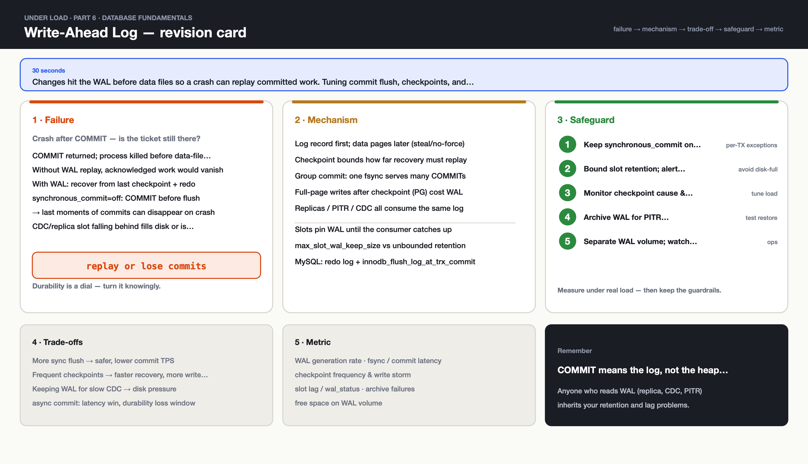
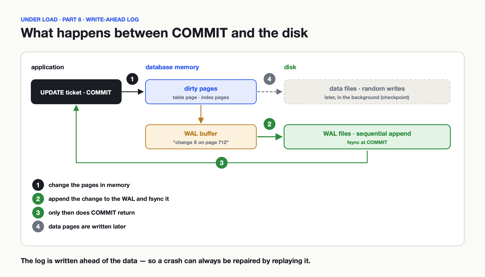
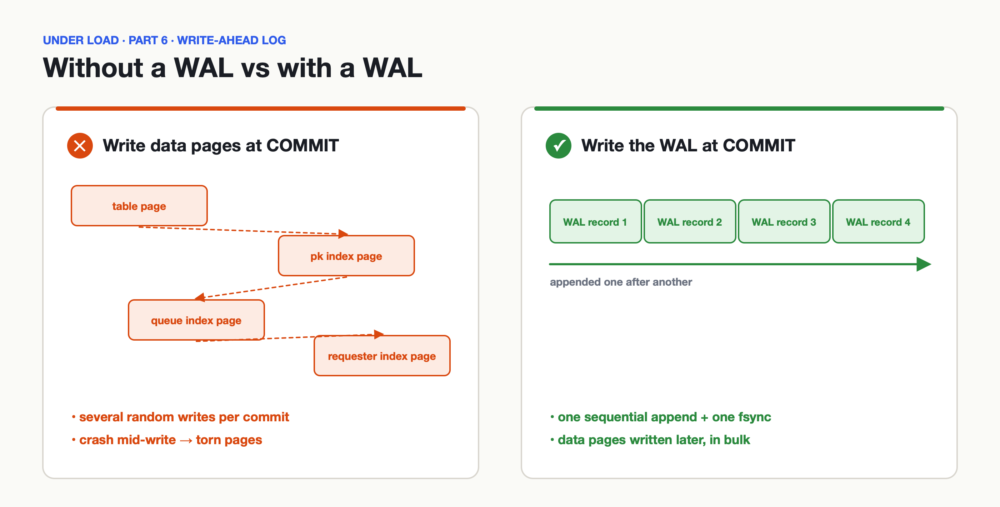
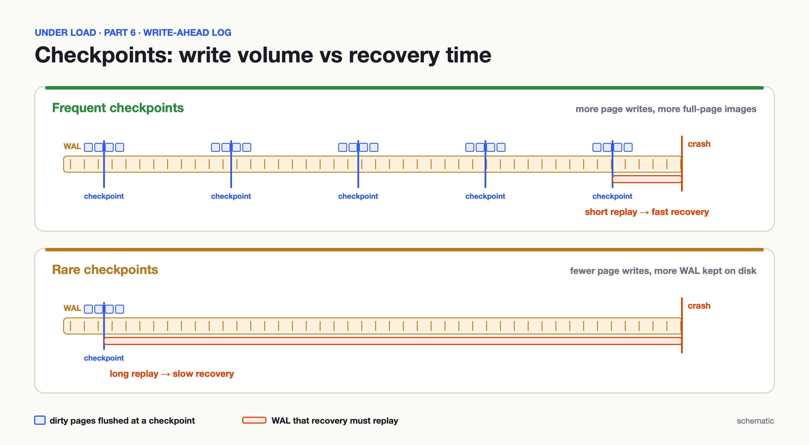
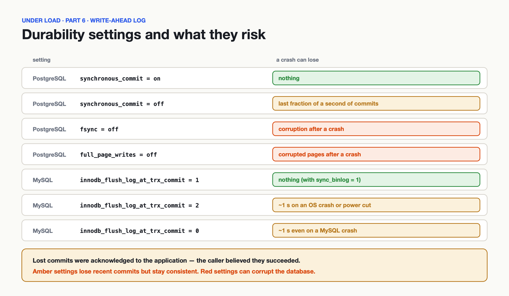
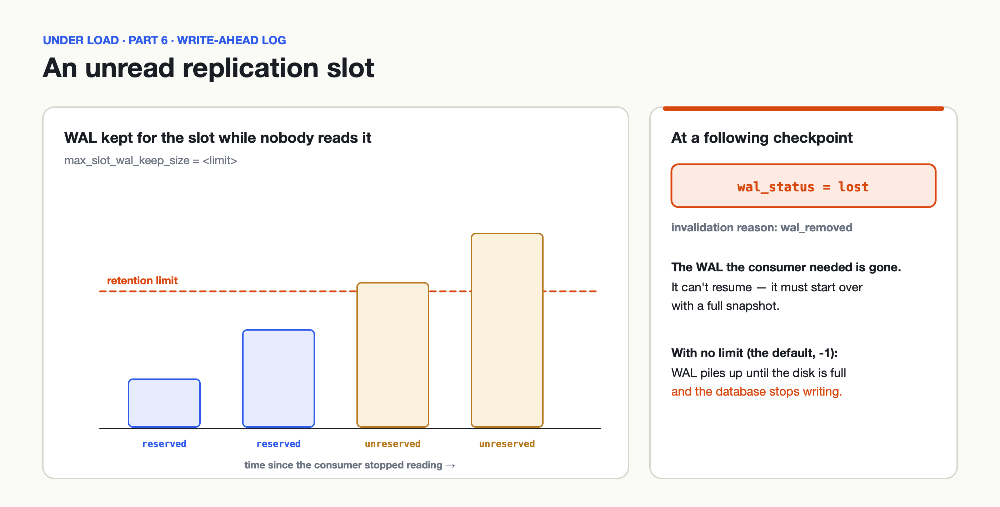
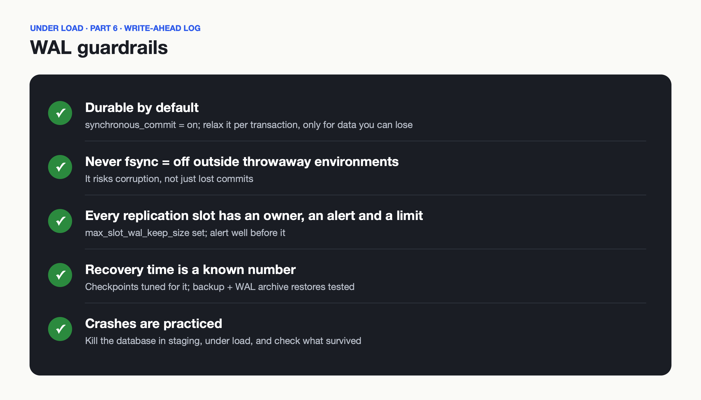

# The Write-Ahead Log

### How the write-ahead log makes committed data survive crashes, why COMMIT can still be fast, and the settings that quietly trade durability for speed.

*Under Load · Part 6 · Database Fundamentals*





---

At 14:32 on a busy Tuesday, the primary database server behind the ticketing platform goes down hard. A kernel bug, no warning, no clean shutdown. Agents' screens freeze mid-reply. A couple of minutes later the server is back and the database starts up again.

The first question in the incident channel is the scary one: *"Did we lose any tickets?"*

The answer turns out to be mostly reassuring, with two surprises:

1. **Every ticket an agent saw as "saved" was still there.** The database had been killed in the middle of thousands of transactions, and it came back with every committed change intact and none of the half-finished ones.
2. **Except for one service.** A few hundred inbound emails, which the email-ingestion service had already acknowledged to the mail provider, had never turned into tickets. That service's database user had a setting someone had added months earlier "to speed up bulk inserts."
3. **And search was broken for a day.** The service that copies ticket changes into the search index reads the database's change stream. While it was down, the database kept that history around for it — until a safety limit kicked in and threw the backlog away. The search index had to be rebuilt from scratch.

All three come from the same mechanism: the **write-ahead log**, or WAL. It is the reason databases survive crashes, the reason `COMMIT` can be fast, and the source of a handful of settings and limits that every backend engineer eventually runs into.

---

## The problem: updating data pages is slow and unsafe

Part 1 explained that a database stores tables and indexes in fixed-size **pages** (8 KB in PostgreSQL, 16 KB in InnoDB). Saving a single ticket touches several of them: the table page holding the row, and a page in every index on that table.

The naive way to make a change durable would be to write each of those pages to disk at `COMMIT`. That is a bad idea for two reasons:

- **It's slow.** The pages are scattered across the files, so every commit would need several **random writes** — the expensive kind of I/O from Part 1. A busy table would turn every commit into a small storm of seeks.
- **It's unsafe.** If the server crashes halfway through writing those pages, some are new and some are old, and the table and its indexes disagree. Worse, a crash in the middle of writing *one* page can leave it half old, half new — a **torn page** — because storage typically guarantees atomic writes only in smaller units (often 512 bytes or 4 KB), not a whole 8 KB database page.

---

## The idea: write the log first

The write-ahead log solves both problems with one rule:

> **Before a change to a data page is written to disk, a record describing that change must already be safely on disk in the log.**

That is what "write-ahead" means: the log is always written *ahead* of the data. When an agent saves a ticket:



1. The database changes the pages **in memory** (in its shared buffer cache). Changed pages that haven't been written to disk yet are called **dirty pages**.
2. It appends **WAL records** describing those changes to the end of the write-ahead log, which is simply a sequence of files written one after another. Each record gets a position in the log, called a **log sequence number (LSN)**.
3. At `COMMIT`, it makes sure the WAL up to that transaction's commit record is **durable** on disk.
4. Only then does `COMMIT` return to the application.
5. The dirty data pages are written to their real locations **later**, in the background. Before any dirty page is written, the database checks that the WAL covering its latest change is already durable — the write-ahead rule, enforced page by page.

This is why a database can acknowledge a commit before the data pages are flushed. The data pages don't need to be on disk, because the **log** is — and the log contains everything needed to redo the change.

It is also why `COMMIT` is fast. Instead of several random writes, a commit needs one **sequential append** to the end of the log and one flush. Sequential appends are the cheapest kind of write storage offers, and the random page writes are batched up and done later, when many changes to the same page can be written at once.

### What "durable" actually means

There is a subtlety in step 3. When a program writes to a file, the operating system usually doesn't send the data to the disk right away. It keeps it in memory (the **page cache**) and writes it out later. If the machine loses power, that cached data is gone.

To actually reach stable storage, a program has to call **`fsync`** (or a similar system call such as `fdatasync`, or open the file with `O_DSYNC`), which waits until the device reports the data as stored. So "the WAL is durable" means "the WAL has been written *and flushed*." Data that has only been handed to the operating system is **buffered, not durable** — a distinction that matters a lot below.

Even `fsync` is only as honest as the hardware underneath it. A disk or RAID controller with a volatile write cache can report data as stored when it is still in its own memory. Enterprise drives and controllers protect that cache with a battery or capacitors; consumer hardware sometimes doesn't. PostgreSQL ships a small tool, `pg_test_fsync`, that reports how fast the storage claims to flush — a result that looks impossibly fast for the hardware is a hint that something in the stack is not really flushing.

---

## Crash recovery: replaying the log

When the database starts after a crash, it can't trust the data pages on disk — some committed changes existed only in memory. Instead it:

1. Finds the last **checkpoint** (explained next): a point from which all earlier changes are known to be on disk.
2. Reads the WAL from that point forward and **replays** every record, reapplying each change to the data pages. This is called **redo**. Each page records the LSN of the last change applied to it, so replay can skip records the page already contains.
3. Deals with transactions that never committed. How depends on the engine:
   - **PostgreSQL** needs no undo step. Thanks to MVCC (Part 3), an uncommitted transaction's row versions are simply marked as belonging to an aborted transaction and are invisible to everyone; VACUUM removes them later.
   - **InnoDB** (and other engines based on the classic ARIES recovery design) updates rows in place, so after redo it runs an **undo** phase, using the undo log to roll back changes from transactions that hadn't committed.

PostgreSQL's log after an unclean shutdown makes the process visible:

```
database system was not properly shut down; automatic recovery in progress
redo starts at 0/14EF8B0
redo done at 0/1523840
database system is ready to accept connections
```

The two hexadecimal numbers are LSNs: where replay started and where it ended. Everything committed before the crash is back.

Note what kind of crash this covers. If only the database *process* dies, the operating system's page cache survives, and even writes that were never flushed may still reach the disk. A power cut or kernel crash — like the one in this incident — loses the page cache too. That is the case `fsync` exists for, and the only honest way to test it is to cut power (or use a virtual machine and kill it hard), not just to kill the database process.

### Half-written pages

Replaying the log assumes every data page on disk is in *some* complete state, old or new. A torn page breaks that assumption: a WAL record that says "change bytes 120–180 of page 712" is useless if the rest of page 712 is garbage.

PostgreSQL guards against this with **full-page writes**: the first time a page is changed after a checkpoint, the WAL record includes a **complete image of the page**. During recovery, that image is restored first, and later records are applied on top, so a torn page on disk doesn't matter. InnoDB solves the same problem differently, with a **doublewrite buffer**: pages are first written to a separate area, flushed, and only then written to their real location, so an intact copy always exists.

Full-page images have a visible cost. The first change to a page after each checkpoint writes the whole 8 KB page into the WAL, plus the page of every index it touches; a later change to the same page writes only a small record describing the change itself — often a hundred bytes or so. The first update after a checkpoint can therefore produce tens of times more WAL than the identical update a moment later. That ratio is one of the reasons checkpoint frequency matters.

---

## Checkpoints: how much history to keep

If recovery had to replay the log from the very beginning, it would take forever, and the log would grow without limit. **Checkpoints** solve this.

A checkpoint writes **all dirty pages** to disk, flushes them, and then records the current position in the log. Everything before that position is no longer needed for crash recovery, so old WAL files can be recycled. Recovery only has to start from the last checkpoint.

How often to checkpoint is a trade-off:



- **Frequent checkpoints** mean less WAL to replay, so recovery is fast. But each checkpoint writes out every dirty page — including pages that would have been changed again a moment later — and after each one, the first change to every page triggers another full-page image. Total disk writes go up.
- **Infrequent checkpoints** mean fewer writes during normal operation: a page changed a hundred times between checkpoints is written once. But more WAL piles up since the last checkpoint, so recovery after a crash takes longer, and the WAL directory needs more disk space.

Recovery time grows roughly with the amount of WAL written since the last checkpoint, and with how fast the storage can read the log and the pages it touches. A small database replays in a moment. A busy server with tens of gigabytes of WAL between checkpoints, on slower network-attached storage, can spend minutes in recovery after every crash — minutes in which the database accepts no connections at all.

In PostgreSQL, three settings control this:

- **`checkpoint_timeout`** — the maximum time between checkpoints (5 minutes by default).
- **`max_wal_size`** — start a checkpoint early once this much WAL has been written since the last one (1 GB by default). If checkpoints keep being triggered by this limit, PostgreSQL logs "checkpoints are occurring too frequently" — a sign that it's too small for the write volume.
- **`checkpoint_completion_target`** — spread the checkpoint's writes over this fraction of the interval (0.9 by default), so it doesn't hit the disk all at once.

Full-page images are often the largest part of WAL volume right after a checkpoint. **`wal_compression`** (off by default; `lz4` or `zstd` since PostgreSQL 15) compresses those images, trading a little CPU for less WAL to write, replicate and archive.

A common production approach is to raise `max_wal_size` so checkpoints are normally triggered by time, then pick `checkpoint_timeout` from the recovery time the business can accept. InnoDB works the same way in principle: the size of its redo log bounds how far behind the flushed pages can fall, and therefore how much must be replayed.

---

## Making COMMIT fast: group commit

Even a sequential flush takes time, and every commit needs one. When many transactions commit at the same moment, the database **groups** them: one flush makes the WAL records of several transactions durable at once. This is called **group commit**.

It works almost by itself. While one flush is in progress, other transactions that reach `COMMIT` append their records and wait. When the flush finishes, the next one covers all of them together. The more transactions commit concurrently, the more each flush is shared, so commit throughput rises with concurrency even though each individual commit still waits for a flush.

The benefit depends on how slow a flush is. On a local NVMe drive a flush may take a fraction of a millisecond, so there is little time for others to pile up behind it. On network-attached cloud volumes a flush can take a millisecond or more, many commits arrive in the meantime, and group commit makes a large difference. PostgreSQL also has two settings, `commit_delay` and `commit_siblings`, that make a committing transaction wait a few microseconds for others to join when enough are active; they help only in specific workloads and are off by default.

In PostgreSQL, comparing the number of commits (`xact_commit` in `pg_stat_database`) to the number of WAL flushes shows how much grouping is happening. Since PostgreSQL 18 the flush count is `fsyncs` in `pg_stat_io` for `object = 'wal'`; older versions report it as `wal_sync` in `pg_stat_wal`.

---

## Trading durability for speed

Because the flush at `COMMIT` is the main cost, databases let it be skipped or delayed. Every one of these settings is a real trade-off, and every one of them has caused data loss for teams that didn't realize what they'd chosen.



### PostgreSQL: `synchronous_commit`

With `synchronous_commit = off`, `COMMIT` returns **before** the WAL is flushed. The background WAL writer flushes it shortly afterwards; the documented worst case is about three times `wal_writer_delay`, which defaults to 200 ms — so roughly the last half second. If the server crashes in that window, the most recent transactions are lost, even though the application was told they succeeded.

A worked example makes the risk concrete. A service inserting a few thousand rows per second with `synchronous_commit = off` has, at any moment, up to a few hundred milliseconds of acknowledged-but-unflushed commits — potentially hundreds or thousands of rows. A hard crash erases exactly those. With `on`, the same crash erases nothing that was acknowledged; the transactions in flight simply never committed, and their callers got an error.

In return, each commit no longer waits for the flush, which helps most when flushes are slow and commits are small and frequent.

Two things are important about this setting:

- **It never corrupts the database.** It only loses the last fraction of a second of commits. What remains is consistent — unlike `fsync = off`, below.
- **It can be set per transaction.** `SET LOCAL synchronous_commit = off` inside one transaction applies to that transaction only. That is appropriate for low-value, high-volume data like page-view events or debug logs. It is not appropriate for anything a customer would notice missing — like inbound emails that have already been acknowledged to the sender, which is exactly what bit the email-ingestion service. Its role had the setting turned off globally.

### Settings that are much more dangerous

- **`fsync = off`** — PostgreSQL never forces anything to disk. After an operating-system crash or power loss, the database can be **corrupted**, not just missing recent data, because data pages may reach disk before the WAL that protects them. Only for throwaway databases, like test fixtures that are recreated on every run.
- **`full_page_writes = off`** — removes the torn-page protection. Safe only on storage that guarantees 8 KB writes can't be torn (some copy-on-write file systems, such as certain ZFS configurations). Otherwise, a crash can leave corrupted pages that replay can't repair.

### MySQL InnoDB: `innodb_flush_log_at_trx_commit`

InnoDB has the same idea under a different name. Its log is called the **redo log**, and this setting controls when it is flushed:

- **`1` (the default)** — write and flush the redo log at every commit. Fully durable.
- **`2`** — write to the operating system at every commit, but flush only about once per second. Survives a MySQL crash, but a power cut or operating-system crash can lose about the last second.
- **`0`** — write and flush about once per second. Even a MySQL crash can lose about the last second.

MySQL also writes a second log, the **binary log** (used for replication and point-in-time recovery), with its own flush setting, `sync_binlog`. For full durability, both `innodb_flush_log_at_trx_commit = 1` and `sync_binlog = 1` are needed; otherwise a crash can leave a transaction in one log and not the other, and a replica can disagree with its primary.

### Durability across machines

Everything above is about one server's disk. If the disk itself is lost, a durable local commit doesn't help. Replicas solve that, and PostgreSQL's `synchronous_commit` also has levels that wait for standbys: `remote_write` (the standby has received the WAL and handed it to its operating system), `on` with synchronous standbys configured (the standby has flushed it), and `remote_apply` (the standby has replayed it, so a read there sees the change). Each level waits longer and protects against more. Part 33 covers replication.

---

## The WAL is more than crash recovery

Because the WAL is a complete, ordered history of every change, many other features are built on it:

- **Replication.** Replicas receive the primary's WAL and replay it, the same way crash recovery does (Part 33).
- **Point-in-time recovery.** Keeping a base backup plus every WAL file written since (*WAL archiving*) makes it possible to restore the database to any moment — say, one second before someone ran `DELETE FROM tickets` without a `WHERE`.
- **Change data capture.** Tools like Debezium read the WAL through *logical decoding*, which turns low-level page changes back into row-level inserts, updates and deletes, and publish them as events (Part 30).

The WAL is still a *means* of recovering the database's state, not a replacement for it. It is only useful together with a consistent starting point — the data files at the last checkpoint, or a base backup — and archived WAL without a tested base backup restores nothing.

All of these consumers depend on the WAL still being there when they need it. That is where the incident's third surprise comes from.

### When a reader falls behind

A consumer that reads the WAL — a replica or a CDC connector — usually uses a **replication slot**: a bookmark that tells the database "don't delete WAL this consumer hasn't confirmed yet." While the consumer is down or slow, the database keeps all WAL since that bookmark, even past the checkpoint that would normally allow it to be recycled.



The sequence plays out the same way every time:

1. **The consumer stops reading** — it crashed, its credentials expired, someone paused it during a deploy and forgot.
2. **Retained WAL grows** at the database's write rate. A primary writing a few gigabytes of WAL an hour retains a few more gigabytes every hour, whether or not anyone is watching.
3. **With a limit** (`max_slot_wal_keep_size`), once the retained WAL passes it, the slot's `wal_status` changes from `reserved` to `unreserved`, and at a following checkpoint PostgreSQL removes the old WAL and marks the slot **`lost`**. The consumer can't continue from where it was: the history it needed is gone. It has to be set up again and take a full snapshot of the data — the "rebuild the search index from scratch" in the incident.
4. **Without a limit** — PostgreSQL's default, `max_slot_wal_keep_size = -1` — the database keeps WAL for the abandoned slot indefinitely, until the disk holding the WAL fills up and the database stops accepting writes altogether.

A limit turns "the whole database goes down" into "one consumer has to resync." Neither is pleasant, which is why the limit should be chosen deliberately — large enough to ride out a normal outage of the consumer, small enough that the disk survives — and backed by an alert that fires long before it's reached. Logical slots also hold back cleanup of system catalogs (Part 3), another reason not to leave one unread. PostgreSQL 18 adds a second, time-based limit, `idle_replication_slot_timeout`: a slot nobody has used for longer than the timeout is invalidated at a checkpoint, which catches the forgotten test slot before its retained WAL becomes large.

---

## Guardrails that prevent the next one



1. **Durable by default.** `synchronous_commit = on` (and `innodb_flush_log_at_trx_commit = 1`, `sync_binlog = 1`) globally. Relaxing it is a per-transaction decision for data that can be lost, written down next to the code that does it.
2. **Never `fsync = off` outside throwaway environments.** It risks corruption, not just lost commits.
3. **Every replication slot has an owner, a lag alert and a limit.** `max_slot_wal_keep_size` set, an alert at a fraction of it, and unused slots dropped.
4. **Recovery time is a known number.** Checkpoint settings are chosen for how long the database can afford to be down after a crash, and restores from base backup plus WAL archive are tested regularly.
5. **Crashes are practiced.** Killing the database — and, for the real test, the whole machine — in staging, under load, is the only way to know what "the database survived a crash" means for the system.

---

## What to keep on the dashboard

- **WAL generation rate.** `wal_bytes` in `pg_stat_wal`, or how fast `pg_current_wal_lsn()` advances. A sudden jump usually means a big batch job, a new index or a burst of full-page images after checkpoints.
- **WAL retained by replication slots.** `pg_wal_lsn_diff(pg_current_wal_lsn(), restart_lsn)` per slot in `pg_replication_slots`, plus `wal_status`. Anything other than `reserved` needs attention.
- **Checkpoint frequency and cause.** In PostgreSQL 17, `pg_stat_checkpointer` shows timed versus requested checkpoints. Many requested ones mean `max_wal_size` is too small.
- **Commit and fsync latency.** With `track_wal_io_timing = on`, PostgreSQL reports how long WAL writes and syncs take — in `pg_stat_io` (`object = 'wal'`, `write_time` and `fsync_time`) since version 18, in `pg_stat_wal` before that. Disk latency shows up here before it shows up anywhere else.
- **Replication and CDC lag**, in bytes and in seconds.
- **WAL archiving failures.** `failed_count` in `pg_stat_archiver`. A broken archive means point-in-time recovery silently stopped working.
- **Disk free space** on the volume that holds the WAL.

---

## Recap

### What is a write-ahead log?
An append-only log where the database records a description of every change before the corresponding data pages are written to disk. Because the log is always written first and made durable at commit, the database can rebuild any committed change after a crash by replaying the log from the last checkpoint.

### Why can a database acknowledge a commit before the data pages are flushed?
Because the WAL records describing the change are already durable, and they contain everything needed to redo it. The data pages can be written later, in the background. This also makes commits fast: one sequential append and flush instead of several random page writes.

### What does "durable" actually mean?
That the data has been written *and* forced to stable storage with `fsync` or an equivalent. Data that was only handed to the operating system sits in its page cache and is lost in a power cut or kernel crash. Buffering is not durability — and storage with an unprotected write cache can undermine even `fsync`.

### What happens during crash recovery?
The database starts from the last checkpoint and replays every WAL record after it (redo). PostgreSQL then needs no undo — uncommitted row versions are simply invisible — while InnoDB rolls back uncommitted changes from its undo log. Full-page images (PostgreSQL) or the doublewrite buffer (InnoDB) protect against pages that were half written when the crash happened.

### What is a checkpoint for?
It writes all dirty pages to disk and records the log position, so recovery only needs to replay WAL from that point and older WAL can be recycled. Frequent checkpoints mean faster recovery but more writes, including more full-page images; rare checkpoints mean fewer writes but longer recovery and more WAL on disk.

### What is group commit?
When several transactions commit at the same time, one flush of the WAL makes all of them durable. Commit throughput rises with concurrency, and the effect is largest on storage where each flush is slow.

### What does `synchronous_commit = off` trade away?
`COMMIT` returns before the WAL is flushed, so a crash can lose roughly the last fraction of a second of acknowledged commits, without corrupting anything. It's fine per transaction for data that can be lost, never as a global default. MySQL's equivalent is `innodb_flush_log_at_trx_commit` set to 0 or 2.

### What else depends on the WAL?
Replication (replicas replay it), point-in-time recovery (a base backup plus archived WAL), and change data capture (tools like Debezium read it through logical decoding). All of them need the WAL to still exist when they read it, and none of them work without a consistent starting point.

### What happens if a CDC consumer needs WAL older than the retention limit?
It can't resume. In PostgreSQL, a slot that falls behind `max_slot_wal_keep_size` is invalidated (`wal_status = lost`), and the consumer has to be set up again from a full snapshot. Without a limit, the database keeps WAL for the slot until the disk fills up and writes stop.

### What should be monitored?
WAL generation rate, WAL retained per replication slot and slot status, checkpoint frequency and cause, commit and fsync latency, replication and CDC lag, WAL archiving failures, and free disk space on the WAL volume.

---

## Next

- **Lab (run + measured write-up):** [06-wal](https://github.com/b-basoglu/under-load/tree/main/06-wal)
- **Next:** [Connection Pooling](../07-connection-pooling/article.md) — The team scaled the API from 10 servers to 40 for a product launch. The database fell over. Why would more servers make things worse?
