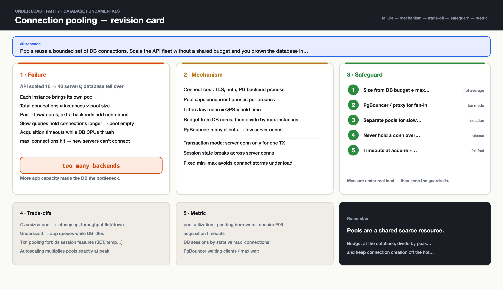
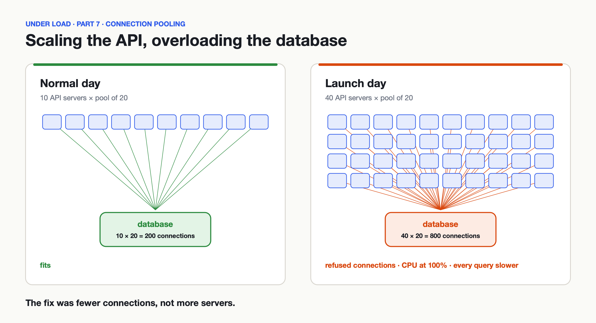
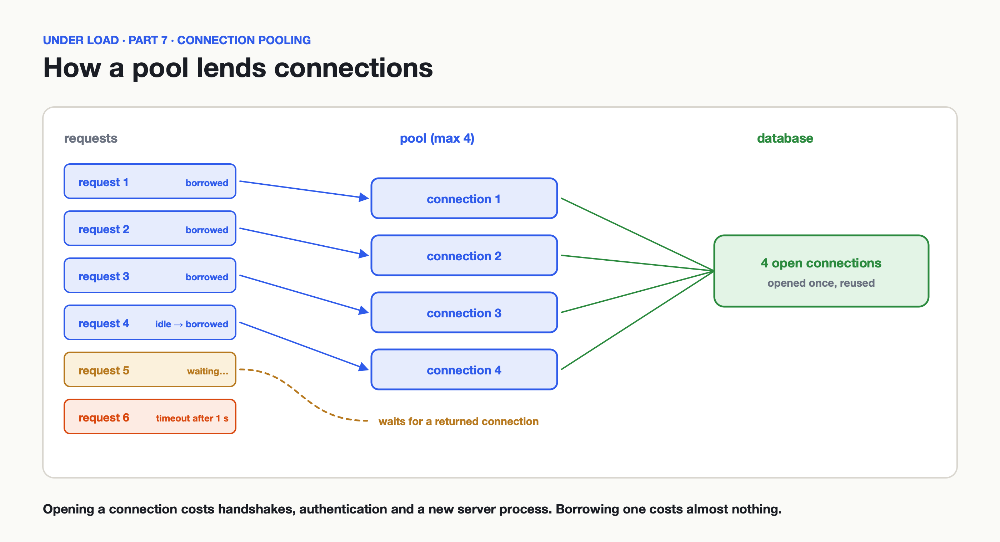
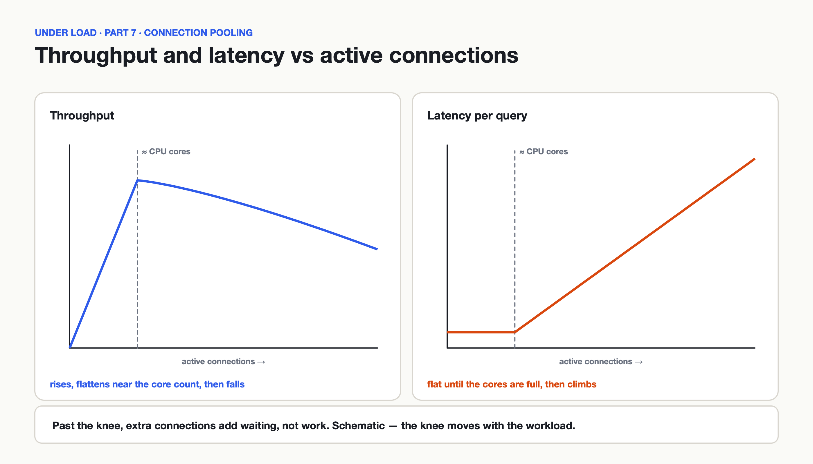
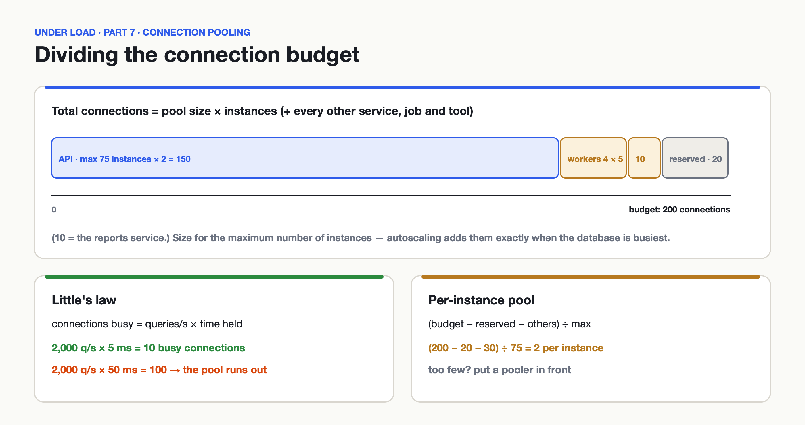
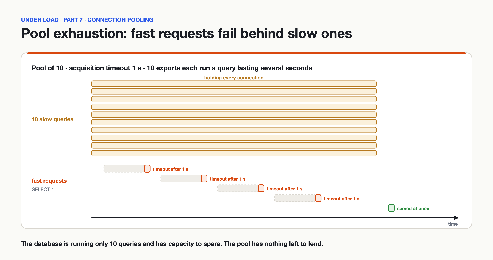
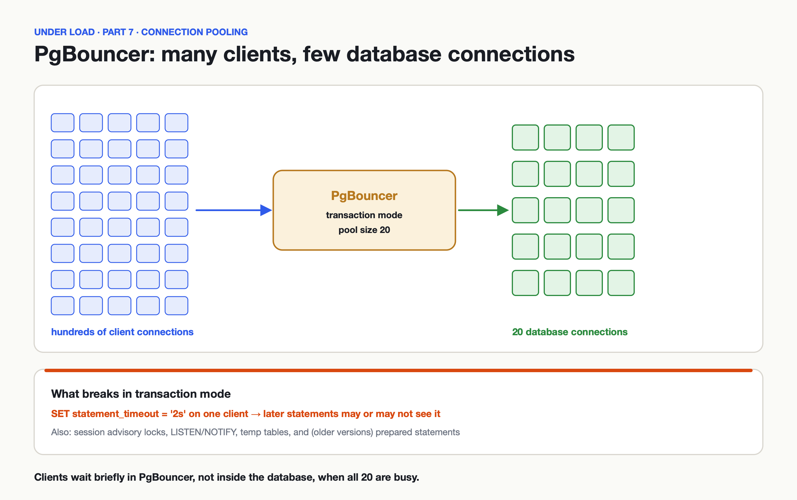
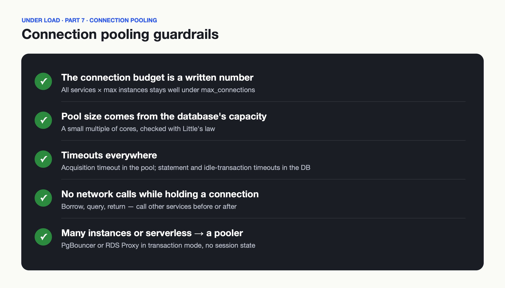

# Connection Pooling

### How connection pools work, why a bigger pool can make everything slower, and how to size pools across a fleet that autoscales.

*Under Load · Part 7 · Database Fundamentals*





---

The ticketing platform is about to launch a big new feature, and marketing has done its job a little too well. The API normally runs on 10 servers. For launch day, the team scales it to 40, just to be safe.

Each API server has a database **connection pool** with 20 connections, the framework's default. Nobody has thought about that number in two years.

At 09:00 the launch email goes out. Traffic triples. And instead of handling it better, the system falls over:

- New API servers start failing on boot with `FATAL: sorry, too many clients already`. The database allows 500 connections; 40 servers × 20 is 800.
- The servers that *did* connect get slower, not faster. Database CPU is pinned at 100%, and the median query time climbs from a few milliseconds to hundreds.
- Requests start timing out while *waiting for a connection from the pool*, even though the database is right there.

The incident commander's first instinct — add more API servers — would have made it worse. The fix that actually worked was the opposite: **fewer connections**. Each server's pool was cut to a handful, PgBouncer was put in front of the database, and the system handled the launch traffic with lower latency than on the normal day before.

Why fewer connections can mean more throughput comes down to two things: what a connection actually costs, and what happens inside the database when too many of them are busy at once.

---

## What a database connection really is

A **connection** is a long-lived network session between an application and the database. Opening one is not cheap. In PostgreSQL, it involves:

1. A TCP handshake, and usually a TLS handshake for encryption — several network round trips before anything useful happens.
2. Authentication — for modern PostgreSQL, a multi-step password exchange called SCRAM, deliberately designed to be computationally expensive.
3. Starting a brand-new **operating-system process** on the database server just for this connection (PostgreSQL forks one *backend process* per connection), which then initializes its own memory and caches.

All of that typically adds up to milliseconds — often more than the query the connection was opened for. A simple indexed lookup on an already-open connection can complete in a fraction of a millisecond, so opening a fresh connection for every query can make each one many times slower, and the gap widens across a real network with TLS. Meanwhile, the database spends CPU on connection setup instead of queries.

The cost doesn't end once the connection is open. Each PostgreSQL connection is a separate process with its own private memory: a few megabytes when idle, and potentially much more while it sorts or hashes data (each sort or hash step can use up to `work_mem`, 4 MB by default). That is why PostgreSQL has a hard limit, `max_connections` (100 by default). Past it, new connections are refused:

```
FATAL:  sorry, too many clients already
```

Even idle connections aren't free: some internal operations, such as taking a snapshot (Part 3), have to look at every connection's state, so their cost grows with the number of connections. Newer PostgreSQL versions have made this much cheaper, but thousands of connections are still a burden.

MySQL uses threads instead of processes, so each connection is lighter, but it has the same kind of limit (`max_connections`, 151 by default) and the same problems when too many connections are *busy* at once.

---

## What a connection pool does

A **connection pool** keeps a bounded set of connections open and lends them out. Instead of opening a connection for each request, a request **borrows** one, uses it, and **returns** it.



1. When the application starts, the pool opens some connections (its **minimum idle** size).
2. A request asks the pool for a connection. If one is idle, it gets it immediately.
3. If none is idle and the pool is below its **maximum size**, the pool opens a new one.
4. If the pool is at its maximum, the request **waits** — up to an **acquisition timeout**. If no connection is returned in time, the request fails.
5. When the request is done, it returns the connection, and the next waiting request gets it.

Pools also take care of connection health. They check that a connection still works before handing it out (or periodically), close connections that have been idle too long, and replace connections after a **maximum lifetime**, so that none stays open forever — useful when the database fails over, a load balancer silently drops long-lived TCP sessions, or credentials rotate. Good pools also expose metrics: active, idle and pending counts, acquisition latency, timeouts and connection age.

Every major platform has one: **HikariCP** in Java, `pgxpool` in Go, `psycopg_pool` or SQLAlchemy's pool in Python, the pool built into `node-postgres`, and the pools inside most ORMs.

The pool has a second job that is easy to overlook: it is a **concurrency limit**. A pool of 10 means at most 10 queries from this process are in the database at once; request number 11 waits in the application, not inside the database. That bound is what protects the database when traffic jumps — as long as it is set to the right number.

The maximum size is the setting that matters most. It is also the one most teams get wrong.

---

## Why a bigger pool can make things slower

It is tempting to think more connections means more queries in parallel, so more throughput. That is only true up to a point, and the point is much lower than most people expect.

A database server has a limited number of **CPU cores** and a limited amount of disk bandwidth. Once every core is busy, a new query can't run any faster just because it has its own connection. It has to wait for CPU time — and while it waits, it still holds memory, locks and cache space. Many active queries also push each other's data out of the CPU caches and the buffer cache, and compete for the database's internal locks. The database spends more of its time switching between queries and coordinating them, and less running them.



The result has a characteristic shape:

- **Up to about the number of cores** (a little more if queries often wait on disk), adding connections adds throughput. Each new connection keeps another core busy.
- **Past that point, throughput flattens.** The cores are full; extra queries just queue for them.
- **Further out, throughput often falls.** Context switching, lock contention and cache thrashing take a growing share of the machine.
- **Latency climbs the whole way.** By Little's law (below), if throughput is flat and the number of queries in flight doubles, each query takes twice as long. A database running ten times more concurrent queries than it has cores makes each query wait behind roughly ten others.

Here is a worked, illustrative example. A database with 8 cores runs a CPU-bound query that takes 10 ms of CPU time. With 8 connections busy, it completes about 800 queries per second, each in about 10 ms. With 80 connections busy, it still can't complete more than about 800 per second — but now each query waits for its turn among 80, so each one takes around 100 ms, and some of the 800 is lost to overhead. Ten times the connections, the same or less work done, ten times the latency.

That is exactly what happened on launch day. More API servers meant more connections, more connections meant more queries competing for the same CPUs, and every query got slower. Slower queries held their connections longer, so pools ran out, so requests timed out. More API servers would have added even more competing connections.

The precise curve depends on the workload: queries that mostly wait on disk or on locks can keep more connections usefully busy per core than CPU-heavy ones. But the shape is always the same — throughput flattens, then falls, while latency keeps climbing.

A pool that is **too small** has its own failure: requests queue in the application waiting for a connection while the database sits partly idle. The goal is the narrow band between the two — enough connections to keep the database's resources busy, and no more.

---

## Sizing the pool

### Start from the database, not from the application

The question isn't "how many connections does each API server want?", and it isn't "how many HTTP requests are in flight?" It is "**how many queries can the database usefully run at once?**" — and then dividing that among everyone who connects.

A useful starting point is a small multiple of the database's CPU cores. The HikariCP documentation popularized the formula *connections = (cores × 2) + effective spindle count* (the spindles term dates from spinning disks; on SSDs it's usually treated as small) — for an 8-core database server, somewhere around 16 to 20 connections doing real work at the same time. It is a rough guide, not a law. Measure under realistic load and adjust.

### Check it with Little's law

The number of connections the application actually needs can be estimated with **Little's law**, a basic result from queueing theory:

> connections in use = queries per second × average time each query holds a connection

If the ticketing API runs 2,000 queries per second and each holds a connection for 5 ms on average, it needs about **2,000 × 0.005 = 10** connections busy at any moment. A pool with some headroom covers it. A pool of 800 doesn't help; it just lets 800 queries compete for the same CPUs.

The same formula explains how pools run out. If queries suddenly take 50 ms instead of 5 ms — a missing index, a lock, a slow disk — the same traffic needs **100** connections busy at once. The pool hits its limit, and requests start waiting. Note that "time held" includes everything between borrowing and returning the connection, not just query execution: transaction overhead, application code that runs while the connection is borrowed, and any network call made in between.

### Divide the budget across the fleet



The total number of connections is **pool size × number of application instances** — plus every other service that connects, plus admin tools, migrations and background workers. So the per-instance pool size has to come from the total budget:

> per-instance pool = (connection budget − reserved − other services) ÷ maximum number of instances

For example, with a budget of 200 connections, 20 reserved for administrators and migrations, 30 for background workers and a reporting service, and an API that can autoscale to 75 instances: **150 ÷ 75 = 2 connections per instance**. That sounds tiny, but by Little's law, 2 connections holding each query for 5 ms can serve about 400 queries per second per instance.

Two consequences:

- **Use the maximum number of instances, not the usual number.** Autoscaling adds instances exactly when the database is busiest. A pool size that is fine at 10 instances can exhaust the database at 40 — the launch-day incident in one sentence. Many teams cap the autoscaler at the number the connection budget allows.
- **When the math doesn't work, add a connection pooler** (below). With a hundred instances and the same budget, the API's share works out to less than two connections each, and per-instance pools alone can't keep the total low enough. The same is true for serverless functions, which may run thousands of copies and can't keep a long-lived pool at all.

### Keep the pool fixed

Many pools let a small minimum grow toward a larger maximum under load. For databases, a **fixed-size pool** (minimum = maximum) is usually better: growing means opening connections — the expensive part — exactly when the system is under the most pressure, and a fixed size makes the fleet's total connection count predictable.

---

## When every connection is busy

A pool has a fixed number of connections. Anything that holds a connection for a long time takes it away from everyone else.



Picture a pool of 10 connections with a 1-second acquisition timeout. A customer starts ten large exports at once, and each runs a query that takes several seconds. While they run:

- **Every other request on that instance waits** for a connection — even a trivial `SELECT 1`. After 1 second, each one fails with an acquisition timeout.
- **The database itself is fine.** It is running only 10 queries; it has plenty of capacity. The *pool* simply has nothing left to lend.
- **As soon as the slow queries finish**, connections return and new requests are served instantly again.

That is pool exhaustion: fast requests fail because slow ones hold every connection. The usual causes:

- **A slow query**, often after a missing index or a plan change (Part 1).
- **Long transactions**, which hold their connection from `BEGIN` to `COMMIT` (Parts 2 and 3).
- **Network calls while holding a connection.** A request that borrows a connection, starts a transaction, then calls a payment provider that takes 10 seconds holds a connection for 10 seconds. Twenty such requests in a pool of 20, and the whole service stops — even though the database is idle.
- **Connection leaks** — code paths that borrow a connection and never return it, usually after an error. Use the language's `with` / `using` / `defer` / try-with-resources construct so connections are always returned, and turn on the pool's leak detection (HikariCP's `leakDetectionThreshold`, for example).

The defenses are timeouts at every level, so nothing holds a connection forever, and bounds so that one workload can't starve another:

- **Acquisition timeout** in the pool — fail fast with a clear error instead of hanging the request. A few hundred milliseconds to a couple of seconds is typical for user-facing APIs; it should be shorter than the request's own deadline so the error is useful.
- **`statement_timeout`** in the database — cancel any query that runs too long.
- **`idle_in_transaction_session_timeout`** — end sessions that opened a transaction and went quiet (Part 3).
- **Separate pools for separate workloads** — exports, reports and background jobs get their own small pool, so a slow export can't take every connection from the API. This is the *bulkhead* idea, covered in Part 17.
- **Bounded concurrency in front of the pool** — limit how many requests an instance accepts at once, so a traffic spike becomes a short queue or a fast rejection rather than thousands of requests all waiting on ten connections.

---

## Poolers in front of the database

An application pool only shares connections *inside one process*. When there are many processes — dozens of API instances, many services, short-lived serverless functions — the database still sees all of their connections.

A **connection pooler** sits between the applications and the database and shares a small number of real database connections among a large number of client connections. The best-known one for PostgreSQL is **PgBouncer**; others include **pgcat**, **Odyssey** and **Supavisor**, and managed options such as **Amazon RDS Proxy**. For MySQL, **ProxySQL** plays a similar role.



Client connections to PgBouncer are cheap: it is a single lightweight process, not a process per connection. So hundreds or thousands of application connections can be accepted, while the database sees only the pooler's small pool — say 20 — and each query waits briefly in PgBouncer, not inside the database, when all 20 are busy.

### Pooling modes

- **Session mode:** a client keeps the same database connection until it disconnects. Safe, but it only helps when clients connect and disconnect often.
- **Transaction mode:** a client gets a database connection only for the duration of one transaction, then gives it back. This is what lets many clients fit into a few database connections, and it is the mode most teams use.
- **Statement mode:** a connection is given back after every single statement, so multi-statement transactions aren't allowed. Rarely used.

### What breaks in transaction mode

Because consecutive transactions from the same client can run on **different** database connections, anything that relies on session state stops working reliably:

- **`SET` commands.** A client runs `SET statement_timeout = '2s'` outside a transaction. That command runs on whichever database connection it was given, and the client's next statement may land on a different one that never saw it — while some *other* client may later inherit the changed setting. The value appears and disappears unpredictably. Use `SET LOCAL` inside a transaction instead, or set defaults per database user (`ALTER ROLE ... SET ...`).
- **Session-level advisory locks**, `LISTEN`/`NOTIFY` and temporary tables, for the same reason. Use the transaction-scoped versions (`pg_advisory_xact_lock`) or a separate session-mode connection for these.
- **Prepared statements.** Many drivers prepare statements on a connection and reuse them. Before PgBouncer 1.21, this failed in transaction mode. Newer versions can track protocol-level prepared statements (`max_prepared_statements`), but check that the driver and version work together — or turn off automatic preparation in the driver.

A pooler is also another network hop and another component that can fail. Run more than one, and monitor it like the database.

---

## Shipping a pool change safely

- **Compute the budget before changing anything.** List every service, its pool size and its maximum instance count; the sum is the real peak connection count.
- **Shrink pools gradually and watch acquisition time.** If it rises sharply while the database is not busy, the pool is now too small or connections are being held too long.
- **Change autoscaling limits and pool sizes together.** A higher instance cap without a smaller pool reopens the launch-day failure.
- **Introduce a pooler in session mode first** if the application's use of session state is unknown, then switch to transaction mode after removing `SET`, session locks and temporary tables from the code paths that use it.
- **Load-test with the maximum instance count**, not the usual one.

---

## Guardrails that prevent the next one



1. **The connection budget is a written number.** Total connections across every service and instance, at maximum scale, stays well under the database's limit.
2. **Pool size comes from the database's capacity.** A small multiple of its cores, checked with Little's law — never the framework default.
3. **Every pool has an acquisition timeout, and every database user has statement and idle-transaction timeouts.**
4. **No network calls while holding a connection.** Borrow, query, return. Call other services before or after.
5. **Many instances or serverless → a pooler.** PgBouncer, RDS Proxy or similar in transaction mode, with session-state features avoided.

---

## What to keep on the dashboard

- **Pool utilization:** active, idle and maximum connections, per instance. Constantly at maximum means the pool is too small or connections are held too long.
- **Pending borrowers and acquisition time.** How many requests are waiting for a connection, and for how long. This rises before anything else breaks.
- **Acquisition timeouts.** Each one is a failed request that never reached the database.
- **Database sessions by state.** `pg_stat_activity` grouped by `state` (`active`, `idle`, `idle in transaction`) and by `application_name`. Shows who is using the budget.
- **Total connections vs `max_connections`.** Alert well before the limit.
- **Query latency and transaction duration.** When they rise, connections are held longer and pools run out — Little's law in action.
- **For PgBouncer:** `SHOW POOLS` — `cl_waiting` (clients waiting for a database connection) and `maxwait` (how long the oldest has waited).

---

## Recap

### What is connection pooling?
Keeping a bounded set of open database connections and lending them to requests, instead of opening a new connection for every request. Opening a connection means network and TLS handshakes, authentication and, in PostgreSQL, a new server process — often more work than the query itself. The pool also caps how many queries one process can send to the database at once.

### Why can adding more API servers make a database outage worse?
Every server brings its own pool, so more servers means more connections and more queries competing for the same database CPUs. Past a point, that lowers throughput and multiplies latency; slower queries hold connections longer, pools run out, and new servers can't even connect once `max_connections` is reached.

### Why isn't a bigger pool always better?
Because the database can only run a limited number of queries usefully at once — roughly a small multiple of its cores. Beyond that, extra connections queue inside the database, add memory, lock and cache contention, and make every query slower without adding throughput. Too small is also a problem: requests then queue in the application while the database idles.

### How is a pool size chosen?
Start from the database: a small multiple of its CPU cores is a reasonable first budget for connections doing work at once. Check it with Little's law — connections needed = queries per second × average time a connection is held. Then measure acquisition time and database load under realistic traffic and adjust.

### How would you choose a pool size for 100 application instances?
Divide the database's connection budget, minus reserves for admin tools, migrations and other services, by the maximum number of instances — not the usual number, because autoscaling adds instances exactly when the database is busiest. With a budget of a couple of hundred connections, that leaves one or two per instance, which is often too few; then a pooler like PgBouncer in front of the database is the answer.

### What happens when every connection is busy with a slow query?
Every other request waits for a connection and fails after the acquisition timeout, even if the database itself has spare capacity. Timeouts at every level, separate pools for slow workloads, bounded concurrency and no network calls while holding a connection prevent it.

### What does PgBouncer do?
It sits between applications and the database and shares a few real database connections among many cheap client connections. In transaction mode, a client holds a database connection only for one transaction, so hundreds of clients can share a pool of a few dozen.

### What breaks with transaction-mode pooling?
Anything that depends on session state, because consecutive transactions can run on different database connections: `SET` commands, session-level advisory locks, `LISTEN`/`NOTIFY`, temporary tables and, with older versions, prepared statements. `SET LOCAL`, per-role defaults and transaction-scoped locks are the replacements.

### Why keep the pool size fixed?
Because a growing pool opens new connections — the expensive operation — exactly when the system is under the most load. A fixed size (minimum equal to maximum) keeps connection creation out of the critical moment and makes the total connection count predictable.

### What should be monitored?
Pool utilization, pending borrowers and acquisition time, acquisition timeouts, database sessions by state and application, total connections against `max_connections`, query latency and transaction duration, and for PgBouncer, waiting clients and maximum wait time.

---

## Next

- **Lab (run + measured write-up):** [07-connection-pooling](https://github.com/b-basoglu/under-load/tree/main/07-connection-pooling)
- **Next:** [Pagination: Offset vs Cursor](../08-pagination/article.md) — The ticket export reads page 1 in an instant and page 5,000 in seconds. Same query, same page size. What changed?
