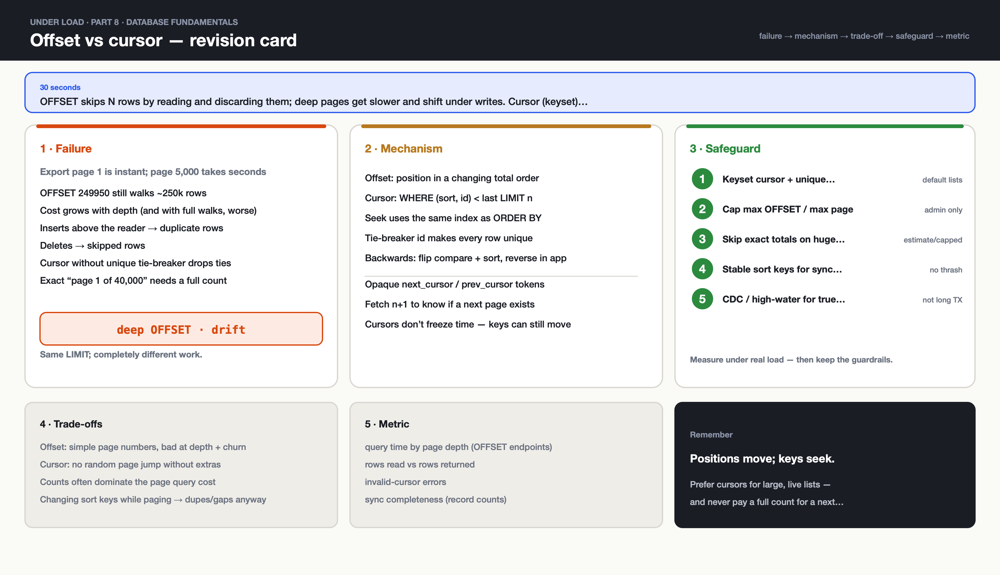
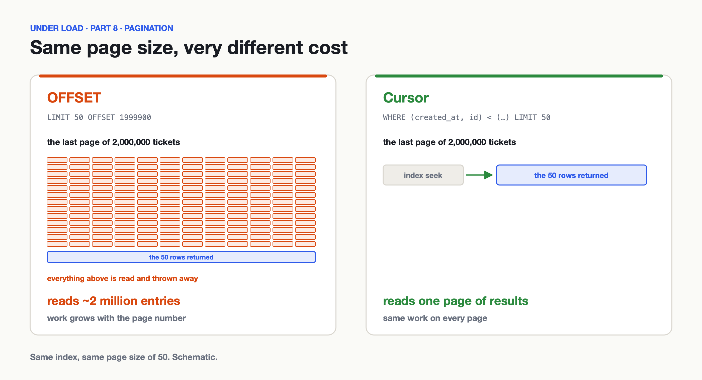
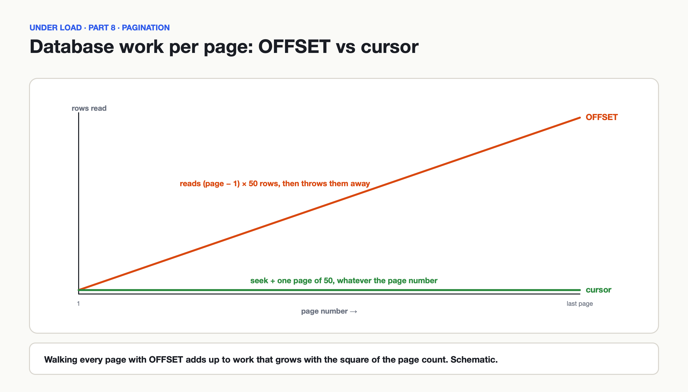
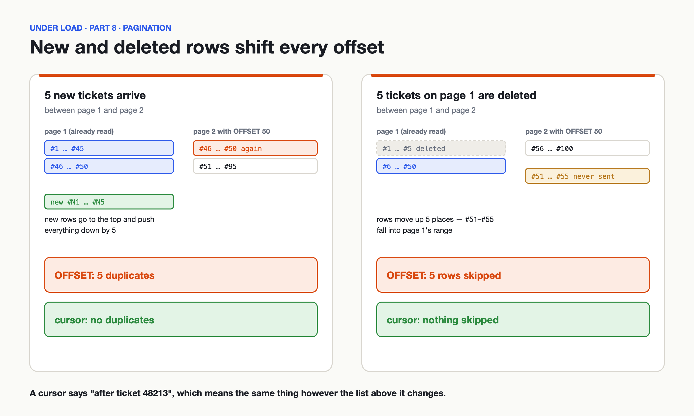
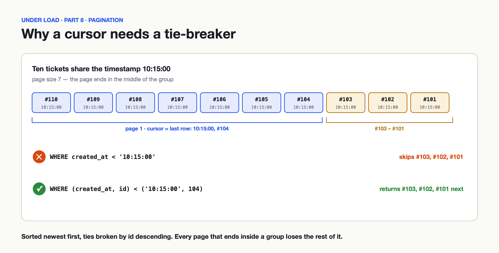
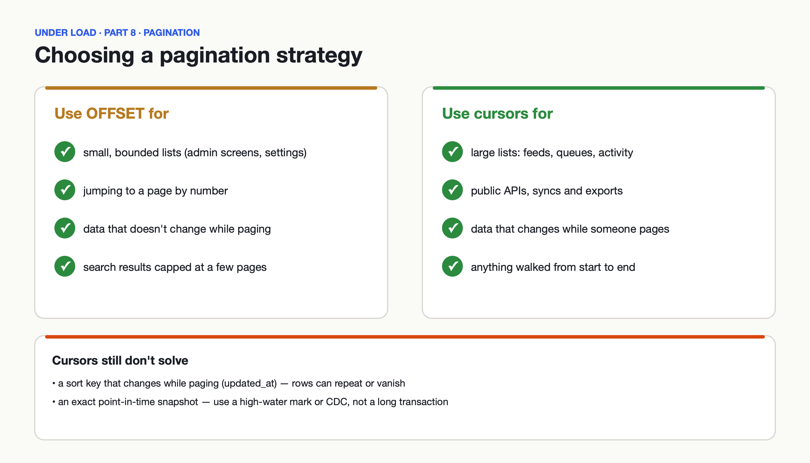
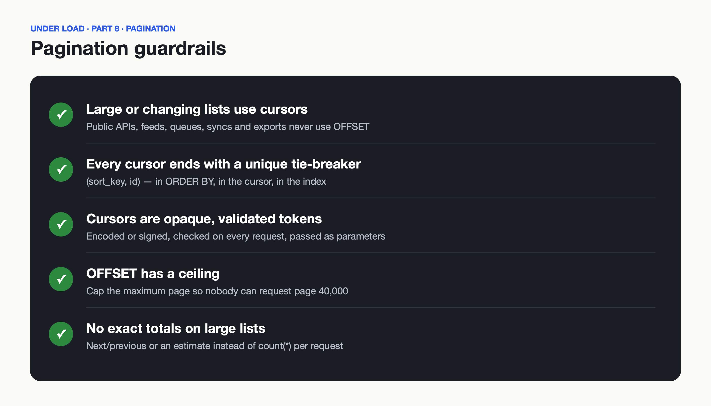

# Pagination: Offset vs Cursor

### Offset vs cursor pagination: why deep pages get slower, how changing data creates duplicates and gaps, and how to build cursors that hold up.

*Under Load · Part 8 · Database Fundamentals*





---

Halcyon's data team syncs every ticket into their own warehouse through the platform's public API. Their script is simple:

```
GET /api/tickets?page=1&per_page=50
GET /api/tickets?page=2&per_page=50
...
```

and the API runs the obvious query:

```sql
SELECT id, created_at, subject
FROM tickets
WHERE workspace_id = $1
ORDER BY created_at DESC
LIMIT 50 OFFSET ($page - 1) * 50;
```

Two complaints arrive in the same week.

The first is from the platform's own on-call engineer: the sync job is one of the most expensive workloads on the database. The early pages are instant, but every page is a little slower than the one before, and near the end each request takes hundreds of milliseconds of database time — for 50 rows.

The second is from Halcyon: their warehouse has **duplicate tickets** and is **missing others**. Not many, but enough that their weekly report doesn't match the numbers in the product.

Both problems come from the same choice: **offset pagination**. This article explains why it gets slower with every page, why it produces duplicates and gaps when data changes, and how **cursor pagination** (also called **keyset pagination**) fixes both — plus the details that make cursors work in a real API.

---

## Two ways to ask for "the next page"

**Offset pagination** says *skip this many rows, then give me the next 50*:

```sql
ORDER BY created_at DESC, id DESC
LIMIT 50 OFFSET 1950;      -- page 40
```

**Cursor (keyset) pagination** says *give me the next 50 after the last row I saw*:

```sql
WHERE (created_at, id) < ('2024-03-02 10:15:00', 48213)   -- the last row of the previous page
ORDER BY created_at DESC, id DESC
LIMIT 50;
```

The second query never mentions a page number. It remembers a **position** — the sort values of the last row the client received — and continues from there. That position is the **cursor**.

The `(created_at, id) < (...)` syntax is a **row comparison**: it compares `created_at` first, and only when two rows have the same `created_at` does it compare `id`. It means "comes after this row in descending order."

---

## Why OFFSET gets slower on every page

`OFFSET` doesn't jump to row 1,950. A database can't know where row 1,950 is without counting. So it **reads the first 1,950 rows in order, throws them away**, then returns the next 50. Page 1,000 reads and discards 49,950 rows. Page 40,000 reads and discards almost two million.

A cursor query uses the index to **seek** straight to the cursor's position (Part 1 explained seeks), then reads 50 rows. The page number doesn't matter.



With an index on `(workspace_id, created_at DESC, id DESC)`, the two queries do very different amounts of work. A worked, illustrative example for a workspace with two million tickets and pages of 50:

- **Page 1:** both read a handful of index and table pages. Equally fast.
- **Page 1,000:** OFFSET walks the index past 49,950 entries — and, unless the index covers every selected column, visits the table for each of them too — before returning anything. The cursor still seeks and reads one page of results.
- **The last page, around 40,000:** OFFSET reads and discards almost the whole workspace — on the order of two million entries and tens of thousands of pages — to return 50 rows. The cursor does the same small amount of work as on page 1.

OFFSET's cost grows in a straight line with the page number; the cursor's stays flat. Even with every page cached in memory, discarding millions of rows takes noticeable CPU time, hundreds of milliseconds rather than a fraction of one. Once the skipped rows have to come from disk, deep OFFSET pages get far slower still. And because a query that reads more holds its connection longer, deep pages also eat into the connection budget from Part 7.

For a sync job, that adds up badly. Walking all 40,000 pages with OFFSET reads the first page's rows 40,000 times, the second page's 39,999 times, and so on. The total work grows with the **square** of the number of pages — so doubling the data makes the full sync roughly four times as expensive.

---

## Why OFFSET duplicates and skips rows

The second complaint is worse, because it's about correctness.

An offset is a position counted from the top of the list. If the list changes between two requests, the same offset points to a different row.



**New rows push everything down.** The client reads page 1 (rows 1–50). Five new tickets are created. They go to the top, because the list is sorted newest first. Now the rows the client already saw have moved down by five. Page 2 (`OFFSET 50`) starts with the **last five rows of page 1** — duplicates.

**Deleted rows pull everything up.** The client reads page 1. Five tickets on page 1 are deleted (merged, spam-filtered, removed by a privacy request). Everything after them moves up five places. Page 2 now starts five rows later than it should, and the five rows that moved into page 1's range are **never returned** — they're silently skipped.

The arithmetic is exact: *k* rows inserted ahead of the reader's position produce *k* duplicates on the next page, and *k* rows deleted ahead of it produce *k* rows that are never returned. A cursor-based reader sees neither.

That's exactly what Halcyon's warehouse showed. Their sync ran during the working day, while agents created, merged and deleted tickets. Every change near the front of the list shifted every page after it.

A cursor doesn't have this problem, because it doesn't count positions. "Everything after ticket 48213" means the same thing no matter how many rows were added or removed before it.

---

## Making cursors correct

### Sort by something unique

The cursor is only as reliable as the sort order. If two rows can have the same sort value, "everything after this value" is ambiguous.

Duplicate timestamps are common: tickets created by an import, an email burst or a bulk action can share the same `created_at` down to the microsecond. Suppose ten tickets share each timestamp, and a client walks the list with a cursor on `created_at` alone:

```sql
WHERE created_at < $last_created_at ORDER BY created_at DESC LIMIT 7
```

Whenever a page ends in the middle of a group of tickets with the same timestamp, `created_at < $last` jumps past the rest of that group, and those tickets are never returned. With groups of ten and pages of seven, most page boundaries land inside a group, so a large share of tickets silently goes missing. Using `<=` instead doesn't help: it returns the already-seen part of the group again, and if a group is larger than a page, the walk never gets past it.



The fix is to add a **unique tie-breaker** — usually the primary key — to both the sort and the cursor:

```sql
WHERE (created_at, id) < ($last_created_at, $last_id)
ORDER BY created_at DESC, id DESC
LIMIT 50;
```

Now every row has a unique position, and nothing is skipped or repeated. This applies to *every* sort a cursor is built on: by priority, by name, by last update — always add the id at the end.

### Index exactly that order

The cursor query is only fast if an index matches the sort exactly — same columns, same order, same direction:

```sql
CREATE INDEX ON tickets (workspace_id, created_at DESC, id DESC);
```

Then the database seeks to the cursor and reads forward, as described above. Without a matching index, it has to find and sort all the matching rows first, and the cursor loses most of its advantage. (Part 1 covers composite index design.)

### Make the cursor an opaque token

Avoid exposing `?after_created_at=...&after_id=...` in the API. Encode the cursor into a single **opaque token**:

```json
{
  "data": [ ...50 tickets... ],
  "next_cursor": "eyJjIjoiMjAyNC0wMy0wMlQxMDoxNTowMFoiLCJpIjo0ODIxMywicyI6ImNyZWF0ZWRfYXQifQ"
}
```

Inside, it's just the sort values and the sort field, base64-encoded. Keeping it opaque has real benefits:

- **It can change later** — a new field, a different sort — without breaking clients, because they never parsed it.
- **It can be validated.** Decode it, check the types, reject a cursor built for a different sort or a different workspace. Never paste a value from a token into SQL; always pass it as a query parameter. If clients shouldn't be able to forge positions, sign the token.
- **Clients can't do arithmetic on it**, so they don't build their own "jump to page 500" logic on top.

### Know when to stop

Fetch **one extra row**: ask for 51 when the page size is 50. If 51 come back, there's a next page — return 50 and a `next_cursor`. If 50 or fewer come back, it's the last page, and `next_cursor` is `null`. That avoids an extra query, and it avoids counting.

### Going backwards

Cursors work in both directions. For a "previous page" button, flip the comparison and the sort, then reverse the result in the application:

```sql
-- previous page, starting from the first row of the current page
SELECT id, created_at, subject FROM tickets
WHERE workspace_id = $1 AND (created_at, id) > ($first_created_at, $first_id)
ORDER BY created_at ASC, id ASC
LIMIT 50;
-- then reverse the 50 rows before returning them
```

This returns exactly the previous page, using the same index read in the other direction — PostgreSQL can scan a B-tree index backwards just as cheaply. At the very start of the list, the backward query returns fewer than a full page; that is the signal to hide the "previous" button. An API that supports both directions usually returns two tokens, `next_cursor` and `prev_cursor`.

---

## The "page X of Y" problem

Offset pagination usually comes with a total: "Showing 1–50 of 2,000,000 tickets," "Page 1 of 40,000." That total needs a count of every matching row.

A page fetch reads 51 rows. An exact `count(*)` for a large workspace has to visit every matching index entry (and, in PostgreSQL, check visibility for each, because MVCC means different transactions can see different counts — Part 3). For a two-million-ticket workspace, the count does tens of thousands of times more work than the page it decorates, on every request.

Options, from best to worst:

- **Don't show an exact total.** "Next" and "Previous" are enough for feeds, queues and APIs.
- **Show an estimate.** PostgreSQL keeps an approximate row count per table (`reltuples` in `pg_class`, or the estimate from `EXPLAIN`) that's nearly free to read. "About 2 million tickets" is usually all a person needs.
- **Cap it.** Count up to 10,000 and show "10,000+".
- **Cache it**, and accept that it's a little out of date.

---

## When OFFSET is the right choice

Cursors aren't always better. OFFSET is simpler and supports things cursors can't do easily:

- **Jumping to a page by number.** "Go to page 37" needs OFFSET. A cursor only knows "next" and "previous."
- **Small, bounded lists.** An admin screen with 200 users, a settings page with 30 integrations, search results capped at 10 pages. If the deepest possible page is cheap, OFFSET is fine.
- **Data that doesn't change while someone pages through it.** A finished report, a closed month.



Use **cursors** for anything large, anything that keeps changing, and anything a machine walks from beginning to end: feeds, activity streams, ticket queues, public APIs, sync jobs and exports. Many APIs — Stripe's, Slack's and GitHub's GraphQL API among them — are cursor-based for exactly these reasons.

### What cursors still don't solve

- **The sort key itself changes.** When a list is paginated by `updated_at` and a ticket is updated while someone is paging, it moves — it might show up again on a later page, or move behind the cursor and never appear. For syncs, that's usually fine (the next sync picks it up). If it isn't, paginate by something that never changes, like `id` or `created_at`.
- **A perfectly consistent snapshot.** A cursor doesn't freeze the data; rows added behind the cursor aren't returned. When a sync must see exactly one point in time, record a high-water mark (say, the newest `created_at`) at the start and stop there — or use change data capture (Part 30). Holding one transaction open for the whole walk is not the answer; Part 3 showed what that does to the database.

---

## Moving an API from pages to cursors

Halcyon's sync can't switch overnight, and neither can every other client of a public API. A migration that doesn't break anyone usually goes like this:

1. **Add cursors alongside pages.** Every list response gains a `next_cursor` field, and the endpoint accepts either `page` or `cursor`. Existing clients keep working; new ones use the cursor.
2. **Make the sort deterministic everywhere first.** Even the OFFSET version should order by `(created_at, id)`, not just `created_at`. Without a tie-breaker, the database is free to return tied rows in any order, so even OFFSET pages can overlap between two identical requests.
3. **Cap the offset.** Reject `page` values beyond a sensible depth with a clear error that points to the cursor parameter. This alone removes the most expensive queries.
4. **Tell the heaviest clients directly.** Sync jobs and integrations walk every page, so they benefit most and cause most of the load. A short migration guide with a before-and-after example is usually enough.
5. **Deprecate page numbers on large endpoints** once traffic on them has dropped, keeping them only where jumping to a page is a real product need.

Test the behaviour that matters, not just the happy path. A pagination test should read page 1, then insert and delete rows ahead of and behind the reader's position, then read page 2 — and assert that the union of the pages contains every expected row exactly once. A second test should create many rows with identical sort values and walk them with a page size smaller than the group. Both tests are cheap to write and catch exactly the bugs Halcyon found in production.

---

## Guardrails that prevent the next one



1. **Large or changing lists use cursors.** Public APIs, feeds, queues, syncs and exports never use OFFSET.
2. **Every cursor ends with a unique tie-breaker.** `(sort_key, id)`, in the `ORDER BY`, in the cursor and in the index.
3. **Cursors are opaque, validated tokens.** Base64 or signed, checked on every request, always passed as query parameters.
4. **OFFSET has a ceiling.** If an endpoint must support page numbers, cap the maximum page (or offset) so nobody can request page 40,000.
5. **No exact totals on large lists.** "Next" or an estimate instead of `count(*)` on every request.

---

## What to keep on the dashboard

- **Query time by page depth**, if any endpoint still uses OFFSET. Log the offset with each request; a time that grows with it is the signature of deep pagination.
- **Rows read vs rows returned.** From `EXPLAIN (ANALYZE, BUFFERS)` or `pg_stat_statements` (`rows` versus `shared_blks_hit + shared_blks_read`). A query reading thousands of pages to return 50 rows is a deep OFFSET or a missing index.
- **Top queries by total time** that contain `OFFSET` or `count(*)`.
- **Invalid cursor errors.** A spike usually means a client is building or editing cursors by hand, or a deployment changed the cursor format.
- **Sync completeness.** For integrations, compare the number of records exported with the number in the source, so duplicates and gaps are caught by a check, not by a customer.

---

## Recap

### What's the difference between offset and cursor pagination?
Offset pagination skips a number of rows (`LIMIT 50 OFFSET 1950`) and returns the next ones. Cursor (keyset) pagination remembers the sort values of the last row the client saw and asks for the rows after it (`WHERE (created_at, id) < (...) LIMIT 50`). One counts positions; the other continues from a known row.

### Why does OFFSET get slower on deep pages?
Because the database can't jump to row N — it reads all N rows in order and throws them away. The last page of two million tickets reads almost the whole workspace with OFFSET, while a cursor seeks and reads one page. Walking every page with OFFSET costs work that grows with the square of the number of pages.

### Why does OFFSET return duplicates or skip rows?
Because offsets are positions, and positions shift when data changes. New rows at the top push already-seen rows onto the next page (duplicates); deleted rows pull unseen rows back onto the previous page (skips). Each insert ahead of the reader causes one duplicate and each deletion one skipped row; a cursor has neither.

### Why should a cursor include a unique tie-breaker?
Because when several rows share the sort value, "after this value" skips the rest of that group or repeats it. A cursor on `created_at` alone silently drops the rest of any timestamp group a page ends inside. Adding the id — `(created_at, id)` — gives every row a unique position.

### How is backwards pagination implemented?
Flip the comparison and the sort direction, starting from the first row of the current page — `WHERE (created_at, id) > (...) ORDER BY created_at ASC, id ASC LIMIT 50` — then reverse the rows in the application. It uses the same index, read in the other direction.

### What should a cursor look like in an API?
An opaque token, such as base64-encoded JSON with the sort values and sort field, returned as `next_cursor` (and `prev_cursor`). Validate it on every request, pass its values as query parameters, and sign it if clients shouldn't be able to forge positions. Fetch one extra row to know whether there's a next page.

### Why are exact totals expensive?
Because "page 1 of 40,000" needs a count of every matching row. On a large list, the count does orders of magnitude more work than the page itself. Use "next/previous" without a total, a cheap estimate, a capped count like "10,000+", or a cached number.

### When is offset pagination fine?
For small, bounded lists, admin screens and reports where data doesn't change during paging, and whenever users need to jump to a specific page number. Cap the maximum page so nobody can request a very deep one.

### What doesn't a cursor solve?
Rows whose sort key changes while someone is paging can move — appearing twice or not at all — so paginate syncs by something that never changes, like `id` or `created_at`. And a cursor doesn't freeze the data: for an exact point-in-time export, use a high-water mark or change data capture, not a transaction held open for the whole walk.

### What should be monitored?
Query time by page depth for OFFSET endpoints, rows read versus rows returned, top queries by total time that use `OFFSET` or `count(*)`, invalid-cursor errors, and record counts that verify syncs are complete.

---

## Next

- **Lab (run + measured write-up):** [08-pagination](https://github.com/b-basoglu/under-load/tree/main/08-pagination)
- **Next:** [Caching Strategies & Invalidation](../09-caching/article.md) — The ticket page is fast again thanks to a cache. Then an agent changes a ticket's priority, refreshes, and the old priority is still there.
