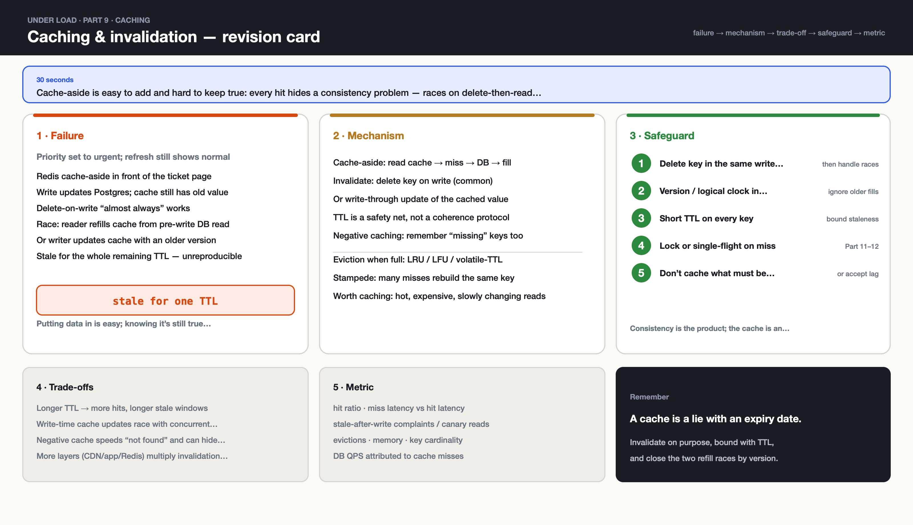
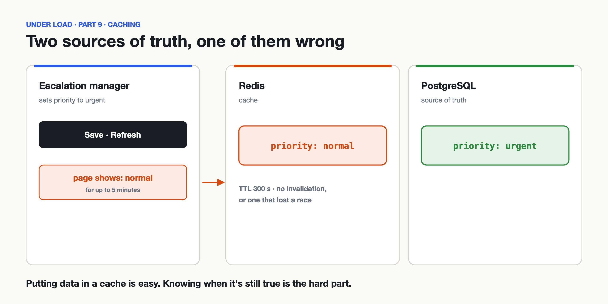
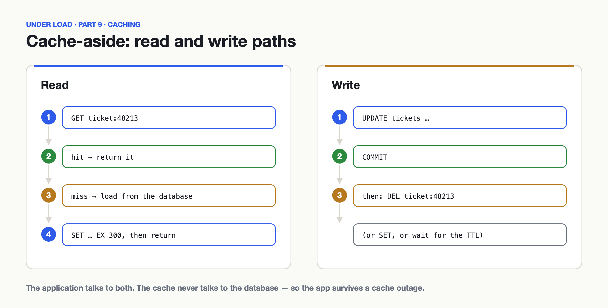
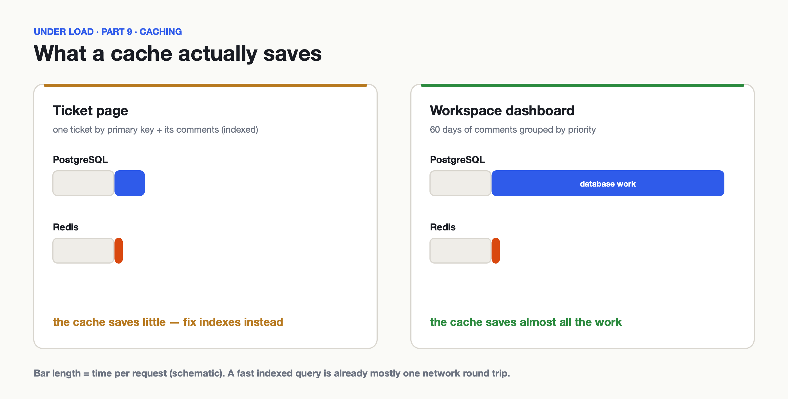
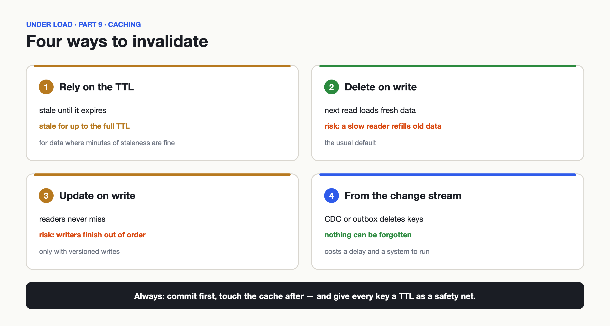
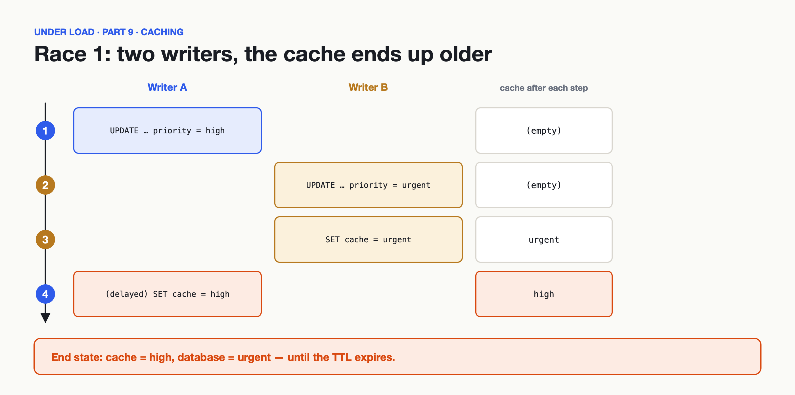
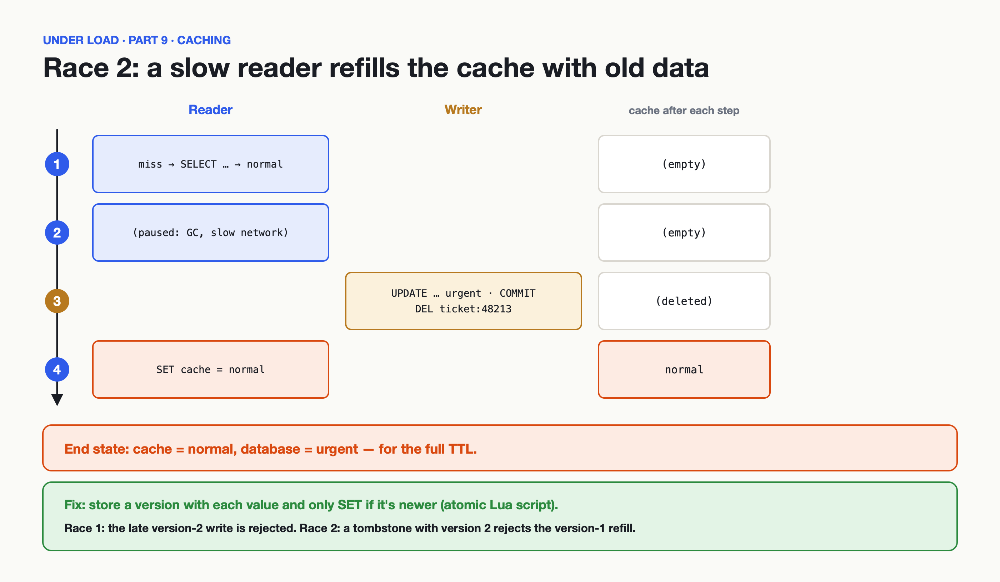
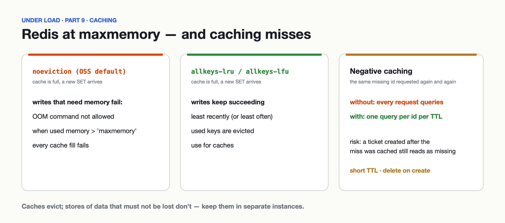
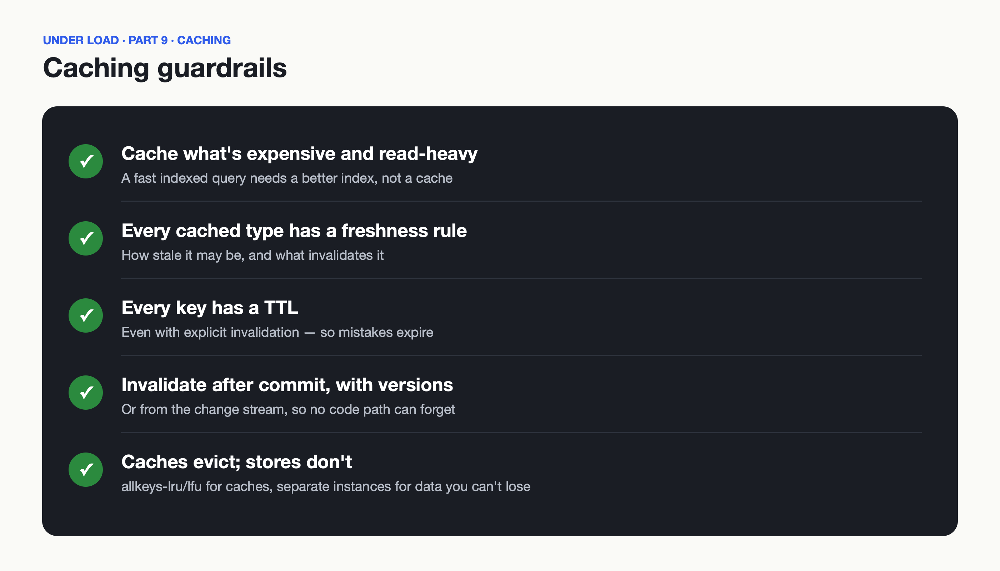

# Caching Strategies & Invalidation

### Cache-aside done properly: what's worth caching, every way to invalidate, the two races that leave stale data behind, and how to close them.

*Under Load · Part 9 · Caching*





---

The team adds Redis in front of the ticket page. The idea is standard: on every view, look in the cache first; only if the ticket isn't there, build the page from PostgreSQL and store it for five minutes.

Database load drops, and for a week everyone is happy. Then an escalation manager raises a ticket's priority to *urgent*, refreshes, and sees *normal*. She changes it again. Still *normal*. Five minutes later it suddenly shows *urgent* — and in the meantime, the on-call agent who opened the ticket from the urgent queue saw a "normal" ticket and moved on.

The first fix is obvious: delete the cache entry whenever a ticket changes. It works — almost always. A few times a week, a ticket still shows an old value after an update, for exactly five minutes. Nobody can reproduce it.

This is the real lesson of caching: **putting data in a cache is easy; knowing when cached data is still true is the hard part.** This article covers how cache-aside works, what's actually worth caching (less than most teams assume), every way to invalidate, the two races behind the "can't reproduce" bug, what happens when many requests miss at once, and what to do when the cache is full or the data doesn't exist at all.

---

## Cache-aside: the standard pattern

The most common way to use a cache is called **cache-aside** (or *lazy loading*). The application talks to the cache and the database separately; the cache never talks to the database itself.



**Reading:**

1. Look for the key in the cache (`GET ticket:48213`).
2. If it's there — a **hit** — return it.
3. If it's not — a **miss** — load it from the database, store it in the cache with an expiry time (`SET ticket:48213 ... EX 300`), and return it.

**Writing:**

1. Write to the database.
2. Do something about the cache: delete the key, update it, or do nothing and wait for it to expire. That choice is the whole topic of invalidation.

The expiry time is the **TTL** (time to live). After it passes, the cache deletes the entry on its own, and the next read loads a fresh copy.

Other patterns exist — *read-through* (the cache loads from the database itself), *write-through* and *write-back* (writes go through the cache). Part 10 covers them. Cache-aside is the default because it's simple, and because if the cache goes down, the application can still fall back to the database.

---

## What's worth caching

The obvious assumption is "Redis is fast, the database is slow, so cache everything." It's worth looking at where the time actually goes.



- **The ticket page** — one ticket by primary key, plus its comments through an index. PostgreSQL answers this by walking a couple of B-tree levels that are almost certainly in memory (Part 1) and reading a few pages: a fraction of a millisecond of database work. Redis answers it with one in-memory lookup. In both cases, most of the time is the **network round trip** between the application and the server — and that round trip is the same for both. The cache saves very little.
- **The workspace dashboard** — counting 60 days of comments by ticket priority across the workspace. PostgreSQL has to read and aggregate many thousands of rows on every request: milliseconds to tens of milliseconds of CPU and I/O. Redis returns the precomputed result in one round trip. Here the cache saves almost all of the work, often by two orders of magnitude.

For a query that already uses a good index, the cache barely helps — and it adds a second system that can be stale, full or down. The ticket-page cache in the story mostly added risk.

A cache earns its place when:

- **The work behind the value is expensive:** aggregations, many joins, calls to other services, rendering.
- **The same value is read far more often than it changes.** A dashboard read by 200 agents and updated once a minute is ideal. A ticket being edited every few seconds isn't.
- **The database is the bottleneck under load.** Even when a single query is fast, taking thousands of identical reads per second off a busy database frees capacity for everything else (Part 7 showed what happens when it runs out).
- **A little staleness is acceptable** for that data.

And when **not** to cache:

- Data that must be exactly right at the moment it's read: balances, permissions, inventory at checkout, a ticket's assignee when someone clicks "Take."
- Data that changes about as often as it's read.
- Queries that are already fast and not under heavy load — fix the index instead (Part 1).
- Anything per-user and rarely repeated: the hit rate will be close to zero.

---

## Invalidation: the four options

When a ticket changes, something has to happen to its cached copy. There are four options, and each has a cost.



**1. Do nothing; rely on the TTL.** The cached value is wrong until it expires. With a five-minute TTL, a priority changed one second after the page was cached keeps showing *normal* for almost five more minutes. Fine for a "top articles" widget; not fine for ticket priority. Even with explicit invalidation, always set a TTL as a **safety net**: if any invalidation is ever missed, the damage has an end date.

**2. Delete the key on write.** After writing to the database, delete the cache entry. The next read misses and loads the new value. This is the usual recommendation, because the next read always goes to the source of truth. Its weakness is a race, shown below.

**3. Update the key on write.** After writing to the database, write the new value into the cache. Readers never miss. But two writers can finish in the opposite order, and the cache can end up with the older value — also shown below.

**4. Invalidate from the database's change stream.** Instead of every code path remembering to delete keys, a separate process reads committed changes from the database (change data capture, Part 30, or a transactional outbox, Part 29) and deletes or updates the affected keys. Nothing can be forgotten, because every committed change produces an event. The trade-off: there's a delay of milliseconds to seconds, and another system to run.

Whichever is chosen, the write to the database **commits first**, and the cache is touched **after the commit**. Deleting the key before committing lets a reader refill it with the old value before the writing transaction finishes.

---

## The two races that leave stale data

Both are timing races: each needs a specific interleaving of steps, which is why they show up rarely in production and almost never in a test unless the steps are forced into that order.

### Race 1: updating the cache, two writers out of order



1. Writer A sets the priority to *high* in the database.
2. Writer B sets it to *urgent* in the database.
3. Writer B writes *urgent* to the cache.
4. Writer A — delayed by a slow network call or a pause — writes *high* to the cache.

The database says *urgent*. The cache says *high*, and keeps saying it until the TTL expires. The end state: **cache = high, database = urgent.**

This is why "update the cache on write" is risky: the order of the cache writes doesn't have to match the order of the database writes.

### Race 2: deleting on write, with a slow reader



1. A reader misses the cache and loads the ticket from the database: *normal*.
2. The reader is delayed for a moment — a garbage-collection pause, a slow network hop.
3. A writer sets the priority to *urgent* in the database and deletes the cache key.
4. The reader, finally continuing, writes the *normal* it loaded earlier into the cache.

The delete happened, but the reader's refill came after it. The cache holds *normal* for the full TTL. The end state is **cache = normal, database = urgent** — the "can't reproduce" bug from the story. It needs an unlucky timing on a busy ticket, which is why it happens a few times a week and never on demand.

### Closing both races: versioned writes

The root problem in both races is the same: **an older value is written to the cache after a newer one.** So make the cache refuse older values.

Give every ticket a `version` column that increases on every update (the same column used for optimistic locking in Part 5). Store the version with the cached value. Then only write to the cache if the new value's version is higher than the one already there — checked inside Redis, atomically, with a small Lua script:

```lua
-- KEYS[1] = cache key, ARGV[1] = value, ARGV[2] = its version, ARGV[3] = TTL
local cur = redis.call('GET', KEYS[1])
if cur then
  local cached = cjson.decode(cur)
  local have, new = tonumber(cached.version), tonumber(ARGV[2])
  if cached.tombstone then
    if new < have then return 0 end        -- older than the last write: reject
  elseif new <= have then return 0 end     -- not newer than what's cached: reject
end
redis.call('SET', KEYS[1], ARGV[1], 'EX', ARGV[3])
return 1
```

For the delete race, the writer doesn't just delete the key. It leaves a short-lived **tombstone** that records the new version (`{"version": 2, "tombstone": true}`), so a reader that loaded version 1 before the write can't put it back.

Walking both races again with this change:

- **Race 1:** writer B caches *urgent* with version 3. Writer A's late write carries version 2, so the script **rejects** it. The cache stays *urgent*.
- **Race 2:** the writer leaves a tombstone with version 2. The slow reader tries to cache version 1, and the script **rejects** it. The next read misses, loads version 2 — *urgent* — and caches it, because a version equal to the tombstone's is accepted.

The tombstone needs a TTL of its own, longer than any plausible reader delay but short enough not to waste memory — seconds, typically.

Simpler alternatives exist, each closing the window only partly: a **short TTL** limits how long a stale value can survive; a **delayed second delete** (delete again a second or two after the write) catches most slow refills. For data where stale values really matter, use versions — or don't cache it.

---

## When the data doesn't exist

Old notification emails link to tickets that were later deleted. Scanners and buggy integrations request random ids. Every one of those lookups misses the cache — there's nothing to cache — and goes to the database.

The fix is **negative caching**: cache the fact that something *doesn't exist*, with a short TTL. If 50 ids that don't exist are each requested 20 times, the database receives 1,000 queries without negative caching — and only 50 with it, one per id until each negative entry expires.

The risk is the mirror image of everything above: if the ticket is created after "doesn't exist" was cached, it **reads as missing** until the negative entry expires. A ticket created a moment after its "missing" result was cached still reads as missing. So:

- Keep negative TTLs **short** — seconds, not minutes.
- **Delete negative entries on create**, the same way positive ones are deleted on update.
- For floods of requests for ids that never existed, check them before they reach the cache at all. Part 11 covers this (*cache penetration*) along with the other ways caches fail under load.

---

## When the cache is full

A cache has limited memory. What happens when it fills up depends on its **eviction policy**, and the default in Redis may not be the one a cache needs.

Redis enforces a memory limit with `maxmemory` and decides what to do at the limit with `maxmemory-policy`:



- With **`noeviction`** — the default in open-source Redis — writes that need more memory are **rejected** with `OOM command not allowed when used memory > 'maxmemory'`. Reads keep working, but every cache fill in the application starts failing, so every miss goes to the database and stays a miss.
- With **`allkeys-lru`**, Redis keeps accepting writes by **evicting** keys that haven't been used recently (it uses an approximate LRU, sampling a few keys rather than tracking exact order). The cache stays full of roughly the most recently used entries.
- The **`volatile-*`** variants evict only keys that have a TTL. Managed services sometimes default to one of these (Amazon ElastiCache, for example, defaults to `volatile-lru`), which behaves like `noeviction` for keys stored without a TTL — one more reason every cache key should have one.

For a cache, use an eviction policy: `allkeys-lru` (evict least recently used) or `allkeys-lfu` (evict least *frequently* used, better when some keys are popular for a long time). Keep `noeviction` for Redis instances that store data that must not be lost, like queues or sessions — and don't put both kinds of data in the same instance.

Watch the **evicted keys** counter. Evictions themselves are normal, but a steady stream of them means the cache is too small for the working set, so popular entries are being thrown out and the hit rate drops.

---

## When many requests miss at once

Every cache has moments when it protects nothing. A popular key expires, a deploy changes the key prefix, a cache node restarts empty. In those moments, every request that wanted the value misses at the same time — and every one of them goes to the database to rebuild it. This is a **cache stampede** (or *thundering herd*), and it hits exactly when the cache is least useful: the dashboard key that 200 agents load every few seconds expires, and the expensive aggregate runs 200 times in parallel instead of once.

The defenses all aim at the same thing — rebuild each value once, not once per request:

- **Request coalescing.** Within one application instance, the first request that misses starts the rebuild, and every other request for the same key waits for that result instead of running its own query (Part 12 covers it in depth).
- **A rebuild lock.** Across instances, the first miss takes a short lock in the cache (`SET lock:dashboard:7 <token> NX EX 5`); the others either wait briefly and re-read, or serve a stale value. The lock needs a TTL so a crashed rebuilder doesn't block everyone.
- **Stale-while-revalidate.** Store the value with a "fresh until" time shorter than its real TTL. After it goes stale, keep serving the stale copy while one request refreshes it in the background. Readers never wait, at the cost of a little extra staleness.
- **TTL jitter.** Keys written at the same moment (a warm-up, a bulk import) expire at the same moment. Adding a random spread — say ±10% of the TTL — keeps them from all missing together.

Part 11 goes through stampedes, hot keys and the other ways caches fail under load.

---

## Designing cache keys

A few rules prevent a whole class of bugs:

- **Include everything the value depends on.** If the ticket page looks different per language or per permission level, those belong in the key: `ticket:48213:v3:en:agent`. Missing one is how one user sees another user's view.
- **Namespace and version the format.** When the cached structure changes in a deploy, bump a prefix (`v3:`) so old and new code don't read each other's data.
- **Keep values small.** Large values slow down the cache and the network; cache the expensive part, not the whole world.
- **Never cache errors as values.** A database timeout cached for five minutes turns a one-second hiccup into a five-minute outage.

---

## Rolling out a cache safely

A cache is a production dependency like any other, and it is easiest to get right before it carries load.

- **Decide what happens when the cache is down.** With cache-aside, the application can fall back to the database — but only if the database can take the full load. If it can't, a cache outage is a database outage; plan for a degraded mode (serve less, or serve stale) instead of discovering it.
- **Give cache calls short timeouts.** A cache lookup that hangs for seconds is worse than a miss. Timeouts of a few milliseconds to tens of milliseconds, with the miss path as the fallback, keep a sick cache from slowing every request.
- **Shadow-read first.** For a while, read from both the cache and the database, serve the database's answer, and count how often they differ. A non-zero mismatch rate before launch is a free bug report.
- **Add a kill switch per key type.** Being able to turn off caching for tickets, without a deploy, turns the next staleness incident into a one-minute fix.
- **Warm up gradually.** A new cache — or a new key prefix after a format change — starts empty. Rolling it out to a fraction of traffic first avoids a stampede on the database.

---

## Guardrails that prevent the next one



1. **Cache what's expensive and read-heavy, not everything.** A fast indexed query usually needs a better index, not a cache.
2. **Every cached type has a written freshness rule.** How stale can it be, and what invalidates it.
3. **Every key has a TTL**, even when there's explicit invalidation.
4. **Invalidate after commit, with versions where staleness matters.** Or invalidate from the change stream so no code path can forget.
5. **Caches evict; stores don't.** `allkeys-lru` or `allkeys-lfu` for caches, separate instances for data that must not be evicted.

---

## What to keep on the dashboard

- **Hit rate, per key type.** `keyspace_hits` and `keyspace_misses` in Redis `INFO stats`, but measured per type in the application, because one bad key type hides behind a good average.
- **Database load with and without the cache.** The point of the cache is the load it removes; measure it.
- **Evicted keys.** `evicted_keys` in `INFO stats`. A steady stream means the cache is too small.
- **Memory used vs `maxmemory`.**
- **Cache latency and errors** from the application's point of view, including timeouts.
- **Staleness.** For critical types, sample cached values and compare their version with the database. The number of mismatches is the real consistency rate.
- **Rejected cache writes**, where versioned writes are used. A rise means more concurrent updates than expected.

---

## Recap

### What is cache-aside?
The application reads from the cache first; on a miss, it loads from the database and stores the value with a TTL. On a write, it updates the database and then deletes, updates or leaves the cached copy. The cache never talks to the database itself, so the application still works when the cache is down.

### What should be cached — and what shouldn't?
Cache values that are expensive to build, read far more often than they change, and allowed to be slightly stale. An indexed ticket lookup costs about one network round trip either way, so a cache saves little; a dashboard aggregate is mostly database work, so a cache saves almost all of it. Don't cache data that must be exactly current, changes as often as it's read, or is already fast — fix the index instead.

### How can the cache and the database be kept reasonably consistent?
Write to the database first, then invalidate after the commit — usually by deleting the key. Always set a TTL as a safety net. Where stale values matter, store a version with each cached value and reject older writes atomically in the cache, or invalidate from the database's change stream (CDC or an outbox) so no code path can forget.

### Why can deleting the key on write still leave stale data?
Because a reader that loaded the old value just before the write can store it in the cache just after the delete. That sequence leaves "normal" cached while the database says "urgent," for the full TTL. A tombstone with the new version, or a delayed second delete, closes the window.

### Why is updating the cache on every write risky?
Because two writers can update the database in one order and the cache in the other. The cache can end with the older value, "high," while the database has "urgent." Versioned writes that reject older values fix it.

### What is negative caching, and when is it dangerous?
Caching the fact that something doesn't exist, so repeated lookups for missing ids don't all reach the database — one database query per missing id per TTL instead of one per request. It's dangerous when the item is created later: it reads as missing until the negative entry expires. Keep negative TTLs short and delete them on create.

### What happens when the cache runs out of memory?
It depends on the eviction policy. With Redis's default, `noeviction`, every new write fails with an out-of-memory error. With `allkeys-lru` or `allkeys-lfu`, old keys are evicted to make room. Caches should use an `allkeys-*` policy and keep data that must not be lost in a separate instance.

### Why should every key have a TTL?
Because any invalidation can be missed — a bug, a crashed worker, a manual database fix. A TTL guarantees that a wrong value eventually disappears, so the worst case has an end date.

### What is a cache stampede, and how is it prevented?
Many requests missing the same key at the same time and all rebuilding it from the database at once — for example, when a popular key expires or a cache node restarts. It overloads the database exactly when the cache stops protecting it. Request coalescing, a short rebuild lock, stale-while-revalidate and TTL jitter make sure each value is rebuilt once, not once per request.

### What should be monitored?
Hit rate per key type, database load removed by the cache, evicted keys, memory against `maxmemory`, cache latency and errors, measured staleness for critical types, and rejected versioned writes.

---

## Next

- **Lab (run + measured write-up):** [09-caching](https://github.com/b-basoglu/under-load/tree/main/09-caching)
- **Next:** [Write-Through vs Write-Back](../10-write-through-back/article.md) — What if every write went through the cache first? Faster writes — and a new way to lose data.
