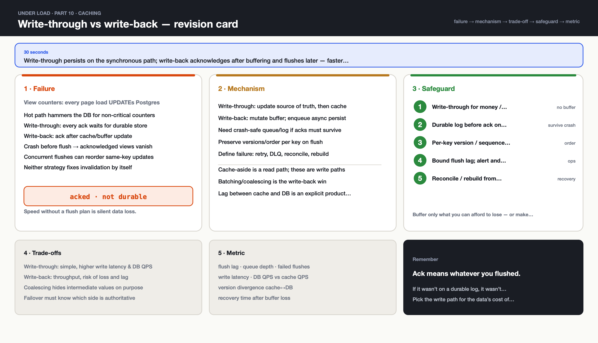
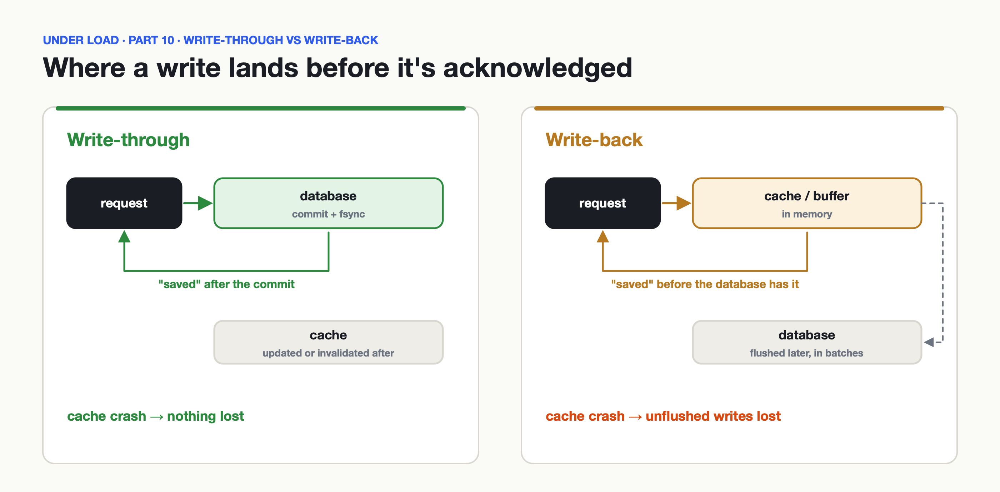
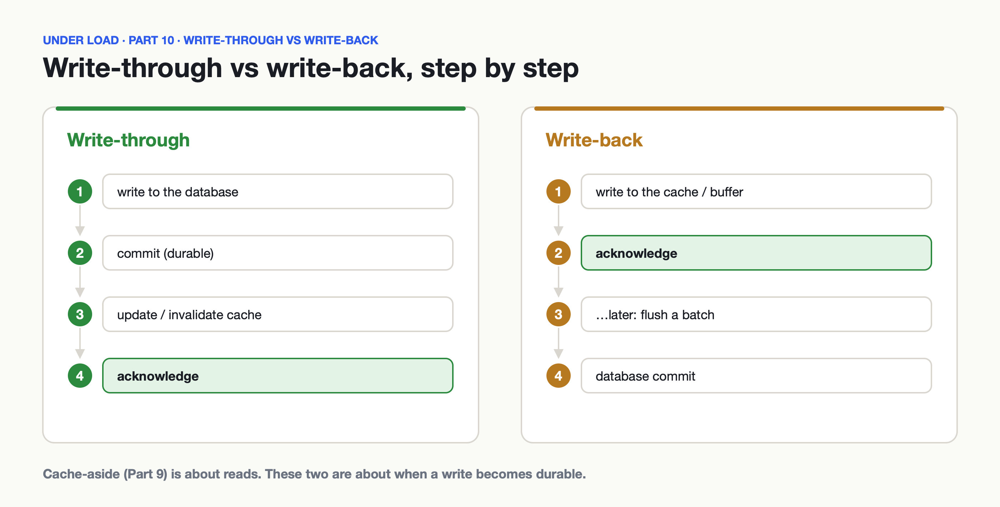
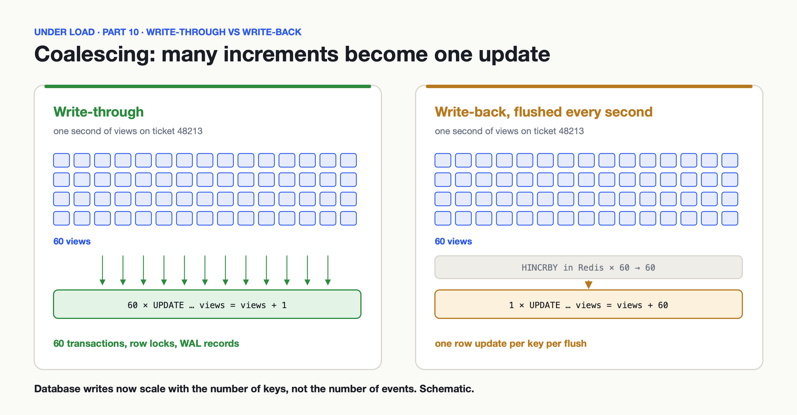
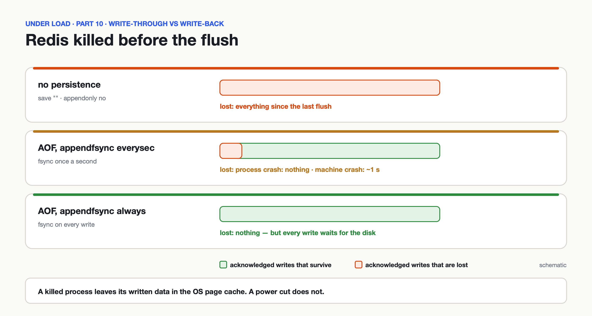
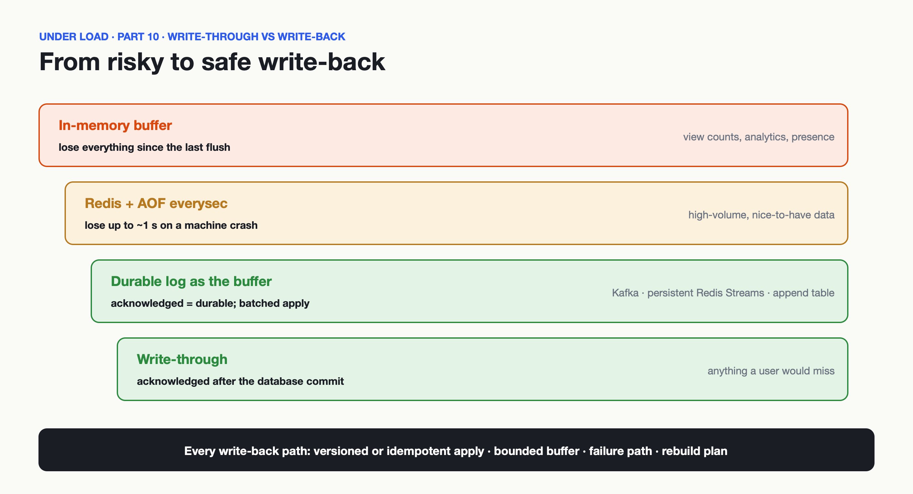
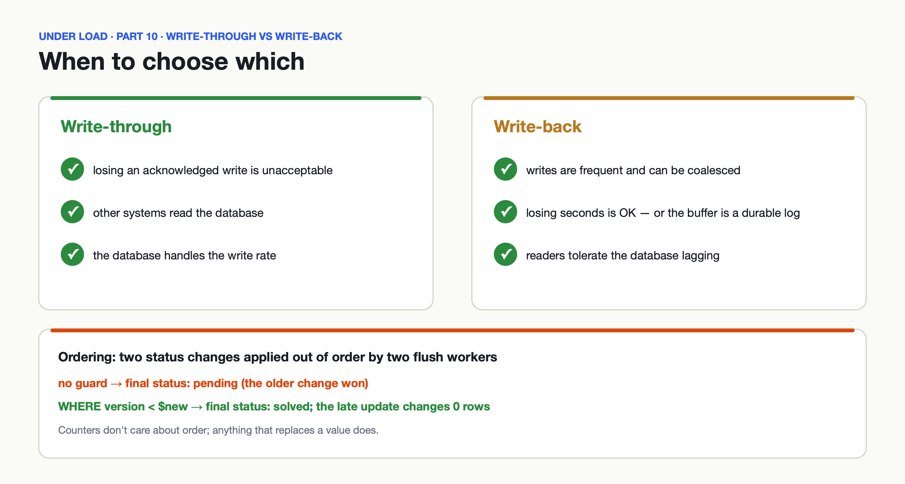
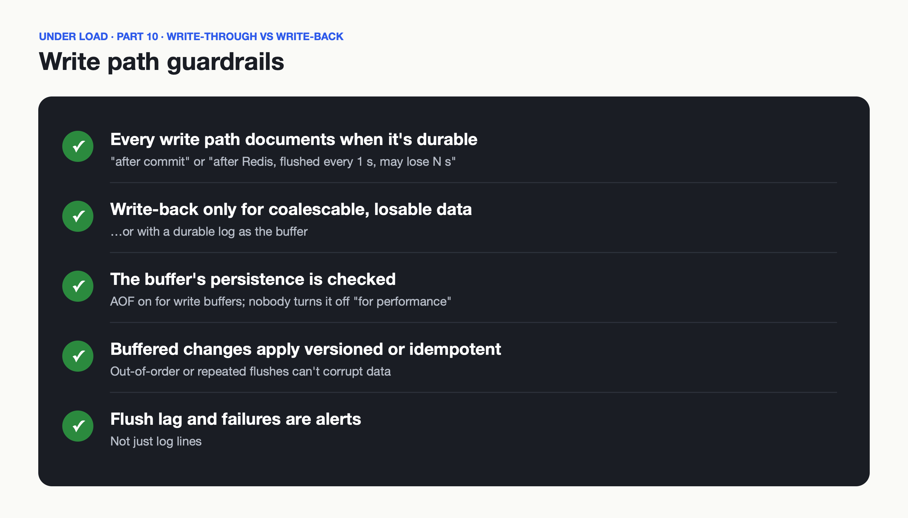

# Write-Through vs Write-Back

### Write-through vs write-back: when a write should reach the database, what buffering really buys, and what it costs when the cache crashes.

*Under Load · Part 10 · Caching*





---

Product wants to show how many times each ticket has been viewed, so team leads can spot the tickets everyone opens and nobody answers. The first version is one line of code: every time a ticket page loads, run

```sql
UPDATE ticket_stats SET views = views + 1 WHERE ticket_id = $1;
```

It works, and it's expensive. Every page view is now also a database write — plus a row lock, a new row version for VACUUM to clean up (Part 3) and a WAL record with its flush at commit (Part 6). The most-viewed tickets become hot rows (Part 5), and the ticket page gets noticeably slower at peak.

So the team moves the counter to Redis. Each view does `HINCRBY` in Redis, an in-memory operation, and a background job copies the counts into PostgreSQL once a second. Page latency drops, database writes drop to a small fraction of what they were, and everyone moves on.

A month later, Redis restarts during routine maintenance. Every view count accumulated since the last flush is gone, which nobody notices. But by then the same pattern had been copied to something that matters: **agents' "last read" markers**, which decide which tickets show as unread in their queue. Those were lost too. For a few seconds of updates, nobody notices. Then the team discovers that persistence on that Redis instance had been turned off entirely, so a crash at the wrong moment — or a flush job that had quietly stopped — would have lost everything still waiting to be written.

The difference between those two designs has a name. The first is **write-through**: the write goes to the database before it's acknowledged. The second is **write-back** (also called **write-behind**): the write is acknowledged once it's in the cache, and reaches the database later. This article explains both, what write-back actually buys, what it costs, and what has to be added to make it safe.

---

## The difference is when a write becomes durable



**Write-through:**

1. The request writes to the database.
2. The database commits (and makes it durable — Part 6).
3. The cache is updated or invalidated.
4. The request is acknowledged.

When the user sees "saved," the data is in the source of truth. If the cache dies a second later, nothing is lost: the next read misses and loads from the database.

**Write-back:**

1. The request writes to the cache (or another buffer).
2. The request is acknowledged.
3. Later — a few milliseconds to a few seconds — a background process writes the buffered changes to the database, usually many at once.

When the user sees "saved," the data exists **only in the buffer**. Until the flush happens, the buffer *is* the source of truth.

That is the whole trade-off: write-back is faster because the slow, durable step is moved off the request path. Everything it costs comes from the same move.

The terms come from CPU caches, where they mean exactly the same thing: a write-through cache passes every store on to main memory, while a write-back cache marks the cache line "dirty" and writes it out only when the line is evicted. Operating systems do the same with file writes — the page cache from Part 6 is a write-back cache, and `fsync` is how a program forces the write-through behaviour when it needs it.

### How this relates to cache-aside

Cache-aside (Part 9) is about **reads**: the application loads from the database on a miss and decides what to do with the cache on writes. Write-through and write-back are about **writes**: where a write goes first, and when it's acknowledged.

They combine. Most systems use cache-aside for reads and some form of write-through for writes — write to the database, then invalidate or update the cache. Write-back is a specialized tool for writes that are frequent, cheap to lose (or protected by a durable buffer) and can be **coalesced**: many updates to the same thing turned into one.

Strictly speaking, "write-through" in caching libraries often means the *cache* writes to the database on the application's behalf, synchronously, so the application only talks to the cache. The important property is the same either way: the write is in the database before it's acknowledged.

---

## What write-back buys

### Lower write latency

With write-through, every acknowledged write waits for the database: a network round trip, a row lock, a new row version, index updates, a WAL record and the commit flush. With write-back, the request waits only for an in-memory operation in the cache — typically one round trip to Redis and microseconds of work there. The request path gets shorter by the cost of a database commit, which on busy or network-attached storage can be the largest part of the request.

### Far fewer database writes: coalescing

The bigger gain is what happens to the writes that do reach the database. A worked, illustrative example:



- The product has 200 popular tickets, and together they're viewed a few thousand times per second at peak.
- **Write-through** sends every one of those views to the database as its own `UPDATE`: thousands of row updates per second, each with its lock, row version and WAL record, many of them contending for the same hot rows.
- **Write-back** accumulates them in Redis. When the flush job runs once a second, a ticket viewed 60 times in that second produces one statement, `UPDATE ticket_stats SET views = views + 60 WHERE ticket_id = $1` — and the flush can update all 200 tickets in a single transaction.
- So the database goes from thousands of single-row transactions per second to **one transaction with at most 200 row updates per second**, however high the view rate climbs. The write load now depends on the number of distinct keys, not the number of events.

That is **coalescing**, and it is the main reason to use write-back. Latency helps; coalescing changes the shape of the load.

Coalescing only works for changes that can be combined:

- **Counters** — increments add up.
- **"Last seen" timestamps and latest positions** — only the newest value matters.
- **Aggregated metrics** — sums, maxima, histograms.

A sequence of independent events — comments, payments, audit entries, state transitions that each need to be recorded — can't be merged; each one must be written. For those, write-back can still batch (many inserts in one transaction), but every event has to survive, which changes how durable the buffer must be.

---

## What write-back costs

### 1. The database is behind

Between flushes, the database doesn't have the latest data. Right after a burst of views, the cache might hold a count of several thousand while the database still shows the count from the previous flush. Only after the next flush do they match.

Anything that reads from the database during that window sees old numbers: reports, exports, a read replica, another service, a person running SQL, the change-data-capture stream (Part 30). Every reader has to know which store is current — or be fine with lag. If the application itself must show the user their own fresh write (*read-your-writes*), it has to read from the buffer, or merge the buffered delta into what it reads from the database.

The lag also complicates **failover and recovery**. If the database fails over to a replica, the buffer still holds changes that neither the old nor the new primary has. If the cache fails over to its replica, any writes not yet replicated to it are gone. Both cases need a defined answer before they happen.

### 2. A crash loses what wasn't flushed

This is the big one. Imagine Redis being killed a moment before the next flush. What survives depends entirely on how Redis persists data:



- **No persistence** (`save ""`, `appendonly no`): everything in memory is gone. Every write acknowledged since the last flush is lost.
- **RDB snapshots only** (the default `save` rules): Redis writes a point-in-time snapshot periodically — by default somewhere between every minute and every hour, depending on how many keys changed. A crash loses everything since the last snapshot — usually far more than one flush interval.
- **Append-only file (AOF), `appendfsync everysec`** — Redis appends every write to a log file and forces it to disk once a second. If only the Redis *process* dies, the data it had written to the file is still in the operating system's page cache and survives. On a **power cut or machine crash**, it can lose up to about a second of writes, sometimes a little more if the disk is slow — the same "written" versus "durable" distinction from Part 6.
- **AOF, `appendfsync always`** — every write is forced to disk before Redis replies. Nothing acknowledged is lost, but every write now waits for the disk, so throughput drops sharply and much of write-back's latency advantage disappears.

So the question "what happens if the cache crashes before a write-back flush?" has a precise answer: **it depends on the buffer's durability.** In memory only: everything since the last flush is lost. Persisted once a second: up to about a second on a machine crash. Persisted on every write: nothing — at a large cost in speed.

Replication doesn't change this much. Redis replicates asynchronously, so a failover to a replica can lose the writes the primary had acknowledged but not yet sent. The `WAIT` command can make a client wait until a write reaches a number of replicas, which narrows the window, but Redis's documentation is explicit that it doesn't turn Redis into a strongly consistent store.

### 3. Updates can be applied out of order

With several flush workers, or with retries, two updates to the same key can reach the database in the wrong order. For counter increments that doesn't matter — addition doesn't care about order. It matters for anything that *replaces* a value.

A worked example: a ticket's status changes to *pending* (version 1), then to *solved* (version 2). Both changes are buffered. Two flush workers pick them up, and the worker holding *solved* happens to finish first.

- **Without a guard**, the worker holding *pending* writes last, and the final status is **pending** — the older change won, and the ticket reappears in the agent's queue.
- **With a version guard**, every write is conditional:

  ```sql
  UPDATE tickets SET status = $2, version = $3
  WHERE id = $1 AND version < $3;
  ```

  The late *pending* update carries version 1, finds version 2 already stored, matches **zero rows**, and the status stays **solved**.

This is the same idea as the versioned cache writes in Part 9 and the version column in Part 5: carry a version with every change, and refuse to apply anything older than what's already there. The alternative is to **route all changes for one key to the same worker** — partitioning by key, the way Kafka keeps per-partition order — so they are always applied in sequence. Part 27 covers ordering in queues.

### 4. Failures have to go somewhere

A flush can fail: the database is down, a row violates a constraint, a deploy changed the schema, a ticket was deleted while its counter was still buffered. With write-through, the user would have seen an error and could retry. With write-back, the user already saw "saved," so the system has to handle it alone:

- **Retry** transient failures with backoff and jitter (Part 15), so a recovering database isn't hit by every flush worker at once.
- **Dead-letter** records that keep failing — move them aside so one bad record doesn't block the rest (Part 28).
- **Reconcile** — periodically compare the buffer with the database, or rebuild the derived values from a durable log, to catch anything that slipped through.
- **Alert** — a failed flush is lost data in slow motion.

Write-back without a defined failure path loses data silently.

### 5. The buffer needs a bound

If the database is unavailable for an hour, the buffer keeps filling. In Redis that means memory, and at `maxmemory` it means either rejected writes or evicted buffered data (Part 9) — both of which lose acknowledged writes. Decide in advance how large the buffer may grow, and what happens at the limit: slow down producers (backpressure, Part 24), spill to disk, or start rejecting writes so callers know they failed.

---

## Making write-back safe

The rule is simple: **if a write must survive, it must be durable before it's acknowledged.** Write-back is fine as long as the *buffer* is durable — it just can't be a plain in-memory cache.



Options, from least to most durable:

1. **In-memory buffer only.** Acceptable for data that can be lost: view counts, analytics, "currently viewing" indicators. Say so in the design.
2. **Redis with AOF, `appendfsync everysec`.** Survives process crashes; can lose about a second on a machine crash or failover. Good for nice-to-have data at high volume.
3. **A durable log as the buffer.** Append each change to something built to keep it — Kafka with replication and `acks=all`, Redis Streams on a persistent replicated instance, or a simple append-only table in the database — and acknowledge only after the append. A consumer applies changes to the main table in batches and records how far it got. This keeps write-back's batching and coalescing without losing acknowledged writes, and the log doubles as the rebuild path. It is also the shape of the transactional outbox (Part 29).
4. **Write-through.** For anything a user would be upset to lose, or anything that must be correct the moment it's read.

Option 3 deserves a note: appending to a log is itself a durable write, so it isn't free. It's cheaper than the main write because it's an append with no indexes, no row locks and no contention on hot rows, and because many appends can share one flush (Part 6's group commit). The coalescing happens on the way out of the log, not on the way in.

And for every write-back path:

- **Make applying changes idempotent or versioned**, so a retry or a duplicate can't double-count or move a value backwards (Part 14). For counters, that usually means the flush records which buffered batch it applied, so a retried flush doesn't add the same delta twice.
- **Bound the buffer**, and decide what happens when it's full.
- **Have a rebuild path.** If the buffer is lost or corrupted, how is the data reconstructed? For view counts, maybe it isn't. For "last read" markers, perhaps from the event log.
- **Know the recovery time.** After a crash, how long until the buffer is reloaded or replayed and the database is caught up? That number belongs on the dashboard.

The fix in the story followed exactly this split. View counts stayed in a write-back Redis buffer, now explicitly labeled "may lose a few seconds." "Last read" markers moved to write-through — a single `UPDATE` per read is cheap enough, and losing them was visible to every agent.

---

## When to choose which



**Choose write-through when:**

- Losing an acknowledged write is unacceptable: anything a user created or changed on purpose.
- Other systems read the database and expect it to be current.
- The write rate is something the database can handle comfortably.

**Choose write-back when:**

- Writes are very frequent and can be **coalesced** — counters, last-seen times, positions, metrics.
- Losing a few seconds of them is acceptable, or the buffer is a durable log.
- Readers can tolerate the database lagging behind.

When in doubt, write-through. It's slower, but it's simple and correct, and buffering can always be added later for the specific writes that need it. Going the other way — discovering after an outage that "saved" didn't mean saved — is much more expensive.

### Neither one solves invalidation

Write-through guarantees the database has the write. It does not guarantee the cache agrees: the update-or-invalidate step after the commit is exactly where Part 9's races live, and a system with several cache layers (an in-process cache, Redis, a CDN) has to invalidate each one. Write-back makes the cache authoritative for a while, which moves the problem rather than removing it. TTLs, versions and invalidation are still needed with both.

---

## Rolling out a write-back path safely

- **Start with the data that can be lost.** Counters and analytics first; nothing user-created until the durable-buffer version exists.
- **Run both paths in parallel for a while.** Keep the write-through path as the source of truth, write to the buffer as well, and compare the database's values with what the flush job would produce. Differences are bugs found for free.
- **Test the crash, not just the happy path.** Kill the buffer process mid-burst, restart it, and count what survived. Then do the same with the whole machine, because a process kill hides the difference between "written to the OS" and "on disk."
- **Check persistence settings in every environment.** Configuration drift is how a "durable" buffer quietly becomes an in-memory one.
- **Document the loss window** next to the code: "acknowledged after Redis, flushed every second, may lose up to a few seconds on a machine crash."

---

## Guardrails that prevent the next one



1. **Every write path documents when it's durable.** "Acknowledged after the database commit" or "acknowledged after a Redis write, flushed every second, may lose up to N seconds."
2. **Write-back only for coalescable, losable data — or with a durable log.** Never for user-created content on an in-memory buffer.
3. **The buffer's persistence settings are checked.** A Redis instance used as a write buffer has AOF on, and nobody turns it off "for performance."
4. **Applying buffered changes is versioned or idempotent.** Out-of-order or repeated flushes can't corrupt data.
5. **Flush lag and flush failures are alerts, not logs.**

---

## What to keep on the dashboard

- **Flush lag:** the age of the oldest unflushed change. This is how much data a crash would lose right now.
- **Buffer size:** queue depth or number of pending keys. A buffer that grows means flushes can't keep up.
- **Flush failures and retries**, and the size of the dead-letter queue.
- **Write latency** for both paths, and the database write rate. Write-back's benefit should show up as lower database load.
- **Cache-versus-database divergence:** sample keys and compare values or versions between the buffer and the database.
- **Recovery time:** how long a restarted buffer or flush job takes to catch up.
- **Redis persistence health:** `aof_last_write_status`, `aof_last_bgrewrite_status` and `rdb_last_bgsave_status` in `INFO persistence`. A failed write here means the "durable" buffer isn't.

---

## Recap

### What's the difference between write-through and write-back?
When the write reaches the source of truth. Write-through writes to the database before acknowledging, so an acknowledged write is durable. Write-back acknowledges once the write is in a cache or buffer and writes it to the database later, often in batches.

### When would you choose write-back over write-through?
For frequent writes that can be coalesced — counters, last-seen timestamps, positions, metrics — where losing a few seconds is acceptable or the buffer is a durable log. Coalescing turns thousands of increments into one update per key per flush, so database load depends on the number of keys rather than the number of events.

### What happens if the cache crashes before a write-back flush?
Everything not yet flushed is lost unless the buffer is durable. Redis without persistence loses all of it. With AOF and `appendfsync everysec`, a process crash loses nothing that was written, but a machine crash can lose about a second; `appendfsync always` loses nothing at a large cost in throughput. Asynchronous replication adds its own small loss window on failover.

### How do you preserve ordering for repeated updates to the same key?
Carry a version with every change and only apply it if it's newer (`WHERE version < $new`), or route all changes for one key to the same worker so they're applied in sequence. Without either, two flush workers can apply an older change after a newer one and leave the stale value in place.

### How is write-back different from cache-aside?
Cache-aside describes reads: load from the database on a miss and populate the cache; writes go to the database first. Write-back describes writes: they go to the cache first and reach the database later. Most systems combine cache-aside reads with write-through-style writes and reserve write-back for specific high-frequency data.

### What does write-back cost besides possible data loss?
The database lags behind, so reports, replicas, CDC streams and other services see old data, and failover and recovery get harder. Updates can be applied out of order. Failed flushes must be retried, dead-lettered, reconciled and alerted on, because the user was already told the write succeeded. And the buffer needs a bound.

### How do you make write-back safe for data that must not be lost?
Make the buffer durable before acknowledging: append each change to a durable log such as replicated Kafka, a persistent replicated Redis Stream or an append-only database table, then apply changes in batches with versioned or idempotent writes. That keeps batching and coalescing without losing acknowledged writes, and the log becomes the rebuild path.

### Does write-through solve cache consistency?
No. It guarantees the database has the write, but the cache can still be stale if the update or invalidation races with other writers or readers — the races from Part 9 still apply, across every cache layer. Neither strategy removes the need for TTLs, versions or invalidation.

### What should be monitored?
Flush lag (how much a crash would lose right now), buffer size, flush failures and retries, write latency and database write rate, divergence between buffer and database, recovery time, and the buffer's persistence health.

---

## Next

- **Lab (run + measured write-up):** [10-write-through-back](https://github.com/b-basoglu/under-load/tree/main/10-write-through-back)
- **Next:** [When Caches Fail: Stampedes, Penetration and Avalanches](../11-cache-failures/article.md) — The dashboard's cache key expires at 09:00:00. At 09:00:00, two hundred requests miss it at the same time.
