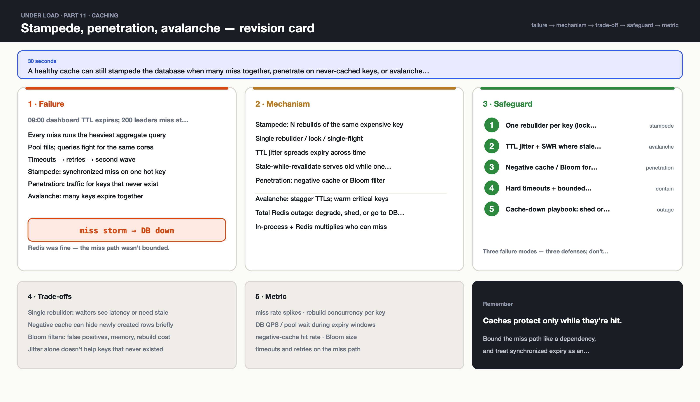
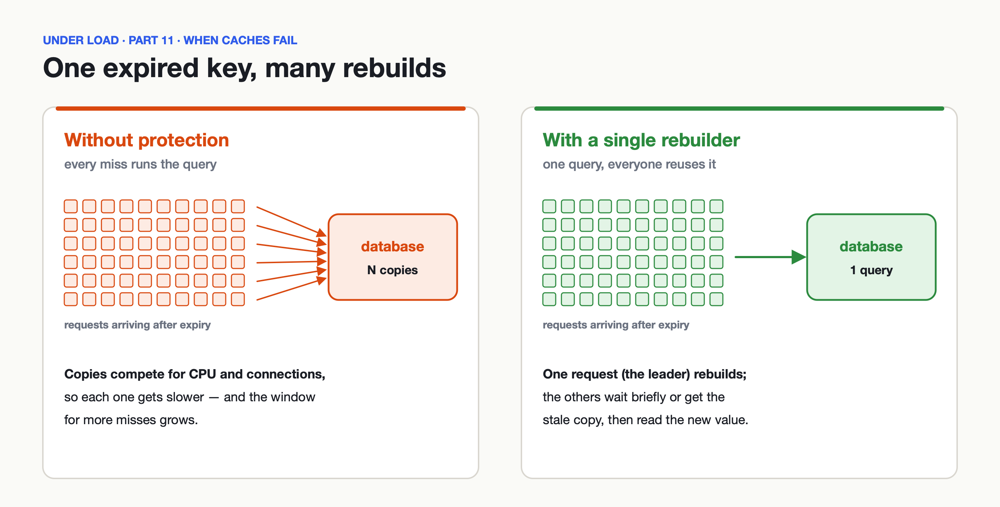
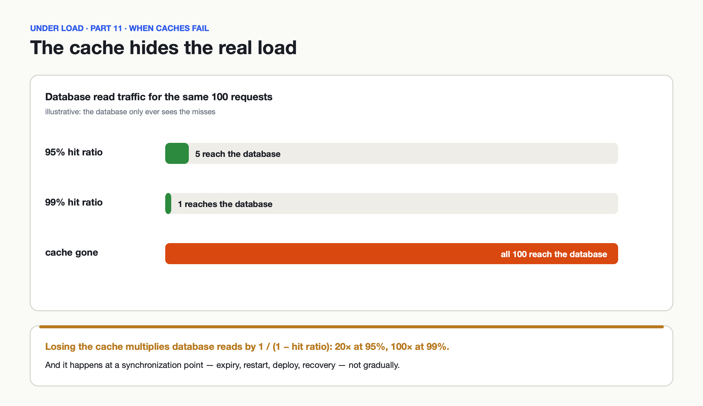
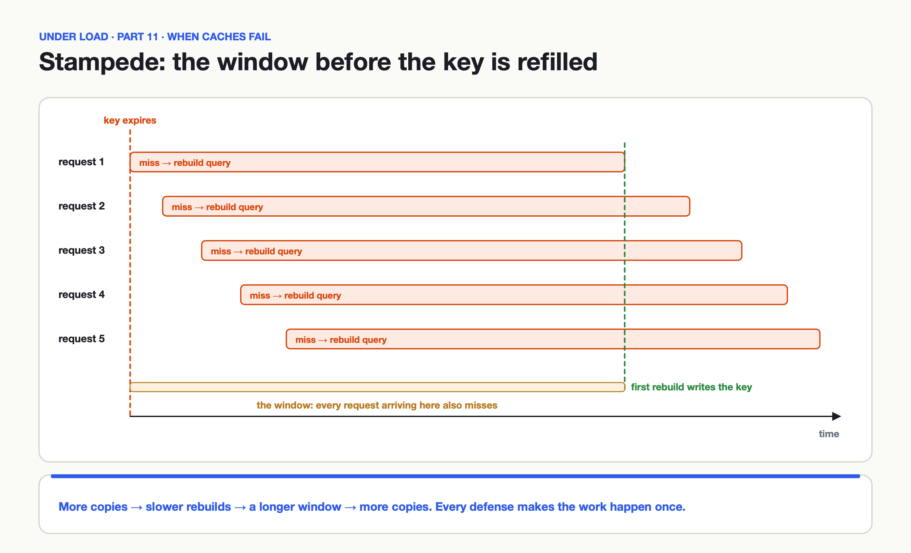
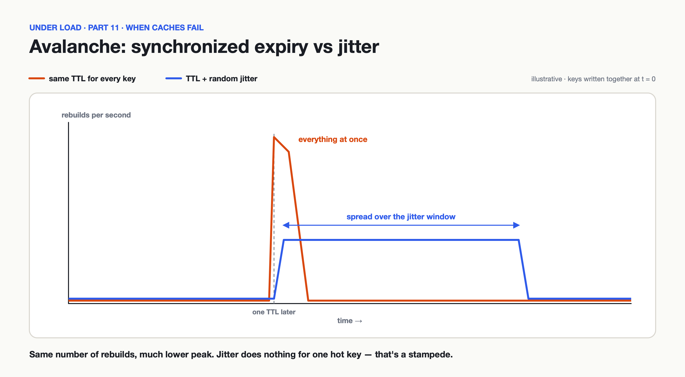
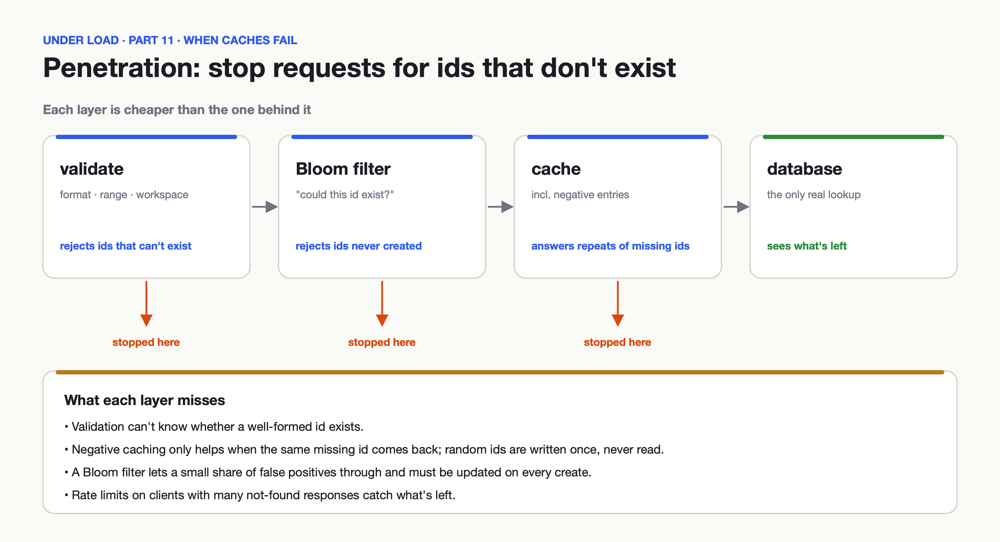
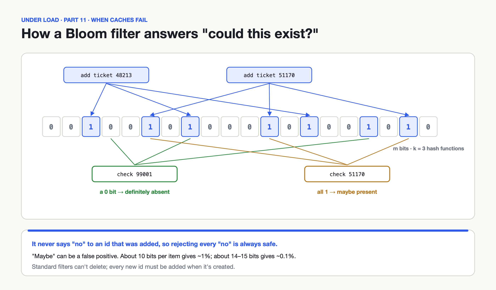
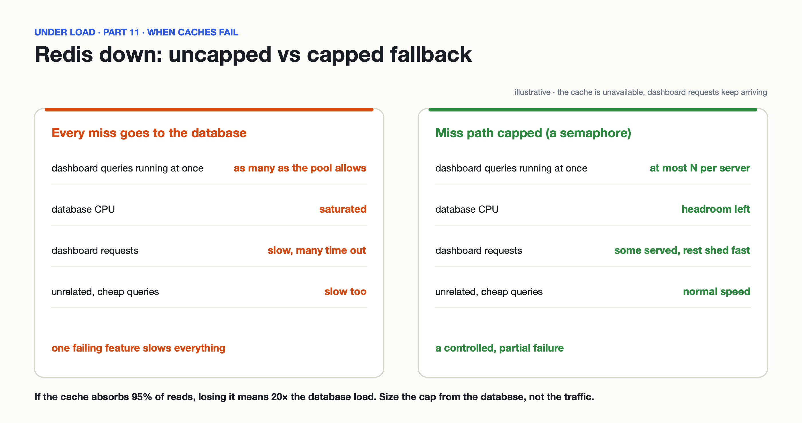
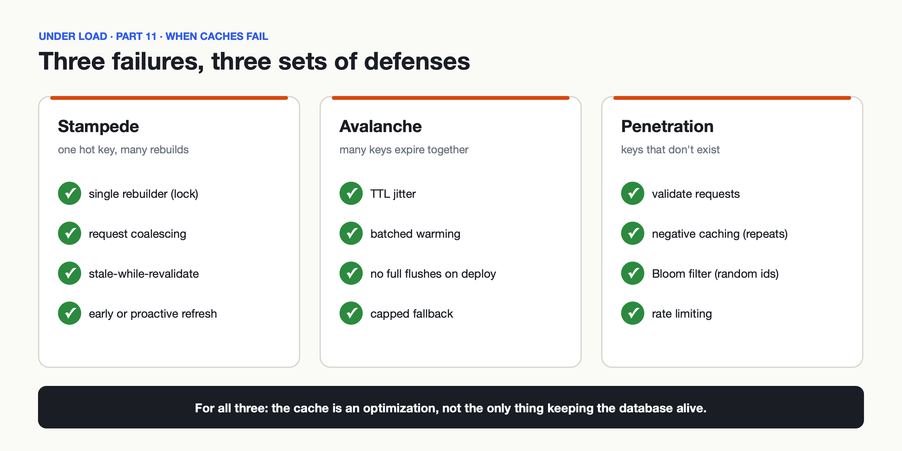
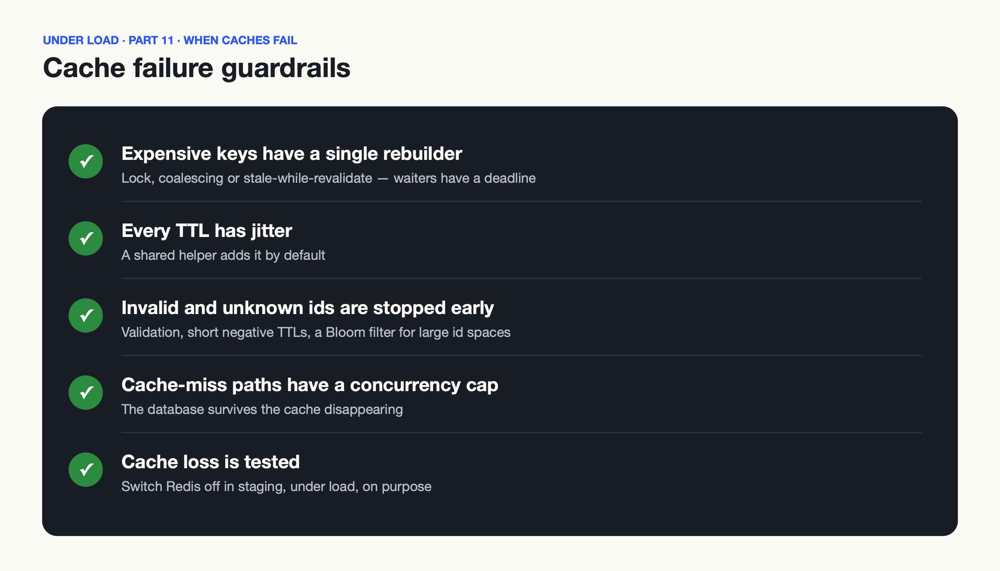

# When Caches Fail: Stampedes, Penetration and Avalanches

### Cache stampede, avalanche and penetration: three ways a cache suddenly sends everything to the database, and the defenses for each.

*Under Load · Part 11 · Caching*





---

The organization-wide dashboard is the most expensive page in the support product. It counts every open ticket and every comment by priority across all of Halcyon's workspaces, and building it means scanning and aggregating millions of rows. On a quiet database, that takes a noticeable fraction of a second of CPU time. So the result is cached in Redis with a 60-second **TTL** (time to live — how long an entry stays in the cache before it expires), and it works beautifully: the database rebuilds the dashboard once a minute, and every team lead in between sees it instantly.

Until Monday at 09:00. Halcyon's two hundred team leads open the dashboard within the same few seconds, and the cache entry happens to expire right then.

Every one of those requests looks in Redis, finds nothing, and does exactly what the code says to do on a miss: run the expensive query and store the result. Two hundred copies of the heaviest query in the product land on the database at once. The application's connection pool (Part 7) fills up immediately, the remaining requests queue for a connection, and the copies that do run compete for the same few CPU cores, so each one takes far longer than it would alone. A page that normally loads from memory takes seconds. Some requests hit their timeouts, the browsers retry, and the next wave arrives before the first one has finished.

Nothing was broken. Redis was healthy, the query was correct, the TTL was sensible. The cache did exactly what it was told. But a cache only protects the database **while it's being hit**, and there are three distinct ways it can suddenly stop being hit:

- **Stampede:** one popular key expires, and many requests rebuild it at once.
- **Avalanche:** many keys expire, or the whole cache becomes unavailable, at about the same time.
- **Penetration:** requests for keys that don't exist, so there is never anything to cache.

All three are cases of a **thundering herd**: many callers doing the same expensive thing at the same moment. This article explains how each one happens, how to defend against it, what each defense costs, and how to keep the database alive when the cache disappears entirely. It builds on cache-aside from Part 9; nothing else is assumed.

---

## Why a cache miss can be more dangerous than no cache

It's worth starting with an uncomfortable fact: a cached system can be *more* fragile than an uncached one.

Without a cache, the database is sized for the real traffic. Every page load is a query, the team watches query load every day, and capacity planning is honest.

With a cache, the database is quietly sized for the **misses**. If 95% of dashboard reads come from Redis, the database only ever sees 5% of them, and over months it gets tuned, shared and downsized around that 5%. Nobody decides this; it just happens, because the database looks idle.

Losing the cache then doesn't bring the load back to "normal." It brings it back to a level the database hasn't seen since before the cache existed. The arithmetic is simple: with a hit ratio of *h*, the database sees a fraction (1 − *h*) of reads. Going from 95% hits to 0% multiplies database read traffic by 1 / 0.05 = **20**. At a 99% hit ratio, the multiplier is **100**.



And cache failures are rarely spread out. They happen at **synchronization points** — moments when many callers see the same missing or unavailable state at once:

- a hot key expiring,
- many keys that were written together expiring together,
- a cache node restarting empty,
- a deploy that clears the cache,
- a dependency coming back after an outage, and every client that was waiting reconnecting and retrying at the same instant.

At a synchronization point, the load doesn't rise gradually; it arrives as a wall. That's what makes these failures dangerous: the database is hit hardest at exactly the moment the cache is least useful.

---

## Stampede: one hot key expires



A **cache stampede** (also called *dog-piling*) happens when a key that many requests depend on expires or is deleted, and the next wave of requests all miss in the window before anyone has refilled it.

Walk through the timeline:

1. At 09:00:00.000 the dashboard key expires.
2. Request 1 arrives, misses, and starts the rebuild query.
3. While that query runs, requests 2 through 200 arrive. The key is still missing — request 1 hasn't finished — so each of them also starts the rebuild.
4. The database is now running many copies of one heavy query.
5. Eventually one finishes and writes the key. The rest finish later, each overwriting the key with the same result.

The danger is in the window between step 2 and step 5, and three things make that window worse than it looks:

- **The rebuild gets slower as more copies run.** A database has a fixed number of CPU cores and a fixed amount of disk bandwidth. Two hundred copies of a CPU-heavy query don't each take their usual time; they share the hardware, so each copy takes many times longer.
- **The window grows with the rebuild time.** Nobody can refill the key until the first rebuild completes. Slower rebuilds mean a longer window, which lets more requests pile in, which makes rebuilds slower still. It's a feedback loop.
- **The damage spreads.** Everything else that uses the database slows down too. Requests time out, clients retry (Part 15), and retries add load at the worst possible moment.

The core problem is that **the same work is being done many times**. Every defense against stampedes is a way to make sure it's done once.

### Defense 1: a single rebuilder (a lock)

The first request that misses takes a short **lock** in Redis. Only the request holding the lock rebuilds; the others wait briefly and read the result from the cache.

```python
import uuid, time

def get_dashboard(org_id):
    key, lock_key = f"dash:{org_id}", f"lock:dash:{org_id}"
    deadline = time.monotonic() + 2.0                     # how long a waiter is willing to wait
    while time.monotonic() < deadline:
        value = redis.get(key)
        if value is not None:
            return value
        token = str(uuid.uuid4())
        if redis.set(lock_key, token, nx=True, px=10_000):   # only one caller gets this
            try:
                value = redis.get(key)                     # re-check: someone may have just finished
                if value is None:
                    value = build_dashboard_from_database(org_id)
                    redis.set(key, value, ex=60)
                return value
            finally:
                release_if_owner(lock_key, token)          # compare-and-delete, see below
        time.sleep(0.05)                                   # someone else is rebuilding
    raise TemporarilyUnavailable()                          # or serve a stale copy
```

Each piece is there for a reason:

- **`SET key value NX PX 10000`** writes the lock only if it doesn't already exist (`NX`), with an expiry of 10,000 milliseconds (`PX`). The check and the write happen in one atomic Redis command, so exactly one caller wins. The expiry means a rebuilder that crashes can't hold the lock forever.
- **The second `get` after taking the lock** closes a subtle gap. A request can see the key missing, then the previous rebuilder finishes and releases the lock, and the request takes the now-free lock and rebuilds a value that was written a millisecond ago. Re-checking after acquiring the lock is the same "double-checked" idea used for lazy initialization in concurrent code.
- **The random token and compare-and-delete.** If a rebuild takes longer than the lock's expiry, the lock disappears on its own and a second request can take it. When the first request then finishes and blindly deletes `lock:dash`, it deletes the *second* request's lock. Storing a unique token and deleting only if the value still matches — done atomically with a short Lua script, because a separate `GET` and `DEL` would race — prevents that (Redis 8.4's `DELEX key IFEQ token` and Valkey 9.2's `DELEX` / `DELIFEQ` do the same in one command):

```lua
-- release_if_owner: KEYS[1] = lock key, ARGV[1] = my token
if redis.call("GET", KEYS[1]) == ARGV[1] then
  return redis.call("DEL", KEYS[1])
end
return 0
```

- **A bounded wait.** The waiters don't poll forever. After a deadline, they fail fast or fall back to something else.

This lock is a performance optimization, not a correctness guarantee. If the lock expires early and two rebuilds run, the result is two identical queries, not corrupt data. That's fine here. (Locks that protect *correctness* need much more care — fencing tokens and leases, covered in Part 42.)

### The cost: everyone depends on the leader

A single rebuilder turns a free-for-all into a queue behind one request, usually called the **leader**. That's the point, but it creates a new failure mode: **whatever happens to the leader happens to everyone waiting for it.**

- **A slow leader delays every waiter.** If the rebuild takes three seconds, every request that arrived during those three seconds waits up to three seconds.
- **A failed leader fails the group.** If the query times out, all the waiters either see that failure or wake up to an empty cache and race for the lock again.
- **A leader that dies silently** (the process is killed mid-rebuild) leaves the lock in place until it expires. Every waiter sits idle until then.

So the design questions for any single-rebuilder scheme are: how long should waiters wait, what do they do when the leader fails, and is there something better to return than an error? The usual answer to the last one is the next defense.

The same idea — identical concurrent requests sharing one piece of work — is called **request coalescing** or **single-flight**. A Redis lock coordinates across all application servers; inside one process it can be done with no network round trip at all. Part 12 covers coalescing in depth.

### Defense 2: serve stale while refreshing

For data that can be a little old, there's an even better option: **never let the hot key disappear at all.**

Store the value with two times instead of one:

- a **soft expiry** ("fresh until"), after which the value is considered stale and should be refreshed,
- a **hard expiry** (the Redis TTL), well after the soft one, after which the value is really gone.

```python
entry = redis.get(key)                       # {"rows": ..., "fresh_until": 1767603600}
if entry is None:
    return rebuild_with_lock(key)            # truly missing: fall back to Defense 1
if now() > entry.fresh_until and redis.set(lock_key, token, nx=True, px=10_000):
    enqueue_background_refresh(key, token)   # one caller schedules the refresh
return entry.rows                            # everyone returns immediately, maybe slightly stale
```

When a request finds a value past its soft expiry, it returns that **stale** value immediately, and one request — the one that wins the lock — triggers a refresh in the background. Nobody waits for the database. When the refresh finishes, it writes a new value with new soft and hard expiries.

This is called **stale-while-revalidate**, the same name used by the HTTP `Cache-Control: stale-while-revalidate` directive (RFC 5861). The same RFC defines `stale-if-error`, which allows a cache to keep serving a stale response when the origin is failing — the same idea applied to errors instead of expiry. Reverse proxies have it built in: NGINX's `proxy_cache_use_stale updating` together with `proxy_cache_background_update`, and Varnish's grace mode, both serve the old object while one fetch refreshes it.

It also answers the leader problem. If the background refresh fails or is slow, readers still get the stale value; the only cost is that it gets older. A failure in the rebuild becomes a freshness problem instead of an availability problem.

The trade-off is explicit: some readers see data older than the soft TTL — by up to the time a refresh takes, or longer if refreshes are failing. For a dashboard, that's almost always the right trade. For an account balance, a permission check or a price at checkout, it may not be, and the answer there is to not serve that data stale at all.

### Defense 3: refresh before it expires

For keys known to be hot, the cleanest solution is to never wait for a miss.

**Proactive refresh.** A scheduled job rebuilds the dashboard every 50 seconds and writes it with a 60-second TTL. The key never expires under normal operation, and request traffic never triggers a rebuild. The cost is work done even when nobody is looking, and a job that has to be monitored — if it silently stops, the key expires and the stampede returns.

**Probabilistic early expiration.** A decentralized alternative, described by Vattani, Chierichetti and Lowenstein (2015) and often called *XFetch*. Each request that reads the key also decides, at random, whether to refresh it early. The probability is tiny when the expiry is far away and rises sharply as it approaches:

```python
# delta = how long the last rebuild took; beta ≈ 1 (higher = refresh earlier)
if now() - delta * beta * math.log(random.random()) >= expiry:
    refresh()
```

`math.log(random.random())` is a negative number that is usually small and occasionally large, so the left side is `now()` plus a random amount of time scaled by how long a rebuild takes. A request refreshes when that amount pushes it past the expiry. With many readers, one of them almost always refreshes shortly before the key expires, and the chance of several doing it at once is small — with no lock and no coordination. Scaling by the rebuild time means expensive keys start refreshing earlier.

**TTL jitter** (next section) is sometimes listed as a stampede defense. For one hot key, it only moves the moment of expiry; the stampede still happens, just at a less predictable time. Jitter is an avalanche defense.

---

## Avalanche: many keys expire together



A **cache avalanche** is the same failure spread across many keys: a large number of entries expire, or disappear, at about the same moment, and the database gets all their rebuilds at once.

The difference from a stampede is precise:

- A **stampede** is **one** hot key rebuilt **many times** at once.
- An **avalanche** is **many different** keys, each rebuilt **once**, but all at the same moment.

The defenses differ accordingly. A stampede needs a single rebuilder. An avalanche needs the expirations spread out — a lock per key does nothing when every key is different.

### How keys end up expiring together

Keys expire together because they were **written together with the same TTL**. That happens far more often than it seems:

- **A batch job pre-loads the cache.** A nightly job warms the ticket summaries of every workspace at 02:00 with a one-hour TTL. At 03:00, all of them expire within the same few seconds.
- **The cache restarted empty.** Every key is refilled during the first minutes of traffic, all with the same TTL, and all expire again together one TTL later — and again after that. The synchronization repeats until something breaks it.
- **A deploy cleared the cache.** Same as a restart, but scheduled.
- **The morning rush.** Thousands of users log in between 08:55 and 09:05; their session data and permission lists are cached with `TTL = 3600`. At 10:00 they all expire within the same ten minutes.
- **Fixed expiry times.** "Cache until midnight" sends every such key to the database at 00:00:00.

### Defense: TTL jitter

The fix is to add a random amount to every TTL, so keys written together expire over a window instead of at one instant:

```python
ttl = base_ttl + random.randint(0, base_ttl // 5)       # e.g. 3600 s plus up to 20%
redis.set(key, value, ex=ttl)
```

With a fixed TTL, keys written in the same second expire in the same second. With up to 20% jitter on a one-hour TTL, the same keys expire spread across twelve minutes. The total number of rebuilds is identical; what changes is the **peak** rate the database sees, which is what decides whether it survives. The wider the jitter window, the lower the peak.

Jitter costs almost nothing: entries live a little longer on average, which slightly increases staleness and memory use. That's why it should be the default for every TTL in a codebase, not an emergency fix.

### Other avalanche defenses

- **Warm in batches, not all at once.** A job that pre-loads the cache should spread its writes out — and add jitter to the TTLs it writes. A warm-up that writes 100,000 keys in a minute creates the next avalanche exactly one TTL later.
- **Don't clear the cache on deploy.** If a data format changes, put a version in the key (`v3:ticket:48213`, as in Part 9). New code reads new keys, and old entries expire on their own schedule.
- **Use more than one cache layer.** A small in-process cache in each application server, with a short TTL of its own, sits in front of Redis. If Redis entries expire together, many of the reads are still absorbed locally. The layers expire independently, which breaks synchronization. The cost is a second place where data can be stale (Part 13).
- **Make cold starts rare.** Redis can persist its data to disk (RDB snapshots or the AOF append-only log), so a restarted node can come back with most of its keys instead of empty. Replicas with automatic failover (Redis Sentinel or Redis Cluster) mean losing one node doesn't mean losing its data.
- **Don't remap the whole keyspace.** If application servers pick a cache node with `hash(key) % number_of_nodes`, adding or removing one node changes the node for almost every key — an instant avalanche. **Consistent hashing** (Part 36) moves only about 1/N of the keys when one of N nodes changes.

---

## Penetration: keys that don't exist



**Cache penetration** is traffic for keys that **don't exist**. Cache-aside stores what the database returns, and when the database returns nothing, there's nothing to store. So the next request for the same id misses again, and every request goes all the way to the database.

Typical causes:

- A broken integration loops over ticket ids that were never created, or that belong to a workspace it has no access to.
- A scanner probes random ids, looking for something to scrape.
- An attacker discovers that any id can be looked up and uses it to load the database deliberately.
- A client-side bug sends `undefined` or `0` as the id thousands of times a minute.

What makes penetration different from the other two failures is that it isn't caused by timing. It doesn't need an expiry or a restart; it's steady, and it can be manufactured on purpose.

### Defense 1: validate before looking anything up

The cheapest defense is to reject ids that can't possibly exist before touching the cache or the database:

- **Format:** a ticket id that isn't a number, or a UUID that isn't a valid UUID.
- **Range:** an id larger than the highest id ever issued.
- **Ownership:** a ticket id whose embedded workspace prefix doesn't match the caller's workspace.

None of this needs a database lookup, and it filters out most accidental penetration.

### Defense 2: negative caching

**Negative caching** (introduced in Part 9) stores "not found" as a cache entry: `ticket:48213 → NOT_FOUND`, with a short TTL. The next request for the same missing id is answered from the cache.

It works well when the **same** missing ids are requested **repeatedly** — the client bug sending the same bad id, a deleted ticket that old links still point to. It does nothing when every id is **different**: if a scanner tries a million random ids once each, each negative entry is written once and never read again. The cache fills up with junk and the database still sees every request.

And negative caching has a real danger: **the item might be created later.** If a ticket is looked up just before it's created — a webhook that arrives before the transaction commits, a replica that hasn't caught up yet (Part 34) — the cache now says "doesn't exist" about something that does. Every reader sees it as missing until the negative entry expires. Three rules keep that safe:

- **Keep negative TTLs short** — seconds or a minute, much shorter than positive TTLs.
- **Delete the negative entry when the item is created.** The code path that creates a ticket also deletes `ticket:{id}` from the cache.
- **Bound the memory.** Junk entries from random ids shouldn't push useful entries out of the cache. A separate, size-limited keyspace or a different eviction priority for negative entries helps.

### Defense 3: a Bloom filter

For large id spaces under steady random probing, a **Bloom filter** stops the requests before the cache.

A Bloom filter is a compact data structure that answers one question: "could this item be in the set?" It's an array of *m* bits, all starting at 0, and *k* hash functions. Adding an id sets the *k* bits its hashes point to. Checking an id looks at those *k* bits:

- If **any** of them is 0, the id was **definitely never added**.
- If **all** of them are 1, the id **might** have been added — or those bits might have been set by other ids. That's a **false positive**.

It never says "no" to something that is in the set, so rejecting every "no" is always safe. A "maybe" just falls through to the cache and database as usual.



The false-positive rate is set by the number of bits per item and the number of hash functions. With *n* items, the standard approximation is p ≈ (1 − e^(−kn/m))^k, and the best number of hash functions is about (m/n) × ln 2. In practice that works out to roughly **10 bits per item for a 1% false-positive rate** and about **14–15 bits per item for 0.1%**. Ten million ticket ids fit in a filter of around 12 MB at 1% — small enough to keep in each application server's memory or in Redis.

Things to know before reaching for one:

- **It must be kept up to date.** Every new ticket has to be added to the filter when it's created, or it will be rejected as nonexistent — a correctness bug, not a performance one. That means the filter needs a reliable update path (on create, or from a change stream as in Part 30) and a way to rebuild it from scratch.
- **Standard Bloom filters can't remove items.** Deleted ids stay "maybe" forever, which is harmless — they fall through to negative caching. Over time, though, the false-positive rate rises as the filter fills, so it should be sized for growth and rebuilt periodically. *Counting Bloom filters* and *cuckoo filters* support deletion at the cost of more memory per item.
- **False positives are a tuning knob, not a bug.** A 1% rate means 1% of random probes still reach the cache. Combined with negative caching and rate limiting, that's usually plenty.
- **Where to get one:** Redis 8 and later include Bloom filters in the server itself (`BF.RESERVE`, `BF.ADD`, `BF.EXISTS`); older versions needed the RedisBloom module or Redis Stack. Valkey offers the same commands through its official `valkey-bloom` module. Most languages also have libraries for an in-process filter.
- **It's operational complexity.** One more structure to size, populate, rebuild and monitor. For most products, validation, negative caching and rate limiting are enough; a Bloom filter earns its place when the id space is large and probing is constant.

### Defense 4: limit the clients that cause it

Penetration traffic comes from somewhere. **Rate-limit** clients by their not-found rate as well as their total rate (Parts 22–23), and alert when one API key starts producing thousands of 404s. **Unguessable ids** — random UUIDs instead of sequential integers — make blind probing far less productive, though they don't stop someone replaying ids they've collected.

---

## When the whole cache is gone



The worst avalanche is the cache disappearing completely: Redis crashes, a network partition separates it from the application, a failover takes longer than expected, or someone runs `FLUSHALL` on the wrong instance. Every request is now a miss.

The question to ask in every design review is: **can the database survive the traffic the cache normally absorbs?** At a 95% hit ratio, that's twenty times its usual read load. Usually the honest answer is no — and if the answer is no, the fallback path must be deliberately limited, or the cache outage becomes a database outage, and the database outage takes down every feature that doesn't even use the cache.

### Admission control on the miss path

**Admission control** means deciding, before doing expensive work, whether to accept it at all. On the cache-miss path it usually takes the form of a **concurrency cap**: at most N requests may run the fallback query at once, and the rest wait briefly or are turned away.

```python
dashboard_fallback = Semaphore(8)                     # per application server

def dashboard_on_miss(org_id):
    if not dashboard_fallback.acquire(timeout=0.5):
        raise TemporarilyUnavailable()                 # shed instead of queueing forever
    try:
        return build_dashboard_from_database(org_id)
    finally:
        dashboard_fallback.release()
```

Compare the two behaviours when Redis disappears and a hundred dashboard requests arrive:

- **Uncapped:** all hundred run the expensive query at once, limited only by the connection pool. The database's CPU is saturated, so every query on it slows down — including the cheap, unrelated ticket lookups that every page makes. One failing feature drags down the whole product.
- **Capped:** at most eight dashboard queries run at a time per server. Some dashboard requests are served, slowly; others are told "temporarily unavailable" after a short wait. The database keeps headroom, and everything that doesn't depend on the dashboard keeps working at normal speed.

Turning requests away sounds bad. But the alternative isn't serving all of them; it's serving all of them slowly, timing many of them out anyway, and slowing down everything else while doing it. A cap converts an uncontrolled failure into a controlled, partial one. The cap should be sized from the database's capacity divided by the number of application servers, and a per-feature cap keeps one expensive page from using the whole budget. Parts 17 (bulkheads) and 25 (load shedding) go deeper.

### Fail fast on the cache itself

A cache that is *down* is easy: connections are refused immediately. A cache that is *slow* or unreachable behind a silent network partition is worse: every request waits for its cache timeout before even starting the fallback. Short timeouts on cache calls (tens of milliseconds, not seconds) and a **circuit breaker** (Part 16) that stops calling Redis for a while after repeated failures keep a dead cache from adding its timeout to every request.

### Serve something degraded

- **A stale local copy.** The in-process cache layer can keep entries past their TTL for exactly this case, like `stale-if-error`.
- **A simplified page.** The dashboard can show "temporarily unavailable" while the rest of the page loads normally (Part 20).
- **Turn off the expensive feature** with a feature flag until the cache is back.

### Come back gently

Recovery is a synchronization point too. When Redis returns empty, every key misses at the same moment, and every client that was failing retries at once. Reconnect and retry with **jittered backoff** (Part 15), keep the concurrency caps in place while the cache warms, and warm the hottest keys first, in batches, with jittered TTLs.

### Test it

The only way to know what happens when the cache disappears is to make it disappear: switch Redis off in a staging environment under realistic load, or block it with a fault-injection tool, and watch the database, the caps and the error rates. A fallback that has never been exercised usually doesn't work the way the design document says.

---

## Stampede vs avalanche vs penetration



- **Stampede** — *one hot key* expires; *many requests* rebuild it at once. Defenses: a single rebuilder (lock or coalescing), stale-while-revalidate, proactive or probabilistic early refresh.
- **Avalanche** — *many keys* expire or vanish *together*; each is rebuilt once, but all at the same moment. Defenses: TTL jitter, batched warming, no full flushes on deploy, multiple cache layers, highly available cache nodes, consistent hashing, a capped fallback.
- **Penetration** — requests for keys that *don't exist*, so nothing gets cached. Defenses: validation, negative caching (for repeats), a Bloom filter (for random ids), rate limiting.

And a **thundering herd** is the general pattern behind all three, and beyond caching: many callers waking up and doing the same thing at once — rebuilding a cache entry, retrying after an outage, reconnecting after a restart, every cron job starting at the top of the hour. A cache stampede is one specific thundering herd. The cures are always the same three: **share the work** (coalescing), **break the synchronization** (jitter), and **cap what reaches the backend** (admission control).

For all of them: **treat the cache as an optimization, not as the only thing keeping the database alive.**

---

## Guardrails that prevent the next one



1. **Expensive keys have a single rebuilder.** A lock, coalescing or stale-while-revalidate — never a free-for-all on a miss. Waiters have a deadline and a fallback.
2. **Every TTL has jitter.** A shared helper writes cache entries and adds jitter by default, so nobody has to remember.
3. **Invalid and unknown ids are stopped early.** Validation first, short-lived negative caching for repeats, a Bloom filter for large id spaces under constant probing.
4. **Cache-miss paths have a concurrency cap.** The database can survive the cache disappearing, by design.
5. **Cache loss is tested.** Redis is switched off in staging, under load, on purpose, and the result is written down.

---

## What to keep on the dashboard

- **Hit and miss rate per key type**, and **misses by reason**: expired, evicted, not found, cache error. A rise in "cache error" misses is an outage starting.
- **Concurrent misses per key.** More than one in-flight rebuild for the same key is a stampede in progress.
- **Database queries per second from miss paths**, separate from the rest. A step change means a cache event.
- **Hot keys.** `redis-cli --hotkeys` (which requires an LFU eviction policy) or client-side counting shows which keys carry the most traffic and need a single rebuilder or proactive refresh.
- **Expiry distribution.** How many keys are due to expire per minute; a spike in that schedule is a future avalanche.
- **Not-found rate per client.** The first sign of penetration.
- **Fallback saturation:** how often the miss-path concurrency cap is full, how long requests wait for it, and how many it sheds.
- **Retries and timeouts** on the cache and database paths, because they are what turn a cache event into a cascade.

---

## Recap

### What is a cache stampede?
Many requests missing the same popular key in the window after it expires, and all rebuilding it from the database at once. The copies compete for the same hardware, so each rebuild gets slower, the window gets longer and more requests pile in.

### How do you prevent a stampede?
Make sure only one request rebuilds the key: a short lock (`SET NX PX` with a unique token), a re-check of the cache after taking it, and waiters with a deadline — or single-flight coalescing inside each process. Better still for data that may be slightly old, serve the stale value while one request refreshes it in the background. For known hot keys, refresh proactively or with probabilistic early expiration.

### What does a single rebuilder cost?
A leader that everyone else depends on. A slow leader delays every waiter, a failed leader fails the whole group, and a crashed leader blocks waiters until its lock expires. Bounded waits, compare-and-delete lock release, and a stale fallback keep that dependency safe.

### What's the exact difference between a stampede and an avalanche?
A stampede is one hot key rebuilt many times at once. An avalanche is many different keys, each rebuilt once, but all at the same moment — usually because they were written together with the same TTL, or the cache restarted empty. A stampede needs a single rebuilder; an avalanche needs the expirations spread out.

### Why does adding random jitter to TTLs help?
Keys written at the same moment with the same TTL expire at the same moment. A random addition to each TTL spreads those expirations across a window, so the total number of rebuilds stays the same but the peak rate the database sees falls. Jitter doesn't help one extremely hot key; it only moves its expiry.

### What is cache penetration?
Traffic for keys that don't exist, so there's never anything to cache and every request reaches the database — scanners, broken integrations, client bugs or deliberate abuse requesting ids that were never created.

### When is negative caching dangerous?
When the "missing" item is created later: readers see it as nonexistent until the negative entry expires. Keep negative TTLs short, delete the negative entry when the item is created, and bound the memory it uses. It also doesn't help against random, unique ids — each entry is written once and never read.

### What does a Bloom filter add, and what does it cost?
It answers "could this id exist?" in a few bits per item and never says no to an id that does exist, so requests it rejects skip the cache and database entirely. The costs: false positives, a filter that must be updated on every create and rebuilt periodically, no deletion in the standard form, and one more component to operate.

### How would you survive a total Redis outage?
Assume the database can't absorb the traffic the cache normally handles. Cap concurrency on miss paths and shed the excess, fail fast on cache calls with short timeouts and a circuit breaker, serve stale local copies or degraded pages, make the cache highly available, come back with jittered retries and gradual warming — and test the outage on purpose.

### What's the difference between a cache stampede and a thundering herd?
A thundering herd is the general pattern: many callers waking up and doing the same expensive thing at the same moment — rebuilding, retrying, reconnecting. A cache stampede is one instance of it, triggered by a hot key expiring. The cures are shared: share the work, break the synchronization, cap what reaches the backend.

### What should be monitored?
Miss rate per key type and by reason, concurrent misses per key, database queries from miss paths, hot keys, the expiry distribution, not-found rate per client, fallback saturation and shedding, and retry and timeout volume.

---

## Next

- **Lab (run + measured write-up):** [11-cache-failures](https://github.com/b-basoglu/under-load/tree/main/11-cache-failures)
- **Next:** [Request Coalescing](../12-request-coalescing/article.md) — The Redis lock fixed the stampede across servers. But inside each server, dozens of threads were still asking Redis the same question at the same time.
