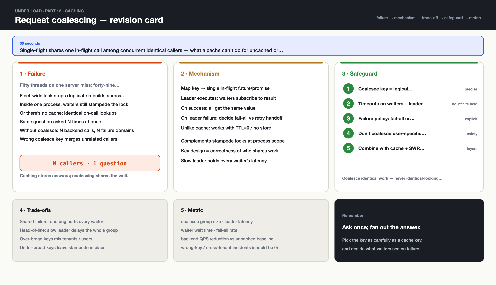
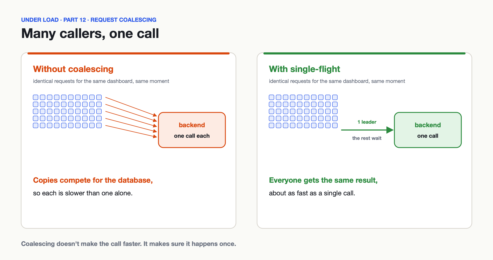
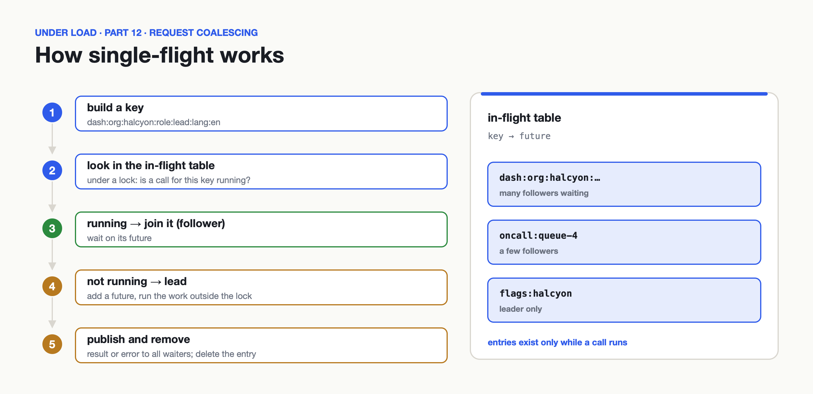
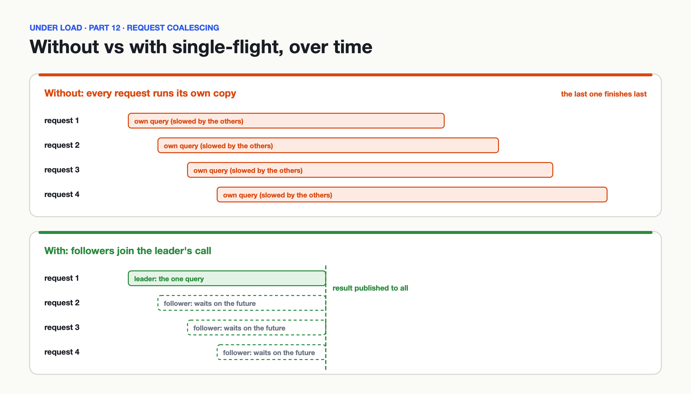
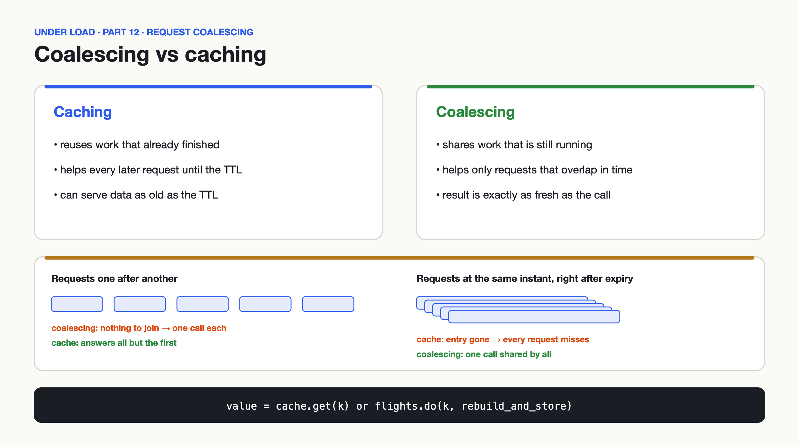
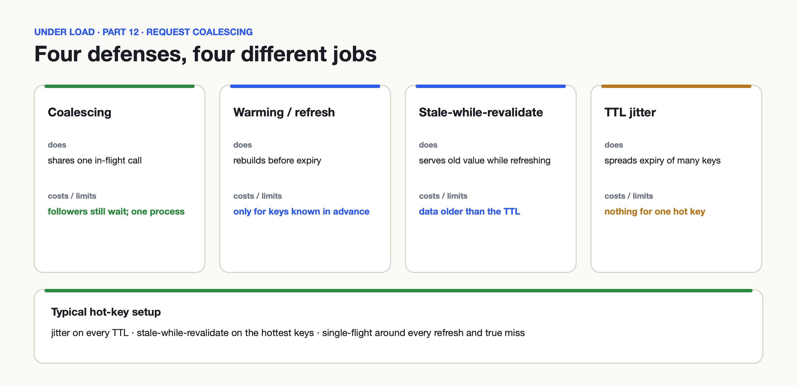
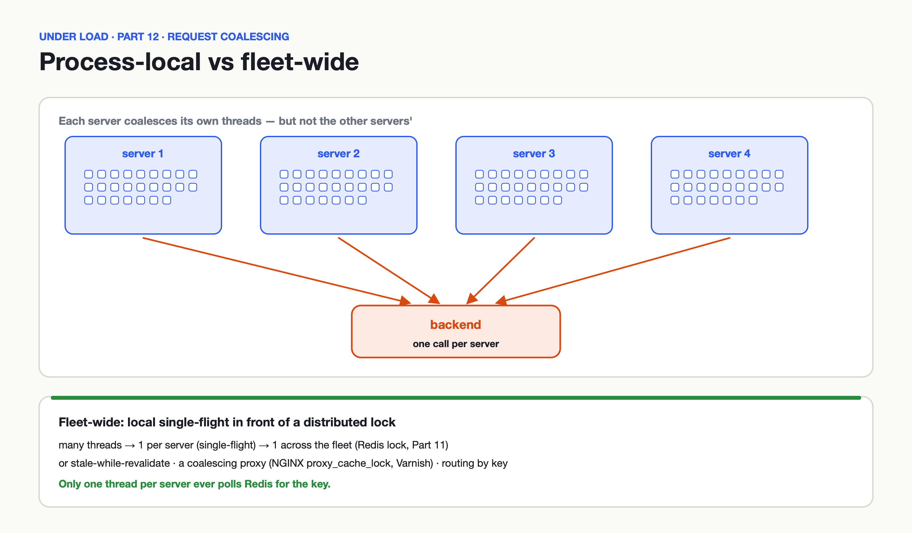
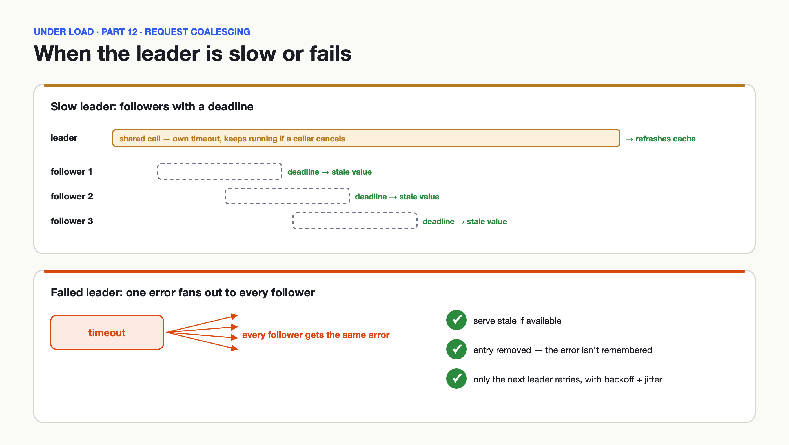
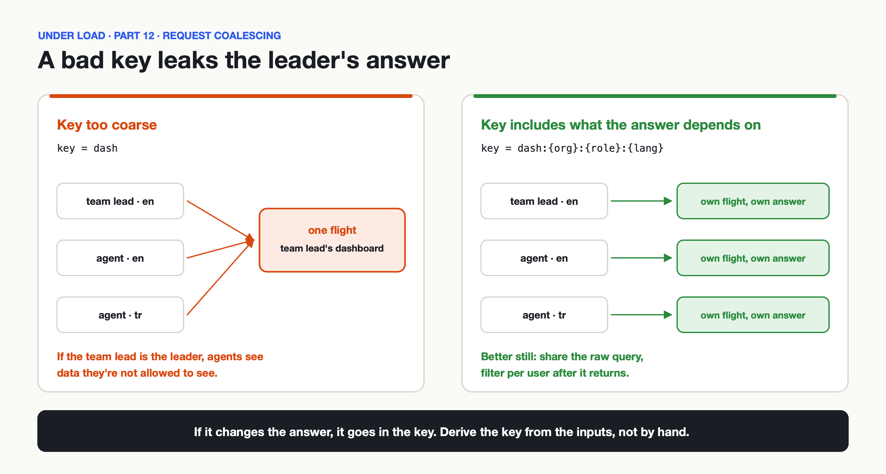
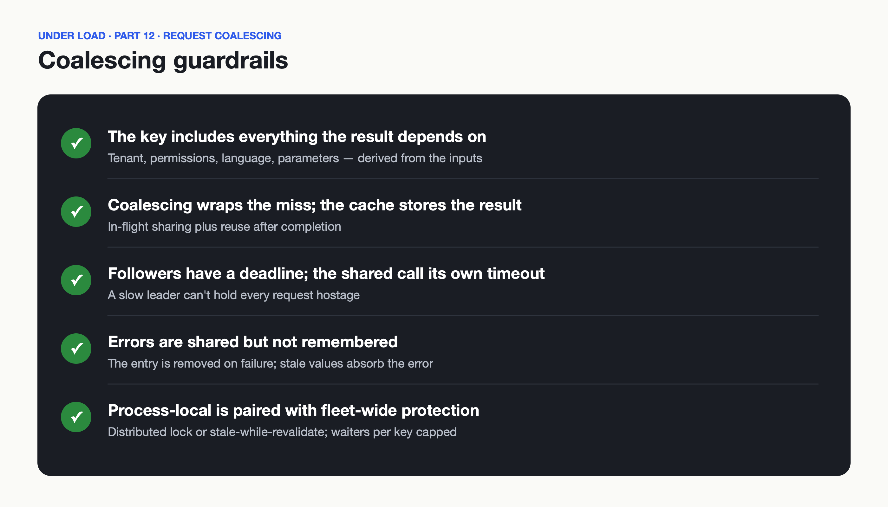

# Request Coalescing

### Request coalescing (single-flight): sharing one in-flight call among many callers, what it does that a cache can't, and the four ways it goes wrong.

*Under Load · Part 12 · Caching*





---

Part 11 fixed the dashboard stampede with a Redis lock: when the cache key expires, only one request across the whole fleet rebuilds it. That works. But a closer look at a single API server during the 09:00 peak reveals something else.

Each server runs dozens of request threads. When the dashboard entry expires, fifty of them on the same server miss at almost the same moment. All fifty race for the Redis lock. One wins. The other forty-nine sleep, poll Redis, find nothing, and sleep again — a steady drumbeat of Redis calls from one server, for one key, accomplishing nothing. Multiply that by every server in the fleet, and Redis is doing more work answering "is it ready yet?" than it ever did serving the dashboard.

And some lookups have no cache to protect them at all. The internal "who's on call for this queue?" service is asked by every ticket page; it has to be fresh, so nobody caches it. When a major incident brings every agent onto the same queue, hundreds of identical lookups per second go straight to the on-call backend.

Those fifty threads aren't asking fifty questions. They're asking **the same question, at the same time**. The cheapest possible answer is to ask it **once** and hand the result to all fifty.

That's **request coalescing**, often called **single-flight** after the Go package that made the name popular (`golang.org/x/sync/singleflight`). This article explains how it works, why it's different from caching, where it fits next to the other stampede defenses, and the four ways it goes wrong: across servers, when the call fails, when the call is slow, and when two requests that look the same aren't.

---

## How single-flight works



The idea fits in a few lines. Keep a table of calls that are **currently running**, keyed by what they compute.

1. A request needs the dashboard. It builds a **key** that identifies the work: `dash:org:halcyon:role:lead:lang:en`.
2. It checks the table. If a call for that key is already running, it **joins** it: it waits for that call's result instead of starting its own. A caller that joins is a **follower**.
3. If nothing is running, it becomes the **leader**. It adds an entry to the table — a **future** (also called a *promise*): a placeholder object for a result that isn't ready yet, which other threads can wait on — then runs the call.
4. When the call finishes, the leader **publishes** the outcome to the future — the result, or the error — and every follower wakes up with it.
5. The leader **removes the entry**. The next request after that starts fresh work.

A minimal version in Python:

```python
import threading
from concurrent.futures import Future

class SingleFlight:
    def __init__(self):
        self._lock = threading.Lock()
        self._inflight = {}                        # key -> Future of the running call

    def do(self, key, fn, timeout=None):
        with self._lock:
            future = self._inflight.get(key)
            leader = future is None
            if leader:
                future = Future()
                self._inflight[key] = future
        if leader:
            try:
                future.set_result(fn())            # the work runs once
            except BaseException as e:
                future.set_exception(e)            # followers get the same error
            finally:
                with self._lock:
                    del self._inflight[key]        # the next caller starts fresh
        return future.result(timeout=timeout)      # leader and followers read the same outcome
```

Three details in those lines matter more than they look:

- **The check and the insert happen under one lock.** If two threads could both see "nothing running" and both insert, there would be two leaders. The lock makes "look, and if missing, claim" atomic.
- **The work runs outside the lock.** Holding the table lock during the call would block every other key too.
- **Every exit path publishes something.** If the leader's function throws and the future is never completed, followers wait forever. The `except` and `finally` blocks guarantee that every outcome, including a crash in the function, reaches the followers and that the entry is always removed.

Most languages have a ready-made version:

- **Go:** `singleflight.Group`. `Do(key, fn)` returns the value, the error and a `shared` flag that says whether the result went to more than one caller. `DoChan` returns a channel instead, so a caller can stop waiting when its own context is canceled. `Forget(key)` makes the next call start new work even if one is running.
- **Java:** Caffeine's `cache.get(key, loader)` and Guava's `LoadingCache` both run the loader once per key while other callers for the same key wait — coalescing built into the cache.
- **JavaScript:** store the in-flight `Promise` in a `Map` and return it to later callers; delete it when it settles. Facebook's DataLoader does this deduplication and also batches different keys into one request.

---

## What it saves

Return to the fifty threads. Without coalescing, the dashboard query reaches the database once per thread per server — or, with Part 11's lock, it reaches Redis as a storm of polling. With single-flight in each server, those fifty threads become one: one thread talks to Redis and, if needed, to the database; forty-nine wait on a future in memory, which costs nothing but a parked thread.



The saving isn't only "fewer calls." It's what fewer calls do to **latency**. Fifty copies of a heavy query on a database with a handful of CPU cores don't each take their usual time. They share the hardware, so each one takes many times longer, and everything else on the database slows down with them. One copy runs at its normal speed. With coalescing, the slowest request takes roughly as long as one call, because everyone is waiting for the same call; without it, the slowest request takes as long as the last of fifty competing copies.

The benefit grows with how many identical requests overlap. It's largest exactly when it's needed: at peaks, during cache expiry, and when a backend gets slow — because a slow backend means calls stay in flight longer, so more requests arrive while each one is running and join it instead of piling on.

---

## Coalescing is not caching

The two look similar and work best together, but they solve different problems.

**Caching reuses work that has already finished. Coalescing shares work that is still running.**



Picture twenty dashboard requests that arrive one after another, each starting after the previous one has finished. Single-flight saves **nothing**: each request finds an empty table, because the previous call has already completed and its entry has been removed. Twenty requests, twenty backend calls. A cache would have answered nineteen of them.

Now picture twenty requests that arrive in the same instant, right after the cache entry has expired. The cache saves nothing — the entry is gone. Single-flight turns twenty misses into one call.

The differences, side by side:

- **What it shares:** a cache shares results that exist; coalescing shares a call that hasn't finished yet.
- **When it helps:** a cache helps every later request until the entry expires; coalescing only helps requests that **overlap in time**.
- **Freshness:** a cached result can be as old as its TTL; a coalesced result is exactly as fresh as the call that produced it. Coalescing never serves stale data on its own.
- **Memory:** a cache holds entries for their TTL; the in-flight table only holds entries while calls run, so it stays tiny.

That's why the strongest setup uses both: the cache for the common case, single-flight around the cache miss for the dangerous case.

```python
def get_dashboard(org, role, lang):
    key = f"dash:{org}:{role}:{lang}"
    value = cache.get(key)
    if value is None:
        value = flights.do(key, lambda: rebuild_and_store(key, org, role, lang))   # many misses, one rebuild
    return value
```

Coalescing also works with **no cache at all**, which is its main advantage for data that must be fresh. The on-call lookup from the story can't be cached, but a burst of identical lookups can still share one call. Every caller gets an answer that was true at the moment the call ran — which is as fresh as any of them could have gotten by calling separately.

---

## Where it fits among the stampede defenses

Part 11 introduced several defenses against a hot key expiring. They're often mentioned together, but they do different jobs:

- **Request coalescing** shares one **in-flight** call among concurrent callers. It removes duplicate work, but followers still wait for the leader, and on its own it works inside one process.
- **Cache warming / proactive refresh** rebuilds known hot keys **before** they expire, on a schedule. Nobody waits and nothing misses, but it only works for keys known in advance, and it does work even when nobody is asking.
- **Stale-while-revalidate** keeps serving the old value while one caller refreshes it. Nobody waits for the refresh, at the cost of serving data older than the TTL.
- **TTL jitter** spreads out the expiry of **many** keys written together. It prevents avalanches, but does nothing for one hot key.



They combine naturally. A typical hot-key setup: TTL jitter on everything, stale-while-revalidate on the hottest keys so expiry never makes anyone wait, and single-flight around every refresh and every true miss so that whatever does reach the backend reaches it once.

---

## Four ways it goes wrong

### 1. It only coalesces inside one process

The in-flight table lives in one server's memory. Other servers don't know about it. With forty servers behind a load balancer, a burst of identical requests spread evenly across them produces **forty** backend calls — one per server. That's still far better than one per request, but it isn't one, and it grows with the fleet.



To coalesce across servers, combine single-flight with a fleet-wide technique:

- **Local single-flight in front of a distributed lock.** Inside each server, fifty threads become one. That one thread then takes the Redis lock from Part 11, so across the fleet, forty servers become one rebuild. This also ends the polling storm from the story: only one thread per server ever talks to Redis about the key.
- **Stale-while-revalidate**, so the fleet keeps serving the old value while one refresh runs.
- **A shared layer that coalesces for everyone.** Reverse proxies and CDNs can merge concurrent identical requests before they reach the application. NGINX's `proxy_cache_lock on` lets only one request at a time populate a new cache entry while others wait (up to `proxy_cache_lock_timeout`, 5 seconds by default, after which they go to the backend uncached). Varnish puts concurrent requests for the same object on a waiting list behind a single backend fetch. Several CDNs call the same feature *request collapsing*.
- **Consistent routing.** Sending all requests for the same key to the same server (hashing on the key at the load balancer, Part 36) makes a process-local table effectively fleet-wide for that key — at the price of hot keys concentrating on one server.

A caveat for proxies: coalescing assumes the response can be shared. If the backend's response turns out to be uncacheable (`Cache-Control: private`, a `Set-Cookie`), the waiting requests can end up served one at a time behind each other. Varnish handles this with "hit-for-miss" markers that tell later requests not to wait. Check how a proxy behaves with uncacheable responses before relying on its coalescing.

### 2. When the leader fails, everyone fails

The leader runs the call for everyone, so its outcome — including an error — goes to everyone. If the dashboard query times out, every follower waiting on that future receives the same timeout. One failure **fans out** to all the callers that joined it.

That's still better than every caller making its own failing call against a struggling database. But one bad moment now produces a burst of errors at once, and what followers do next matters:

- **Serve a stale value on failure.** If the last good result is still available (from a cache with a longer hard TTL, or a local copy), followers return it instead of the error. A failed refresh becomes a freshness problem instead of an outage.
- **Don't remember the error.** The entry must be removed when the call fails, so the next request tries again. An implementation that caches the failed future turns one timeout into an outage that lasts until something clears it.
- **Retry once, not N times.** If every follower that received the error retries immediately, they all miss together and form a new herd at the same instant. Better: followers return the error or a stale value, and only a later caller — the next leader — retries, with backoff and jitter (Part 15).
- **Distinguish errors that are shared from errors that are personal.** A timeout or a database error applies to everyone. A permission error shouldn't happen inside a shared call at all, which is a hint about the key (see failure 4).

### 3. A slow leader makes everyone slow

Followers wait for the leader. If the leader's call takes three seconds, everyone who joined it waits up to three seconds, even if they arrived 2.9 seconds in and the user would have preferred a quick error. And if the leader **hangs** — a query with no timeout, a socket that never responds — every follower hangs with it, and each one ties up a request thread while it does.



The fixes:

- **Give the shared call a timeout.** The call itself must have a deadline, so a hang can't last forever.
- **Give followers their own, shorter deadline.** A follower waits, say, up to half a second, then falls back to a stale value, a degraded response or a clear error — while the leader's call keeps running and, when it finishes, refreshes the cache for everyone who comes next. In Go, that's `DoChan` plus a `select` on the caller's context; in the Python sketch, `future.result(timeout=...)`.
- **Be careful with cancellation.** If the leader's own request is canceled — the user closed the tab, a load balancer gave up — the shared call should usually **keep running**, because other callers are still waiting for it. Tying the work to the first caller's request context is a classic bug: one impatient user cancels the work for fifty. The shared call should run with its own context and its own timeout, independent of any one caller.
- **Bound the number of waiters.** For extremely hot keys, thousands of followers can pile up behind one slow call, each holding a thread (or, in async code, at least memory and an open connection to its client). Capping followers per key — beyond the cap, return stale data or "temporarily unavailable" right away — keeps one slow key from consuming the whole server.

### 4. A bad key merges requests that aren't the same

Coalescing is only correct if every caller sharing a key would have received **exactly the same answer**. Whoever happens to be the leader decides what everyone else sees.

The key must include everything the result depends on: tenant, user or role, permissions, language, query parameters, feature flags, API version. Suppose the dashboard key is built from the page name alone — `dash` — while the real dashboard depends on the viewer's role and language. A team lead and an agent, an English-speaking and a Turkish-speaking user all arrive in the same instant:

- If an **agent** happens to be the leader, team leads lose the sections only they should see, and Turkish users get English.
- If a **team lead** happens to be the leader, **agents are shown data they're not allowed to see.**



This is the most dangerous of the four, because it turns a performance optimization into a **data leak** — and it's intermittent. It only happens when requests from different users overlap, which is rare in testing and common at peak. The same rule as for cache keys (Part 9): **if it changes the answer, it goes in the key.**

Two habits make the rule easier to follow:

- **Coalesce at a level where the result can't vary per caller.** Share the raw database query ("open tickets per priority for workspace 7"), then apply per-user filtering and formatting in each caller after the shared call returns. The shared part has a small, obviously complete key.
- **Build keys from the inputs, mechanically.** Derive the key from the same arguments passed to the function — every argument, serialized — rather than writing it by hand. A hand-written key is where a missing field hides.

The opposite mistake is harmless but wasteful: a key that's **too specific** (including a request id or a timestamp) never matches anything, so nothing coalesces.

---

## When to use it

Good fits:

- **Cache misses on hot keys**, as the in-process half of the stampede fix (Part 11).
- **Expensive, identical reads that arrive in bursts:** dashboards, configuration and feature-flag lookups, permission and entitlement checks, token or credential refreshes, calls to slow third-party APIs that are billed per request.
- **Data that can't be cached but is requested many times at once**, like the on-call lookup.

Poor fits:

- **Writes.** Two writes that look identical are usually two separate intentions — two clicks of "add comment" are two comments, or a deliberate double-submit that needs a different mechanism. Merging them silently loses one. Deduplicating repeated writes on purpose is **idempotency** (Part 14), which uses a key chosen by the client, not one inferred by the server.
- **Requests that rarely overlap.** Without concurrent identical calls there's nothing to share, and the table is pure overhead (small, but not zero).
- **Results that depend on the caller** in ways the key can't express safely.
- **Very cheap calls.** If the call costs less than the coordination, coalescing doesn't pay.

---

## Shipping it safely

Adding single-flight to an existing path changes behaviour in ways that are easy to miss in review:

- **Errors become correlated.** Before, one failing call produced one error. After, it produces as many errors as there were followers. Alerting thresholds based on error counts may fire differently.
- **Latency becomes correlated too.** One slow call now shows up as many slow requests at once. That's a reason to ship it together with follower deadlines, not afterwards.
- **Roll out per key type, behind a flag,** starting with keys whose results are obviously identical for everyone — global configuration, public data — before anything per-user.
- **Log the leader.** When a follower gets an unexpected result, the first debugging question is "who was the leader and what were its inputs?" Recording the leader's request id alongside the shared flag makes that answerable.
- **Test overlap deliberately.** Unit tests of a single call won't exercise coalescing. A test that starts many concurrent calls with different users and checks that each got its own correct answer catches bad keys before production does.

---

## Guardrails that prevent the next one



1. **The key includes everything the result depends on.** Tenant, permissions, language, parameters — derived mechanically from the inputs and reviewed like a cache key.
2. **Coalescing wraps the miss, and the cache stores the result.** In-flight sharing plus reuse after completion.
3. **Followers have a deadline and a fallback; the shared call has its own timeout.** A slow leader can't hold every request hostage, and no single caller's cancellation kills the shared work.
4. **Errors are shared but not remembered.** The entry is removed on failure; stale values absorb the error; only the next leader retries.
5. **Process-local is paired with fleet-wide protection** where many servers serve the same hot keys, and waiters per key are capped.

---

## What to keep on the dashboard

- **Coalescing ratio:** followers ÷ (leaders + followers), per key type. How much work is being shared. A ratio near zero means the table is overhead; a ratio near one on a per-user key type is worth a second look at the key.
- **Backend calls saved:** followers per second is the number of backend calls that didn't happen.
- **Waiters per key** at peak. A key with hundreds of waiters is a candidate for stale-while-revalidate, proactive refresh or a waiter cap.
- **In-flight age:** how long the oldest running call has been running. A rising number means slow or hung leaders.
- **Follower latency vs leader latency,** and how often followers hit their deadline and fall back.
- **Shared failures:** how many callers received each failed call's error.
- **Cache-miss bursts** on the keys that coalescing protects — the events it exists for.

---

## Recap

### What is request coalescing?
Keeping only one expensive call in flight per key. The first caller (the leader) runs the work; callers that arrive while it's running (followers) wait on its future and share its result, instead of each hitting the backend.

### How do you implement it?
Build a stable key from the request's inputs. Under a lock, look the key up in a table of in-flight calls: if a future exists, wait on it; otherwise add one and become the leader. Run the work outside the lock, publish the result or the error to the future on every exit path, then remove the entry. Go's `singleflight`, Caffeine and Guava loading caches, and a `Map` of promises in JavaScript are common implementations.

### How is coalescing different from caching?
Caching reuses work that has already finished; coalescing shares work that is still running. Coalescing only helps requests that overlap in time, never serves data older than the call, and holds entries only while calls run. Use both: the cache for the common case, coalescing around the miss for bursts.

### How does it compare with cache warming, stale-while-revalidate and TTL jitter?
Coalescing removes duplicate in-flight work; warming refreshes known hot keys before they expire; stale-while-revalidate serves the old value while one caller refreshes; jitter spreads out the expiry of many keys. They solve different parts of the problem and are usually combined.

### Does single-flight stop every stampede?
Not across servers: the in-flight table is local to one process, so each server makes its own call. Combine local coalescing with a distributed lock, stale-while-revalidate, a coalescing proxy or key-based routing to get one rebuild across the fleet.

### What should waiters see if the shared call fails?
By default they all receive the leader's error. Better: serve a stale value if one exists, make sure the failure isn't remembered so a later caller retries, and don't let every follower retry at the same instant.

### What happens when the leader is slow?
Every follower waits as long as the leader. Give the shared call its own timeout, give followers a shorter deadline with a fallback, cap the number of waiters per key, and don't cancel the shared work just because the leader's own request was canceled.

### Why is the coalescing key so important?
Because everyone sharing a key gets the leader's result. If the key leaves out something the result depends on — role, language, tenant — callers get someone else's answer, which can leak data they're not allowed to see. Coalesce at a level where the result can't vary per caller, and derive keys mechanically from the inputs.

### When shouldn't you coalesce?
For writes, which are separate intentions even when they look identical; for requests that rarely overlap; for very cheap calls; and for results that depend on the caller in ways the key can't safely express.

### What should be monitored?
The coalescing ratio, backend calls saved, waiters per key, the age of in-flight calls, follower versus leader latency and deadline hits, how many callers each failed call affected, and cache-miss bursts on protected keys.

---

## Next

- **Lab (run + measured write-up):** [12-request-coalescing](https://github.com/b-basoglu/under-load/tree/main/12-request-coalescing)
- **Next:** [Cache Coherence vs Consistency](../13-cache-coherence/article.md) — The ticket's priority is cached in Redis, in each server's memory and in the agent's browser. They don't agree. Which one is right?
