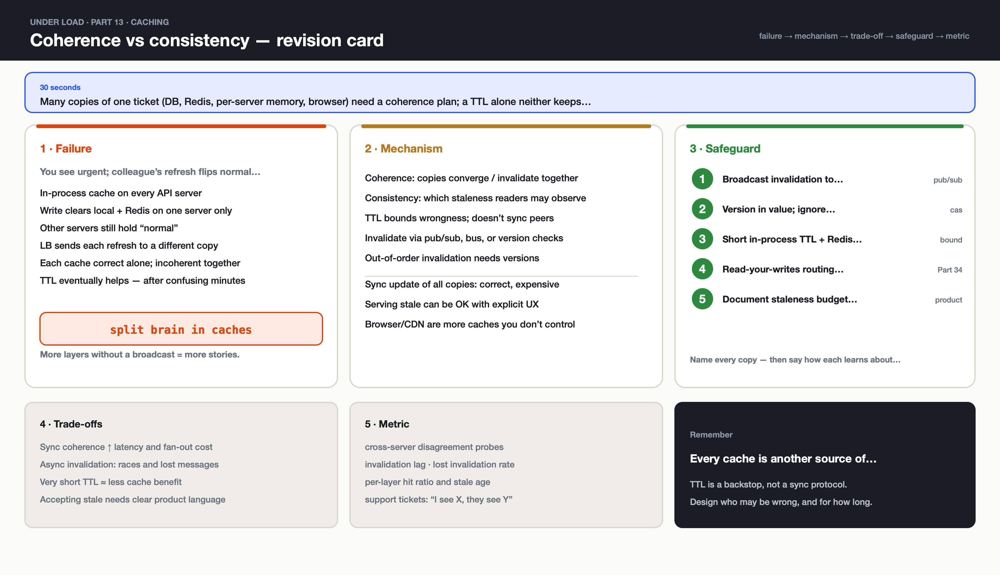
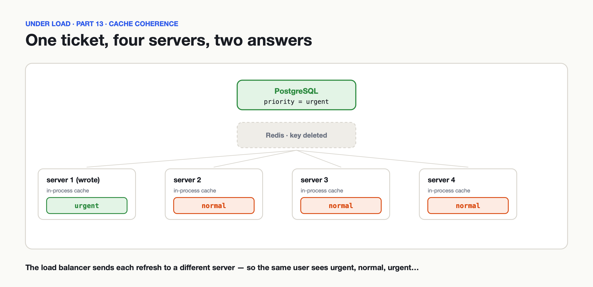
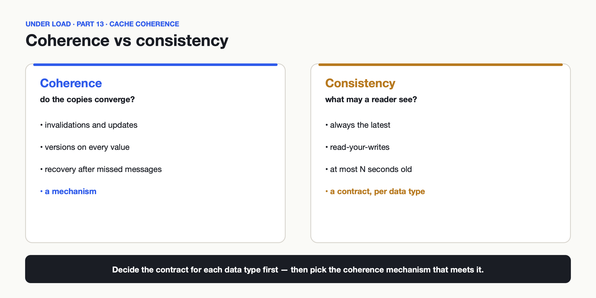
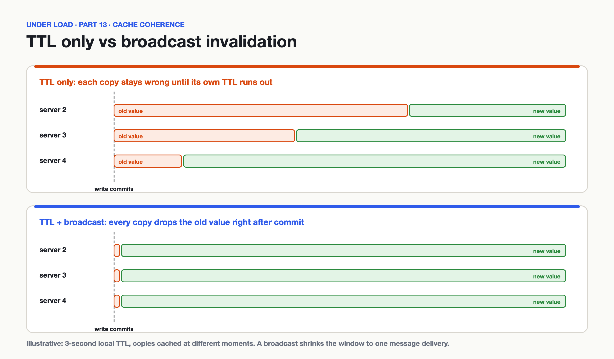
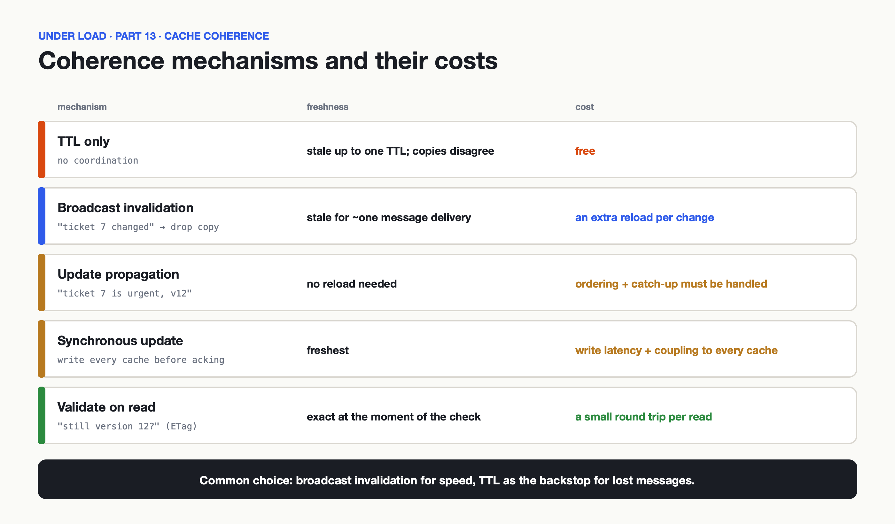
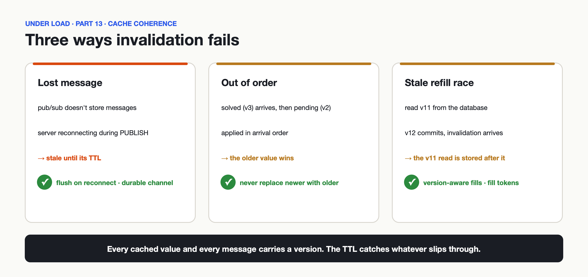
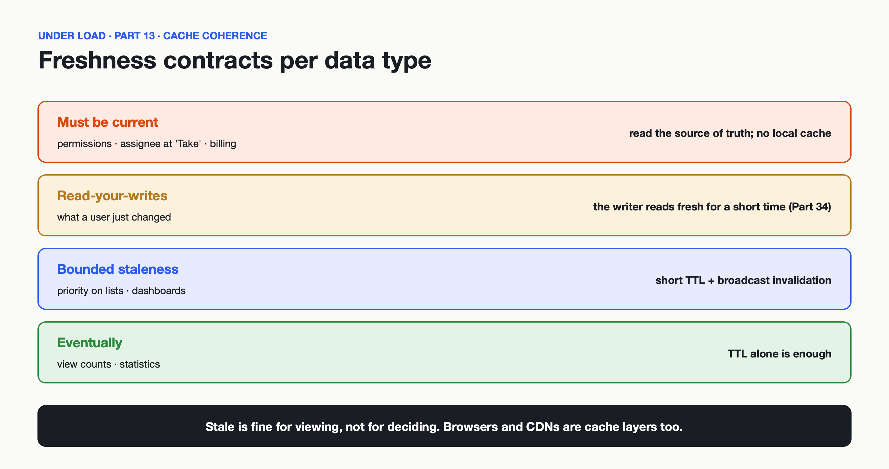
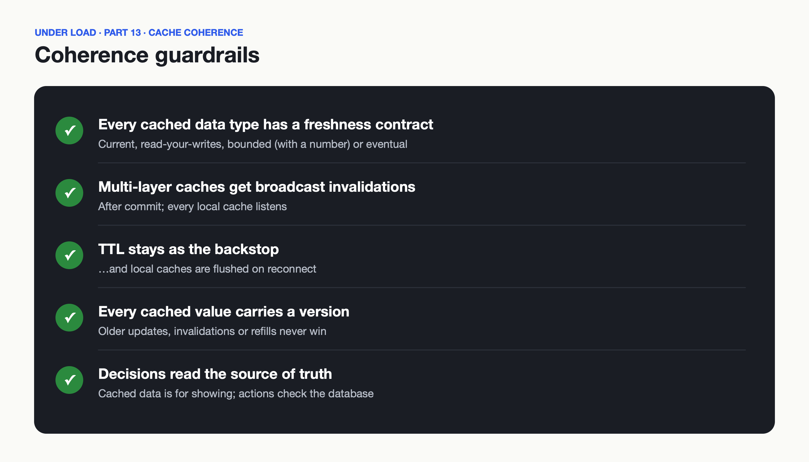

# Cache Coherence vs Consistency

### Cache coherence vs cache consistency: keeping many copies of the same data in step, deciding what readers are allowed to see, and why a TTL alone does neither.

*Under Load · Part 13 · Caching*





---

After Part 12, the team added a small **in-process cache** to every API server: a few thousand hot tickets held in each server's own memory for a few seconds, so most reads don't even need a network call to Redis. Reads got faster again. Then the support lead filed a bug that took a while to believe:

> "I set a ticket to urgent. My screen shows urgent. My colleague, sitting next to me, refreshes the same ticket and sees normal. She refreshes again and sees urgent. Then normal. Then urgent."

Nothing was broken. The ticket now lived in **at least six places**: PostgreSQL, Redis, the memory of each of four API servers — and, it turned out later, the colleague's browser. The write updated the database, deleted the Redis key and cleared the local cache **on the server that handled the write**. The other three servers still had their own copy of *normal*. The load balancer sent each refresh to a different server, and each server answered from its own memory.

Every individual cache was behaving correctly. Together, they were telling the same user different stories about the same ticket, in alternation.

This article is about that problem. It has two halves that are often confused: keeping many cached copies of the same item in step (**coherence**), and deciding what a reader is allowed to see while they're out of step (**consistency**). Both are needed, and the order in which they're decided matters.

---

## Coherence and consistency are different questions



**Coherence** is about the **copies**. When the same item is cached in several places, do those copies converge on the same value, and how quickly? Does a copy ever keep an old value indefinitely? It's a **mechanism** problem: invalidations, updates, versions, messages, recovery after a message is missed.

**Consistency** is about the **contract with the reader**. Relative to the writes that have happened at the **source of truth** — the one system whose value is authoritative, here PostgreSQL — which values is a read *allowed* to return? Some example contracts:

- "Always the latest committed value."
- "At most five seconds old."
- "At least as new as what this same user just wrote."
- "Eventually the latest; no promise about when."

It's a **policy** problem, and it's decided per type of data, because a dashboard counter and a permission check deserve very different answers.

The two are independent. A system can be coherent but have a weak contract: every copy is updated within a second, and readers are fine with a second of staleness. Or it can have a strict contract and meet it by bypassing caches entirely for the reads that need it, without any coherence machinery at all. So the order of decisions is:

1. **Pick the source of truth** for each piece of data.
2. **Decide the consistency contract** for each data type: what may a reader see?
3. **Choose the coherence mechanism** that meets that contract at acceptable cost.
4. **Decide what happens on a miss or a suspected stale entry**: read from the source of truth, wait until a fresh value is available, or deliberately serve the stale one.

Teams that start at step 3 ("let's add pub/sub invalidation") without step 2 end up with machinery that is either too weak for the data that matters or needlessly expensive for the data that doesn't.

### Where the words come from

Both terms come from hardware. A multi-core CPU gives each core its own cache. When core 1 writes to a memory address that core 2 also has cached, core 2's copy is now wrong. **Cache coherence protocols** fix that. The best known, **MESI**, tags every cached line as *Modified*, *Exclusive*, *Shared* or *Invalid*. Before a core writes a shared line, it broadcasts an invalidation over the interconnect, and every other core marks its copy *Invalid*; their next read fetches the new value. A separate concept, the **memory consistency model**, defines what orderings of reads and writes a program may observe across cores.

That's a useful mental model — **invalidate other copies on write, then reload on the next read** — and it's exactly the shape of the solution below. But the analogy breaks in important places. CPU caches talk over a hardware interconnect with guaranteed delivery, in nanoseconds, with a fixed set of participants. Application caches talk over networks where messages are **delayed, reordered or lost**, servers start and stop, and a "core" can be paused for seconds by garbage collection. Everything that follows is about what has to be added when the cores are servers.

---

## What a TTL does, and doesn't

Every cache entry in this series has a **TTL** (time to live). It's the first tool everyone reaches for, so it's worth being precise about what it guarantees.

### It bounds how long a copy can be wrong

Suppose each server's in-process cache holds tickets for three seconds. Server 1 changes ticket 7 from *normal* to *urgent*: it updates the database, deletes the Redis key, and clears its own local copy.

The other three servers know nothing about this. Each keeps serving *normal* until its own copy expires. If server 2 cached the ticket just before the write, it can serve the old value for almost the full three seconds. The write never reached it. Time did.



That's what a TTL gives: a **bound on staleness**. No copy can be wrong for longer than its TTL, measured from when it was cached. That's valuable, and every cache entry should have one, as a backstop if nothing else.

### It doesn't coordinate copies

Copies cached at different moments expire at different moments. Suppose the four servers cached ticket 9 one second apart, each with a four-second TTL, and then the priority changes. For the next few seconds, the servers don't just lag behind the database — they **disagree with each other**:

- right after the write: all four show the old value;
- one second later: server 1's copy has expired and reloaded, so it shows the new value; servers 2–4 still show the old one;
- another second: two new, two old;
- and so on, until the last copy expires.

That's exactly the flickering in the bug report. Each refresh landed on a different server, and the servers were at different points in their TTLs. A TTL tells each copy when to give up on its own; it does nothing to make copies agree. And shortening the TTL only narrows the window at the cost of more reloads — it never closes it.

---

## Coherence mechanisms

To make other copies stop serving stale data, the writer has to **tell them** — or every reader has to check. There are a handful of ways to do that, each with a different cost.



### Broadcast invalidation

After committing, the writer publishes a message — "ticket 7 changed" — that every server listens to. Each server deletes its local copy when the message arrives, and the next read reloads from Redis or the database.

```python
# writer, after the transaction commits
db.execute("UPDATE tickets SET priority = %s, version = version + 1 WHERE id = %s", ...)
redis.delete(f"ticket:{ticket_id}")
redis.publish("ticket-changes", json.dumps({"id": ticket_id, "version": new_version}))

# every server, in a background listener
def on_message(msg):
    event = json.loads(msg)
    local_cache.drop_if_older(event["id"], event["version"])
```

Redis **pub/sub** (`PUBLISH` and `SUBSCRIBE`) is a common choice because Redis is already there and delivery to connected subscribers typically takes on the order of a millisecond on a local network. With a broadcast, the stale window shrinks from "up to one TTL" to "the time it takes a message to arrive."

Two rules make this safe:

- **Invalidate after commit.** The same rule as in Part 9: if the message goes out before the transaction commits, a server can reload the old value from the database and cache it again — and nothing will tell it to drop that copy.
- **Prefer invalidation over sending the new value.** "Ticket 7 changed" lets each server reload on its next read; a missed or late invalidation causes, at worst, an extra reload. Sending the value itself ("ticket 7 is now urgent") saves the reload, but a reordered or duplicated update can install an old value, as shown below.

### Update propagation

The writer sends the new value to every copy. It avoids the reload after every change, which matters for items that are both hot and frequently changed. It also needs the most care: every message must carry a version so that receivers can refuse old values, and a server that missed messages must have a way to catch up.

### Synchronous update (write-through to every copy)

The writer updates every cache before acknowledging the write (Part 10 discussed write-through for a single cache). This gives the strongest freshness — once the write returns, no cache holds the old value — but it costs on every write: more latency, and a **dependency coupling** between the write path and every cache. If one server is slow or unreachable, the write is slow or fails. That's acceptable for a shared cache like Redis; it's rarely acceptable for dozens of in-process caches.

### Versioned entries with validation

Each cached value carries the version it was read at. Instead of being told about changes, a reader **asks** the source cheaply whether its version is still current — "is ticket 7 still at version 12?" — and only reloads if it isn't. HTTP's `ETag` and `If-None-Match` work exactly like this (below). The read always costs a round trip to the source of truth, but a small one, and freshness is exact at the moment of the check.

### Choosing

The mechanisms trade freshness against write cost and coupling:

- **TTL only:** no coordination at all; staleness up to one TTL; copies disagree with each other.
- **Broadcast invalidation:** cheap writes, staleness of roughly one message delivery, and an extra reload after each change.
- **Update propagation:** no reload, but ordering and catch-up must be handled explicitly.
- **Synchronous update:** freshest, but every write waits for every cache.
- **Validation on read:** exact freshness per read, at the cost of a small check against the source each time.

Most systems combine two: broadcast invalidation for speed, plus a TTL as the backstop for every message that goes missing.

---

## How invalidation still fails

Invalidation is simple to describe and full of races. Three of them account for most stale-data bugs.



### 1. Lost messages

Redis pub/sub is **fire-and-forget**: messages aren't stored. A subscriber that isn't connected at the moment of `PUBLISH` never receives the message, and there's no way to ask for it later.

Subscribers are disconnected more often than it seems: during a deploy, while a server starts up, on a reconnect after a network blip or a Redis failover. If an invalidation is published during that moment, that one server keeps serving the old value until its TTL expires. It has no way of knowing it missed anything.

Defenses:

- **Keep the TTL.** It's what turns "stale forever" into "stale for at most N seconds."
- **Flush the local cache on reconnect.** A server whose subscription dropped can't know what it missed, so it clears its in-process cache when the subscription comes back, and starts listening **before** it starts serving from the cache again. Cheap and very effective.
- **Use a durable channel** when missed invalidations really matter. With Redis Streams or Kafka, each server tracks its position in the stream and catches up after a disconnect instead of losing messages.
- **Drive invalidations from the database's change log.** Instead of the application publishing after each write — which can be forgotten in one code path or skipped by a crash between commit and publish — a process reads the database's own log of committed changes and publishes an invalidation for each (change data capture, Part 30). Every committed change produces a message, including changes made by scripts and migrations. Facebook's memcache deployment described this approach: daemons tail the MySQL commit log and broadcast deletes.
- **Let the cache server track it.** Redis 6 and later support **client-side caching** with `CLIENT TRACKING`. Redis remembers which keys each client has read and sends that client an invalidation when one of them changes. Redis's documentation is explicit that if the connection carrying invalidations is lost, the client must flush its local cache — the same rule as above, built into the protocol. Several Redis client libraries implement this directly.

### 2. Messages out of order

If messages carry **values** — "ticket 5 is now *solved*" — then two updates published close together can arrive in the wrong order. A server receives *solved* (version 3) and then *pending* (version 2), applies both in arrival order, and ends up at *pending*: the older value wins, and nothing will correct it until the TTL expires.

Ordering is guaranteed less often than it seems. Two writers on different servers publish independently. Retries resend old messages. A durable channel partitioned by something other than the item id can deliver one item's messages through different partitions.

The fix is the same one used throughout this series: **every cached value carries the version it came from** (the `version` column incremented on every update), and every message carries one too. A receiver applies an update only if its version is higher than the one it holds; an invalidation drops the local copy only if the local version is older than the message's. Then the order of arrival stops mattering.

Pure invalidations are more forgiving still: a late "ticket 5 changed" just causes one extra reload, which fetches the current value whatever order things happened in.

### 3. The stale refill race

The subtlest failure needs no lost or reordered messages at all. It's a race between a **read that refills the cache** and a **write that invalidates it**:

1. Server 2 misses its cache and reads ticket 7 from the database: *normal*, version 11.
2. Before server 2 stores that result, server 1 commits *urgent* (version 12) and broadcasts the invalidation.
3. Server 2 receives the invalidation. There's nothing in its cache yet, so it drops nothing.
4. Server 2 now finishes its read and stores *normal*, version 11, in its cache.

The invalidation arrived, was processed correctly, and the cache still holds the old value — until the TTL expires. The window is small, but on hot items it happens.

Defenses:

- **Version-aware fills.** The invalidation records "ticket 7 is at version 12 or later." A fill with version 11 is refused. This needs the server to remember recent invalidation versions briefly, even for items it doesn't hold.
- **Fill tokens.** When a reader misses, it gets a token; an invalidation for that key revokes outstanding tokens; a fill with a revoked token is discarded. Facebook's memcache paper (Nishtala et al., 2013) describes this as **leases**, used to prevent exactly these stale sets — and to throttle stampedes at the same time.
- **Short TTLs on the inner layers.** The in-process cache, which is the hardest to keep coherent, gets the shortest TTL, so whatever slips through is short-lived.

---

## The consistency contract

Coherence mechanisms shrink the window in which copies disagree. Over a network, they never make it zero. So for each type of data, the contract has to say explicitly what a reader may see during that window.



- **Must be current** — permissions and roles, a ticket's assignee at the moment of "Take ticket," billing and plan state. Don't serve these from an in-process cache at all, or read them from the source of truth at the moment it matters: when an action is taken, not just when something is displayed.
- **Read-your-writes** — a user who just changed something must see their own change, even if others see it a moment later. The writer's own reads can be served from the source of truth for a short time after their write, or carry the version they wrote so any cache older than that is bypassed. Part 34 covers this in depth.
- **Bounded staleness** — a ticket's priority on the list view, the dashboard. "At most a few seconds old" is fine. Short TTLs plus broadcast invalidation enforce it, and the bound should be a written number, not a feeling.
- **Eventually** — view counts, recommendations, statistics. Minutes of staleness are acceptable; a TTL alone is enough.

The contract also answers the question from the start: what happens when a stale entry is **suspected** — a version check fails, a subscriber just reconnected, an invalidation is late? For "must be current" data, read from the source. For bounded data, reload and accept the latency. For eventual data, keep serving and refresh in the background.

### When serving stale data is acceptable

Serving stale data on purpose — stale-while-revalidate (Part 11), a stale fallback when a refresh fails (Part 12) — is often the right call for availability: an old dashboard is better than an error page, and a fast slightly-old list is better than a slow exact one.

It's not acceptable when the stale value would lead someone to **act** wrongly:

- approving a refund based on an outdated balance,
- letting a removed admin keep access because their role is cached,
- assigning a ticket that someone else took a second ago.

A useful rule: **stale is fine for viewing, not for deciding.** Screens can be served from caches; actions re-check the source of truth, usually with the version check from Part 2 (`UPDATE ... WHERE version = $seen`), so a decision based on an old view fails loudly instead of succeeding wrongly.

---

## Don't forget the caches the backend doesn't run

The browser and any **CDN** (content delivery network — a layer of caching servers close to users) in front of the API are cache layers too, and no server-side broadcast reaches them.

`Cache-Control: max-age=60` on a ticket API response allows a browser to show a 60-second-old ticket without asking the server at all. That was the last piece of the bug report: the colleague's browser had its own copy.

For data that changes, the HTTP mechanism is **revalidation**:

- The server sends an `ETag` — an opaque version identifier for the response, such as the ticket's version number — with `Cache-Control: no-cache`. Despite its name, `no-cache` means "may be stored, but must be revalidated with the server before each use."
- On the next request, the browser sends `If-None-Match: "<etag>"`.
- If nothing changed, the server answers `304 Not Modified` with no body. If it did change, the server sends the new version.

That's the "validation on read" mechanism from above, built into HTTP: one small round trip per use, and exact freshness. (Part 5 used the same `ETag` header for safe writes with `If-Match`.) For personalized responses, `Cache-Control: private` keeps shared caches such as CDNs from storing them at all. CDNs usually also offer **purge** APIs, often by tag, so a change can explicitly evict cached responses — another invalidation channel, with its own delivery delays.

---

## Shipping a new cache layer safely

Most coherence bugs arrive with a new layer — like the in-process cache in the story. A few habits catch them before users do:

- **Start with the shortest TTL that delivers the benefit.** For an in-process cache in front of Redis, a second or two often captures most of the gain on hot items.
- **Ship the invalidation listener before the cache.** The layer should never exist without the mechanism that keeps it coherent.
- **Exclude "must be current" data by design**, with an allow-list of cacheable types rather than a deny-list.
- **Test with more than one server.** Single-instance test environments can't reproduce coherence bugs; they need at least two instances behind a load balancer that spreads requests between them.
- **Add a kill switch.** A flag that bypasses the layer makes "is it the cache?" answerable in seconds during an incident.

---

## Guardrails that prevent the next one



1. **Every cached data type has a freshness contract.** Current, read-your-writes, bounded (with a number) or eventual — written down next to the cache code.
2. **Multi-layer caches get invalidations, after commit.** Each server's local cache listens and drops changed keys; ideally the invalidations come from the database's change log.
3. **TTL stays as the backstop**, and local caches are flushed on reconnect.
4. **Every cached value carries a version.** Older updates, invalidations or refills never overwrite newer data.
5. **Decisions read the source of truth.** Cached data is for showing; actions check the database.

---

## What to keep on the dashboard

- **Invalidation lag:** time from commit to every subscriber having received the invalidation. The median is usually small; watch the tail and the maximum.
- **Subscriber health:** connected subscribers per channel, reconnects, and local-cache flushes on reconnect. A server missing from the subscriber count is a server serving stale data.
- **Version mismatches:** periodically sample cached values in each layer and compare their version with the database. This is coherence, observed directly.
- **Stale-read incidents:** for example, how often a user's action fails a version check because what they saw was old.
- **Hit rate and eviction rate per layer.** A layer with a low hit rate adds coherence risk without much benefit.
- **Source-of-truth load.** Adding a layer should reduce load below it; invalidation storms show up here as reload spikes.
- **P99 read latency.** Coherence work should never make reads slow.

---

## Recap

### What's the difference between cache coherence and cache consistency?
Coherence is about the copies: making several cached copies of the same item converge, using invalidations, updates, versions and recovery from missed messages. Consistency is the contract with readers: which values a read is allowed to return relative to the writes at the source of truth. Decide the contract per data type first, then choose the mechanism.

### Why doesn't a TTL alone guarantee coherence?
A TTL only limits how long each copy can be wrong on its own; it never tells copies about a write. Copies cached at different moments expire at different moments, so for up to one TTL they disagree with the database and with each other — which is why the same user can see the old and new value alternate.

### What coherence mechanisms are there?
Broadcast invalidation (drop the copy, reload on next read), update propagation (send the new value), synchronous update of every cache before acknowledging the write, and versioned entries validated against the source on read. They trade freshness against write latency and coupling; most systems use broadcast invalidation plus a TTL backstop.

### Why is cache invalidation vulnerable to races and message loss?
Messages over a network can be lost (Redis pub/sub doesn't store them), reordered, or arrive while a reader is in the middle of refilling the cache with a value it read just before the write. Each of these leaves an old value in place until its TTL expires. Flush on reconnect, use durable channels or change data capture, and make every fill and update version-aware.

### How would you handle an invalidation arriving out of order?
Carry a version with every message and every cached value, and never let an older version replace a newer one — for updates, invalidations and refills alike. Pure invalidations are more forgiving, because a late one only causes an extra reload of the current value.

### Why do synchronous cache updates have a cost?
Because every write waits for every cache. Freshness improves, but write latency grows, and the write path now depends on every cache being reachable — a slow or failed cache node slows or fails writes.

### When is serving stale cache data acceptable?
When the data is for viewing and the contract allows it — dashboards, lists, statistics — especially to stay available and fast during failures. It's not acceptable when someone will act on it: permissions, balances, assignments. Actions check the source of truth, usually with a version check.

### How does this relate to CPU cache coherence?
Protocols like MESI keep per-core caches coherent by invalidating other copies before a write, over a reliable hardware interconnect, within nanoseconds. It's a good mental model, but application caches communicate over networks where messages are delayed, reordered or lost and nodes come and go, so they also need TTLs, versions and recovery on reconnect.

### What about browser and CDN caches?
They're layers that server-side invalidation can't reach. A response with `max-age` can be reused without asking the server. For data that changes, send an `ETag` with `Cache-Control: no-cache` so clients revalidate cheaply with `If-None-Match`, use `private` for personalized responses, and use CDN purge where shared caching is needed.

### What should be monitored?
Invalidation lag, subscriber health and reconnects, version mismatches between layers and the source of truth, stale-read incidents, hit and eviction rates per layer, source-of-truth load, and P99 read latency.

---

## Next

- **Lab (run + measured write-up):** [13-cache-coherence](https://github.com/b-basoglu/under-load/tree/main/13-cache-coherence)
- **Next:** [Idempotency](../14-idempotency/article.md) — The customer clicked "Submit" once. The network timed out. The app retried. Two tickets were created, and two confirmation emails went out.
