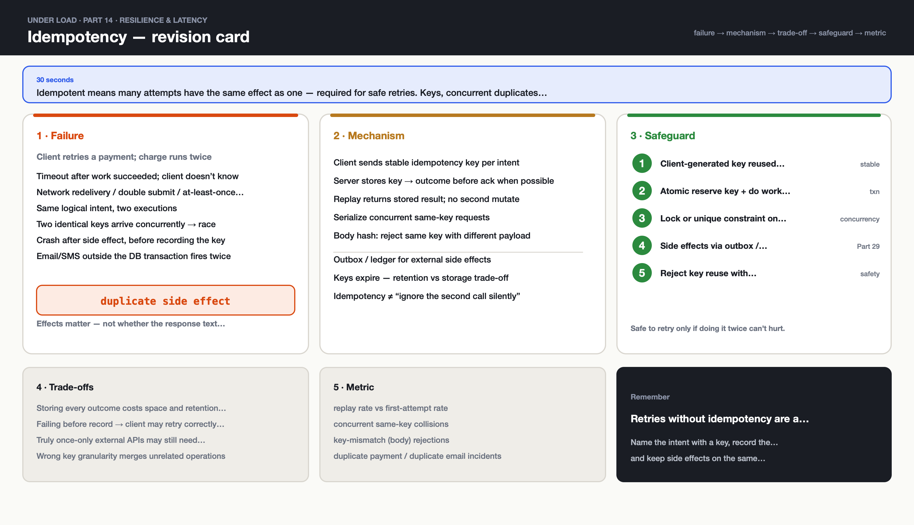
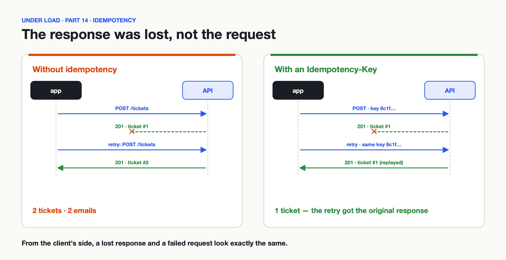
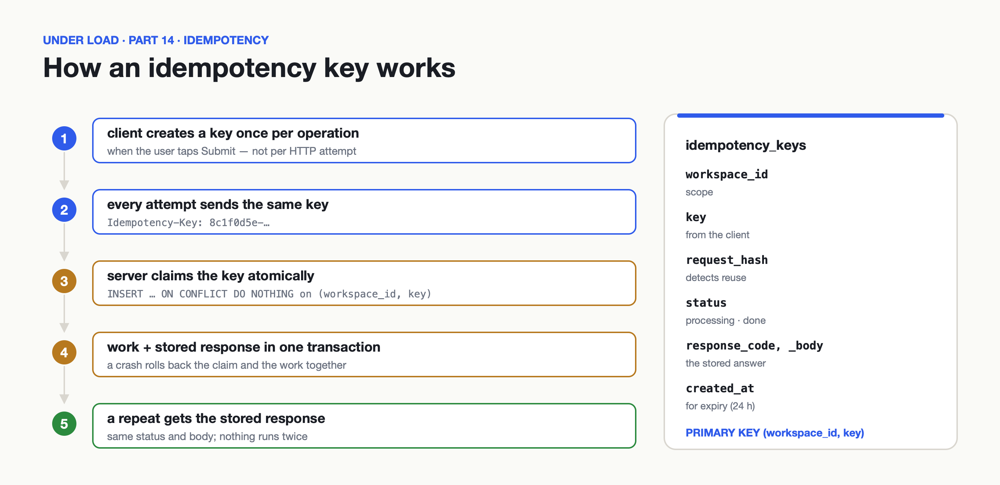
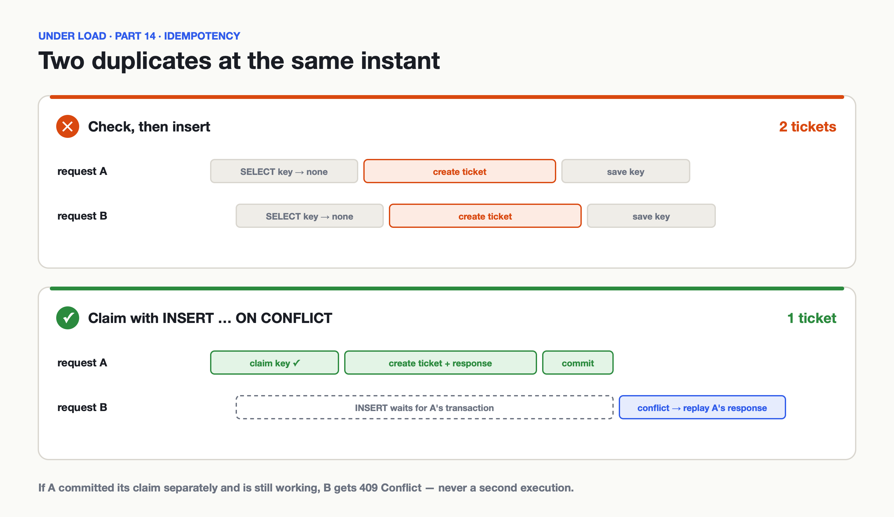
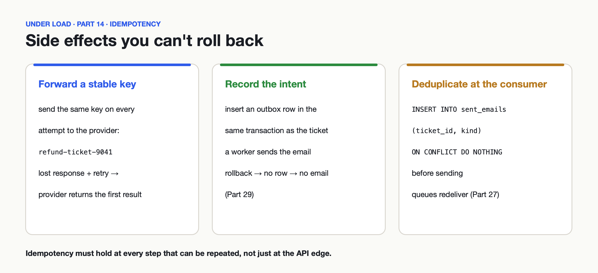
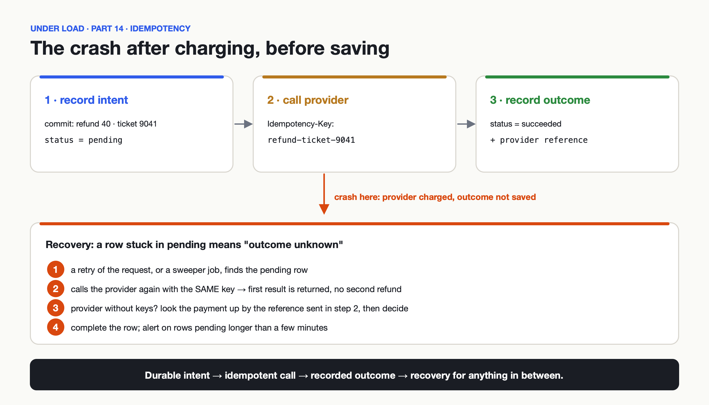
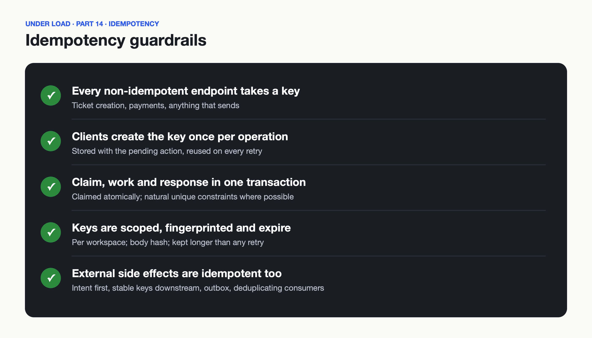

# Idempotency

### Idempotency: making retries safe — idempotency keys, the concurrent-duplicate race, the crash in the middle, and side effects that can't be rolled back.

*Under Load · Part 14 · Resilience & Latency*





---

A Halcyon customer submits a support request from the mobile app: a refund for a duplicated order. The request reaches the API, the ticket is created, the confirmation email is queued — and the response gets lost on the way back, because the customer's phone switched from Wi-Fi to cellular at that exact moment.

The app sees a timeout and does what it was built to do: it retries. The API receives a perfectly valid request to create a ticket, and creates one. The customer now has **two tickets** and **two confirmation emails**. Two agents pick them up, and both start working on the same refund. One of them issues it. Then the other one does too.

At scale, this isn't rare. Mobile networks drop responses. Load balancers and service meshes retry on timeouts. Message queues redeliver messages (Part 27). Users double-click "Submit." Every retry mechanism in the system — and Part 15 argues that several are needed — will eventually repeat a request that **already succeeded**, because from the caller's side, a lost response and a failed request look exactly the same. The caller only knows that it didn't hear back.

The fix is **idempotency**: making it safe to repeat an operation, so that doing it twice has the same effect as doing it once. This article builds it step by step, through the four ways it usually goes wrong: the lost response, two duplicates arriving at the same instant, a crash halfway through, and side effects outside the database.

---

## What idempotent means

An operation is **idempotent** if performing it many times has the same effect as performing it once. The word is about **effects**, not responses: the second call may return something slightly different (a "this was a replay" marker), as long as it doesn't change anything further.

Some operations are idempotent by nature:

- **Setting a value:** `UPDATE tickets SET status = 'solved' WHERE id = 1182` leaves the same result whether it runs once or five times.
- **Deleting by id:** deleting a ticket that's already deleted changes nothing.
- **HTTP `PUT` and `DELETE`** are defined as idempotent by the HTTP specification (RFC 9110) for exactly this reason: `PUT /tickets/1182` with a full body means "make it look like this," and saying it twice doesn't make it look more like that. `GET`, `HEAD` and `OPTIONS` are **safe** as well — they're not supposed to change anything at all.

Others are not:

- **Creating something:** every `POST /tickets` creates another ticket.
- **Incrementing or appending:** `UPDATE ... SET reopen_count = reopen_count + 1` adds one more every time; so does appending a comment.
- **Sending and charging:** every call to "send email" sends another email; every "charge card" charges again.

Some operations can be **redesigned** to be naturally idempotent: "set the refund amount for order 1182 to 40" instead of "refund 40," or a client-chosen id (`PUT /tickets/<uuid>`) instead of a server-generated one. That's worth doing where it fits. But many operations can't be reshaped that way, and for those, the standard tool is an **idempotency key**.

---

## The idempotency key



1. The **client** generates a unique key for one **logical operation** — usually a random UUID — **before** sending the first request, and sends it with every attempt:

   ```http
   POST /api/tickets
   Idempotency-Key: 8c1f0d5e-3b7a-4c2e-9a41-6f2d8e0b7c55
   Content-Type: application/json

   {"subject": "Refund for duplicated order 1182", ...}
   ```

2. The **server** durably remembers which keys it has processed, and what it answered.
3. When a request arrives with a key it has already processed, the server **doesn't do the work again**. It returns the **stored response** from the first time.

Replay the story with a key: the first attempt creates ticket 9041 and stores "201 Created, ticket 9041" under the key. The response is lost. The retry arrives with the same key, the server finds the stored response and returns it. The app shows ticket 9041, exactly as if the first response had arrived. One ticket, one email.

The detail that matters most is in step 1: **the key belongs to the operation, not to the HTTP request.** A client that generates a fresh key on every attempt — a common bug when the key is created inside the HTTP helper instead of at the moment the user taps "Submit" — makes each retry look like a brand-new operation, and the server will dutifully create a second ticket. The key should be created when the user acts, stored with the pending action (on mobile, on disk, so it survives the app being killed), and reused for every retry of that action.

The `Idempotency-Key` header is the common convention. Stripe's API popularized it, and the IETF HTTP APIs working group has a draft that standardizes the header and the error responses around it. For message queues, the equivalent is a **message id** that the producer assigns once and the consumer remembers.

---

## Building it correctly

A table to remember keys:

```sql
CREATE TABLE idempotency_keys (
  workspace_id  int         NOT NULL,
  key           text        NOT NULL,
  request_hash  text        NOT NULL,          -- fingerprint of the request
  status        text        NOT NULL,          -- 'processing' or 'done'
  response_code int,
  response_body jsonb,
  created_at    timestamptz NOT NULL DEFAULT now(),
  PRIMARY KEY (workspace_id, key)
);
```

Three decisions are already in that table.

**The key is scoped.** The primary key is `(workspace_id, key)`, not just `key`. Two customers can't collide, and one customer can't probe for another's keys and read their stored responses. Scope it to whatever identifies the caller — account, user or API client — and check authorization **before** returning a stored response, exactly as for a fresh request.

**The request is fingerprinted.** If the same key arrives with a *different* body, something is wrong — usually a client reusing a key by mistake, sometimes a client that edited the form and resubmitted. Silently returning the first response would hide the bug and confuse the user; doing the new work would break the guarantee. The usual answer is to reject the request (`422 Unprocessable Content`, the status the IETF draft uses) and log it. The fingerprint is a hash of the parts of the request that define the operation: method, path and a canonical form of the body.

**There's a status.** A key can be claimed while its work is still in progress. That's what makes the next two sections work.

### Two duplicates at the same moment

The tempting implementation is "check if the key exists; if not, do the work":

```python
if not db.exists("SELECT 1 FROM idempotency_keys WHERE workspace_id = %s AND key = %s", ws, key):
    ticket = create_ticket(body)
    db.execute("INSERT INTO idempotency_keys ...")
```

That's the check-then-act race from Part 2. When a user double-clicks, or a client's retry fires while the first attempt is still running, two requests with the same key arrive milliseconds apart. Both check, both see nothing, both create a ticket. The check protects against retries that come *after* the first attempt finished — the easy case — and does nothing for the overlapping case, which is exactly when duplicates are most likely.



The fix is to **claim the key atomically before doing the work**, letting the primary key act as the lock:

```sql
INSERT INTO idempotency_keys (workspace_id, key, request_hash, status)
VALUES ($1, $2, $3, 'processing')
ON CONFLICT DO NOTHING
RETURNING key;
```

If a row comes back, this request owns the key and does the work. If nothing comes back, someone else already holds it, and this request reads that row instead:

- **`done`, same fingerprint:** return the stored response — a replay.
- **`done`, different fingerprint:** reject with `422`.
- **`processing`:** the original is still running. Either wait briefly and re-read, or answer `409 Conflict` ("a request with this key is in progress, retry shortly") — the response both Stripe and the IETF draft use. It must never be a second execution.

There's a useful subtlety in PostgreSQL here. If the first request's transaction has inserted the key but **not committed yet**, the second request's `INSERT ... ON CONFLICT` doesn't return immediately: it **waits** for the first transaction to finish, because it can't know yet whether that row will exist. If the first commits, the second sees the conflict and can read the finished response. If the first rolls back, the second's insert succeeds and it does the work itself. So when the claim and the work share one transaction (next section), duplicates naturally queue behind the original instead of polling.

The same idea works without a key table whenever the operation has a **natural unique identity**: a `UNIQUE` constraint on `(workspace_id, external_message_id)` for tickets created from inbound emails means the same email can never create two tickets, no matter how many times it's processed. A uniqueness constraint is often a simpler and more reliable guard against duplicates than a lock, because the database enforces it even for code paths nobody thought about.

### A crash in the middle

The second classic mistake is doing the work and recording the key in **separate steps**:

1. Create the ticket (and commit).
2. *(the process dies)*
3. Save the key and the response.

If the process dies between steps 1 and 3 — a deploy, an out-of-memory kill, a lost database connection — the ticket exists but the key doesn't. The client retries, the server finds no key, and creates the ticket again. A key store alone doesn't help if the work and the record of the work can be separated by a crash.

When the work is in the same database as the keys, the fix is to put the claim, the work and the stored response in **one database transaction**:

```python
with db.transaction():
    if not claim_key(ws, key, request_hash):        # INSERT ... ON CONFLICT DO NOTHING
        return replay_or_conflict(ws, key, request_hash)
    ticket_id = insert_ticket(body)
    insert_outbox(ticket_id, "send_confirmation")   # see below
    save_response(ws, key, 201, {"id": ticket_id})  # status = 'done'
```

Now a crash anywhere before the commit rolls back **everything** — the claim, the ticket and the outbox row — and the retry starts from a clean slate. A crash after the commit leaves a `done` key, so the retry gets a replay. There's no moment at which the ticket exists without its key.

---

## Side effects outside the database

A database transaction can roll back a ticket. It can't un-send an email or un-charge a card. The refund in the story is the dangerous case: a call to a payment provider that **succeeds on their side** while the server crashes, or times out, before it records the result.



### Forward a key downstream

Most payment providers and many other APIs accept an idempotency key themselves. Derive a **stable** key for the downstream call from the operation — `refund-ticket-9041`, or the incoming key plus a step name — and send the **same** key on every attempt. If the first call succeeded but its response was lost, the provider recognizes the key and returns the original result instead of refunding again.

"Stable" is the important word: a downstream key generated at random on each attempt is the same bug as a client generating a new key per retry, one level further down.

### The crash after charging, before saving

Suppose the server crashes **after** the provider processed the refund but **before** the server recorded it. Because the provider call is outside the transaction, the "one transaction" trick doesn't cover it. The design that does:

1. **Record the intent first, durably.** Commit a row — `refund 40 for ticket 9041, status: pending, provider key: refund-ticket-9041` — **before** calling the provider.
2. **Call the provider with that key.**
3. **Record the outcome.** Update the row to `succeeded` or `failed`, with the provider's reference.



Now every crash leaves a recoverable state. If the row says `pending`, nobody knows whether the provider processed the refund — so the recovery path, whether a retry of the request or a background job sweeping old pending rows, **calls the provider again with the same key**. Thanks to the provider's own idempotency, that either performs the refund for the first time or returns the result of the earlier one. Either way, the row can be completed. Where a provider doesn't support keys, the recovery path has to **ask** it instead — look up the payment by a reference sent in the first call — before deciding whether to retry.

This is the general shape for any external side effect: **durable intent, idempotent call, recorded outcome, and a recovery path for anything stuck in between.**

### Don't send from inside the request at all

For side effects like email, a simpler pattern is to **record the intent** in the same transaction as the ticket — a row in an `outbox` table that says "send confirmation for ticket 9041" — and let a separate worker send it. If the transaction rolls back, there's no outbox row, so no email. If it commits, the email will be sent, eventually, even if the API server dies right after. This is the **transactional outbox** (Part 29).

### Make consumers idempotent too

The worker that sends the email may itself crash after sending but before marking the row done, and send again on restart. A message broker delivering **at least once** — the usual guarantee — will sometimes deliver the same message twice (Part 27). So the consumer remembers what it has processed:

```sql
INSERT INTO sent_emails (ticket_id, kind) VALUES ($1, 'confirmation')
ON CONFLICT DO NOTHING
RETURNING ticket_id;          -- only send if a row came back
```

Even this leaves a tiny window — sent, then crashed before the insert committed — which is why the email provider's own idempotency key or message id is the last line of defense. Idempotency has to hold at **every** step that can be repeated, not just at the API edge.

"Exactly-once" features don't remove this need. Kafka's idempotent producer, for example, prevents duplicates caused by the producer's own retries within a partition, and its transactions cover reads and writes inside Kafka. Neither can prevent a consumer from charging a card twice in an external system. Exactly-once claims always have a scope, and external side effects are usually outside it.

---

## What to store, and what to return

**Replay the same status and body.** If the first attempt returned `201 Created` with the ticket, the replay does too, so clients need no special handling. A marker header such as Stripe's `Idempotent-Replayed: true` helps debugging.

**Decide which failures to store.** Two policies are common:

- **Store only final outcomes.** Success and deterministic errors (a validation failure that will fail the same way next time) are stored. Transient failures — the database was briefly unavailable, a downstream timeout before anything happened — release the claim, so the retry can actually succeed.
- **Store everything, including server errors.** Stripe documents this behaviour: the first result for a key is returned for all later requests with that key, even a `500`. It's simpler and maximally predictable, but a transient error then sticks for the life of the key, and the client must use a new key — a new operation — to try again.

Either works, as long as clients know which one they're dealing with.

**Don't store too much.** The stored response may contain personal data. Store what the client needs to continue — the ticket id and status — rather than a full copy of a large response, and expire it.

---

## How long to keep keys

Keys can't be stored forever, and they don't need to be. A key only has to live as long as a client might still retry that operation. Stripe documents that keys can be removed after they're at least 24 hours old; a day is a common default. Choose a value longer than the longest retry window in the system, including mobile apps that queue actions while offline and retry hours later.

Two consequences to accept knowingly:

- **After expiry, a retry is a new operation.** If a phone comes back online after two days and retries, it creates a new ticket. Usually acceptable; where duplicates must never happen, back the key with a **natural uniqueness rule** that never expires.
- **Expired keys must be cleaned up without hurting the database.** Delete in small batches, or partition the key table by day and drop old partitions, so cleanup doesn't become its own load problem.

---

## Shipping it safely

- **Start with the endpoints where duplicates cost money or trust:** payments and refunds, ticket creation, anything that sends a message to a customer.
- **Make the key optional at first, then required** for those endpoints once clients send it; log requests that arrive without one.
- **Fix the clients at the same time.** The server-side implementation does nothing if the mobile app generates a new key per attempt. Test the whole loop: kill the app between request and response, restart it, and check that the retry carries the same key.
- **Test the races deliberately.** Fire two requests with the same key at the same instant; simulate a crash after the side effect and before the commit; replay a queue message twice. These are the cases that ordinary tests never exercise.
- **Add a duplicate detector that doesn't trust the mechanism:** a scheduled query looking for two tickets with the same subject from the same requester within seconds. If idempotency fails somewhere, this finds it.

---

## Guardrails that prevent the next one



1. **Every non-idempotent endpoint accepts an idempotency key.** Ticket creation, payments, anything that sends.
2. **Clients create the key once per operation**, store it with the pending action, and reuse it on every retry.
3. **Claim, work and response in one transaction**, with the key claimed atomically (`INSERT … ON CONFLICT`), and natural unique constraints wherever the data has a natural identity.
4. **Keys are scoped, fingerprinted and expire** after longer than the longest retry window.
5. **External side effects are idempotent too:** durable intent before the call, stable keys forwarded downstream, an outbox for messages, and consumers that deduplicate.

---

## What to keep on the dashboard

- **Replay rate:** requests answered from a stored response, per endpoint. A sudden rise means something upstream is retrying a lot.
- **Concurrent duplicates:** requests that waited on, or got `409` for, a key in progress.
- **Key mismatches:** same key, different body. Almost always a client bug.
- **Requests without a key** on endpoints that should have one.
- **Stuck intents:** side-effect rows still `pending` after a few minutes — the crash-in-the-middle cases waiting for recovery.
- **Duplicates skipped downstream:** messages or emails a consumer recognized as already processed.
- **Business-level duplicates** found by the independent detector.
- **Key table size and cleanup lag.**

---

## Recap

### What does idempotency mean?
That performing an operation many times has the same effect as performing it once. Setting a value or deleting by id is naturally idempotent; creating a record, incrementing a counter, sending an email or charging a card is not, so those need explicit protection.

### Why do duplicate requests happen?
Because callers can't tell a lost response from a failed request, and every retry mechanism — mobile clients, load balancers, queues, users double-clicking — eventually repeats a request that already succeeded.

### How would you make a payment API safe to retry?
Have the client generate an idempotency key once per logical operation and send it with every attempt. The server claims the key atomically, records the intent durably, calls the payment provider with a stable key derived from the operation, and stores the outcome; repeats with the same key get the stored response instead of a second charge.

### What if two requests with the same key arrive at the same time?
A "check, then insert" lets both through. Claim the key atomically with `INSERT … ON CONFLICT DO NOTHING` on a unique key: one request wins; the other waits for it and replays its response, or gets `409 Conflict` while it's still in progress — never a second execution.

### What happens if the server crashes after doing the work but before saving the key?
If they're separate steps, the retry finds no key and does the work again. For work inside the database, put the key claim, the work and the stored response in one transaction, so a crash rolls back all of it. For an external charge, record a pending intent before the call, call with a stable downstream key, and let the recovery path repeat the call with that same key to learn the outcome.

### How do you handle side effects outside the database?
Forward stable idempotency keys to external APIs that support them, ask the provider for the outcome where they don't, write intents like "send email" to an outbox in the same transaction and let a worker send them, and make every consumer deduplicate what it has already processed.

### Why must the client reuse the same key?
Because the key identifies the operation, not the HTTP request. A client that generates a new key per attempt makes every retry look like a new operation, and the server creates a duplicate.

### What if the same key comes with a different request body?
Reject it, usually with `422`, instead of returning the first response or doing the new work. Store a fingerprint of the request with the key so mismatches can be detected.

### Could idempotency or a unique constraint replace a lock?
Often, for preventing duplicates. A unique constraint on a natural identity (or on the idempotency key) lets the database reject the second attempt atomically, without holding a lock around the work, and it protects every code path. Locks are still needed when two different operations must not interleave.

### Does "exactly-once delivery" remove the need for idempotency?
No. Exactly-once features have a defined scope — a broker's own reads and writes, a producer's own retries — and side effects in external systems are outside it. Consumers that call other systems still need to deduplicate.

### How long should keys be kept?
Longer than the longest window in which a client might retry — 24 hours is a common default. After that, a retry is treated as new, so combine keys with natural uniqueness rules where duplicates must never happen, and clean up expired keys in batches.

### What should be monitored?
Replay rate per endpoint, concurrent duplicates, key mismatches, requests missing a key, stuck pending intents, duplicates skipped downstream, an independent business-level duplicate check, and the size and cleanup of the key table.

---

## Next

- **Lab (run + measured write-up):** [14-idempotency](https://github.com/b-basoglu/under-load/tree/main/14-idempotency)
- **Next:** [Retries, Backoff & Jitter](../15-retries/article.md) — The email provider had a 10-second blip. Every worker retried immediately, then again, then again — and kept it down for 20 minutes.
