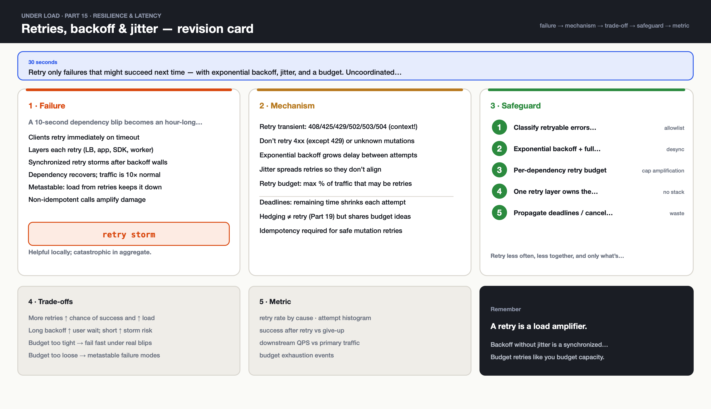
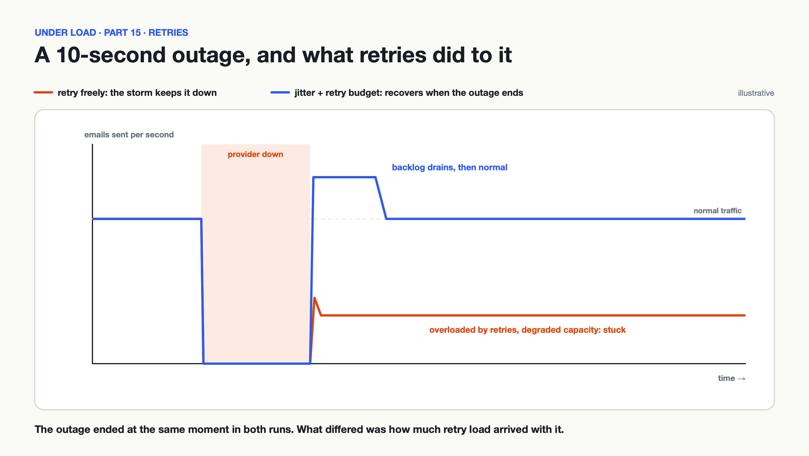
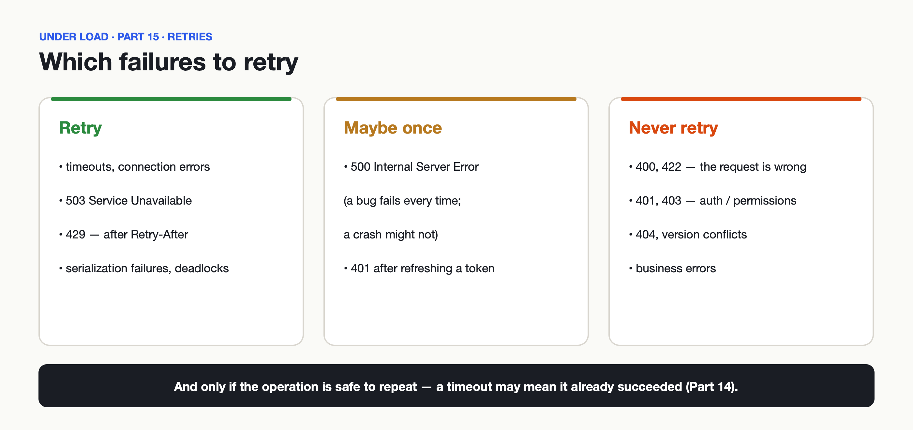
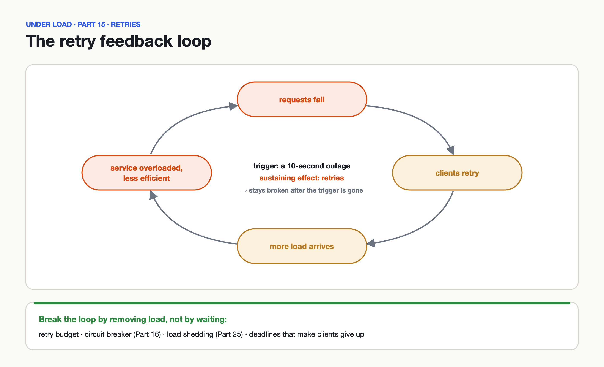
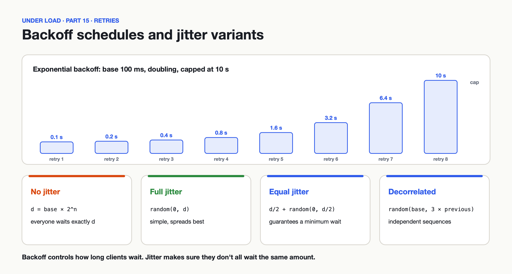
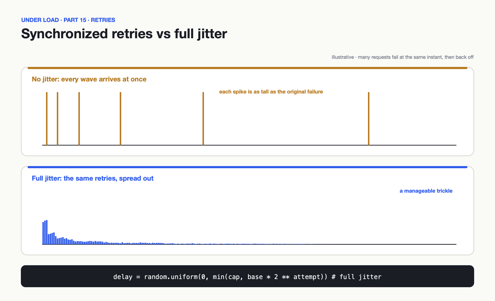
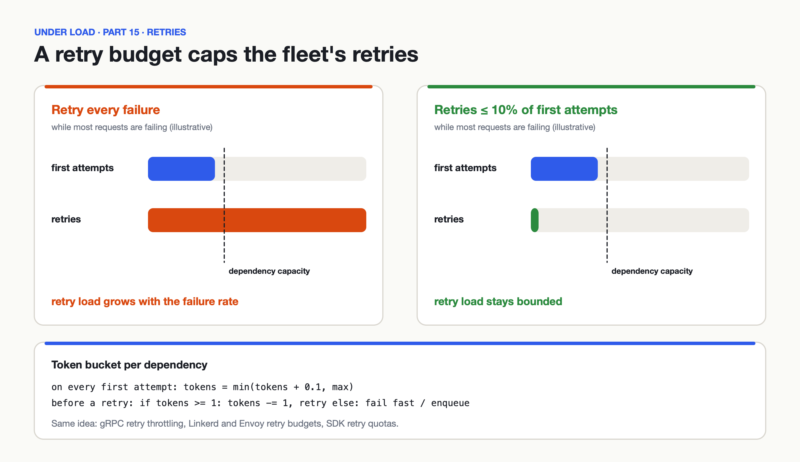
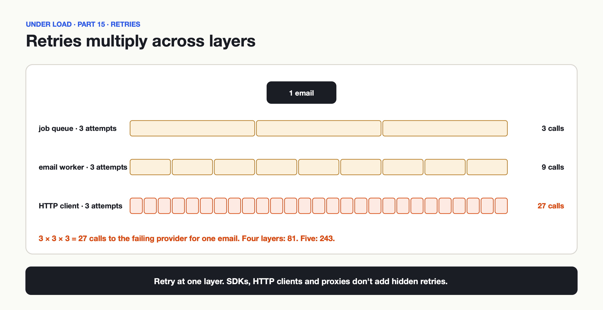
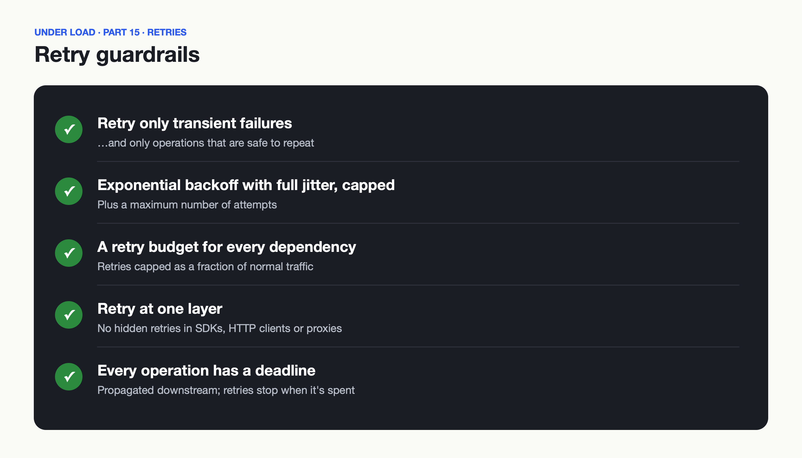

# Retries, Backoff & Jitter

### Retries, exponential backoff and jitter: when retrying helps, how it turns a 10-second blip into an outage that won't end, and the budget that prevents it.

*Under Load · Part 15 · Resilience & Latency*





---

The support platform sends its emails — confirmations, replies, notifications — through an external email provider. One afternoon the provider has a ten-second outage. That's the kind of thing a well-built system shrugs off.

Instead, email stays broken for twenty minutes.

The email workers had a simple retry policy: if sending fails, try again. During the ten-second outage, every send failed, and every failure was retried — immediately, and then again, and then again. When the provider came back, it didn't come back to its normal few hundred emails per second. It came back to many times that: every new email plus every retry of every email that had failed in the last ten seconds, all arriving at once. Overloaded, the provider slowed down and started failing requests again, which caused more retries. The outage had ended, but the **retries kept it going**.

Retries are essential. Networks drop packets, servers restart, connections reset, and most of these failures last milliseconds. A single retry turns many of them into a success the user never notices. But a retry is also **extra load, sent exactly when a dependency is struggling**. This article covers when to retry, how to space retries out (exponential backoff), why spacing isn't enough on its own (jitter), how retries multiply across layers, and the one control that stops retries from keeping an outage alive (a retry budget).

---

## When to retry, and when not to

A retry only helps if the next attempt has a real chance of succeeding. So the first rule is about **which failures** to retry.



**Usually worth retrying** — the failure is likely temporary:

- **Timeouts and connection errors:** connection refused or reset, a DNS lookup that failed, a TLS handshake that timed out.
- **`503 Service Unavailable`:** the server says it's temporarily unable to handle the request.
- **`429 Too Many Requests`:** the caller is being rate-limited (Part 22). Retry only after the delay the server asks for in its `Retry-After` header, which can be a number of seconds or a date. Retrying sooner just gets rejected again and counts against the limit.
- **Database errors that mean "try again":** serialization failures and deadlocks (Parts 2 and 5). The database aborted the transaction on purpose and expects the client to rerun it.

**Not worth retrying** — the next attempt will fail the same way:

- **`400 Bad Request`, `422 Unprocessable Content`:** the request itself is wrong.
- **`401 Unauthorized`, `403 Forbidden`:** authentication or permission problems. (A `401` caused by an expired access token is the exception: refresh the token once, then retry once.)
- **`404 Not Found`**, `409 Conflict` from a version check, and business errors like "ticket already closed."

**`500 Internal Server Error` is ambiguous.** It may be a bug that fails every time for this input, or a transient crash. Retry it at most once.

Retrying permanent errors isn't harmless. Every retry of a `400` is a request the dependency has to parse, authenticate and reject, and a client stuck retrying one is load with no possible benefit.

### The prerequisite: safe to repeat

Before retrying anything that changes data, the operation must be **safe to repeat**. A timeout doesn't mean the request failed. It means the caller stopped waiting. The request may have succeeded, with only the response lost. Retrying a non-idempotent request creates duplicates (Part 14): retrying an email send without an idempotency key or message id sends the email twice. Reads are usually safe; writes need an idempotency key, or shouldn't be retried automatically.

---

## How retries turn a blip into an outage

To see why retries can keep an outage going, follow the numbers of the story. They're illustrative, but the arithmetic is the point.

- New emails arrive at **400 per second**.
- The provider can handle about **600 per second**. Normally it has **200 per second of spare capacity**.
- The provider is down for **10 seconds**. In that time, **4,000** sends fail.

When the provider comes back, those 4,000 failed sends still need to go through, on top of the 400 per second that keep arriving. With 200 per second of spare capacity, draining a backlog of 4,000 takes **20 seconds** — if the retries arrive gently, spread over those 20 seconds. If they all arrive within the first couple of seconds, the provider sees well over twice its capacity at the very moment it's recovering.

And with immediate retries, the backlog isn't even 4,000 requests. During the outage, each failed send is retried the moment it fails, fails again instantly, and is retried again. The request rate during the outage is limited only by how fast the workers can loop — easily tens or hundreds of times the normal rate. Every worker thread is busy retrying, connection pools are exhausted, and the moment the provider accepts connections again, that whole storm lands on it.

### Why it doesn't recover by itself

If the provider simply processed 600 requests per second no matter how many it received, the storm would eventually drain. Real services don't behave that way. Under overload:

- queues fill up, so requests wait longer than their callers' timeouts and are **abandoned after the server already did the work**;
- threads, memory and connections run out, and the server spends more effort on rejecting and timing out than on useful work;
- garbage collection, lock contention and context switching all get worse.

So an overloaded service often completes **fewer** requests per second than a healthy one. And if its degraded capacity falls below the normal incoming rate — 400 per second here — even the new traffic alone keeps it overloaded. Add retries of everything that fails, and the system has found a new, stable, broken state.



This is called a **metastable failure** (Bronson et al., "Metastable Failures in Distributed Systems," 2021): the system is pushed into a bad state by a trigger — here, a ten-second outage — and then held there by a **sustaining effect** — here, retries — after the trigger is gone. The defining property is that **waiting doesn't fix it**. Something has to remove the extra load: fewer retries, a circuit breaker (Part 16) or load shedding (Part 25).

---

## Exponential backoff: spacing retries out

The standard first fix is to wait between attempts, and to wait **longer each time**:

```
delay = min(cap, base × 2^attempt)
# base 100 ms, cap 10 s:  0.1 s, 0.2 s, 0.4 s, 0.8 s, 1.6 s, 3.2 s, 6.4 s, 10 s, 10 s …
```

This is **exponential backoff**. Early retries come quickly, so a brief glitch costs little; later ones spread out, so a longer outage isn't hammered. The **cap** keeps the delay from growing absurdly large, and a **maximum number of attempts** (or a total deadline, below) makes the client eventually give up.



Backoff changes the storm dramatically. Instead of retrying continuously, each failed operation makes a handful of attempts spread over several seconds. The request rate during the outage drops from "as fast as the workers can loop" to a small multiple of normal.

But it has two limits.

**It limits each client, not the fleet.** Every failed operation still retries several times. After a ten-second outage, thousands of operations are each partway through their backoff schedules, and their retries keep arriving for a while after the provider returns. If the provider is fragile under overload, that backlog can still push it over the edge — and the longer clients keep retrying, the bigger the backlog that lands on the recovering service. Patience isn't free.

**It keeps clients synchronized.** That's the next problem.

---

## Jitter: breaking synchronization

If many requests fail **at the same moment** — a connection reset that hits every open connection, a deploy, a brief network partition, a provider restart — they all compute the same backoff and retry at the same moments too: all at 0.1 seconds, all at 0.3, all at 0.7, all at 1.5. The retries arrive in **synchronized waves**, each one a spike as tall as the original failure.



Each wave is a small denial-of-service attack. Many of its requests fail because of the spike itself, schedule their next retry for the same moment as everyone else, and the pattern repeats.

**Jitter** adds randomness to the delay so that clients that failed together retry apart. The usual reference is Marc Brooker's analysis on the AWS Architecture Blog ("Exponential Backoff and Jitter," 2015), which compares three variants:

- **Full jitter:** wait a random time between zero and the backoff value. Simple, and among the best at spreading load.

  ```python
  delay = random.uniform(0, min(cap, base * 2 ** attempt))
  ```

- **Equal jitter:** wait half the backoff value, plus a random amount up to the other half. It guarantees a minimum wait, at the cost of a little less spreading.
- **Decorrelated jitter:** each delay is random between the base and three times the previous delay, capped. Delays grow on average but each client's sequence is independent of the others'.

Full jitter is a good default. What matters most is having **some** randomness: **backoff controls how long clients wait; jitter makes sure they don't all wait the same amount.** The same idea fixes cache avalanches (Part 11) — synchronized events need randomness to spread them out.

The cost of jitter is a less predictable delay for an individual request. With full jitter, some retries happen almost immediately and some wait the full backoff. For a user-facing request that's fine; for a test that asserts timings, it's annoying, which is a bad reason to remove it.

---

## The retry budget: limiting the fleet

Backoff and jitter shape *when* retries happen. They don't limit *how many* happen in total. During a large outage, every failed request still retries its full number of attempts, so retry traffic grows with the failure rate — exactly backwards from what a struggling dependency needs.

A **retry budget** fixes that by capping retries as a **fraction of normal traffic**: for example, "retries may add at most 10% on top of first attempts." When failures are rare, the budget is never touched and every failure can be retried. When everything is failing, the budget runs out quickly, and most failed requests are **not retried**: they fail fast, or go to a queue to be handled later (Part 28).

```python
# A token bucket per dependency: each first attempt earns 0.1 tokens, each retry spends 1.
class RetryBudget:
    def __init__(self, ratio=0.1, max_tokens=100):
        self.ratio, self.max_tokens, self.tokens = ratio, max_tokens, max_tokens

    def on_request(self):
        self.tokens = min(self.tokens + self.ratio, self.max_tokens)

    def can_retry(self):
        if self.tokens >= 1:
            self.tokens -= 1
            return True
        return False                    # fail fast, or enqueue for later
```



Back to the story's numbers. With a 10% budget, the provider sees at most about 440 requests per second — the 400 new ones plus 40 retries — no matter how many sends are failing. That stays under its 600 per second of capacity, so when the outage ends, the provider recovers immediately instead of being flattened by a backlog. Some emails fail during the outage and aren't retried right away; they go to a queue and are sent once the provider is healthy, at a pace it can handle.

That's the counter-intuitive result: **retrying less makes more requests succeed** overall, because the dependency's capacity is spent on useful work instead of on drowning in retries.

Retry budgets are widely implemented:

- **gRPC** has *retry throttling*: each client keeps a token count per server that failures decrease and successes increase, and retries are only allowed while the count is above half its maximum.
- **Service meshes and proxies:** Linkerd and Envoy both support retry budgets expressed as a percentage of normal requests, with a small minimum so low-traffic services can still retry.
- **Cloud SDKs** often include a retry quota for the same purpose — the AWS SDKs' "standard" retry mode, for example, draws retries from a token bucket.
- **Google's SRE book** describes the same pair of limits: a per-request cap on attempts, and a per-client cap on the ratio of retries to requests.

A circuit breaker (Part 16) attacks the same problem from a different angle: instead of limiting retries, it stops calling a dependency entirely once it's clearly failing.

---

## Retries multiply across layers

One more trap. The job queue retries a failed job 3 times. Inside the job, the email worker retries the provider call 3 times. Inside that, the HTTP client library retries each request 3 times. Each layer looks reasonable on its own.

Together, one email that keeps failing becomes **3 × 3 × 3 = 27 calls** to the provider. With four layers of three attempts, it's 81; with five, 243. And each layer's backoff starts again from the beginning whenever the layer above retries, so the calls aren't even spread out.



The rule: **retry at one layer only**, usually the one that owns the operation and knows whether it's safe to repeat — often the outermost one, close to the user or the job. Configure HTTP clients, SDKs, service meshes and proxies **not** to retry on their own, or account for their retries explicitly in the budget. Many SDKs retry by default, which is exactly how hidden multiplication happens.

---

## Deadlines: retrying within a budget of time

A user waiting for a page doesn't care how many retries happened; they care how long it took. So retries need a **total deadline**, not just a maximum number of attempts.

- **Set a deadline for the whole operation** — for example, two seconds for the ticket page — and stop retrying when there isn't enough time left for another attempt.
- **Make each attempt's timeout shorter than the total.** Three attempts with a two-second timeout each can't fit in a two-second deadline. A common split: a per-attempt timeout around a typical slow response, and as many attempts as fit.
- **Propagate the remaining deadline downstream**, so services further along don't keep working on a request the caller has already given up on. gRPC carries the deadline with every call, and many gRPC implementations pass it on automatically when the request context is forwarded; with HTTP, a header carrying the remaining time or an absolute deadline does the same job.
- **For background work, the deadline can be long**, but it should still exist. A job that retries for days is usually a bug that needs a human, not more attempts — which is what dead-letter queues are for (Part 28).

Deadlines also cap the backlog problem from earlier: clients that give up after a few seconds stop contributing retries to a recovering dependency.

---

## Shipping retry changes safely

Retry behaviour is invisible until something fails, which makes it easy to get wrong and hard to notice:

- **Inventory every layer that retries** for each important dependency: application code, HTTP client, SDK, proxy, mesh, queue. The number that matters is the product.
- **Put the policy in one shared client** per dependency — retryable error classes, backoff with jitter, budget, deadline — instead of in each call site.
- **Test with injected failures.** Make the dependency return `503`s or time out in staging and watch how much load it receives compared with normal. A retry policy that hasn't been tested under failure is a guess.
- **Test recovery, not just failure.** The dangerous moment is when the dependency comes back; check that load returns to normal quickly instead of staying elevated.
- **Roll out retry changes gradually**, because a policy that retries more aggressively can turn the next blip into an outage across the whole fleet at once.

---

## Guardrails that prevent the next one



1. **Retry only transient failures**, and only operations that are safe to repeat.
2. **Exponential backoff with full jitter, capped**, and a maximum number of attempts.
3. **A retry budget for every client of every dependency.** Retries are capped as a fraction of normal traffic.
4. **Retry at one layer.** SDKs, HTTP clients and proxies don't add hidden retries.
5. **Every operation has a deadline**, propagated downstream, and retries stop when it's spent.

---

## What to keep on the dashboard

- **Retry rate per dependency:** retries divided by first attempts. This is the most direct signal of a storm.
- **Attempts per successful operation.** Normally close to 1. A rise means retries are doing real work — or hiding a problem.
- **Retry budget exhaustion:** how often retries were skipped because the budget ran out.
- **Errors by class:** retryable versus non-retryable, to catch code that retries `400`s.
- **Load on each dependency compared with incoming traffic.** If a dependency sees far more requests than there are user actions, something is amplifying.
- **Recovery time after incidents:** how long load and error rates take to return to normal once the dependency is healthy. A long tail is the signature of retries sustaining the problem.
- **End-to-end latency against the deadline**, and how often requests run out of time.

---

## Recap

### How can retries create cascading failures?
Every retry is extra load sent exactly when a dependency is struggling. If all clients retry freely, a brief outage turns into a flood that lands on the dependency the moment it recovers. Overloaded services often get less efficient, so the retries can keep it overloaded long after the original cause is gone — a metastable failure.

### Which HTTP and API failures should be retried?
Transient ones: timeouts, connection errors, `503`, `429` after its `Retry-After` delay, and database serialization failures and deadlocks. Not `400`, `401`, `403`, `404`, `422` or business errors, which will fail the same way again. Retry `500` at most once. And only retry operations that are safe to repeat.

### What is exponential backoff?
Waiting longer before each retry — for example 0.1, 0.2, 0.4, 0.8 seconds, up to a cap — with a maximum number of attempts. Brief glitches are retried quickly and long outages aren't hammered. It limits how hard each client pushes, but not how much the whole fleet retries.

### Why is jitter necessary if you already use exponential backoff?
Because clients that fail at the same moment compute the same delays and retry in synchronized waves, each as tall as the original failure. Jitter — for example full jitter, a random delay between zero and the backoff value — spreads those retries out so they arrive as a manageable trickle instead of spikes.

### What is a retry budget, and why does it matter?
A cap on retries as a fraction of normal traffic, such as 10%. When failures are rare, everything can be retried; when everything is failing, most requests aren't retried, so retry traffic can't grow with the failure rate and keep a dependency down. gRPC retry throttling, Linkerd and Envoy budgets and SDK retry quotas all implement it.

### What happens when several layers retry?
The attempts multiply: three layers of three attempts make 27 calls for one failing request. Retry at one layer only, and turn off or account for hidden retries in SDKs, HTTP clients, meshes and proxies.

### How do timeouts and deadlines fit with retries?
Retries must fit inside the operation's total latency budget: stop when there isn't time for another attempt, make each attempt's timeout shorter than the total, and propagate the remaining deadline so downstream services stop working on requests that were abandoned.

### What's a metastable failure?
A failure that sustains itself after its trigger is gone — for example, retry load keeping a recovered service overloaded. Waiting doesn't fix it; something has to remove the extra load, such as a retry budget, a circuit breaker or load shedding.

### What should be monitored?
Retry rate per dependency, attempts per successful operation, retry budget exhaustion, errors split into retryable and non-retryable, load on each dependency compared with incoming traffic, recovery time after incidents, and latency against deadlines.

---

## Next

- **Lab (run + measured write-up):** [15-retries](https://github.com/b-basoglu/under-load/tree/main/15-retries)
- **Next:** [Circuit Breakers & Cascading Failures](../16-circuit-breakers/article.md) — The email provider is down. Every request still waits 10 seconds for its timeout, and the ticket page — which sends a notification — waits with it.
