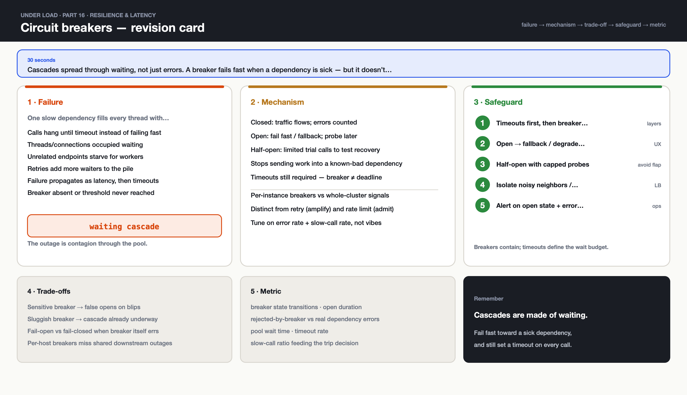
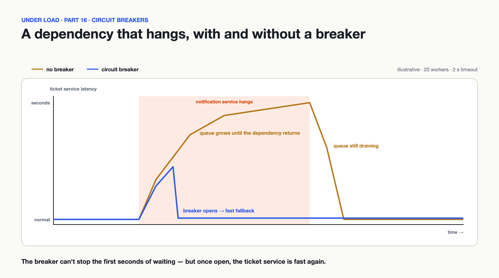
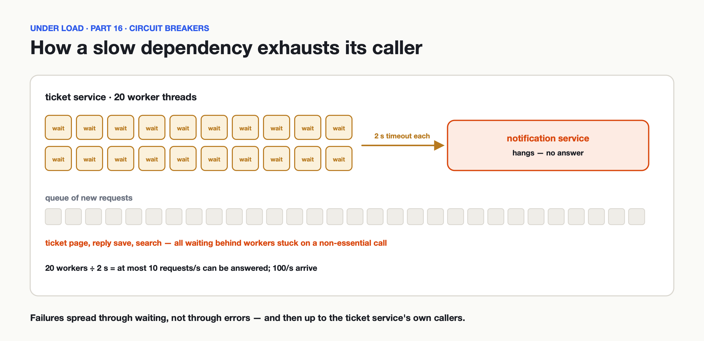
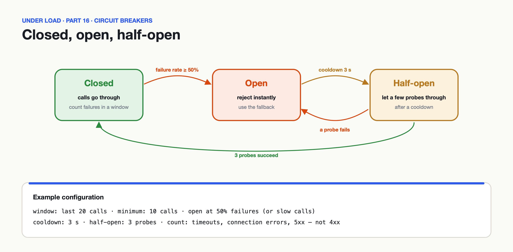
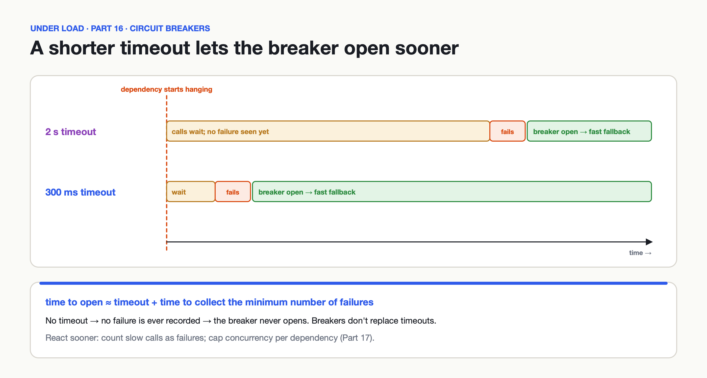
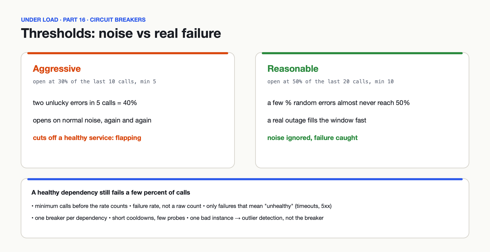
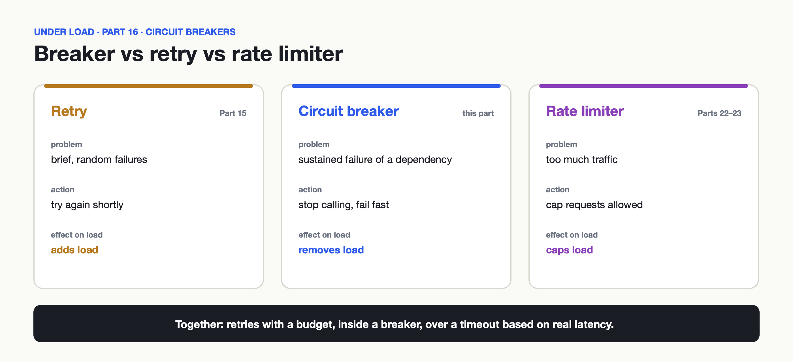
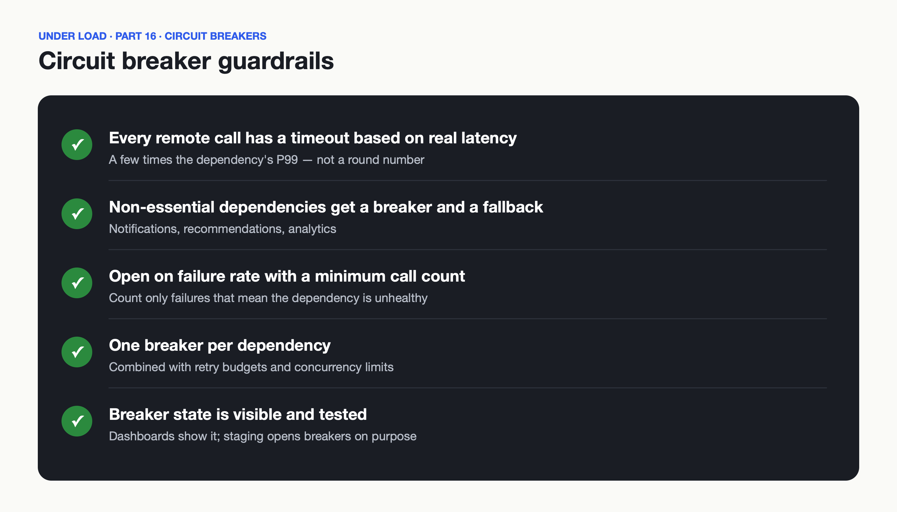

# Circuit Breakers & Cascading Failures

### Circuit breakers: how failures spread through waiting, how a breaker contains them, why it can't fix a long timeout, and how to tune it without tripping on noise.

*Under Load · Part 16 · Resilience & Latency*

---

When an agent saves a reply, the ticket service also calls the **notification service**, which pings the customer's mobile app. It's a nice-to-have: if the notification is a minute late, nobody notices.

One afternoon the notification service doesn't fail — it **hangs**. Requests to it don't get an error; they just never get an answer, until the caller's 2-second timeout gives up.

The ticket service has a pool of 20 worker threads. Every reply now waits 2 seconds on the notification call. Within a second, all 20 workers are waiting on a service that isn't going to answer. New requests queue behind them. Saving a reply — the one thing agents actually need — takes many seconds. The ticket page, which has nothing to do with notifications, is just as slow, because it shares the same workers.

A broken, non-essential service has taken down an essential one. That's a **cascading failure**: one component's failure spreading through everything that waits on it. And the ticket service's own callers — the web app, the mobile API — now wait on *it*, so the failure keeps climbing the call graph.

The tool for stopping this is a **circuit breaker**. This article explains how failures cascade, how a breaker works, the part most explanations skip — a breaker only works as well as the timeout under it — and how to tune one so it trips on real failures but not on normal noise.

---

## How failures cascade

The failure doesn't spread through errors. It spreads through **waiting**.

1. A dependency gets slow or stops answering.
2. Every call to it now holds one of the caller's resources — a thread, a connection, a slot in a pool — for the full timeout.
3. The caller has a fixed number of those resources. They run out.
4. New requests wait in a queue, including requests that never needed the broken dependency.
5. The caller becomes slow for its own callers, who start waiting on it — and the same thing happens one level up.

The arithmetic is unforgiving. Twenty workers, each held for 2 seconds per request, can complete at most 20 ÷ 2 = **10 requests per second**. If 100 requests per second arrive, 90 per second join a queue that only grows. Every request in that queue waits for the ones ahead of it, so latency keeps climbing for as long as the dependency hangs — and after it recovers, the queue still has to drain before latency returns to normal. The damage outlasts the outage.

Two things make it worse:

- **Retries** (Part 15): each call that times out and is retried holds a worker for another full timeout.
- **A failure that is slow is worse than a failure that is fast.** A dependency that returns errors instantly costs the caller almost nothing per call. A dependency that hangs costs the caller a resource for the full timeout. That's why "the service is down" is often less dangerous than "the service is slow."

---

## What a circuit breaker does

A circuit breaker wraps calls to a dependency and tracks how they're going. When too many fail, it **stops making the calls for a while** and fails immediately instead. The name comes from the electrical device that cuts the current when something is wrong, before the wiring overheats. The pattern was popularized by Michael Nygard's book *Release It!* and by Netflix's Hystrix library.

It has three states:

- **Closed** — normal. Calls go through. The breaker records the outcome of recent calls in a **sliding window**: either the last N calls (count-based) or the calls in the last N seconds (time-based).
- **Open** — when the failure rate in the window crosses a threshold (for example, 50% of the last 20 calls, once at least 10 calls have been recorded), the breaker **opens**. Calls are rejected immediately without touching the dependency, and the caller uses a **fallback**. No thread waits; no timeout is spent.
- **Half-open** — after a **cooldown** (a few seconds), the breaker lets a small number of **probe** calls through. If they succeed, it closes and normal traffic resumes. If one fails, it opens again for another cooldown.

Replay the story with a breaker on the notification call. The service hangs; for a short time, calls still go through and wait. As soon as enough of them have **timed out** to cross the threshold, the breaker opens. From then on, the notification call costs microseconds: the breaker rejects it, the fallback queues the notification for later, and the worker moves on. Saving a reply and loading the ticket page return to normal speed, even though the notification service is still down. Every few seconds the breaker lets a probe through; while the service is still hanging, the probe times out and the breaker reopens. When the service recovers, the next probes succeed, the breaker closes, and notifications resume — including the queued ones.

### The fallback is a product decision

What happens when the breaker is open depends on what the call was for:

- **Notifications:** skip it now, put it on a queue to send later.
- **A recommendations widget:** hide it.
- **Enrichment data** (a customer's plan shown next to a ticket): show the page without it, or from a cached copy.
- **Data the operation can't do without:** return a clear "temporarily unavailable" quickly (Part 20), rather than a slow failure.

A breaker without a fallback still helps — failing fast frees the caller's resources — but the user sees an error. Deciding the fallback for each dependency, before the incident, is most of the design work.

### Why it prevents the cascade

The breaker doesn't make the dependency work. What it does is **stop the caller from spending its limited resources waiting** on something that's failing. Rejected calls return instantly, so threads, connections and pool slots stay available for work that doesn't need the broken dependency. The failure is contained to the feature that actually depends on it.

It also helps the dependency. A struggling service that keeps receiving full traffic — plus retries — has a hard time recovering (the metastable failures of Part 15). An open breaker removes that load and gives it room to come back.

---

## A breaker can't fix a long timeout

There's a delay between "the dependency started hanging" and "the breaker opened," and it's easy to underestimate.

The breaker only learns that a call failed **when the call returns**. A call to a hanging service returns only when its timeout expires. So with a 2-second timeout:

1. The service starts hanging.
2. For the next 2 seconds, **no call has failed yet** — they're all still waiting. The breaker sees nothing wrong. Every worker gets stuck, and the queue grows.
3. After 2 seconds, the first timeouts arrive. The window fills with failures; once there are enough, the breaker opens.

The time to open is roughly **the timeout plus the time to collect the minimum number of failures**. During that time, the caller suffers the full cascade. With a 300 ms timeout, the same breaker would open within a fraction of a second, and only a handful of requests would ever feel the hang.

So the breaker is the second line of defense. The first is a **timeout that matches how long the call should actually take**. If the notification service normally answers in 20 ms, a 2-second timeout is a hundred times its normal latency — almost all of which is pure waiting when something goes wrong. Base timeouts on the dependency's real latency distribution — a few times its P99 is a common starting point — not on a round number someone picked years ago. (Part 18 covers what P99 means and why tails matter.)

Circuit breakers **do not replace timeouts.** Without a timeout, a call to a hanging service never returns, the breaker never records a failure, and it never opens.

Two more ways to make a breaker react sooner:

- **Count slow calls as failures.** Resilience4j, for example, can open the breaker when the share of calls slower than a threshold exceeds a rate, not only when calls fail — so it reacts to a dependency getting slow before calls start timing out.
- **Limit concurrency per dependency** (Part 17, bulkheads), so a hanging dependency can only ever hold a few workers, however long its timeout. Concurrency limits contain the damage during the window before the breaker opens.

---

## Tuning: not too eager, not too late

A breaker that opens too easily is its own outage. Every service across a network fails occasionally: a connection reset, a garbage-collection pause, one slow instance. Suppose a healthy dependency fails a few percent of calls at random:

- An **aggressive** breaker — open at 30% failures over the last 10 calls, with a minimum of 5 calls — will open regularly. With only 5 calls in the window, two unlucky failures are 40%. Each time it opens, it rejects every call for the cooldown, cutting off a service that was working fine. A breaker that does this repeatedly is **flapping**.
- A **reasonable** breaker — open at 50% over the last 20 calls, with a minimum of 10 — will practically never open on that noise, because reaching 50% by chance in a window of 20 at a few percent error rate is vanishingly unlikely. It still opens quickly when the dependency really breaks, because then nearly every call fails.

The general shape: the threshold must sit well above the normal error rate, and the window must be large enough that random clusters of errors don't look like a trend — but small enough (or short enough, for time-based windows) that a real failure fills it quickly.

Practical guidance:

- **Require a minimum number of calls** before the failure rate counts. Two failures out of three calls is noise, not a trend. At low traffic, a time-based window with a minimum count avoids judging a dependency on a tiny sample.
- **Use a failure rate, not a raw count**, so the threshold works at both low and high traffic.
- **Count only failures that mean the dependency is unhealthy:** timeouts, connection errors, `5xx`, slow calls. A `404` or a `400` is a problem with the request, not the dependency; counting it lets one bad client open the breaker for everyone. Most libraries let exceptions be marked as recorded or ignored.
- **Keep one breaker per dependency** — and sometimes per endpoint or operation, when one endpoint can fail while the rest of the service is fine. A single global breaker lets one bad endpoint cut off a healthy service.
- **Make cooldowns short and probes few.** A few seconds of cooldown and a handful of probes recover quickly without flooding a recovering service. Remember that a probe sent to a still-hanging service holds a worker for the full timeout — another reason to keep timeouts short. Some systems use a synthetic health-check request as the probe, so no real user request is the unlucky one.

### One instance, or the whole service?

A dependency is usually many instances behind a load balancer. If one of ten instances is broken, a client-side breaker sees about a 10% failure rate across the service — not enough to open, and opening would cut off nine healthy instances anyway.

That case needs a different tool: **outlier detection**, which tracks errors per instance and temporarily removes a misbehaving instance from the load-balancing pool. Envoy and service meshes built on it, such as Istio, implement this (ejecting an instance after a number of consecutive `5xx` responses, for example). It's a circuit breaker per instance, applied by the load balancer.

A naming trap: Envoy also has a feature *called* "circuit breaking," which is actually a set of **concurrency limits** — maximum connections, pending requests and retries per upstream cluster. It's closer to a bulkhead (Part 17) than to the three-state breaker described here. Both are useful; they're not the same thing.

### Each client decides alone

In a fleet of 40 ticket-service instances, each one has its own breaker for the notification service, with its own window and state. They don't coordinate. That's usually fine — each instance sees roughly the same failures and opens at roughly the same time — but it means breaker state should be looked at across the fleet, and an instance that just started has an empty window and will send real traffic to a dependency the others already know is down.

---

## Circuit breaker vs retry vs rate limiter

The three are often configured together, and they solve different problems:

- **Retries** handle **brief, random failures**: try again a moment later, and it'll probably work. They **add** load (Part 15).
- **A circuit breaker** handles **sustained failure of a dependency**: stop trying for a while, fail fast, and let it recover. It **removes** load.
- **A rate limiter** handles **too much traffic**: cap how many requests are allowed, regardless of whether anything is failing (Parts 22–23). It's about fairness and capacity, not health.

They work together: retries with a budget for transient errors, **inside** a breaker — so that an open breaker stops retries entirely instead of each retry being rejected separately — with timeouts underneath so nothing waits too long, and concurrency limits so a hang can't consume every worker before the breaker reacts.

Most languages have a library: **Resilience4j** in Java (Hystrix, its predecessor at Netflix, has been in maintenance mode for years), **Polly** in .NET, **sony/gobreaker** in Go, **opossum** in Node.js, **pybreaker** in Python. Service meshes provide outlier detection and concurrency limits at the network level.

---

## Fallbacks have to be safe too

A fallback runs exactly when things are going wrong, so it needs the same care as the main path — usually more, because it's exercised far less:

- **Don't fall back to something that shares the failure.** Falling back from a failing primary database to a cache that's rebuilt from that database doesn't help; neither does falling back to a second region that depends on the same broken service.
- **Don't let the fallback become the new overload.** A fallback that calls another service sends it all the traffic that used to go to the broken one, at the worst possible moment. Fallbacks that read local data or return a static response are the safest.
- **Don't serve stale data where it's dangerous.** A stale notification preference is fine; a stale permission check isn't (Part 13).
- **Make it visible.** Users and support staff should be able to tell that a degraded mode is active, and so should dashboards.
- **Test the fallback.** Code that only runs during outages is code that's rarely run. Open breakers on purpose in staging — most libraries allow forcing a breaker open — and check that the product still works.

---

## Shipping a breaker safely

- **Start in observe-only mode.** Many libraries can record what the breaker *would* have done without rejecting anything. A week of that shows whether the thresholds would have flapped on normal traffic.
- **Set the timeout first**, from the dependency's real latency, then add the breaker on top.
- **Decide and implement the fallback with the product owner** for each dependency.
- **Alert on state, not just errors.** An open breaker on an essential dependency is an incident; on a non-essential one it's a warning. Both should be visible.
- **Run a game day:** make a dependency hang in staging under realistic load and watch time-to-open, caller latency and recovery.

---

## Guardrails that prevent the next one

1. **Every remote call has a timeout based on real latency.** A few times the dependency's P99, not a round number.
2. **Every non-essential dependency has a breaker and a fallback.** Notifications, recommendations, analytics.
3. **Breakers open on failure rate with a minimum call count**, counting only failures (and slow calls) that mean the dependency is unhealthy.
4. **Breakers are per dependency**, combined with retry budgets, concurrency limits and per-instance outlier detection.
5. **Breaker state is visible and tested.** Dashboards show it; staging opens breakers on purpose.

---

## What to keep on the dashboard

- **Breaker state per dependency**, across the fleet, with every transition timestamped. An open breaker on an essential dependency should page someone.
- **Calls rejected by open breakers** and fallbacks served.
- **Dependency latency and error rate from the caller's side** — the inputs the breaker decides on.
- **Time to open** after a dependency starts failing. If it's long, timeouts are too long.
- **Worker and connection pool saturation** in the caller. This is where cascades show up first.
- **Flapping:** breakers opening and closing repeatedly, a sign of thresholds tuned too tight or a window too small.
- **Ejected instances** from outlier detection, per dependency.

---

## Recap

### What is a cascading failure?
A failure in one component spreading to the components that depend on it. It usually spreads through waiting: calls to a slow dependency hold the caller's threads and connections for the full timeout until they run out, and the caller becomes slow for its own callers, and so on up the call graph.

### What does a circuit breaker do?
It tracks the outcome of calls to a dependency over a sliding window and, when the failure rate crosses a threshold, stops making those calls for a while, failing fast with a fallback instead. After a cooldown it lets a few probes through and resumes normal traffic if they succeed.

### What are the closed, open and half-open states?
Closed: calls go through and outcomes are recorded. Open: the failure rate crossed the threshold, so calls are rejected immediately and the fallback is used. Half-open: after a cooldown, a few probe calls are allowed; success closes the breaker, failure opens it again.

### How does a circuit breaker prevent cascading failure?
By stopping callers from spending their limited resources waiting on a dependency that's failing. Rejected calls return instantly, so threads and connections stay available for work that doesn't need the broken dependency, and the dependency gets room to recover instead of being flooded with calls and retries.

### Does a circuit breaker replace timeouts?
No. The breaker only learns about a failure when a call returns, which for a hanging service means when its timeout expires — so time-to-open is roughly the timeout plus the time to collect enough failures, and without a timeout it never opens. Set timeouts from the dependency's real latency, count slow calls as failures, and limit concurrency per dependency.

### How do you avoid a breaker that trips on normal noise, or reacts too late?
Use a failure rate over a window with a minimum number of calls, put the threshold well above the normal error rate, count only failures that indicate an unhealthy dependency, and keep one breaker per dependency. Too small a window or too low a threshold flaps on noise; too large a window or too long a timeout reacts late.

### What about one bad instance behind a load balancer?
A service-level breaker sees only a small failure rate and shouldn't open. Per-instance outlier detection, in the load balancer or service mesh, ejects the bad instance from the pool instead.

### What's the difference between a circuit breaker, a retry and a rate limiter?
Retries handle brief, random failures by trying again, and add load. A circuit breaker handles sustained failure by stopping calls, and removes load. A rate limiter caps traffic regardless of health, for fairness and capacity. They're used together, with retries inside the breaker.

### What makes a good fallback?
One that doesn't share the failure, doesn't overload something else, doesn't serve dangerously stale data, is visible when active, and is tested — for example, queueing a notification to send later, hiding a widget, or serving a cached copy of non-critical data.

### What should be monitored?
Breaker state and transitions per dependency across the fleet, rejected calls and fallbacks, dependency latency and error rate from the caller's side, time to open, worker and connection pool saturation, flapping, and ejected instances.

---

## Next

- **Lab (run + measured write-up):** [16-circuit-breakers](https://github.com/b-basoglu/under-load/tree/main/16-circuit-breakers)
- **Next:** [Bulkheads](../17-bulkheads/article.md) — The breaker protects the ticket service from the notification service. What protects the ticket page from a slow export running in the same process?
