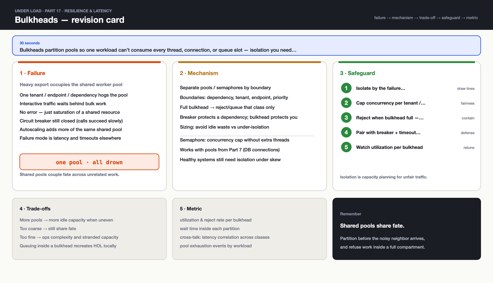
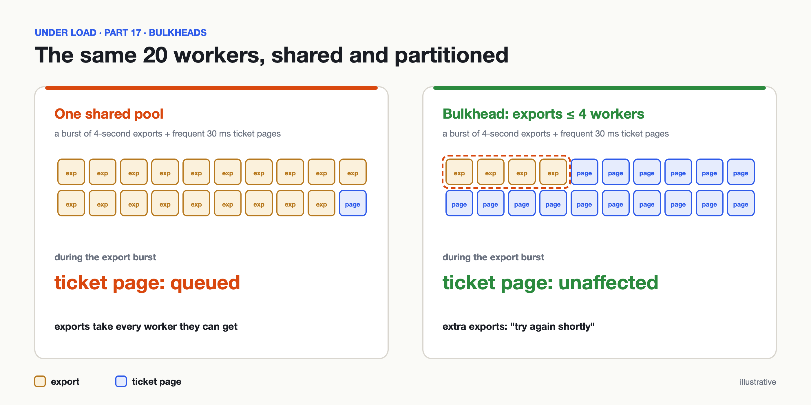
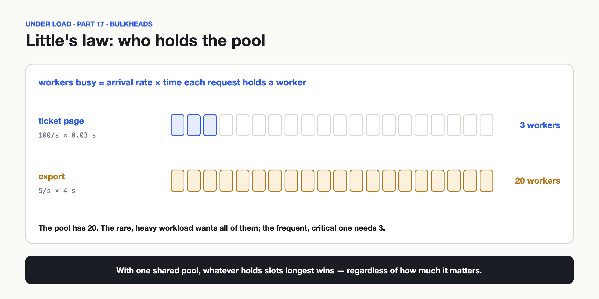
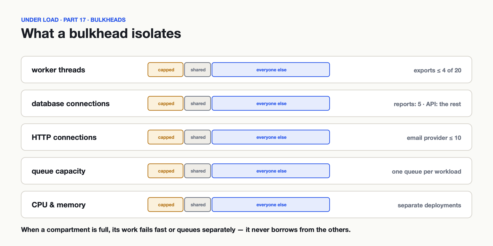
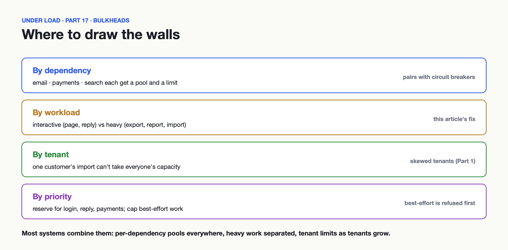
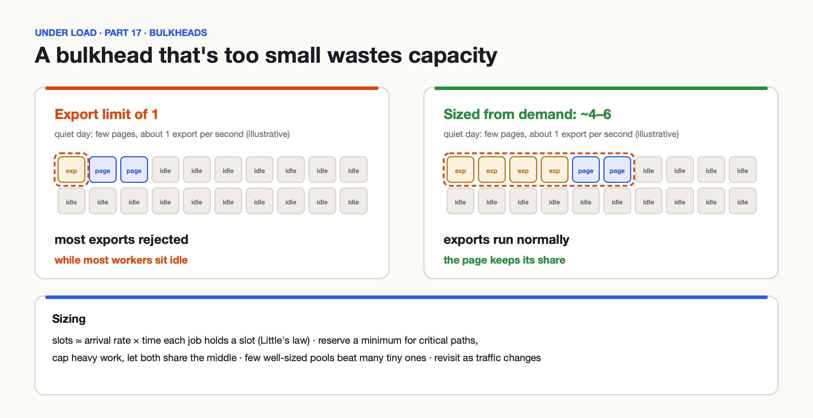
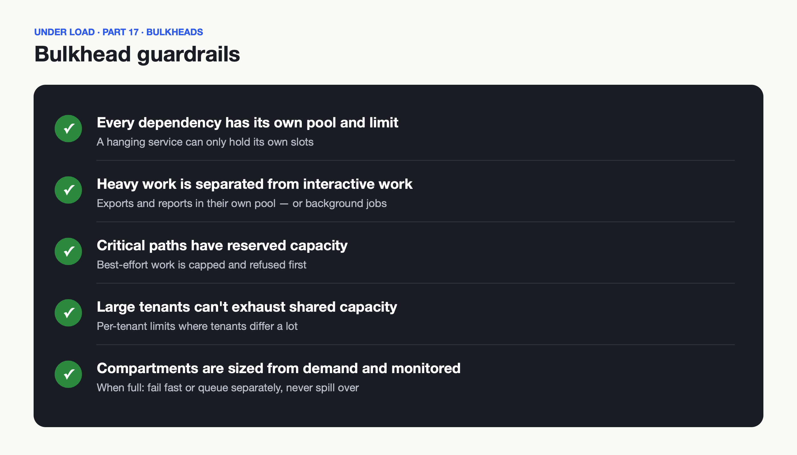

# Bulkheads

### Bulkheads: isolating resources so one workload can't take every thread, connection or queue slot — how to draw the boundaries, how to size them, and what they cost.

*Under Load · Part 17 · Resilience & Latency*





---

Halcyon's operations team discovers the CSV export: every ticket in a workspace, with comments, as one file. They love it. On Monday morning, several team leads start exporting their workspaces — repeatedly, because the first file "seemed to be missing something."

Each export holds a worker for about 4 seconds while it streams rows out of the database. The exports aren't broken, and the database is fine. But the API process that handles them is the same one that serves the ticket page, and it has **20 worker threads**. At five exports per second, 4 seconds each, exports want 5 × 4 = **20 workers at once** — all of them. They get them. The ticket page — a 30-millisecond request, a hundred times a second — now waits in a queue behind exports, and an instant page starts taking a second or more.

Part 16's circuit breaker doesn't help: nothing is failing. Every export succeeds. They just take everything.

The fix is named after ships. A ship's hull is divided by watertight walls — **bulkheads** — so a breach floods one compartment, not the whole ship. In software, a **bulkhead** gives a workload its own limited share of a resource, so whatever happens to that workload — a burst, a slow dependency, a bug — it can't use up what the others need.

---

## Why shared pools spread failures

A **pool** is a fixed set of reusable resources handed out on demand: worker threads, database connections, HTTP connections. Pools exist for good reasons — creating a thread or a connection per request is expensive, and an unlimited number would exhaust memory or overwhelm the database (Part 7). But a shared pool also creates a **shared fate**.

Every request that holds a pool slot for a long time reduces what's left for everyone else. **Little's law** — the number of items in a system equals the arrival rate times the time each one spends there — gives the arithmetic:

- Ticket pages: 100 per second × 0.03 seconds = **3 workers** busy on average.
- Exports: 5 per second × 4 seconds = **20 workers** busy on average.



The ticket page is far more important and far more frequent, yet it needs a small fraction of the pool. The export, rare and heavy, wants all of it. With one shared pool, the workload that holds resources longest wins, regardless of how much it matters.

The same happens when a dependency gets slow (Part 16). If the email provider starts taking 10 seconds per call, every request that sends email holds a worker for 10 seconds, and the pool fills with requests waiting on email. Requests for payments, searches and ticket pages, which never touch email, queue behind them. That's how a shared thread pool turns one slow dependency into a cascading failure: the pool is the channel through which the failure spreads.

---

## What a bulkhead isolates



Anything a process or a system has a fixed amount of can be shared too broadly:

- **Worker threads** or request slots.
- **Database connections** (Part 7).
- **HTTP client connections** to other services.
- **Queue capacity** and in-memory buffers.
- **CPU and memory**, when everything runs in the same process, container or node.

A bulkhead puts a wall around one workload's share: "exports can use at most 4 of these workers," "calls to the email provider can use at most 10 of these connections," "one tenant's traffic can use at most a third of these workers." When the share is full, new work for that workload is **rejected immediately or queued in its own queue** — it never borrows from the others.

Replay the story with exports capped at 4 workers. Four exports run; the others get an immediate "export capacity is full, try again shortly." The ticket page has 16 workers available and needs about 3, so its latency doesn't move — it behaves as if the exports weren't there at all. Fewer exports complete in that burst, and that's the point: the cost of the burst lands on the workload that caused it, not on every agent in the product.

---

## The rejection is a feature

Rejecting exports sounds bad, until it's compared with the alternative. The shared pool finishes more exports during the burst — but only by taking the workers the ticket page needed, so every agent pays for every export. A rejected export can be retried in a minute. A slow ticket page affects everyone at once.

The rejection also points to the better long-term design. A 4-second export doesn't belong on the request path. "Your export is being prepared; we'll email you the file" moves it to a **background job** with its own workers and queue — a bulkhead at the level of the architecture — and the request that starts it takes milliseconds.

---

## Implementing a bulkhead

The simplest bulkhead is a **semaphore**: a counter of available slots that a request must take before doing the work.

```python
export_slots = threading.BoundedSemaphore(4)

def handle_export(request):
    if not export_slots.acquire(blocking=False):          # don't wait for a slot
        return Response(status=429, headers={"Retry-After": "60"},
                        body="Export capacity is full, try again shortly")
    try:
        return build_export(request)
    finally:
        export_slots.release()
```

Other forms, from inside a process to across a fleet:

- **Separate thread pools** (executors) per workload or dependency. Exports run on their own small pool and can never take threads from the request pool.
- **Separate connection pools** per dependency and per workload: the reporting job gets its own few database connections, the API gets the rest.
- **Library support:** Resilience4j offers a semaphore `Bulkhead` and a `ThreadPoolBulkhead`; Polly has a bulkhead policy; Hystrix, which popularized the pattern, isolated every dependency in its own thread pool by default.
- **Proxy and mesh limits:** Envoy's per-cluster limits on connections, pending requests and concurrent requests (confusingly named "circuit breaking" in Envoy) are bulkheads enforced in the network layer.
- **Container and node limits:** CPU and memory limits (cgroups, Kubernetes requests and limits) keep one noisy service on a shared node from starving its neighbours.
- **Separate deployments:** the strongest bulkhead. Exports run on their own worker fleet, so they don't share a process, a container or even a node with the API.
- **Separate queues** per workload, priority or tenant, so one backlog can't delay the others (Part 26, head-of-line blocking).

### Semaphore or thread pool?

The two in-process forms behave differently when the work **hangs**:

- A **semaphore** limits how many callers are inside the protected code at once, but the caller's own thread does the work. If the call hangs, the caller's thread hangs with it, and only a timeout on the call itself frees it.
- A **separate thread pool** runs the work on its own threads. The caller can wait with a timeout and walk away, returning an error to its client — but the pool's thread stays stuck until the call ends, so the pool still fills up. The damage stays inside that pool, which is the point.

Semaphores are cheaper (no extra threads, no hand-off between threads); thread pools give the caller a way to stop waiting. Either way, the underlying call still needs its own timeout.

Whatever the form, the important behaviour is the same: **when the compartment is full, fail fast or queue separately — never spill into the shared space.** A bulkhead whose queue is unbounded isn't a bulkhead; it's a delay.

---

## Where to draw the walls

The boundaries should follow **how things fail** and **how much they matter** — the *failure domains* (parts of the system that tend to fail together) and the split between critical and best-effort work.



- **By dependency.** Calls to the email provider, the payment provider and the search cluster each get their own connection pool and concurrency limit. If one dependency hangs, it can only hold its own slots. This is the bulkhead that pairs with a circuit breaker.
- **By endpoint or workload type.** Interactive requests (ticket page, reply) separated from heavy ones (exports, reports, bulk imports). The story's fix.
- **By tenant.** In a multi-tenant system, one customer's traffic — a runaway integration, a huge import — shouldn't use up capacity every other customer needs (Part 1 showed how skewed tenants can be). Per-tenant concurrency limits contain them; at larger scale, the biggest tenants can get dedicated pools or dedicated **cells** (independent copies of the whole stack, each serving a subset of tenants).
- **By priority.** Critical paths (signing in, saving a reply, payments) get reserved capacity; best-effort work (analytics, recommendations, prefetching) gets what's left and is the first to be refused.

Most systems need a combination: per-dependency pools everywhere, heavy work separated from interactive work, and per-tenant limits once tenants differ a lot in size.

### Shuffle sharding: smaller blast radius per tenant

A refinement for tenant isolation, described by AWS as **shuffle sharding**: instead of splitting workers into fixed groups and assigning each tenant to one group, assign each tenant to a small, random **combination** of workers. Two tenants rarely share their whole combination. If one tenant's traffic is poisonous — it crashes or saturates the workers it lands on — only the few tenants that share *all* of those workers are fully affected; everyone else still has healthy workers in their set. It gives much stronger isolation than fixed groups without dedicating capacity to every tenant.

---

## The cost: isolation wastes capacity

Walls have a price. A slot reserved for one workload can't be used by another, even when it's idle.

Imagine a quiet afternoon: a handful of ticket requests and one export per second, against an export bulkhead that's been sized far too small — one slot. Little's law says one export per second at 4 seconds each needs about 4 slots. With one, most exports are rejected, while most of the 20 workers sit idle. Bad limits can **starve a workload even when the system has plenty of spare capacity** — the opposite of what isolation was for.



So sizing matters:

- **Size each compartment from its real demand.** Slots needed ≈ arrival rate × time each piece of work holds a slot, at the busiest realistic moment, plus headroom. Exports at 1 per second × 4 seconds need about 4 slots; budget 5 or 6.
- **Reserve a minimum for what's critical, cap what's heavy, and let both share the middle.** For example: the ticket page is guaranteed at least 8 workers, exports may use at most 6, and the rest is first-come. This keeps most of the utilization of a shared pool with most of the protection of isolation. It's the same idea as Kubernetes resource *requests* (a guaranteed minimum) and *limits* (a ceiling).
- **Don't create too many tiny pools.** Ten pools of 2 waste more capacity, absorb bursts worse and are harder to operate than three well-sized ones. Each pool is configuration to maintain and a dashboard to watch.
- **Revisit sizes as traffic changes.** A limit that was right last year can starve a feature that grew. Alerts on sustained full utilization catch this.

### Bulkheads contain; they don't cure

A bulkhead **contains** a failure; it doesn't fix it. If the email provider hangs, the email bulkhead fills up and email stops — but the rest of the system keeps running while the circuit breaker (Part 16) and the dependency's owners deal with the cause. That's why bulkheads are always combined with other tools:

- **Timeouts**, so slots held by a hanging call are eventually freed.
- **Circuit breakers**, so a failing dependency stops being called at all.
- **Rate limits** (Parts 22–23), so one client can't flood a compartment.
- **Backpressure** (Part 24), so a full compartment slows down the producer instead of silently dropping work.

---

## Bulkhead vs circuit breaker

The two are often confused and work best together.

- **A circuit breaker** watches whether a dependency is **healthy** and stops calling it when it isn't. It protects against wasting resources on calls that are going to fail.
- **A bulkhead** limits **how much** of the caller's resources a workload or dependency can use, healthy or not. It protects everything else from that one thing — even when nothing is failing, as with the exports in this story.

A breaker reacts after failures have happened; a bulkhead limits the damage from the first second. In Part 16's scenario, a bulkhead of 4 workers on the notification call would have kept 16 workers serving tickets from the moment the notification service started hanging, during the seconds when the breaker was still waiting for its first timeouts.

---

## Shipping bulkheads safely

- **Measure before limiting.** Record concurrency per workload and per dependency for a few weeks — peak, not average — and size from that.
- **Start with limits in report-only mode** where the library supports it, or with generous limits that only catch extreme cases, then tighten.
- **Decide what a rejection means for each workload** before turning it on: a `429` with `Retry-After`, a queued background job, a degraded response.
- **Test the burst.** Load-test with the heavy workload at several times its normal rate, and check that the critical path's latency stays flat.
- **Review limits when features change.** A new feature that calls a dependency inherits that dependency's bulkhead — and its limit.

---

## Guardrails that prevent the next one



1. **Every remote dependency has its own connection pool and concurrency limit.**
2. **Heavy work is separated from interactive work.** Exports, reports and imports run in their own pool — or better, as background jobs.
3. **Critical paths have reserved capacity.** Best-effort work is capped and refused first.
4. **Large tenants can't exhaust shared capacity.** Per-tenant limits where tenants differ a lot in size.
5. **Every compartment is sized from measured demand and monitored.** When full, it fails fast or queues separately — never spills over.

---

## What to keep on the dashboard

All of these per bulkhead, not only for the service as a whole:

- **Utilization:** slots in use versus the limit. Constantly full means it's undersized or the workload changed.
- **Rejections**, and what happened to the rejected work: retried, queued, or lost.
- **Queue depth and wait time** for compartments that queue instead of rejecting.
- **Timeouts** inside each compartment — the usual sign that a dependency behind it is slow.
- **Latency of critical paths** — the thing bulkheads exist to protect. It should stay flat when other workloads spike.
- **Global utilization**, to spot capacity wasted by compartments that are reserved but idle.
- **Per-tenant usage**, to see which customers come close to their limits.

---

## Recap

### What is a bulkhead?
A limit on how much of a shared resource — threads, connections, queue slots, CPU, memory — one workload, dependency or tenant can use, so whatever happens to it can't use up what everything else needs. When its share is full, new work is rejected or queued separately.

### Why can shared thread pools create cascading failures?
Because the workload or dependency that holds slots longest takes the pool, regardless of importance. A slow dependency or a burst of heavy requests fills every worker, and requests that have nothing to do with it queue behind them; the caller becomes slow for its own callers, and the failure spreads.

### Why use a bulkhead if nothing is failing?
Because a workload can take every resource just by being busy or slow. Successful 4-second exports at five per second need all 20 workers by Little's law; capping them at a few workers leaves the ticket page, which needs only a handful, running as if nothing happened.

### Bulkhead vs circuit breaker — what does each protect?
A circuit breaker protects against a failing dependency by stopping calls to it. A bulkhead protects everything else from one workload or dependency by limiting how much capacity it can use, failing or not. The breaker reacts after failures; the bulkhead limits damage from the start, so they work best together.

### Would you isolate by dependency, tenant, endpoint or priority?
Usually by a combination: a pool and concurrency limit per remote dependency, interactive work separated from heavy work, per-tenant limits (or dedicated pools, cells or shuffle sharding) when tenants differ a lot in size, and reserved capacity for critical paths with best-effort work capped and refused first.

### How do you size separate pools without wasting capacity?
From measured demand — arrival rate times how long work holds a slot, at peak — plus headroom. Reserve a minimum for critical paths, cap heavy work, let both share the rest, avoid many tiny pools, and revisit sizes as traffic changes. Limits that are too small starve a workload even while the system has spare capacity.

### What happens when a bulkhead is full?
Work for that compartment fails fast — for example with `429` and `Retry-After` — or waits in that compartment's own bounded queue. It never spills into the shared capacity. Heavy work that's rejected is often better moved to a background job.

### Semaphore or separate thread pool?
A semaphore limits concurrency cheaply but runs the work on the caller's thread, so a hanging call holds the caller. A separate pool lets the caller time out and walk away while the stuck thread stays inside the pool. Both need timeouts on the underlying call.

### Do bulkheads fix the failing dependency?
No. They contain the blast radius so the rest of the system keeps working. Fixing the cause is the job of timeouts, circuit breakers, backpressure and the dependency's owners.

### What should be monitored?
Per bulkhead: utilization, rejections and what happened to them, queue depth and wait time, timeouts, plus the latency of critical paths, global utilization to find wasted reserved capacity, and per-tenant usage.

---

## Next

- **Lab (run + measured write-up):** [17-bulkheads](https://github.com/b-basoglu/under-load/tree/main/17-bulkheads)
- **Next:** [Tail Latency: Why P99 Is the Number That Matters](../18-tail-latency/article.md) — Every service the dashboard calls averages 65 ms. Two requests in a hundred take over a second — and an agent loading a dashboard makes 40 requests.
