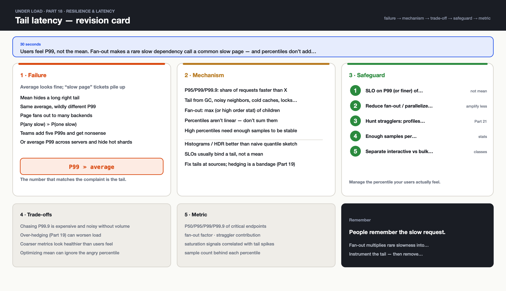
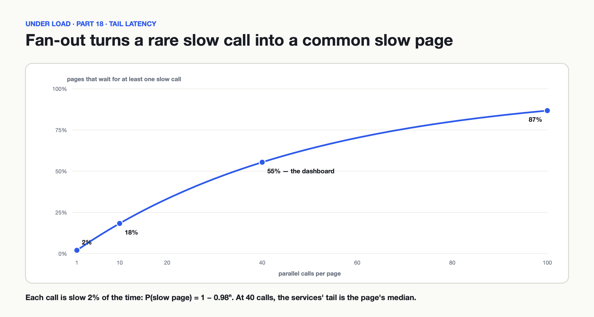
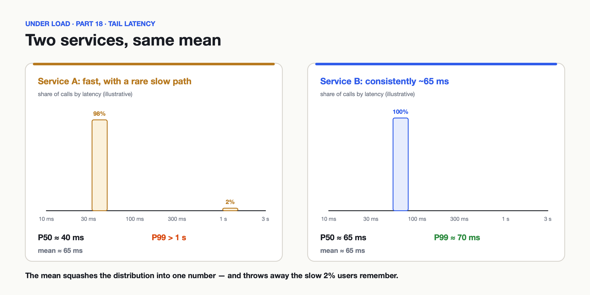
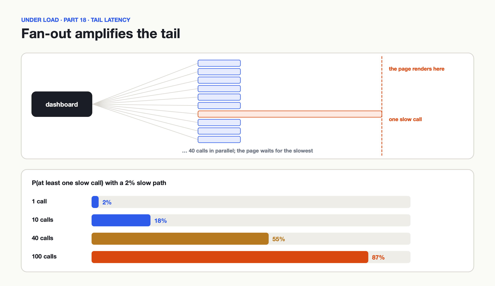
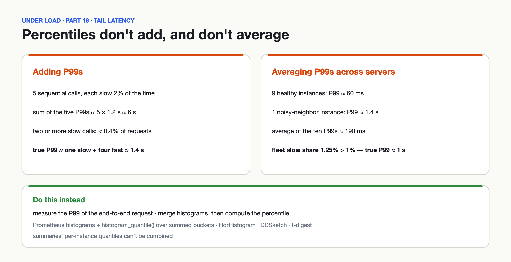
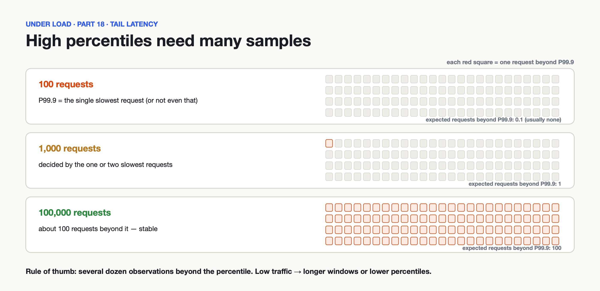
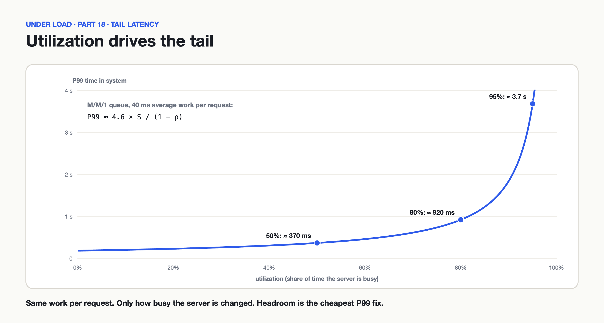
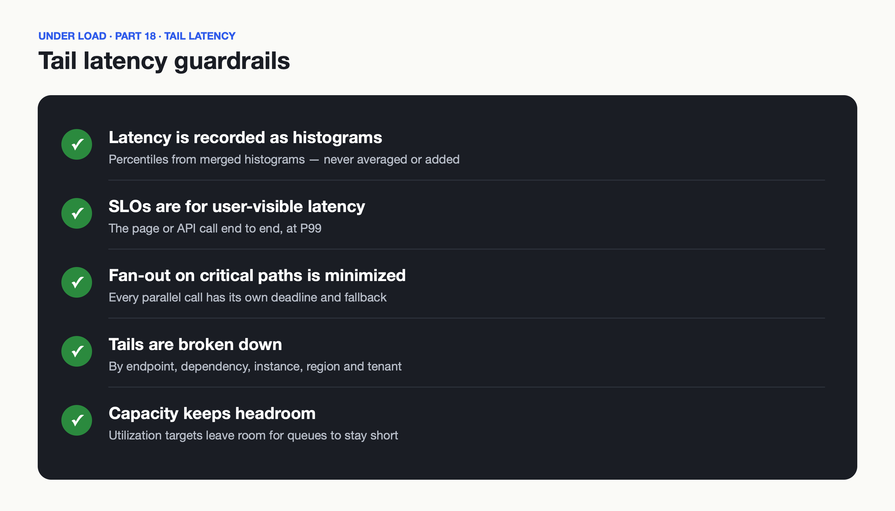

# Tail Latency: Why P99 Is the Number That Matters

### Tail latency: what P95, P99 and P99.9 really tell you, why fan-out turns a rare slow call into a common slow page, and the statistics traps that hide it.

*Under Load · Part 18 · Resilience & Latency*

---

The team lead dashboard loads in about a second, sometimes more. Agents complain. The engineering team looks at its monitoring: every backend service the dashboard calls has an average response time around **65 ms**. Nothing is slow. The graphs are green.

Both things are true. The services *are* fast on average. And the dashboard *is* slow, because it doesn't make one call — it makes **40 of them in parallel**, one per widget, and it can't render until the slowest one answers. Each service is slow only 2% of the time. But a page that rolls the dice 40 times lands on that 2% **more than half the time**.

This is **tail latency**: the slow end of the latency distribution, the requests an average hides. This article explains percentiles from the ground up, shows why fan-out makes the tail matter more than the middle, covers the statistical mistakes — averaging percentiles, adding them up, trusting too few samples, measuring the wrong way — that make dashboards say everything is fine, and goes through where tails actually come from.

---

## Averages hide the tail

An **average** (the mean) adds every request's latency together and divides by the count. A handful of very slow requests barely move it — but they're exactly the ones users remember.

Take two services with the same mean latency of about 65 ms:

- **Service A** answers 98% of calls in around 40 ms, and the other 2% in around 1.2 seconds — those calls hit a slow path: a garbage-collection pause, a cache miss that falls through to disk, a lock held by a background job. The mean is 0.98 × 40 + 0.02 × 1,200 ≈ 63 ms.
- **Service B** answers every call in about 65 ms, give or take a few milliseconds.

On an "average latency" graph, the two are indistinguishable. For users, they're nothing alike: two in every hundred calls to A take more than a second; none to B do. The mean is a property of the whole distribution squashed into one number, and the squashing throws away exactly the information that matters.

### Percentiles

A **percentile** answers "how slow is the slowest X% of requests?" More precisely, the Pth percentile is the value that P% of observations fall below.

- **P50** (the **median**): half of requests are faster than this. The typical experience.
- **P95**: 95% are faster; 1 in 20 is slower.
- **P99**: 99% are faster; 1 in 100 is slower.
- **P99.9**: 99.9% are faster; 1 in 1,000 is slower.

For Service A, the P50 is about 40 ms — better than B's — but the P99 is in the slow path, over a second. For B, P50 and P99 are both close to 65 ms. Percentiles show what the mean hid.

For latency, track several together: P50 for the typical case, P99 for the tail, and P99.9 for busy, latency-critical systems. An average alone answers a question nobody asked.

### "1 in 100" isn't rare at scale

A service handling 2,000 requests per second has **20 requests every second** beyond its P99, and 1.2 million a day. And those requests are often concentrated on the most valuable users: the ones loading the most data, belonging to the biggest tenants, making the most calls per session. A user who loads a page making many requests over a session will see the tail regularly, even if each request has only a 1% chance of hitting it.

---

## Fan-out: a rare slow call becomes a common slow page

When a page waits for several calls in parallel, it's as slow as the **slowest** of them. If each call independently has a probability *p* of landing in the slow path, the probability that **at least one** of *n* calls does is:

> P(at least one slow) = 1 − (1 − p)ⁿ

With *p* = 2%:

- **1 call:** 2% of pages hit a slow call.
- **10 calls:** 1 − 0.98¹⁰ ≈ **18%**.
- **40 calls** — the dashboard: 1 − 0.98⁴⁰ ≈ **55%**.
- **100 calls:** 1 − 0.98¹⁰⁰ ≈ **87%**.

At 40 calls, more than half of dashboard loads wait for at least one slow call. That means the page's **median** load time is no longer set by the fast path of its services — it's set by their slow path. The "about a second" agents complain about is each service's P99, experienced as the page's P50.

This is the central point of Jeffrey Dean and Luiz André Barroso's paper "The Tail at Scale" (Communications of the ACM, 2013), written from experience with large fan-out systems at Google: **at high fan-out, the tail of each component becomes the typical experience of the whole.** The services were measured one call at a time; users experienced forty calls at a time.

The fixes follow directly:

- **Reduce fan-out on the critical path.** Fetch data in fewer, larger calls; precompute dashboard widgets; don't call 40 services to render one page. Going from 40 calls to 10 cuts the chance of a slow page from about 55% to about 18%.
- **Shrink each dependency's tail**, not its average. At high fan-out, improving one service's P99 helps the page far more than improving its mean.
- **Don't let the slowest call block everything.** Render widgets independently, give each its own deadline, and show a placeholder for those that miss it (Part 20). The page's latency becomes the deadline, not the slowest call.
- **Hedge requests** to services with high-variance latency — send a second copy if the first is slow, and use whichever answers first (Part 19).

The formula assumes calls are slow **independently**. When they aren't — all 40 calls hit the same overloaded database, or the same stalled cache node — the slow calls cluster on the same pages. Fewer pages are slow, but those that are slow are very slow, and hedging to the same overloaded backend doesn't help.

---

## Percentiles don't add up

A common mistake is to estimate end-to-end latency by adding the P99s of each step. Consider a request that makes **5 sequential calls**, each to a service like A above: 40 ms usually, 1.2 s with probability 2%.

- **Adding the P99s:** each call's P99 is in its slow path, about 1.2 s, so the sum is about **6 seconds**.
- **The actual P99 of the total:** the chance that at least one of the five calls is slow is 1 − 0.98⁵ ≈ 9.6%; the chance that two or more are slow is under 0.4%. So the slowest 1% of requests are almost all "one slow call plus four fast ones": about 1.2 s + 4 × 40 ms ≈ **1.4 seconds**.

Adding P99s assumes every step is slow at the same time, which almost never happens. Percentiles are not additive. The P99 of a sum has to be measured on the sum — end to end — not computed from the parts. (Means *are* additive, which is one more reason they're misleading: they're easy to compute with, and they hide the tail.)

### Averaging percentiles across servers

The opposite mistake is just as common: **averaging percentiles across servers.** Imagine 10 instances of a service. Nine are healthy, with 0.5% of calls slow, so each has a P99 of about 60 ms. One runs on a host with a **noisy neighbor** — another workload hogging the same CPU or disk — and 8% of its calls are slow, so its P99 is around 1.4 seconds.

- **Average of the ten per-instance P99s:** (9 × 60 + 1,400) / 10 ≈ **190 ms**. Looks tolerable.
- **True P99 across all the fleet's requests:** the slow fraction of all calls is (9 × 0.5% + 8%) / 10 = 1.25%, which is more than 1%. So the fleet's real P99 is **in the slow path** — around a second.

Averaging the instances' P99s made the fleet look several times better than it was, and hid the one instance causing it.

The correct way to combine latency from many servers is to **merge the underlying distributions** — histograms — and compute the percentile from the merged data:

- **Prometheus histograms** store counts per latency bucket, which can be summed across instances; `histogram_quantile()` over the summed buckets gives a correct fleet-wide estimate (within the precision of the bucket boundaries).
- **Prometheus summaries**, by contrast, compute quantiles on each instance; the Prometheus documentation is explicit that these can't be meaningfully aggregated.
- **HdrHistogram, DDSketch and t-digest** are compact data structures designed for exactly this: recording latencies with bounded error and merging across servers and time windows.

The same goes for slicing in the other direction: **a single global P99 can hide one bad endpoint, region, instance or tenant.** Break tails down by endpoint, dependency, instance, region and customer, so the part that's broken stands out instead of being diluted by everything that isn't.

---

## High percentiles need many samples

P99.9 describes 1 request in 1,000. To estimate it, there have to be enough requests beyond it to say anything.

- From **100 requests**, a "P99.9" is just the single slowest request — it depends entirely on whether one unlucky request happened to be in the sample. Repeat the measurement and it can jump between fast and slow.
- From **1,000 requests**, it rests on the one or two slowest requests. Still noisy.
- From **100,000 requests**, about 100 requests lie beyond it, and the estimate is stable from one window to the next.

A useful rule of thumb: an estimate of the Pth percentile needs at least several dozen observations **beyond** it, which means many times 1 / (1 − P) requests in total — tens of thousands for P99.9, thousands for P99.

So for low-traffic endpoints, use longer windows (an hour instead of a minute) or lower percentiles (P95 instead of P99.9). A P99.9 alert on an endpoint that gets 50 requests a minute will fire on noise.

### Coordinated omission

One more measurement trap, named by Gil Tene: **coordinated omission.** A load test that sends a new request only **after** the previous one finishes will send *fewer* requests exactly when the system is slow. If the server stalls for two seconds, a closed-loop test simply waits, records one slow request, and carries on — while in production, every user who arrived during those two seconds would have waited. The slow periods are undersampled, so the measured tail looks far better than the real one.

Load generators that keep sending at a fixed rate regardless of responses — `wrk2`, k6's constant-arrival-rate executor, Gatling's open workload models — avoid this. The same trap can appear in monitoring when a client measures latency only from the moment it actually managed to send a request, ignoring time spent waiting for a connection or a pool slot.

---

## Where tails come from

The middle of the distribution is usually about how much **work** a request does. The tail is usually about **waiting**.

- **Queueing.** As a server gets busier, requests wait for each other (below).
- **Pool waits** for database connections or threads (Parts 7 and 17).
- **Lock contention** in the database or the application (Part 5).
- **Garbage-collection pauses** and other runtime stalls (JIT compilation, page faults, memory compaction).
- **Noisy neighbors** — other workloads on the same host, disk or network link.
- **Background work** on the same machine: compactions, backups, log rotation, cron jobs.
- **Cache misses**, cold starts after a deploy, and the occasional cache stampede (Part 11).
- **Retries** that turn one slow call into two (Part 15). Retries can reduce visible failures and still make the tail worse.
- **Network variance**, especially across zones or regions, and TCP retransmissions after a dropped packet.

### Utilization drives the tail

Queueing deserves emphasis because it's the most common cause and the least intuitive: **the tail depends on how busy the system is, not just on how fast it is.**

The simplest queueing model makes this concrete. In an **M/M/1 queue** — requests arriving at random, one server, service times that vary randomly around an average *S* — the time a request spends in the system (waiting plus being served) has an average of *S* / (1 − ρ), where ρ is the **utilization**: the fraction of time the server is busy. Its P99 is about 4.6 × *S* / (1 − ρ).

With the work per request unchanged at *S* = 40 ms:

- at **50%** utilization, P99 ≈ 4.6 × 40 / 0.5 ≈ **370 ms**;
- at **80%**, ≈ **920 ms**;
- at **95%**, ≈ **3.7 seconds**.

Real systems aren't exactly M/M/1 — multiple workers flatten the curve, and bursty arrivals steepen it — but the shape holds: as utilization approaches 100%, waiting time grows without bound, and the tail grows first. The work per request didn't change at all; only how busy the server was.

That's why running servers "efficiently" at 90% or more of their capacity costs so much in tail latency, and why keeping **headroom** is one of the cheapest ways to cut P99. It's also why a small traffic increase can suddenly make a service "slow": on the steep part of the curve, a few percent more load means a large increase in waiting.

### Techniques for cutting the tail

Dean and Barroso's paper lists several techniques that large systems use to tolerate variability rather than eliminate it:

- **Hedged requests:** send a backup request after a short delay, take the first answer (Part 19).
- **Tied requests:** send to two servers at once, and let each tell the other to cancel when it starts processing.
- **Micro-partitioning:** split data into many small partitions so load can be moved in fine steps away from a slow machine.
- **Selective replication:** keep more copies of hot data, so its load spreads across more machines.
- **Latency-induced probation:** temporarily stop sending traffic to a machine that's been slow, much like outlier detection (Part 16).

All of them assume the slowness is in **one place at a time**. When the cause is shared — the whole fleet is at 95% utilization — the fix is capacity, not cleverness.

---

## Shipping latency work safely

- **Define SLOs on user-visible latency.** A **service level objective** for the dashboard — "99% of loads complete in under 800 ms over 28 days" — is what actually matters, measured end to end. Per-service SLOs are useful, but they have to be derived from the page's budget and its fan-out.
- **Measure where users are.** Server-side timings miss network time, client rendering and the browser's own queueing. Real-user monitoring in the browser and app shows the latency users actually experience.
- **Look at distributions before and after every change.** A change that improves the mean can make the tail worse — and the other way round.
- **Load-test with an open model** (fixed arrival rate) and with realistic fan-out, at the utilization the system will really run at.

---

## Guardrails that prevent the next one

1. **Latency is recorded as histograms**, never just averages, and percentiles are computed from merged histograms — never averaged or added.
2. **SLOs are written for user-visible latency** — the page or API call end to end, at P99 — not for each service in isolation.
3. **Fan-out on critical paths is minimized**, and every parallel call has its own deadline and fallback.
4. **Tails are broken down** by endpoint, dependency, instance, region and tenant.
5. **Capacity keeps headroom.** Utilization targets leave room for queues to stay short.

---

## What to keep on the dashboard

- **P50, P99 and (for busy services) P99.9 per endpoint**, from histograms.
- **End-to-end latency of key pages and API calls**, measured where users see it — including real-user monitoring in the browser or app.
- **Fan-out per request:** how many downstream calls a page makes, and which are on the critical path.
- **Utilization and queue depth** next to latency, so a rising tail can be tied to saturation.
- **Pool wait time, GC pause time and lock waits** — the usual causes.
- **Per-instance and per-tenant tails**, to spot the one bad host or customer hiding in the aggregate.
- **Sample counts** behind each high percentile, so a noisy P99.9 isn't mistaken for a regression.

---

## Recap

### What are P95, P99 and P99.9?
Percentiles of latency: 95%, 99% or 99.9% of requests are faster than that value, so 1 in 20, 1 in 100 or 1 in 1,000 is slower. P50 (the median) describes the typical request; the higher percentiles describe the tail that averages hide.

### Why is P99 often more useful than average latency?
Because a few very slow requests barely move an average, but they're what users notice and complain about. P99 shows the slow requests directly, and at scale "1 in 100" is many requests per second, often from the heaviest users.

### Why can two systems have the same average but very different P99?
Because the average squashes the distribution into one number. A service that answers 98% of calls in 40 ms and 2% in over a second has about the same mean as one that always answers in 65 ms — but its P99 is more than ten times higher.

### Why does fan-out amplify tail latency?
Because a page that waits for parallel calls is as slow as the slowest one, and the chance that at least one lands in the tail is 1 − (1 − p)ⁿ. With a 2% slow path, 40 calls hit it on about 55% of page loads, so each service's tail becomes the page's typical latency.

### Can you add five downstream P99s to get the overall P99?
No. Adding them assumes every step is slow at once, which almost never happens. With five steps that are each slow 2% of the time, the total's P99 is roughly one slow step plus four fast ones — far less than the sum of the P99s. Measure end to end instead.

### Can you average P99s across servers?
No. A single bad instance can push the fleet's true P99 into the slow path while the average of per-instance P99s still looks fine. Merge histograms (Prometheus histograms, HdrHistogram, DDSketch, t-digest) and compute the percentile from the merged data.

### How many samples does a high percentile need?
Enough that several dozen requests lie beyond it: thousands for P99, tens of thousands for P99.9. With fewer, the estimate is decided by one or two unlucky requests. Use longer windows or lower percentiles for low-traffic endpoints, and load-test with a fixed arrival rate to avoid coordinated omission.

### Where does tail latency come from?
Mostly from waiting: queueing as utilization rises, pool waits, lock contention, garbage-collection pauses, noisy neighbors, background work, cache misses, retries and network variance. In a simple queueing model, P99 grows with 1 / (1 − utilization), so the same work takes ten times longer in the tail at 95% busy than at 50%.

### How do you reduce tail latency?
Reduce fan-out on critical paths, give each parallel call a deadline and fallback, keep capacity headroom, isolate noisy workloads (bulkheads), fix the specific causes found by breaking tails down, and use hedged requests or similar techniques for high-variance dependencies.

### What should be monitored?
Histogram-based P50/P99/P99.9 per endpoint, end-to-end latency where users see it, fan-out per request, utilization and queue depth, pool waits, GC pauses and lock waits, per-instance and per-tenant tails, and the sample counts behind high percentiles.

---

## Next

- **Lab (run + measured write-up):** [18-tail-latency](https://github.com/b-basoglu/under-load/tree/main/18-tail-latency)
- **Next:** [Request Hedging](../19-hedging/article.md) — If one call in a hundred is slow, what if you send a second copy after a few milliseconds and take whichever answers first?
