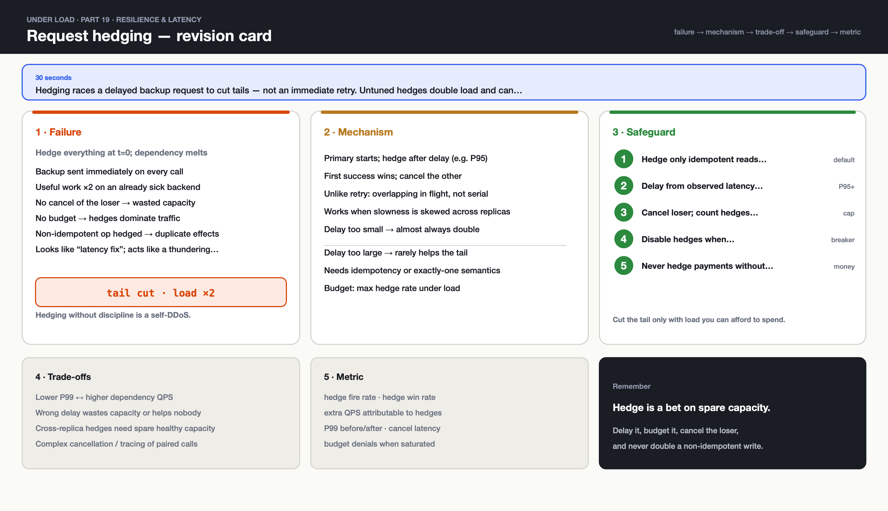
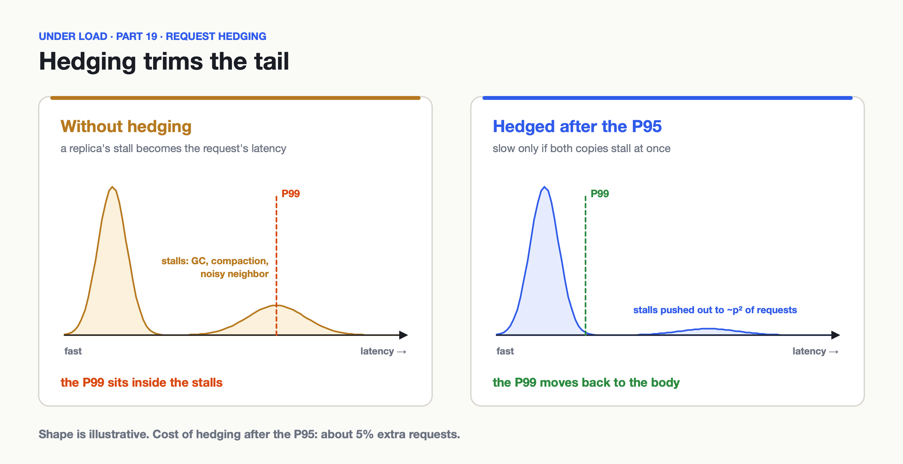
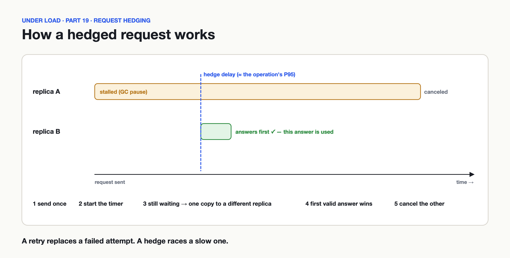
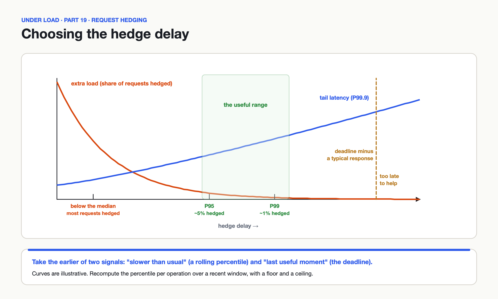
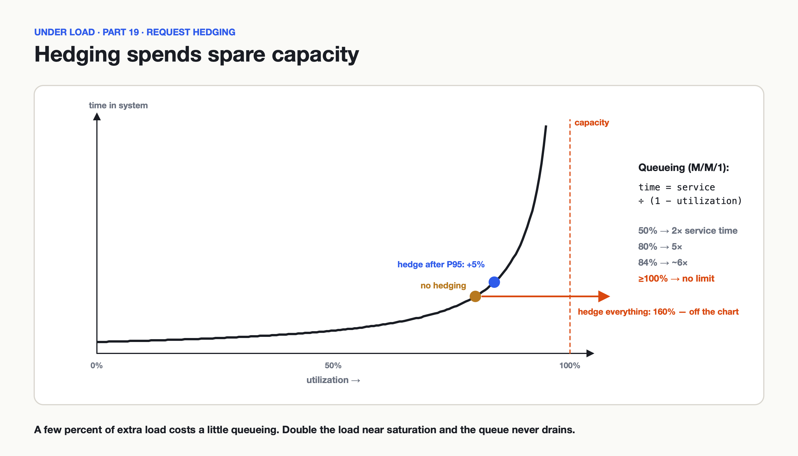
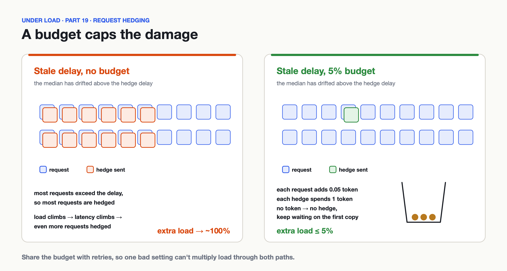
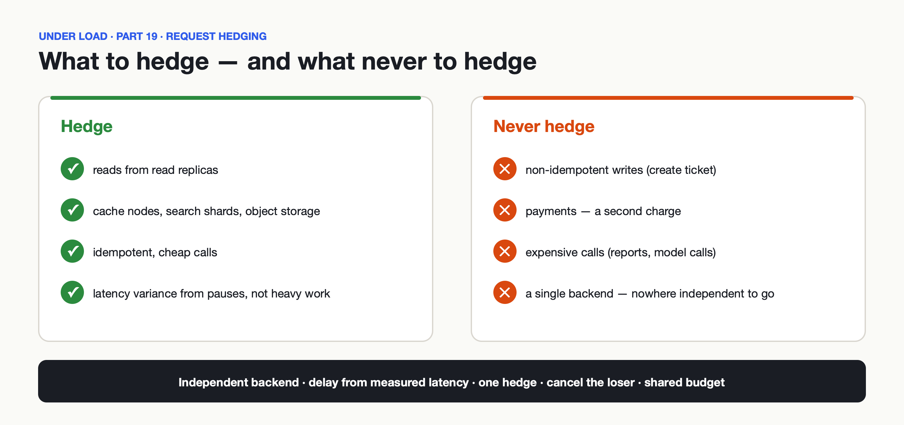
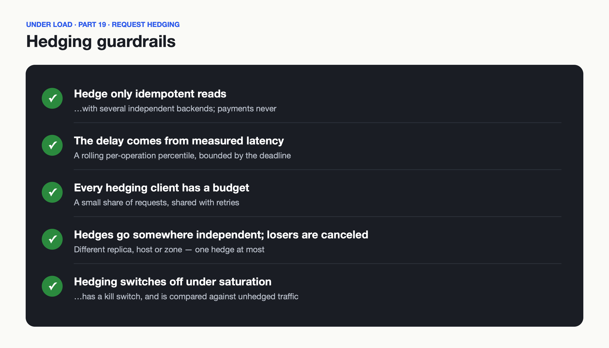

# Request Hedging

### Request hedging: cutting tail latency by racing a delayed backup request — how it works, how to pick the delay, and how it turns into a self-inflicted overload.

*Under Load · Part 19 · Resilience & Latency*

---

Part 18 ended on the team lead dashboard: forty widgets, forty parallel backend calls, and a page that can't render until the slowest one answers. Digging into the slow calls showed a pattern. They weren't slow because the work was hard. The same query that usually comes back in a couple of dozen milliseconds sometimes took the better part of a second, and when it did, the read replica it had landed on was briefly **stalled** — a garbage-collection pause, a background compaction, a noisy neighbor on the same host, a burst of disk flushing. At that same moment, the other replicas holding exactly the same data were idle.

Halcyon, the platform's largest customer, has hundreds of team leads opening that dashboard at the start of every shift. Each one of them rolls the dice forty times per page load.

That suggests a simple trick. If a read hasn't answered after a little while, **send the same read to another replica, and use whichever answer comes back first**. The technique is called **request hedging**. It was described in Jeffrey Dean and Luiz André Barroso's 2013 paper *The Tail at Scale*, and versions of it ship in Cassandra (as *speculative retry*), in gRPC (as a *hedging policy*) and in the Envoy proxy.

Done carefully, hedging removes most of the tail for a few percent of extra load. Done carelessly, it doubles the load at exactly the moment the system can least afford it. This article explains both — the mechanism, the arithmetic behind it, how to choose the delay, and the guardrails that keep it from becoming the incident.

---

## Why the tail exists at all

A few terms first, since everything below depends on them.

**Latency** is how long a request takes, from sending it to receiving the answer. A **percentile** describes the distribution of latencies: the **P95** is the value that 95% of requests come in under; the **P99** is the value 99% come in under; the **P99.9**, 999 out of 1,000. The **tail** is the slow end of that distribution — the requests above the P99, say.

In a healthy system, most of the tail isn't caused by the work. Fetching one ticket's metadata from a replica is the same amount of work every time. What varies is the **environment the work runs in**:

- **Garbage-collection pauses.** Runtimes with a garbage collector (the JVM, Go, .NET) occasionally stop or slow application threads to reclaim memory.
- **Background work on the same machine.** Compaction in log-structured storage engines, checkpoints in relational databases, log rotation, backups.
- **Shared hardware.** On cloud hosts and shared Kubernetes nodes, another tenant's burst of CPU or disk usage slows everything on the host (the "noisy neighbor").
- **Queueing.** A short burst of arrivals, by pure chance, lines several requests up behind each other.
- **The network.** A dropped packet that has to be retransmitted adds a retransmission timeout to the request.

These events share two properties. They are **rare** — a replica spends most of its time not paused. And they are mostly **independent** across machines — one replica's garbage collector has nothing to do with another's. Hedging exploits both.

### Why rare becomes common under fan-out

Part 18 covered the arithmetic. If one call has a probability *p* of landing in the tail, a page that makes *n* independent calls and waits for all of them avoids the tail only if every call does:

> P(page is slow) = 1 − (1 − p)ⁿ

With *p* = 1% and *n* = 40, that's 1 − 0.99⁴⁰ ≈ 33%: a third of page loads are as slow as the slowest 1% of calls. *The Tail at Scale* makes the same point with a fan-out of 100: 1 − 0.99¹⁰⁰ ≈ 63%. At large enough fan-out, a backend's P99 becomes the user's median.

There are two ways to fight it. **Reduce the variance** at the source — tune the garbage collector, isolate noisy work, schedule compactions — which is always worth doing but never gets the tail to zero. Or **tolerate the variance**: accept that some backend will be slow at any moment and design the client so that one slow backend doesn't make the request slow. Hedging is the second kind.

---

## How a hedged request works

1. **Send the request to one backend, as usual.** Nothing is duplicated up front.
2. **Start a timer — the hedge delay.** This is the single most important setting, covered in detail below.
3. **If the answer arrives before the timer fires, cancel the timer.** For the large majority of requests, this is all that happens.
4. **If the timer fires first, send one copy of the request to a different backend** — one that holds the same data and is unlikely to be slow for the same reason.
5. **Take the first valid answer.** "Valid" matters: a fast error should not win the race against a slower success. A copy that fails is ignored while the other one is still running.
6. **Cancel the other copy.** If it is still queued, it should be dropped before it starts; if it is running, it should be stopped if the protocol allows; if neither is possible, its answer is simply discarded when it arrives.

The point isn't to make any backend faster. It's to make one backend's bad moment irrelevant. A hedged request is slow only if the first copy is slow *and* the second copy is slow too.

### The arithmetic of "both slow"

If a replica is in a slow state with probability *p*, and replicas are independent, the chance that two of them are slow at the same moment is roughly *p²*.

A worked, illustrative example: suppose each replica spends about 3% of its time in some kind of stall. Without hedging, about 3 requests in 100 hit a stall — which puts the P99 squarely inside the stalls. With a hedge, a request is stuck only if its second replica is also stalled, which happens to about 3% of the 3%: roughly 1 request in 1,000. The stalls haven't gone away. They've been pushed from "a few percent of requests" down to "a fraction of a percent" — out of the P99 and close to the P99.9.

Real systems are less tidy: stalls are sometimes correlated, the hedge starts late, and the hedged copy adds some load of its own. But the shape holds: **hedging turns a probability into roughly its square**, as long as the backends are independent.

### How it differs from a retry

The two are easy to confuse, because both send the same request again.

- A **retry** happens **after a failure**: the first attempt returned an error or timed out, and a new attempt **replaces** it. Retries reduce **errors**.
- A **hedge** happens **while the first attempt is still running**, because it's slow. Both attempts are alive at once and **race**. Hedges reduce **latency**.

The difference shows up in the cost. A retry's extra load is proportional to the error rate. A hedge's extra load is proportional to the share of requests that are slower than the hedge delay — which depends entirely on where the delay is set.

---

## Choosing the hedge delay

The hedge delay decides both what hedging costs and what it buys. Too long, and the slow requests have already done most of their waiting before the hedge starts. Too short, and almost every request is hedged.

### Start from a percentile of the operation's own latency

The usual choice, recommended in *The Tail at Scale*, is the **P95 of the operation's own latency**: wait about as long as 95% of requests take, and only hedge the ones that are still outstanding after that. By definition, about 5% of requests exceed their P95, so about 5% of requests send a second copy. Extra load: roughly **5%**, by construction.

Some systems go further out. Cassandra's `speculative_retry` table option defaults to `99p`: the coordinator node handling a read that hasn't heard back from a replica within the table's recent P99 read latency sends the read to another replica. That costs about 1% extra reads and targets only the worst of the tail. Moving the delay from P99 to P95 or P90 hedges more requests and trims more of the tail; moving it the other way costs less and helps less. The percentile is a dial, and the right setting depends on how much spare capacity there is and how much the tail hurts.

### Measure it continuously

A fixed delay chosen from last quarter's graphs is wrong as soon as the service changes. If the backend gets faster, a fixed delay hedges too few requests to help. If it gets slower — a bigger data set, a busier day, a regression — a fixed delay ends up **below the median**, and suddenly most requests are hedged. That is exactly the failure that turns hedging into an outage (below).

So the delay should come from a **rolling percentile**, kept per operation (a ticket lookup and a full-text search have very different latency profiles), and recomputed over a recent window — the last minute or few minutes. A streaming percentile structure such as a histogram (HdrHistogram, a t-digest, or the histograms already exported to the metrics system) keeps that cheap. A **floor** and a **ceiling** around the computed value keep it from collapsing to near zero on a very quiet service or growing without bound during an incident.

### Respect the deadline

A request usually has a **deadline**: the time by which the caller needs the answer, after which it gives up (Part 15 covered deadlines and how to propagate them). The hedge has to fit inside it. If the deadline leaves 300 ms, and a fresh attempt typically takes 40 ms, a hedge sent at 280 ms can't help — it will be canceled before it answers. Two rules follow:

- **Hedge no later than** the remaining deadline minus a typical response time. When the percentile-based delay would be later than that, either hedge earlier or don't hedge at all.
- **Pass the remaining deadline along** with the hedged copy, not the original deadline, so the backend knows how much time is actually left and can refuse work it won't finish.

So the effective delay is the earlier of two signals: "this request is slower than usual" (the percentile) and "if there's going to be a second chance, it has to start now" (the deadline).

### What a good delay looks like on the dashboard

With the delay at the P95, the **hedge rate** — the share of requests that send a second copy — should sit near 5%. Most of those hedges should be requests that would otherwise have landed in the tail. Some will lose the race, because the first copy was about to answer anyway; that's the unavoidable waste of not knowing the future. The **hedge win rate** — the share of hedges whose copy answered first — says whether the hedges are buying anything. Both numbers come back in the dashboard section below.

---

## Why not hedge every request immediately?

The tempting shortcut is to skip the timer: send every request to two replicas from the start and take whichever answers first. The tail gets even shorter, because no request ever waits out a delay.

The price is **100% extra load**. Every request is now served twice. Most of the second copies do work nobody will use — by the time the loser could be canceled, it has often already started.

At low utilization, that's merely wasteful. At high utilization, it's fatal, and the reason is how queues behave.

### Queues don't degrade linearly

**Utilization** is the share of time a server is busy. For the simplest queueing model — requests arriving at random, one server, random service times (the M/M/1 queue) — the average time a request spends in the system is:

> average time = service time ÷ (1 − utilization)

At 50% utilization, that's twice the service time. At 80%, five times. At 90%, ten times. At 100% and beyond, the queue grows without limit. Real servers aren't exactly M/M/1, but the shape is universal: **latency rises slowly at low utilization and steeply near saturation**.

Now apply hedging. A replica set running at 80% utilization with immediate hedging is asked to run at 160% — far past what it can serve. Queues grow until requests time out, and the timeouts trigger retries on top. The tail that hedging was meant to remove becomes the whole distribution.

A well-placed delay changes that picture completely. Hedging after the P95 adds about 5% load: 80% becomes 84%. Using the same formula, the average time in the system goes from 5× to about 6× the service time — a real but modest cost, paid for a much shorter tail. **Hedging spends spare capacity to buy latency. When there's no spare capacity, it makes everything slower.**

### A delay that's too short is immediate hedging in disguise

The same failure happens with any delay that falls inside the body of the distribution. Picture a hedge delay hard-coded at 30 ms, back when the median was 15 ms. A few months later, the data has grown and the median is 35 ms. Now more than half of all requests are hedged. Load jumps by more than 50% without a single deploy. Utilization climbs, latency climbs with it — which makes even more requests exceed 30 ms, which hedges even more. It's a feedback loop, and nothing in the system stops it.

That loop is why the delay must come from measured latency, and why every hedging client needs a **budget** that caps the damage when the delay is wrong anyway.

---

## Making hedging safe

### Put a budget on it

A **hedge budget** caps hedges at a fixed share of requests — for example, **at most 5% of requests may send a hedge**. It's implemented the same way as the retry budget in Part 15: a token bucket (Part 22 covers the algorithm in depth) where every normal request adds a fraction of a token, every hedge spends a whole token, and a hedge with no token available simply isn't sent. The request keeps waiting on its first copy, exactly as it would have without hedging.

The budget is what makes hedging fail safe:

- When the delay is right, the budget is never reached and changes nothing.
- When the delay is wrong — too short, or stale — the budget limits extra load to 5% instead of 100%.
- When the system is overloaded and nearly every request is slow, the budget is exhausted within moments and hedging effectively switches itself off.

gRPC's retry design (gRFC A6) builds this in. A channel can declare a `hedgingPolicy` — the maximum number of attempts, the delay between them, and which status codes are not fatal — and a separate `retryThrottling` policy that applies to retries and hedges together. Throttling keeps a token count per target service: failed calls subtract a token, successful calls add a configured fraction of one, and while the count is below half of its maximum, no extra attempts are sent. When the backend is struggling, the extra attempts stop on their own.

### Cap the number of copies

One hedge per request is almost always enough. The second copy already reduces the slow probability from *p* to about *p²*; a third reduces it to *p³* but adds another full copy of load on the requests that are already the most expensive. Systems that allow more than one hedge (gRPC's `maxAttempts` permits a few) should space them out and count every one against the budget.

### Hedge to somewhere independent

The *p²* arithmetic only holds if the second copy is unlikely to be slow **for the same reason**. That means:

- **A different replica**, never the same one. Hedging to the server that's already slow just puts a second copy in its queue.
- **Ideally a different host or zone**, so the two copies don't share a disk, a hypervisor or a top-of-rack switch.
- **Not the same overloaded dependency.** If both replicas wait on the same primary database, the same search cluster or the same downstream API, the hedge waits in the same place. Hedging an HTTP request through two load-balancer paths to the same pool of saturated workers buys nothing.

Hedging is most effective where the system already has interchangeable backends: read replicas, cache nodes, search shard replicas, object storage. Envoy, for example, can send a hedge when a per-try timeout fires (`hedge_on_per_try_timeout`) and keep the original request running, and its load balancer picks the host for the hedge — which works well when the cluster has several equivalent hosts and poorly when it has one.

### Cancel the loser

Once one copy answers, the other is pure waste. Cancelling it matters most when the loser is still in a queue, where dropping it costs nothing.

- **gRPC** propagates cancellation: when the client cancels a call, the server sees its context canceled and can stop work.
- **HTTP/2** can cancel a single request on a shared connection by resetting its stream (`RST_STREAM`) without closing the connection.
- **HTTP/1.1** has no per-request cancel; closing the connection is the only signal, and it costs a new connection afterwards.
- On the server side, cancellation only helps if handlers actually check for it — between steps, before starting an expensive query, before writing a result.

*The Tail at Scale* describes a stronger variant, **tied requests**: the client sends the request to two servers almost at once, each tagged with the identity of the other, and the first server to **start** executing it tells the other to drop its copy. Because the cancellation happens at the start of execution rather than at completion, the duplicate work is close to zero, while the request still avoids whichever queue is longer. It needs cooperation from the servers and is typically built into storage systems rather than bolted onto clients.

### Switch it off under saturation

A budget reacts to load indirectly. A direct signal is better still: when backend utilization, queue length or concurrency passes a threshold, stop hedging entirely. The decision belongs in the client library or the proxy, so that every caller behaves the same way. And hedging should have a **kill switch** — a runtime flag that turns it off without a deploy — because the first question in any latency incident is "is our own resilience mechanism adding to this?"

---

## What to hedge, and what never to hedge

**Good candidates:**

- **Reads served by several equivalent backends**: read replicas, cache clusters, search shards with replicas, object storage, DNS.
- Calls whose **latency variance comes from occasional pauses**, not from expensive work. A request that is slow because it scans a million rows will be just as slow on the second replica.
- **Idempotent** operations (Part 14) — those that have the same effect whether they run once or twice. Every read is idempotent; some writes are, such as "set the ticket's status to closed".
- **Cheap requests on a latency-critical path**, where the user is waiting and the duplicate costs little.

**Never hedge, or only with great care:**

- **Non-idempotent writes.** Hedging "create ticket" creates two tickets. Hedging "append comment" posts the comment twice.
- **Payments**, covered below.
- **Expensive operations.** A report, an export or a large model call can cost a lot of CPU or money per request. Doubling even a few percent of them may cost more than the latency is worth, and those requests are often slow because they're heavy, not because a backend paused.
- **Calls with a single backend.** With nowhere independent to send the copy, a hedge just lengthens the one queue.

### Hedging writes safely, when it's unavoidable

Some writes are latency-critical enough that teams want to hedge them anyway. That is only safe when the backend **deduplicates**: the client attaches an **idempotency key** — a unique ID per logical operation — and the server records which keys it has already processed, returning the stored result for a duplicate instead of executing it again. Both copies of a hedged write carry the same key, so at most one takes effect. The key store itself has to be strongly consistent, or two copies landing on different nodes at the same moment can both pass the check. In practice, for most writes, the complexity isn't worth it; a single attempt with a sensible timeout and a retry on failure (with the same idempotency key) is simpler and nearly as fast.

### Would anyone hedge a payment request?

No. A payment has a side effect outside the system — money moves — and a duplicate is not just wasteful but visible to the customer. Hedging a charge either relies entirely on the payment provider's idempotency handling to avoid a double charge, or gets it wrong. Payment providers' APIs are also often rate-limited and slow by design (fraud checks, bank round trips), so their latency variance isn't the "random pause" kind that hedging fixes. The right tool for a slow payment is a single attempt with an idempotency key, a generous deadline, and, if the outcome is unknown, a **status check** before any retry — not a race.

---

## When hedging makes things worse

Hedging is a bet that spare capacity exists and that slowness is independent. When either assumption fails, it amplifies the problem.

- **Under overload.** If every backend is busy, every extra copy makes every queue longer, which makes more requests slow, which triggers more hedges. Without a budget and a saturation switch, hedging accelerates the collapse.
- **With correlated slowness.** If the slowness comes from something all replicas share — the primary database, the network between zones, a slow downstream API, a bad deploy rolled out everywhere — the hedge is slow too. The load doubles and the tail stays.
- **With a delay that's too short or stale.** Below the typical latency, almost everything is hedged. This often happens silently, months after hedging was configured, as the service gets slower.
- **Stacked across layers.** If the browser, the API gateway and the backend service each hedge or retry, the multipliers compound — exactly like layered retries in Part 15. Hedge at **one** layer, ideally the one closest to the replicas, and count hedges and retries against the **same** budget.
- **With expensive or heavy requests.** If a request is slow because it does a lot of work, the hedge does the same work again and finishes no sooner.
- **With caches that warm on access.** Sending a hedge to a cold replica can be slower than waiting for the warm one, and it spreads cache pollution.

---

## Rolling it out

Hedging changes the load profile of every backend it touches, so it deserves the same care as a capacity change.

1. **Measure first.** Collect per-operation latency histograms for the candidate calls and confirm the tail comes from occasional stalls — a long, thin tail — rather than from a heavy fraction of requests.
2. **Pick one operation.** A high-volume, idempotent read with several replicas behind it — on this platform, the ticket-metadata lookups behind the team lead dashboard.
3. **Start with a conservative delay and a small budget**: the P99 rather than the P95, and a budget of a couple of percent. Widen both only if the tail improvement justifies it.
4. **Ship behind a flag**, enabled for a slice of traffic, and compare the P99 and P99.9 of hedged and unhedged requests side by side — not just "after vs before," which mixes in every other change that week.
5. **Watch the backends, not just the client.** The win shows up in client latency; the cost shows up in replica CPU, queue length and connection counts.
6. **Load-test with hedging on**, at the utilization the system sees on its busiest day. The failure mode only appears near saturation, which is exactly where everyday traffic never goes.

---

## Guardrails that prevent the next one

1. **Hedge only idempotent reads** with several independent backends. Writes need deduplication; payments are never hedged.
2. **The hedge delay comes from measured latency** — a rolling per-operation percentile, bounded by a floor, a ceiling and the remaining deadline — never a hard-coded guess.
3. **Every hedging client has a budget**, shared with retries, so a wrong delay costs a few percent of load, not double.
4. **Hedges go to a different replica, host or zone**, at most one per request, and the losing copy is canceled.
5. **Hedging switches off under saturation** and has a kill switch, and its effect is measured against unhedged traffic rather than assumed.

---

## What to keep on the dashboard

- **Hedge rate:** hedges as a share of requests, per operation. It should sit near the percentile chosen — around 5% for a P95 delay. A rising hedge rate means latency has shifted or the delay is stale.
- **Hedge win rate:** the share of hedges that answered first. A low win rate means the second copy is slow for the same reason as the first — the slowness is correlated, and hedging is only adding load.
- **Added load:** extra requests per second on each backend caused by hedging, next to that backend's total.
- **Wasted work:** losing copies that ran to completion because cancellation came too late or wasn't supported.
- **Cancellation success rate:** the share of losing copies stopped before they started or while running.
- **Budget exhaustion:** how often a hedge was wanted but the budget refused it. Frequent exhaustion during normal traffic means the delay is too short; exhaustion during an incident means the budget is doing its job.
- **P50, P95, P99 and P99.9 for hedged and unhedged traffic**, so the benefit is visible and the feature can be justified — or turned off.
- **Backend saturation:** CPU, queue length and in-flight requests on every backend that receives hedges.

---

## Recap

### What is request hedging?
Sending a second copy of a slow request to another backend after a delay, and using whichever valid answer arrives first. It doesn't make any backend faster; it makes one backend's temporary stall — a garbage-collection pause, a compaction, a noisy neighbor — irrelevant to the request.

### Why does it work?
Because most tail latency comes from rare, independent events. If a replica is slow with probability *p*, two independent replicas are both slow with probability about *p²*, which pushes stalls out of the P99 and towards the P99.9. Under fan-out, where one page makes many calls, that matters even more.

### How is hedging different from a retry?
A retry happens after a failure and replaces the failed attempt; it reduces errors, and its cost scales with the error rate. A hedge happens while the first attempt is still running, because it's slow, and both copies race; it reduces latency, and its cost scales with the share of requests slower than the hedge delay.

### What signals would you use to choose a hedge delay?
A rolling, per-operation latency percentile — typically the P95, or the P99 for a cheaper and gentler setting — bounded by a floor and a ceiling, and cut short by the remaining deadline so the hedge still has time to answer. Hedge rate and win rate then show whether the choice is working.

### Why shouldn't every request be hedged immediately?
Because it doubles the load, and latency grows steeply as utilization approaches 100%. A system that is comfortable at 80% utilization is asked to run at 160%. A delay at the P95 adds about 5% instead, which costs a little queueing and removes most of the tail.

### When can hedging make an outage worse?
When there's no spare capacity, when the delay is too short or has gone stale so most requests are hedged, when slowness is shared by all backends, or when hedges stack with retries across layers. Each extra copy makes queues longer, which makes more requests slow, which triggers more hedges — unless a budget and a saturation switch break the loop.

### Why does hedging need a budget?
Because the delay will eventually be wrong. A token-bucket budget, shared with retries, caps hedges at a small share of requests, so a mistaken delay costs a few percent of load instead of double, and hedging shuts itself off when nearly every request is slow.

### Would you hedge a payment request?
No. A payment's side effect is external and visible, so a duplicate risks a double charge, and its latency usually comes from slow-by-design processing rather than random stalls. Use one attempt with an idempotency key and a generous deadline, and check the status before any retry.

### Can writes ever be hedged?
Only if the backend deduplicates with an idempotency key stored in a strongly consistent place, so two copies of the same write take effect once. For most writes, a single attempt plus a safe retry is simpler and almost as fast.

### What makes hedging effective?
Independent backends (a different replica, host or zone), a delay from measured latency, at most one hedge per request, cancellation of the losing copy, a budget on extra requests, and latency variance that comes from occasional pauses rather than expensive work.

### What should you monitor?
Hedge rate, hedge win rate, added load and wasted work on backends, cancellation success, budget exhaustion, P50/P95/P99/P99.9 for hedged versus unhedged traffic, and backend saturation.

---

## Next

- **Lab (run + measured write-up):** [19-hedging](https://github.com/b-basoglu/under-load/tree/main/19-hedging)
- **Next:** [Graceful Degradation](../20-graceful-degradation/article.md) — The search cluster is down. Does the ticket page show an error, or a ticket without the "related tickets" box?
