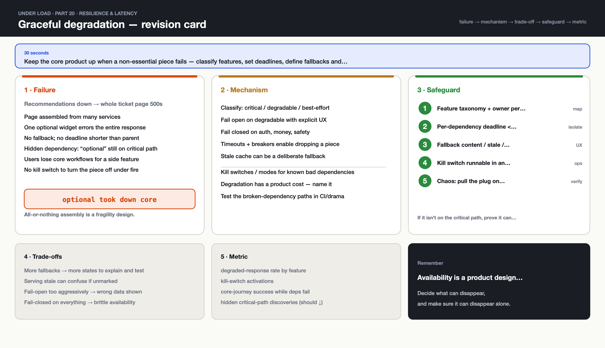
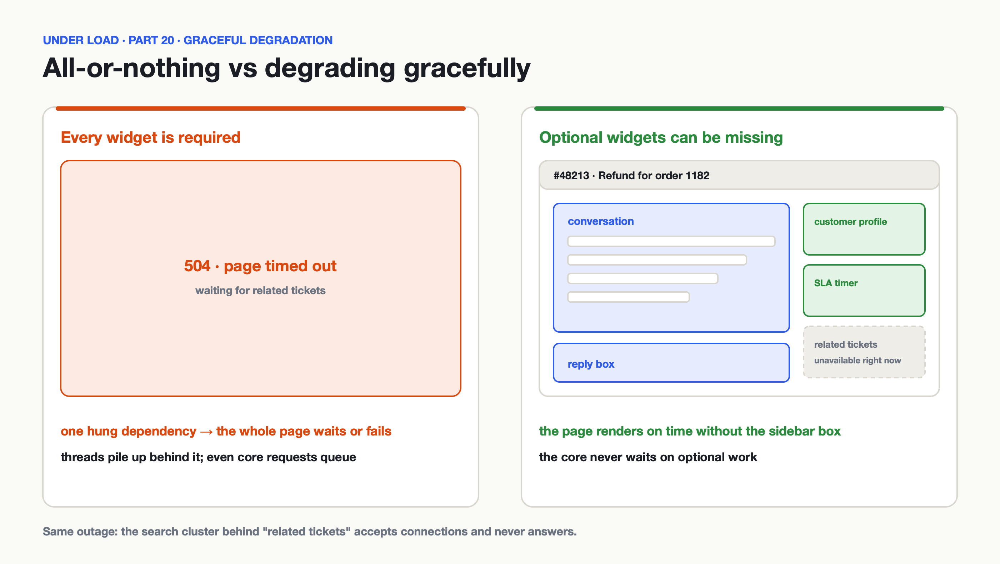
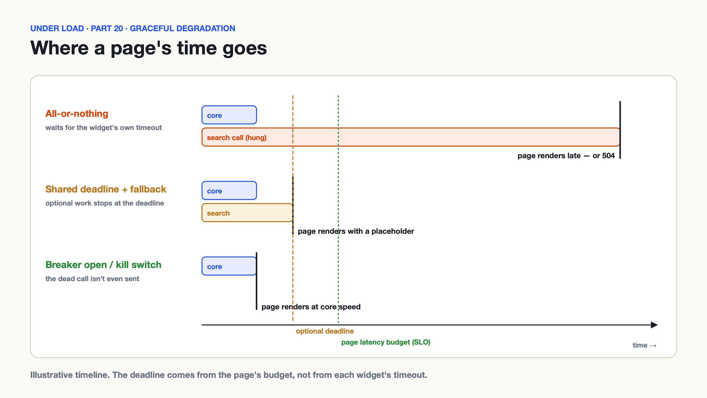
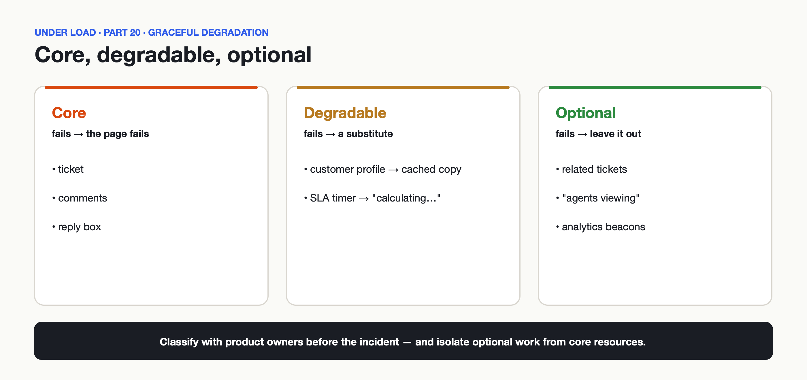
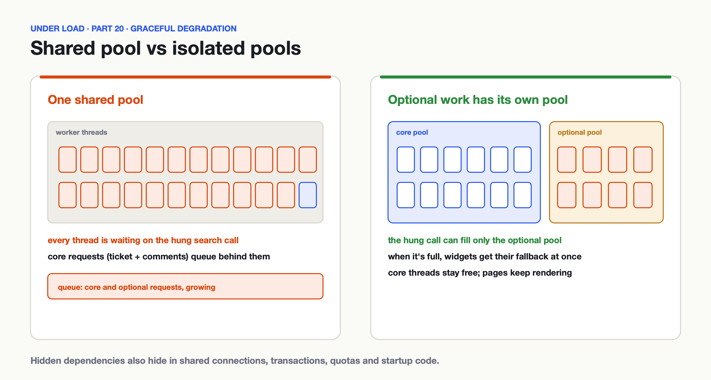
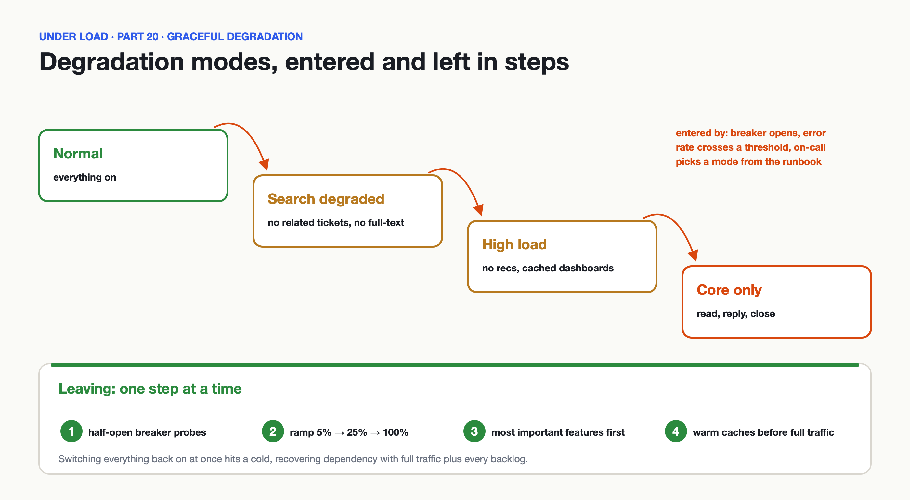
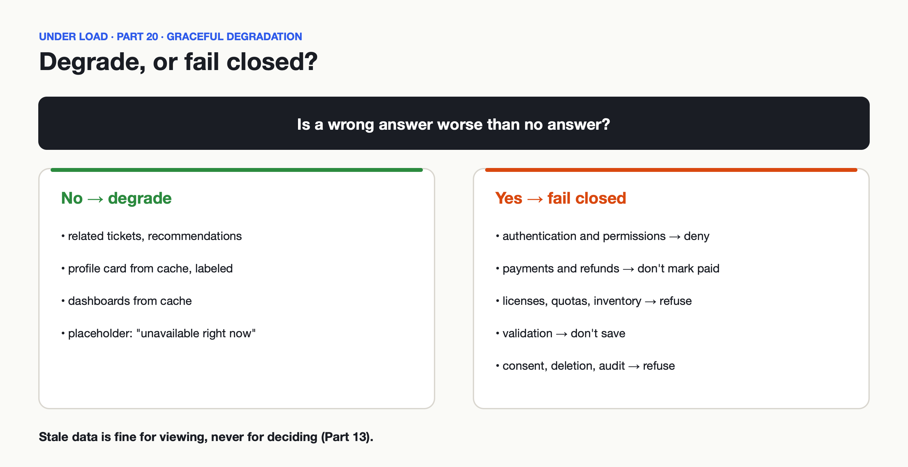
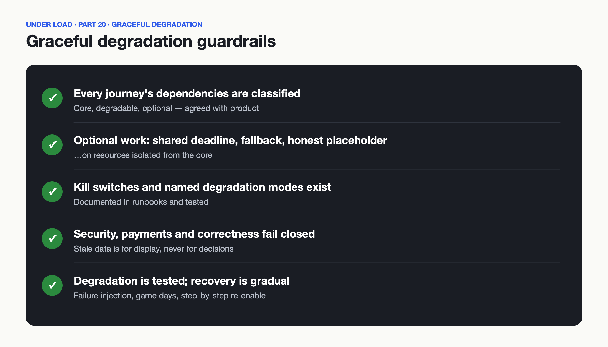

# Graceful Degradation

### Graceful degradation: keeping the core of a product working when parts of it fail — classifying features, deadlines and fallbacks, kill switches, and what must never degrade.

*Under Load · Part 20 · Resilience & Latency*





---

The ticket page shows a lot more than the ticket. Next to the conversation sits a **related tickets** box (powered by the search cluster), a **customer profile** card (from the CRM), and an **SLA timer** (from the rules service, counting down to the deadline the support contract promises). They're useful. None of them is why an agent opens the page. The agent opens it to read the ticket and reply.

One morning the search cluster stops answering — not failing fast with an error, but accepting connections and then hanging. The ticket page's backend was written the obvious way: fetch the ticket, the comments and the three widgets, wait for all five, then render. Each widget call has a 2-second timeout. So for the length of the search incident, every ticket page either fails outright or takes more than two seconds. Worse, the threads waiting on search pile up, and soon even the requests that would never touch search are stuck in the queue behind them.

Halcyon's agents, working through a backlog, can't open tickets at all. The ticket store, the comments and the reply box are perfectly healthy. A broken sidebar has taken down the main feature of the product.

This article is about the design decision that prevents that: **graceful degradation** — when part of a system fails or runs short of capacity, return a smaller but still useful result instead of an error. It covers how to decide what's essential, how deadlines and fallbacks make degradation automatic, how kill switches and degradation modes help during an incident, which features must **not** degrade, and how to test all of it before it's needed.

---

## What graceful degradation is

Most pages and API responses are assembled from several pieces, and those pieces come from different services. **Graceful degradation** means designing the assembly so that the failure of a non-essential piece removes that piece — and only that piece — from the result.

The idea is old and comes from physical engineering: a building's emergency lighting, an aircraft that can land with one engine, a car whose infotainment system can crash without affecting the brakes. In software it usually takes one of a few forms:

- **Omitting** a feature: the related-tickets box simply isn't shown.
- **Substituting** a cheaper or older version: the customer profile comes from a cache that's an hour old.
- **Simplifying** the result: search returns matches from the title only, skipping the expensive full-text ranking.
- **Deferring** work: an analytics event goes into a local buffer instead of being sent now.
- **Disabling** a feature explicitly, with a message: "Exports are temporarily unavailable."

Two triggers lead to degradation, and both matter:

1. **A dependency fails or becomes slow** — the search cluster hangs, the CRM returns errors.
2. **Capacity runs short** — traffic is higher than the system can serve at full quality. Here nothing is broken; the system deliberately does less per request so it can serve more requests. This is sometimes called a **brownout**, by analogy with an electrical grid that lowers voltage instead of cutting power. Google's SRE book describes the same idea for search: under overload, serve results from a smaller part of the index rather than refusing queries.

What graceful degradation isn't: hiding failures. A degraded response should be honest about what's missing, and the team should be able to see — on a dashboard, not by luck — that the system is running in a reduced state.

---

## Why all-or-nothing pages fail so badly

It's worth understanding exactly how one hung widget took down a whole page, because each step suggests a fix.



**The page waited for the slowest piece.** A page assembled from five parallel calls can't render before the slowest of them finishes. When one call hangs, the page's latency becomes that call's timeout: two seconds instead of a couple of hundred milliseconds.

**The timeout was the widget's, not the page's.** A 2-second timeout is a sensible limit for one search call in isolation. It's a terrible limit for a page that's expected to load in a few hundred milliseconds. Nobody had decided how much of the *page's* time the sidebar was allowed to spend.

**Waiting consumed shared resources.** Each request waiting on search held a worker thread (or a connection, or a slot in an async concurrency limit) for the full two seconds. Requests arrived at the usual rate but finished far more slowly, so the number of in-flight requests grew — **Little's law** says the number in flight equals arrival rate multiplied by time in the system, so if time in the system grows tenfold, so does the number of requests occupying threads. Once every thread was held by a request waiting on search, new requests waited in the queue, including requests that would have been fast. That's how an optional dependency reached the core: not through the data, but through **shared resources**.

**Failure was the only outcome.** There was no code path that said "render without the sidebar." The page had two states: everything, or an error.

Each of these has a matching countermeasure: a deadline for optional work, isolation of the resources it uses, and a fallback for every piece that's allowed to be missing. But before any of that, someone has to decide which pieces those are.

---

## Step 1: classify every dependency



For each **user journey** — "open a ticket and reply," "log in," "run the weekly report" — list everything the journey depends on, and put each dependency into one of three groups:

- **Core.** Without it, the journey makes no sense. For the ticket page: the ticket, its comments, the ability to reply. If a core dependency fails, the journey fails, and that is the correct behavior.
- **Important but degradable.** Useful, and there's an acceptable substitute. The customer profile can come from a cache; the SLA timer can show "calculating…"; the agent list for reassigning a ticket can come from the last known copy.
- **Optional.** The journey is fine without it. Related tickets, recommendations, "agents currently viewing," analytics beacons, the onboarding tooltip.

This is a **product decision**, not just an engineering one. "Can the ticket page work without the CRM?" depends on what support agents need to do their job, what the contract with Halcyon promises, and what a missing card communicates to a customer. The classification should be made with product owners in the room, written down, and reviewed when features change — and it should be made **before** an incident, because the middle of an outage is the worst time to debate it.

The classification also changes with context. The SLA timer is optional for an agent reading a ticket, but the **SLA breach calculation** that triggers an escalation to a manager is core for the escalation job. The same dependency can be optional in one journey and core in another, so the list is per journey, not per service.

### Watch for hidden dependencies

A dependency that looks optional on the diagram can still be on the critical path in practice. The common ways:

- **Shared thread pools or connection pools.** The optional call borrows a thread from the same pool as the core call. When it hangs, it starves the core — exactly what happened to the ticket page.
- **Shared transactions.** An optional write — "record that this agent viewed the ticket" — inside the same database transaction as the core read. If the optional write blocks on a lock, the core read waits too.
- **Shared rate limits or quotas.** Optional calls to a third-party API consume the same quota as essential ones.
- **Initialization.** A client library that connects to the search cluster at startup and refuses to start if it can't. Every instance that restarts during the outage stays down.
- **Synchronous logging, metrics or tracing.** An exporter that blocks the request when its collector is unreachable.

The fix for each is **isolation**: give optional work its own pool, its own connections, its own transaction and its own concurrency limit, so it can't take resources the core needs. Part 17 (bulkheads) covers the techniques in detail.



---

## Step 2: give optional work a deadline and a fallback

Degradation only happens automatically if the code is written for it. A sketch of the ticket page's backend, rebuilt:

```python
core = fetch_ticket_and_comments(ticket_id)            # required: let errors propagate

widgets = {
    "related":  submit(search.related, ticket_id),     # each runs on the optional-work pool
    "customer": submit(crm.profile, customer_id),
    "sla":      submit(rules.sla, ticket_id),
}
wait(widgets.values(), timeout=0.150)                  # one deadline for all optional work

page = render(core,
    related  = result_or(widgets["related"],  placeholder="Related tickets are unavailable right now"),
    customer = result_or(widgets["customer"], fallback=cached_profile(customer_id)),   # stale is fine here
    sla      = result_or(widgets["sla"],      placeholder="SLA: calculating…"))
cancel_unfinished(widgets)                             # don't keep working for a page that's gone
```

Each piece has a job.

### A deadline that comes from the page's budget

Start from the latency the page is supposed to have — its **latency budget**, often derived from a service-level objective (SLO) such as "95% of ticket pages render within 300 ms." Then decide how much of that budget optional work may spend. On the ticket page, optional widgets get 150 ms in total: they start in parallel with the core, and whatever hasn't answered by then is replaced by its fallback.

Three details make the deadline work:

- **One deadline for the group, not a timeout per call.** Three widgets with 150 ms timeouts each, called in sequence, can spend 450 ms. A shared deadline measured from the start of the request can't be exceeded, however many widgets there are.
- **The deadline is propagated.** The call to search carries the remaining time (gRPC deadlines do this automatically; over HTTP, a header can carry it), so the search service can stop working on a request whose caller has already given up. Part 15 covers deadline propagation.
- **Unfinished work is canceled.** A page that has rendered without the related-tickets box shouldn't leave a thread waiting on search for another two seconds. If the client library can't be canceled, its own timeout must be short, because a timed-out call that's still running still holds its thread.

### A fallback for every degradable piece

The usual fallbacks, from most to least useful:

- **Cached or stale data.** The last good customer profile. HTTP has a standard for this: the `stale-if-error` Cache-Control extension (RFC 5861) lets a cache serve a stale response when the origin returns an error, and `stale-while-revalidate` lets it serve stale content while fetching a fresh copy in the background.
- **A sensible default.** A generic list of help-center articles instead of personalized ones.
- **A partial response.** Search results from the replicas that answered, marked as possibly incomplete.
- **Static content.** A pre-rendered version of a dashboard from the last hour.
- **Leaving it out**, with a placeholder.

### Placeholders that tell the truth

"Related tickets are unavailable right now" is honest. An empty box isn't: an agent can't tell "no related tickets" from "search is down," and may act on the wrong one. API responses should do the same thing in machine-readable form — a field such as `"degraded": ["related_tickets"]`, or a response header — so that callers, including the front end and other services, know the result is partial and can decide what to show.

### Circuit breakers, so the page stops trying

A deadline bounds how long each request waits. During a long outage, though, every request still spends its full 150 ms waiting for a call that will fail. A **circuit breaker** (Part 16) tracks the failure rate of a dependency; when it's high, the breaker **opens** and calls fail immediately without being sent. Pages then skip the dead widget entirely and render at core speed. After a cool-down, the breaker lets a few **probe** requests through (the **half-open** state), and closes again once they succeed.

Timeouts and breakers work together: the deadline limits the damage of a slow dependency for one request, the breaker limits it across all requests, and the fallback defines what the user sees in both cases.

### Concurrency limits and load shedding

Two more tools keep failing dependencies from exhausting shared resources:

- A **concurrency limit** on each optional dependency — at most N calls in flight to the CRM at once — means that even if the CRM becomes slow, it can occupy at most N threads or connections. Further calls get the fallback immediately.
- **Load shedding** (Part 25) rejects or simplifies work at the front door when the whole service is overloaded, starting with the least important requests.

---

## Step 3: kill switches and degradation modes

Automatic fallbacks handle individual failed calls. During a real incident it also helps to have **levers** humans can pull, because humans often know something the automation doesn't — that search will be down for an hour, or that an expensive feature is what's overloading the database.

### Kill switches

A **kill switch** is a feature flag that turns off a feature, an expensive query or a whole integration in seconds, without a deploy. Turning off the related-tickets widget during the search outage means pages stop spending any part of their budget on it. Kill switches should be:

- **Fast to flip**, from a feature-flag system or a configuration service that every instance watches.
- **Safe when the flag service is down.** Each instance caches the last known flag values and has a sensible default; a kill switch that depends on the system it's meant to protect is worse than none.
- **Audited.** Every change records who flipped it, when and why.

### Degradation modes

A **degradation mode** is a named, tested combination of switches, decided in advance:

- **"Search degraded":** hide related tickets, disable full-text search, keep lookup by ticket number.
- **"CRM degraded":** show customer profiles from cache with a "may be out of date" label, disable editing customer details.
- **"High load":** turn off recommendations and live presence, serve dashboards from cache, pause bulk exports.
- **"Core only":** everything optional off; agents can read, reply and close tickets, nothing else.

On-call engineers pick a mode from a runbook instead of improvising under pressure. Automatic triggers — a breaker opening, an error rate crossing a threshold, load shedding activating — can enter a mode without a human.



### Recover gradually

When the dependency comes back, switching everything on at once is a common way to cause a second outage. The recovering search cluster suddenly receives full traffic, its caches are cold, and every client's retry queue empties at the same moment. Bring traffic back in steps:

- **Breakers' half-open probes** let a few requests through and close only after they succeed.
- **Percentage rollouts** on the kill switch: 5%, 25%, 50%, 100%, watching the dependency's latency at each step.
- **Re-enable features in order of importance**, the most useful first.
- **Warm caches** before sending full traffic, where possible.

---

## The costs of degradation

Graceful degradation isn't free, and the trade-offs should be made on purpose.

- **Stale and less personalized data.** A cached profile may show last week's plan; a default recommendation list is less relevant. That's acceptable for display, and dangerous for decisions (below).
- **More code paths.** Every fallback is a branch that runs only during failures, so it's the least exercised code in the system. Ten widgets with two fallbacks each produce many combinations of partial pages, and some of them will be broken in ways nobody has seen. Keep the number of fallbacks small, make them simple, and prefer "leave it out" over clever substitutes.
- **Hidden inconsistency.** A page that mixes fresh core data with an hour-old sidebar can show contradictions — a ticket assigned to an agent who, according to the cached profile, no longer works there. Labels help.
- **Masked problems.** A dependency that's been failing quietly for a week, hidden behind a fallback, is a dependency nobody is fixing. Fallback activations need to be visible and alerting.
- **Product confusion.** Users who see a feature come and go may lose trust in it. Communicate partial functionality clearly — a banner for longer incidents, a status page for customers like Halcyon.

---

## What must not degrade



Some features have to work correctly or not at all. For these, the right failure mode is to **fail closed**: refuse the operation with a clear error rather than guess. (The opposite, **failing open**, means allowing the operation when the check can't be performed.)

- **Authentication and authorization.** If the permission service is down, deny access; never fall back to "allow." A stale cached permission is also risky: it may grant access that was revoked an hour ago. Some systems accept a short, bounded cache for read-only access and require a fresh check for anything that changes data.
- **Payments and refunds.** If the payment provider can't confirm a charge, the invoice isn't paid. Don't mark it paid and hope.
- **Quantities that must be exact.** Seat licenses on Halcyon's contract, credits, inventory, quotas that are billed. Allowing a 501st agent seat because the license service timed out is a contract breach, not a degraded experience.
- **Data validation.** Don't save a ticket with a missing required field because the validation service timed out.
- **Legal, privacy and audit requirements.** Consent records, data deletion requests, audit logs. A deletion request "accepted" but never executed is worse than an error the user can retry.

The question to ask for each feature: **is a wrong answer worse than no answer?** If yes, fail closed. If no, degrade.

Failing closed doesn't mean failing badly. The error should be specific ("Refunds are temporarily unavailable; no money has moved"), the operation should be safe to retry later (Part 14, idempotency), and the rest of the page should keep working.

### Is stale data a safe fallback?

For **display**, often yes: an hour-old customer plan or satisfaction score is fine to show, ideally labeled. For **decisions**, no (Part 13 covered cache coherence): don't use a stale permission to authorize an action, a stale balance to approve a refund, or a stale assignee to decide who owns a ticket. When a degradable feature is used to *act*, its fallback should be "can't do that right now," not "use the old value."

How stale is acceptable is also a decision. A fallback cache should record when each entry was fetched, and the page should refuse to show entries older than a limit — a day, say — rather than an arbitrarily old copy.

---

## Testing degradation before it's needed

Fallback code runs only during failures, so it has to be made to run on purpose.

- **Failure injection in tests.** Unit and integration tests that make each optional dependency time out, return errors or return garbage, and check that the page still renders with the right placeholders — and that core dependencies failing still produces a clear error.
- **Fault injection in staging and production.** Service meshes such as Envoy and Istio can inject delays or errors into calls to a specific service; tools like Toxiproxy sit between a service and its dependency and add latency, drop connections or limit bandwidth. A hung dependency — accepting connections and never answering — is the most important case to test, because it's the one that exhausts resources.
- **Chaos experiments.** Turn a real dependency off, during working hours, with people watching and a clear way to stop. The practice was popularized by Netflix (Chaos Monkey and its successors); the principle is that failures will happen anyway, so better to choose when.
- **Game days.** Rehearse entering and leaving each degradation mode, including the gradual recovery, so the first time isn't during an incident.
- **Load tests in degraded modes.** A degraded page should be cheaper than a full one. If "core only" mode is somehow more expensive — because fallbacks hit the database harder than the cache they replace — it's better to find out in a test.
- **Monitor the core journey during every test.** The point of the exercise is to prove that agents can still open and reply to tickets while search is down. A dashboard that shows only service health can't prove that.

---

## Guardrails that prevent the next one



1. **Every user journey has its dependencies classified** — core, degradable, optional — agreed with product and reviewed when features change.
2. **Optional work has a shared deadline, a fallback and an honest placeholder**, and runs on resources isolated from the core.
3. **Kill switches and named degradation modes exist**, work when the flag service is down, are documented in runbooks and are tested.
4. **Security, payments and exact quantities fail closed.** Stale data is for display, never for decisions.
5. **Degradation is tested** with failure injection and game days, fallback activations are visible, and recovery is gradual.

---

## What to keep on the dashboard

- **Core journey success rate** — for example, "ticket page loaded with ticket and comments" — tracked separately from full-page success. This is the number that should stay flat during a dependency outage.
- **Partial-response rate:** pages or API responses served with at least one fallback, per feature.
- **Fallback activations** per dependency, and **stale-data age** where stale fallbacks are used.
- **Dependency error rate and timeout rate**, and **circuit breaker states**.
- **Kill-switch and degradation-mode state**, with a timestamp and author for every change.
- **Saturation** of the pools and concurrency limits used by optional work, to catch hidden dependencies before they reach the core.
- **Latency of the page against its budget**, so an optional deadline that has quietly grown is visible.

---

## Recap

### What is graceful degradation?
Keeping the core of a user journey working when non-essential parts fail or capacity runs short, by returning a reduced but useful result — omitting, substituting, simplifying or deferring the non-essential parts — instead of an error.

### Which dependencies would you degrade versus fail closed?
Degrade optional and display-only features — related items, recommendations, profile cards, timers, analytics — using placeholders, defaults or cached data. Fail closed wherever a wrong answer is worse than none: authentication and authorization, payments and refunds, exact quantities such as licenses, inventory or billed quotas, data validation, and legal, privacy or audit requirements.

### How do you classify features?
Per user journey, with product owners, before an incident: core (the journey fails without it), important but degradable (an acceptable substitute exists), and optional (fine without it). The same dependency can be core in one journey and optional in another.

### How do timeouts and circuit breakers enable graceful degradation?
A deadline for optional work, taken from the page's latency budget and shared by all optional calls, stops a slow dependency from consuming the whole request. A circuit breaker then stops calling a failing dependency across all requests, so pages skip it and render at core speed. The fallback defines what the user sees in both cases.

### What is a hidden dependency?
A dependency that looks optional but shares something with the core — a thread pool, a connection pool, a transaction, a quota, startup initialization — so its failure exhausts resources the core needs. Isolation (separate pools, separate limits) is the fix.

### Can serving stale data be a safe fallback?
For display, often yes, labeled and within a maximum age. For decisions, no: never use stale permissions, balances, quantities or assignments to authorize or perform an action. Refuse actions that need fresh data.

### What does degradation cost?
Stale or less personalized data, more code paths that rarely run and are easy to break, possible inconsistencies within one page, problems hidden behind fallbacks, and user confusion. Keep fallbacks few and simple, label them, and make every activation visible.

### What are kill switches and degradation modes?
Kill switches are feature flags that turn off a feature instantly without a deploy, and keep working when the flag service is down. Degradation modes are named, tested combinations of them — "search degraded," "high load," "core only" — that on-call engineers or automatic triggers can activate.

### How should recovery work?
Gradually: breaker probes, percentage rollouts of re-enabled features, the most important features first, and warm caches before full traffic, so a recovering dependency isn't hit with full load plus every backlog at once.

### How would you test degradation paths before an incident?
Tests that make each optional dependency time out, fail or hang; fault injection with a service mesh or Toxiproxy in staging; chaos experiments and game days in production with people watching; load tests in degraded modes; and monitoring of the core journey's success rate throughout.

### What should you monitor?
Core journey success rate, partial-response rate per feature, fallback activations and stale-data age, dependency errors, timeouts and breaker states, kill-switch and mode changes, saturation of pools used by optional work, and page latency against its budget.

---

## Next

- **Lab (run + measured write-up):** [20-graceful-degradation](https://github.com/b-basoglu/under-load/tree/main/20-graceful-degradation)
- **Next:** [Continuous Profiling](../21-continuous-profiling/article.md) — P99 went up 30% after Tuesday's deploy. Every trace looks the same. Where is the time going?
