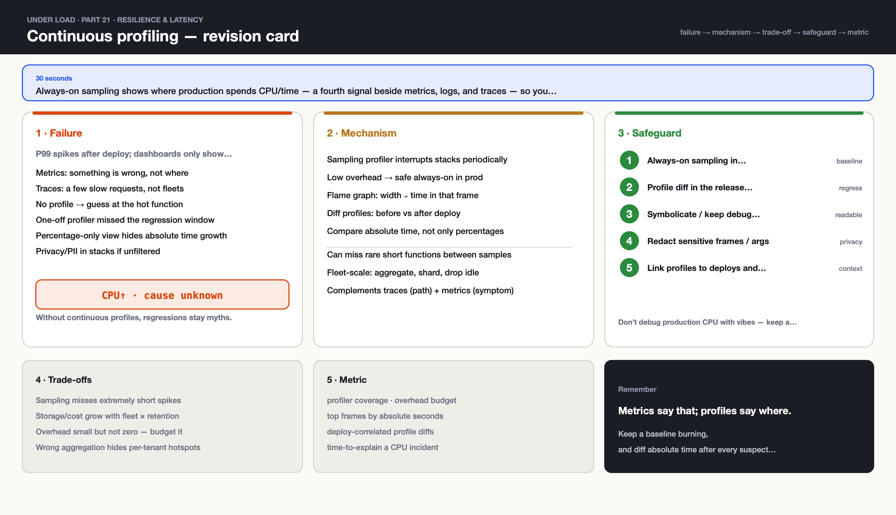
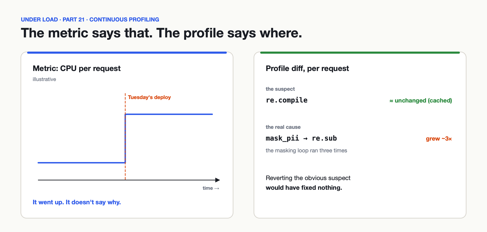
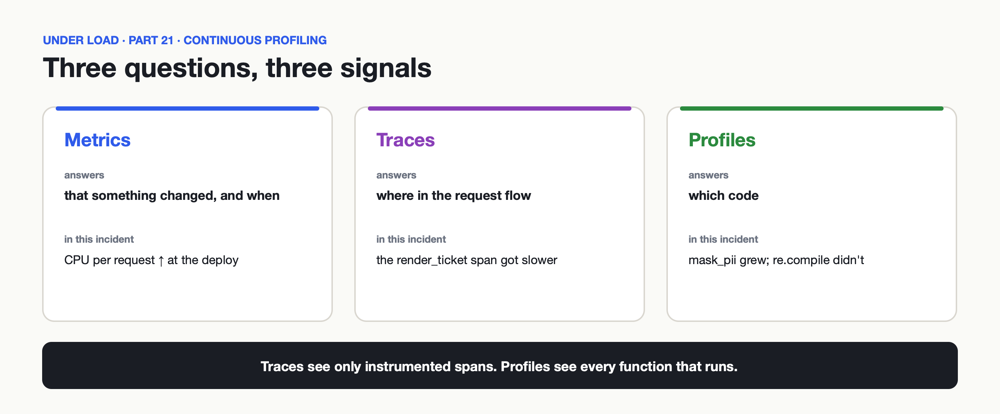
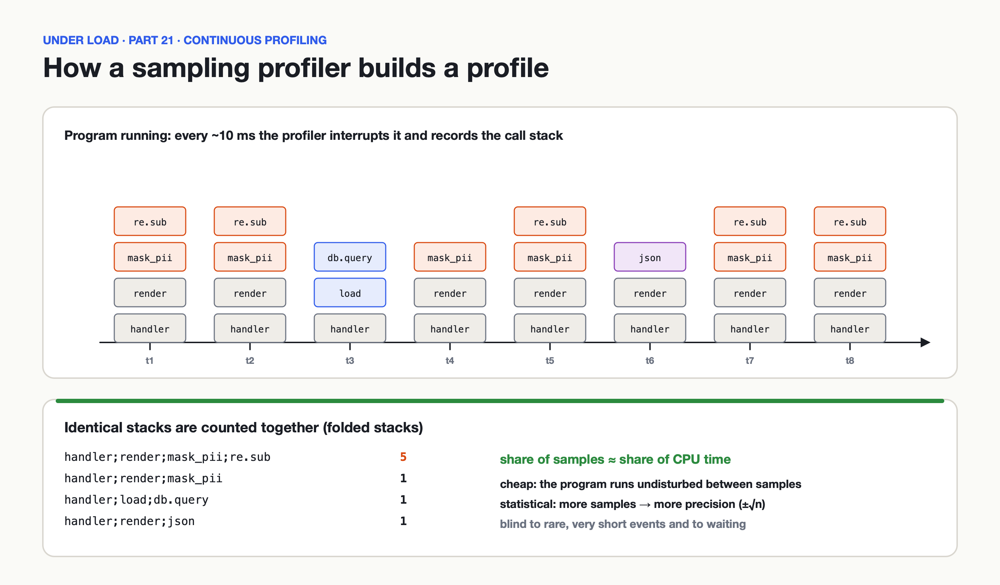
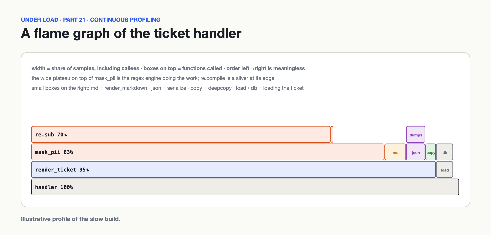
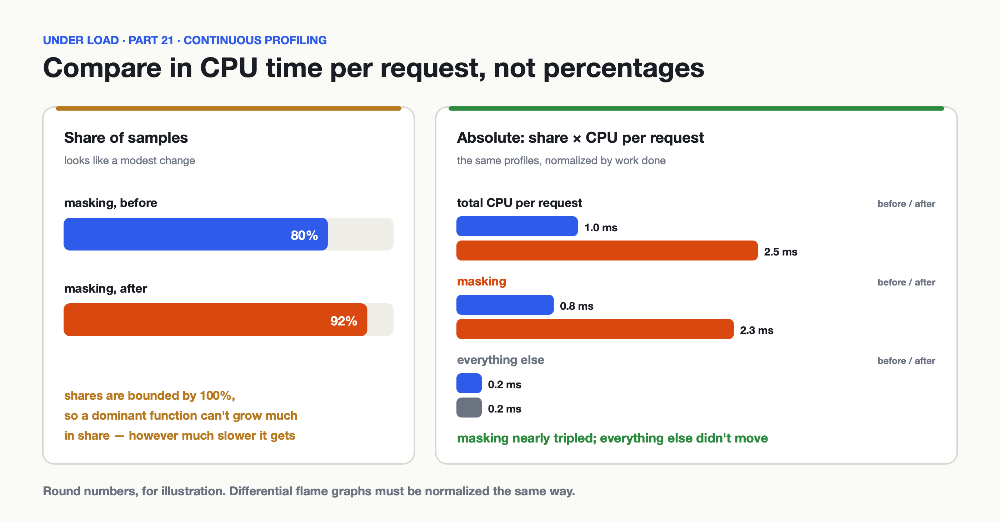
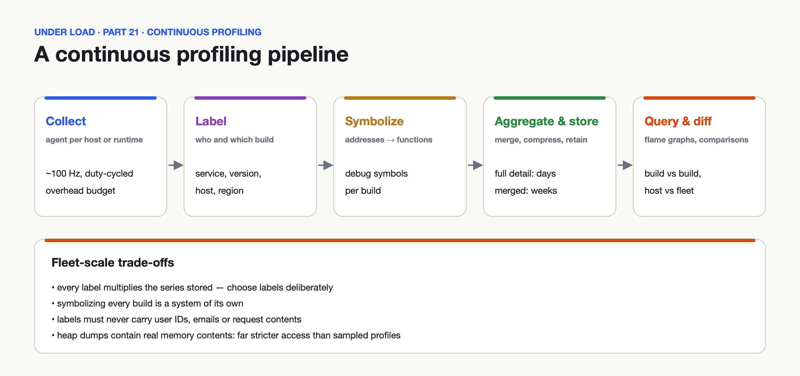
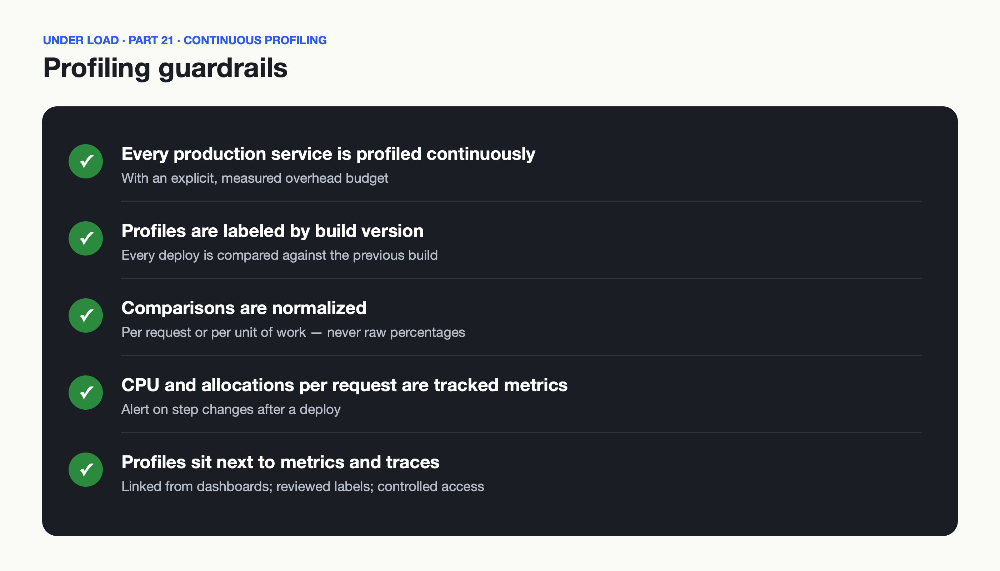

# Continuous Profiling

### Continuous profiling: always-on sampling of where production spends its time, how it differs from metrics and traces, and how to read a profile diff after a bad deploy.

*Under Load · Part 21 · Resilience & Latency*

---

Tuesday's release of the ticket service went out without incident. No errors, no alerts, nothing rolled back. By Wednesday afternoon, the autoscaler had more than doubled the number of instances serving the same traffic, and the P99 of the ticket page had crept up. Halcyon's account manager forwarded a complaint: agents said the product "felt sluggish."

The team looked at what they had:

- **Metrics** said CPU per request had stepped up at the moment of the deploy. They didn't say why.
- **Traces** showed every ticket-page request spending more time in the `render_ticket` span. But that span covered the whole page render — loading, masking personal data, formatting, serializing. Something inside it had become slower. The trace couldn't say what.
- **Logs** said nothing at all. Nothing was failing.

The release diff touched dozens of files. One change looked suspicious: the function that masks personal data (emails, phone numbers) in ticket comments now built its regular expressions inside the function, on every call, instead of once at startup. "That's it — compiling regexes on every call is slow," someone said, and a revert was being prepared.

The profile said otherwise. Python's `re` module keeps a cache of recently compiled patterns, so compiling the same pattern again mostly returns the cached object; that change cost almost nothing. The same release had also wrapped the masking in a loop that ran it **three times** "to make sure everything was masked," and that loop was where the time went. Reverting the obvious suspect would have fixed nothing.

This article explains **continuous profiling** — always-on, low-overhead sampling of where code spends its resources in production — how sampling profilers work, how to read a flame graph, how to compare profiles without fooling yourself, and what changes when profiling a whole fleet.

---

## Metrics, traces, profiles

Production telemetry is usually described as three signals — metrics, logs and traces. Profiles are a fourth, and each answers a different question:

- **Metrics** are numbers aggregated over time: requests per second, CPU utilization, error rate, latency percentiles. They tell you **that** something changed and **when**.
- **Logs** are records of individual events. They tell you **what happened** to a specific request, if someone thought to log it.
- **Traces** follow one request across services as a tree of **spans** — named, timed sections of work that someone instrumented. They tell you **where in the request flow** time was spent: which service, which span, which downstream call.
- **Profiles** record which **code** was using a resource: which functions, often down to the line, were on the CPU, allocated memory, or waited on locks. They tell you **why** a process is expensive.

The key difference between traces and profiles is **who decides what to measure**. A trace only sees the spans someone added; inside a span, it's blind. A profile sees everything that runs — application code, libraries, the runtime, the garbage collector, sometimes the kernel — without anyone deciding in advance. A regression inside a single span, like Tuesday's, is a profiling problem.

The signals work best together: the metric shows CPU per request stepped up at 14:05; the trace narrows it to the `render_ticket` span; the profile shows which function inside that span grew.

### What "continuous" adds

A **profiler** is a tool that records where a program spends its resources. Engineers have always used them locally or by attaching one to a production process during an incident. **Continuous profiling** means doing it **all the time**, in production, on every service, and **storing** the results so they can be queried later. That matters for three reasons:

- **Many regressions are intermittent.** CPU spikes during the noon peak, on one host, for one tenant's data. By the time someone attaches a profiler, the hotspot is gone. A continuous profile has the data from the exact window.
- **Comparison needs a baseline.** "Is this function slow?" is hard to answer. "Did this function get slower since Monday's build?" is easy — if Monday's profile exists.
- **Production is different from a laptop.** Real data shapes, real traffic mix, real hardware and real contention produce hotspots that benchmarks never show. Halcyon's comments are longer than any test fixture.

The approach became widely known through Google's 2010 paper on **Google-Wide Profiling**, which described sampling profiles across the company's data centers continuously and storing them for analysis. Today it's offered by open-source projects such as Grafana Pyroscope and Parca, and by most commercial observability vendors.

---

## How sampling profilers work

There are two ways to find out where a program spends time.

An **instrumenting** profiler records every function entry and exit. It gives exact call counts and durations, but the bookkeeping on every call slows the program down significantly — often by more than the effect being investigated, and unevenly, since small, frequently called functions are slowed the most. That's a development tool.

A **sampling** profiler doesn't track every call. At a regular interval — typically around 100 times per second — it **interrupts** the program and records the current **call stack**: the function that's running, the function that called it, and so on, up to the thread's entry point. Then it lets the program continue. A function that uses a lot of CPU is on the stack in many samples; a function that uses little appears in few.

After enough samples, the counts are a statistical picture of where time goes. If a function appears in 30% of samples, it was on the stack about 30% of the time. Identical stacks are counted together, which makes the data compact: a profile is essentially a list of distinct stacks with a count for each — the **folded stack** format that flame-graph tools use, one line per stack like `handler;render_ticket;mask_pii 412`.

### How the samples are taken

- **Runtime profilers** are built into or attached to a language runtime: Go's `pprof` (whose CPU profiler samples at 100 Hz by default), Java's async-profiler and JDK Flight Recorder, `py-spy` for Python, and others. They know the language's own stack layout, so they produce readable function names for interpreted and JIT-compiled code.
- **eBPF-based profilers** run in the Linux kernel. **eBPF** is a mechanism for safely running small programs inside the kernel; a profiler uses it to sample the stacks of every process on a host from a timer, without changing or restarting the applications. That gives whole-host coverage, including the kernel itself, from one agent per machine.

Profilers often sample at slightly odd frequencies — 99 Hz rather than 100 — so the sampling doesn't fall into lockstep with periodic activity in the program, such as a timer that fires exactly every 10 milliseconds.

### Why it's safe in production

Sampling is cheap because it does almost nothing most of the time. At 100 samples per second, the program runs undisturbed for about 10 milliseconds between samples, and each sample costs microseconds: walk the stack, increment a counter. The rest of the work — converting addresses to function names, compressing, uploading — happens in the background, in batches, often on another process.

Production deployments treat overhead as a **budget**, commonly a percent or two of CPU, and control it with two knobs:

- **Sampling frequency.** Lower frequency means less overhead and less detail.
- **Duty cycle.** Instead of profiling every process every second, profile each one for, say, ten seconds out of every minute, or only a random subset of hosts at a time. Google-Wide Profiling used this approach. Across a large fleet, the aggregate still contains plenty of samples.

The overhead should itself be measured and kept on a dashboard; "the profiler is cheap" is a claim that each runtime and configuration has to earn.

### What sampling can miss

Sampling sees what uses a meaningful share of time, and its precision depends on how many samples there are. Sampling error behaves roughly like a counting error: with *n* samples of a function, the uncertainty is on the order of √*n*. A function seen in 10,000 samples is measured to about ±1%; one seen in 100 samples, to about ±10%; one seen in 4 samples is barely measured at all.

At 100 Hz on one process for one minute, there are about 6,000 samples. A function using 0.1% of the CPU shows up around 6 times; one using 0.01% probably doesn't show up at all. That's usually fine for performance work — the code that matters is, by definition, the code that uses a lot — but **rare, short events** (a single long pause per minute, one slow request in ten thousand) need more samples, more hosts aggregated together, longer windows, or a different tool, such as tracing that request.

Two further limits are worth knowing:

- **CPU profiles don't show waiting.** A thread blocked on a database query or a lock isn't on the CPU, so a CPU profile won't show it. **Wall-clock** (or **off-CPU**) profiles sample threads whether they're running or not, and are the right tool when latency is up but CPU isn't.
- **Some profilers are biased.** Traditional Java sampling profilers could only record stacks at **safepoints** — places where the JVM allows threads to be inspected — so hot loops between safepoints were misattributed. Async-profiler and JDK Flight Recorder avoid most of this, which is one reason they're the usual choice for JVM services.

---

## Other kinds of profiles

CPU is only one resource. The same sampling idea applies to others:

- **Allocation (heap) profiles** sample memory allocations by stack: which code allocates the most bytes or objects. Allocation churn drives garbage-collection work, which shows up as CPU in the collector and as pauses in the tail latency (Part 18).
- **Live-heap profiles** sample what's still in memory, to find leaks and bloated caches.
- **Lock and contention profiles** record where threads wait on mutexes or other synchronization, and for how long — often the hidden cause of latency that looks like "the server is slow" with idle CPUs.
- **Off-CPU and wall-clock profiles** show where threads are blocked: I/O, sleeps, waiting for a connection from a pool (Part 7).
- **Goroutine or thread profiles** show how many threads are in each state, which finds leaks and pile-ups.

Each one answers a different question, and a performance investigation often uses two: CPU to see what's expensive, and wall-clock or contention to see what's waiting.

---

## Reading a flame graph

Profiles are usually displayed as **flame graphs**, a visualization introduced by Brendan Gregg in 2011.

- Each box is a **function** in a stack. The box at the bottom is the entry point; boxes stacked on top of it are the functions it called, and so on upwards.
- The **width** of a box is the share of samples in which that function was on the stack — the time spent in it **including** everything it called (**inclusive** or **total** time).
- The part of a box with nothing stacked on top is time spent **in that function itself** — its **self** time. The top edge of the graph is where the CPU was actually executing.
- The left-to-right order **carries no meaning**. Boxes are usually sorted alphabetically so the same function lines up across views. It's not a timeline.
- Colors are usually arbitrary, or encode something secondary such as the language or the package.

Some tools draw the same data upside down (an **icicle graph**), or as a table of functions sorted by self and total time. The information is the same.

### Investigating a CPU regression with a flame graph

1. **Look for wide boxes.** They're where the time goes. On the ticket handler, `mask_pii` spans most of the width.
2. **Look for wide plateaus** — wide boxes with little stacked above them. That's code doing the work itself rather than delegating. If the plateau is in a library function (a regex engine, a JSON encoder, a hash function), find the caller in your code that sends it so much work.
3. **Look for things that shouldn't be there at all**: a deep copy on a hot path, logging that formats strings nobody reads, a cache miss path that should be rare, reflection.
4. **Compare against a baseline** — the same service on the previous build, or the same time yesterday — rather than judging one profile in isolation. Almost every profile has a widest box; the question is whether it got wider.
5. **Check self time vs total time** for the candidates. A function with a large total and tiny self time is just a caller; the cost is in its children.

---

## Comparing profiles without fooling yourself

The first instinct after a regression is to put the before and after flame graphs side by side. There's a trap in that: flame graphs show **shares** of samples, and shares can barely move during a large regression.

A clearly illustrative example with round numbers. Before the release, the handler costs 1.0 ms of CPU per request, and masking is 80% of the samples. After it, the handler costs 2.5 ms per request, and masking is 92% of the samples.

- In **shares**, masking went from 80% to 92% — twelve points. That looks like a modest change, the kind that could be noise.
- In **absolute time**, masking went from 0.8 ms to 2.3 ms per request — nearly three times as much. Everything else together went from 0.2 to 0.2 ms: unchanged.

Shares are bounded by 100%, so a function that already dominates can't grow much in share however much slower it gets, while everything else *shrinks* in share even though it didn't change. The fix is to **normalize by work done**: multiply each function's share by the total CPU per request (or per unit of throughput), and compare those.

Most profiling tools support **differential flame graphs** — a single graph colored by how much each function grew or shrank between two time ranges, builds or hosts. They're the fastest way to read a regression, as long as the two profiles are normalized to the same amount of work, not compared by raw sample counts (which also change with traffic) or by percentages.

### The regression, step by step

1. **Confirm it in metrics.** CPU per request stepped up at the deploy, and the instance count followed. Traffic didn't change.
2. **Narrow it with traces.** The extra time is inside `render_ticket`.
3. **Diff the profiles** for the old and new build, normalized per request. Almost all the growth is under `mask_pii`. Inside it, `re.compile` is a sliver — the cache absorbs it. The growth is in the regex matching itself, which now happens three times per comment.
4. **Fix it.** Remove the redundant loop; keep the pattern compilation at startup anyway, because it's tidier.
5. **Verify with the next build's profile.** CPU per request and `mask_pii`'s time per request should both return to the baseline. The profile of the fixed build becomes the new baseline.

The profile didn't just find the problem faster; it **ruled out** the wrong answer. Without it, the revert would have shipped, the CPU would have stayed high, and the team would have lost a day looking elsewhere.

---

## Correlating profiles with everything else

A profile is most useful when it can be lined up with the other signals:

- **Deploys.** Profiles labeled with build version make "what changed in this release" a single query.
- **Traffic.** A function that grows in absolute CPU because traffic doubled isn't a regression; one that grows per request is.
- **Latency.** If P99 went up and CPU per request didn't, the problem is waiting, not work — switch to wall-clock or contention profiles.
- **Memory and GC.** Rising allocation per request usually shows up first as more garbage-collection CPU, then as tail-latency pauses.
- **Traces.** Some tools attach profile samples to the span that was active when they were taken, so a slow trace can link straight to the code that ran inside it.

---

## Running it across a fleet

At a few services, continuous profiling is mostly a matter of installing an agent. At hundreds of services and thousands of hosts, it becomes a data system with its own trade-offs.

- **Labels.** Profiles are tagged with service, build version, host, region, and sometimes endpoint or tenant tier — so they can be compared "v2 vs v1", "this host vs the rest", "eu-west vs us-east". Every label multiplies the number of distinct series stored, so labels with many possible values are expensive and should be chosen deliberately.
- **Aggregation.** One host's minute of samples is noisy; a hundred hosts' combined minute is precise. Queries usually merge many profiles.
- **Symbolization.** A raw sample is a list of memory addresses. Turning them into function names and line numbers needs the debug symbols of the exact build. Compiled binaries are often shipped stripped, so symbols have to be uploaded or fetched from a symbol server (such as one speaking the `debuginfod` protocol); JIT-compiled languages need the runtime to publish a map of generated code. At fleet scale, this is one of the most operationally expensive parts.
- **Stack walking.** Recording a stack reliably requires either frame pointers or unwind information. Some Linux distributions have re-enabled frame pointers by default in recent releases largely to make whole-system profiling easier.
- **Storage and retention.** Profiles are much larger than metrics. A common pattern keeps full-resolution profiles for days and down-sampled or merged ones for weeks.
- **Cost of the collection itself.** Overhead per host is small, but it's paid on every host; it belongs in the capacity plan.
- **Standardization.** Formats such as `pprof` are widely supported, and OpenTelemetry is developing profiles as an additional signal, which should make collection less vendor-specific over time.

### Privacy and access

Profiles are more sensitive than they look:

- They reveal **code structure** — function names, libraries, internal service names.
- **Labels can leak data.** A label with a customer email, a request URL with a token, or a ticket ID turns a profile into a store of personal data. Labels should come from a small, reviewed set of values: never user identifiers or request contents.
- **Some profile types capture values.** Heap dumps, unlike sampled heap profiles, contain the actual contents of memory — passwords, tokens, customer data. They need far stricter handling.
- **Access control** should be as deliberate as for logs, with retention limits that match the organization's data policies.

---

## Guardrails that prevent the next one

1. **Every production service is profiled continuously**, with an explicit, measured overhead budget.
2. **Profiles are labeled by build version**, and every deploy's profile is compared against the previous build's.
3. **Comparisons are normalized** — per request or per unit of work — never raw percentages or raw sample counts.
4. **CPU and allocations per request are tracked metrics**, with an alert on step changes after a deploy.
5. **Profiles sit next to metrics and traces**, linked from dashboards and traces, with reviewed labels and controlled access.

---

## What to keep on the dashboard

- **CPU per request** and **allocations per request**, by service and build version.
- **CPU samples by stack:** the top functions by self and total time, and the **biggest movers** since the last deploy (the differential view).
- **Regression deltas** per release: the change in CPU per request attributed to each changed function.
- **Allocation rate and GC time**, from allocation profiles and runtime metrics.
- **Lock and contention hotspots**, from contention profiles.
- **Profiler overhead** itself, to keep it inside the budget.
- **P99 latency alongside CPU per request**, to tell whether a latency change comes from more work or more waiting.

---

## Recap

### What is continuous profiling?
Sampling where production code spends CPU time, memory or lock waits, all the time and across every service, and storing the results so they can be searched and compared later. It catches intermittent regressions after the fact and gives every deploy a baseline.

### How is it different from metrics and traces?
Metrics show that something changed and when; traces show where in the request flow, but only at the granularity of the spans someone instrumented; profiles show which code — functions and lines, including libraries and the runtime that nobody instrumented. A regression inside a single span is visible only in a profile.

### Why are sampling profilers suitable for production?
Instead of tracking every call, they record the call stack a fixed number of times per second — typically around 100 — so the program runs undisturbed between samples and each sample is cheap. Overhead is kept inside an explicit budget with the sampling rate and a duty cycle. Instrumenting every call is exact but slows the program too much for production.

### What can sampling miss?
Very rare or very short events, and anything that isn't on the CPU. Precision grows with the number of samples, so small functions need more hosts or longer windows; waiting needs wall-clock, off-CPU or contention profiles; rare slow requests need tracing.

### How do you use a flame graph to investigate a CPU regression?
Look for wide boxes and wide plateaus — functions present in many samples, especially ones doing the work themselves — and for code that shouldn't be on the hot path. Then compare against a baseline from before the regression, using a differential view normalized by work done, to see which functions actually grew.

### Why compare in absolute time rather than percentages?
Because shares are bounded by 100%: a function that already dominates can triple in cost while its share moves only a few points, and unchanged functions appear to shrink. Multiply each function's share by CPU per request before comparing.

### What trade-offs change when profiling a very large fleet?
Overhead is paid on every host; labels multiply storage; symbolization for every build becomes a significant system; profiles are large, so retention and down-sampling matter; aggregation across hosts improves precision; and access control and label hygiene become a privacy requirement.

### What overhead and privacy concerns matter?
Overhead must be measured and budgeted, not assumed. Profiles reveal code structure, labels can leak personal data if they carry identifiers or request contents, and heap dumps contain real memory contents — so labels are reviewed, access is controlled and retention is limited.

### What should you monitor?
CPU and allocations per request by build, top stacks and biggest movers since the last deploy, regression deltas, allocation rate and GC time, lock contention hotspots, profiler overhead, and P99 latency alongside CPU per request.

---

## Next

- **Lab (run + measured write-up):** [21-continuous-profiling](https://github.com/b-basoglu/under-load/tree/main/21-continuous-profiling)
- **Next:** [Token Bucket vs Leaky Bucket](../22-token-leaky-bucket/article.md) — One integration sends 300 requests in a second, then nothing for a minute. Is that allowed?
