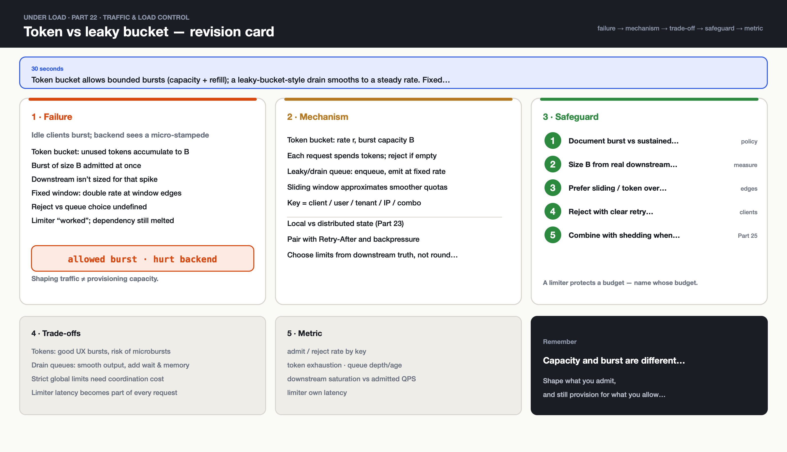
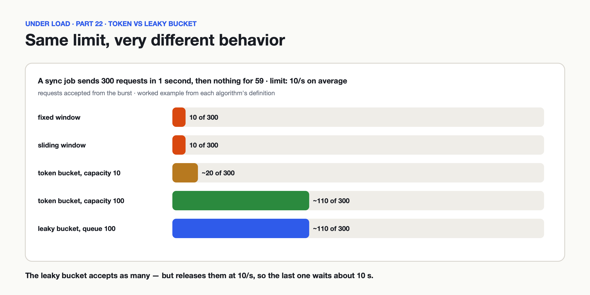
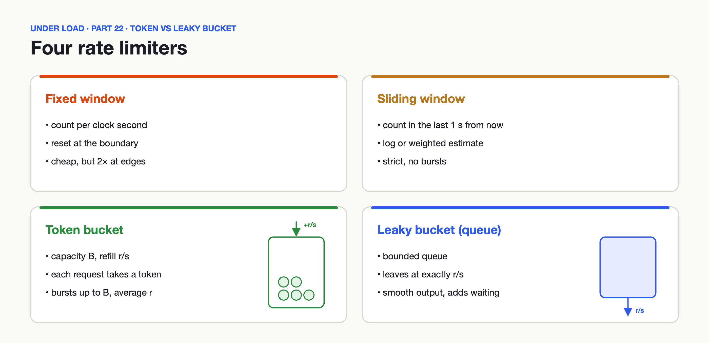
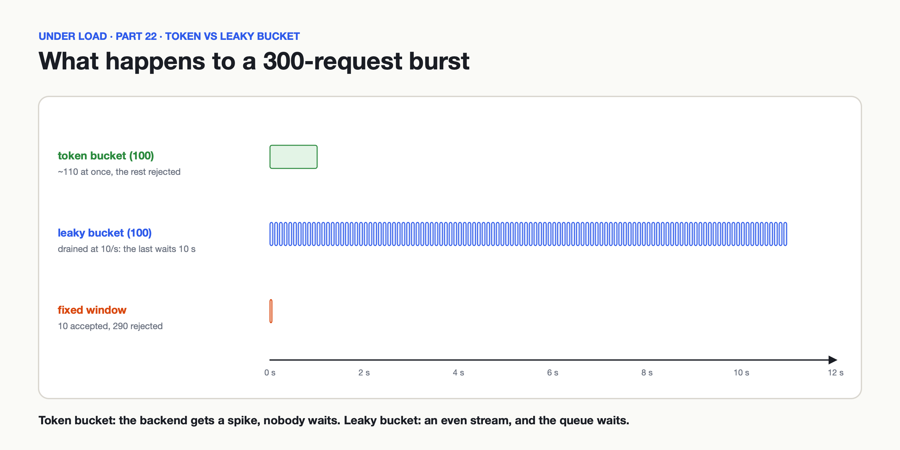
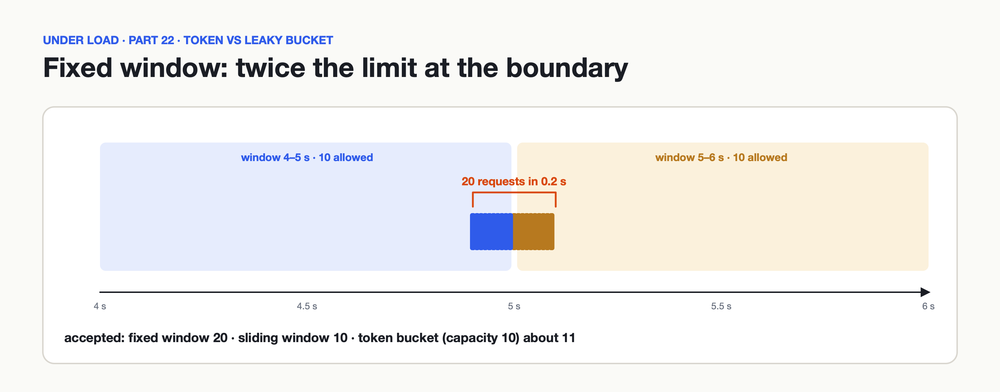
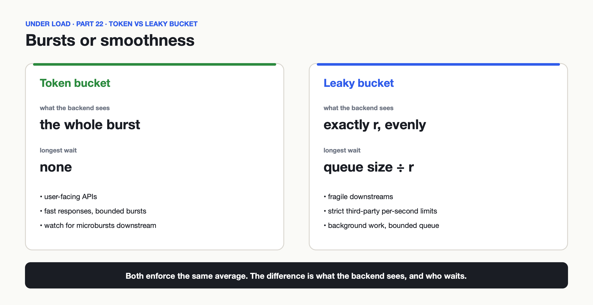
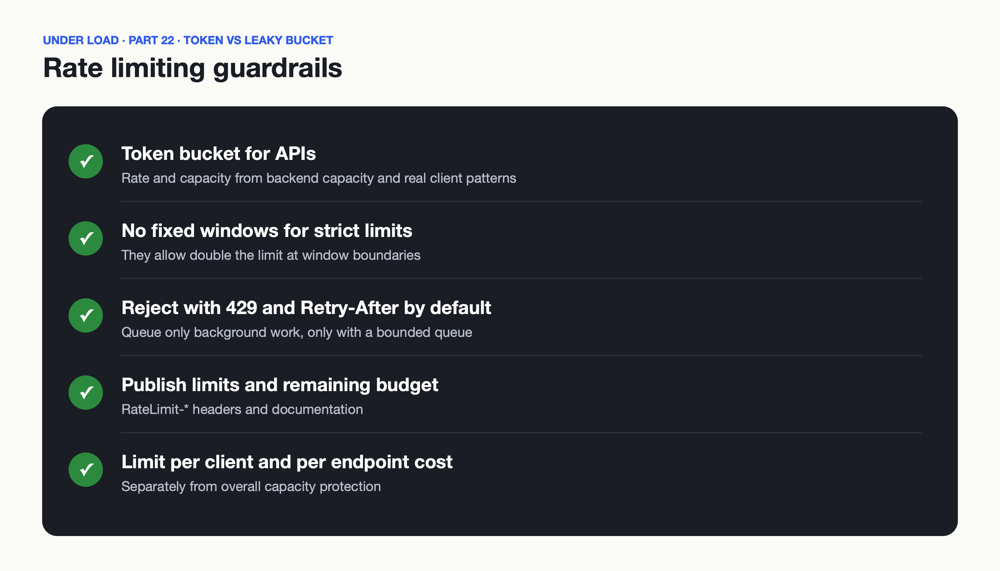

# Token Bucket vs Leaky Bucket

### Token bucket vs leaky bucket (and the fixed and sliding windows people use instead): how each one treats bursts, what capacity and rate control, and whether to reject or queue.

*Under Load · Part 22 · Traffic & Load Control*





---

The public API of the support platform has a rate limit: **10 requests per second** per API client. It's implemented the simplest way: count requests in the current clock second, reject anything past the tenth. It has worked for years.

Then two complaints arrive in the same week.

Halcyon's data team runs a sync job once a minute — the export from Part 8. It fires off about **300 requests in one second**, then nothing for the remaining 59. Averaged over the minute, that's 5 requests per second, half the limit. But the limiter sees 300 requests in one clock second and lets only 10 through. Every minute, 290 requests come back rejected, and the sync falls further behind each hour.

Meanwhile, a small customer's integration has a bug: a retry loop that sends **50 requests per second, forever**. The limiter caps that one correctly. But on the last day of the month the same limiter lets a third client send 10 requests at the very end of one second and 10 more at the very start of the next — twenty requests within a few milliseconds, all accepted.

All three are about the same thing: **"10 per second" isn't one rule.** It can mean "never more than 10 in any one-second interval," "10 per second on average, with some room for bursts," or "accept anything, but hand it to the backend at exactly 10 per second." Each of those is a different algorithm with different behavior, and picking one is a product decision as much as a technical one.

This article compares the four common ones — fixed window, sliding window, token bucket and leaky bucket — explains what each parameter controls, and covers the choices around them: rejecting versus queueing, where the limiter's state lives, and what rate limiting can't do.

---

## What a rate limiter is for

A **rate limiter** decides, for each incoming request, whether it may proceed now, based on how many requests the same **key** — an API client, a user, a tenant, an IP address — has made recently. It serves several purposes, and it's worth being explicit about which one a given limiter is for:

- **Fairness between clients.** One tenant's runaway job shouldn't consume capacity that other tenants need. This is the main reason for per-client limits in a multi-tenant product.
- **Protecting a backend** from more traffic than it can handle, or from traffic in a shape it handles badly (sudden bursts).
- **Respecting someone else's limit.** A third-party API — an SMS gateway, a payment provider, an email service — allows a fixed rate, and exceeding it gets requests rejected or the account suspended.
- **Commercial tiers.** Free plans get lower limits than enterprise plans.
- **Abuse resistance.** Slowing down credential stuffing, scraping or enumeration.

Two numbers describe almost every limiter: a **rate** (how much traffic is allowed on average) and some notion of **burst** (how much may arrive at once). The algorithms differ in how they define and enforce those two.

---

## The four algorithms



### Fixed window

Divide time into fixed **windows** aligned to the clock — each second, or each minute — and keep a counter per key per window. Each request increments the counter; if it's over the limit, reject. When the window changes, the counter starts again from zero.

It's the most common first implementation because it's trivial: in Redis, an `INCR` on a key named after the client and the current second, with an expiry. It uses one integer per key.

Its weakness is at the **edges**. The limit holds within each window, but nothing connects one window to the next.

### Sliding window

Count requests in the last *T* seconds **from now**, rather than since the clock window started. Two common implementations:

- **Sliding log:** store the timestamp of every accepted request; on each new request, discard timestamps older than *T* and count the rest. Exact, but memory grows with the limit — a limit of 10,000 per hour means storing up to 10,000 timestamps per client.
- **Sliding window counter:** keep counters for the current and previous fixed windows and estimate the sliding count by weighting the previous window by how much of it still overlaps the last *T* seconds. If 30% of the current minute has passed, the estimate is the current count plus 70% of the previous minute's count. It's approximate — it assumes requests were spread evenly in the previous window — but uses two integers per key and removes most of the edge problem.

A sliding window gives the strictest reading of "no more than N in any interval of length T." It allows no bursts beyond N.

### Token bucket

Picture a bucket that holds up to **B** tokens — the **capacity** — and receives new tokens at a steady **rate r** per second, up to that capacity. Each request takes a token. If the bucket is empty, the request is rejected (or waits; more on that below). Tokens that aren't used **accumulate**, up to *B*, so a client that has been quiet can spend them all at once in a burst.

It needs no timers and only two numbers per key: the token count and when it was last updated. Refill is computed lazily on each request:

```python
def allow(bucket, now, rate, capacity, cost=1):
    bucket.tokens = min(capacity, bucket.tokens + (now - bucket.last) * rate)   # refill since last time
    bucket.last = now
    if bucket.tokens >= cost:
        bucket.tokens -= cost
        return True
    return False
```

Two properties follow directly from the definition. Over any interval of length *t*, a client can be admitted at most **B + r·t** requests: the full bucket plus whatever refilled during the interval. And over a long period, the admitted rate can't exceed *r*. So *r* bounds the **average** and *B* bounds the **burst**.

The token bucket is the standard choice for APIs. AWS API Gateway, for example, describes its throttling in exactly these terms — a steady-state rate and a burst — implemented with a token bucket.

### Leaky bucket

The name covers two different things, which causes endless confusion.

- **Leaky bucket as a queue.** Requests enter a queue of bounded size and **leave at a fixed rate** *r*, like water dripping from a hole in the bottom of a bucket. A burst isn't rejected as long as the queue has room; it's **delayed** and spread out into a steady stream. Only when the queue is full are new requests turned away. The output never exceeds *r*, whatever the input does.
- **Leaky bucket as a meter.** A counter "leaks" at rate *r* and each request adds to it; requests that would overflow are rejected. This version admits exactly the same requests as a token bucket with the same parameters — it's the same algorithm described from the other side. The **generic cell rate algorithm (GCRA)**, from ATM networking, is a compact form of it that stores a single timestamp per key.

In this article, "leaky bucket" means the **queue** version, because it's the one with genuinely different behavior: it **shapes** traffic rather than merely limiting it. NGINX's `limit_req` module is a well-known example: it's documented as a leaky-bucket limiter, with a `burst` parameter that sets how many excess requests may queue, and a `nodelay` option that serves queued-burst requests immediately instead of spacing them out — which effectively turns it into a token bucket.

---

## The same traffic through each limiter

The differences show up clearly on three traffic patterns. All four limiters below are set to an average of 10 per second; the token bucket has a capacity of 100, and the leaky bucket has a queue of 100. The numbers that follow come straight from each algorithm's definition — they're worked examples, not measurements.

### A well-behaved client

A client sending a steady 8 requests per second is never rejected by any of them. A properly configured limiter is invisible to clients that stay under it — which is the point. If well-behaved clients are hitting the limit, the limit is wrong.

### A broken client

The retry loop at 50 requests per second is capped at 10 per second on average by every algorithm. The token bucket lets the first 100 through at once if the bucket was full, then settles at the refill rate. Steady overload is the easy case; every algorithm handles it.

### A bursty client

Halcyon's sync job — 300 requests in one second, then idle for 59 — is where the algorithms diverge.



- **Fixed window:** 10 accepted, 290 rejected. The burst lands in one clock second.
- **Sliding window:** 10 accepted. Any one-second interval may contain at most 10.
- **Token bucket, capacity 10:** about 20 — the 10 stored tokens plus the roughly 10 that refill during the second the burst lasts.
- **Token bucket, capacity 100:** about **110** — 100 stored plus about 10 refilled. The client has been idle for a minute; it earned that burst.
- **Leaky bucket, queue of 100:** about **110** accepted as well — 100 fit in the queue, about 10 drain while the burst arrives — but they're released at 10 per second, so the **last one waits about 10 seconds** before reaching the backend.

The token bucket with capacity 100 is what Halcyon's job needed: an idle client may send a burst, and the average is still capped. If the sync is changed to send its 300 requests as three bursts of 100 spread across the minute, it fits entirely.

### The fixed window's boundary problem

Ten requests at 4.9 seconds and ten more at 5.0 seconds — twenty within a tenth of a second:



- The **fixed window** accepts all twenty, because they fall into two different clock seconds, each of which sees exactly ten.
- The **sliding window** accepts ten: any one-second interval containing both groups would hold twenty.
- A **token bucket with capacity 10** accepts about eleven: ten from the full bucket, plus one refilled during the gap.

That's the classic weakness of fixed windows: the limit only holds *within* each window. Across the edge, a client can send up to **twice** the limit in a very short time. With a per-minute or per-hour window, that's double the limit in a few seconds — often exactly the burst the limit was meant to prevent. Fixed windows also synchronize clients: everyone who was rejected near the end of a window retries at the start of the next, producing a spike at every boundary.

Fixed windows are still fine for coarse quotas where precision doesn't matter, such as "10,000 calls per day" on a billing plan.

---

## Token bucket vs leaky bucket: bursts or smoothness

The two bucket algorithms enforce the same long-term rate. They differ in what they do with a burst, and therefore in what the **backend** sees and **who waits**.



- **A token bucket passes bursts through.** After a quiet minute, the 100 stored tokens let 100 requests reach the backend in the time it takes to send them — a **microburst**, a very short spike well above the average rate. Nobody waits; excess beyond the burst is rejected immediately.
- **A leaky bucket smooths bursts.** The backend sees an even stream at exactly *r*, whatever the input looks like. The price is **waiting**: a request at the back of a queue of 100, draining at 10 per second, waits 10 seconds. A full queue adds latency equal to queue size ÷ drain rate.

The choice depends on what's being protected:

- **Token bucket** suits **interactive, user-facing APIs.** Clients get immediate answers — accepted or rejected — short bursts are absorbed, and the average is enforced. A user clicking through ten tickets quickly, or a page that makes a dozen API calls on load, fits naturally in a burst.
- **Leaky bucket** suits **protecting a downstream that can't absorb bursts at all**: a legacy system with a few worker threads, a third-party API with a strict per-second limit, an SMS or email provider that throttles hard. It's also natural for background work, where nobody is waiting on the response.

### Microbursts add up

A per-client token bucket bounds each client's burst. It doesn't bound the **sum**. If hundreds of clients each have a full bucket of 100 and they all burst in the same second — because they're all cron jobs scheduled at the top of the minute — the backend sees hundreds of times 100 requests at once. That's a capacity problem, not a per-client one, and it's handled by a separate limit in front of the backend, by admission control and load shedding (Part 25), or by smoothing with a queue.

Microbursts also hide from dashboards. Metrics averaged per minute or even per second can show a comfortable average while connection pools and thread pools saturate for a few hundred milliseconds at a time. Measuring queue depth and in-flight requests at high resolution, or tracking a maximum over short intervals, makes them visible.

---

## What capacity and rate control

The two token-bucket parameters do separate jobs, and should be chosen separately:

- **Rate (r)** is the **long-term average**. No client can sustain more than *r* requests per second, however it spaces them.
- **Capacity (B)** is the **burst size**. A client that has been idle long enough to fill the bucket — *B* ÷ *r* seconds — can send *B* requests at once.

Setting *B* = 1 turns the token bucket into strict pacing: one request per 1/*r* seconds, no bursts. Setting *B* very large turns it into a quota over a long period: a client could save up a day's worth and spend it in a second.

### Choosing the numbers

Limits should come from **downstream capacity and fairness goals**, not from round numbers:

- **Start from what the backend can serve.** Suppose the services behind the public API can handle a few thousand requests per second with headroom, and a few hundred clients are active at peak. A per-client rate around 10 per second means the sum of all clients at their limit stays within capacity, with room to spare. A rate of 1,000 per client would make the limit meaningless.
- **Set the burst from real client behavior.** Look at what well-behaved clients actually do: a sync job that fetches pages of 100 records needs a burst of about 100; an interactive page that makes 20 calls on load needs 20. A capacity of 10,000 serves nobody and lets one client produce a large spike.
- **Use different limits for different costs.** Cheap reads can have generous limits; search, export and report endpoints tight ones. Many APIs charge different **costs** against the same bucket — a search takes 5 tokens, a read takes 1 — so a single bucket reflects the real load a client creates.
- **Use tiers.** Halcyon's contract may justify a higher rate or a larger burst than a free plan. That's a commercial decision; the limiter just needs per-key parameters.
- **Check the sum, not just each client.** Multiply the per-client burst by the number of clients that could burst together, and compare it with what the backend can take.

### Choosing the key

The **key** decides who shares a bucket. Per API key is usual for B2B APIs; per user for interactive products; per IP for unauthenticated endpoints such as login (with care, since many users can share one IP behind a corporate proxy). Layered limits are common: per key, per tenant, and a global limit per endpoint. A misbehaving integration that shares an API key with the customer's important sync — the small customer's situation above — is a reason to issue separate keys per integration, so one can be limited without starving the other.

---

## Reject, shed or queue?

When a request exceeds the limit, there are three options, and the right one depends on the **API contract** — what the client expects to happen.

- **Reject** with **`429 Too Many Requests`** (defined in RFC 6585) and a **`Retry-After`** header saying when to try again. The client stays in control, nothing waits on the server, and latency stays predictable. This is the right default for synchronous APIs.
- **Shed**: drop or downgrade the request without much ceremony — skip an analytics event, serve a cached response instead of a fresh one. Useful for low-value traffic under pressure (Parts 20 and 25).
- **Queue** it (the leaky bucket) and process it later. Right for background work where the client isn't waiting, such as webhook deliveries or outgoing emails, and for protecting a downstream that must never see bursts.

### When queueing is the right call

Queue rather than reject when:

- The client **can't usefully retry**, or retries would be worse than waiting — for example, events emitted by the system itself.
- The work is **asynchronous** and the client receives an acknowledgement, not a result.
- The **downstream rate is fixed** by someone else, and the goal is to use exactly that rate, no more and no less.
- **Waiting is cheaper than losing** the request, and the wait is short relative to the request's deadline.

And the queue must always be **bounded**. An unbounded queue turns overload into unbounded latency and unbounded memory: requests wait so long their callers have given up, and the server keeps working on answers nobody will read. Part 24 (backpressure) covers this in depth. A good rule: the maximum wait in the queue — its size divided by its drain rate — should be shorter than the deadline of the requests in it. A request that will wait longer than its caller's timeout should be rejected immediately, not queued.

### Making rejections easy to handle

A `429` is only useful if clients can act on it:

- **Send `Retry-After`**, and ideally the current limit and remaining budget. An IETF draft standardizes `RateLimit` header fields for this (earlier versions of the draft used `RateLimit-Limit`, `RateLimit-Remaining` and `RateLimit-Reset`), and many APIs use `X-RateLimit-*` equivalents. Clients that can see their remaining budget pace themselves instead of guessing.
- **Document the limits**, including the burst. Clients that know they have a burst of 100 build sync jobs that fit in it.
- **Expect retries**, and make sure clients' retries use exponential backoff and jitter (Part 15). Without jitter, every rejected client retries at the moment `Retry-After` expires, and the rejections become their own synchronized storm.
- **Return 429 for rate limits and 503 for overload.** "You are over your limit" and "the service is overloaded" are different messages; clients and dashboards should be able to tell them apart.

---

## Where the limiter's state lives

Everything above assumes one bucket per client, in one place. In production, the API runs on many servers behind a load balancer, and the limit has to mean something across all of them:

- **Local, per server.** Each server keeps its own buckets in memory. It's fast and has no dependencies, but the effective limit becomes "10 per second per server." With 40 servers and requests spread evenly, a client gets up to 400 per second — and the number changes every time the fleet scales. Dividing the limit by the number of servers helps only if traffic is spread evenly and the server count is known.
- **Shared store.** Buckets live in a central store such as Redis, updated atomically per request (typically with a small script so read-refill-decrement happens in one step). Accurate across the fleet, but every request pays a network round trip, and the store becomes a dependency whose failure must be planned for: fail open (allow traffic) or fail closed (reject it)?
- **Gateway or service mesh.** API gateways, NGINX, Envoy and Kong can enforce limits at the edge, locally or against a shared rate-limit service.
- **Hybrid.** Local buckets that periodically synchronize with a central budget: approximate, but fast and resilient.

The core trade-off is **strictness versus latency and availability**. A globally exact limit requires coordination on every request; an approximate one tolerates some overshoot in exchange for speed and independence from a central store. For most fairness limits, a few percent of overshoot is harmless; for a third-party limit that suspends the account when exceeded, it isn't. Part 23 covers distributed rate limiting in detail.

---

## What rate limiting can't do

Rate limiting is one tool among several, and it's often asked to do jobs it can't.

- **It isn't capacity management.** Per-client limits protect clients from each other. They don't guarantee the backend can handle the sum of all clients at their limits at the same time, nor a traffic spike from many new clients. That needs capacity planning, autoscaling, and load shedding (Part 25).
- **It isn't backpressure.** A limiter enforces a fixed rate set in advance. Backpressure reacts to how the system is actually coping right now — slowing producers when consumers fall behind (Part 24). A limit chosen on a quiet day may be too generous when the database is struggling.
- **It doesn't fix retry storms on its own.** Rejected clients that retry immediately keep generating load. Retry guidance and client-side backoff have to go with it.
- **It counts requests, not cost.** A limit of 10 per second treats a cheap read and an expensive export the same, unless costs are weighted.

---

## Guardrails that prevent the next one



1. **Use a token bucket for interactive APIs**, with the rate and burst chosen from backend capacity and real client patterns — and check the sum of all clients' bursts.
2. **Avoid fixed windows for anything strict.** They admit up to double the limit around window boundaries.
3. **Reject with `429` and `Retry-After` by default.** Queue only for background work or fixed-rate downstreams, and only with a bounded queue whose maximum wait is shorter than the requests' deadline.
4. **Publish the limits and remaining budget** in headers and documentation, and expect clients to back off with jitter.
5. **Limit per client and weight by endpoint cost**, separately from overall capacity protection and backpressure.

---

## What to keep on the dashboard

- **Admitted and rejected requests per client** and per endpoint. A client constantly near its limit may need a higher tier — or has a bug.
- **Token exhaustion:** how often each client's bucket hits empty.
- **Queue depth and age of the oldest item** for every leaky-bucket queue, against the deadline of the work in it.
- **Per-tenant fairness:** the share of capacity each tenant receives at peak, and whether small tenants are being starved.
- **Limiter latency**, especially for shared-store limiters, and the limiter store's own error rate.
- **Downstream saturation** at high time resolution, to check that the limits actually protect what they're meant to and to catch microbursts that per-minute averages hide.

---

## Recap

### Why does a token bucket allow bursts while a fixed-drain queue smooths them?
A token bucket stores unused tokens up to its capacity, so an idle client can spend them all at once; requests beyond that are rejected immediately. A leaky-bucket queue accepts requests into a bounded queue and releases them at a constant rate, so the output is even but requests wait. Both enforce the same long-term average.

### What do bucket capacity and refill rate each control?
The refill rate bounds the long-term average a client can sustain; the capacity bounds the largest burst it can send after being idle. Over any interval *t*, at most *B* + *r*·*t* requests are admitted. They're chosen independently: the rate from each client's fair share of backend capacity, the burst from what real clients need and the backend can absorb.

### What's wrong with a fixed window?
It enforces the limit only inside each window, so a client can send the full limit at the end of one window and again at the start of the next — up to twice the limit in a moment. It also synchronizes rejected clients at window boundaries. Sliding windows and token buckets avoid this.

### Would you reject or queue requests when the limit is exceeded?
Reject by default for synchronous APIs, with `429` and `Retry-After`, keeping latency predictable and the client in control. Queue for asynchronous work, for downstreams with a fixed rate set by someone else, and when waiting is cheaper than losing the request — always with a bounded queue whose maximum wait is shorter than the request's deadline.

### Can a token bucket still hurt the backend?
Yes. Each client's burst is bounded, but many clients bursting at once — for example, cron jobs at the top of the minute — produce microbursts far above the average, which per-minute metrics hide. A global limit, admission control, load shedding or a smoothing queue protects against the sum.

### How do you choose the limits?
From downstream capacity and fairness goals: the rate from how much each client may use given how many share the backend, the burst from the largest burst real clients need and the backend can absorb, with different limits or token costs for cheap and expensive endpoints, and tiers for different plans.

### How would you implement a rate limiter across many servers?
Locally per server (fast, but the effective limit grows with fleet size), in a shared store such as Redis with an atomic update per request (accurate, but adds a network call and a dependency), at a gateway, or as a hybrid of local buckets synchronized with a central budget. Globally strict limits need coordination, which costs latency and availability.

### Is rate limiting the same as capacity management or backpressure?
No. Per-client limits protect clients from each other; capacity management makes sure the backend can serve the sum of demand, and backpressure slows producers based on how the system is coping right now. Rate limits need clear retry guidance and both of the others alongside them.

### What should you monitor?
Admitted and rejected requests per client and endpoint, token exhaustion, queue depth and age, per-tenant fairness, limiter latency and errors, and downstream saturation at high resolution.

---

## Next

- **Lab (run + measured write-up):** [22-token-leaky-bucket](https://github.com/b-basoglu/under-load/tree/main/22-token-leaky-bucket)
- **Next:** [Distributed Rate Limiting](../23-distributed-rate-limiting/article.md) — The limit is 10 per second per client. The API runs on 40 servers. Who's counting?
