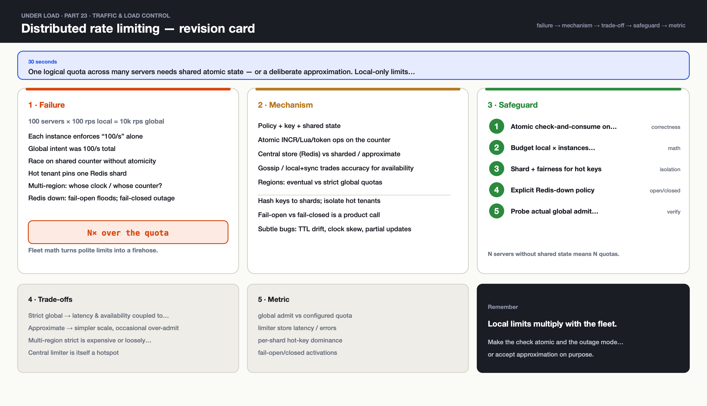
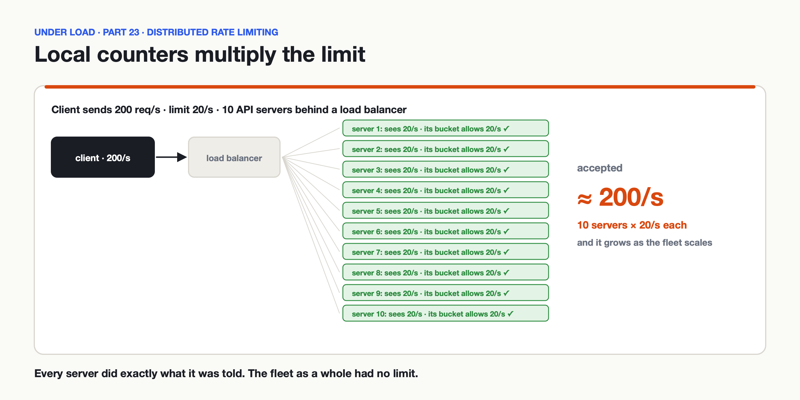
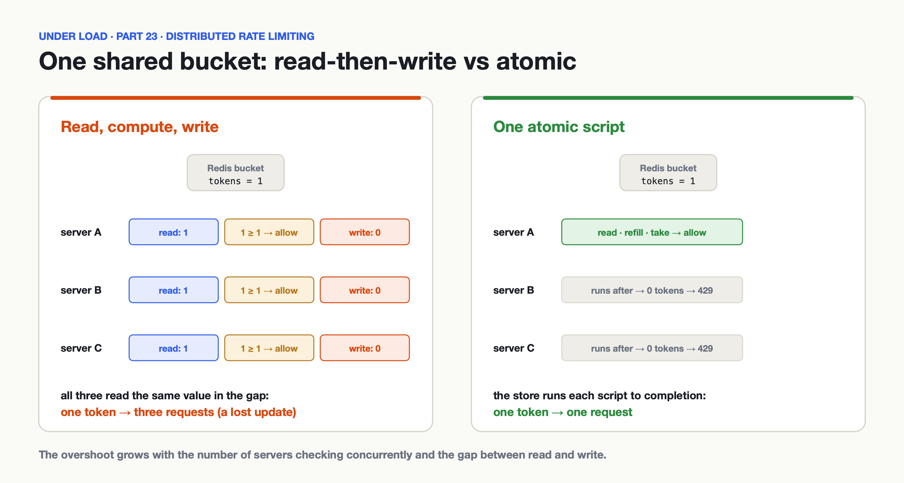
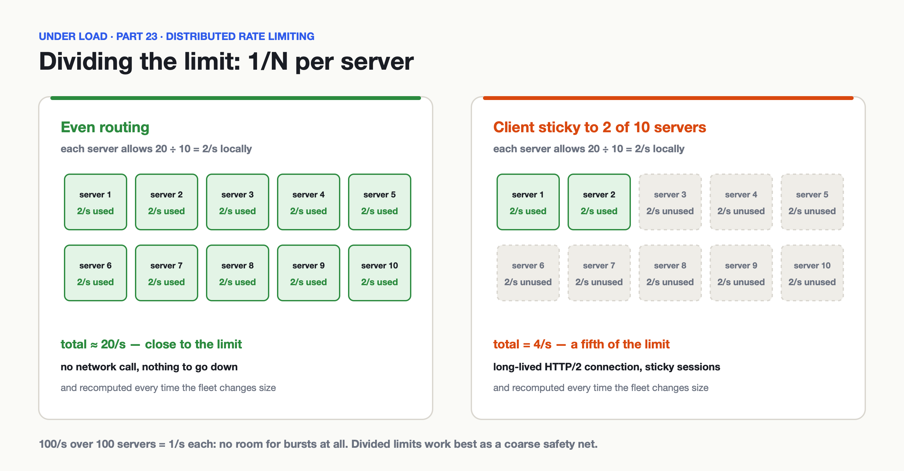
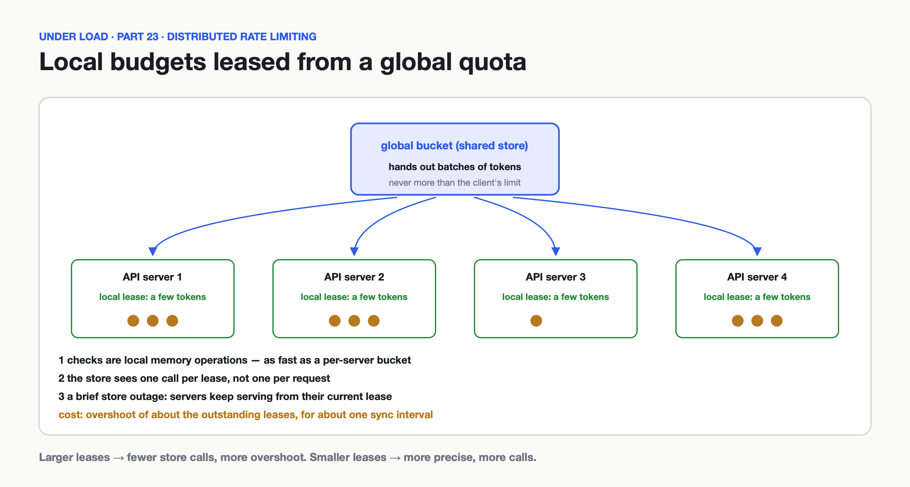
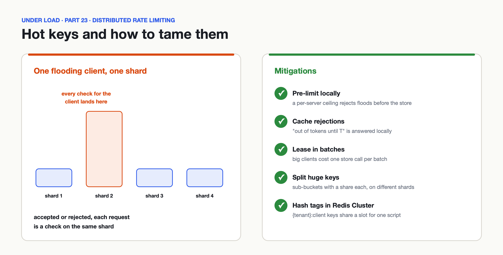
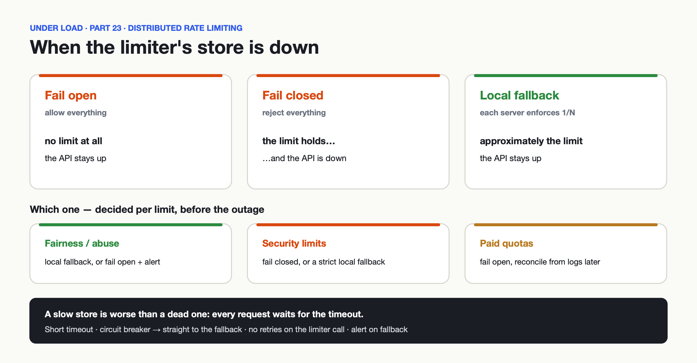
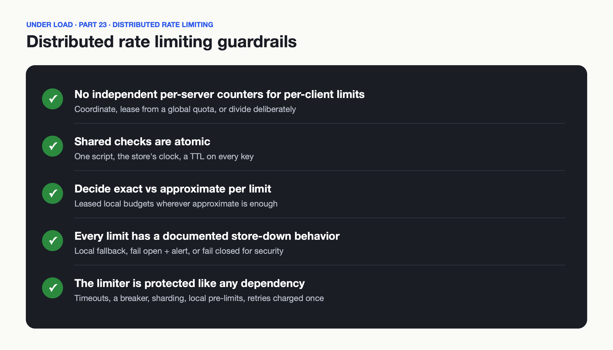

# Distributed Rate Limiting

### Distributed rate limiting: enforcing one limit across a fleet — local vs shared counters, why the check must be atomic, approximate limits, and what to do when the limiter's store is down.

*Under Load · Part 23 · Traffic & Load Control*





---

Part 22 settled on a token bucket for the public API: each API client may send **20 requests per second** on average, with a burst allowance. The first implementation kept each client's bucket in the API server's memory. It passed every test, because every test ran against one server.

In production, the API runs on **ten servers** behind a load balancer. A client sending 200 requests per second has its traffic spread across all ten — about 20 per server. Each server checks its own bucket, sees a client sending 20 per second, and lets everything through. The client gets **ten times** its documented limit. Nobody notices until one of Halcyon's integrations goes into a retry loop, hammers the search endpoint at the full 200 per second, and the search cluster falls over for everyone.

Each server did exactly what it was told. The fleet as a whole had no limit at all.

That's the core problem of **distributed rate limiting**: one logical limit, enforced by many independent servers — and sometimes by several regions. This article covers the options, from a shared counter in Redis to local budgets leased from a central quota, why the shared check has to be atomic, how to decide between an exact and an approximate limit, how to keep the limiter from becoming a hot spot, and the decision every team has to make in advance: what happens when the limiter's own store is down?

---

## Why local limits multiply

A rate limit has three parts: a **policy** (token bucket, sliding window and so on, from Part 22), a **key** that says whose traffic is counted together (an API key, a user, a tenant, an IP address, an endpoint, or a combination such as "tenant × endpoint"), and the **state** — the counter or bucket for each key.

When the state lives in each server's memory, each server enforces the policy on the share of the key's traffic that happens to reach it. With *N* servers and traffic spread evenly, a client can send *N* times the limit before any server rejects it. Three things make this worse than it sounds:

- **The effective limit changes with the fleet.** Autoscaling from ten servers to forty on a busy day quadruples every client's effective limit — at exactly the moment the limit is most needed.
- **It's invisible in testing.** One server in staging enforces the limit perfectly.
- **It fails in the dangerous direction.** The limit is most often hit by misbehaving clients, and those are the ones that now get through.

There are two families of fixes: **coordinate** the state (every server consults the same counter), or **divide** the limit (each server gets a share it can enforce alone). Real systems usually combine them.

---

## Option 1: one shared bucket, updated atomically

The straightforward fix keeps **one bucket per key in a shared store** — usually Redis, sometimes Memcached or a purpose-built rate-limit service — and every API server checks it on every request.

### The check must be atomic

The tempting implementation reads the bucket, computes the new value in the application, and writes it back:

```python
tokens, ts = redis.hmget(key, "tokens", "ts")      # 1. read
tokens = refill(tokens, ts, now)                    # 2. compute in the app
if tokens >= 1:
    redis.hset(key, mapping={"tokens": tokens - 1, "ts": now})   # 3. write
    allow()
```

Between step 1 and step 3, other servers are doing the same thing. If ten servers read the bucket at the same moment and all see one token left, all ten allow their request and all ten write back "zero tokens." Ten requests got through on one token. The more concurrent servers and the longer the gap between read and write — a network hop, a garbage-collection pause — the more requests slip through. Under a heavy burst from one client, the overshoot can approach the number of servers checking concurrently.



This is the **lost update** from Part 2, in a rate limiter. The fix is to make read-compute-write a single atomic operation in the store. In Redis, that means a **Lua script**: Redis runs each script to completion without interleaving any other command, so no other server can read the bucket halfway through an update.

```lua
-- KEYS[1] = bucket key; ARGV = rate (tokens/s), capacity, cost
local rate, cap, cost = tonumber(ARGV[1]), tonumber(ARGV[2]), tonumber(ARGV[3])
local t = redis.call('TIME')                                  -- the store's clock, not the caller's
local now = tonumber(t[1]) + tonumber(t[2]) / 1e6
local b = redis.call('HMGET', KEYS[1], 'tokens', 'ts')
local tokens = tonumber(b[1]) or cap
local ts = tonumber(b[2]) or now
tokens = math.min(cap, tokens + math.max(0, now - ts) * rate)
local allowed = 0
if tokens >= cost then tokens = tokens - cost; allowed = 1 end
redis.call('HSET', KEYS[1], 'tokens', tokens, 'ts', now)
redis.call('EXPIRE', KEYS[1], math.ceil(cap / rate) * 2)      -- idle buckets disappear
return { allowed, tokens }
```

A few details in that script matter:

- **The store's clock.** If each API server passes its own timestamp, servers whose clocks disagree (Part 38) refill the bucket inconsistently — a server whose clock runs ahead refills it early. Reading the time inside the script gives every check the same clock. Since Redis 5 defaults to effects replication (and Redis 7 dropped verbatim script replication), calling `TIME` inside a mutating script is allowed: replicas receive the resulting writes, not the script.
- **A TTL on every key.** Without an expiry, every client that ever made a request leaves a bucket behind forever. With one, a bucket for a quiet client disappears, and its next request starts from a full bucket — which is exactly what an idle client is entitled to.
- **Load the script once**, with `SCRIPT LOAD`, and call it by its hash with `EVALSHA`, so each request sends a short identifier rather than the whole script.

Modules exist that implement rate-limiting algorithms as single atomic commands (for example, `redis-cell` implements the GCRA variant from Part 22 via `CL.THROTTLE`), which avoids maintaining the script — though as of late 2025 the module is in best-effort maintenance, so many teams keep a short Lua script they own.

Fixed-window counters need the same care. The common `INCR` followed by `EXPIRE` is two commands: if the server crashes between them, the key never expires and the client is locked out permanently. Doing both in one script — or setting the expiry atomically when the key is created — avoids it. Redis 8.8 goes further for window counters with a native **`INCREX`** command: one atomic increment with an upper bound (`UBOUND`), optional saturate, and `ENX` so the window's TTL is set only when the key is created — the fixed-window `INCR`+`EXPIRE` race, without a script. Token buckets and GCRA still need a script or a module; `INCREX` covers the window-counter family.

### Answering with a 429

When the check fails, the API returns `429 Too Many Requests` with `Retry-After`, computed from the bucket state the script returns: with zero tokens and a refill rate of 20 per second, the next token arrives in 50 ms. Returning the remaining budget in headers lets well-behaved clients pace themselves.

### What the shared store costs

- **Latency on every request.** A round trip to an in-region Redis typically costs well under a millisecond to a couple of milliseconds. For an API whose requests take 50 ms, that's noise; for one that answers in 2 ms, it's a large share.
- **A dependency on every request.** If every request needs the store, the store's availability caps the API's. That's the store-down decision, below.
- **A throughput ceiling.** One Redis instance can handle a very large number of simple scripts per second, but an API with enough traffic eventually needs several, sharded by key.
- **Connection management.** Hundreds of API servers each holding connections to the limiter store can exhaust its connection limit; pooling (Part 7) applies here too.

---

## Option 2: divide the limit

The opposite approach avoids the shared store entirely: give each of *N* servers **1/N of the limit** and let each enforce its share locally. With ten servers and a limit of 20 per second, each server allows the client 2 per second.



The check is a local memory operation: no network call, no dependency, nothing to go down. But the arithmetic only works if the client's traffic is **spread evenly** across servers.

- With **even** round-robin routing, each server sees about 2 per second from the client, and the total is close to 20. Good.
- When the client's traffic lands on only **two** of the ten servers — because it holds one long-lived HTTP/2 connection, or a load balancer uses sticky sessions, or it simply has two keep-alive connections — those two servers allow 2 per second each, and the client gets **4 per second**: a fifth of its limit, while eight servers' worth of quota sits unused.

It also has to be recalculated whenever the fleet changes size, and the per-server share can become too small to be useful. Enforcing 100 requests per second across 100 servers means each server allows **one** request per second per client — and a token bucket with a capacity of one allows no bursts at all. A client making five quick calls to render a page gets four of them rejected.

Divided limits work best as a **coarse safety net**: generous per-server limits, with plenty of headroom, that stop the worst abuse without trying to be precise.

---

## Option 3: local budgets leased from a global quota

Most large systems end up between the two. Each server enforces the limit **locally**, from a **budget** of tokens it obtains from the shared store:



1. A server that sees traffic from a client asks the central store for a **lease** — a batch of that client's tokens, say a few, or a share sized to the traffic the server has been seeing.
2. It serves the client's requests from the lease, locally, with no network call.
3. When the lease runs low, or every few hundred milliseconds, it asks for more, and reports what it used.
4. The central store hands out leases from the client's global bucket, so the total across servers can't exceed the limit by more than the outstanding leases.

Checks are as fast as a local bucket; the store sees one call per lease instead of one per request; and if the store is briefly unreachable, servers keep serving from their current leases. The cost is **accuracy**: a client can exceed its limit by roughly the size of the outstanding leases, for about one sync interval, and a server can sit on unused tokens that another server needed. Sizing leases is a trade-off between store load (larger leases mean fewer calls) and precision (smaller leases mean less overshoot).

Variations of this pattern are common in API gateways and proxies. Envoy, for example, supports both a **local** rate-limit filter (a token bucket in each proxy) and calls to an external **global** rate-limit service, and the two can be combined so the local limit absorbs most of the traffic and the global one enforces the aggregate.

### Answering "100 requests per second across 100 servers"

Put together, a sound answer to that classic question looks like this:

- **Don't** divide it into 1 per second per server: no bursts, and wildly inaccurate with uneven routing.
- **If it must be exact** (billing, security): a shared atomic bucket per client in a sharded store, with short timeouts and a defined store-down behavior.
- **If approximate is enough** (fairness, abuse): local budgets leased from the global bucket, plus a generous per-server ceiling as a safety net.
- **Either way:** atomic checks, keys sharded by client, TTLs on buckets, and the limiter monitored like any other dependency.

---

## Exact or approximate?

The first design decision isn't the algorithm or the store. It's **how exact this limit needs to be** — and the answer differs per limit.

- **Exact**, or close to it: **security limits** (login attempts, password resets, one-time-code verification), where every extra attempt helps an attacker; **billing quotas** ("50,000 API calls per month on this plan"); and limits promised in a contract. Use a shared, atomic counter and accept its latency and dependency.
- **Approximate**: most **fairness and abuse protection**. Whether a client gets 20 or 23 requests per second for a moment doesn't matter; what matters is that it can't get 200. Use leased local budgets, or divided limits with headroom.

### Across regions

When the API runs in several regions, an exact global limit means a cross-region round trip on every request — tens of milliseconds or more, on every call, plus a dependency on the inter-region network. The usual compromise:

- Give each **region a share** of the global limit, enforced exactly within the region.
- **Rebalance the shares asynchronously** based on where each client's traffic is actually arriving.
- Accept that a client sending traffic to several regions at once can briefly exceed its global limit.

For billing quotas, usage can be counted per region and reconciled into a global total after the fact, rather than enforced globally in real time.

---

## Keys, shards and hot spots

A shared limiter at scale is a sharded key-value workload, with the usual problems.



**Shard by stable keys.** Each client's bucket should live on one shard, chosen by hashing the key (with consistent hashing, Part 36, so adding a shard moves only a fraction of keys). In Redis Cluster, a script can only touch keys in one hash slot; if a check needs several keys at once — per-client and per-tenant buckets, say — **hash tags** (the part of the key in braces, as in `rl:{tenant42}:client7`) put them in the same slot.

**Hot keys.** One huge client's bucket lives on one shard. When that client floods the API, every one of its requests — accepted or not — becomes a check on that one shard, which can saturate while the others sit idle. This is exactly when the limiter matters most. Mitigations:

- **Pre-limit locally.** A per-server local bucket at a generous ceiling rejects the flood before it reaches the store, so the shard sees at most the sum of the local ceilings.
- **Cache rejections.** Once a client is out of tokens until a known time, the server can reject its requests locally until then without asking the store.
- **Split very large keys** into sub-buckets, each with a share of the limit, spread across shards.
- **Use leases** for the largest clients, so the shard sees one call per batch.

**Rebalancing.** When shards are added or removed, keys move. A bucket that moves without its state starts full on the new shard — giving each affected client a fresh burst. For fairness limits that's usually acceptable; for security limits, the state should be migrated or the limit should briefly run stricter.

---

## Double counting and other subtle bugs

- **Retries consume tokens twice.** A client that retries a request after a timeout spends a second token for the same logical operation — and so does a server-side retry inside the API. If the first attempt actually succeeded, the client has been charged twice for one operation. For quotas that customers pay for, count by **idempotency key** (Part 14), so a retried operation is charged once.
- **Charging for failures.** If the API charges a token and then fails with a 500, the client loses budget for the API's own fault. Deciding whether server errors refund tokens is a policy choice worth making explicitly.
- **Window boundaries.** Fixed-window counters in a shared store have the same boundary problem as local ones (Part 22): a client can send the full limit at the end of one window and again at the start of the next. With synchronized clocks, every rejected client also retries at the same boundary.
- **Clock skew** across servers, if timestamps come from the callers rather than the store.
- **Retry storms after 429s.** Without jittered backoff (Part 15), rejected clients retry in lockstep, turning one rejection into a wave of checks against the same hot shard.

---

## When the limiter's store is down

With a shared store, the rate limiter is a dependency of every request. When the store is slow or unreachable, every server has to decide what to do — and that decision should be made in advance, per limit, not improvised during an outage.



The three options:

- **Fail open** — allow every request. The API stays up; clients have no limit until the store returns. A misbehaving client gets everything it asks for.
- **Fail closed** — reject every request. The limit holds perfectly — and the API is down, because its rate limiter is down. For most traffic, this turns a limiter outage into a full outage.
- **Degrade to local enforcement** — each server falls back to its 1/N share, enforced in memory, until the store returns. The limit becomes approximate (and inaccurate under uneven routing), but it still exists, and the API stays up.

Which is right depends on what the limit protects:

- **Fairness and abuse protection** for normal API traffic: **local fallback**, or fail open with an alert. Letting clients exceed their limits for a few minutes is usually far less harmful than an outage.
- **Security limits** — login attempts, password resets, one-time codes: **fail closed**, or a strict local fallback. Removing the limit is precisely what an attacker wants, and an attacker may be the one who knocked the store over.
- **Paid quotas:** usually **fail open** for availability, then reconcile usage from logs afterwards and bill or warn accordingly.

### Keep the limiter's own failure fast

The worst case isn't a store that's down; it's a store that's **slow**. If every check waits for a timeout before falling back, every API request pays that timeout. A 50 ms limiter timeout on an API that normally answers in 20 ms triples its latency during the incident.

So the limiter client needs the same protection as any other dependency:

- **A short timeout**, a small fraction of the API's latency budget.
- **A circuit breaker** (Part 16): after a few failed checks, stop asking the store for a short period and go straight to the fallback, probing occasionally to detect recovery. Checks during the outage then cost a local memory lookup instead of a timeout.
- **No retries** on the limiter call itself. A retry doubles the load on a struggling store, and the check is cheap to skip.
- **A metric and an alert** for every fallback activation, so "the limiter is in fallback mode" is visible.

---

## Guardrails that prevent the next one



1. **Never rely on independent per-server counters for a per-client limit.** Coordinate through a shared store, lease budgets from a global quota, or deliberately divide the limit by the fleet size.
2. **Shared checks are atomic** — a script or an atomic module, using the store's clock, with a TTL on every key — never read-then-write from the application.
3. **Decide exact vs approximate per limit**, and use leased local budgets wherever approximate is enough.
4. **Every limit has a documented store-down behavior**: local fallback, fail open with an alert, or fail closed for security limits.
5. **The limiter is protected like any dependency**: short timeouts, a circuit breaker, sharding by stable keys, local pre-limits against hot keys, and retries charged once per idempotency key.

---

## What to keep on the dashboard

- **Allowed and denied rates** per client and per limit, and how close the biggest clients run to their limits.
- **Effective vs configured limit**: sampled clients' actual accepted rate against their configured limit, to catch multiplication (too much admitted) or under-admission (uneven routing starving a divided limit).
- **Limiter latency** (P50 and P99) and **limiter errors**, measured from the API servers' side.
- **Store saturation**: CPU, operations per second, memory and connections on every limiter shard.
- **Hot keys**: the clients generating the most limiter traffic, per shard.
- **Fallback and breaker activations**: how often servers fell back to local enforcement or failed open, and for how long.
- **Lease utilization**, if leases are used: how many leased tokens go unused, and how often servers wait for a new lease.

---

## Recap

### Why can local rate limits on every API server violate a global quota?
Because each server enforces the limit independently on the share of traffic it sees, so a client spread across *N* servers can send up to *N* times the limit. The effective limit also grows whenever the fleet scales out, and the problem never shows up in single-server tests.

### How would you enforce 100 requests per second across 100 servers?
Not by giving each server 1 per second — that removes bursts and breaks under uneven routing. For an exact limit, keep one bucket per client in a sharded shared store, updated by an atomic script, with short timeouts and a defined store-down behavior. For an approximate one, lease local budgets from the global bucket, with a generous per-server ceiling as a safety net.

### Why must the shared check be atomic?
Because with separate read and write commands, concurrent servers read the same token count, each decides there's room, and each writes back its own result — a lost update that lets far more requests through than the limit. A Lua script or an atomic module performs read, refill and decrement as one operation.

### When would you accept an approximate distributed limit?
For fairness and abuse protection, where 20 versus 23 requests per second for a moment doesn't matter but 20 versus 200 does. Security limits, billing quotas and contractual limits justify the latency and dependency of an exact shared counter.

### What changes when the limit must be global across regions?
An exact global limit costs a cross-region round trip on every request. The usual compromise is per-region shares rebalanced asynchronously, accepting brief overshoot for clients active in several regions, and reconciling billing quotas after the fact.

### If Redis is down, should the API fail open or fail closed?
It depends on the limit. For normal fairness limits, fall back to local enforcement or fail open with an alert — failing closed would turn a limiter outage into an API outage. For security limits such as login attempts, fail closed or use a strict local fallback. In every case, short timeouts and a circuit breaker keep a slow store from adding latency to every request.

### How do you stop one hot tenant from overwhelming a limiter shard?
Pre-limit locally so floods are rejected before they reach the store, cache "out of tokens until T" decisions, lease budgets in batches for the largest clients, and split very large keys into sub-buckets across shards.

### What subtle bugs affect distributed limiters?
Retries consuming tokens twice for one logical operation, charging clients for the API's own failures, fixed-window boundaries admitting double bursts, clock skew between servers, `INCR`/`EXPIRE` races that leave keys without expiry, and synchronized retry storms after 429s.

### What should you monitor?
Allowed and denied rates per client, effective versus configured limits, limiter latency and errors, store saturation, hot keys, fallback and breaker activations, and lease utilization.

---

## Next

- **Lab (run + measured write-up):** [23-distributed-rate-limiting](https://github.com/b-basoglu/under-load/tree/main/23-distributed-rate-limiting)
- **Next:** [Backpressure](../24-backpressure/article.md) — The email worker reads from a queue faster than the email provider can send. The queue in its memory grows by 20,000 messages a minute.
