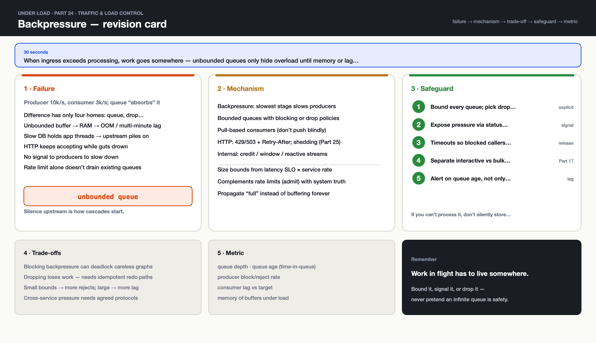
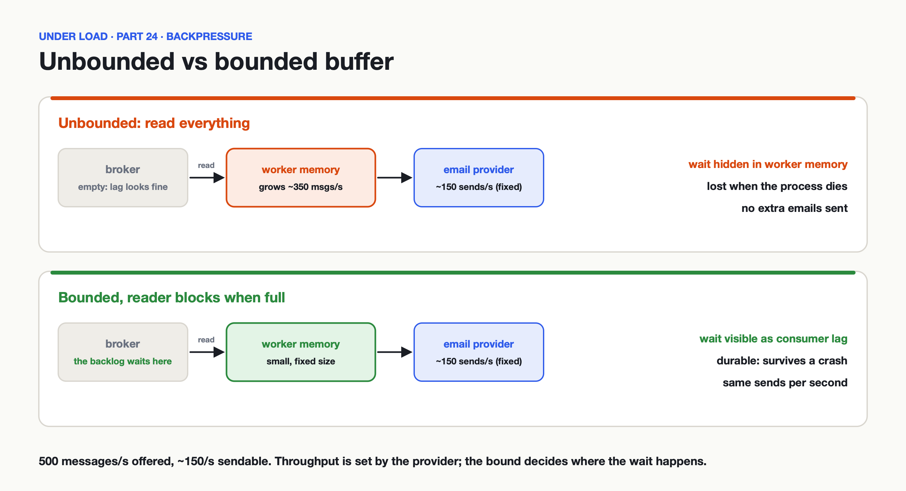
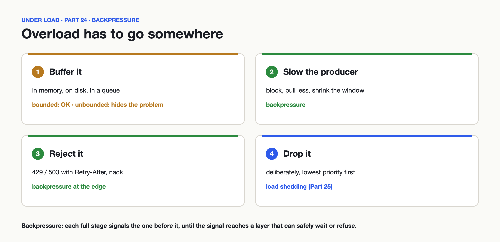
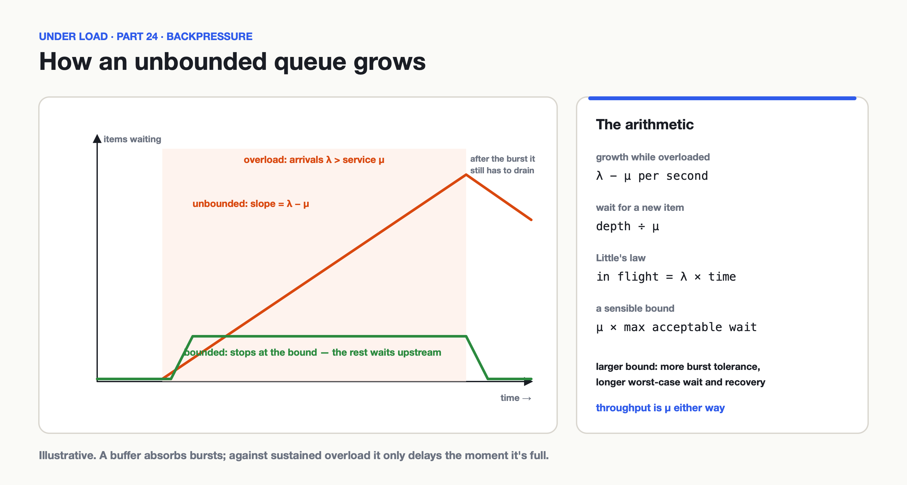
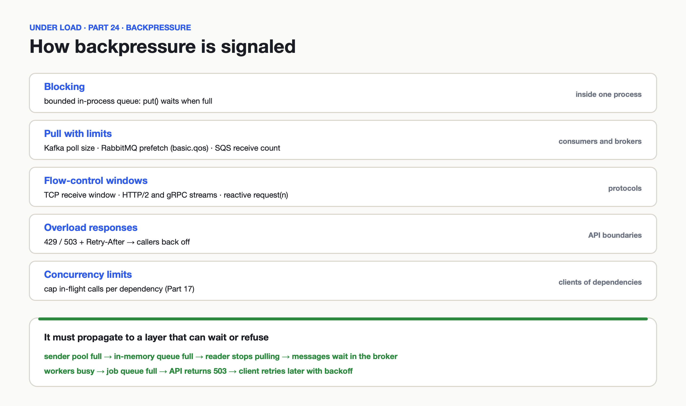
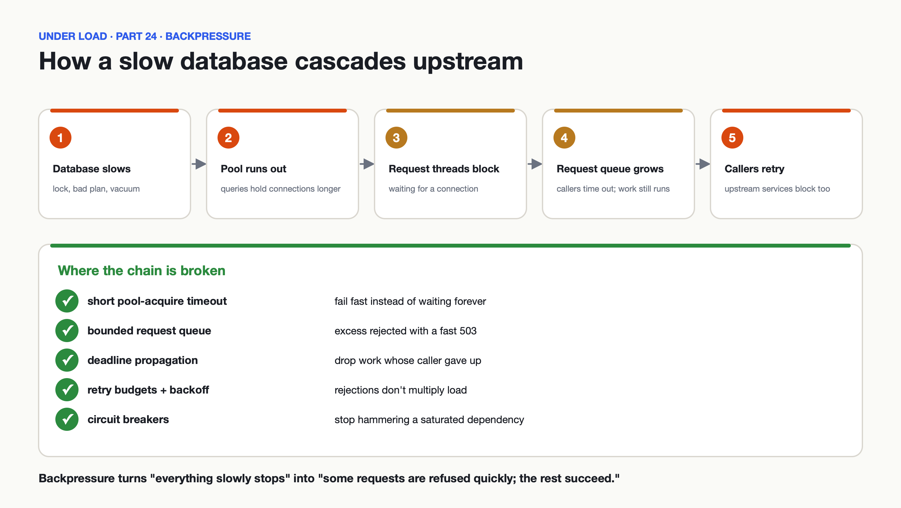
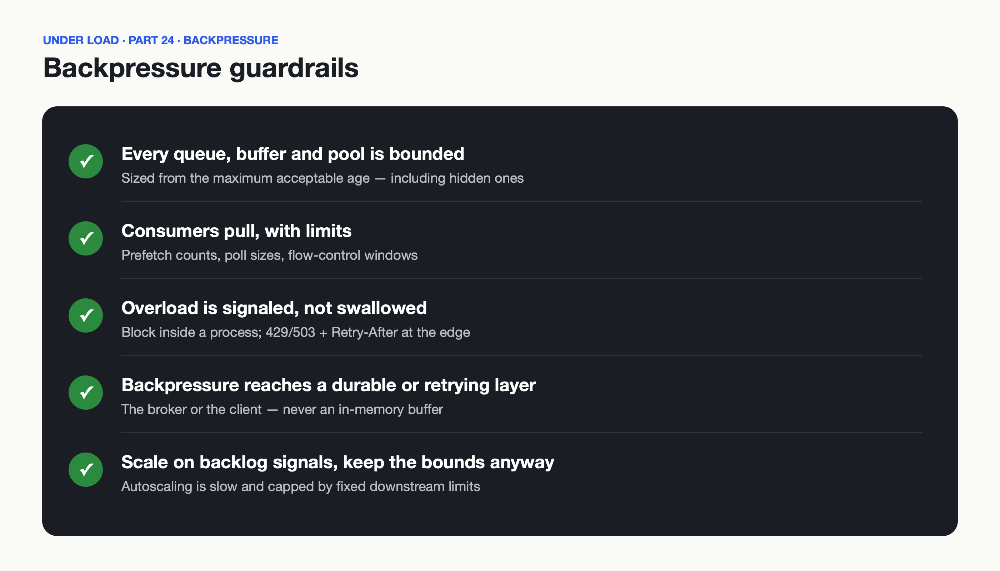

# Backpressure

### Backpressure: letting the slowest part of a system push back on everything upstream — why unbounded buffers only hide overload, and how bounded queues, pull-based consumers and overload signals contain it.

*Under Load · Part 24 · Traffic & Load Control*

---

The email worker has a simple job. It reads outgoing-email messages from the message broker and hands them to a pool of sender threads, which call the email provider's API. To keep the senders busy, the reader pulls messages as fast as the broker will give them and puts them on an **in-memory queue** in front of the senders.

On a normal day, that's fine: a few dozen emails a second, the queue nearly empty. Then Halcyon runs a bulk import of historical tickets, and a misconfigured rule sends a notification email for each one. The broker offers the worker about **500 messages a second**. The email provider accepts about **150 a second** from this account — a hard limit in the contract with the provider.

Nothing fails. No errors, no alerts. The in-memory queue simply grows by the difference — about **350 messages a second**, more than 20,000 a minute. The broker's dashboard looks perfect: the consumer is keeping up, there's no lag, every message is acknowledged. Meanwhile, the emails the senders are working on get older by the second, because each one is waiting behind everything the reader pulled in before it.

Twenty minutes later, the worker exceeds its memory limit and the container runtime kills it. Every message in that in-memory queue — hundreds of thousands of them, already acknowledged to the broker and therefore gone from it — disappears with the process.

The worker read faster than it could process, and nothing told it to slow down. The fix has a name: **backpressure** — the slowest part of a system pushing back on everything upstream, so excess work waits where it's safe instead of piling up where it's dangerous.

---

## Overload has to go somewhere

When work arrives faster than it can be processed, the difference doesn't vanish. It goes somewhere, and there are only four places it can go:

1. **Buffer it** — in memory, on disk, in a queue — and process it later.
2. **Slow down the producer** — make whoever is sending wait before sending more.
3. **Reject it** — tell the producer "not now," so it can try again later or go elsewhere.
4. **Drop it** — deliberately, by priority (Part 25 covers load shedding).

**Backpressure** is options 2 and 3 working *through* the system. Each stage that is full signals the stage before it to stop sending; that stage fills up in turn and signals the one before it; and the signal travels upstream until it reaches a place that can afford to wait — a durable broker that is designed to hold messages, a client that can retry later, a user who sees "please try again in a minute."

Option 1 without a limit is what the email worker did. A buffer is a fine tool for absorbing a short **burst** — arrivals briefly above capacity, then back below. It is useless against **sustained overload** — arrivals above capacity for longer than the buffer can hold. An unbounded buffer doesn't remove the overload; it **hides** it, in the worst possible place.

The goal of backpressure is **controlled degradation**: queues and latency stay bounded, and the system refuses or delays work it can't handle, rather than accepting everything and failing on all of it.

---

## The arithmetic of a growing queue

The behavior of any queue follows from two rates: the **arrival rate** λ (lambda — how fast work comes in) and the **service rate** μ (mu — how fast it is processed).

- If λ < μ, the queue drains. Bursts come and go.
- If λ > μ, the queue grows at λ − μ per second, **for as long as the overload lasts**. Nothing about the queue's size changes that; a larger buffer only delays the moment it's full.

Two more relationships make the cost visible:

- **Waiting time.** A new item joining a queue of depth *Q* in front of a service that processes μ items per second waits about *Q* / μ seconds. In the email worker, a queue of 21,000 messages in front of senders doing 150 a second means each new email waits more than two minutes — and the wait grows by more than two seconds for every second the overload continues.
- **Little's law.** For any stable system, the average number of items inside it equals the arrival rate times the average time each spends inside: *L* = λ × *W*. If items spend ten times longer waiting, there are ten times as many of them occupying memory, threads or connections at once.

That last point explains why overload turns into resource exhaustion. Latency and occupancy are the same quantity seen from two sides: everything that waits longer is also something that holds memory longer.

### Why the bound doesn't change throughput

A common objection to bounding a queue is that it "limits throughput." It doesn't. Throughput is set by the slowest stage — here, the email provider at 150 a second. Whether the queue in front of it holds 200 messages or 200,000, the provider still sends 150 a second. An unbounded buffer doesn't deliver a single email sooner; it only changes **where** the waiting happens and **what is lost** when something crashes.

With a bounded queue that blocks the reader when it's full, the email worker reads only as fast as it sends. The excess stays in the broker:

- **Durable** — it survives a worker crash, because it was never acknowledged.
- **Visible** — as **consumer lag**, the gap between what has been published and what has been consumed, which every broker reports and which can drive alerts and autoscaling.
- **Shareable** — a second worker started during the incident can take a share of it immediately. Messages hoarded in one worker's memory can't be redistributed.

The end-to-end delay of an email is about the same either way: if the provider is the bottleneck, every email waits its turn somewhere. Backpressure doesn't make the wait shorter. It moves it from a place where it's invisible and fragile to a place where it's visible and safe.

---

## Why an unbounded queue is dangerous

- **It hides the problem until it's a crisis.** Nothing fails and nothing alerts while memory fills. Then the process dies, and everything fails at once.
- **It hides the delay.** A message waiting behind 20,000 others in a worker's memory is minutes late, but no broker metric shows it: consumer lag looks healthy because the worker has already taken everything.
- **The work may be useless by the time it's done.** A "your ticket has a new reply" email delivered an hour late, or an API request processed after its caller timed out, consumes capacity and helps nobody. Under sustained overload, a large share of the work in an unbounded queue can be in this state.
- **Recovery takes longer.** After the burst, the system first has to work through a stale backlog before it can serve fresh work. A queue that holds an hour of work means an hour of degraded service after the cause is gone.
- **A crash loses everything in it.** Messages in process memory are gone when the process dies — and if they were acknowledged to the broker on receipt, they're gone for good.
- **It can trigger a crash loop.** A restarted worker reads from the broker as fast as before, fills its memory again, and dies again.

Unbounded queues also appear in places nobody thinks of as queues. In Java, `Executors.newFixedThreadPool` creates a pool backed by an **unbounded** work queue: submitting tasks faster than the threads complete them grows the queue without limit. HTTP client libraries often queue requests without bound when their connection pool is exhausted. Logging libraries buffer messages in memory when the log destination is slow. Every one of these is a place where overload can collect silently.

---

## Sizing a bound

Every queue, buffer and pool needs a bound. The question is what size.

The useful way to choose it is from the **maximum acceptable age** of the work, not from how much memory is available. If an email notification must go out within 30 seconds to be useful, and the senders handle 150 a second, the buffer in front of them should hold at most about 150 × 30 = 4,500 messages. A message that joins a longer queue will be late no matter what happens next, so there's no point accepting it into that queue.

> **bound ≈ service rate × maximum acceptable wait**

The trade-off is between **burst tolerance** and **worst-case latency**:

- A **larger** bound absorbs longer bursts without pushing back — useful when bursts are common and short.
- But it also allows a longer worst-case wait, and a longer recovery after sustained overload, because everything in it must be worked through.

For **in-memory** buffers inside a worker, the bound should usually be small — enough to keep the next stage busy, a few seconds of work at most — because the durable broker upstream is a much better place for a large backlog. For the **broker** itself, the bound is the retention or queue-length limit, and the maximum tolerable age becomes an alert: "the oldest message is older than five minutes."

Track **age, not just length**. A queue of 10,000 items is fine if they're processed in two seconds and terrible if they take two hours. The age of the oldest item is what users feel, and it's the number most brokers can report directly — SQS exposes `ApproximateAgeOfOldestMessage` for exactly this reason.

---

## How backpressure is signaled

Different layers push back in different ways, but each one is a version of "stop, or send less."

### Blocking

A bounded in-process queue makes `put()` wait when it's full, so the producing thread naturally slows to the consumer's pace. Go's buffered channels, Java's `ArrayBlockingQueue`, and Python's `queue.Queue(maxsize=…)` all work this way. Java's thread pools can be given a bounded queue and a **rejection policy**; `CallerRunsPolicy`, which makes the submitting thread run the task itself when the queue is full, is a simple form of backpressure.

Node.js streams make the same idea explicit: `write()` returns `false` when the stream's internal buffer is above its high-water mark, and a well-behaved producer waits for the `drain` event before writing more.

### Pull-based consumption with limits

Consumers ask for work when they're ready, instead of having it pushed at them.

- **Kafka** consumers poll; `max.poll.records` caps how many records one poll returns, and a consumer that falls behind can `pause()` partitions until it catches up.
- **RabbitMQ** consumers set a **prefetch** limit (`basic.qos`), so the broker never has more unacknowledged messages outstanding to a consumer than it can hold. With prefetch set, a slow consumer simply receives messages more slowly.
- **SQS** consumers receive only what they request, up to a small batch per call.

In each case, the **broker becomes the buffer** — which is what brokers are built for: durable storage, retention, visibility into lag, and the ability for many consumers to share a backlog.

Brokers also push back on **producers**. A Kafka producer's send buffer is bounded (`buffer.memory`), and `send()` blocks for up to `max.block.ms` when it's full. RabbitMQ blocks publishing connections when the broker hits its memory or disk alarm thresholds. A producer that ignores these signals — or wraps them in an unbounded buffer of its own — reintroduces the problem one level up.

### Flow-control windows

At the protocol level, the receiver advertises how much more it can accept:

- **TCP** has a receive window. A slow reader stops draining its socket buffer, the window shrinks, and when it reaches zero the sender stops sending.
- **HTTP/2** has per-stream and per-connection flow-control windows, updated with `WINDOW_UPDATE` frames; **gRPC** streaming builds on them, so a slow stream consumer slows its producer.
- **Reactive Streams** (implemented by RxJava, Project Reactor, Akka Streams and the Java `Flow` API) make it part of the programming model: a subscriber calls `request(n)` to say how many more items it's ready for, and the publisher may not send more.

### Overload responses at the edge

An HTTP service expresses backpressure to its callers by **refusing work it can't handle soon**, with enough information for the caller to back off:

- **`503 Service Unavailable`** when the service as a whole is overloaded, and **`429 Too Many Requests`** when a specific client is over its limit (Parts 22–23).
- **`Retry-After`** with a realistic delay, so callers don't retry immediately.
- **A fast rejection.** Refusing a request should cost microseconds, before any expensive work starts; a rejection that takes a full second of CPU is not backpressure.
- **For asynchronous APIs**, `202 Accepted` should only be returned if the work is actually going to be processed in time — accepting jobs into a backlog that will take hours to drain is the unbounded queue again, wearing an HTTP status code.

Callers must cooperate: bounded retries with exponential backoff and jitter (Part 15), and retry budgets, so an overload signal reduces load instead of multiplying it.

### Concurrency limits

Capping the number of in-flight requests to a dependency (Part 17) is backpressure on the calling side: when the cap is reached, new calls wait briefly in a bounded queue or fail fast. **Adaptive concurrency limits** go further, adjusting the cap from observed latency — Netflix's `concurrency-limits` library and Envoy's adaptive concurrency filter apply ideas from TCP congestion control to request concurrency, lowering the limit when latency rises and raising it when there's headroom.

---

## Backpressure must reach the edge

A single bounded queue doesn't help if the layer above it has an unbounded one. Overload just moves up a level and collects there. Backpressure works only when it **propagates**, hop by hop, all the way to a place that can safely hold or refuse work:

- sender pool full → in-memory queue full → reader stops pulling → messages wait in the broker;
- or: workers busy → API job queue full → API returns `503` with `Retry-After` → client backs off and retries later.

Every hop between the bottleneck and the edge needs a bound: thread pools, connection pools, in-memory queues, HTTP client request queues, the proxy or load balancer in front of the service. The one that's unbounded is where the next overload will collect.

### How a slow database becomes a cascading failure

The same chain explains one of the most common outages, and shows why bounds and timeouts matter at every hop:

1. The database slows down — a bad query plan, a lock, a vacuum, a noisy neighbor.
2. Each query holds a **connection** from the application's pool for longer. By Little's law, the number of connections in use rises in proportion. The pool runs out.
3. Request threads now wait for a connection. They hold their own memory and sockets while they wait; the server's **thread pool** fills up.
4. New requests queue in front of the thread pool — or in the load balancer — and wait. Their callers' **timeouts** expire, but the work is still queued and will still be done, uselessly, when it reaches the front.
5. Callers **retry**, adding more requests to the queue. Upstream services that call this one now hold *their* threads waiting for it. The slowdown spreads.

Each step can be stopped: a **short pool-acquisition timeout** so threads fail fast instead of waiting forever; a **bounded request queue** so excess requests are rejected with `503` rather than queued; **deadline propagation** so work whose caller has given up is dropped (Part 15); **bounded retries with budgets**; and **circuit breakers** (Part 16) so callers stop hammering a dependency that is already saturated. Backpressure turns "everything slowly stops working" into "some requests are refused quickly, and the rest succeed."

---

## Rejecting is sometimes the healthiest answer

Rejecting work feels like failure. Often it's the opposite.

- A request rejected in a millisecond lets the caller retry elsewhere, show an error, or fall back (Part 20). A request accepted and timed out after thirty seconds wasted thirty seconds of the caller's time and the server's resources, and still failed.
- Work accepted beyond capacity doesn't get done faster; it makes **all** work slower, including the work that would have succeeded.
- When the backlog is made of time-sensitive work, accepting it means doing it after it stopped mattering.

So every overload path should answer, in advance: **when this queue is full, do we block, reject, shed, or reduce intake?** The answer depends on the work:

- **Block** inside a process, between stages that should run at the same pace.
- **Reject** at API boundaries, so callers can decide what to do.
- **Shed** low-priority work deliberately when there isn't capacity for everything — which requires deciding what's low priority before the incident (Part 25).
- **Reduce intake** by consuming more slowly from a durable broker, letting the backlog wait there.

---

## Backpressure, rate limiting and autoscaling

These three are related, and solve different problems:

- **Rate limiting** (Parts 22–23) caps what each **client** may send, according to a policy, whether or not the system is busy. It's about fairness and contracts.
- **Backpressure** reacts to **actual capacity right now**: when the system can't keep up, it pushes back, regardless of who is sending. A rate limit set on a quiet day can't know that the database is slow today; backpressure does.
- **Admission control** sits between them: deciding at the edge whether to accept a request at all, based on current load and the request's priority.
- **Autoscaling** adds capacity — but with **delay** (new instances take tens of seconds to minutes to start and warm up) and **hard limits** (a database, a license, or a third-party provider's per-account quota doesn't grow with the number of workers).

Backpressure is what keeps the system healthy **while** autoscaling catches up and **where** it can't help. Autoscaling should be driven by **backlog signals** — consumer lag, queue age, in-flight requests — rather than CPU alone, because a worker waiting on a slow provider shows low CPU while its backlog grows.

### When to shed load instead of autoscaling

Autoscaling is the right response when capacity can actually grow and the delay is acceptable. It's the wrong one when:

- **The bottleneck is a fixed limit.** The email provider accepts 150 a second for this account. Ten more workers push harder on the same wall; the backlog should wait in the broker.
- **The overload is shorter than the scale-up time.** By the time new instances are ready, the spike is over, and they only add cost.
- **The work is time-sensitive** and the backlog would take too long to clear. Late work has no value; dropping the least important part deliberately is better than making all of it late.
- **Scaling one tier overloads the next.** More API servers mean more database connections; more consumers mean more load on whatever they call.

In those cases, the right move is to drop work deliberately, lowest priority first — load shedding, the subject of Part 25.

---

## Guardrails that prevent the next one

1. **Every queue, buffer and pool is bounded**, sized from the maximum acceptable age of its work, not from available memory — including the hidden ones in thread pools, HTTP clients and loggers.
2. **Consumers pull, with limits:** prefetch counts, poll sizes, flow-control windows. Large backlogs wait in the durable broker, not in worker memory.
3. **Overload is signaled, not swallowed:** blocking inside a process, fast `429`/`503` with `Retry-After` at the edge, and bounded retries with backoff on the calling side.
4. **Backpressure propagates to a durable or retrying layer** — the broker or the client — with timeouts and bounds at every hop in between.
5. **Autoscaling is driven by backlog signals**, and the bounds stay in place anyway, because scaling is slow and fixed limits don't scale.

---

## What to keep on the dashboard

- **Queue depth and age of the oldest item**, for every queue and in-memory buffer. Age is the one users feel, and the one to alert on.
- **Arrival rate vs service rate** per stage. When arrivals exceed service for longer than a burst, depth must grow somewhere — make sure it's in the right place.
- **Consumer lag** in the broker — Kafka consumer-group lag, SQS `ApproximateAgeOfOldestMessage`, RabbitMQ queue depth and unacknowledged counts.
- **Saturation** of the pools behind each queue: sender threads, connections, in-flight requests against their limits.
- **Rejections and `429`/`503` rates**, with the reason, and the rate of retries they trigger.
- **Processing latency vs time in queue**, measured separately: a rise in the second with a flat first means overload, not a slow dependency.
- **Memory of workers that buffer**, as a last line of defense.

---

## Recap

### What is backpressure?
A slower part of a system signaling upstream producers to slow down or stop, so excess work waits somewhere safe — a durable broker, a retrying client — instead of piling up in memory. It turns overload into bounded queues and bounded latency: controlled degradation instead of collapse.

### Why is an unbounded queue dangerous?
Under sustained overload it grows at arrival rate minus service rate, without limit. It hides the problem until memory runs out, hides the delay from broker metrics, fills with work that will be useless by the time it's processed, slows recovery, loses everything on a crash, and can cause crash loops. It never increases throughput, which is set by the slowest stage.

### How do you size a bound?
From the maximum acceptable age of the work: bound ≈ service rate × maximum acceptable wait. Larger bounds tolerate longer bursts but increase worst-case latency and recovery time. Keep in-memory buffers small and let large backlogs wait in a durable broker, and alert on the age of the oldest item, not just the length.

### How should an HTTP service express backpressure to callers?
By rejecting quickly what it can't handle soon: `503` with `Retry-After` when overloaded, `429` when a client is over its limit, before any expensive work starts — and by not returning `202 Accepted` for work it can't process in time. Callers cooperate with bounded retries, exponential backoff, jitter and retry budgets.

### How is backpressure signaled inside a system?
By blocking producers on bounded in-process queues, by pull-based consumption with prefetch or poll limits, by flow-control windows in TCP, HTTP/2, gRPC and reactive streams, by producer-side buffer limits in brokers, and by concurrency limits — fixed or adaptive — on calls to dependencies.

### How do backpressure and rate limiting relate?
Rate limiting caps what each client may send by policy, regardless of load. Backpressure reacts to actual capacity right now, regardless of who's sending. Most systems need both, plus admission control at the edge.

### A producer writes 10,000 events a second, consumers process 3,000. What tells you it's failing?
Arrival rate persistently above service rate, consumer lag growing steadily at about 7,000 a second, the age of the oldest unprocessed event rising, consumer pools saturated, and — if anything in between is unbounded — worker memory climbing. Rising age is the signal users will feel first.

### How can a slow database cause a cascading failure?
Slow queries hold connections longer, so the pool runs out; request threads block waiting for connections; the request queue grows; callers time out and retry, adding load; and upstream services block on this one. Short pool timeouts, bounded request queues with fast rejection, deadline propagation, retry budgets and circuit breakers break the chain.

### When should you shed load instead of autoscaling?
When the bottleneck is a fixed limit that more instances can't raise, when the spike is shorter than the time to scale, when the work is time-sensitive and a backlog would make it worthless, or when scaling one tier would overload the next. Then drop the least important work deliberately.

### What should you monitor?
Queue depth and oldest-item age everywhere, arrival versus service rate, consumer lag, pool saturation, rejection and overload-response rates, time in queue versus processing time, and memory of buffering workers.

---

## Next

- **Lab (run + measured write-up):** [24-backpressure](https://github.com/b-basoglu/under-load/tree/main/24-backpressure)
- **Next:** [Load Shedding](../25-load-shedding/article.md) — At 09:00 the API receives three times its capacity. Which requests should it refuse — and how does it decide fast enough?
