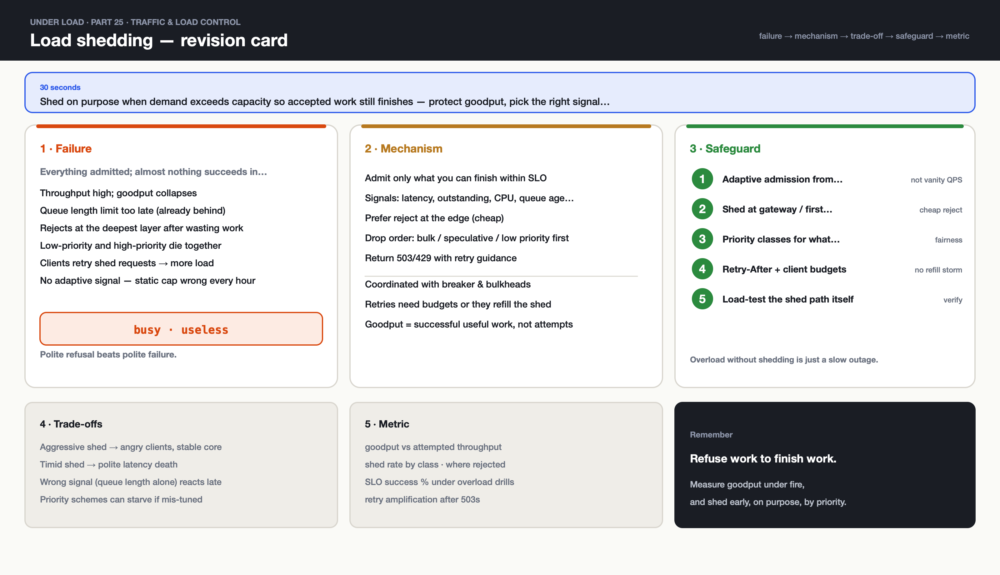
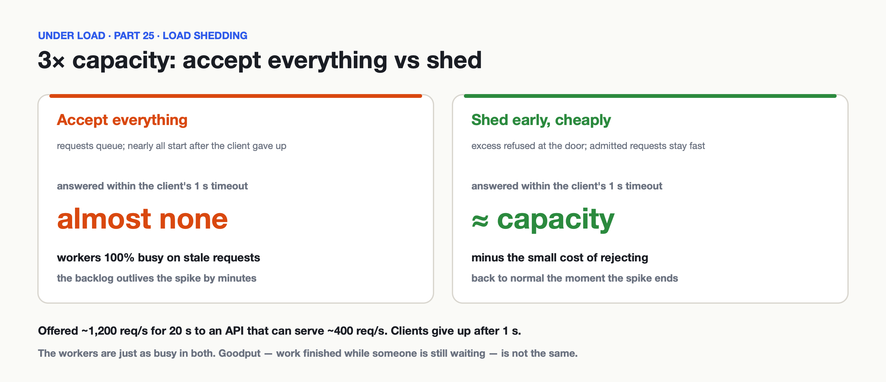
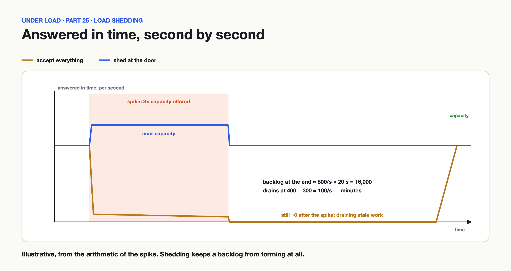
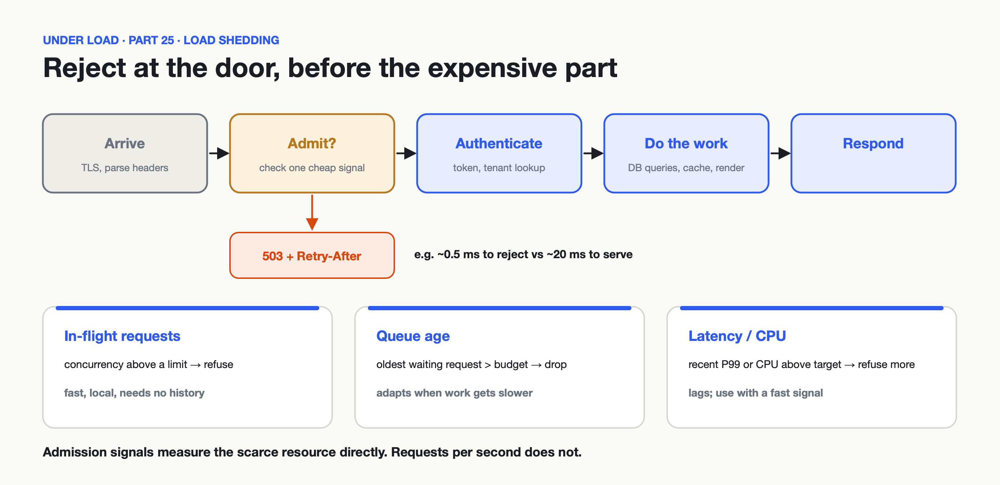
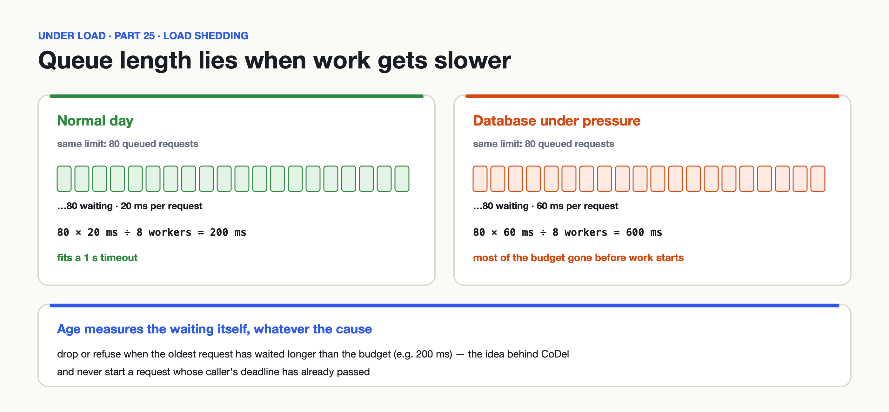
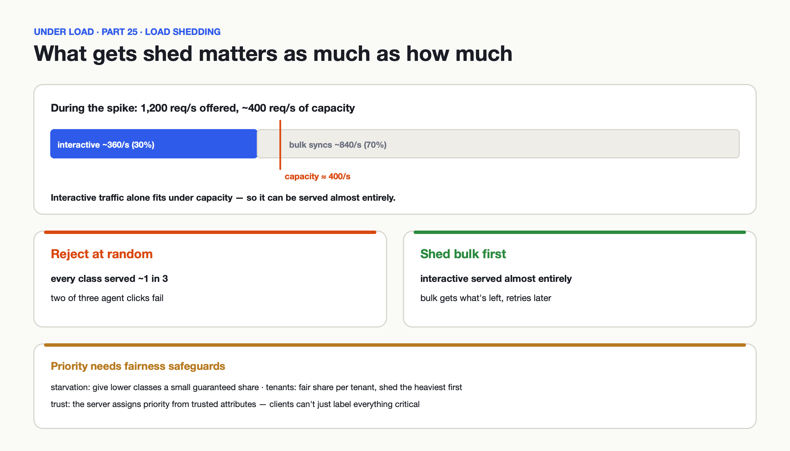
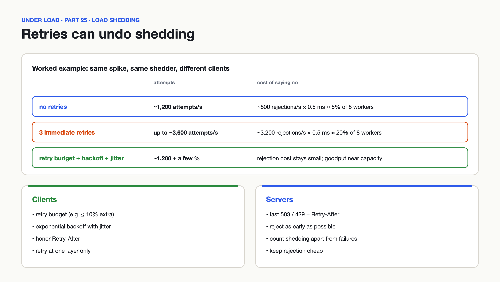
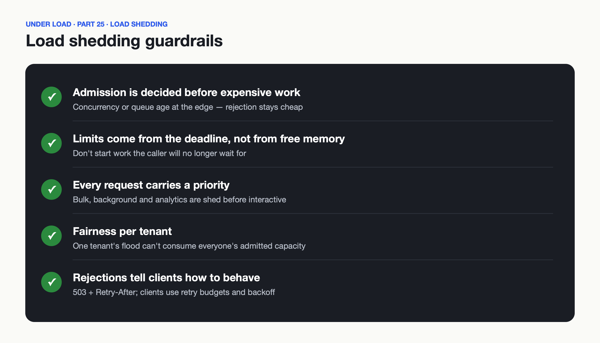

# Load Shedding

### Load shedding: refusing work on purpose when demand exceeds capacity — which signal to admit on, where to reject, what to drop first, and why clients that retry can undo all of it.

*Under Load · Part 25 · Traffic & Load Control*

---

Monday, 09:00. Thousands of Halcyon's support agents log in at the same moment and open their ticket queues. At the top of the hour, a dozen customer integrations also start their hourly syncs, pulling every ticket that changed overnight. For about twenty seconds, the ticket API receives around **1,200 requests a second**. It can serve about **400**.

There is no bug, no failed dependency, no bad deploy. There is just three times more work than the servers can do.

The API does what most servers do by default: it accepts every request and puts it in line. The line grows by about 800 requests every second. Within the first second of the spike, a newly arrived request is waiting more than a second before a worker even looks at it — and the agents' browsers, like most clients, give up after one second. The server keeps working through the line anyway, carefully building responses that nobody is waiting for.

The workers are 100% busy for the whole spike. Almost none of what they produce arrives in time. And when the spike ends at 09:00:20, nothing improves: the line still holds thousands of requests whose callers left long ago, and every new request joins the back of it. For minutes after the traffic returned to normal, the API answers almost nothing in time.

The same API with one change — **refuse the requests it can't serve in time, immediately and cheaply** — serves close to its full capacity throughout the spike and is back to normal the moment the spike ends. That change is **load shedding**. This article explains why it works, which signal to base it on, where to reject, what to drop first, and how retrying clients can undo it.

---

## What load shedding is

**Load shedding** means deliberately rejecting or degrading some work when demand exceeds capacity, so the work that is accepted finishes in time.

It sounds like giving up. It's the opposite. When a system receives more work than it can do, it **will** fail some of it — the only choice is which requests fail and how. Without shedding, it fails them slowly and indiscriminately: every request waits, most time out, and the work spent on them is wasted. With shedding, it fails a chosen subset quickly and cheaply, and serves the rest well.

Two terms make this precise:

- **Throughput** is how many requests a server completes per second.
- **Goodput** is how many it completes **usefully** — within the time the caller is still waiting. A response delivered after the client gave up counts toward throughput but not toward goodput.

The overloaded ticket API had full throughput and almost no goodput. Load shedding gives up a little throughput — the cost of rejecting — to recover nearly all of the goodput.

### How it relates to the other tools

- **Rate limiting** (Parts 22–23) caps each **client** by policy — 20 requests a second per API key — whether the server is busy or not. It enforces quotas and fairness; it doesn't know the server's current state.
- **Backpressure** (Part 24) asks producers to slow down, so work waits somewhere safe, such as a durable broker. It works when the producer can wait.
- **Load shedding** refuses work based on the server's **actual state right now**: when it can't keep up, it rejects the excess, whoever sent it. It's the tool for when waiting isn't an option — because the caller won't wait.

All three are usually needed together, alongside bounded queues, timeouts, retry budgets and circuit breakers.

---

## Why accepting everything collapses

It's worth walking through the arithmetic of the 09:00 spike, because it shows exactly why "accept everything" fails so badly — and why it's the default behavior of most servers.

The API can complete about 400 requests a second. During the spike, 1,200 arrive each second, so the queue grows by about **800 a second**. A request that joins a queue of depth *Q* waits about *Q* ÷ 400 seconds before it starts. Once the queue holds 400 requests — half a second into the spike — every new arrival waits a full second, and its client has already given up by the time it starts.

From that point on, the workers spend all their time on requests whose callers are gone. Goodput drops to nearly zero, while CPU, threads and database connections stay fully used.

When the spike ends, the queue holds roughly 800 × 20 = **16,000** stale requests. Arrivals fall back to about 300 a second, so the queue drains at only 400 − 300 = 100 a second: it takes well over two minutes to clear. With a first-in, first-out queue, every new request waits behind the stale ones for that whole time. A twenty-second spike becomes a multi-minute outage.

Three things went wrong:

1. **The server accepted work it could not finish in time.** Once the wait exceeded the clients' timeout, every accepted request was wasted.
2. **Nothing removed abandoned work.** Requests whose clients had given up were still processed.
3. **The backlog outlived the cause.** The queue's size, not the traffic, determined how long the outage lasted.

Load shedding fixes all three: refuse what can't be served in time, drop what has already waited too long, and never let a backlog build that outlasts the spike.

### Why shedding improves successful throughput

With shedding, the server admits roughly what it can serve — about 400 a second — and rejects the rest at the door. Admitted requests wait only briefly, so nearly all of them finish in time. Goodput is close to capacity, minus the cost of rejecting.

That cost matters. Rejecting a request still means accepting the connection, parsing it, making a decision and sending an error back. Suppose a rejection costs half a millisecond of worker time and real work costs twenty. Rejecting 800 requests a second costs 800 × 0.5 ms = 0.4 worker-seconds every second — out of eight workers, about 5% of capacity. So the shedding API still serves around 380 useful requests a second instead of nearly none. If rejecting were as expensive as serving, shedding would save nothing — which is why *where* the rejection happens matters so much.

---

## Admission control: deciding fast, on the right signal

The part of a server that decides whether to accept a request is called **admission control**. Two decisions define it: **where** in the request path it runs, and **what signal** it decides on. Before either, it helps to name the **scarce resource** — the thing that actually runs out first under load:

- worker threads or **concurrency** (how many requests can be in progress at once),
- **CPU**,
- **database connections** from a pool (Part 7),
- **queue capacity** or memory,
- a **downstream quota**, such as a third-party API's rate limit.

Admission control should protect that resource directly.

### Reject before the expensive part

A rejection must be **much cheaper** than serving the request. So admission belongs at the very start of the request path: after the connection is accepted and the headers are read, **before** authentication, tenant lookups, database queries or rendering.

The same logic applies across layers. A load balancer or reverse proxy in front of the service can shed even more cheaply than the service itself; a client-side throttle can avoid sending the request at all. A request that will be rejected should be rejected at the first layer that knows enough to do it.

The response should be appropriate to the API:

- **HTTP:** `503 Service Unavailable` with a `Retry-After` header when the server is overloaded; `429 Too Many Requests` when the reason is a per-client limit.
- **gRPC:** the `RESOURCE_EXHAUSTED` or `UNAVAILABLE` status codes, which client libraries treat as retryable with backoff.
- **Message consumers:** stop pulling, or negatively acknowledge so the broker redelivers later (Part 24).

### Admit on a signal that measures the scarce resource

The question admission answers is "can this request be served in time?" Requests per second can't answer it: 400 a second is comfortable when each request is quick and a disaster when each one is slow. Better signals:

- **Concurrency (in-flight requests).** How many requests are being worked on right now. If the server serves 8 at a time well, a ninth waits. A limit on in-flight requests, plus a short bounded queue, is the simplest and fastest signal: local, instant, no history needed.
- **Queue age.** How long the oldest waiting request has been waiting. This is what the client feels. If it's above the budget — say 200 ms for a client with a 1-second timeout — new work won't finish in time.
- **Latency.** Recent P99 latency of admitted requests above a target. It reflects reality but **lags**: it's computed over the last few seconds, so on its own it reacts after the damage is done.
- **Saturation** — CPU, pool usage, memory. Useful for tuning, also lagging, and not always the resource that runs out.

The usual design combines a **fast** signal (concurrency or queue age) that makes each admission decision with a **slow** signal (latency, CPU) that tunes the limit.

### Adaptive limits

The right concurrency limit changes every time the code, the hardware, the traffic mix or a dependency's speed changes. **Adaptive concurrency limits** find it continuously: increase the limit while latency stays low, and cut it when latency rises — the same idea TCP congestion control uses to find a sending rate. Netflix's open-source `concurrency-limits` library and Envoy's adaptive concurrency filter both work this way, measuring the latency of requests and adjusting how many may be in flight.

Clients can adapt too. Google's SRE book describes **client-side adaptive throttling**: each client tracks how many requests it sent and how many the backend accepted over the last couple of minutes, and once requests start to exceed a multiple of accepts, it rejects a growing share locally, without sending them. A backend that is rejecting most traffic stops receiving most of it.

---

## Queue length is a misleading limit

A limit on **how many** requests may wait looks like a limit on how long they wait. It isn't. The waiting time is the number of requests ahead multiplied by how long each takes, divided by the number of workers.

With 8 workers and 20 ms per request, a queue of 80 requests means about 80 × 20 ÷ 8 = 200 ms of waiting. If the database slows down under pressure and each request now takes 60 ms, the same 80 requests mean **600 ms** of waiting — most of a 1-second budget gone before work even starts. A length limit tuned on a good day is three times too generous on a bad one, and the bad day is exactly when it's needed.

**Queue age** measures the waiting itself, whatever its cause. The networking world arrived at the same conclusion: **CoDel** ("controlled delay"), an algorithm for router queues published by Kathleen Nichols and Van Jacobson, watches how long packets sit in the queue rather than how many there are, and starts dropping when that time stays above a target. Facebook described applying the same idea to server request queues, in combination with adaptive LIFO.

### Don't start work nobody is waiting for

A request that has already waited longer than its client's timeout should never start. Checking its age when a worker picks it up — and dropping it if it's too old — is cheap and saves all the work it would have cost.

It's even better when the client sends its **deadline** with the request. gRPC propagates deadlines automatically; HTTP services can carry one in a header. The server then knows exactly when the work becomes worthless, can drop it the moment that time passes, and can give each downstream call only the time that remains (Part 15).

### LIFO under overload

Normally, a queue serves requests in arrival order (**FIFO**, first in, first out), which is fair. Under overload, FIFO serves the oldest requests first — the ones most likely to have been abandoned. Serving the **newest** first (**LIFO**, last in, first out) during overload gives priority to requests whose clients are most likely still waiting, while the oldest ones age out and are dropped. Facebook's "adaptive LIFO" switches between the two: FIFO when the queue is short, LIFO when it's building up.

---

## What to drop first

Not all requests are equally important. An agent opening a ticket while a customer waits on the phone matters more than an integration syncing changes it could just as well sync a minute later. A shedder that treats them the same rejects both at the same rate.

In the 09:00 spike, suppose about 30% of traffic is **interactive** — agents loading and answering tickets — and 70% is **bulk** — integration syncs. Interactive traffic alone is about 0.3 × 1,200 = 360 requests a second: less than the API's capacity of 400. A shedder that rejects at random serves about a third of everyone's requests, so two out of three agents' clicks fail. A shedder that rejects **bulk first** can serve essentially every interactive request and give the bulk syncs whatever is left — and the syncs, being background jobs, can simply retry later.

To make this work:

- **Every request carries a priority** the shedder can read cheaply — from the route, the client type, the API key's plan, or a header set by a trusted caller. Google's SRE book describes a small set of criticality levels attached to every request and propagated to downstream calls, so a backend sheds the least critical work first no matter which service sent it.
- **Keep the levels few**, for example:
  1. **Critical** — what users are waiting on: loading a ticket, sending a reply, logging in.
  2. **Important** — user-visible but tolerant: search, dashboards.
  3. **Deferrable** — bulk syncs, exports, analytics, prefetching, background refreshes.
- **Shed from the bottom up**: deferrable work is rejected when the queue is partly full, important work when it's nearly full, critical work only when there's no other choice.
- **Consider cost, not just priority.** One export that runs for ten seconds costs as much as hundreds of ticket loads. Expensive requests are good candidates for early shedding, or for a separate, smaller pool (Part 17).
- **Use deadlines.** A request with 50 ms left on its deadline has less chance of succeeding than one with a second left; under pressure, prefer the one that can still succeed.

### Priority needs fairness safeguards

Priority alone creates two new problems.

**Starvation.** If critical traffic alone exceeds capacity, deferrable work is shed **forever**, and some of it — data syncs, billing exports — eventually matters. A small guaranteed share for lower classes, or limits on how long a class can be fully shed, prevents it.

**One tenant's flood.** If one customer's integration sends most of the traffic, even a priority-aware shedder admits mostly that customer's requests, and every other tenant's share shrinks. **Tenant-fair shedding** gives each tenant a fair share of the admitted capacity — for example, a concurrency limit per tenant, a queue per tenant served round-robin, or rejecting first from the tenants currently using the most. The noisy tenant is the one that gets shed, not everyone around it. This is the overload counterpart of per-tenant rate limits (Part 22) and bulkheads (Part 17).

Priority can also be abused: if clients can mark their own requests "critical," they will. Priorities should be assigned by the server from trusted attributes, or by internal callers whose labels are trusted.

### Degrade before rejecting

Before dropping a request entirely, there's often a cheaper way to serve it: a cached version, a page without the "related tickets" box, a search without spell correction (Part 20). Under overload, degrade first where it's possible, and reject what can't be degraded.

---

## Retries can undo it all

A rejected request rarely disappears. The client usually retries. If every rejected request comes back three more times, immediately, the server faces several times as many attempts as before — and every one of them costs a rejection.

Back to the 09:00 arithmetic. About 800 requests a second are rejected. If each is retried three times without delay, that's up to 2,400 extra attempts a second, almost all of which are rejected again. At half a millisecond per rejection, 3,200 rejections a second cost 1.6 worker-seconds every second — **a fifth** of the eight workers' capacity, spent saying "no." Goodput drops by about the same fraction. With even more aggressive clients, rejection alone can consume the whole server, and the system is back to collapse — only now it's busy refusing instead of busy serving stale requests.

The defense is on both sides:

**Clients:**

- **Retry budgets** cap retries at a fraction of normal traffic — for example, retries may add at most 10% on top of first attempts (Part 15).
- **Exponential backoff with jitter** spaces retries out with random delays, so they don't arrive together.
- **Honor `Retry-After`.** If the server says "wait two seconds," wait two seconds.
- **Retry at one layer only.** Retries at the browser, the gateway and the service multiply each other.

**Servers:**

- Return a **fast**, explicit overload response — `503` with `Retry-After`, or the protocol's equivalent. A rejection that takes as long as a timeout isn't a rejection.
- Make rejection as **cheap** as possible, as early as possible.
- **Count rejections separately from failures**, so dashboards and on-call engineers see "shedding" and not "the service is broken" — and so client libraries don't treat shedding as a reason to open a circuit breaker on a healthy service.

---

## Shedding too early, shedding too late

Both are real failures:

- **Too late** — the limits are too generous — and the server accepts work it can't finish in time. Latency rises, timeouts begin, retries arrive, goodput collapses: the "accept everything" result in a milder form. Little protection.
- **Too early** — the limits are too strict — and the server rejects requests it could have served, at 60% CPU, turning a healthy day into a stream of errors. Wasted capacity.

The cure for both: set limits from what the **client can tolerate** (its deadline) and what the server **actually sustains** under load (from load tests at realistic traffic mixes, including slow dependencies), then watch the rejection rate next to CPU and latency. Rejections at low CPU mean the limit is too tight; rising latency and late work with no rejections mean it's too loose. Adaptive limits do this tuning continuously, but they too need watching.

And **verify that shedding actually helps**: in load tests, compare goodput — requests completed within the deadline — with and without shedding, at two or three times expected peak. A shedder that doesn't raise goodput under overload is misconfigured or rejecting in the wrong place.

Finally, shedding is the last line of defense, not the capacity plan. If the API sheds every Monday at 09:00, it needs more capacity at that time, or the hourly syncs need to move off the top of the hour — ideally with jitter in their schedule. Shedding buys the time to fix that without an outage.

---

## Guardrails that prevent the next one

1. **Admission is decided before expensive work**, on a signal that measures the scarce resource — concurrency or queue age — so rejection stays cheap.
2. **Limits come from the client's deadline**, and no request starts after its caller has given up.
3. **Every request carries a trusted priority**; deferrable and expensive work is shed before interactive, with a safeguard against starvation.
4. **Fairness per tenant**, so one tenant's flood is shed instead of everyone's traffic.
5. **Rejections tell clients how to behave** — fast `503` or `429` with `Retry-After` — and clients use retry budgets, backoff and jitter.

---

## What to keep on the dashboard

- **Goodput** — requests answered within their deadline — next to raw throughput. During overload, the gap between them is the wasted work.
- **Admitted vs shed rate**, and the **shedding reason** (concurrency, queue age, priority, tenant), broken down by priority class and by tenant.
- **In-flight requests** and the current concurrency limit, especially if it's adaptive.
- **Queue depth and queue age**, the oldest waiting request's wait in particular.
- **Work finished after the client's deadline** — which should be close to zero when shedding works.
- **Retry and timeout rates** from clients, as a fraction of first attempts.
- **Saturation** (CPU, pools) and **P95/P99 latency of admitted requests**, to tell whether limits are too strict or too loose.

---

## Recap

### What is load shedding?
Deliberately rejecting or degrading some work when demand exceeds capacity, so the admitted work keeps bounded latency and finishes in time. An overloaded system fails requests either way; shedding fails a chosen few quickly instead of most of them slowly.

### Why can shedding improve successful throughput during overload?
Because without it, queues grow until every request waits longer than its caller's timeout, so the server spends its full capacity on responses nobody receives, and the backlog keeps it useless long after the spike. With shedding, it admits about what it can serve, those requests finish in time, and goodput stays near capacity minus the small cost of rejecting.

### What is the difference between throughput and goodput?
Throughput counts every completed request. Goodput counts only those completed while the caller was still waiting. Overload keeps throughput high while goodput collapses.

### Which signals would you use for adaptive admission control?
A fast, local signal that measures the scarce resource — in-flight requests, or the age of the oldest queued request — to make each decision, and slower signals such as admitted-request latency and CPU or pool saturation to tune the limit. Adaptive concurrency limits raise the limit while latency is low and cut it when latency rises; client-side throttling reduces what clients send when the backend rejects a lot.

### Why is queue length a misleading limit?
Because waiting time is queue length times per-request work divided by workers. When work gets slower, the same queue length means a much longer wait. Queue age measures the waiting directly, which is why algorithms like CoDel use it.

### Where should requests be rejected?
As early and cheaply as possible — at the proxy, or at the very start of the request path before authentication and database work — with an API-appropriate overload response such as `503` with `Retry-After`. If rejecting cost as much as serving, shedding would save nothing.

### What should be dropped first?
Use priority, fairness, request cost, deadlines and capacity rather than arbitrary rejection: deferrable and expensive work before interactive, requests unlikely to meet their deadline before those that can, and the heaviest tenants' excess before everyone else's — with safeguards so low-priority work isn't starved forever and clients can't simply label everything critical.

### How do retries defeat shedding?
Rejected requests come back, multiplying attempts, and every rejection costs CPU. Enough immediate retries consume a large share of capacity just in refusing them. Retry budgets, exponential backoff with jitter, honoring `Retry-After`, and retrying at one layer only prevent it.

### How is load shedding different from rate limiting and backpressure?
Rate limiting enforces a policy or quota per client, regardless of load. Backpressure asks producers to slow down so work waits somewhere safe. Load shedding rejects work that can't safely be accepted right now, based on the server's actual state, when the caller won't wait.

### How do you know the limits are right?
Rejections at low CPU mean shedding is too early; rising latency and late work without rejections mean it's too late. Set limits from client deadlines and load tests, verify in load tests that shedding raises goodput under overload, and watch rejections, saturation and admitted latency together.

### What should you monitor?
Goodput next to throughput, admitted versus shed rate with reasons, in-flight requests and the current limit, queue depth and age, work finished after the deadline, retry and timeout rates, saturation, and P95/P99 latency of admitted work.

---

## Next

- **Lab (run + measured write-up):** [25-load-shedding](https://github.com/b-basoglu/under-load/tree/main/25-load-shedding)
- **Next:** [Head-of-Line Blocking](../26-head-of-line-blocking/article.md) — One slow export at the front of a connection, a queue or a partition, and every fast request behind it waits. Where it hides, and how to get out from behind it.
