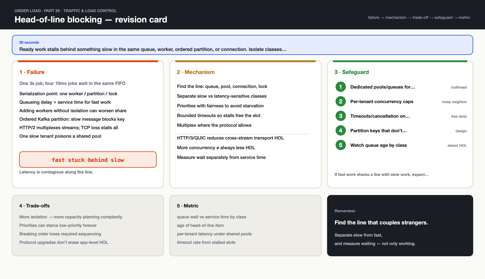
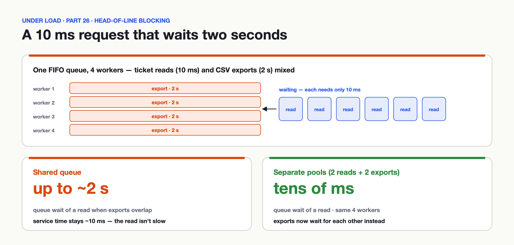
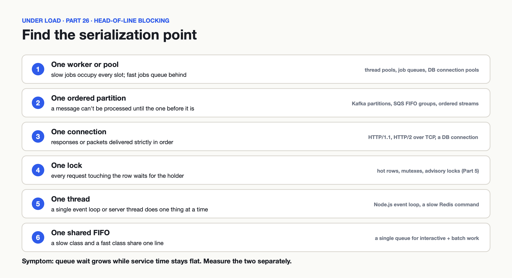
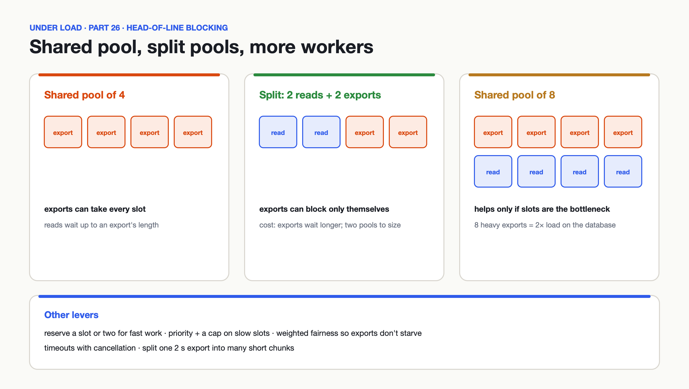
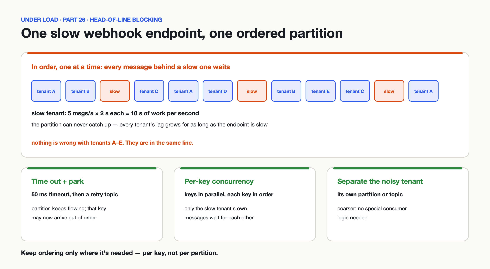
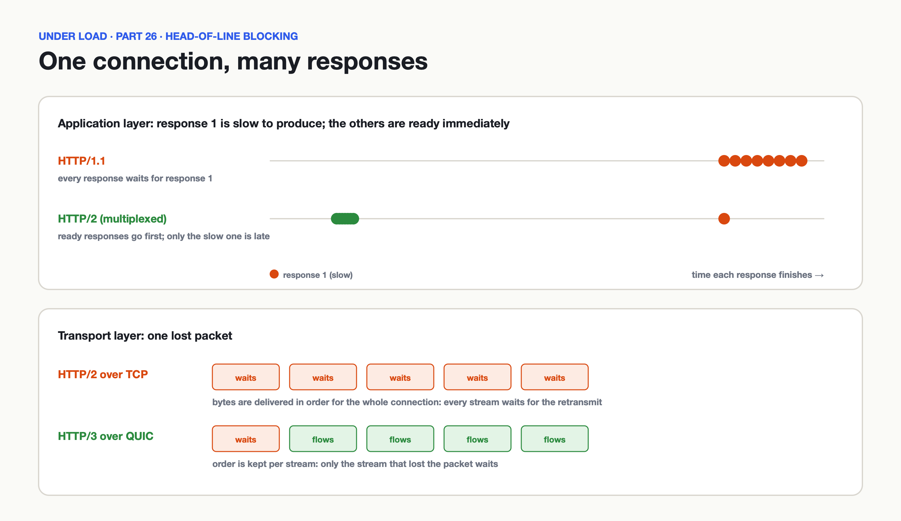
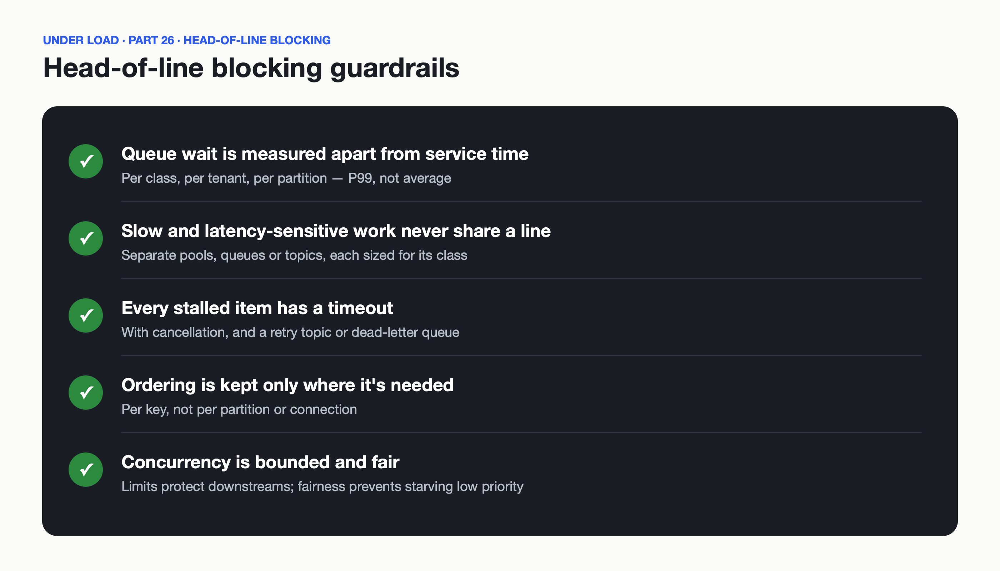

# Head-of-Line Blocking

### Head-of-line blocking: when ready work can't move because something slow is in front of it — in worker pools, ordered partitions and connections — and how to find the serialization point and get out from behind it.

*Under Load · Part 26 · Traffic & Load Control*

---

Opening a ticket takes about **10 milliseconds** of server work. Yet every few minutes, support agents see the ticket page spin for a couple of seconds. The traces are confusing: the database query is fast, the cache is fast, the rendering code is fast. The slow part of the trace is a span labeled "waiting for a worker."

The ticket service runs a small pool of four workers that take jobs from one queue, in arrival order. The same queue also carries a newer feature: **CSV exports**, where a team lead downloads every ticket for the month. An export takes about **two seconds**. Exports are rare — less than one a second — but now and then three or four arrive close together, which is exactly what happens when Halcyon's team leads all prepare their monthly reports on the same morning. For two seconds, all four workers are busy with exports, and every 10 ms ticket read that arrives in that window waits in line behind them.

The reads aren't slow. They're stuck behind something slow. That is **head-of-line blocking**, and it's one of the most common reasons a fast service has a terrible tail.

This article explains the mechanism, how to find the place where it happens — the **serialization point** — and how to get out from behind it in three settings where it keeps appearing: worker pools, ordered message partitions, and network connections.

---

## What head-of-line blocking is

**Head-of-line (HOL) blocking** happens when work that is ready to proceed can't make progress because something earlier in the same line is stalled. The "line" can be a queue, a set of workers, an ordered stream of messages, a network connection, or a lock. One slow item at the front inflates the latency of everything behind it — including work that has nothing to do with it.

The term comes from network switches. In a switch with a first-in, first-out queue at each input port, a packet at the head of the queue that is waiting for a busy output port blocks the packets behind it, even if their own output ports are free. A classic 1987 analysis by Karol, Hluchyj and Morgan showed that, under uniform random traffic, this alone caps such a switch's throughput at about 58.6% of its capacity (2 − √2) — the switch is mostly idle while packets wait. Switch designers solved it by giving each input a separate queue per output (**virtual output queues**). The same idea — separate lines for work that doesn't need to share one — is the core of most fixes below.

### Service time and queue wait

Two terms are central to everything that follows:

- **Service time** is how long the work itself takes once it starts.
- **Queue wait** (or **queueing delay**) is how long the work waited before it started.

What the user feels is the sum. Head-of-line blocking is the situation where **queue wait grows while service time stays flat**. If a dashboard shows only total latency, it looks like "the service got slow," and the investigation goes to the wrong places — the database, the cache, the code. If it shows the two separately, the problem is obvious: the work is fast, and it's waiting.

### The arithmetic of the export problem

With four workers, ticket reads arriving at 150 a second (10 ms each) need 1.5 workers' worth of time on average. Exports at about 0.75 a second (2 s each) need another 1.5. Average utilization is about 75% — the service isn't overloaded.

But averages don't describe the moments that matter. Exports arrive randomly, so sometimes four of them overlap. During that window, **zero** workers are available for reads, and a read that arrives waits until the first export finishes — up to two seconds. Those windows are rare, so the median read is fine; but they're frequent enough to dominate the P99. The tail of the reads is set entirely by the service time of a **different kind of work**.

---

## Find the serialization point

Every head-of-line problem has a **serialization point**: a place where independent work is forced into a single line and processed in order. Finding it is most of the fix. The usual suspects:

1. **One worker or pool.** A fixed number of execution slots shared by fast and slow work. When slow work fills every slot, fast work queues. Thread pools, background-job queues, database connection pools (Part 7).
2. **One ordered partition.** In Kafka, each partition is consumed in order by one consumer in a group; in SQS FIFO queues, each message group is delivered in order. A message can't be processed until the one before it is done.
3. **One connection.** HTTP/1.1 returns responses on a connection one after another; TCP delivers bytes in order; a database connection runs one query at a time.
4. **One lock.** Every request that needs a hot row or a mutex waits for whoever holds it (Part 5).
5. **One thread.** Single-threaded runtimes and servers process one thing at a time: a CPU-heavy task on a Node.js event loop delays every other request in that process; a slow command in Redis (`KEYS`, deleting a huge key) delays every other client of that instance.
6. **One shared FIFO.** A single queue for interactive and batch work, so the slowest class sets the pace for all of them.

To find it in practice:

- **Measure queue wait separately from service time** for every queue, pool and consumer. Where wait dominates, there's a line.
- **Break latency down by work class.** If fast requests have a long tail only when slow requests are present, they're sharing a line.
- **Look for correlation in time.** Spikes in read latency that line up with export starts, a large batch job, a slow tenant's traffic or a long-running query point to the shared resource.
- **Look at per-partition and per-connection metrics.** One partition with growing lag while the others are healthy points straight at a stuck message.

In each case, the next question is the same: **does this work actually need to be in the same line?** Usually only part of it does.

---

## Worker pools: separate the slow from the fast

### Workload isolation

The most direct fix is **workload isolation**: work with very different service times — or different importance — gets its own queue and its own workers, so the slow class can only block itself. Split the four workers into two for reads and two for exports, and a burst of exports can occupy at most two workers; reads always have two of their own. Read queue wait drops from "up to the length of an export" to "a few read service times," with the same total number of workers.

This is the bulkhead idea from Part 17, applied to queues. It has costs:

- **The slow class now waits for itself.** With two workers, a third and fourth export queue behind the first two, so exports start later than before. Isolation moves the waiting to the class that can best tolerate it — a team lead waiting a few more seconds for a CSV is a much better outcome than every agent waiting two seconds to open a ticket — but it's still a cost, and it should be a deliberate choice.
- **Capacity planning gets harder.** Each pool has to be sized for its own peak, and idle capacity in one pool can't help the other. Two pools at 50% utilization each have less headroom for bursts than one shared pool at 50%.
- **More moving parts.** More queues to monitor, more limits to tune.

A softer version often works well: one shared pool, but with a **reservation** — at least one or two slots that only fast work may use. Slow work can never take the whole pool, and the reserved slots don't sit idle when there's spare capacity.

### Would more workers fix it?

Doubling the shared pool to eight workers also makes the problem disappear in the scenario above: four overlapping exports leave four workers free for reads. But it doubles the cost, and it only pushes the limit further out — eight overlapping exports would block it again.

More importantly, more concurrency isn't free. It helps when the **slots themselves** are the bottleneck. It makes things worse when the work is slow because of a **shared resource behind the slots**:

- If exports are slow because they run heavy database queries, eight concurrent exports put twice the load on the database. Every query slows down — including the reads' queries. The reads' service time rises, and head-of-line blocking has moved from the worker pool into the database.
- More threads mean more memory, more context switching and more lock contention.
- More concurrent connections to a downstream service can push it past its own limits and trigger its load shedding (Part 25).

That's why the guidance is **bounded concurrency and isolation**, not unlimited parallelism. Before adding workers, check what the slow work is waiting on.

### Priorities, and starvation

Another option is a single queue with **priorities**: workers always take a read before an export. This helps when reads and exports are both waiting — but on its own, it doesn't help when all four workers are **already** running exports. Priority decides what starts next, not what's already running. It needs to be combined with a limit on how many slots the slow class can occupy.

Strict priority also risks **starvation**: under steady read traffic, exports might never start. **Weighted fairness** — for example, at least one export for every N reads, or a weighted round-robin across class queues — keeps both moving.

### Timeouts and cancellation

Whatever the layout, a stalled item must not hold a slot indefinitely. A **timeout** with **cancellation** — actually stopping the work, not just stopping waiting for it — frees the slot. An export that hangs on a database lock for ten minutes is a worker lost for ten minutes. Part 15 covered deadlines and cancellation; they matter as much inside a worker pool as across services.

### Make slow work smaller

Sometimes the best fix is to make the slow item stop being a single long item. A month-long CSV export can be split into chunks — a day at a time — each a short job, written to storage and assembled at the end. Short jobs interleave with reads naturally, and progress isn't lost if one chunk fails. The same idea applies to large batch updates (process in batches of a few thousand rows) and to large messages (send a reference to the payload instead of the payload).

---

## Ordered partitions: one slow message stops everyone

The ticket system sends **webhooks** — HTTP calls to customers' own endpoints whenever a ticket changes. Deliveries flow through a message broker, partitioned by tenant, and each partition is consumed **in order**, one message at a time. Order matters: a customer must not receive "ticket closed" before "ticket created."

One afternoon, one customer's webhook endpoint starts responding slowly — taking seconds per call before timing out. That customer is a small share of the traffic in its partition, shared with dozens of other tenants.

The arithmetic is brutal. Suppose the partition carries 100 messages a second, normally 5 ms each, and the slow tenant sends 5 of them. If each of those now takes 2 seconds, the slow tenant alone needs 5 × 2 = **10 seconds of work every second**. The partition can never keep up. Every message behind a slow one waits, so every tenant in that partition sees its webhook lag grow without limit, for as long as the endpoint stays slow. Nothing is wrong with the other tenants. They're in the same line.

Three fixes, which are often combined:

### Time out, then park the message

Give each delivery a short timeout — tens of milliseconds, a little above a healthy endpoint's response time. If it doesn't succeed, publish the message to a **retry topic** — a separate queue for messages to try again later, with backoff — acknowledge it in the main partition, and move on. The main partition keeps flowing; the slow tenant's messages are retried separately, and messages that fail repeatedly go to a dead-letter queue (Part 28).

The arithmetic changes completely: the slow tenant's 5 messages a second now cost at most 5 × 50 ms = 0.25 seconds of work per second, and the partition stays well under capacity.

The trade-off: that tenant's messages are now delivered **out of order** relative to newer ones that took the main path. The receiver must tolerate it — for example, each event carries a version number or timestamp per ticket, and the receiver ignores events older than what it already has (idempotency and versioning, Part 14). Alternatively, once one message for a key is parked, all later messages for the same key are parked too, so that key stays in order on the retry path.

### Keep ordering per key, not per partition

Ordering is usually needed only **per key** — per ticket, or per tenant — not across the whole partition. A consumer can process **different keys in parallel** while keeping each key's messages in order: messages are dispatched to a fixed number of slots by key, and a key's next message only starts after its previous one finishes. Libraries such as Confluent's Parallel Consumer for Kafka implement this pattern.

Now the slow tenant's messages occupy one slot and wait for each other; every other tenant's messages flow through the remaining slots. The slow tenant's lag still grows — that's its own endpoint's problem, contained to it — but nobody else's does.

### Separate the noisy tenant

If one tenant's traffic is consistently large or slow, give it its own partition or topic, chosen by tenant rather than by hash. This is isolation again, at the level of the broker. It's coarser than per-key concurrency but needs no special consumer logic.

### The general rule

**Keep ordering only where it's needed.** Ordering by partition, by connection or by queue is usually an implementation convenience; the business requirement is almost always narrower. Every bit of ordering that isn't required is a serialization point that a single slow item can block.

SQS FIFO queues make this explicit in their design: ordering applies within a **message group**, and while a message from a group is in flight, later messages from the same group aren't delivered — but other groups proceed independently. Choosing the message group ID per ticket rather than per tenant, or per tenant rather than one group for everything, is choosing the size of the line.

---

## Connections: HTTP/1.1, HTTP/2 and the transport layer

Head-of-line blocking was famous in networking long before job queues, and protocols show the distinction between **application-layer** and **transport-layer** HOL blocking clearly.

### At the HTTP layer

In **HTTP/1.1**, a connection carries one request and response at a time. (Pipelining — sending several requests without waiting — exists in the specification, but responses must still come back in request order, and it was never widely enabled.) If the first response on a connection takes 500 ms for the server to produce, the responses behind it — ready immediately — wait for it.

Browsers work around this by opening several connections per host — typically up to six — which costs extra handshakes, extra server memory, and connections that compete with each other for bandwidth.

**HTTP/2** **multiplexes**: it splits each response into frames and interleaves frames from many streams on a single connection. A slow response no longer blocks the others; the ready ones are sent as soon as they're ready, and the slow one arrives when it's done. Application-layer HOL blocking is gone.

### At the transport layer

HTTP/2 still runs over **TCP**, and TCP promises to deliver bytes **in order** for the whole connection. When a packet is lost, the receiving TCP stack holds back every byte that arrived after it until the lost packet is retransmitted — even bytes belonging to other, unrelated streams, which arrived intact. Every stream on the connection waits, typically for at least a round trip. HTTP/2 fixed head-of-line blocking at the HTTP layer and kept it at the transport layer, and because it puts everything on one connection, a single loss stalls more streams than it would have with HTTP/1.1's several connections.

**HTTP/3** (RFC 9114) runs over **QUIC** (RFC 9000), a transport built on UDP that keeps order **per stream** instead of per connection. A lost packet delays only the stream whose data it carried; the others continue.

How much this matters depends on the network:

- On a clean data-center network with very little loss, the difference between HTTP/2 and HTTP/3 is small.
- On mobile networks, congested Wi-Fi and long-distance links, where loss is common, transport-layer HOL blocking adds noticeable delay to many requests — which is a large part of why HTTP/3 exists.

### The same lesson for backend connections

Backends meet the same pattern in other forms:

- A **database connection** runs one query at a time. A connection used for a long report blocks short queries that happen to share it — which is why pools hand each request its own connection, and why long-running work should use separate connections or a separate pool.
- A single **gRPC** channel multiplexes many calls over HTTP/2, so it inherits TCP's transport-level HOL blocking; very high-throughput clients often spread calls over several channels.
- **Large transfers** — file uploads, bulk exports, big messages — on the same connection as latency-sensitive calls delay them; sending bulk data on separate connections keeps it out of the way.

---

## Head-of-line blocking elsewhere

Once the pattern is familiar, it shows up in many places outside networking:

- **Storage pipelines.** A write path that flushes to disk in order: a large write or a slow `fsync` delays every small write queued behind it.
- **Logging.** A synchronous logger whose destination is slow makes every request that logs wait for it.
- **Locks.** One long transaction holding a hot row (a counter, a tenant's settings) makes every request that touches that row wait — the lock is the line.
- **Single-threaded event loops.** One CPU-heavy JSON parse or regular expression on a Node.js event loop, or one slow Redis command, stalls every other client served by that loop.
- **Batch schedulers.** A nightly job that takes longer than usual delays every job scheduled after it.

The diagnosis and the fixes are the same everywhere: find the line, decide what really needs to be in it, isolate the rest, bound how long anything can block it, and measure the wait separately from the work.

---

## The trade-offs, in one place

Every fix trades something:

- **More concurrency** increases contention, memory use and pressure on downstream dependencies — and can move the blocking somewhere else.
- **Priority queues** can starve low-priority work unless fairness is enforced.
- **Separate queues and pools** improve isolation but make capacity planning, scheduling and monitoring more complex, and leave capacity stranded in idle pools.
- **Timeouts** protect execution slots but can amplify retries if the retry policy is poor — bounded retries, backoff and a dead-letter destination have to come with them.
- **Relaxing ordering** requires receivers that tolerate reordering, usually through versioning or idempotency.

---

## Guardrails that prevent the next one

1. **Queue wait is measured apart from service time**, per work class, per tenant and per partition, at P95 and P99.
2. **Slow and latency-sensitive work never share a line**: separate pools, queues or topics — or reserved slots — each sized for its class.
3. **Every stalled item has a timeout with cancellation**, and somewhere to go — a retry topic or a dead-letter queue — with bounded, backed-off retries.
4. **Ordering is kept only where it's needed** — per key, not per partition, connection or queue.
5. **Concurrency is bounded and fair**: limits protect shared downstreams, and fairness keeps low-priority work from starving.

---

## What to keep on the dashboard

- **Queue wait P95/P99 next to service time P95/P99**, per work class. Head-of-line blocking is the gap between them.
- **Queue depth and the age of the oldest item**, per queue and pool.
- **Worker utilization per pool**, and how often all workers are busy with the slow class.
- **Consumer lag per partition** and per message group, to spot one stuck line among healthy ones.
- **Timeout, park and retry rates**, and the size of retry topics and dead-letter queues.
- **Downstream saturation** — database load, connection counts — before adding concurrency.
- **Per-class and per-tenant latency**, so one tenant's slow endpoint or heavy jobs show up as theirs.

---

## Recap

### What is head-of-line blocking?
Ready work that can't make progress because earlier work in the same line — a queue, a worker pool, an ordered partition, a connection, a lock or a single thread — is stalled. One slow item inflates the latency of unrelated fast items behind it.

### How is queueing delay different from service time?
Service time is how long the work takes once it starts; queueing delay is how long it waited before starting. Head-of-line blocking shows up as rising queue wait with flat service time, so the two must be measured separately — total latency alone sends the investigation to the wrong place.

### How do you identify the serialization point?
Measure queue wait separately from service time at every queue, pool and consumer; break latency down by work class and tenant; look for latency spikes that coincide with slow work; and check per-partition and per-connection metrics for one stuck line. The serialization point is wherever independent work is forced into one ordered line.

### Where can head-of-line blocking appear outside networking?
Worker and thread pools shared by fast and slow jobs, database connection pools, ordered message partitions and FIFO message groups, hot-row locks, storage write pipelines, synchronous loggers, single-threaded event loops and Redis instances, and batch schedulers.

### How do you stop slow work from blocking fast work in a worker pool?
Isolate them: separate queues and pools per class, or reserved slots for the fast class, plus timeouts with cancellation and, where possible, breaking slow work into smaller pieces. The cost is that the slow class waits for itself and each pool must be sized separately.

### When does adding workers make HOL blocking worse rather than better?
When the slow work is slow because of a shared resource behind the workers, such as the database: more concurrency adds load to it and slows everything, including the fast work, moving the blocking downstream. More workers help only when the slots themselves are the bottleneck, and even then they only move the limit.

### How would you prevent one slow tenant from blocking others?
On ordered partitions: time out each delivery and park failures on a retry topic, process different keys in parallel while keeping each key in order, or give the noisy tenant its own partition. In worker pools: per-tenant limits or queues. Keep ordering only at the granularity the business actually needs.

### Why does HTTP/2 reduce HTTP-layer HOL blocking but not eliminate TCP-level HOL blocking?
HTTP/2 multiplexes streams on one connection, so a slow response no longer blocks ready ones. But TCP delivers bytes in order for the whole connection, so one lost packet stalls every stream until it's retransmitted. HTTP/3 over QUIC orders each stream separately, so a loss delays only the affected stream.

### What are the trade-offs of the fixes?
More concurrency increases contention and downstream load. Priorities can starve low-priority work without fairness. Separate queues complicate capacity planning. Timeouts free slots but can amplify retries if the retry policy is poor. Relaxed ordering requires receivers that tolerate reordering.

### What should you monitor?
Queue wait and service time separately at P95/P99 per class and tenant, queue depth and oldest-item age, worker utilization per pool, consumer lag per partition, timeout and retry rates, and downstream saturation.

---

## Next

- **Lab (run + measured write-up):** [26-head-of-line-blocking](https://github.com/b-basoglu/under-load/tree/main/26-head-of-line-blocking)
- **Next:** [Message Queues & Delivery Guarantees](../27-message-queues/article.md) — "Exactly once" is on the brochure. What a broker can actually promise — and what the consumer has to do to make the rest true.
