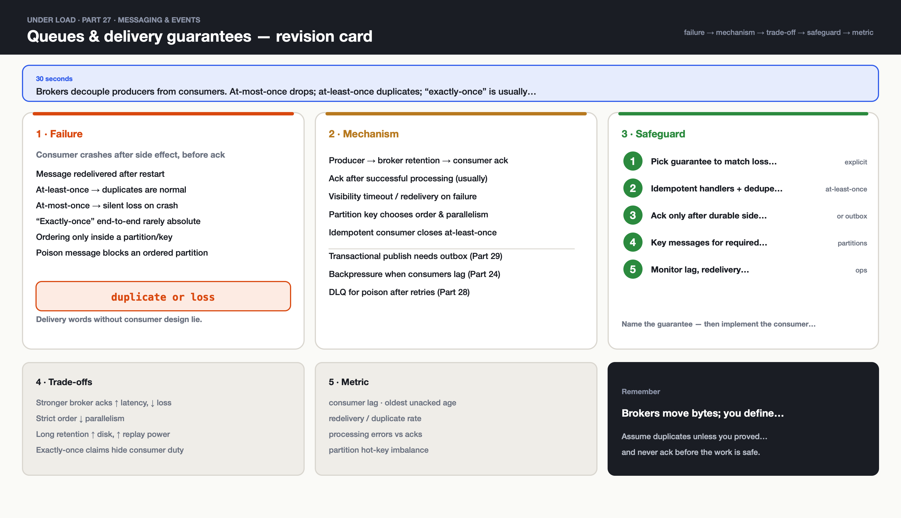
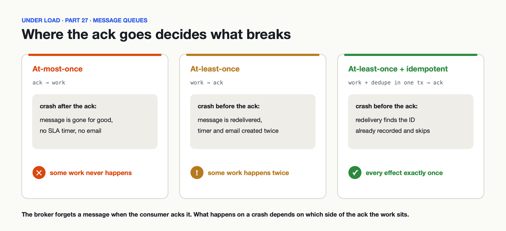
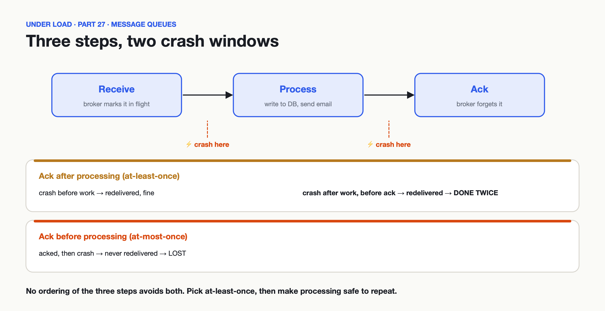
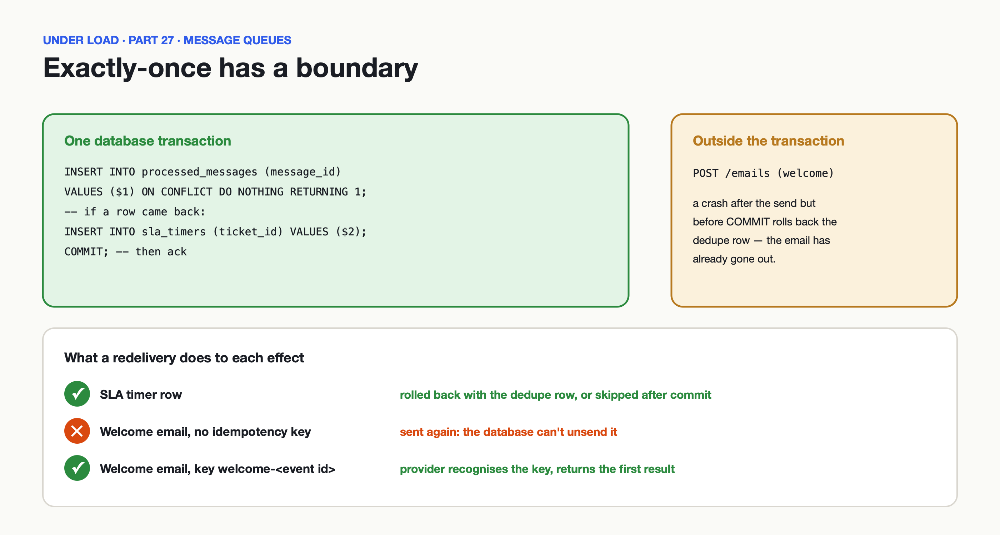
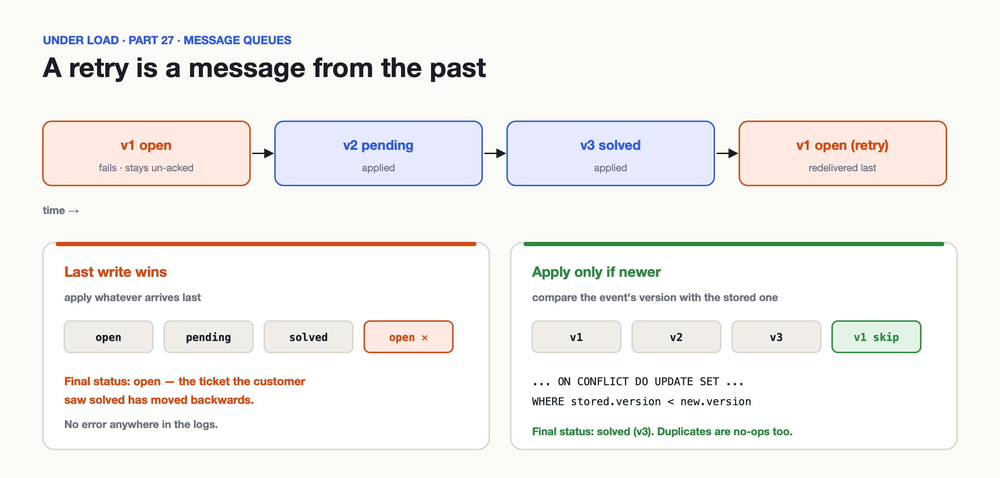
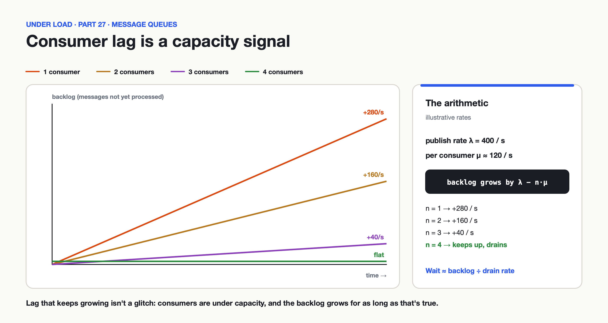
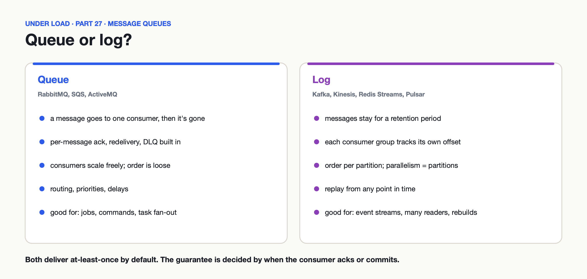
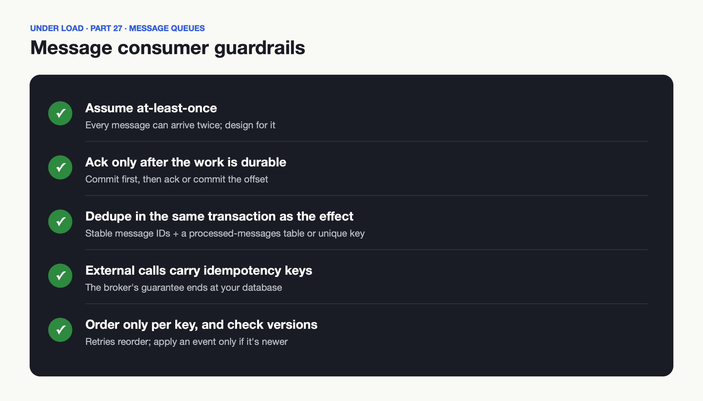

# Message Queues & Delivery Guarantees

### Message queues and delivery guarantees: what at-most-once, at-least-once and "exactly-once" really promise, why a crash in the wrong millisecond creates duplicates or loses messages, and how idempotent consumers make it safe.

*Under Load · Part 27 · Messaging & Events*





---

When a ticket is created in the support product, a lot has to happen that the person creating it shouldn't wait for: start the SLA timer that tracks the response deadline, send the customer a "we got your request" email, notify the assigned team, update search. The ticket API doesn't do any of it directly. It publishes a **`ticket.created`** event to a message broker and returns. Separate **consumers** pick up the event and do the work.

One week, a support lead at Halcyon — the product's largest customer — notices something odd: a few tickets have **two** SLA timers, and a few customers got the welcome email **twice**. The duplicates cluster around the times the consumer service was deployed.

In another region, someone had "fixed" a similar complaint months earlier by moving one line in the consumer. Since then, every deploy had quietly left a handful of tickets with **no** SLA timer at all. Nobody noticed until a Halcyon deadline was missed and the customer asked why the ticket had never shown up as overdue.

Both problems come from the same line of code: the moment when a consumer tells the broker "done." Put it after the work and a crash creates duplicates. Put it before the work and a crash loses the message. There is no third position that avoids both — but there is a design that makes the duplicates harmless, and that's what this article builds.

---

## What a message queue does

A **message broker** is a service that accepts messages from **producers** and holds them until **consumers** process them. RabbitMQ, Amazon SQS, Apache Kafka, Google Cloud Pub/Sub and Redis Streams are common ones. A **message** is a small record — usually JSON or a binary format like Protobuf — describing something that happened (`ticket.created`) or something to do (`send-welcome-email`).

Putting a broker between two services gives three things:

- **Decoupling.** The ticket API doesn't need to know who consumes `ticket.created`, how many consumers there are, or whether they're running right now. New consumers can be added without changing the producer.
- **Absorbing bursts.** When Halcyon's import script creates thousands of tickets in a minute, the events wait in the broker and consumers work through them at their own pace instead of the API slowing down (Part 24 covers backpressure).
- **Durability across failures.** If a consumer crashes, its messages are still in the broker and can be processed by another instance.

That third point is where the trouble starts. To survive a consumer crash, the broker must know which messages were processed and which weren't. The broker can't see inside the consumer, so it relies on the consumer to tell it. That's what the **acknowledgement** is for.

### Acknowledgements

When a consumer receives a message, the broker doesn't delete it. It marks it **in flight** — handed out, not yet confirmed — and waits. The consumer processes the message and then sends an **acknowledgement** (an **ack**): "this one is done." Only then does the broker forget it. If no ack arrives — the consumer's connection drops, or a deadline passes — the broker assumes the consumer died and **redelivers** the message, often to a different consumer instance.

Every broker has its own version of the same idea:

- **RabbitMQ**: the consumer sends `basic.ack` for each message (or for a batch of them). If the consumer's channel or connection closes with messages unacknowledged, they go back to the queue and are redelivered with a `redelivered` flag set. RabbitMQ also enforces a delivery acknowledgement timeout (30 minutes by default in recent versions) and closes the channel of a consumer that holds a message longer.
- **Amazon SQS**: a received message becomes invisible to other consumers for a **visibility timeout** (30 seconds by default, configurable up to 12 hours). The consumer deletes the message when done. If it doesn't, the message becomes visible again and another consumer receives it.
- **Kafka**: consumers don't ack individual messages. Messages sit in an append-only log, and each consumer group **commits an offset** — the position in the log up to which it has finished. After a restart, or when a partition moves to another consumer, reading resumes from the last committed offset.
- **Redis Streams**: `XREADGROUP` delivers an entry to one consumer in a group, `XACK` acknowledges it, and un-acked entries stay in a **pending entries list** where another consumer can take them over with `XCLAIM` or `XAUTOCLAIM`.
- **Google Cloud Pub/Sub**: each delivery has an **ack deadline**; a message not acked before it expires is redelivered.

The mechanics differ; the principle doesn't. **The broker considers a message done when the consumer says so, and not a moment earlier.**

---

## Three steps, two crash windows



Processing a message is three steps: receive, process, ack. A consumer can stop between any two of them — a deploy that kills the process, an out-of-memory kill, a node that disappears, a network partition that drops the broker connection. Where the ack sits decides what a stop does.

**Ack after processing.** If the consumer dies *before* finishing the work, the message is redelivered and processed — fine, that's the point of the broker. If it dies *after* the work but *before* the ack, the message is also redelivered, and the work is done **again**. Nothing is ever lost; some things happen twice. This is **at-least-once** delivery.

**Ack before processing.** If the consumer dies after the ack but before finishing the work, the broker believes the message is done and never redelivers it. The work never happens. Nothing ever happens twice; some things never happen at all. This is **at-most-once** delivery.

There is no ordering of the three steps that closes both windows. The consumer can't atomically "do the work and tell the broker," because the work (a database row, an email) and the broker are different systems, and there is no shared transaction between them. This is a small version of a classic problem in distributed systems — two parties can never be certain they agree over an unreliable channel, because the last message confirming agreement can itself be lost. The same gap appears on the producer side, where a service must write to its database *and* publish an event; Part 29's transactional outbox exists to close it.

### Why the duplicates cluster around deploys

The Halcyon duplicates weren't random. A consumer rarely handles one message at a time: brokers let it fetch a batch ahead, so it doesn't wait for a network round trip per message. RabbitMQ calls this the **prefetch count** (`basic.qos`), SQS returns up to ten messages per receive call, and a Kafka consumer's `poll()` returns whatever has accumulated, up to `max.poll.records`.

So at any moment a consumer holds a set of messages it has received and not yet acknowledged. When a deploy kills it, *all* of them are redelivered. Some it hadn't touched — no harm. Some it had fully processed and was about to ack — those get processed again. With a prefetch of 50, a single abrupt restart can produce up to 50 duplicates, and a rolling deploy restarts every instance. That's why the support lead saw duplicates in bursts rather than as a steady trickle.

The region that moved the ack to the front had the mirror image: every message received and acked but not yet processed at the moment of the kill was simply gone.

### Duplicates come from more places than crashes

Even a consumer that never crashes will see duplicates under at-least-once delivery:

- **Slow processing.** If processing takes longer than the SQS visibility timeout, the message becomes visible again and a second consumer starts on it *while the first is still working*. In Kafka, a consumer that doesn't call `poll()` within `max.poll.interval.ms` (five minutes by default) is removed from the group, its partitions are reassigned, and the new owner starts again from the last committed offset.
- **Rebalances.** When Kafka consumers join or leave a group, partitions move between them. Anything processed since the last offset commit is processed again by the new owner.
- **Lost acks.** The consumer sends the ack, the network drops it, the broker redelivers.
- **Producer retries.** A producer publishes, the broker stores the message, the confirmation is lost, and the producer retries — now there are two copies of the event in the broker. Kafka's **idempotent producer** (enabled by default since Kafka 3.0) removes duplicates caused by its own retries within a partition, but it can't help when the application itself retries after a timeout.

The conclusion most teams reach after an incident like Halcyon's: for almost every business process, a lost message is worse than a duplicate. A duplicate can be detected and ignored; a lost message is gone without a trace. So the practical choice is **at-least-once**, and then the consumer is made safe to run twice. At-most-once is reserved for data that is genuinely disposable — a metrics sample, a "user is typing" indicator — where losing one costs nothing and the next one replaces it.

---

## The idempotent consumer

An operation is **idempotent** if doing it twice has the same effect as doing it once (Part 14). "Set the ticket's status to solved" is idempotent; "add one SLA timer" is not. An **idempotent consumer** turns redelivered messages into no-ops, so at-least-once delivery produces **effectively-once processing**.

The simplest reliable version needs two things.

**1. A stable message ID.** Every message carries an identifier that stays the same across redeliveries and producer retries. It must identify the **event**, not the delivery attempt. The best source is the producer: it generates an event ID (a UUID, or something derived from the business fact, like `ticket-48213-created`) when the event is created, so a producer retry carries the same ID. Broker-assigned IDs — an SQS message ID, a Redis stream entry ID, a Kafka topic-partition-offset — are stable across redeliveries of *one* stored copy, but a producer that publishes twice creates two copies with two different broker IDs.

**2. A record of processed IDs, written in the same transaction as the work.** The consumer inserts the message ID into a `processed_messages` table with a unique key. If the insert succeeds, this is the first time — do the work. If it conflicts, it's a duplicate — skip the work. Both happen in **one database transaction**, so either both are saved or neither is.

```sql
BEGIN;
INSERT INTO processed_messages (message_id, processed_at)
VALUES ($1, now())
ON CONFLICT DO NOTHING
RETURNING 1;
-- only if a row came back:
INSERT INTO sla_timers (ticket_id, due_at) VALUES ($2, $3);
COMMIT;
-- then acknowledge the message
```

The order of operations is what makes it work:

- If the consumer dies **before `COMMIT`**, both inserts roll back. The redelivery finds no record and processes the message from scratch. Correct.
- If it dies **after `COMMIT` but before the ack**, the redelivery finds the ID and skips. The window that caused Halcyon's duplicate timers is closed.
- The ack is sent **after** the commit, so nothing is acknowledged until its effect is durable.

This pattern is sometimes called an **inbox**: the consumer's own record of what it has received, the mirror image of the producer's outbox in Part 29.

### Two duplicates at the same time

Duplicates don't always arrive one after the other. With a visibility timeout that's too short, two consumers can process the same message concurrently. The unique key still protects the work: in PostgreSQL, when a second transaction inserts a key that a first, uncommitted transaction has already inserted, the second one **waits** for the first to finish. If the first commits, the second's `ON CONFLICT DO NOTHING` takes effect and it skips; if the first rolls back, the second proceeds. Only one of them ever does the work. The dedupe check must be this insert — a separate `SELECT` to see whether the ID exists, followed by an insert, leaves a gap where both consumers see "not processed" and both continue (Part 2 covers this kind of race).

### Natural keys and idempotent writes

Sometimes the work itself has a natural uniqueness rule, and a separate table isn't needed. "One SLA timer per ticket" can be a unique constraint on `sla_timers (ticket_id)` with `ON CONFLICT DO NOTHING`. "Set the ticket's search document to this content" is an overwrite and naturally idempotent. The processed-messages table is the general tool for work without such a rule — "append a line to the activity feed," "increment a counter."

### Keeping the inbox small

The processed-messages table grows with every message. Old IDs can be deleted, but only once a duplicate of them can no longer arrive. That horizon is set by the longest path a duplicate can take: the broker's maximum retention or redelivery window, retry queues with long delays, and manual replays from a dead-letter queue (Part 28). A common choice is to keep IDs for several times the longest of these, delete older rows in batches, and partition the table by date so cleanup is a cheap `DROP` of an old partition rather than a large `DELETE`.

---

## "Exactly-once" has a boundary



The first version of the fixed consumer still sent duplicate welcome emails. The SLA timers were clean; the emails weren't.

The email was sent **inside** the processing, before `COMMIT`. When the consumer died after calling the email provider but before committing, the database rolled back the processed-message row — correctly, because as far as the database knew, nothing had happened. The redelivery saw no record and sent the email again. A database transaction can undo the database's own changes. It can't unsend an email.

This is the honest meaning of **exactly-once**. Systems that offer it guarantee it **within their own boundary**:

- **Kafka transactions** let an application read from input topics, write to output topics and commit its consumer offsets as one atomic unit. Consumers reading with `isolation.level=read_committed` see the output only if the transaction committed. Kafka Streams wraps this in a single setting (`processing.guarantee=exactly_once_v2`). The guarantee covers Kafka-to-Kafka processing.
- **SQS FIFO queues** remove duplicate *sends* that share a deduplication ID within a five-minute window. A consumer that crashes before deleting a message still receives it again.
- **Google Cloud Pub/Sub** offers an exactly-once delivery option on a subscription, which prevents redelivery of a message once it has been successfully acknowledged — but a consumer that does the work and dies before acking still gets the message again.

In every case, once the work touches something outside the boundary — a database, an email provider, a payment API — the end-to-end guarantee falls back to at-least-once, and duplicates have to be handled **where the side effect happens**.

The options for external side effects:

- **Pass an idempotency key** to the external service, derived from the message ID — for example `welcome-<event id>`. Services that support idempotency keys (Stripe's `Idempotency-Key` header is the best-known example, and many payment, email and messaging APIs have an equivalent) remember the key for a period and return the earlier result instead of acting again. The key's retention window on the provider's side becomes part of the design: a replay after the provider has forgotten the key is a new request.
- **Record the intent first, act from a separate step.** The consumer's transaction writes "welcome email due for ticket 48213" to a table; a separate sender reads that table, calls the provider with an idempotency key and marks the row sent. This is the outbox pattern again (Part 29), applied inside the consumer.
- **Accept rare duplicates** where they're genuinely harmless. A duplicate "your ticket was updated" notification is an annoyance; a duplicate refund is an incident. The decision belongs to whoever owns the side effect, written down, not left to chance.

The useful mental model: **delivery is at-least-once; processing can be effectively-once, one side effect at a time, by making each one idempotent.**

---

## Ordering: a retry is a message from the past



Queues are usually pictured as first-in, first-out. In practice ordering is weaker than it looks, and retries break it.

Consider a consumer that maintains a `tickets_view` table for the dashboard. A ticket goes through three status changes in a few seconds: `open`, then `pending`, then `solved`. The `open` event fails transiently — a database timeout — and the consumer leaves it un-acked to be retried later. Meanwhile `pending` and `solved` are processed normally. Then the `open` event is redelivered, processed, and written. The dashboard now shows `open` for a ticket the customer saw solved.

Nothing was lost and nothing was duplicated. The retry was simply **a message from the past** arriving after the present. A "last write wins" consumer applies whatever arrives last, so every transient failure followed by a redelivery is a chance to move an entity backwards. The more transient failures, and the more events per entity in a short time, the more entities end in the wrong state — and nothing in the logs looks like an error.

The fix is to make each update **conditional on being newer**. Every event carries a **version** — a per-entity sequence number incremented by the producer, the row's version column, or the source database's commit position — and the consumer applies it only if it's newer than what's stored:

```sql
INSERT INTO tickets_view (ticket_id, status, version)
VALUES ($1, $2, $3)
ON CONFLICT (ticket_id) DO UPDATE
  SET status = excluded.status, version = excluded.version
WHERE tickets_view.version < excluded.version;
```

The late `open` event carries version 1; the stored row is at version 3; the `WHERE` clause turns the update into a no-op. The same check also makes the consumer idempotent for duplicates, since a duplicate has the same version as what's stored.

Timestamps work as versions only if they come from one clock that never goes backwards for that entity — the source database's update time, say. Timestamps from different application servers can disagree by more than the gap between two events (Part 38 covers clock skew).

### Order per key, not globally

When strict order matters, brokers provide it **per key**, not globally:

- **Kafka** guarantees order within a **partition**. Messages with the same key are hashed to the same partition, and each partition is read by exactly one consumer in a group at a time.
- **SQS FIFO** guarantees order within a **message group**; messages in one group are delivered one batch at a time, in order.
- **RabbitMQ** keeps order within a single queue for a single consumer; competing consumers on one queue process in parallel and can finish out of order.

There is no cheap global order across partitions, and there rarely needs to be. "All events of ticket 48213 in order" is a real requirement; "all events of all tickets in one order" almost never is. Choose the partition key from the business invariant — here, `ticket_id` — and keep in mind that strict per-partition order means one slow or failing message blocks everything behind it in that partition (head-of-line blocking, Part 26).

Even with per-key ordering, order holds only as long as failures are retried **in place**. A consumer that parks a failing message in a retry queue and moves on — a common way to avoid head-of-line blocking — has, by definition, let later messages overtake it. Version checks make the consumer correct either way, which is why they're worth adding even on an ordered broker.

---

## Retries and poison messages

Some messages fail every time: a malformed payload, a reference to a ticket that was deleted, a bug that throws on one specific input. Redelivered forever, such a **poison message** burns consumer capacity on every attempt — and on an ordered partition, it blocks every message behind it.

The standard defense is a **retry limit** followed by a **dead-letter queue (DLQ)**: after a bounded number of failed attempts, the message is moved to a separate queue for inspection, and processing continues. SQS has this built in (a redrive policy with `maxReceiveCount`), RabbitMQ does it with dead-letter exchanges, and Kafka consumers implement it with retry and dead-letter topics. Retries should back off with jitter (Part 15), so a struggling dependency isn't hammered by every consumer at once.

Not every failure deserves retries. A validation error will fail the same way every time; a timeout may succeed in a second. Classifying errors as **transient** or **permanent** decides whether a message is retried or dead-lettered immediately. Part 28 covers DLQs in depth — including the part most teams forget: what to do with the messages once they're there.

---

## Consumer lag is a capacity signal



**Consumer lag** is how far consumers are behind producers. It's expressed two ways:

- **Count**: messages published but not yet processed (in Kafka, the latest offset minus the committed offset, per partition).
- **Age**: how long the oldest unprocessed message has been waiting (SQS publishes `ApproximateAgeOfOldestMessage`).

Age is usually the more useful of the two, because it's what users feel. A backlog of a million messages that drains in seconds is fine; a backlog of a hundred that has been stuck for an hour is not.

It's tempting to treat lag as a broker metric. It's a **capacity** metric, and the arithmetic is simple. If producers publish λ messages per second and each consumer processes μ per second, then with *n* consumers the backlog changes by **λ − n·μ** every second. As an illustration: at 400 events per second, with consumers that each handle about 120 per second, one consumer falls behind by about 280 messages every second, two by about 160, three by about 40 — still growing, just more slowly — and four, with a combined 480 per second, keep up and drain any backlog. Growing lag isn't a glitch; it's the system saying it's under capacity, and the backlog grows for as long as that's true.

Lag also translates directly into delay. By **Little's law** — the average number of items in a system equals arrival rate times average time spent in it — a backlog of 10,000 messages drained at 500 per second means a new message waits about 20 seconds. For SLA timers, that's 20 seconds during which an urgent ticket isn't being tracked.

That's why autoscaling consumers on lag — Kafka consumer-group lag, SQS queue age — works better than scaling on CPU. A consumer waiting on a slow database shows low CPU and still falls behind. Two limits to keep in mind:

- In Kafka, a consumer group can't use more consumers than the topic has partitions; extra consumers sit idle. Partition count is a capacity decision made in advance, and increasing it later changes which partition each key maps to, which breaks per-key ordering for keys in flight.
- If consumers are limited by a downstream — a database, a third-party API with a rate limit — adding consumers just pushes harder on that limit. Lag then needs to be fixed downstream, or the consumers need to slow down deliberately (Part 24).

---

## Queue or log?



Brokers come in two families, and the choice shapes the consumer.

**Queues** (RabbitMQ, SQS, ActiveMQ): a message is delivered to **one** consumer and removed once acknowledged. Per-message acks, redelivery, delayed delivery, priorities and dead-lettering are built in. Consumers can be added or removed freely, because each message is handed out individually; ordering is loose unless explicitly requested. A queue is a natural fit for **jobs and commands**: "send this email," "generate this export," "resize this attachment." Once a job is done, nobody needs it again.

**Logs** (Kafka, Amazon Kinesis, Apache Pulsar, Redis Streams): messages are appended to a durable log and **kept** for a retention period, whether consumed or not. Each **consumer group** tracks its own position, so many independent consumers — SLA timers, search indexing, analytics — read the same events without interfering, and any of them can **replay** from an earlier point to rebuild a search index or reprocess after a bug fix. Order is guaranteed per partition, and parallelism within a group is capped by the partition count. Acknowledgement is coarse: committing offset 1,000 means "everything before 1,000 is done," so one slow message can't be skipped without some extra machinery. A log is a natural fit for **event streams** with many readers.

The trade-offs that usually decide it:

- **One reader or many?** Many independent readers of the same events favour a log.
- **Replay needed?** Rebuilding projections (Part 32) or onboarding a new consumer from history needs a log's retention.
- **Per-message control?** Delays, priorities, per-message retry and DLQ handling come for free in a queue and take work in a log.
- **Ordering?** A log gives strong per-partition order; a queue with competing consumers gives little unless it's a FIFO variant.
- **Operations.** Managed queues like SQS have almost no capacity planning; a log needs decisions about partitions, retention and consumer-group sizing.

The line between the two is blurring. Kafka 4.2 (2026) made **share groups** — "queues for Kafka" — production-ready: consumers in a share group take records from the same partitions cooperatively, acknowledge each record individually, and a record that isn't acknowledged in time is redelivered to another consumer. That gives queue-style competing consumers, with more consumers than partitions, on top of a log — but without per-key ordering, since records from one partition can be processed by several consumers at once. Ordinary consumer groups also got a new rebalance protocol in Kafka 4.0 (KIP-848): the broker computes assignments and moves partitions one consumer at a time, instead of pausing the whole group on every membership change.

Many systems use both: a log for domain events (`ticket.created`, `ticket.updated`) consumed by several services, and queues for the jobs those services generate. Either way, the delivery guarantee is the same — at-least-once by default — and every consumer rule in this article applies to both.

---

## Changing a consumer safely

The fix for Halcyon's duplicates touches the most delicate line in the consumer, so it ships carefully.

**Graceful shutdown first.** Most duplicates around deploys come from processes killed with messages in hand. A consumer that handles the termination signal (`SIGTERM`) can stop fetching new messages, finish the ones in flight, ack them and exit before the orchestrator's grace period ends. It doesn't remove the crash window — a node can still disappear — but it removes most of the routine duplicates.

**Add dedupe before changing anything else.** The processed-messages table can be introduced while the consumer is still at-least-once: start inserting IDs in the same transaction as the work. From that moment, duplicates are skipped. No backfill is needed, because messages processed before the change are already acked and won't come back — except through replays, which is a reason to carry stable event IDs from the start.

**Move the ack only after dedupe is live.** The region that acked first can switch to ack-after-commit once its consumers dedupe. Switching in the other order would trade lost messages for duplicate timers for the length of the rollout.

**Size timeouts to the work.** The visibility timeout, ack deadline or `max.poll.interval.ms` must comfortably exceed the slowest normal processing time, or the broker hands the same message to a second consumer while the first is still working. Long-running jobs can extend their lease as they go (SQS `ChangeMessageVisibility`, Pub/Sub's deadline extensions) instead of setting one huge timeout that delays recovery when a consumer really dies.

**Test the crash windows on purpose.** Killing consumers at random during a load test in staging — between the work and the ack, specifically — is the only reliable way to see whether duplicates are actually harmless. A consumer that has never been killed mid-message hasn't been tested.

---

## Guardrails that prevent the next one



1. **Assume at-least-once.** Every message can arrive twice, or concurrently on two consumers. Design every consumer for it.
2. **Ack only after the work is durable.** Commit first, then ack, delete or commit the offset.
3. **Dedupe in the same transaction as the effect**, using stable event IDs from the producer and a unique key — never a check-then-insert.
4. **External calls carry idempotency keys** derived from the event ID. The broker's guarantee ends at the consumer's own database.
5. **Order per key, and check versions.** Retries reorder; apply an event only if it's newer than what's stored.

---

## What to keep on the dashboard

- **Consumer lag** — both count and age of the oldest unprocessed message — per consumer group, per partition. Alert on age against the business deadline, not on an arbitrary count.
- **Publish rate vs consume rate**, to see lag coming before it grows.
- **Redelivery rate** (RabbitMQ's redelivered flag, SQS's `ApproximateReceiveCount`, Kafka rebalance counts) and **dedupe hits** in the processed-messages table. A rising redelivery rate means consumers are crashing, timing out or being rebalanced.
- **Processing failures and retries** per message type, split into transient and permanent, and **DLQ depth and age**.
- **Processing time per message**, compared with the visibility timeout or poll interval. Processing that approaches the timeout causes redelivery while the first attempt is still running.
- **Stale events skipped** by version checks. A sudden rise means something upstream is reordering or replaying.

---

## Recap

### What does a message queue give a system?
Decoupling between producers and consumers, buffering of bursts, and durability across consumer failures: messages wait in the broker until a consumer acknowledges them, and are redelivered if it doesn't.

### Why can an at-least-once consumer receive duplicates?
Because the work and the acknowledgement happen in different systems with no shared transaction. A consumer that dies after the work but before the ack has its message redelivered, and the work runs again. Slow processing past a visibility timeout, consumer-group rebalances, lost acks and producer retries create duplicates too.

### What is at-most-once delivery, and when is it acceptable?
Acknowledging before processing. A crash between the ack and the work loses the message permanently, with no trace. It's acceptable only for disposable data that the next message replaces, like a metrics sample or a typing indicator.

### How do you build an idempotent event consumer?
Give every event a stable ID assigned by the producer. In the same database transaction as the work, insert that ID into a processed-messages table with a unique key, and skip the work if it's already there. Ack only after the commit. Where the work has a natural unique key, a constraint on it does the same job. Clean up old IDs only beyond the longest possible redelivery or replay window.

### What does "exactly-once" actually mean?
A guarantee within a defined boundary — Kafka transactions for read-process-write inside Kafka, deduplication windows in SQS FIFO, exactly-once delivery in Pub/Sub. Side effects outside that boundary, like an email or a payment, are still at-least-once and need their own idempotency: an idempotency key sent to the provider, or an outbox that records the intent first.

### How do retries break ordering, and how is it fixed?
A failed message redelivered later arrives after newer messages for the same entity and overwrites them, moving the entity backwards. Each event carries a per-entity version, and the consumer applies it only if it's newer than the stored one — which also makes duplicates harmless.

### How should ordering and partitioning be designed?
Around the business requirement. Order is usually needed per entity, so partition by that entity's key. Global order across partitions is expensive and rarely needed, strict per-partition order means one slow message blocks those behind it, and changing the partition count later remaps keys.

### What should happen to messages that always fail?
Permanent errors go to a dead-letter queue immediately; transient ones are retried a bounded number of times with backoff and jitter, then dead-lettered. That keeps poison messages from consuming capacity and blocking ordered partitions — and someone must own inspecting and replaying them.

### Why is consumer lag a capacity signal?
The backlog changes by the publish rate minus the total consume rate every second, so lag that keeps growing means consumers are under capacity, and by Little's law it translates directly into waiting time. Scale consumers on lag or message age rather than CPU — within the limits of partition count and downstream capacity.

### Kafka vs a traditional queue: what trade-offs matter?
Queues deliver each message to one consumer and remove it, with per-message acks, delays, priorities and dead-lettering built in — a fit for jobs and commands. Logs keep messages for a retention period, let many consumer groups read independently and replay history, and order per partition with parallelism capped by partition count — a fit for event streams with many readers. Both are at-least-once by default.

---

## Next

- **Lab (run + measured write-up):** [27-message-queues](https://github.com/b-basoglu/under-load/tree/main/27-message-queues)
- **Next:** [Dead Letter Queues](../28-dead-letter-queues/article.md) — The messages that failed five times are sitting in a queue nobody looks at. What should go there, what should never go there, and how to get them back out.
