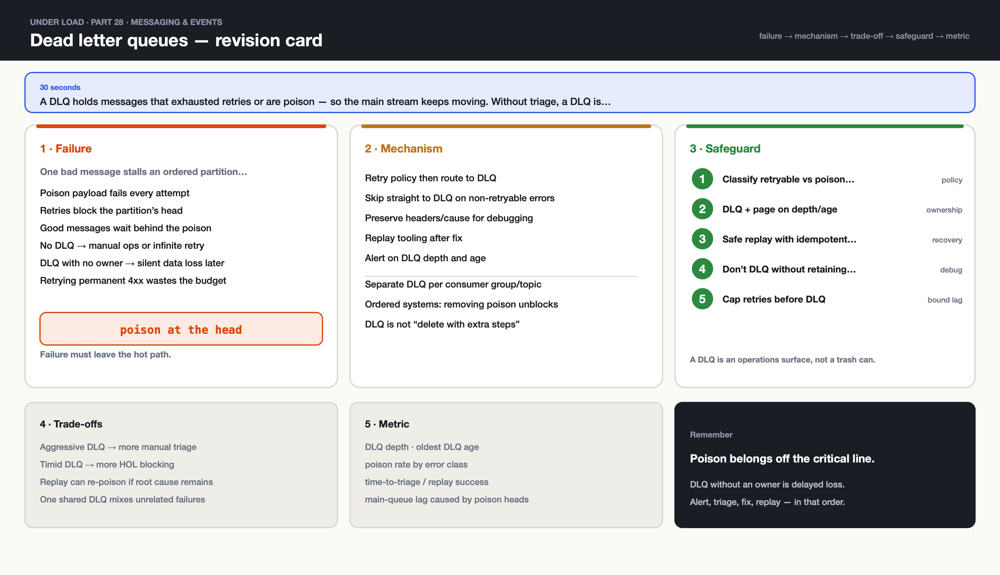
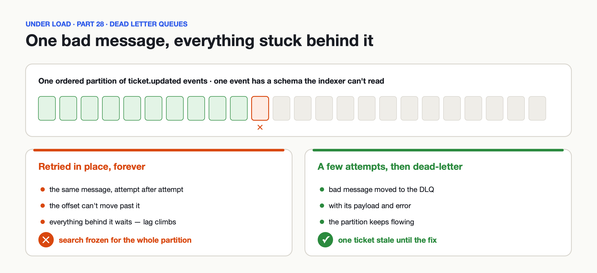
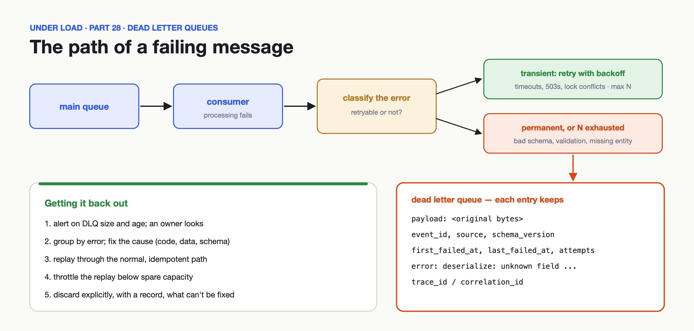
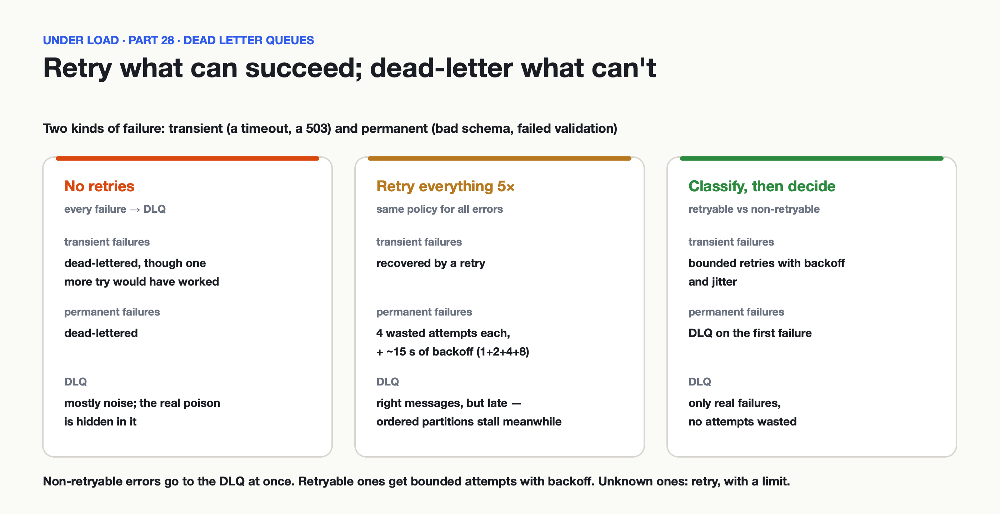
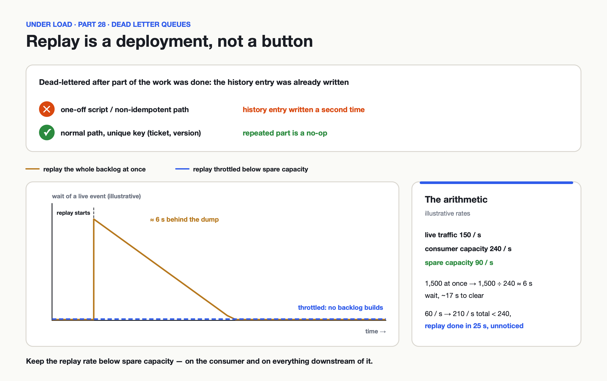
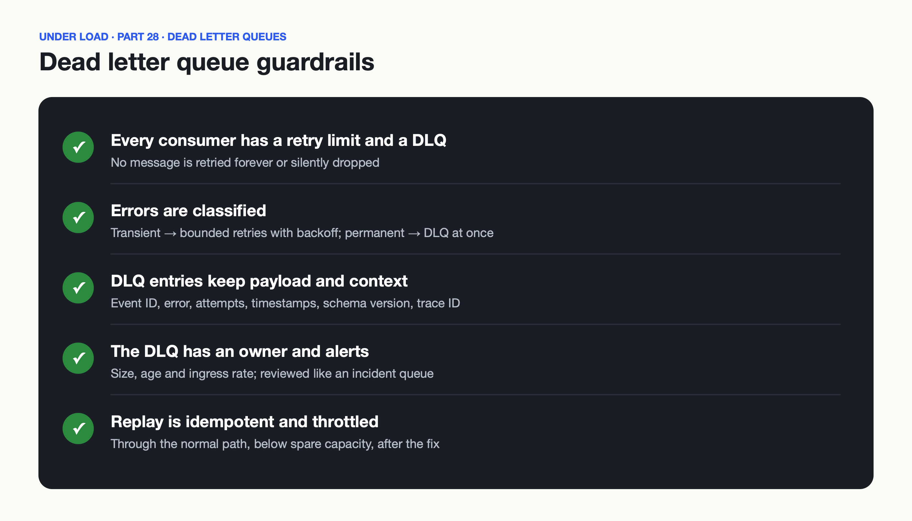

# Dead Letter Queues

### Dead letter queues: moving messages that can't be processed out of the way — which failures deserve retries, which go straight to the side, what to keep with them, and how to replay them without causing a second incident.

*Under Load · Part 28 · Messaging & Events*





---

The search indexer keeps ticket search up to date. It reads `ticket.updated` events from an ordered stream — one event per change, in order per partition — and writes each ticket's new state to the search index.

On a Tuesday afternoon, the ticket service ships a new optional field, `priority_v2`, and bumps its event schema to version 3. The indexer hasn't been updated yet, and its deserializer is strict: it rejects any event with a schema version it doesn't know. The first version-3 event arrives and the indexer fails to read it. It retries. It fails again — and will fail every time, because nothing about the message will ever change. The indexer is built to process its partition in order, so it doesn't move on.

Search freezes for every ticket on that partition. New tickets don't appear, updated tickets show their old status, and Halcyon's agents start reporting that "search is broken." The indexer is busy the whole time — retrying one message as fast as it can — so CPU looks normal and no error rate alarm fires. Forty minutes pass before someone notices the consumer-lag graph climbing in a straight line.

The fix that should have been there from the start is simple to state: after a few attempts, move the bad message **aside** — into a **dead letter queue** — and continue with the rest. One ticket is missing from search for a while instead of all of them. The harder part, and the subject of most of this article, is everything around that rule: which failures deserve retries at all, what to store with the message, who looks at it, and how to put it back without causing a second incident.

---

## What a dead letter queue is

A **dead letter queue (DLQ)** is a separate queue where a consumer puts messages it couldn't process after its retry policy is exhausted — or immediately, when the failure is clearly permanent. The name comes from postal services: a "dead letter" is mail that can be neither delivered nor returned to the sender.

A DLQ does two jobs:

1. **It keeps the main flow moving.** A message that will never succeed stops consuming retries, worker time and — on an ordered stream — the attention of every message behind it.
2. **It keeps the failed work.** The message isn't deleted. It's stored with enough context to understand what went wrong, fix the cause, and process it later.

The message that froze search is a **poison message**: one that fails every time it's processed, because of its content rather than the environment. Typical causes are a schema the consumer doesn't understand, a field that fails validation, a reference to something that no longer exists (a ticket deleted between the event and its processing), or a bug that throws on one specific input — a subject line with an unexpected character, a number too large for the target type.

### How brokers support it

- **Amazon SQS** has a **redrive policy** on the source queue: after a message has been received `maxReceiveCount` times without being deleted, SQS moves it to the configured DLQ. SQS also has a **redrive** operation that moves messages from the DLQ back to the source queue, with an optional rate limit.
- **RabbitMQ** routes messages to a **dead-letter exchange** when they're rejected without requeueing, expire through a time-to-live, or overflow a queue's length limit. Each dead-lettered message carries an `x-death` header recording where it came from, why, and how many times. Quorum queues also support a **delivery limit**, after which a repeatedly redelivered message is dead-lettered or dropped; RabbitMQ 4.0 made a limit of 20 the default.
- **Kafka** has no DLQ in the broker itself. Kafka Connect can send failed records to a dead-letter topic (`errors.tolerance=all` with `errors.deadletterqueue.topic.name`), and consumer frameworks such as Spring Kafka provide retry topics and a dead-letter topic as a library feature.
- **Google Cloud Pub/Sub** supports a **dead-letter topic** on a subscription, with a maximum number of delivery attempts.

Where neither broker nor framework does it, the consumer does it itself: catch the failure, publish the message and its context to the DLQ, and only then acknowledge the original. The order matters — acknowledging first and then failing to publish to the DLQ is exactly the silent loss that a DLQ exists to prevent.

---

## Why one message stops a partition



Not every consumer stalls on a poison message, and it's worth understanding which ones do.

On a classic **queue** with competing consumers (SQS standard, a RabbitMQ classic queue), messages are handed out individually. A poison message fails, becomes visible again, and is redelivered — over and over, consuming a slot each time — but other messages keep flowing to other consumers in parallel. The damage is wasted capacity and noise, not a full stop.

On an **ordered** stream — a Kafka partition, an SQS FIFO message group, a single-consumer queue that must preserve order — the consumer can only make progress by moving its position forward. In Kafka, the committed offset is a single number per partition: "everything before this is done." The consumer can't commit past a message it hasn't finished without declaring that message done. So if it retries in place, the partition stops. Every event behind the poison one waits, regardless of which ticket it belongs to, because they happen to share a partition. This is **head-of-line blocking** (Part 26), and it's what turned one bad event into frozen search.

The arithmetic is unforgiving. If a partition normally receives fifty events a second and the poison message blocks it for forty minutes, about 120,000 events are stuck behind it — and once it's cleared, the consumer must work through all of them before search is current again.

---

## Transient vs permanent failures

When processing fails, the consumer has three possible next steps: try again now, try again later, or give up and dead-letter the message. Which is right depends on **why** it failed.

- **Transient failures** may succeed if tried again: a database timeout, a `503 Service Unavailable` from a dependency, a deadlock or lock timeout, a dropped connection, a `429 Too Many Requests`. The world changes between attempts; retrying — after a delay — often works.
- **Permanent failures** fail the same way every time: a message that can't be deserialized, a payload that fails validation, a reference to a ticket that doesn't exist, a business rule that rejects the request, an HTTP `400` or `422` from a downstream. Nothing about the next attempt will be different.

This **classification** is the most important decision in the retry policy, because the two obvious shortcuts are both wrong.



**Shortcut 1: never retry — every failure goes straight to the DLQ.** The DLQ fills with messages that hit a momentary database timeout and would have succeeded a second later. In a busy system, transient failures far outnumber poison messages, so the DLQ becomes mostly noise. Someone has to replay all of it, and the few genuinely broken messages are hidden among the many that never needed to fail.

**Shortcut 2: retry everything a fixed number of times with backoff.** The DLQ ends up with the right messages, but every poison message is retried in vain first. With five attempts and exponential backoff of 1, 2, 4 and 8 seconds between them, each poison message costs four wasted attempts and fifteen seconds of waiting before it's moved aside. On an ordered partition, that's fifteen seconds of blocked traffic per poison message. When a bad deploy makes *every* message permanently invalid, the consumer spends almost all its time waiting on retries that can't help.

**The right policy: classify first.** Non-retryable errors go to the DLQ on the first failure. Retryable errors get a bounded number of attempts with backoff, then go to the DLQ. Errors the code doesn't recognise are treated as retryable *with a limit*, so a new failure mode ends up in the DLQ after a few attempts instead of looping forever or being dropped on the first try.

In code, that's usually an explicit list rather than a guess:

```text
non-retryable  → deserialization error, schema version unknown,
                 validation error, entity not found, HTTP 400/404/422
retryable      → timeout, connection reset, deadlock, HTTP 429/502/503/504
unknown        → retryable, at most N attempts
```

Spring Kafka, for example, lets an error handler declare exception types as "not retryable," so they skip straight to the dead-letter recoverer. Whatever the framework, the classification should be reviewed when an incident reveals a mistake — a permanent error that was being retried, or a transient one that was dead-lettered.

One subtlety: "entity not found" isn't always permanent. If events can arrive before the data they refer to has been replicated or committed elsewhere, a short retry can succeed. The classification has to reflect how the system actually behaves, not just the error's name.

---

## Retry limits, backoff and retry topics

Retryable errors still need a **limit**. A dependency that's down for an hour turns every message into a retry loop. And on an ordered stream, retrying in place for an hour is the same stall as a poison message.

A common shape is three tiers:

1. **A few quick retries in the consumer** — milliseconds to a couple of seconds apart — to ride out blips without leaving the main flow.
2. **Delayed retries outside the main flow**: the message is moved to a **retry queue or topic** with a delay (for example 1 minute, then 10 minutes, then an hour), and the consumer continues with the next message. SQS can delay redelivery by extending the visibility timeout; RabbitMQ uses queues with a message TTL that dead-letter back into the main queue; Kafka setups use a chain of retry topics whose consumers wait until each message's due time.
3. **The DLQ**, once the last retry fails.

Backoff with **jitter** — a random component added to each delay (Part 15) — keeps retries from arriving in a synchronised wave the moment a dependency recovers.

Moving a message to a retry topic frees the partition, but at a price: later events for the same ticket are processed before the one being retried. That's an ordering problem, covered below.

---

## What a DLQ entry must keep

A DLQ entry is only useful if someone can understand it weeks later, possibly someone who didn't write the consumer. Each entry should keep:

- **The original payload, byte for byte.** Not a re-serialized version — if the problem is in the bytes (an encoding, an unexpected field), re-serializing may hide it.
- **Identity:** the event ID, the source (topic and partition and offset, or queue name), the event type and the **schema version**.
- **Failure context:** the error type and message, a stack trace or its fingerprint, the number of attempts, the first and last failure times, and the **version of the consumer** that failed.
- **A trace or correlation ID**, to find the request that produced the event and the logs of every attempt.
- **The business key** — ticket ID, workspace ID — so the impact can be counted without parsing payloads.

Brokers add some of this automatically (RabbitMQ's `x-death` header, Spring Kafka's exception headers, SQS's receive count). The rest belongs in message headers or attributes added by the consumer when it dead-letters.

Without this, the DLQ becomes a pile of messages nobody can explain, and the safest-looking action becomes deleting them — which is how business work quietly disappears.

### Retention: longer than the broker's default

A DLQ must keep messages long enough to diagnose, fix and replay — days to weeks. Broker defaults are often shorter. SQS retains messages for four days by default (up to fourteen), and for standard queues the expiry is based on the message's **original** enqueue time, not the time it entered the DLQ. A message that spent three days being retried in the source queue has only one day left in a DLQ with the same retention. AWS's guidance is to give the DLQ a longer retention than the source queue for exactly this reason. Kafka dead-letter topics need their own `retention.ms`, set deliberately rather than inherited.

---

## A DLQ is not a trash can

The most common DLQ failure isn't technical. It's that nobody looks at it.

A message in the DLQ is work the business expected to happen and didn't: a ticket missing from search, an SLA timer that never started, a customer notification never sent, a refund never issued. Thousands of them can accumulate silently while every dashboard is green, because the main consumers are healthy and their lag is zero. A DLQ hides failure as effectively as it isolates it.

So a DLQ needs what any incident queue needs:

- **An owner** — the team that owns the consumer, not a platform team that has no idea what the messages mean.
- **Alerts** on its size, its ingress rate, and the age of its oldest message. For a healthy consumer the DLQ is normally empty, so a single new message is worth a look, and a steady trickle is a bug report.
- **Retention** long enough to fix and replay.
- **Access controls.** DLQ messages contain the same customer data as the main stream, often more of it (error messages can quote payloads), and replay tooling can write to production. Both deserve the same protection as the main system.
- **A record of business impact**: which tickets, which customers. "400 messages in the DLQ" rarely gets prioritised; "400 Halcyon tickets missing from search" gets fixed the same day.

---

## Getting messages back out: replay



Once the cause is fixed — the indexer deployed with schema version 3 support — the messages in the DLQ have to be processed. This is **replay** (or **redrive**): sending them back through the consumer. It's where the second incident often happens, because replay is a bulk write to production triggered by a person in the middle of an incident.

### Replay must be idempotent

Messages often reach the DLQ after part of their work is done. Suppose the indexer, for each event, appends an entry to the ticket's change history and then writes an audit record. A migration forgot a column, the audit write fails, and the events are dead-lettered — but each one has already appended its history entry. After the column is added, the events are replayed. A non-idempotent consumer appends every history entry a second time.

An idempotent path makes the second application a no-op: a unique key on (ticket, event version) with `ON CONFLICT DO NOTHING`, or the processed-messages table from Part 27. Replay must go through the **same, idempotent processing path** as normal traffic — never through a one-off script that writes directly to the database and skips the safeguards that exist in the consumer.

### Replay must be throttled

The other trap is speed. Consider live traffic of 150 events a second, consumers that can handle about 240 a second in total — so about 90 a second of spare capacity — and a DLQ that accumulated 1,500 messages during the incident.

- **Replaying everything at once** puts 1,500 messages in front of live traffic. A live event arriving right after the dump waits behind all of them: about 1,500 ÷ 240 ≈ 6 seconds before it's even looked at. The combined backlog shrinks only at the spare rate, so it takes about 1,500 ÷ 90 ≈ 17 seconds to clear. Fresh updates are seconds late because old ones are being processed — on a larger DLQ, minutes or hours late.
- **Replaying at 60 a second**, below the spare capacity, keeps total arrivals at 210 a second against a capacity of 240. No backlog builds, live events wait no longer than usual, and the replay takes 25 seconds instead of being "instant." Nobody notices it.

The general rule: **replay rate must stay below spare capacity**, judged on the consumer *and* on everything downstream of it. The search cluster, the database and any third-party API see the replay too.

### Replaying a million messages

The same reasoning, at a larger scale, becomes a runbook:

1. **Confirm the fix on a sample.** Replay ten messages, check the results by hand, then a hundred.
2. **Group by cause.** A million messages rarely share one error. Some groups are fixed by the deployment, some need data repaired first, some are genuinely invalid. Replay one group at a time.
3. **Pick an order.** Oldest first is usually right for correctness; most-impactful tenant first is sometimes right for the business.
4. **Throttle and watch.** At 200 messages a second, a million takes about 80 minutes; plan for it. Watch consumer lag, error rate and downstream latency, and lower the rate if any of them move.
5. **Be able to stop and resume.** The replay tool records its position, so a pause doesn't mean starting over or replaying twice.
6. **Have a DLQ for the replay.** Some replayed messages will fail again. They go back to a DLQ with their new error, not into an infinite loop between the DLQ and the main queue.
7. **Discard explicitly.** Messages that can't or shouldn't be processed — events for deleted workspaces, test traffic — are removed with a record of what was discarded, by whom and why.

### Is replaying still correct?

Before replaying old events, check that applying them now is still the right thing. An update from last week, replayed today, may overwrite a newer state — unless the consumer checks versions (Part 27). A "send reminder" command from three days ago may no longer make sense. Some events should be replayed, some re-derived from current state, and some dropped.

### Ordering

When a message leaves an ordered stream for a retry topic or the DLQ, later messages for the same key continue without it. Replaying it later delivers it **out of order**. There are two ways to handle that:

- **Version checks in the consumer.** The replayed event is applied only if it's newer than what's stored. For a search indexer that writes the latest state of a ticket, this is enough: a stale event is ignored, a genuinely missing one is applied.
- **Park the whole key.** Where every event matters in sequence — a ledger, a state machine whose transitions must happen in order — once one message for a ticket is dead-lettered, later messages for that ticket also go aside until the first is resolved. Other tickets continue. This keeps per-key order at the cost of more messages in the DLQ and a replay tool that understands keys.

---

## Shipping it safely

Adding a DLQ to a consumer that's been running without one changes its failure behaviour, so it deserves the same care as any other change.

**Prevent the most common poison first.** The schema change that froze search is the textbook cause. Consumers that ignore unknown fields (a **tolerant reader**), a schema registry that rejects incompatible schema changes, and deploying consumers before producers start sending a new version remove most poison messages before they exist.

**Start in observe mode.** Before dead-lettering anything, log and count what *would* be dead-lettered under the new classification. A surprising number usually means the classification is wrong.

**Alert before turning it on.** A DLQ without an alert converts loud failures — a stalled partition — into silent ones. The alert and the owner come first.

**Build the replay tool before it's needed.** A replay tool written during an incident skips the throttle, the idempotency check and the audit trail. A tested one, with a rate limit and a dry-run mode, is ready when the DLQ fills.

**Test it with a real poison message.** Publishing a deliberately malformed event in staging and watching it go to the DLQ, alert, and replay after a fix is the only proof that the whole path works.

---

## Guardrails that prevent the next one



1. **Every consumer has a retry limit and a DLQ.** No message is retried forever, and none is silently dropped.
2. **Errors are classified.** Transient errors get bounded retries with backoff and jitter; permanent errors go to the DLQ immediately; unknown errors get a limit.
3. **DLQ entries keep the payload and context**: event ID, source, schema version, error, attempts, timestamps, consumer version, business key and trace ID.
4. **The DLQ has an owner and alerts** on size, age and ingress, and is reviewed like an incident queue.
5. **Replay is idempotent and throttled**: through the normal processing path, below spare capacity, after the fix is verified on a sample.

---

## What to keep on the dashboard

- **DLQ size, ingress rate, and the age of the oldest message.** For a healthy consumer, ingress should be near zero.
- **Top error causes** in the DLQ, grouped by error type, message type and schema version.
- **Retry counts** per message type, and the share of retries that eventually succeed. Retries that almost never succeed point to a permanent error being treated as transient.
- **Consumer lag on the main stream.** A poison message that isn't being dead-lettered shows up here first, as lag on one partition growing in a straight line.
- **Replay progress, success rate and re-failure rate**, together with consumer lag and downstream latency while a replay runs.
- **Business impact**: affected tenants and entities in the DLQ.

---

## Recap

### What is a dead letter queue?
A separate queue for messages that couldn't be processed after the retry policy is exhausted, or that failed permanently. It keeps the main flow moving and preserves the failed work, with context, for investigation and replay.

### What is a poison message, and how does it affect an ordered partition?
A message that fails every time because of its content — an unreadable schema, invalid data, a missing reference, a bug triggered by one input. On an ordered stream the consumer can't commit past it without declaring it done, so if it retries in place, every message behind it in the partition waits, whatever entity it belongs to.

### When should a message go directly to the DLQ instead of being retried?
When the failure is permanent: deserialization and unknown-schema errors, validation failures, references to entities that don't exist, business-rule rejections, `4xx` responses such as 400 or 422. Retrying them only wastes attempts and backoff time, and blocks ordered partitions while it happens.

### Why not send every failure straight to the DLQ?
Because transient failures — timeouts, `503`s, deadlocks, rate limits — usually succeed on a retry seconds later. Without retries, the DLQ fills with work that never needed to fail, and the real poison messages are hidden in the noise.

### What should a DLQ entry contain?
The original payload byte for byte, the event ID, source and schema version, the error and number of attempts, first and last failure times, the consumer version, the business key, and a trace or correlation ID.

### Why is an ignored DLQ dangerous?
Every message in it is business work that didn't happen, and it accumulates silently while the main system looks healthy. A DLQ needs an owner, alerts on size, age and ingress, retention longer than the source queue's, access controls, and a record of business impact.

### How do you safely replay a million DLQ messages?
Verify the fix on a small sample, group messages by cause, replay one group at a time through the normal idempotent path, throttle below the spare capacity of the consumer and everything downstream, watch lag and errors, be able to pause and resume, send re-failures to a DLQ of their own, and discard explicitly what can't be processed.

### Why must replay be idempotent?
Messages often reach the DLQ after part of their work is done. Replaying them through a non-idempotent path repeats that work; an idempotent path — a unique key or a processed-messages record — makes the repeated part a no-op.

### How does a DLQ affect ordering?
A message removed from an ordered stream is replayed after newer messages for the same key. Version checks in the consumer make that safe when only the latest state matters; where every event must apply in sequence, later messages for the same key are parked until the first is resolved.

---

## Next

- **Lab (run + measured write-up):** [28-dead-letter-queues](https://github.com/b-basoglu/under-load/tree/main/28-dead-letter-queues)
- **Next:** [The Transactional Outbox](../29-transactional-outbox/article.md) — Save the ticket, publish the event — two systems, one of them will fail eventually. How to make both happen, with a polling relay and with Debezium.
