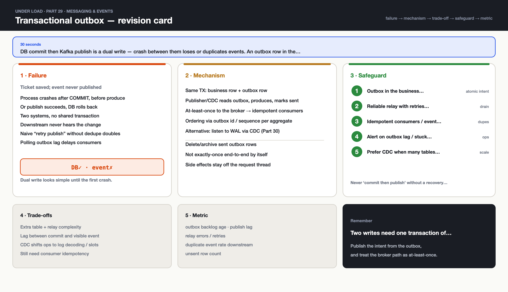
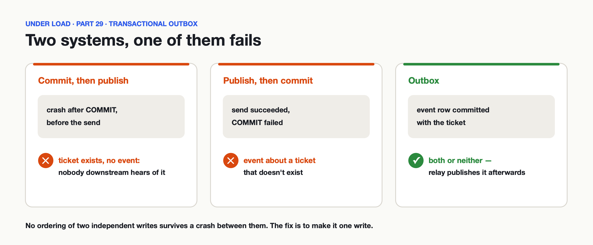
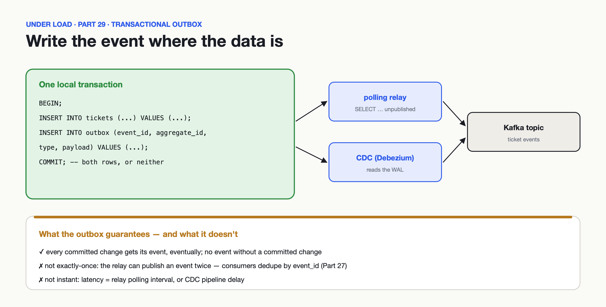
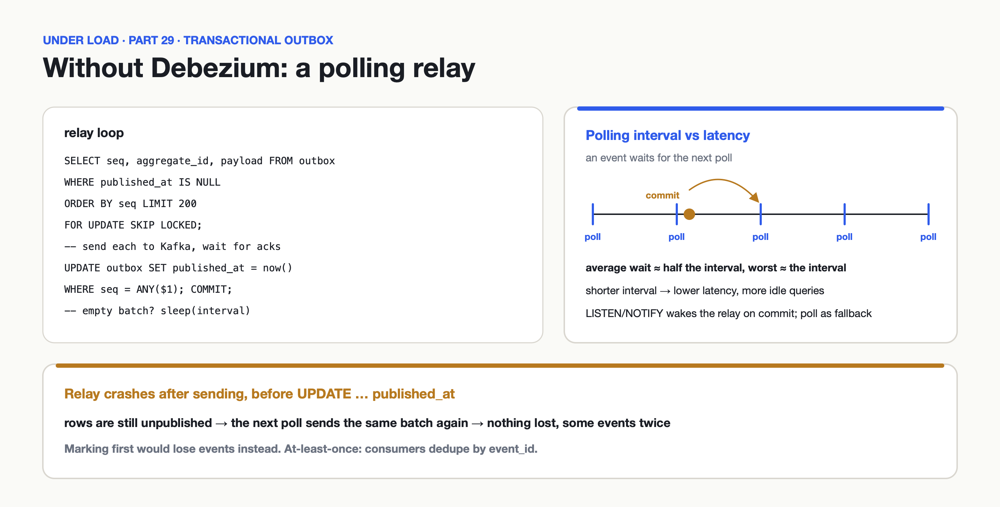
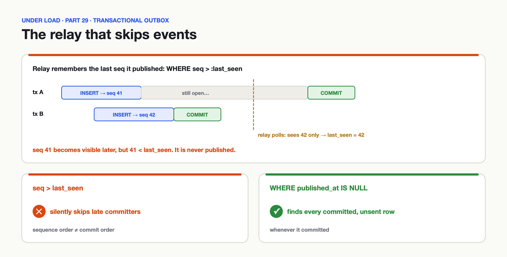
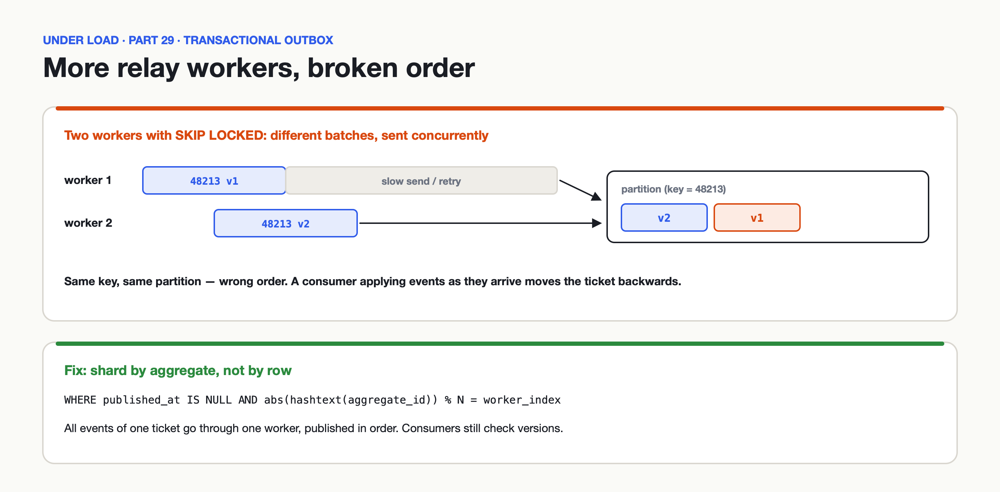
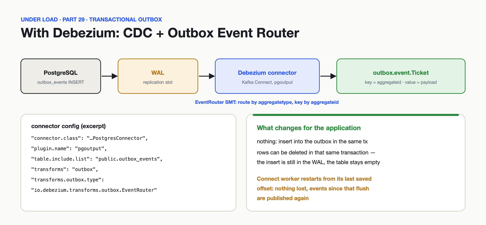
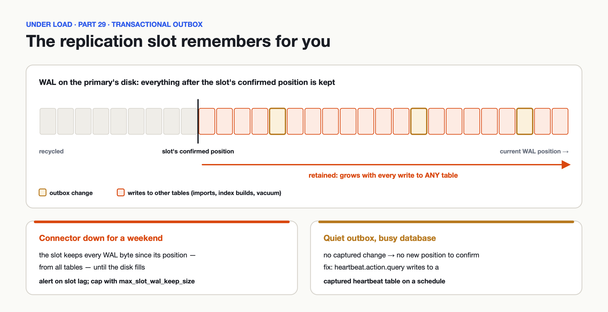
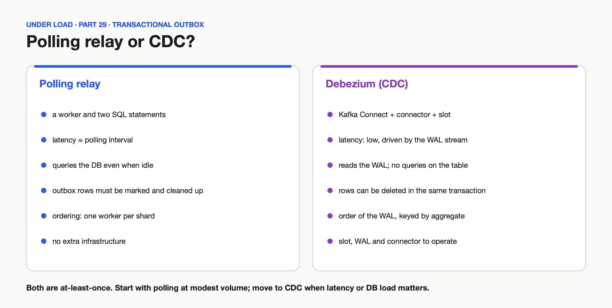
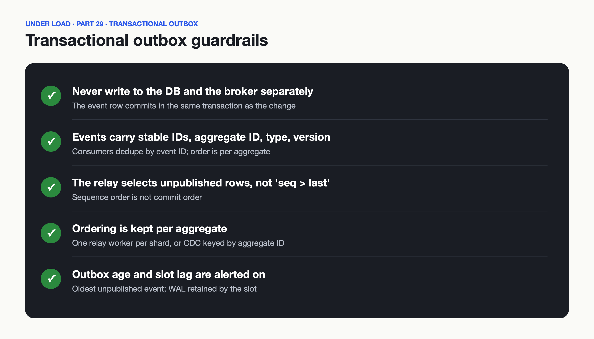

# The Transactional Outbox

### The transactional outbox: why "write to the database, then publish to Kafka" loses events, how an outbox table fixes it, and two ways to get the events out — a polling relay and Debezium — with the traps in each.

*Under Load · Part 29 · Messaging & Events*





---

Creating a ticket does two things. It inserts a row into the `tickets` table. And it publishes a `ticket.created` event to Kafka, which the SLA service, the notification service and the search indexer all consume (Part 27).

The code looks obviously right:

```python
db.execute("INSERT INTO tickets ...")
db.commit()
kafka.send("ticket-events", {"type": "ticket.created", ...})
```

Then one afternoon a deploy restarts the ticket service while Halcyon's agents are busy. A few tickets are committed in the database, but the process dies before the `send`. Those tickets exist; nobody else knows. No SLA timer starts, no confirmation email goes out, the tickets don't appear in search. Two days later a Halcyon customer escalates a ticket that no agent ever saw in their queue.

Someone flips the order — publish first, then commit — and creates the opposite bug. When the commit fails (a constraint violation, a deadlock, a statement timeout), the event is already out. The SLA service starts a timer for a ticket that doesn't exist, and the notification service emails a customer about it.

Neither version fails often. Both fail on every deploy, every crash and every database error that lands in the gap between the two lines. At the scale of a busy support product, "rarely" means every week.

This is the **dual-write problem**, and the standard fix is the **transactional outbox**.

---

## The dual-write problem

A **dual write** is when one operation must update two independent systems — here, a database and a message broker. There's no transaction that spans both: PostgreSQL can't roll back a Kafka message, and Kafka can't roll back a PostgreSQL commit. Whatever order the two writes are in, a crash, timeout or error between them leaves the systems disagreeing:

- **Database first, then broker:** the change is committed and the event never sent. Downstream systems silently miss it — the worse failure, because nothing anywhere records that something is missing.
- **Broker first, then database:** the event is sent and the change never committed. Downstream systems act on something that didn't happen.

The obvious patches don't close the gap:

- **Retrying the publish** helps with a broker hiccup, but if the process itself dies, there's nobody left to retry.
- **Publishing inside the transaction, before `COMMIT`**, is just "broker first" with extra steps: the commit can still fail after the send.
- **Distributed transactions** — two-phase commit, the XA standard — could in theory make the database and the broker commit together. Kafka doesn't participate in XA, most cloud brokers don't either, and where 2PC exists it adds latency, holds locks while a coordinator decides, and needs careful recovery when the coordinator itself fails.

The way out is to stop writing to two systems at all.

---

## The outbox pattern



The idea: write the event into the **same database**, in the **same transaction** as the change, into a table called the **outbox**. A separate process copies events from the outbox to the broker afterwards.

```sql
BEGIN;
INSERT INTO tickets (id, workspace_id, subject)
VALUES (48213, 7, 'Login fails after SSO change');
INSERT INTO outbox (event_id, aggregate_type, aggregate_id, type, payload)
VALUES ('6f1c0b9e-…', 'Ticket', '48213', 'ticket.created',
        '{"ticket_id": 48213, "workspace_id": 7, ...}');
COMMIT;
```

Because both rows are in one local transaction, they're committed together or not at all (Part 2). If the commit succeeds, the event is durably recorded next to the ticket. If it fails, neither exists. The dual write has become a single write to one system, and the database's own atomicity does the rest.

Getting the event from the outbox to Kafka is the second half, and there are two common ways:

1. **A polling relay** — a worker that repeatedly queries the outbox for unpublished events, publishes them, and marks them as published.
2. **Change data capture (CDC)** — a tool like **Debezium** that reads the database's write-ahead log (Part 6) and turns new outbox rows into Kafka messages, without querying the table.

The application code is identical for both: insert into the outbox in the same transaction. Only the relay differs.

### What the outbox guarantees — and what it doesn't

The guarantee changes shape rather than becoming perfect:

- **Every committed change gets its event, eventually.** No event exists without a committed change.
- **Not exactly-once.** The relay can publish an event **more than once** (both kinds of relay, as shown below), so delivery is at-least-once, and consumers must deduplicate by event ID (Part 27).
- **Not instant.** The event reaches Kafka after a delay that depends on the relay — the polling interval, or the CDC pipeline's lag.

That last point matters for the API's contract. The ticket API returns success once the transaction commits; downstream effects follow shortly after. Any client or test that expects the SLA timer to exist the instant the API returns is relying on something the design doesn't promise.

### What an outbox row should carry

- **`event_id`** — a unique, stable ID, generated once when the row is written. Consumers use it to deduplicate.
- **`aggregate_type`** and **`aggregate_id`** — what kind of entity the event is about and which one (here, `Ticket` and the ticket's ID). The aggregate ID becomes the Kafka message key, so all events of one ticket land in the same partition and stay in order.
- **`type`** and a **schema version** — so consumers know how to read the payload.
- **`payload`** — the event body, usually JSON.
- **`created_at`** — for monitoring how old the oldest unpublished event is.

An **aggregate**, in domain-driven design terms, is a cluster of data that changes together as a unit — a ticket with its status, assignee and fields. Ordering guarantees are usually needed per aggregate, not globally, which is what makes the outbox scale.

---

## Without Debezium: a polling relay



The simplest relay is a loop with two SQL statements:

```sql
-- 1. claim a batch of unpublished events
BEGIN;
SELECT seq, aggregate_id, payload FROM outbox
 WHERE published_at IS NULL
 ORDER BY seq
 LIMIT 200
 FOR UPDATE SKIP LOCKED;
-- 2. publish each one to Kafka and wait for the broker's acknowledgements
-- 3. mark them as published
UPDATE outbox SET published_at = now() WHERE seq = ANY($1);
COMMIT;
-- empty batch? sleep for the polling interval
```

A few details make this work in production:

- **`FOR UPDATE SKIP LOCKED`** locks the selected rows and makes any other relay instance skip them instead of waiting. Two relays never publish the same batch at the same time, and a second relay can take over immediately if the first one dies (its locks are released when its connection drops).
- **A partial index** on unpublished rows — `CREATE INDEX ON outbox (seq) WHERE published_at IS NULL` — keeps the query cheap even when the table holds millions of already-published events. The index contains only the handful of rows waiting to go out (Part 1 covers partial indexes).
- **Waiting for acknowledgements** before marking: the producer must be configured so that a successful send means the broker durably has the message (`acks=all` in Kafka). Marking rows as published on the strength of a send that was merely buffered in the client is how events get lost after all.

### Latency is the polling interval

Every event waits in the outbox until the next poll. With a polling interval of one second, an event committed just after a poll waits almost a second, one committed just before waits almost nothing — on average, about half the interval, plus the publish time. Polling every 100 milliseconds cuts the wait about tenfold, at the cost of ten times as many queries, which run whether there are events or not.

Two refinements soften the trade-off:

- **Poll again immediately when a batch was full.** A full batch means more are waiting; sleeping only after an empty or partial batch keeps the relay draining at full speed under load.
- **`LISTEN/NOTIFY`.** PostgreSQL can wake a listening connection when a transaction that called `NOTIFY` commits. A trigger on the outbox (or an explicit `NOTIFY` in the application's transaction) wakes the relay as soon as an event is committed, and a slow poll remains as a fallback in case a notification is missed — notifications are not durable, so they can't be the only mechanism.

### The relay crashes too

The relay has its own dual write: it publishes to Kafka, then marks the rows in PostgreSQL. If it crashes in between, the rows stay unpublished, and the next poll sends the same batch **again**.

There's no ordering of those two steps that avoids it. Marking first and then publishing would turn a crash into lost events — exactly the problem the outbox was built to remove. So the relay publishes first and accepts duplicates. Every crash, every deploy of the relay, and every timeout on the `UPDATE` can resend up to a batch of events. This is the concrete reason the outbox is at-least-once, and why consumers need the idempotency from Part 27. The duplicates are always the same events with the same `event_id`, which makes deduplication straightforward.

### The relay that skips events



A tempting optimisation is to not mark rows at all: remember the highest sequence number published, and next time ask for `WHERE seq > :last_seen`. No `UPDATE`, no dead rows, a simpler query. It's wrong, and it fails silently.

A sequence value is assigned when the row is **inserted**, but the row becomes visible to other sessions only when its transaction **commits** (Part 3). Two transactions can commit in the opposite order from their sequence numbers:

1. Transaction A inserts its outbox row and gets `seq = 41`, then goes on to do other work — update a counter, call a slow function.
2. Transaction B inserts `seq = 42` and commits immediately.
3. The relay polls. It sees only 42, publishes it, and sets `last_seen = 42`.
4. Transaction A commits. Row 41 becomes visible — but the relay only ever asks for `seq > 42`.

Event 41 is never published. There's no error, no gap in the broker, nothing in any log. The more concurrent writers and the longer their transactions stay open after inserting the outbox row, the more events slip through — and a busy afternoon at Halcyon is precisely when both are true.

Selecting by status — `WHERE published_at IS NULL` — finds every committed, unpublished row, no matter when it committed. If a watermark is really needed for performance, it has to trail behind: only advance past sequence values older than the longest possible transaction, or track the database's own transaction visibility (PostgreSQL exposes `pg_snapshot_xmin`, and some relays use it). Both are harder to get right than a status column and a partial index.

### More relay workers, broken order



When one relay can't keep up, the obvious move is to run two. With `SKIP LOCKED`, they never publish the same row. But they publish **concurrently**. Worker 1 takes a batch containing ticket 48213's version-1 event; worker 2 takes the next batch, containing version 2. If worker 2's send completes first, version 2 reaches the partition before version 1. Both carry the same key and land in the same partition — in the wrong order. Consumers that apply events as they arrive now move the ticket backwards.

The fix is to give each worker ownership of a slice of aggregates rather than a slice of rows:

```sql
WHERE published_at IS NULL
  AND abs(hashtext(aggregate_id)) % 4 = $worker_index   -- this worker's shard
```

All events of one ticket then go through one worker, which publishes them in sequence order. Adding workers means re-sharding, which has to be done with workers stopped or with a hand-off, so that two workers never own the same shard at once. Consumers should still check versions (Part 27) as a second line of defence.

The Kafka producer itself can also reorder: with retries enabled and several requests in flight per connection, a failed batch retried after a later one succeeded lands out of order. Kafka's **idempotent producer** (`enable.idempotence=true`, the default since Kafka 3.0) preserves order per partition across retries, which is another reason to leave it on.

### Cleanup and table health

Published rows pile up. A polling outbox needs a cleanup job that deletes rows published more than some days ago — keeping them for a while helps debugging and replay — in small batches, so it doesn't hold long locks or generate a burst of WAL.

The outbox is also one of the busiest tables in the database: every business write inserts into it and the relay updates every row once. That produces a steady stream of dead row versions, which PostgreSQL's autovacuum must clean up (Part 3). An outbox whose autovacuum falls behind bloats, and the relay's "cheap" query slowly stops being cheap. Some teams delete rows immediately after publishing instead of marking them, which turns the update into a delete but doesn't remove the vacuum work; others partition the outbox by day and drop old partitions whole.

### Events that can't be published

Occasionally an outbox row can't be published at all — a payload larger than the topic's maximum message size (`max.message.bytes`, about 1 MB by default in Kafka), or a serialization error. A relay that retries such a row forever stops publishing everything behind it, just like a poison message in a consumer (Part 28). The relay needs a retry limit and a **quarantine**: move the row aside, alert, and continue.

---

## With Debezium: CDC and the Outbox Event Router



**Change data capture (CDC)** reads changes from the database's own replication log instead of querying tables. **Debezium** is the most widely used open-source CDC platform. It runs as a set of connectors on **Kafka Connect**, Kafka's framework for moving data in and out of Kafka. For PostgreSQL, it uses **logical replication**: PostgreSQL decodes its write-ahead log (WAL) into row-level changes and streams them, in commit order, through a **replication slot** — a server-side record of how far this particular consumer has read. For MySQL, Debezium reads the binary log instead. (Part 30 goes deep into how this works and how it breaks.)

Because the WAL is written in commit order, CDC has no equivalent of the watermark bug: a transaction's changes appear in the stream when it commits, never before, and never skipped.

For the outbox, Debezium provides the **Outbox Event Router**, a **single message transform (SMT)** — a small function Kafka Connect applies to each record. Without it, Debezium would publish raw change records ("row inserted into `outbox_events`, here are the before and after column values") to a topic named after the table. The router turns each outbox row into a clean domain event instead:

- the **topic** comes from the `aggregatetype` column — by default, rows with `Ticket` go to `outbox.event.Ticket`;
- the **message key** is the `aggregateid` column, so all events of one ticket go to the same partition;
- the **value** is the `payload` column;
- the event `id` goes into a message header, and other columns (such as `type`) can be placed in headers or in the message envelope with `table.fields.additional.placement`.

The application side doesn't change: it inserts into the outbox table in the same transaction as the business change. The relay is replaced by configuration:

```json
{
  "connector.class": "io.debezium.connector.postgresql.PostgresConnector",
  "plugin.name": "pgoutput",
  "database.hostname": "tickets-db",
  "database.dbname": "tickets",
  "slot.name": "outbox_slot",
  "table.include.list": "public.outbox_events",
  "transforms": "outbox",
  "transforms.outbox.type": "io.debezium.transforms.outbox.EventRouter",
  "transforms.outbox.route.topic.replacement": "outbox.event.${routedByValue}"
}
```

(`pgoutput` is PostgreSQL's built-in logical decoding plugin, so nothing extra needs installing on the database server.)

### Delete the row in the same transaction

With CDC, the outbox table doesn't need to keep its rows at all. Debezium reads the **insert** from the WAL, not from the table. So the application can insert the outbox row and delete it again **in the same transaction**:

```sql
BEGIN;
INSERT INTO tickets (...) VALUES (...);
INSERT INTO outbox_events (id, aggregatetype, aggregateid, type, payload) VALUES (...);
DELETE FROM outbox_events WHERE id = '6f1c0b9e-…';
COMMIT;
```

The WAL still contains the insert, so the event is published; the table stays empty, so there's no cleanup job, no bloat and no growing index. The router builds events from inserts; the matching deletes don't become outbox events. This is the pattern Debezium's own documentation and examples describe.

PostgreSQL also offers a table-free variant: `pg_logical_emit_message()` writes an arbitrary message straight into the WAL inside the current transaction, and Debezium can capture these logical decoding messages. It skips the table entirely, at the cost of being PostgreSQL-specific and less familiar to most teams.

### Debezium is at-least-once too

Kafka Connect saves each source connector's position — for PostgreSQL, a position in the WAL — as an **offset**, flushed periodically (every 60 seconds by default, set by `offset.flush.interval.ms`). If the Connect worker dies, a new one resumes from the last saved offset and re-reads everything after it. Events published since that last flush are published **again**.

Nothing is lost — the replication slot still holds the WAL from the confirmed position onward — but every unclean restart can resend up to a flush interval's worth of events. Consumers deduplicate them exactly as with the polling relay. Recent Kafka Connect versions and Debezium releases can be configured for exactly-once delivery *into Kafka*, using Kafka transactions; that removes duplicates on the hop into the topic, but consumers that write to their own databases still need idempotency (Part 27).

### The replication slot remembers for you



A replication slot guarantees that PostgreSQL keeps every WAL segment the connector hasn't confirmed yet. That's what makes CDC lossless — the connector can be down for an hour and pick up exactly where it left off — and it's the most important thing to operate.

The catch: WAL is shared by the whole database. The slot can't keep "only the outbox's part"; it keeps **all** WAL generated since the connector's confirmed position, from every table. While the connector is down, every write anywhere in the database — bulk imports, index builds, vacuum activity — accumulates on the primary's disk. On a busy database, a connector that's down over a weekend can fill the disk, and a primary that runs out of disk space stops accepting writes. A CDC pipeline added to make events reliable becomes the cause of a full outage.

Guardrails:

- **Alert on slot lag**: `pg_wal_lsn_diff(pg_current_wal_lsn(), restart_lsn)` from `pg_replication_slots`, in bytes, against a threshold well below the free disk space.
- **Cap it** with `max_slot_wal_keep_size` (PostgreSQL 13+). If the slot falls too far behind, PostgreSQL invalidates it instead of filling the disk. The connector then has to re-snapshot (Part 30) — painful, but far better than the primary stopping.
- **Drop slots that are no longer used.** A slot created for a test connector and forgotten pins WAL forever.

### The quiet outbox on a busy database

A subtler version of the same problem: when the **outbox is quiet but the rest of the database is busy**, the connector receives no outbox changes, so it has no new position to confirm — and the slot keeps holding WAL that was generated by other tables, even though none of it matters to the connector. A ticket database with steady background writes and an outbox that only sees events during business hours accumulates WAL every night.

Debezium's **heartbeat** solves this. With `heartbeat.interval.ms` set, the connector periodically emits a heartbeat and confirms its position. With `heartbeat.action.query`, it also runs a small write — typically an update to a one-row heartbeat table included in the capture — so there's always a recent captured change to move the confirmed position forward. It's one of the settings that is easy to omit and painful to discover.

### Other operational details

- **Failover.** Before PostgreSQL 17, logical replication slots lived only on the primary and were not copied to standbys; after a failover, the slot was gone and the connector had to re-snapshot. PostgreSQL 17 added slot synchronisation to standbys (`failover` slots with `sync_replication_slots`). Managed databases document their own behaviour here, and it's worth reading before the first failover, not after.
- **Schema of the outbox.** The router expects its column names (`id`, `aggregatetype`, `aggregateid`, `type`, `payload` by default); different names are mapped through configuration.
- **Connector health.** A Connect task can fail and stay failed while the worker process looks healthy. Task status needs its own alert.

---

## Polling relay or CDC?



**A polling relay** is a worker and two SQL statements. No extra infrastructure; easy to understand, test and debug; works on any database with transactions. Its latency is about the polling interval; it queries the database even when idle; and it needs a status column, a partial index, a cleanup job, attention to vacuum, and care with ordering when scaled out.

**Debezium** reads the WAL. It delivers in commit order with low latency and no polling queries; rows can be deleted in the same transaction, so the table never grows; and the watermark bug can't happen. In exchange, there's Kafka Connect, a connector and a replication slot to deploy, monitor and upgrade — and the WAL-retention risk, which can take down the primary if it's ignored.

A reasonable path: start with a polling relay at modest volume, move to CDC when latency or database load matters, or when the organisation already runs Kafka Connect. Because the application code — writing to the outbox in the transaction — is the same for both, the switch doesn't touch the services. During the switch, both can run briefly with consumers deduplicating, so no event falls in the gap.

---

## Rolling it out

Moving an existing service from "commit, then publish" to an outbox is a migration with a few traps.

**Introduce the outbox write first, behind a flag.** The service inserts outbox rows in its transactions while still publishing directly. The relay is deployed but publishes to a shadow topic, so its output can be compared with the direct publishes.

**Switch atomically per event type.** For each event type, stop the direct publish and point the relay at the real topic in the same release. Running both against the real topic produces every event twice — tolerable if consumers deduplicate by a shared event ID, confusing if they don't.

**Make sure every write path goes through the transaction.** Background jobs, admin tools and data fixes that update tickets directly in SQL bypass the application's outbox code. Either they write outbox rows too, or their changes are invisible to downstream systems. CDC on the business tables themselves (Part 30) is the alternative when such paths can't be controlled.

**Test the crash windows.** Kill the service between commit and response, kill the relay between publish and mark, kill the Connect worker mid-stream — and verify that nothing is missing and every duplicate is absorbed.

---

## Guardrails that prevent the next one



1. **Never write to the database and the broker separately.** The event row is committed in the same transaction as the change.
2. **Events carry a stable ID, aggregate ID, type and version.** Consumers deduplicate by event ID; ordering is per aggregate.
3. **A polling relay selects unpublished rows** (`published_at IS NULL`), never `seq > last_seen`, because sequence order isn't commit order.
4. **Ordering is kept per aggregate**: one relay worker per shard of aggregates, or CDC keyed by aggregate ID.
5. **Outbox age and slot lag are alerted on**: the oldest unpublished event, and the WAL retained by the replication slot.

---

## What to keep on the dashboard

- **Age of the oldest unpublished event** — the best single signal that the relay or connector is stuck, and a far better alert than "relay process is up."
- **Outbox backlog**: unpublished rows (polling) or connector lag (CDC).
- **Publish latency**: from event creation to the broker, at the median and the tail.
- **Publish failures and retries**, and events moved to quarantine.
- **Duplicate events seen by consumers** — dedupe hits — which spike after relay or connector restarts.
- **For Debezium:** replication slot lag in bytes, connector task status, and time since the last confirmed position.
- **For polling:** outbox table size, dead-row count and autovacuum activity, and the cleanup job's progress.

---

## Recap

### Why can't a service simply update the database and then publish to Kafka?
They're two independent systems with no shared transaction. A crash, deploy or timeout between the two leaves committed changes without events, and nothing records that anything is missing. Publishing first creates the opposite problem: events about changes that never committed.

### How does the transactional outbox solve it?
The event is inserted into an outbox table in the same local database transaction as the change, so both are committed or neither is. A separate relay or CDC connector then publishes events from the outbox to the broker.

### Does the outbox give exactly-once delivery?
No. It guarantees that every committed change produces its event and no event exists without one, but both a polling relay and a CDC connector can publish an event more than once after a crash. Delivery is at-least-once, and consumers deduplicate by event ID.

### How does a polling relay work?
It selects a batch of unpublished rows with `FOR UPDATE SKIP LOCKED`, publishes them, waits for the broker to acknowledge, and marks them published in the same transaction. A partial index keeps the query cheap; latency is roughly the polling interval, which `LISTEN/NOTIFY` can shorten.

### Why is `WHERE seq > last_seen` a dangerous relay query?
Sequence numbers are assigned at insert time, but rows become visible at commit time. A transaction that commits after a later sequence number has been published is skipped forever, silently. Selecting by a published-status column finds every committed, unpublished row.

### How do concurrent relay workers break ordering, and how is it prevented?
Two workers publishing different batches at the same time can deliver a ticket's later event before its earlier one. Assigning each worker a shard of aggregate IDs keeps all events of one aggregate in one worker, published in order; consumers still check versions.

### How does the Debezium outbox work?
Debezium reads the outbox table's inserts from PostgreSQL's WAL through a logical replication slot, and the Outbox Event Router turns each row into an event: topic from the aggregate type, key from the aggregate ID, value from the payload. Rows can be deleted in the same transaction, so the table never grows.

### What is the main operational risk of CDC?
The replication slot keeps all WAL the connector hasn't confirmed — from every table. A connector that's down, or an outbox that's quiet while the database is busy, can pin WAL until the primary's disk fills. Alert on slot lag, cap it with `max_slot_wal_keep_size`, and configure a heartbeat.

### Polling vs CDC — what are the trade-offs?
Polling is simple and needs no extra infrastructure, but adds latency and query load and needs cleanup, vacuum attention and care with ordering. CDC gives low latency in commit order without polling and keeps the table empty, but adds Kafka Connect, a connector and a replication slot to operate.

### Why do consumers still need idempotency with an outbox?
Because both relays and CDC connectors are at-least-once: a crash after publishing but before recording progress sends the same events again. The outbox removes lost and phantom events; consumers remove duplicates.

---

## Next

- **Lab (run + measured write-up):** [29-transactional-outbox](https://github.com/b-basoglu/under-load/tree/main/29-transactional-outbox)
- **Next:** [Change Data Capture](../30-change-data-capture/article.md) — How Debezium actually reads a database: logical decoding, replication slots, snapshots, schema changes — and what happens when any of them goes wrong.
