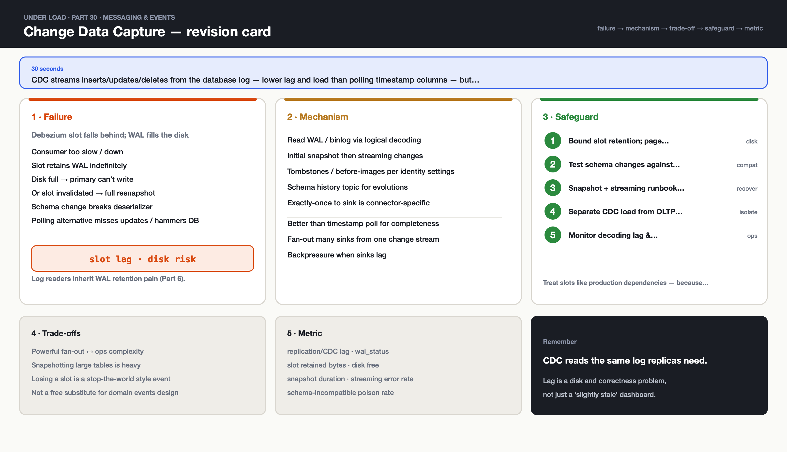
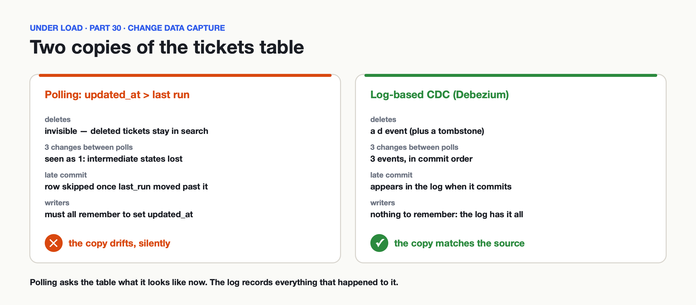
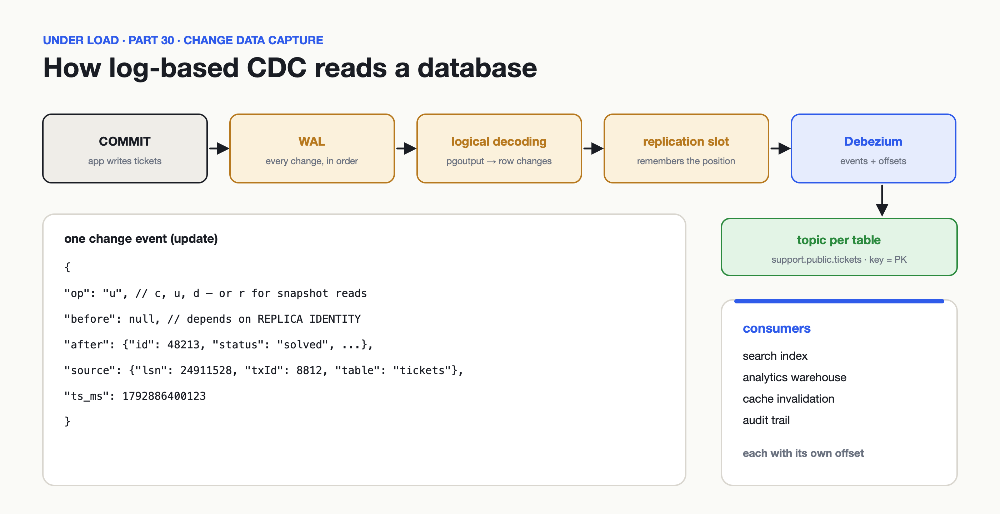
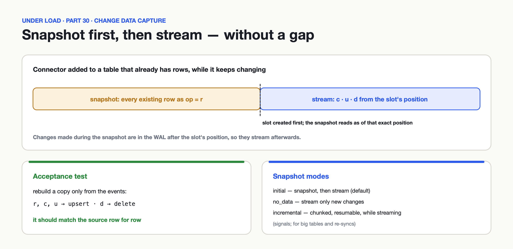
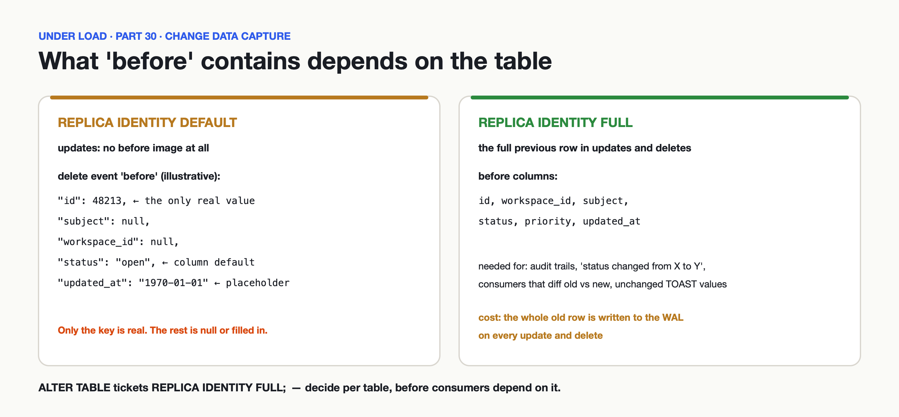
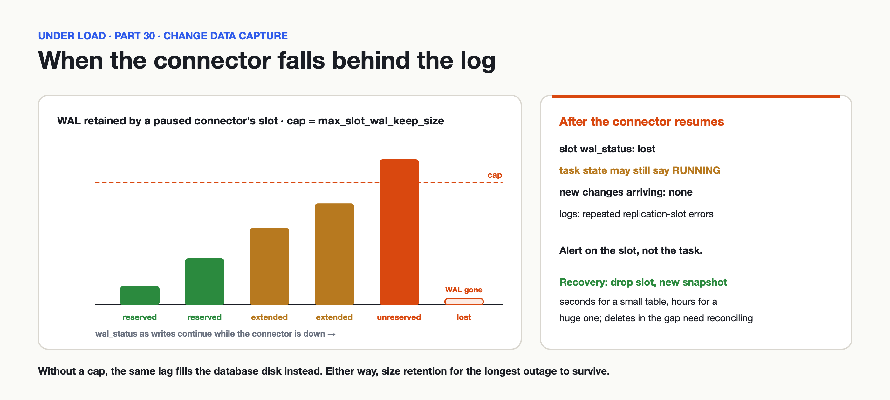
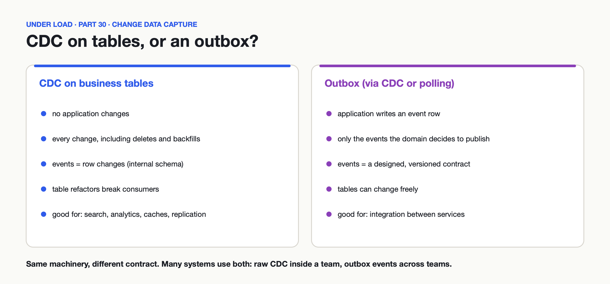
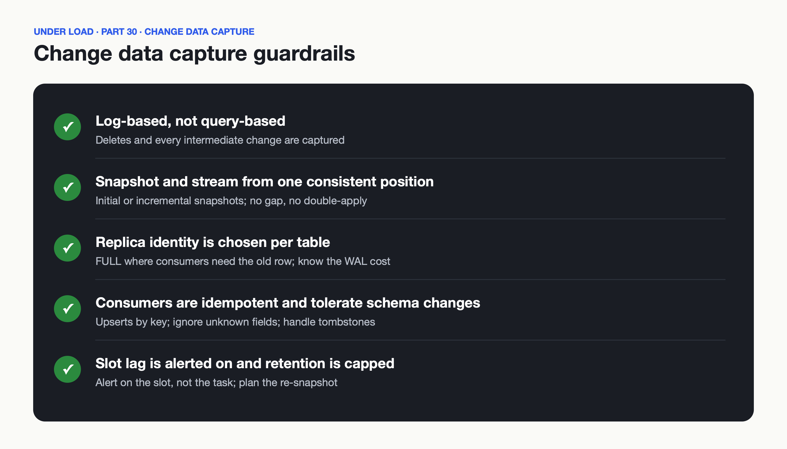

# Change Data Capture

### Change data capture: streaming every insert, update and delete out of a database by reading its log instead of its tables — how snapshots, replication slots and before-images work, and what breaks when the connector falls behind.

*Under Load · Part 30 · Messaging & Events*





---

Ticket search runs on its own search cluster, and it has to stay in sync with the `tickets` table. The first version of the sync was a job that ran every second:

```sql
SELECT * FROM tickets WHERE updated_at > :last_run;
```

It looked fine for months. Then support agents started reporting "ghost tickets": tickets that had been deleted — spam, duplicates, Halcyon's test imports — still showing up in search. A subtler complaint came from the analytics team, which used the same job to count status changes: their numbers were consistently low, and nobody could say by how much.

Both problems are built into the query. A deleted row no longer exists, so there's no `updated_at` to compare and nothing for the query to return — the job never learns about deletes. And when a ticket changes three times between two runs, the query sees only its final state; the two intermediate changes are gone. A third problem hadn't shown up yet but was waiting: the same visibility trap as Part 29's relay. A transaction that sets `updated_at` and then takes a while to commit becomes visible *after* the job has moved `last_run` past its timestamp, and its change is skipped forever.

The fix is to stop asking the tables what changed and instead read the place where the database already writes down every change, in order: its log. That approach is **change data capture**.

---

## What change data capture is

**Change data capture (CDC)** turns every committed change to a database — every insert, update and delete — into an event in a stream that other systems can consume. Instead of each downstream system querying the tables, one CDC process publishes the changes once, and search, analytics, caches and audit systems each consume them at their own pace, each tracking its own position.

There are two ways to do it:

- **Query-based CDC** polls tables for changed rows, usually by a timestamp or version column. It's simple, works on any database and needs no special access. But it misses deletes (unless rows are only ever soft-deleted), collapses intermediate changes, depends on every writer updating the timestamp — including scripts and manual fixes — is exposed to the commit-visibility gap above, and puts query load on the database that grows with polling frequency.
- **Log-based CDC** reads the database's **transaction log** — the write-ahead log (WAL) in PostgreSQL (Part 6), the binary log (binlog) in MySQL, the redo log in Oracle, the transaction log in SQL Server. Every committed change is already written there, in commit order, before the database acknowledges the commit. Reading it captures everything, including deletes and every intermediate state, with no queries on the tables.

**Debezium**, used in Part 29 for the outbox, is the most common open-source log-based CDC platform. It runs as connectors on Kafka Connect and supports PostgreSQL, MySQL, SQL Server, Oracle, MongoDB and others. This article looks at how it works when pointed at business tables directly, using PostgreSQL as the example.

---

## How log-based CDC reads PostgreSQL



The WAL is a binary, physical log: "these bytes changed on this page." That's what crash recovery and physical replicas need, but it's useless to a search indexer. To turn it into row changes, PostgreSQL provides **logical decoding**:

1. **The application commits.** The change goes into the WAL, as for any write. Logical decoding requires `wal_level = logical`, which makes PostgreSQL log a little more information — enough to reconstruct rows.
2. **Logical decoding** reads the WAL and decodes it into row-level changes — "row 48213 in `tickets` was updated, the new values are …" — through an **output plugin**. `pgoutput` is the plugin built into PostgreSQL, the same one its native logical replication uses.
3. **A replication slot** records how far this particular consumer has read and confirmed. PostgreSQL keeps all WAL from the slot's position onward, so the consumer can disconnect and resume without missing anything. (Part 29 showed what this costs when the consumer stops.)
4. **A publication** lists which tables are decoded — here, `tickets`, `comments` and a few others. Creating a narrow publication on purpose, rather than letting a connector create one for all tables, keeps unrelated tables out of the stream.
5. **Debezium** connects through the slot, converts each change into an event, and writes it to a Kafka topic per table — for example `support.public.tickets` — with the row's primary key as the message key. It periodically saves its position — the **LSN**, or log sequence number, a byte position in the WAL — as a Kafka Connect offset, and confirms it to the slot so PostgreSQL can recycle older WAL.

Decoding happens on commit: changes of a transaction are emitted only once it commits, and changes of a transaction that rolls back are never emitted. Downstream systems never see uncommitted data.

### What a change event looks like

Each Debezium event has a standard shape:

- **`op`** — `c` (create), `u` (update), `d` (delete), or `r` (read, emitted for rows copied during a snapshot).
- **`before`** and **`after`** — the row before and after the change. A create has no `before`; a delete has no `after`.
- **`source`** — where it came from: the LSN, transaction ID, database, schema and table, and the commit timestamp.
- **`ts_ms`** — when the connector processed it, which, compared with the source commit time, gives the pipeline's lag.

Because events come from the log in commit order and are keyed by primary key, all changes to one ticket arrive in order in one Kafka partition. There's no order across keys, and none across tables: a ticket's insert and its first comment's insert travel on different topics and can be consumed in either order. That's the same per-key ordering as Part 27, and consumers that need cross-table consistency must handle it — for example by tolerating a comment whose ticket hasn't arrived yet. Debezium can optionally emit **transaction metadata** (begin and end markers with event counts) for consumers that need to group changes by transaction.

### Deletes and tombstones

A delete produces a `d` event with the old row (as much as the log contains — see below) and, by default, a second message: a **tombstone**, with the same key and an empty value. Tombstones exist for Kafka's **log compaction**, a retention mode that keeps only the latest message per key; a tombstone tells compaction that the key can be removed entirely. Consumers must expect messages with no value at all and treat them accordingly — usually by ignoring them, since the `d` event already carried the delete.

---

## Snapshot first, then stream



A new search index needs the tickets that **already** exist, not just future changes. The WAL doesn't help with that: WAL is recycled continuously, and the change that created a ticket three years ago is long gone. So a CDC connector starts with a **snapshot**: it reads the existing rows and emits each as an `r` event, then switches to streaming changes from the log.

The hard part is the switch. If the snapshot reads the table at one moment and streaming starts at another, changes in between are either lost (streaming started too late) or applied twice (streaming started too early, which is harmless only for idempotent consumers). The fix relies on a PostgreSQL feature: when a logical replication slot is created, PostgreSQL can **export a snapshot** — a consistent view of the database exactly as of the slot's starting position. Debezium creates the slot first, reads the tables inside a transaction that uses that exported snapshot, and then streams from the slot. Every change committed after the snapshot point is in the WAL after the slot's position, so it's streamed; every change before it is in the snapshot. Nothing falls between them, even while the table is being modified throughout.

The result can be checked directly: a copy of the table built only from the events — upsert on `r`, `c` and `u`, remove on `d` — matches the source table row for row, which is a good acceptance test for any new CDC pipeline.

### Snapshot modes

- **`initial`** (the default): snapshot, then stream.
- **`no_data`**: only stream new changes. Used for the outbox in Part 29, where old rows don't matter.
- **`initial_only`**: snapshot and stop — a one-off copy.
- **`when_needed`**: snapshot only if there's no usable offset, for example after the slot was lost.
- **Incremental snapshots**: triggered by a **signal** (a row inserted into a signalling table, or a Kafka message) while streaming continues. The table is read in chunks by primary key, with watermarks written into the log around each chunk so that any change streamed during the chunk takes precedence over the chunk's copy. The approach comes from Netflix's DBLog design. Incremental snapshots are resumable if interrupted and can target a single table, which makes them the practical choice for very large tables and for re-syncing one table without stopping the others.

A full initial snapshot reads the whole table and holds a long-running transaction while it does. On a large, busy table that has costs of its own: the old snapshot prevents vacuum from removing dead rows for its duration (Part 3), and the read competes with production traffic. It should be planned like any big batch job — or replaced by an incremental snapshot.

---

## What "before" contains depends on the table



Consumers often want to know not just the new state but what changed: "status went from `pending` to `solved`." That needs the `before` image. Whether it's there depends on the table's **replica identity**, a PostgreSQL setting that decides how much of the old row is written to the WAL:

- **`DEFAULT`** — only the old primary key is logged, and only when it's needed (a delete, or an update that changes the key). So ordinary update events have **no `before` at all**, and delete events carry the key and nothing reliable beyond it. Depending on the connector's settings, the other columns come out `null` — or, for columns declared `NOT NULL`, filled with the column's default or a placeholder such as the Unix epoch for a timestamp. Those values look real and aren't. A consumer that records "ticket 48213 was deleted while in status `open`" from such an event is recording the column default, not the ticket's status.
- **`FULL`** — the entire old row is logged on every update and delete. After `ALTER TABLE tickets REPLICA IDENTITY FULL`, both carry every column of the previous row.
- **`USING INDEX`** — the columns of a chosen unique index are logged, a middle ground for tables without a primary key.

A related trap: PostgreSQL stores large values (long ticket descriptions, big JSON documents) out of line, in **TOAST** storage. When an update doesn't touch such a column, the WAL doesn't repeat its value, so the `after` image can't include it either. Debezium marks those fields with a placeholder (`__debezium_unavailable_value` by default). A consumer that writes the placeholder into the search index overwrites a real description with garbage. Either the consumer must merge — keep the existing value when it sees the placeholder — or the table needs `REPLICA IDENTITY FULL`.

`FULL` isn't free: the whole old row goes into the WAL on every update and delete, which increases WAL volume, replication traffic to standbys and storage. Choose it per table, for the tables whose consumers actually need old values — audit trails, change histories, consumers that compare old and new — and decide it *before* consumers start depending on what the events contain.

---

## Schema changes

Tables change. A migration runs `ALTER TABLE tickets ADD COLUMN priority text DEFAULT 'normal'`, and the next update event's `after` includes `priority`.

How the connector learns about it differs by database. PostgreSQL's logical decoding doesn't stream DDL statements; instead, `pgoutput` sends a **relation message** describing the table's current columns before the first change that uses them, and Debezium updates its view of the table from that. MySQL's binlog does contain DDL, so Debezium's MySQL connector parses it and keeps a **schema history** topic to know what each table looked like at every point in the log.

The connector handling a schema change doesn't mean consumers do. The usual rules:

- **Adding a nullable column** (or one with a default) is safe for consumers that ignore fields they don't know. Strict parsers that reject unknown fields break — the Part 28 incident, in CDC form.
- **Renaming or dropping a column**, or changing its type, breaks consumers that use it. Treat it as a breaking change: add the new column, migrate consumers, then remove the old one in a later release.
- **A schema registry** — used with Avro, Protobuf or JSON Schema converters instead of plain JSON — records every version of each table's schema and can enforce compatibility rules, so an incompatible change is rejected before it reaches consumers.

This is the fundamental trade-off of CDC on business tables: the events **are** the table's internal structure. Every refactor of the table — splitting a column, normalising a field into another table — is a change to an interface other teams depend on, whether the team owning the table knows it or not.

---

## When the connector falls behind the log



Part 29 showed that a stopped connector makes the replication slot keep WAL — from every table — which can fill the database's disk. The standard safety valve is **`max_slot_wal_keep_size`** (PostgreSQL 13+): a cap on how much WAL any slot may hold. The `wal_status` column of `pg_replication_slots` reports where a slot stands:

- **`reserved`** — within normal limits.
- **`extended`** — beyond `max_wal_size`, but still kept because of the slot.
- **`unreserved`** — past the cap; the oldest needed WAL may be removed at the next checkpoint.
- **`lost`** — the WAL the slot needs is gone. The slot can no longer be used.

Past the cap, PostgreSQL gives up on the slot rather than fill the disk. **The database is protected. The CDC pipeline is not.** The changes between the connector's last confirmed position and the oldest WAL still on disk no longer exist anywhere in the log.

What happens next is easy to miss. When the connector resumes, it can't read from the slot, and depending on version and retry settings it may keep retrying for a long time — logging errors about the replication slot — while Kafka Connect still reports the task as `RUNNING`. Nothing new arrives in Kafka, and a dashboard watching task status shows green. **Alert on the slot, not the task**: slot lag in bytes, `wal_status`, and the age of the newest event on the topic compared with the source's latest commit.

Recovery is a fresh start: drop the lost slot, create a new one, and take a **new snapshot**, because the changes in the gap are gone from the log. Consumers must cope with receiving every row again as an `r` event — idempotent upserts handle that — and with the deletes that happened in the gap, which a snapshot can't show (a deleted row simply isn't in it). A downstream copy that only upserts will keep those deleted rows forever; rebuilding the copy from scratch, or reconciling it against the snapshot, removes them.

For a small table, a re-snapshot takes seconds. For a table with hundreds of millions of rows, it takes hours and loads the database while it runs. That's why retention should be sized for the longest connector outage the team must survive — a long weekend, a broken deploy that nobody notices until Monday — and why incremental snapshots and a written, tested re-snapshot runbook matter.

### Other ways the log disappears

- **Failover.** Before PostgreSQL 17, logical slots existed only on the primary; after a failover to a standby, the slot was gone and the connector had to re-snapshot. PostgreSQL 17's slot synchronisation to standbys addresses this; managed services document their own behaviour.
- **MySQL binlog expiry.** MySQL doesn't have slots; it deletes binlogs after `binlog_expire_logs_seconds` (30 days by default in MySQL 8). A connector that falls further behind than that finds its position gone, with the same outcome.
- **Restores.** A database restored from backup has a different log history; connector offsets that point into the old one are meaningless.

---

## CDC on tables, or an outbox?



Both use the same machinery — Part 29's outbox with Debezium was CDC on a special table. The difference is the **contract**:

- **CDC on business tables** needs no application changes and captures everything, including deletes, bulk backfills and manual fixes done directly in SQL. But the events are the table's internal structure, every refactor can break consumers, and the events describe *rows*, not *intent*: an update that sets `status = 'solved'` doesn't say whether an agent solved the ticket or an automation closed it. It's ideal for systems that want a **copy** of the data: search indexes, analytics warehouses, caches, cross-region copies.
- **An outbox** requires the application to write an event row in the same transaction, but the events are a **designed, versioned contract** — `ticket.created`, `ticket.solved_by_agent` — carrying business meaning, and the tables behind them can change freely. It's the better choice for **integration between services** owned by different teams.

Many organisations use both: raw table CDC inside a team's own data pipeline, outbox events across team boundaries.

Either way, CDC is **asynchronous**. Downstream systems are **eventually consistent**: in normal operation they trail the source by a short delay — typically well under a second when the pipeline is healthy — and by much more during an outage, a re-snapshot or a burst of writes. A user who updates a ticket and immediately searches may not see the change yet — the read-your-writes problem of Part 34.

---

## Consumers

Everything from Part 27 applies, plus a few CDC specifics:

- **Idempotent apply.** Delivery is at-least-once: after a connector restart, events since the last saved offset are sent again. Upserts by primary key, and deletes that tolerate a missing row, make repeats harmless.
- **Position checks.** Each event carries its LSN, which only increases. A consumer can store the last applied LSN per key and skip anything older — protection against replays, re-snapshots and reprocessing from an earlier offset.
- **Handle snapshots, tombstones, placeholders and schema changes.** `op = r` means "a row that already existed"; empty values are tombstones; unavailable-value placeholders must not overwrite real data; unknown fields are ignored.
- **Each consumer tracks its own progress** — its own consumer-group offset — so search, analytics and caches can each fall behind, be rebuilt or replay independently.
- **Reconcile periodically.** Comparing row counts or checksums between the source and a downstream copy catches the failures that produce no errors: a gap after a lost slot, a consumer bug that dropped a class of events.

---

## Rolling out CDC safely

**Start with a narrow publication and a dedicated database user** with only the replication privileges the connector needs, so that adding the connector doesn't silently start streaming every table, including ones with sensitive data.

**Set the cap and the alerts before the first connector runs.** `max_slot_wal_keep_size`, slot-lag alerts and topic-freshness alerts are cheap to configure and painful to retrofit after the first full disk.

**Decide replica identity per table up front**, and document what consumers can rely on in `before` images.

**Run the first snapshot off-peak** or use an incremental snapshot, and verify the result with a full comparison against the source.

**Rehearse the bad day.** Stop the connector until the slot is invalidated in a staging environment, then follow the re-snapshot runbook end to end. The first time a team does this should not be in production.

---

## Guardrails that prevent the next one



1. **Log-based, not query-based.** Deletes and every intermediate change are captured; nothing depends on an `updated_at` column being set or becoming visible in time.
2. **Snapshot and stream from one consistent position** — initial or incremental snapshots — so there's no gap and nothing is applied twice.
3. **Replica identity is chosen per table**: `FULL` where consumers need old values or TOASTed columns, with its WAL cost understood.
4. **Consumers are idempotent and tolerate schema changes**: upserts by key, unknown fields ignored, tombstones and placeholders handled.
5. **Slot lag is alerted on and retention is capped** — alert on the slot, not the task — and the re-snapshot procedure is written down and tested.

---

## What to keep on the dashboard

- **Replication slot lag** in bytes, and `wal_status` (`reserved`, `extended`, `unreserved`, `lost`).
- **End-to-end event age**: time from commit to arrival in Kafka, and to each consumer applying it.
- **Source position vs connector position**: the current WAL LSN against the connector's confirmed LSN.
- **Connector task state and error logs** — read together with slot status, since a stuck connector can report `RUNNING`.
- **Events per second by table and operation**, to spot a backfill or a sudden burst of deletes.
- **Consumer lag** per consumer group on each CDC topic.
- **Snapshot progress** during initial or incremental snapshots, and **reconciliation results** between source and copies.

---

## Recap

### What is change data capture?
Turning every committed insert, update and delete into an event stream that downstream systems consume, so they don't have to query the source tables. One connector publishes the changes once; each consumer processes them at its own pace.

### Why is log-based CDC better than polling a timestamp column?
Polling can't see deletes, collapses several changes between polls into one, relies on every writer updating the timestamp, and can skip transactions that commit after the poller has moved past their timestamp. The log already contains every committed change in commit order, so reading it captures all of them without querying the tables.

### How does Debezium read changes from PostgreSQL?
Through logical decoding: PostgreSQL decodes the WAL into row changes with the `pgoutput` plugin, for the tables in a publication, through a replication slot that records the consumer's position. Debezium turns each change into an event with `op`, `before`, `after` and `source` fields, keyed by primary key, one topic per table, and saves its LSN as an offset.

### How do you bootstrap an existing table before streaming new changes?
With a snapshot taken at the exact log position where streaming begins: Debezium creates the slot first, reads the tables using the snapshot PostgreSQL exports at that position, then streams from the slot. Nothing falls in between. Incremental snapshots do the same in resumable chunks while streaming continues, for large tables and re-syncs.

### What does the "before" image contain?
It depends on the table's replica identity. With `DEFAULT`, updates have no before image and deletes carry only the key — other fields are null or filled with defaults and placeholders that look real. With `FULL`, the entire previous row is included, at the cost of more WAL. Unchanged TOASTed columns appear as placeholders unless the identity is `FULL`.

### How are schema changes handled?
The connector picks up new columns automatically, but consumers must tolerate them. Adding columns is safe for consumers that ignore unknown fields; renames, drops and type changes are breaking changes that need an expand-migrate-contract rollout. A schema registry can enforce compatibility.

### What happens when the connector falls behind log retention?
Without a cap, the slot keeps WAL until the disk fills. With `max_slot_wal_keep_size`, the slot becomes `lost`: the changes in the gap are gone, nothing new flows, and the connector task may still report `RUNNING`. Recovery requires a new slot and a full re-snapshot, plus reconciliation for deletes that happened in the gap.

### CDC vs transactional outbox — when would you use each?
CDC on tables when downstream systems need a copy of the data and the table structure is an acceptable contract: search, analytics, caches. An outbox when other services need designed, versioned domain events that carry intent and stay stable while the tables change.

### What delivery and consistency guarantees does CDC give?
At-least-once delivery, ordered per key within a table, with no order across tables, and eventual consistency: consumers trail the source by a short delay normally and by much more during outages. Consumers must be idempotent and should check positions.

---

## Next

- **Lab (run + measured write-up):** [30-change-data-capture](https://github.com/b-basoglu/under-load/tree/main/30-change-data-capture)
- **Next:** [Sagas: Orchestration vs Choreography](../31-sagas/article.md) — Creating a paid ticket touches billing, entitlements and notifications — three services, no shared transaction. How to make it all happen or all undo, and what "undo" even means.
