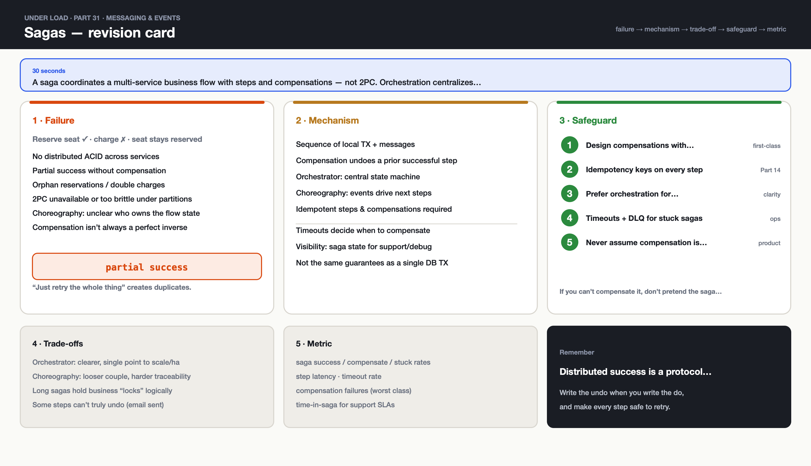
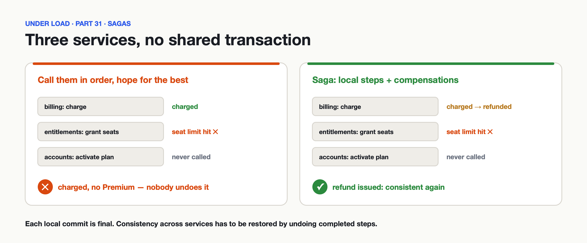
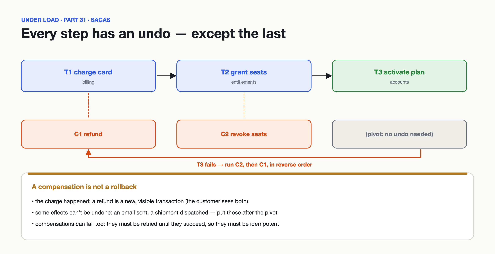
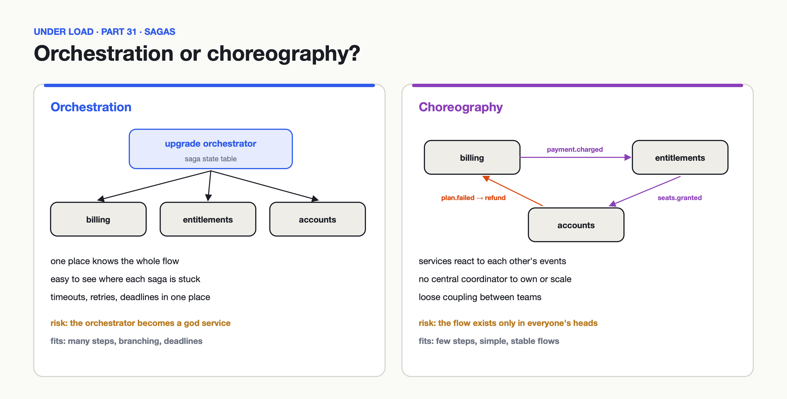
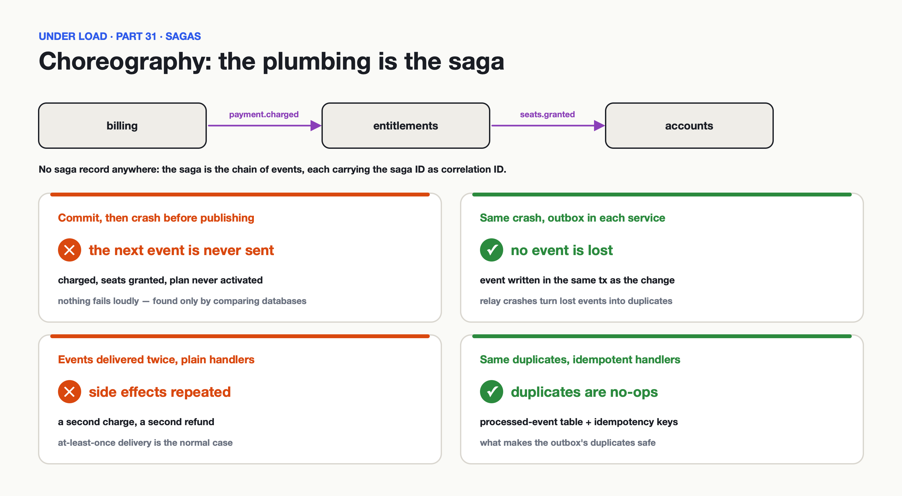
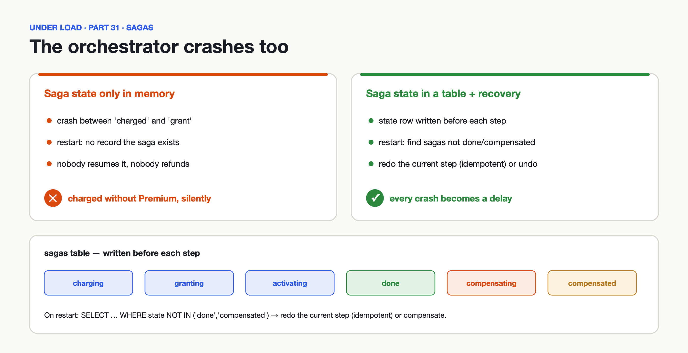
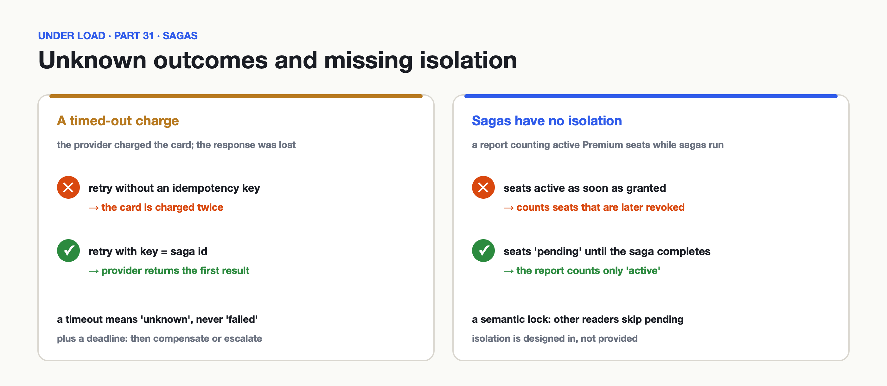
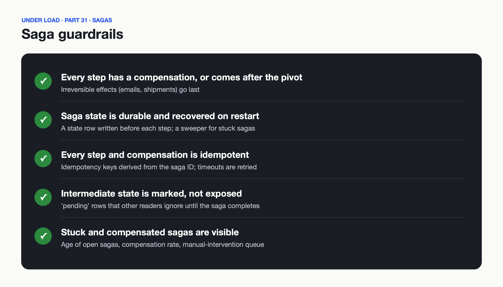

# Sagas: Orchestration vs Choreography

### Sagas: making a business operation that spans several services succeed completely or undo itself — compensations, orchestration vs choreography, crash recovery, timeouts and the missing isolation.

*Under Load · Part 31 · Messaging & Events*





---

Halcyon wants to upgrade to **Premium Support**: more agent seats, a faster SLA, a higher monthly price. Clicking "Upgrade" touches three services, each owned by a different team and each with its own database:

1. **Billing** charges the card through a payment provider.
2. **Entitlements** grants the extra agent seats.
3. **Accounts** switches the plan to Premium.

The first implementation called them one after another from the accounts service. It mostly worked. But sometimes the seat grant failed — the account had hit a contractual seat limit — after the card had been charged. Sometimes plan activation failed after the seats were granted. Each failure left the three databases disagreeing: a customer who paid and didn't get Premium, or seats granted on an account that was never upgraded. The error was logged, the API returned a 500, and the money stayed charged. Finance found the cases a month later, one at a time, when customers disputed their invoices.

Inside one database, this is solved by a transaction (Part 2): if any step fails, roll back everything. Across three services with three databases, there's no such transaction. The pattern for this situation is a **saga**.

---

## Why not one distributed transaction?

The textbook answer to "commit in several databases atomically" is **two-phase commit (2PC)**. A coordinator asks every participant to *prepare* — make the change durable but not yet visible, and promise to commit if asked — and once all have promised, tells them all to *commit*. If any refuses, all abort.

It works, and some databases support it (PostgreSQL's `PREPARE TRANSACTION`, the XA standard). In a service architecture it's rarely the right tool:

- **The participants aren't all databases.** A payment provider's HTTP API doesn't offer "prepare a charge and hold it until I say commit."
- **Locks are held across the network.** Between prepare and commit, every participant holds its locks. A slow participant, or a coordinator that crashes after prepare, leaves rows locked in every other service until it recovers.
- **Availability multiplies down.** A 2PC transaction can only commit when every participant is up. Three services that are each available 99.9% of the time give a combined availability of about 0.999³ ≈ 99.7%.
- **It couples teams.** Every service must expose its database to the same transaction protocol, which defeats the point of separate services.

A saga gives up on atomic commit and isolation, and in exchange needs nothing from the participants except the ability to do a step and undo it.

---

## What a saga is

A **saga** is a sequence of **local transactions**, one per service, where each step has a matching **compensating transaction** — an action that semantically undoes it. Each local transaction commits on its own. If a later step fails, the saga runs the compensations for the steps already completed, in reverse order. (The idea comes from a 1987 paper by Hector Garcia-Molina and Kenneth Salem, written about long-running transactions inside one database; microservices made it mainstream.)

For the upgrade:



- **T1** charge the card (billing) — compensation **C1**: refund.
- **T2** grant seats (entitlements) — compensation **C2**: revoke the seats.
- **T3** activate the plan (accounts) — the last step; nothing after it needs undoing.

If T2 fails, run C1. If T3 fails, run C2, then C1. The end state is always consistent: either everything happened, or everything that happened was undone. A customer may see a charge and a refund on their statement; they never end up charged for a plan they don't have.

### A compensation is not a rollback

A database rollback makes it as if the transaction never happened. A compensation doesn't:

- **The original action is still visible.** The customer's card statement shows a charge and a refund. The audit log shows seats granted and then revoked. Other systems may have seen the intermediate state and acted on it (more on that below).
- **Some actions can't be undone.** An email that was sent stays sent. A shipment that left the warehouse can only be returned. A refund may cost a non-refundable processing fee. Those steps should come **last** — after the **pivot transaction**, the step after which the saga is committed to completing. Here, T3 is the pivot: once the plan is active, the saga only moves forward, and the "Welcome to Premium" email goes after it. Steps after the pivot are **retriable** steps: they don't need compensations, because they're retried until they succeed.
- **Compensations can fail too.** A refund call can time out or be rejected. A compensation must be **retried until it succeeds**, which means it must be **idempotent** — safe to run more than once (Part 14).
- **Compensations are business decisions.** "Undo a seat grant" might mean revoking the seats, or leaving them and invoicing pro rata. "Undo a charge" might mean a refund, or an account credit. The product owner decides; the code implements it.

So the saga's three kinds of steps are: **compensatable** steps before the pivot, the **pivot** itself, and **retriable** steps after it. Ordering steps into that shape is most of the design work.

A saga gives **atomicity** in the business sense — all or nothing, eventually — but not **isolation**, and not instantly.

---

## Orchestration or choreography?



There are two ways to drive the steps: a coordinator that tells everyone what to do, or services that react to each other's events.

### Orchestration

One component — the **orchestrator** — knows the whole flow and tells each service what to do next: "charge," "grant," "activate," "refund." It sends **commands** (requests addressed to one service, either as API calls or messages) and receives replies. It records where each saga is.

```text
orchestrator: CHARGE(saga 8812)  → billing      → reply: charged
orchestrator: GRANT(saga 8812)   → entitlements → reply: failed (seat limit)
orchestrator: REFUND(saga 8812)  → billing      → reply: refunded
orchestrator: saga 8812 = compensated
```

The upgrade orchestrator might live in the accounts service or in a dedicated workflow service.

- **One place to read the flow.** The sequence, the branches and the compensations are in one piece of code. "Where is Halcyon's upgrade stuck?" is a lookup.
- **Timeouts, retries and deadlines live in one place**, instead of being re-implemented by every participant.
- **The services stay simple.** Each exposes "do X" and "undo X" for its own data and knows nothing about the saga.
- **The risk** is an orchestrator that slowly absorbs business logic from the services it calls — deciding seat limits, computing prices — until it's a central service every team must change.
- **It fits** flows with many steps, branching, deadlines, human approvals, or a strong need to see each instance's progress.

Workflow engines such as **Temporal**, **AWS Step Functions** and **Camunda** are orchestrators with durable state built in: they record every step's outcome, so a workflow survives crashes of the process running it, and they provide timers, retries and visibility out of the box.

### Choreography

No central coordinator. Each service listens for **events** (facts about what happened, published for anyone interested) and reacts:

- Billing charges on `upgrade.requested` and publishes `payment.charged`.
- Entitlements reacts to `payment.charged` by granting seats and publishes `seats.granted` — or `seats.failed`.
- Accounts reacts to `seats.granted` by activating the plan and publishes `plan.activated` — or `plan.failed`.
- Compensations are reactions too: billing refunds on `seats.failed`; entitlements revokes seats on `plan.failed` and publishes `seats.revoked`, on which billing refunds.

Every event carries a **correlation ID** — the saga ID — so each service can relate it to its own records.

- **Loose coupling.** Each team owns its reaction, and nobody owns a central workflow. Adding a new reaction — analytics recording upgrades — means subscribing to an event, not changing a coordinator.
- **No central component** to deploy, scale or become a bottleneck.
- **The risk** is that the flow exists only as the sum of many listeners. Nobody can read it in one place, changing it means coordinated changes in several services, and cycles or missed reactions are easy to introduce.
- **It fits** short, stable flows — two or three steps — between teams that want independence.

---

## Choreography: the plumbing is the saga



Both styles rely on the messaging tools from earlier parts — at-least-once delivery (Part 27), outboxes (Part 29), dead-letter queues (Part 28). But choreography depends on them far more, because in choreography there is no saga record anywhere. The saga exists only as a chain of events, and if one link breaks, nothing notices.

### A service commits, then dies before publishing its event

Entitlements receives `payment.charged`, grants the seats, commits — and crashes before publishing `seats.granted`. This is the dual-write problem of Part 29, inside a saga.

What happens next depends on how the handler is written, and both common versions are wrong:

- If it acknowledged the incoming event before publishing, the event is gone; the saga stops. The customer is charged, seats are granted, the plan is never activated.
- If it didn't acknowledge, the broker redelivers `payment.charged` after the restart. But the handler's own dedupe check (Part 27) says "already processed" — the seats were granted — so it skips, and *still* never publishes `seats.granted`. The saga stops in the same place.

Nothing fails loudly. Billing's data says the customer was charged — correct. Entitlements' data says seats were granted — correct. Accounts never heard of the upgrade. No component knows a saga exists, so no component knows it's stuck. Such cases are found only by a **reconciliation job** that compares the services' databases, or by the customer.

The fix is an **outbox in every service**: the next event is written in the same local transaction as the change it announces, and a relay publishes it. Crashes then produce **duplicate** events (a relay that publishes and dies before marking the row resends it) instead of **lost** ones. That's a good trade only if every handler is idempotent.

### Events delivered twice

At-least-once delivery means every handler will see some events twice. A billing service that charges on every `upgrade.requested` it receives charges twice; one that refunds on every `seats.failed` refunds twice. The handlers need the idempotent-consumer pattern from Part 27 — a processed-events record written in the same transaction as the effect — and every external call needs an idempotency key derived from the saga ID.

### Events out of order

Events for one saga can arrive out of order — a `plan.failed` processed by entitlements before the `payment.charged` that should have triggered the grant, after a retry or a partition rebalance. Handlers must tolerate this: a revoke for seats that were never granted is a no-op that's remembered, so a late grant for the same saga is then refused rather than applied.

### Seeing where a saga is

With an orchestrator, "which upgrades are stuck in `granting`?" is one query on one table, and recovery is one sweeper. With choreography, answering it means querying every service, or building a separate **saga log**: a consumer that reads all saga events and records, per correlation ID, which steps have happened and when. That log, plus a sweeper that flags sagas with no new event for too long, is effectively a passive orchestrator — and many teams that start with choreography end up building one.

---

## The orchestrator crashes too



An orchestrator has its own failure mode. One that keeps saga progress only in memory loses it when it crashes. Whatever step a saga was on, nobody resumes it, and nobody compensates it. The result looks exactly like the broken choreography above: customers charged without Premium, seat grants without plans, and no record that anything is unfinished.

The fix is to make the saga's state **durable**. The orchestrator writes the saga's state — `charging`, `granting`, `activating`, `done`, `compensating`, `compensated` — to a `sagas` table **before** each step:

```sql
UPDATE sagas SET state = 'granting', updated_at = now()
WHERE id = $1 AND state = 'charging';
-- then send GRANT(saga_id) to entitlements
```

On restart, it finds every saga that isn't `done` or `compensated` and continues it: redoes the current step, or carries on compensating. Every crash becomes a delay rather than an inconsistency.

Redoing "the current step" is only safe because every step is idempotent. The charge uses an idempotency key derived from the saga ID; the seat grant is keyed by saga ID with `ON CONFLICT DO NOTHING`; the plan activation too. If the crash happened after the step succeeded but before the state was updated, redoing it is a no-op that returns the earlier result.

The orchestrator also has a small dual write of its own: update the state row, then send the command. If it crashes between them, recovery resends the command — fine, because commands are idempotent. If it sends the command through a message broker, an outbox in the orchestrator's database (Part 29) makes the state change and the command atomic.

Two more things a durable orchestrator needs:

- **A sweeper** that finds sagas stuck in the same state for too long — a step waiting on a service that never answered — and retries, compensates or escalates.
- **A manual-intervention path** for sagas that can neither complete nor compensate — a refund rejected by the provider because the card was closed, say. Those go to a queue someone owns and looks at, like a DLQ for business processes (Part 28).

Workflow engines provide all of this as their core feature, which is the main argument for using one rather than building the `sagas` table, sweeper and recovery logic by hand.

---

## Unknown outcomes



When the charge request times out, the orchestrator doesn't know whether the card was charged. The provider may have charged it and the response got lost on the way back. There are three possible reactions, and two are wrong:

- **Treat the timeout as "failed" and stop.** If the charge did happen, the customer is charged for nothing, and nothing will ever refund them.
- **Treat it as "failed" and compensate.** A refund for a charge that may not exist — at best a confusing no-op, at worst a refund issued against a different charge.
- **Treat it as "unknown" and retry with the same idempotency key.** If the first attempt succeeded, the provider recognises the key and returns the original result; if it didn't, the retry does the charge. Either way, the saga learns the truth.

Without an idempotency key, the retry is a second charge. The rule from Part 14 applies to every saga step: **retries carry an idempotency key, so "unknown" can always be resolved by trying again.** Where a service can't accept idempotency keys, the alternative is to **query before retrying** — "is there a charge for saga 8812?" — which needs the provider to support lookups by a reference the saga supplied.

Unknown outcomes also need a **deadline**. A saga that has been retrying a charge for an hour should stop and either compensate (if the outcome can be determined) or escalate to the manual queue — not keep a customer's upgrade in limbo forever.

---

## Sagas have no isolation

Between the moment seats are granted and the moment the saga either completes or revokes them, the seats exist in the entitlements database. Anyone reading it sees them. A reporting job counting active Premium seats every few minutes will, now and then, count seats that are later revoked — and the monthly usage report includes Premium usage that never really happened. A support agent looking at the account sees "Premium seats: 50" for a customer whose upgrade is about to be rolled back.

This is the saga equivalent of a dirty read (Part 2): other readers see the intermediate state of an unfinished business transaction. Worse anomalies are possible too — a **lost update**, where another process changes the same data between a saga's step and its compensation, and the compensation overwrites that change.

The saga literature lists countermeasures; none is automatic, and each is a design decision:

- **Semantic lock.** Mark intermediate data as provisional, and have other readers and writers respect the mark. Seats are created as `pending` and become `active` only when the saga completes; the report counts only `active`; another saga that wants to change the same account's seats waits or fails fast while seats are `pending`.
- **Order steps by risk.** Put the steps most likely to fail first, before anything visible happens. Checking the seat limit before charging the card turns most compensations into simple rejections.
- **Commutative updates.** Design updates so their order doesn't matter: "add 20 seats" and "remove 20 seats" commute with other additions and removals; "set seats to 50" doesn't.
- **Reread before acting.** Before the compensation overwrites something, check that it hasn't changed since the step — a version check (Part 27), the optimistic locking of Part 5.
- **Pessimistic ordering.** Reorder steps so that the data other readers care about is changed in a retriable step after the pivot, when it can no longer be undone.

In every case, isolation is something the design adds on purpose. The saga itself doesn't provide it.

---

## Designing a saga

- **List the steps and their compensations.** If a step has no compensation, it must be the pivot or come after it.
- **Validate first, then commit to effects.** Checks that can fail (seat limits, credit checks) run before anything is charged or granted.
- **Put irreversible and customer-visible effects last.** Charge after validating what can be validated; send emails after the pivot.
- **Make every step and compensation idempotent**, with keys derived from the saga ID.
- **Persist the saga state** (orchestration) or give every service an outbox and a saga log (choreography).
- **Set a deadline for each saga.** A saga that hasn't finished in, say, ten minutes is compensated or escalated, not left waiting forever.
- **Use pending states** for data other readers shouldn't trust yet.
- **Choose orchestration for complex, long-running or audited flows**, choreography for short, stable ones between independent teams.
- **Version the flow.** Sagas in flight when a new version of the flow is deployed must finish on the old definition, or be migrated explicitly; workflow engines have versioning features for exactly this.

---

## Shipping it safely

**Start with reconciliation.** Before changing the flow, build the job that compares billing, entitlements and accounts and lists mismatches. It measures the size of the problem today and will verify the fix later.

**Introduce the saga behind a flag**, for a small share of upgrades first, with the reconciliation job watching both paths.

**Test the crash windows deliberately.** Kill the orchestrator between steps, kill a participant after its commit and before its reply or event, make a provider call succeed and drop the response. Each should end in a completed or compensated saga, never a half-finished one.

**Rehearse the manual queue.** Somebody must know how to resolve a saga stuck in `compensating` because the refund was rejected — before the first one happens.

---

## Guardrails that prevent the next one



1. **Every step has a compensation, or comes after the pivot.** Irreversible effects go last.
2. **Saga state is durable and recovered on restart**: a state row written before each step and a sweeper for stuck sagas — or, with choreography, an outbox in every service and a saga log.
3. **Every step and compensation is idempotent**, with keys derived from the saga ID, so timeouts can be retried.
4. **Intermediate state is marked, not exposed**: pending rows that other readers ignore until the saga completes.
5. **Stuck and compensated sagas are visible**: open-saga age, compensation rate, and a manual-intervention queue.

---

## What to keep on the dashboard

- **Open sagas by state**, and the **age of the oldest** in each state. A growing pile in `granting` points straight at entitlements.
- **Completion vs compensation rate.** A rising compensation rate is a business signal (more seat-limit rejections) or a technical one (a failing service).
- **Step latency and retries per step**, including timeouts with unknown outcome.
- **Compensation failures** and the size and age of the manual-intervention queue.
- **DLQ volume** for saga commands and events.
- **Consistency checks**: a periodic job that compares the services — charged accounts vs active plans — and reports mismatches. It's the last line of defence, and it catches the bug nobody thought of.

---

## Recap

### Why is a saga not the same as a distributed ACID transaction?
A distributed transaction (two-phase commit) locks resources in every participant and commits or aborts them atomically. A saga is a sequence of independent local transactions that commit one at a time; consistency is restored by compensations if a later step fails. It's atomic in the end — all or nothing — but not isolated and not instantaneous, and it needs nothing from participants beyond "do" and "undo."

### What is a compensating transaction?
An action that semantically undoes a completed step — a refund for a charge, a revocation for a grant. It doesn't erase the original action; both remain visible. Compensations must be idempotent and retried until they succeed, and some effects can't be compensated at all, so they belong after the pivot.

### What happens without compensations?
Failures leave services inconsistent: a customer charged without receiving the upgrade, seats granted on an account that was never upgraded. Each service's data looks correct on its own, so nobody notices until reconciliation or a customer complaint.

### When would you prefer orchestration over choreography?
When the flow has many steps, branching, deadlines or human steps, or when it matters to see where each instance is. Choreography suits short, stable flows between independent teams, at the cost of a flow that exists only as the sum of listeners — harder to observe, debug and change.

### Which is easier to observe, and why?
Orchestration. The orchestrator's state table, or a workflow engine's history, records every saga's position, so stuck sagas are one query away. Choreography spreads the state across services; observing it needs correlation IDs on every event and a separate saga log.

### What happens if the orchestrator crashes mid-saga?
If its state is only in memory, sagas are abandoned half-done and nobody knows. With state persisted before each step, recovery on restart and idempotent steps, every unfinished saga is completed or compensated after a delay.

### What happens if a service crashes after committing locally but before publishing its event?
The saga stalls silently: the local change exists, but the next step never hears about it, and a redelivered trigger is skipped by the dedupe check. An outbox in each service makes the change and its event atomic; the resulting duplicate events are absorbed by idempotent handlers.

### How do you make a saga safe under duplicate event delivery?
Every handler records processed event IDs in the same transaction as its effect, every external call carries an idempotency key derived from the saga ID, and every compensation tolerates running more than once — or before the step it undoes.

### How should a saga handle a timeout?
As an unknown outcome, not a failure. Retry with the same idempotency key, so a step that actually succeeded isn't repeated, or query the participant before retrying. A deadline turns endless retries into compensation or escalation.

### What isolation problems do sagas have, and how are they handled?
Other readers can see intermediate state that's later compensated, and concurrent changes can be overwritten by compensations. Semantic locks (pending states others respect), risk-first step ordering, commutative updates and version checks reduce the impact.

### Which steps should come last?
Irreversible or customer-visible ones, after the pivot transaction — the point after which the saga only moves forward, through retriable steps.

---

## Next

- **Lab (run + measured write-up):** [31-sagas](https://github.com/b-basoglu/under-load/tree/main/31-sagas)
- **Next:** [CQRS & Read Models](../32-cqrs/article.md) — The ticket list page joins five tables and aggregates comments on every load. What if the read side had its own model, built from events — and what does "eventually" cost?
