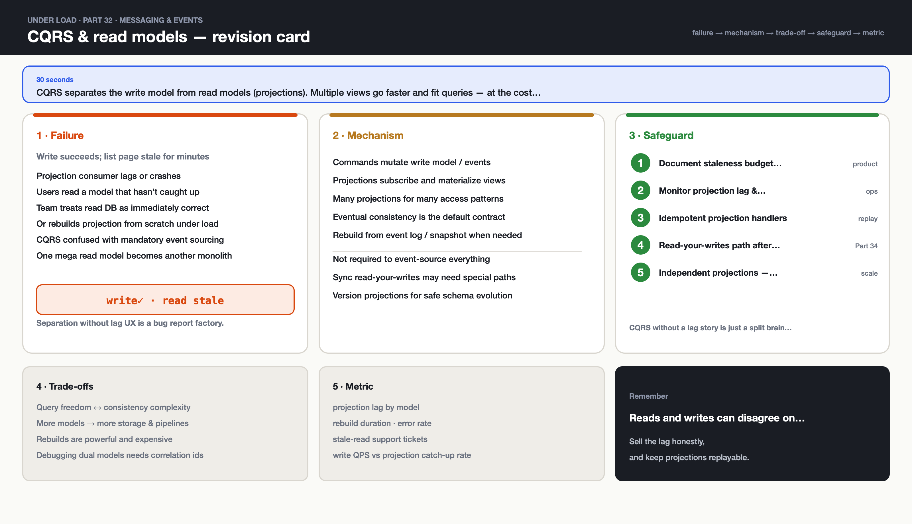
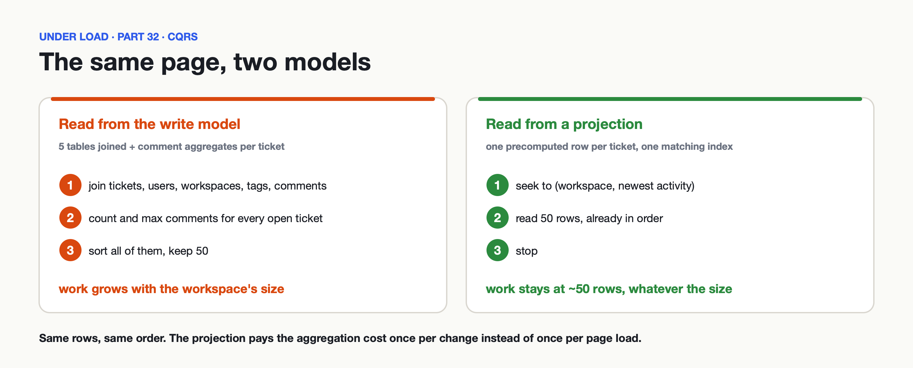
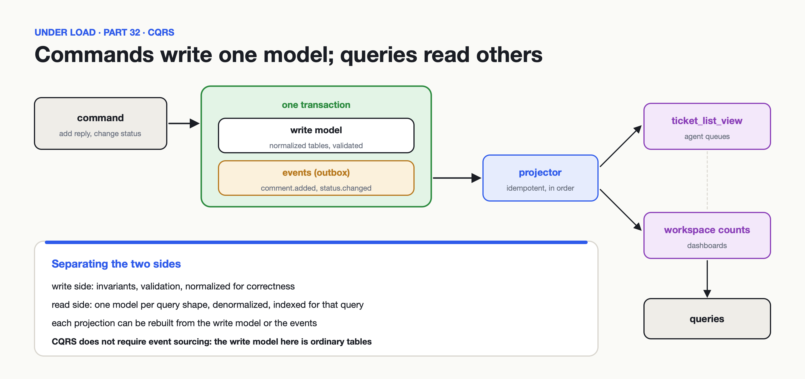
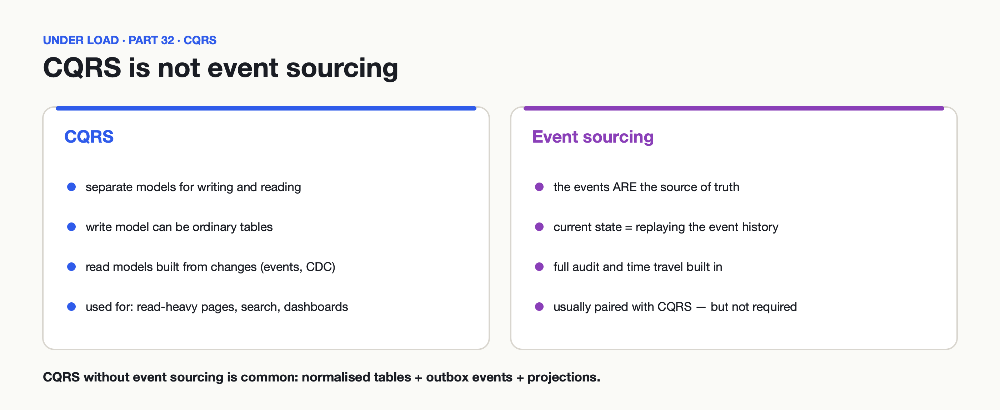
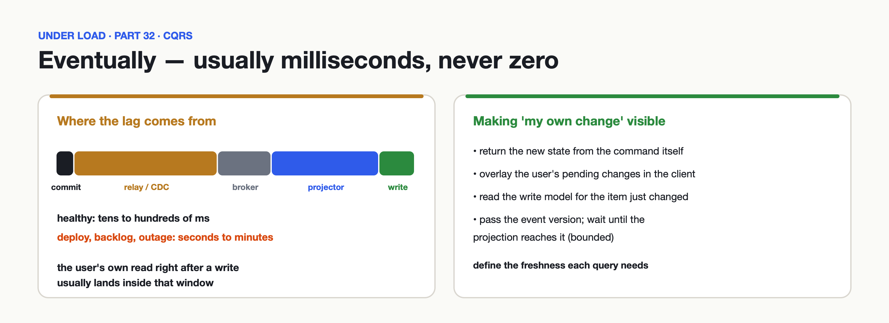
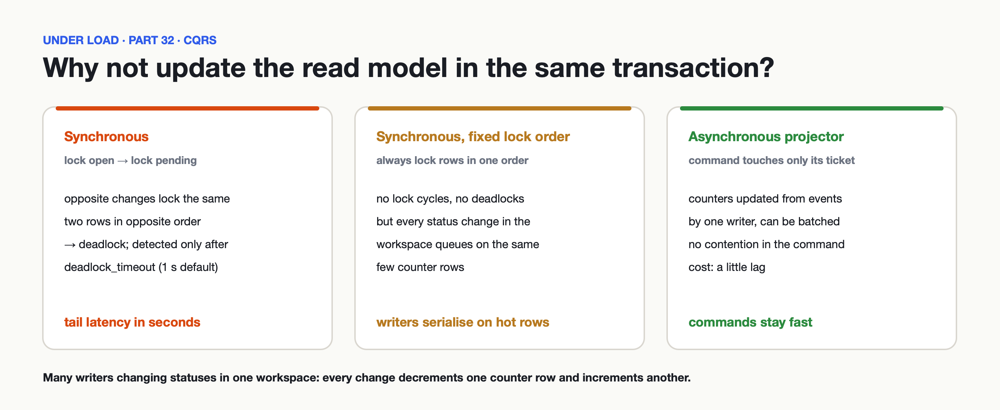
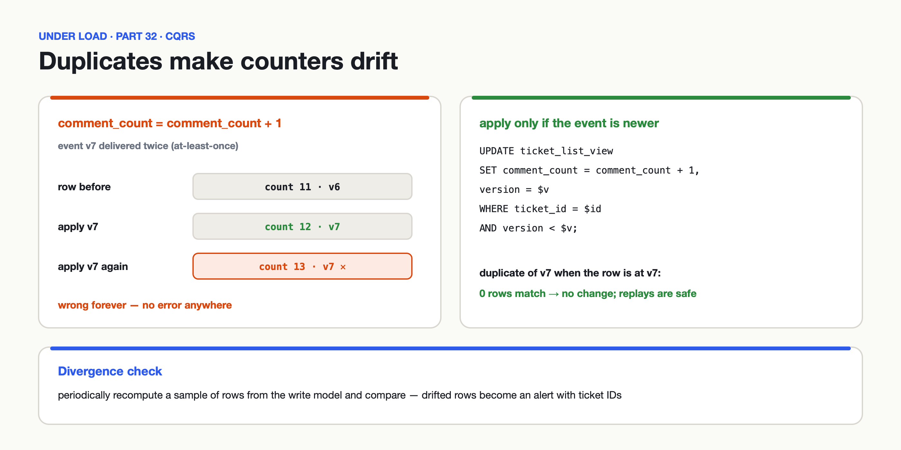
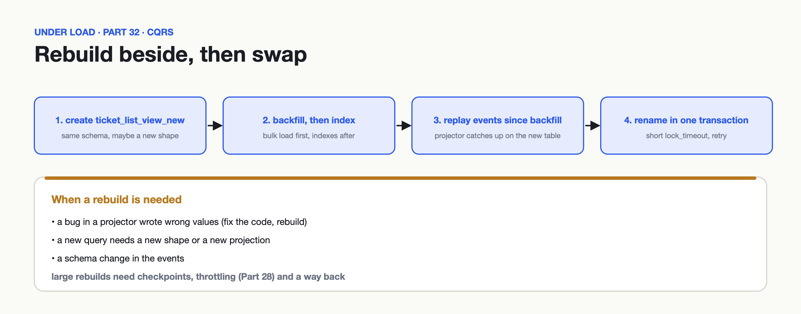
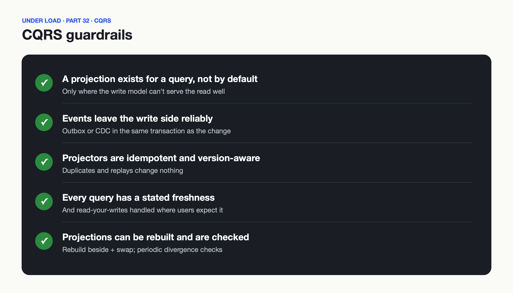

# CQRS & Read Models

### CQRS and materialized projections: separating the model that accepts changes from the models that answer queries — how projections are built from events, why they're eventually consistent, and how to keep them correct and rebuildable.

*Under Load · Part 32 · Messaging & Events*





---

The agent queue page is the most-loaded page in the product. Every agent opens it dozens of times an hour: open and pending tickets for their workspace, sorted by last activity, each row showing the requester, the assignee, the tags and the number of replies.

The tickets database is designed for writing correctly: tickets, users, workspaces, tags and comments in separate, normalised tables, with constraints that keep the data consistent. Answering the queue page from it means joining five tables and, for every open ticket, counting its comments and finding the newest one — then sorting all of them to show the top 50. An index helps with parts of that (Part 1), but no index can precompute "number of comments per ticket" or "time of the latest comment" across a join.

For a typical workspace, the query is cheap enough. For Halcyon, with tens of thousands of open and pending tickets and hundreds of thousands of comments behind them, every page load aggregates all of that again — and on a Monday morning, hundreds of agents refresh the page at once. The database spends most of its time computing the same answer over and over, for a page whose contents change only when someone replies or changes a status.

The alternative is a table with exactly one row per ticket, already containing everything the page shows, with an index that matches the page's filter and sort. Reading 50 rows from it is a single index range scan, whatever the size of the workspace. Keeping that table correct and up to date is what **CQRS** and **materialized projections** are about.

---

## What CQRS is

**CQRS** — Command Query Responsibility Segregation — means using **different models** for changing data and for reading it.

- **Commands** change state: "add a reply," "change the status," "assign to Sam." They go to the **write model**, which is designed for correctness: normalised, validated, protected by constraints and transactions. The rules of the business — a ticket can't be solved without a resolution, a seat can't be assigned twice — are enforced here.
- **Queries** read state: "show Halcyon's open queue," "how many tickets are pending per workspace." They go to **read models**, each shaped for the question it answers: denormalised, precomputed, indexed for one access pattern.

A **materialized projection** is one of those read models: a table (or a search index, or a cache entry) built from the changes to the write model and kept up to date as changes happen. "Materialized" because it's stored, not computed at query time; "projection" because it projects the write model's data into a different shape.

CQRS is not a framework or an architecture for a whole system. It's a decision made per query: **this** page is read so often, or so differently from how the data is written, that it deserves its own model. Most queries in the same system keep reading the write model directly.

---

## How a projection is maintained



The flow builds directly on the previous parts:

1. **A command updates the write model** in a transaction, as usual.
2. **In the same transaction, it records an event** — `comment.added`, `status.changed` — in an outbox table (Part 29), or the change is captured from the log by CDC (Part 30). Either way, an event exists if and only if the change committed.
3. **A projector** — a consumer dedicated to maintaining read models — reads the events and updates each projection. For `comment.added`, it increments `comment_count` and sets `last_activity` on the ticket's row in `ticket_list_view`.
4. **Queries read the projection** instead of reconstructing the view each time.

The queue's projection has one row per ticket: subject, status, requester and assignee names, workspace, tags, comment count, last activity, and the ticket's **version** — a number incremented by every change to the ticket in the write model. Its index is `(workspace_id, last_activity DESC)`, partial on open and pending tickets — exactly the queue's filter and sort. The page becomes:

```sql
SELECT * FROM ticket_list_view
WHERE workspace_id = $1 AND status IN ('open', 'pending')
ORDER BY last_activity DESC
LIMIT 50;
```

The first time, the projection has to be filled from what already exists — a **backfill** — by running the expensive query once, for all tickets, and writing the results. From then on, events keep it current.

### Denormalisation has a fan-out cost

A projection copies data from several tables into one row. When the copied data changes at its source, every row that copied it must change too. If an agent renames themselves, the assignee name in every one of their tickets' rows is now stale; a `user.renamed` event fans out into thousands of row updates. Workspace names, tag labels and user names change rarely, so this is usually acceptable — but it should be a decision. Data that changes often and is shared by many rows is better kept out of the projection and joined at read time from a small table.

### One model per query

Different queries can have different projections. The workspace dashboard shows ticket counts by status; computing them with `GROUP BY` over all of Halcyon's tickets on every load costs work proportional to the workspace's size, while reading a small `workspace_status_counts` projection — one row per workspace and status, maintained by the same projector — costs a handful of row reads. The same events can feed a search index (Part 30's consumers), an analytics table, a cache. Each read model can use whatever storage suits it — PostgreSQL, Elasticsearch, Redis — because each is just a consumer of the same events.

### A simpler cousin: the database's materialized view

PostgreSQL has a built-in `MATERIALIZED VIEW`: a query whose result is stored as a table. It's refreshed explicitly with `REFRESH MATERIALIZED VIEW`, which recomputes the **whole** result; with `CONCURRENTLY` (which requires a unique index on the view), readers keep seeing the old contents during the refresh. That's a good fit for read models that can be minutes old and are cheap enough to recompute in full — a nightly report, an hourly leaderboard. It doesn't update incrementally, so it's not a fit for a queue that should reflect a reply within seconds.

### CQRS is not event sourcing



The two are often mentioned together, but they're independent.

- **CQRS** separates the write model from read models. The write model can be ordinary tables, as here.
- **Event sourcing** makes the events themselves the source of truth: the current state of a ticket is computed by replaying its history of events, and there are no "current state" tables on the write side.

Event-sourced systems almost always use CQRS, because querying by replaying events is impractical. But CQRS doesn't need event sourcing — and most systems that benefit from projections don't need event sourcing either. It brings a full history and the ability to rebuild any past state, at the cost of event schema evolution forever, snapshotting for long histories, and a programming model most teams find unfamiliar.

---

## Eventually consistent: what it costs



A projection is updated **after** the command commits, by a separate process. In between, it's stale. The delay — the **projection lag** — is the sum of the pipeline's steps: the relay's polling interval or the CDC pipeline's latency (Part 29), the broker, the projector's own batching, and the write to the projection. In a healthy pipeline that's typically tens to hundreds of milliseconds. During a projector deploy, a broker hiccup or a backlog, it's seconds or minutes.

For the rest of the team, tens of milliseconds are invisible. For the agent who just posted a reply, they aren't. The agent clicks "Send," the command commits, and the UI immediately navigates back to the queue — a read that happens within a few milliseconds of the write. Unless the projection happens to be faster than the browser, that read shows the old reply count. The window is short, but the read that falls into it is precisely the one a user is watching most closely: their own change.

This is the **read-your-writes** problem, covered for replicas in Part 34. For projections, the usual fixes:

- **Return the new state from the command.** The response to "add reply" contains the updated ticket; the UI shows it without re-reading.
- **Overlay pending changes in the client.** The UI keeps the user's own recent changes and shows them on top of what the projection returns, until the projection catches up.
- **Read the write model for the item just changed**, and the projection for everything else — for example, the ticket detail page reads the write model, the queue reads the projection.
- **Wait for a version.** The command returns the ticket's new version; the next query includes it, and the read side waits — briefly, with a timeout — until the projection row has reached it, then answers. If the timeout passes, it falls back to the write model or returns what it has with a "refreshing" hint.

The important step is to **state the freshness each query needs**. "The queue may lag by up to a few seconds; the ticket detail page must show the agent's own reply" is a requirement that can be designed, tested and monitored. "It's eventually consistent" is not a requirement; it's a disclaimer.

---

## Why not update the projection in the same transaction?



Updating the read model inside the command's transaction removes the lag. For a cold, per-entity projection — one row per ticket, updated only by changes to that ticket — that can be a reasonable trade: the command does a little more work, and the projection is never stale.

For **hot**, shared read models, it's much worse than it looks. The workspace counts projection has one row per workspace and status. Every status change in Halcyon's workspace decrements one counter row and increments another — the same handful of rows, for every agent in the largest workspace.

- **Every command now locks hot rows.** An `UPDATE` takes a row lock until the transaction commits (Part 5). Every status change in the workspace queues behind every other one on those few rows, so commands that used to touch only their own ticket now serialise on shared counters. Throughput for the workspace becomes "one status change at a time per counter row."
- **Opposite changes deadlock.** One agent moves a ticket from `open` to `pending`: lock the `open` row, then the `pending` row. Another moves a ticket from `pending` to `open`: lock `pending`, then `open`. Each holds the row the other needs. PostgreSQL detects the cycle and aborts one transaction — but only after waiting `deadlock_timeout` (one second by default) before it even checks. Every deadlock therefore costs at least a second of waiting, plus a retry. Under load, deadlocks arrive continuously, tail latency jumps to seconds, and throughput collapses.
- **Fixing the lock order removes the deadlocks, not the queueing.** Always locking the two counter rows in a fixed order — say, alphabetically by status — means two transactions can never hold them in opposite orders. Commands still wait for each other on the hot rows, so latency is set by how many writers contend for one workspace.
- **An asynchronous projector removes the contention from the command.** The command touches only its own ticket. The projector applies counter changes from the events — and can batch them: a hundred status changes become one update per counter row, applied by one writer, so there's no contention at all.

The general rule: synchronous projection updates are fine for cold, per-entity rows and sometimes the right trade. For aggregates shared by many writers, they turn every write into a lock on a hot row — and, unless the lock order is fixed, into a deadlock generator. The asynchronous projector trades that write bottleneck for a little lag.

---

## Keeping projections correct

### Duplicates and replays

The projector receives events at least once (Parts 27–29). A handler like `comment_count = comment_count + 1` is not idempotent: every duplicate adds one, every replay adds one more, and the count drifts upward permanently. No error is raised; the number is simply wrong until someone notices.



The fix is to make every update **version-aware**. Each event carries the ticket's version after the change, and the projector applies it only if it's newer than the version stored in the row:

```sql
UPDATE ticket_list_view
   SET comment_count = comment_count + 1,
       last_activity = $at,
       version = $v
 WHERE ticket_id = $id
   AND version < $v;
```

A duplicate of version 7 arrives when the row is already at version 7; the `WHERE` clause matches nothing, and nothing changes. A replay of the whole history from the beginning changes nothing either. With per-key order and a version check, a projector can be re-run over the same events any number of times and produce the same result.

The version check relies on events for one ticket arriving **in order** — guaranteed by processing them in sequence, or by partitioning by ticket ID in Kafka (Part 27). An even sturdier option for some fields is to carry the **new value** in the event rather than the delta: `comment.added` with `comment_count: 12` is idempotent by itself, at the cost of the producer knowing the count.

For aggregate projections like the workspace counts, a per-row version isn't enough, because many tickets contribute to one row. The projector then records which ticket versions it has applied — the processed-events pattern from Part 27 — in the same transaction as the counter update.

### Out-of-order and missing events

If events can arrive out of order across keys — different partitions, multiple projector instances — the projector must not assume a global order. Per-key order plus version checks is the standard approach. A version that **skips** — version 7 arrives when the row is at 5 — means an event is missing or delayed. The projector can wait briefly for the missing one, fetch the current state of the ticket from the write model and overwrite the row, or flag the row for repair. Silently applying version 7 on top of 5 is the one wrong answer.

### Divergence checks

Bugs still happen: a handler that forgets a field, an event type nobody subscribed to, a manual fix in the write model that emitted no event. A **divergence check** periodically recomputes a sample of projection rows from the write model — prioritising recently changed ones — and compares them. It's cheap insurance, and it turns "the numbers look off" into an alert with ticket IDs. The check also needs to account for lag: a row that differs because its latest event is still in flight isn't divergent; comparing only rows whose version matches the write model's avoids false alarms.

### Projector failures

A projector that crashes resumes from its checkpoint — its consumer offset — and reprocesses events since then; version checks make that harmless. An event the projector can't apply at all — a bug, an unexpected shape — goes to a DLQ (Part 28) rather than blocking the stream. While it's there, the affected row is stale, so DLQ depth for projectors is a correctness metric, not just an operational one.

---

## Rebuilding projections



Projections are disposable by design: everything in them can be recomputed from the write model or the event log. That's a feature — and it's needed regularly:

- a projector bug wrote wrong values;
- a new query needs a new column, a new shape, or a new projection entirely;
- the event schema changed.

Rebuilding in place — truncating the table and refilling it — leaves readers looking at an empty or half-filled table. The safer pattern is **rebuild beside, then swap**:

1. **Create a new table**, `ticket_list_view_new`, with the new schema.
2. **Backfill it** from the write model, then build its indexes. Building indexes after the bulk load is usually much faster than maintaining them row by row during it.
3. **Replay the events that arrived since the backfill started**, so the new table catches up. Version checks make the overlap safe: events already reflected by the backfill are skipped.
4. **Swap the names in one transaction**: rename the old table away and the new one into place. Because both renames commit together, readers see either the complete old table or the complete new one.

The swap itself is quick, but `ALTER TABLE … RENAME` needs an exclusive lock on the table. If a long-running query holds the old table, the rename waits — and every new query on the table queues behind the waiting rename. Setting a short `lock_timeout` on the swap transaction and retrying keeps a rebuild from turning into a brief outage. Pointing readers at a view, and redefining the view to point at the new table, has the same locking concern on the view.

For very large projections — hundreds of millions of rows — the backfill needs checkpoints so it can resume, throttling so it doesn't overload the write database (the replay lessons of Part 28), a comparison against the old projection before the swap, and the old table kept for a while as a way back.

---

## When CQRS is worth it

Every projection is another table to store, another consumer to run and monitor, another schema to evolve, another place for data to be wrong, and another freshness guarantee to explain. It's worth it when:

- a read is **much more frequent** than the writes that affect it, and expensive to compute;
- reads and writes need **different shapes** — a search index, a feed, a dashboard of aggregates;
- reads need to **scale separately** — replicas or different storage for the read side;
- several consumers need the same changes in different forms.

It's not worth it when an index or a well-written query on the write model is fast enough, or when a cache with a short TTL is acceptable (Part 9). The first step for a slow page is still Part 1: read the query plan.

---

## Shipping a projection safely

**Run it in shadow first.** Build the projection and keep it updated while the page still reads the write model. Compare the two for a sample of requests — same rows, same order — until differences are explained.

**Switch reads per page, behind a flag.** If the projection misbehaves, flipping the flag back sends reads to the write model immediately.

**Decide and implement read-your-writes before switching.** The first complaint after a projection launch is almost always "my change disappeared."

**Watch lag from day one.** A projection without a lag alert is stale the first time its projector stalls, and nobody knows.

---

## Guardrails that prevent the next one



1. **A projection exists for a query, not by default** — only where the write model can't serve the read well.
2. **Events leave the write side reliably**: outbox or CDC, in the same transaction as the change.
3. **Projectors are idempotent and version-aware**, so duplicates and replays change nothing.
4. **Every query has a stated freshness**, and read-your-writes is handled where users expect it.
5. **Projections can be rebuilt and are checked**: rebuild beside and swap; periodic divergence checks.

---

## What to keep on the dashboard

- **Projection lag**: time from commit to the projection update, median and tail, per projection.
- **Event age** at the projector and **consumer lag** on the event stream.
- **Projector errors and DLQ volume** (Part 28), per event type.
- **Duplicates and out-of-order events** detected by version checks, and **version gaps**.
- **Divergence check results**: rows compared, rows different.
- **Rebuild progress and throughput** during backfills and replays.
- **Read and write latency** for the queries and commands the projection exists to serve.

---

## Recap

### What is CQRS?
Using separate models for commands (changes) and queries (reads): a write model designed for correctness and one or more read models shaped for specific queries. It's a per-query decision, not a whole-system architecture.

### What is a materialized projection?
A stored read model — a table, index or cache — built from the write model's changes and kept up to date, so queries read precomputed data instead of reconstructing it. A queue page that joins and aggregates five tables becomes a single index range scan over one row per ticket.

### CQRS vs event sourcing?
CQRS separates write and read models; the write model can be ordinary tables. Event sourcing stores the event history as the source of truth and derives current state from it. Event sourcing usually uses CQRS, but CQRS doesn't require event sourcing.

### Why have multiple projections?
Different queries need different shapes, indexes and even storage: a ticket list, per-workspace counts, a search index. Each projection serves one access pattern well, and all of them are fed by the same events.

### Why are projections eventually consistent, and how is that handled?
They're updated after the command commits, by a separate process, so there's always a window — usually short, sometimes long — in which they're stale, and a user's own read right after a write often falls into it. Return the new state from the command, overlay pending changes, read the write model for just-changed items, or wait for a version — and state the freshness each query needs.

### Why not update read models synchronously in the command?
It removes lag but adds the read model's cost to every write. For shared aggregate rows it serialises writers on hot rows and, when opposite changes lock rows in opposite order, causes deadlocks that each cost at least the deadlock-detection timeout. A fixed lock order removes the deadlocks but not the queueing; an asynchronous projector removes both from the command.

### What happens when the projector crashes or receives duplicates?
It resumes from its checkpoint and reprocesses events since then. Non-idempotent handlers like `count + 1` drift silently; version-aware handlers that apply an event only if it's newer, or that record processed events, stay correct under any number of replays.

### How do you rebuild a projection safely?
Build a new table beside the old one, backfill it, replay events since the backfill started, then swap names in one transaction with a short lock timeout. Large rebuilds need checkpoints, throttling, a comparison before the swap and a way back.

### When is CQRS not worth it?
When an index, a better query or a short-lived cache on the write model is fast enough. Every projection adds storage, a consumer, schema evolution, a freshness guarantee and a place for data to diverge.

---

## Next

- **Lab (run + measured write-up):** [32-cqrs](https://github.com/b-basoglu/under-load/tree/main/32-cqrs)
- **Next:** [Replication & Consistency](../33-replication/article.md) — The reply was saved. The page reloads from a replica — and the reply isn't there. What replicas promise, how far behind they fall, and what "consistent" can mean.
