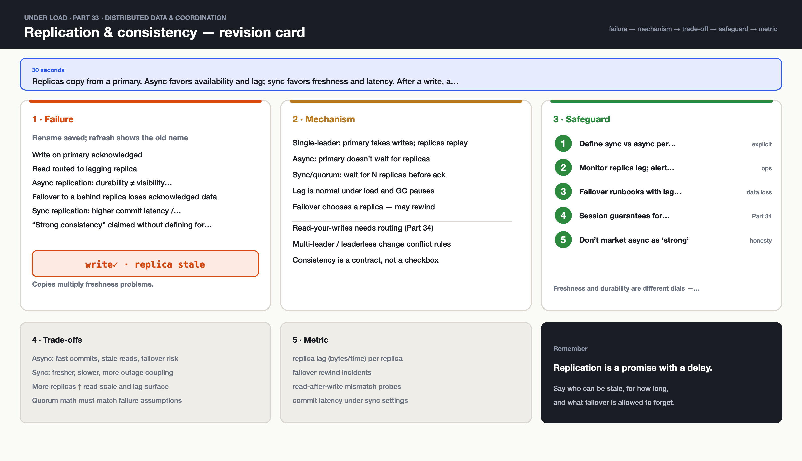
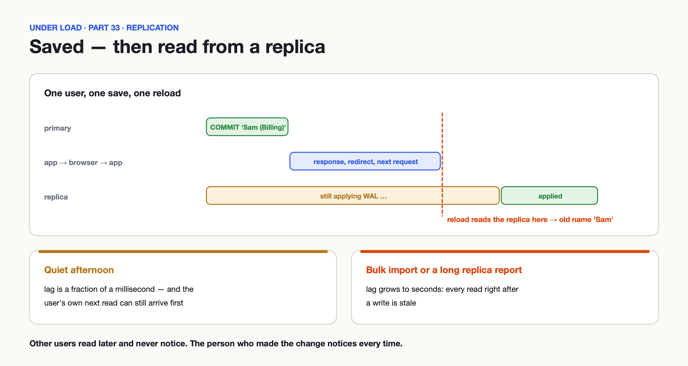
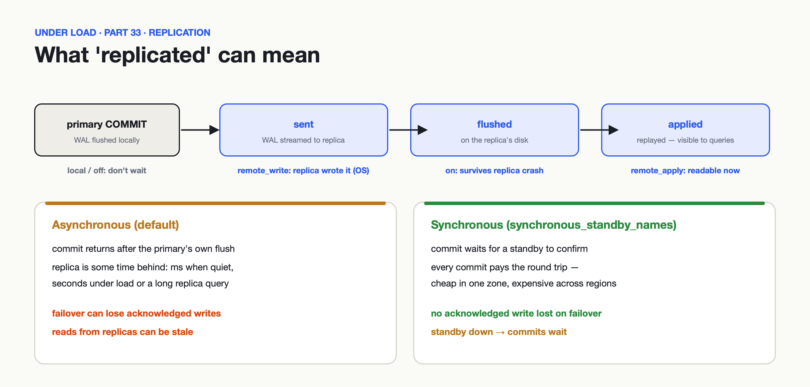
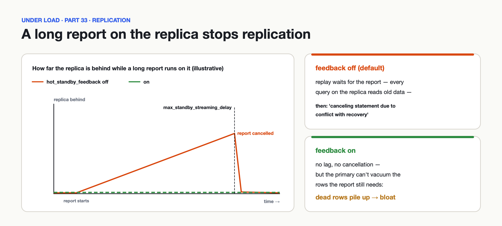
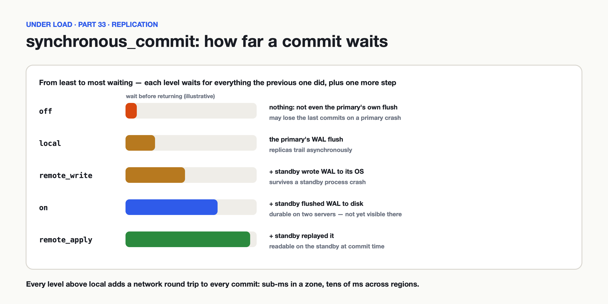
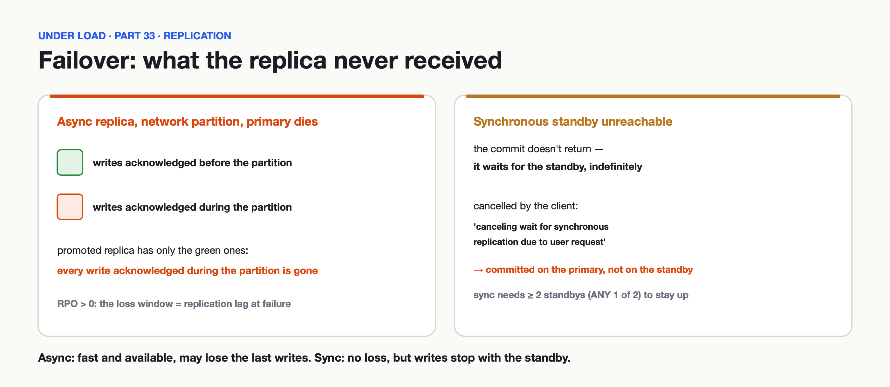
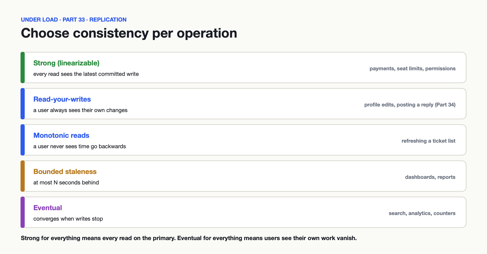
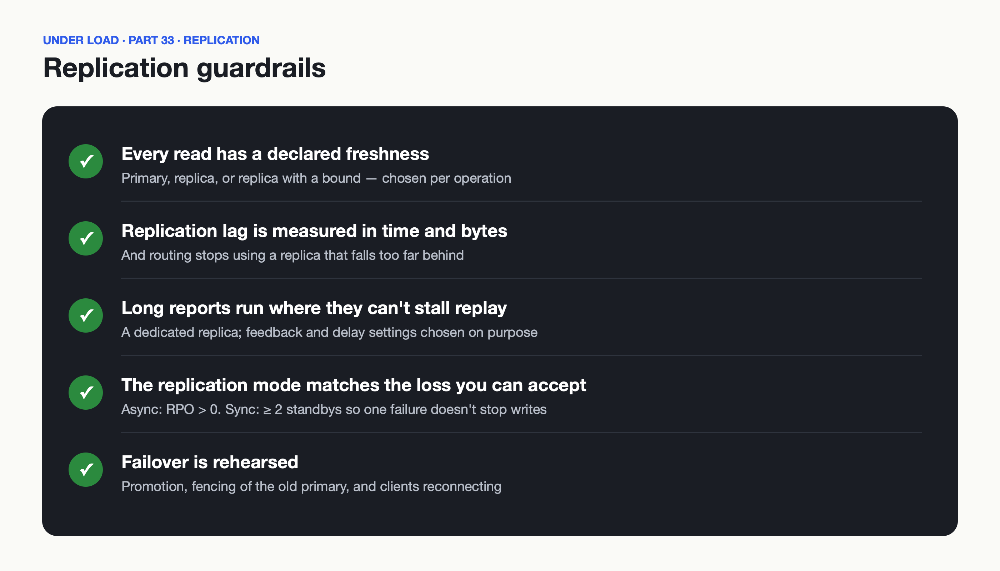

# Replication & Consistency

### Database replication and consistency: what asynchronous and synchronous replicas actually promise, how far behind they fall and why, what a failover can lose, and how to choose consistency per operation.

*Under Load · Part 33 · Distributed Data*

---

An agent at Halcyon changes their display name from "Sam" to "Sam (Billing)", clicks Save, and the page reloads. It still says "Sam." They click Save again. Now there are two audit entries, a confused ticket to the internal tools team, and an engineer who can't reproduce it: on their laptop, with one database, it works every time.

Nothing was broken. The save went to the **primary** database. The page reload read from a **replica**, which hadn't applied the change yet. On a quiet afternoon the replica is only a fraction of a millisecond behind — but a browser that reloads the page right after the save response arrives can easily be faster than that, and the read lands before the change does. During the nightly bulk import, or while a long report runs on the replica, the gap grows to seconds, and every read right after a write is stale.

Replicas are how databases scale reads and survive failures. They're also, by design, a little late — and how late, what that means for each operation, and what a failover can lose are decisions, not accidents.

---

## What replication is

**Replication** keeps copies of a database on several servers. In the most common setup — **single-leader** or **primary/replica** replication, which is how PostgreSQL, MySQL and most managed relational databases work — one server, the **primary**, accepts all writes. **Replicas** (also called standbys, secondaries or followers) receive a stream of changes from the primary and apply them, keeping an identical copy that can serve reads.

It serves two purposes:

- **Read scaling.** Read traffic can be spread across replicas. Reports, search indexing, dashboards and many page loads can read from a replica instead of the primary.
- **Availability.** If the primary fails, a replica can be **promoted** to become the new primary — a **failover** — instead of waiting for the old one to be repaired.

It doesn't scale **writes**. Every replica applies every write, so adding replicas adds read capacity, not write capacity; a primary that's saturated by writes stays saturated no matter how many replicas follow it. Writes that outgrow one primary need sharding (Part 35).

And a replica is not a backup. An accidental `DELETE FROM tickets` replicates to every replica within milliseconds. Protection against mistakes needs backups and point-in-time recovery — or a deliberately **delayed replica** (`recovery_min_apply_delay` in PostgreSQL) that applies changes, say, an hour late, giving time to stop it before a mistake arrives.

Other topologies exist. **Multi-leader** replication accepts writes in several places — usually one per region — and must resolve conflicting writes. **Leaderless** systems such as Cassandra and DynamoDB-style stores write to several nodes and read from several, using quorums: with *N* copies, writing to *W* and reading from *R* nodes such that *R* + *W* > *N* guarantees that every read overlaps at least one node with the latest write. This article stays with single-leader replication, which is what most transactional systems run.

### How PostgreSQL replicates

PostgreSQL's **streaming replication** reuses the write-ahead log (Part 6). Every change is written to the WAL on the primary; a **WAL sender** process streams it to each replica; the replica's **WAL receiver** writes it to the replica's own disk; and the replica's **startup process** replays it into the data files, after which it's visible to queries on the replica. This is **physical** replication: the replica is a byte-for-byte copy of the primary's data files. (Logical replication, used by CDC in Part 30, ships row changes instead.)

So "replicated" can mean four different things: the WAL was **sent**, **written** on the replica, **flushed** to the replica's disk, or **applied** and visible to queries there. The distance between those points is exactly what the replication mode controls — and the reason "the replica has it" is ambiguous until someone says which of the four is meant.

MySQL works on the same principle with different parts: the primary writes its **binary log**, replicas copy it into a **relay log** and apply it with one or more applier threads.

---

## Asynchronous replication: fast and a little late

By default, replication is **asynchronous**: the primary commits as soon as the change is safely in **its own** WAL and returns success to the client. Streaming to replicas happens in the background.

The gap between the primary and a replica is **replication lag**. It's expressed two ways:

- **In bytes**: how much WAL the replica hasn't yet applied. Good for capacity and for understanding how much is at risk.
- **In time**: how old the replica's most recently applied change is. Good for deciding whether a replica is fresh enough to serve a given read.

PostgreSQL reports both: `pg_stat_replication` on the primary shows each replica's sent, written, flushed and replayed positions, plus `write_lag`, `flush_lag` and `replay_lag` as durations.

### Why "almost no lag" still means stale reads

On a quiet system on a fast network, a replica typically applies a change within a millisecond or less of the commit. That sounds like zero. It isn't, for one specific read: the one made **by the same user, immediately after the write**. The commit returns to the application, the application returns to the browser, the browser redirects and issues the next request, the request reaches a replica — and if any part of that chain is faster than the replica's apply, the read sees the old value. The faster the system, the more often the read wins the race. Other users, who read seconds or minutes later, never notice; the person who made the change notices every time.

### Why replicas fall further behind

Lag isn't a fixed property of a replica. It grows when the replica can't apply WAL as fast as the primary produces it:

- **Write bursts.** A bulk import, a backfill, a large `UPDATE` or an index build generates WAL far faster than normal traffic.
- **Single-threaded replay.** PostgreSQL replays WAL in one process on the replica, while the primary generates it from many concurrent sessions. A replica on identical hardware can still fall behind a write-heavy primary simply because one process is applying what many produced. (MySQL has multi-threaded appliers for the same reason.)
- **Weaker replica hardware or I/O.** A replica with slower disks, or one busy serving heavy read queries, applies more slowly.
- **The network.** Bandwidth limits and latency, especially across regions.
- **Conflicts with queries on the replica**, described next.

### A long report can stop replication

The analytics team runs a fifteen-minute report on a replica — that's what replicas are for. But that report holds a **snapshot**: it needs the rows as they were when it started (Part 3). Meanwhile, on the primary, tickets are deleted and **VACUUM** removes their dead row versions. When the replica receives that cleanup in the WAL, it has a **recovery conflict**: applying it would remove rows the report is still reading.

PostgreSQL resolves it in one of two ways, and both have a cost:

- **`hot_standby_feedback = off`** (the default). The replica **pauses replay** to let the report finish — for up to `max_standby_streaming_delay` (30 seconds by default). While replay is paused, the replica falls behind by the length of the pause, and *every* query on it, not just the report, reads increasingly old data. When the limit is reached, PostgreSQL cancels the report with `canceling statement due to conflict with recovery` and resumes replay. The report fails; everyone else got stale data for the duration.
- **`hot_standby_feedback = on`**. The replica tells the primary which row versions its queries still need, and the primary's VACUUM leaves them in place. No pauses and no cancellations — but dead rows accumulate on the **primary** for as long as the report runs. A report that runs for hours on a replica, with feedback on, causes table and index **bloat** on the primary, which slows the production workload the replica was supposed to protect.

The practical answer is to separate workloads: long analytical queries go to a **dedicated replica** whose lag doesn't matter to anyone else, with settings chosen for that purpose (feedback off and a long or unlimited delay, so reports finish and the replica catches up afterwards), while the replicas that serve page loads have strict statement timeouts and stay close to the primary.

---

## Synchronous replication: no loss, at a price

With **synchronous replication**, the primary waits for one or more **standbys** to confirm a change before telling the client the commit succeeded. In PostgreSQL, `synchronous_standby_names` lists which standbys count, and `synchronous_commit` chooses how far the confirmation must go.

From least to most waiting:

- **`off`** — don't even wait for the primary's own WAL flush. A primary crash can lose the last fraction of a second of commits (the database stays consistent; the most recent transactions are simply gone). Fastest; replicas always trail.
- **`local`** — wait for the primary's flush only. Durable on the primary; replicas trail asynchronously.
- **`remote_write`** — the synchronous standby has written the WAL to its operating system, not yet flushed. Survives a standby **process** crash, not a standby **server** crash.
- **`on`** — the standby has flushed the WAL to disk. The change survives the loss of either server. This is the default when synchronous standbys are configured.
- **`remote_apply`** — the standby has **applied** the change, so queries there can see it.

Two things matter in choosing. First, only `remote_apply` makes the replica **readable** at commit time; `on` guarantees the change is **durable** on the standby, not that queries there can see it yet. A team that turns on synchronous replication to fix stale reads and stops at `on` will still see them.

Second, every level above `local` adds at least one network round trip to **every** commit — sub-millisecond between servers in one data centre, a few milliseconds between availability zones, tens of milliseconds between regions. A synchronous standby in another region makes every write, from every user, that much slower; a write-heavy endpoint that does several commits per request pays it several times.

`synchronous_commit` can be set per transaction. A system can commit ordinary updates with `local` and payment records with `on`, paying the round trip only where losing the write would matter. MySQL's equivalent is **semi-synchronous** replication, where the primary waits for at least one replica to acknowledge receipt of the transaction before returning.

---

## Failover: what the replica never received

Replication lag isn't only about stale reads. When the primary dies and a replica is promoted, anything the replica hadn't received is **gone** — even though the clients were told it was committed.

Picture the worst ordinary case: the network between the primary and its asynchronous replica fails, so the replica stops receiving WAL, while clients can still reach the primary. For the next few minutes every write succeeds — tickets created, replies saved, all acknowledged. Then the primary's host dies. The failover tool promotes the replica, which is now minutes behind. Every write acknowledged during the partition is missing from the new primary, and nothing in the application knows which ones.

This is the **recovery point objective (RPO)** of asynchronous replication: the amount of data that can be lost in a failover equals the replication lag at the moment of failure. Usually that's milliseconds; during a partition, a slow replica or a paused replay, it can be much more. Asynchronous replication means RPO > 0, always.

With synchronous replication, the same partition plays out differently. The primary can't get confirmations from its synchronous standby, so commits **don't return**: they wait indefinitely for the standby. Writes stop. If a client cancels the waiting commit, PostgreSQL returns with a warning — `canceling wait for synchronous replication due to user request` — and the transaction **remains committed on the primary** without being on the standby. A cancelled wait doesn't roll anything back; the client simply stops waiting.

So synchronous replication trades **availability** for **durability**: with a single synchronous standby, losing that standby stops writes. Production setups use **quorum** commits — `synchronous_standby_names = 'ANY 1 (r1, r2)'` — so that any one of two standbys can confirm, and a single standby failure doesn't stop writes. That's the minimum of three servers that synchronous setups usually start from.

### Failover needs more than promotion

- **Pick the most up-to-date replica.** With several asynchronous replicas, they're rarely at the same position; promoting the one furthest ahead loses the least.
- **Fence the old primary.** If the old primary comes back — it was only partitioned, not dead — and keeps accepting writes, there are two primaries accepting conflicting writes: **split brain** (Part 41). Fencing means making sure it can't: shutting it down, revoking its network access or storage, or relying on a lease it can no longer renew (Part 42).
- **Reconnect clients.** Applications must find the new primary — through DNS, a virtual IP, a proxy, or driver support for multiple hosts with `target_session_attrs=read-write`.
- **Rebuild the old primary as a replica.** Its WAL may contain writes the new primary never saw; it has to be rewound (`pg_rewind`) or re-cloned before it can follow.

Tools such as Patroni and cloud-managed failover handle these steps. They should be rehearsed regularly — in production or a production-like environment — rather than first exercised during an incident.

---

## Choosing consistency per operation

"Strong" and "eventual" consistency are the two ends of a range of guarantees:

- **Strong (linearizable) consistency:** every read sees the latest committed write, as if there were one copy. In a primary/replica setup, that means reading from the primary (or from a replica that's guaranteed caught up, such as a synchronous standby with `remote_apply`).
- **Read-your-writes:** a user always sees their own changes, even if other users' changes appear a little later. That's what the renamed agent needs (Part 34).
- **Monotonic reads:** a user never sees data go backwards — for example, the new name on one request and the old name on the next because the two requests hit replicas at different positions.
- **Bounded staleness:** reads may be stale, but no more than a stated amount — say, five seconds.
- **Eventual consistency:** replicas converge once writes stop; no promise about when.

Applying one rule to everything is the mistake. Strong consistency for every read means every read goes to the primary and the replicas do nothing. Eventual consistency for every read means users see their own work disappear and decisions get made on stale data. A sensible split for the ticket system:

- **Primary:** checking a seat limit before granting seats, permission checks, anything that reads in order to decide what to write. A stale read here leads to a wrong write, not just a stale page.
- **Read-your-writes:** the agent's own profile, the ticket they just replied to, the settings page they just saved.
- **Bounded staleness (replica, lag under a second or two):** queue pages, ticket lists, other agents' activity.
- **Eventual (a dedicated replica, any lag):** reports, exports, analytics.

Routing then follows the rule: the application, its database library, or a proxy sends each query to the primary or a replica according to its class, and **stops using a replica whose lag exceeds the bound** — falling back to another replica or the primary. A replica that's behind is still healthy as a server, so health checks that only test "does it answer" will keep sending traffic to it; the check has to include lag.

### Cross-region replication

Across regions, the trade-off sharpens. A synchronous commit pays the cross-region round trip on every write, which most interactive workloads can't afford. The common design is synchronous (or quorum) replication within a region for durability, asynchronous replication to other regions for disaster recovery and local reads, and an explicit, documented RPO for a regional failover. Reads in a remote region are then bounded-staleness at best, and read-your-writes across regions needs the techniques of Part 34.

---

## Guardrails that prevent the next one

1. **Every read has a declared freshness** — primary, replica, or replica within a bound — chosen per operation.
2. **Replication lag is measured in time and bytes**, and routing stops using a replica that falls too far behind.
3. **Long reports run where they can't stall replay**: a dedicated replica, with feedback and delay settings chosen on purpose.
4. **The replication mode matches the data loss that's acceptable**: async means RPO > 0; sync needs at least two standbys so one failure doesn't stop writes.
5. **Failover is rehearsed**: promotion, fencing the old primary, and clients reconnecting.

---

## What to keep on the dashboard

- **Replication lag per replica**, in bytes (`pg_wal_lsn_diff(pg_current_wal_lsn(), replay_lsn)` from `pg_stat_replication`) and in time (`replay_lag`, or `now() - pg_last_xact_replay_timestamp()` on the replica — which grows on an idle primary too, so read it together with the byte lag).
- **Replica state**: streaming or not, and synchronous vs asynchronous (`sync_state`).
- **Recovery conflicts** on replicas (`pg_stat_database_conflicts`) — cancelled queries.
- **Dead rows and bloat on the primary**, especially with `hot_standby_feedback` on.
- **Commit latency on the primary**, which rises with synchronous replication and with slow standbys.
- **Read routing**: share of reads on the primary vs replicas, and fallbacks caused by lag.
- **Failover drills**: time to promote and time for clients to reconnect, from the last rehearsal.

---

## Recap

### How can a user read stale data immediately after a successful write?
The write commits on the primary, and the next read goes to a replica that hasn't applied it yet. Even when lag is a fraction of a millisecond, the user's own next request can arrive first; during write bursts or replay pauses, the gap is seconds and every immediate read is stale.

### What does asynchronous replication guarantee?
That the primary commits as soon as its own WAL is flushed and streams changes to replicas in the background. Replicas trail by the replication lag, reads from them can be stale, and a failover can lose writes that were acknowledged to clients — RPO is greater than zero.

### What does synchronous replication guarantee, and what does it cost?
The primary waits for a standby to confirm each commit. With `on`, the change is durable on the standby; with `remote_apply`, it's also visible there. Every commit pays a network round trip, and if the synchronous standby is unreachable, commits wait — so quorum commits across at least two standbys are the norm.

### Why do replicas fall behind?
Write bursts, single-threaded replay, slower replica hardware, the network, and conflicts with queries on the replica: a long report can pause replay for up to `max_standby_streaming_delay` before being cancelled. `hot_standby_feedback` avoids the pause at the cost of bloat on the primary.

### Do more replicas improve write scalability?
No. Every replica applies every write. Replicas scale reads and improve availability; scaling writes requires sharding.

### Strong vs eventual consistency: when would you choose each?
Strong consistency where a stale read leads to a wrong decision or write: limits, permissions, validation. Bounded staleness or eventual consistency where slightly old data is acceptable: lists, dashboards, reports. Read-your-writes for a user's own changes. Choose per operation, not for the whole system.

### How would you implement read-your-writes?
Route a user's reads after their own write to the primary for a short window, or carry a consistency token — the commit's WAL position — and read only from a replica that has replayed past it, waiting briefly or falling back to the primary otherwise. Part 34 covers the options in detail.

### How does cross-region replication change the trade-off?
Synchronous commits pay the cross-region round trip — tens of milliseconds — on every write. Most systems replicate synchronously within a region and asynchronously across regions, accepting a non-zero, documented RPO for a regional failover.

### What does a safe failover need?
Promotion of the most up-to-date replica, fencing of the old primary so it can't keep accepting writes, clients reconnecting to the new primary, rebuilding the old primary as a replica, and regular rehearsal.

---

## Next

- **Lab (run + measured write-up):** [33-replication](https://github.com/b-basoglu/under-load/tree/main/33-replication)
- **Next:** [Read-Your-Writes](../34-read-your-writes/article.md) — The fix for the renamed agent: how to route a user's reads so they always see their own changes — with LSN tokens, sticky sessions and bounded waits — without sending everything to the primary.
