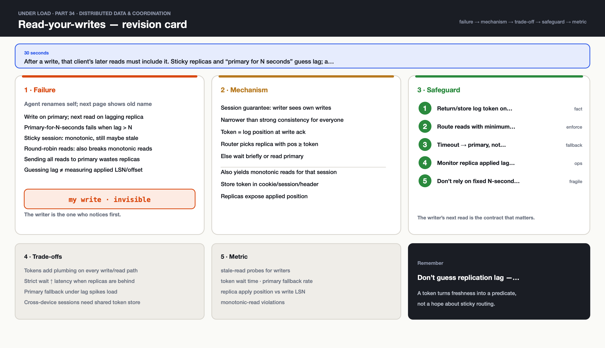
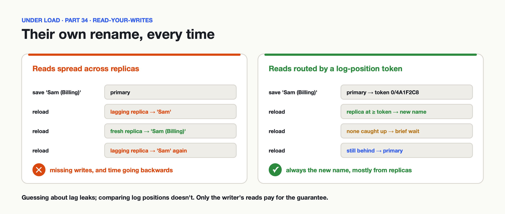
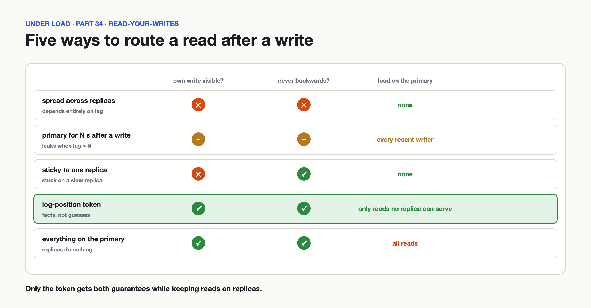
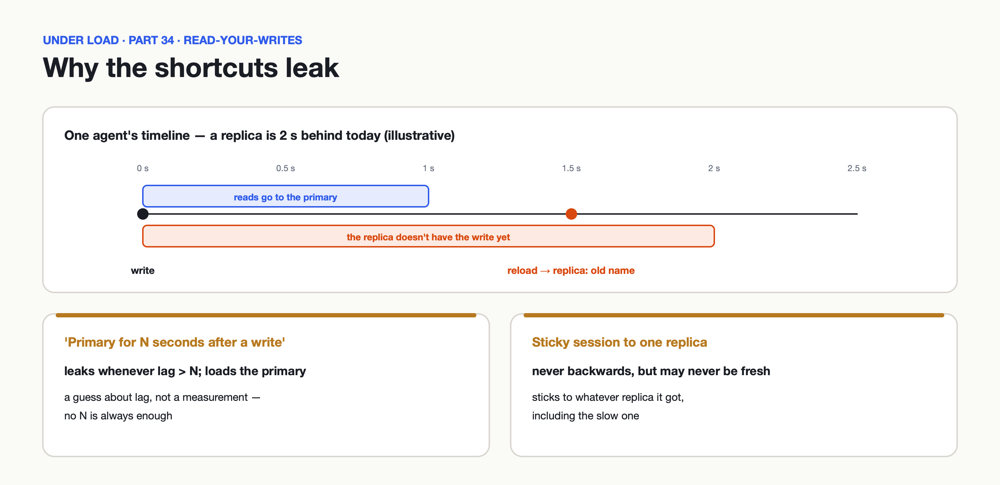
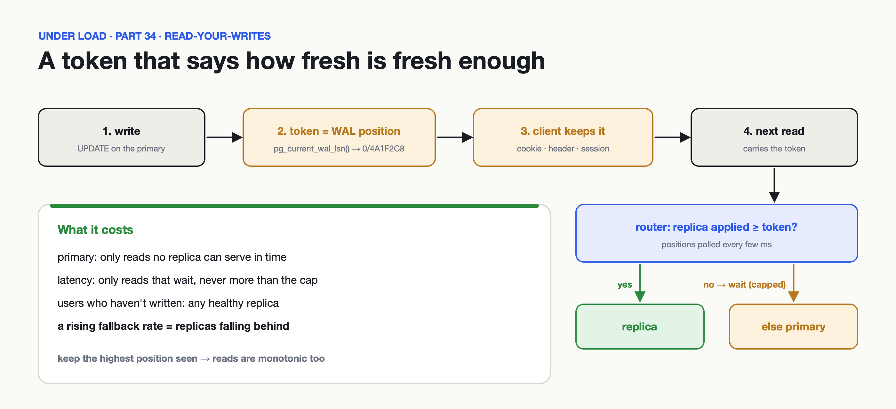
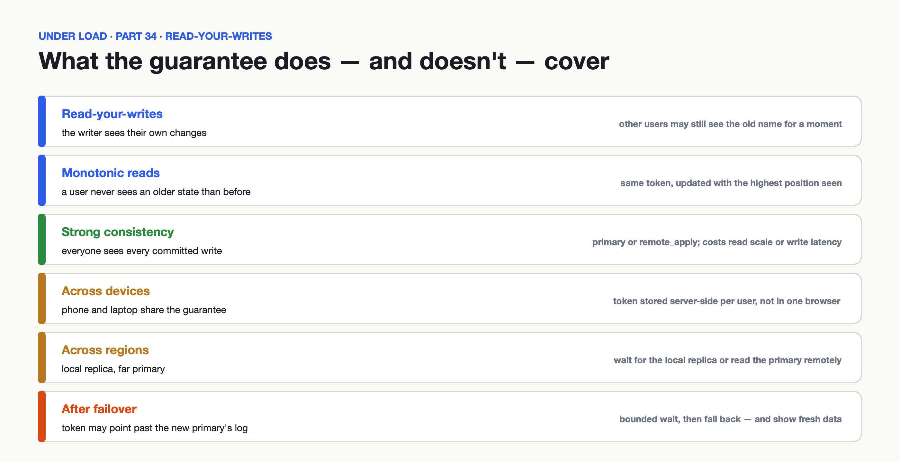
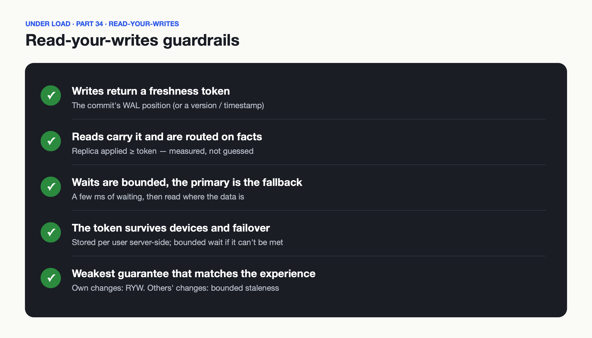

# Read-Your-Writes

### Read-your-writes consistency: guaranteeing that a user always sees their own changes while reads still go to replicas — why "read the primary for a second" and sticky sessions leak, and how a log-position token closes the gap.

*Under Load · Part 34 · Distributed Data*





---

Part 33 ended with an agent who renamed themselves, reloaded the page, and saw their old name — because the reload was served by a replica that hadn't applied the change yet. The obvious fix is to send every read to the primary. That works, and it throws away the reason for having replicas: the primary goes back to carrying all of the read traffic the replicas were bought to absorb.

The team tried the two usual shortcuts first.

"Read from the primary for one second after a write" fixed the rename on ordinary days. Then Halcyon's nightly import ran long into the morning, one replica fell several seconds behind, and the complaints came back — this time from agents who saved a reply, browsed for a couple of seconds, and found the reply missing from the ticket.

"Keep each user on one replica" stopped a different complaint — a ticket appearing solved on one click and open again on the next — but the agents who happened to be assigned to the slow replica now saw stale data on almost every page, and moving them to the other replica during a deploy made things briefly worse.

Both shortcuts share a flaw: they're **guesses** about replication lag. The fix that holds up replaces the guess with a fact — a **token** that records how far the database's log had got when the user wrote, and a router that only uses replicas that have got at least that far.

---

## What read-your-writes means

**Read-your-writes** (also called read-after-write consistency) is a **session guarantee**: after a client's write succeeds, that client's later reads reflect the write — they never return a state older than it.

It's deliberately narrower than strong consistency (Part 33):

- **Strong consistency** promises that **everyone** sees every committed write immediately.
- **Read-your-writes** promises only that **the writer** sees their own writes. Another agent looking at Sam's profile may still see "Sam" for a few hundred milliseconds, and that's fine — they didn't just change it, and they can't tell.

That narrowness is what makes it cheap: the system only has to be fresh for the reads that would notice, which are a small share of all reads.

Session guarantees come as a family, described in the distributed-systems literature since the 1990s (the Bayou project's session guarantees paper is the classic reference). Two of them matter here:

- **Monotonic reads**: a client never sees the data go **backwards** — never version 5 and then version 4. Without it, two consecutive reads that hit two replicas with different lag can show a ticket as "solved," then "open" again.
- **Read-your-writes**: the client's reads include its own writes.

The technique below provides both, for the price of one small token.

---

## Five ways to route a read after a write



Consider an agent session that saves a change on the primary and then reads, again and again, while browsing: immediately, after a few hundred milliseconds, after a couple of seconds. Two replicas serve reads; one is close to the primary, the other is behind by a varying amount — sometimes milliseconds, sometimes seconds. Five routing strategies behave very differently:

1. **Spread reads across replicas** (round-robin or least-connections). Every read can land on either replica. Reads that land on the lagging one miss the user's write; consecutive reads that land on different replicas can disagree, so data appears to jump backwards. Both read-your-writes and monotonic reads are broken, and how often depends entirely on lag.
2. **Primary for N seconds after a write.** Reads inside the window are correct, because they go to the primary. Reads after it go to replicas, and if a replica is more than N seconds behind, they miss the write. Meanwhile, every user who wrote recently reads from the primary, so a large share of reads moves back to it.
3. **Sticky session to one replica.** Each user always reads from the same replica. A single replica only ever moves forward, so data never goes backwards — monotonic reads hold. But nothing guarantees that replica has the user's write; users stuck to the slow replica see stale data on most reads after a write.
4. **Log-position token.** Each read goes to a replica that has provably applied the user's last write, or waits briefly, or goes to the primary. No stale reads, no backwards reads, and only the rare read that no replica can serve in time touches the primary.
5. **Everything on the primary.** Always correct, and the replicas serve nothing.

Only the token gives both properties at once: correctness for the writer and reads that stay on replicas.

### Why the shortcuts leak



The time window and the sticky session fail for the same reason: they're **assumptions** about lag, not **measurements** of it.

- **"Primary for N seconds"** assumes replicas are never more than N seconds behind. Most of the time that's true. During a bulk import, a long-running report on a replica (Part 33), a network hiccup or a slow disk, it isn't — and those are exactly the moments when users are slow, retrying and reloading. Making N larger moves more reads to the primary and still guarantees nothing; there is no N that's always enough. The window must also live somewhere — a cookie, a session — so it already needs most of the machinery a token needs.
- **Session stickiness** guarantees monotonic reads — the same replica only moves forward — but not that the replica has the user's write. Stickiness is a routing convenience, not a correctness proof. It also complicates load balancing and failover: users can't be moved away from a slow replica without risking a backwards jump, and when a replica is removed, its users land on another replica that may be further behind.

---

## The log-position token



The robust approach answers two questions with facts: **how far has each replica got, and how far does this user need?** Both are positions in the database's log.

**1. After a write, record its position in the log.** In PostgreSQL, the position is the **LSN** — log sequence number, a byte offset in the WAL. After the commit, the application asks the primary for `pg_current_wal_lsn()` in the same connection and gets a value like `0/4A1F2C8`. Other databases have equivalents: MySQL's **GTIDs** (global transaction identifiers, with `WAIT_FOR_EXECUTED_GTID_SET()` to wait for one on a replica), MongoDB's cluster time used by causally consistent sessions, and log positions exposed by several managed databases.

**2. Give it to the client as a token** — in a cookie, a response header the client echoes back, or the user's server-side session.

**3. Every read carries the token.** The router — in the application's data access layer, a database proxy, or a driver — knows each replica's **replay position**: `pg_last_wal_replay_lsn()` on the replica, polled every few milliseconds by a background task and cached in memory. A read compares two numbers; it doesn't query every replica.

**4. Route to any replica whose position is at or past the token.** If none is, **wait briefly** — tens of milliseconds — for one to catch up, re-checking the cached positions. If the wait runs out, **read from the primary**. The wait is a cap, not a fixed delay: most reads that wait at all wait a few milliseconds.

**5. After each read, keep the highest position seen.** The session's token becomes the maximum of its last write's position and the position of the replica that served its last read. That's what makes reads monotonic as well: the session never accepts a replica older than something it has already seen.

In pseudocode:

```python
def route(token_lsn):
    deadline = now() + MAX_WAIT          # e.g. 50 ms
    while True:
        fresh = [r for r in replicas if r.replay_lsn >= token_lsn and r.healthy]
        if fresh:
            return least_loaded(fresh)
        if now() >= deadline:
            return primary
        sleep(POLL)                      # a few ms; positions refresh in the background
```

### What it costs

- **Primary load** is limited to reads where no replica catches up within the wait — normally a small fraction, rising only when replicas are genuinely far behind. That rising fallback rate is itself the right alarm.
- **Latency** is added only to reads that wait, and never more than the cap. The median read is unaffected; the tail gains at most the cap.
- **Users who haven't written recently** carry an old token, or none, and are routed to any healthy replica. The guarantee costs only the reads that need it.

### Precision of the token

`pg_current_wal_lsn()` read after the commit is **conservative**: it includes WAL written by other sessions' concurrent transactions, so the router may wait for slightly more than this user strictly needs. That costs a few milliseconds occasionally and never correctness. A more precise variant records the position of the commit itself; either way, the token must never be **smaller** than the commit, or the guarantee breaks.

### Variations

- **Version tokens instead of log positions.** The token can be the entity's version (Part 27's version numbers): "show ticket 48213 at version ≥ 17." The read goes to any replica; if the row there is older, it retries elsewhere or on the primary. This works across systems where log positions aren't comparable — caches, search indexes, CQRS projections (Part 32), where "has this projection caught up?" can only be answered by versions.
- **Timestamps.** Some databases offer "read at a timestamp at least as new as T," using a clock the database itself controls. Wall-clock timestamps from application servers are risky because clocks disagree (Part 38).
- **Primary fallback only.** The simplest correct version: if the token is newer than every replica's position, read the primary — no waiting. Slightly more primary load, no added latency.
- **Wait on the replica.** Instead of polling positions, the read can ask the replica to wait until it has replayed the token (MySQL's `WAIT_FOR_EXECUTED_GTID_SET` with a timeout, or a short loop on `pg_last_wal_replay_lsn()`), then run the query on the same connection.

---

## What the guarantee does — and doesn't — cover



- **Other users.** Read-your-writes protects the writer. Other users get whatever freshness their reads were designed for (Part 33's bounded staleness). If two agents working the same ticket must see each other's changes immediately, that's a stronger requirement — read that ticket from the primary, or push updates to both.
- **Across devices.** A token in one browser's cookie doesn't help the same agent on their phone. For a guarantee per **user** rather than per browser, store the token server-side, keyed by user, and read it on every request.
- **Across services.** If the profile service writes and the ticket service reads, the token has to travel between them — usually as a request header propagated like a trace ID.
- **Across regions.** With the primary in one region and replicas in another, a token newer than the local replica means waiting for cross-region replication — tens to hundreds of milliseconds — or reading from the primary's region remotely. Both are expensive, which is why many systems route a user's writes and their immediate reads to one "home" region and let other regions serve other users' data with bounded staleness.
- **Across caches.** A cache in front of the database (Part 9) is another replica. A cached profile read right after the rename returns the old name unless the write invalidated it, or the cache entry carries a version the token can be compared with.
- **After failover.** If the primary fails and a replica is promoted, writes the replica never received are gone (Part 33). A token pointing at one of them can never be satisfied — worse, LSNs on the new timeline aren't directly comparable with the old ones. The bounded wait and fallback keep this safe: after the wait, the read goes to the new primary and the user sees the current state, which, after a lossy failover, is the truth. Many routers also reset all tokens when they detect a new primary, so a stale token can't make every read wait.

---

## Choosing the weakest guarantee that works

Read-your-writes isn't something every read needs. A useful way to decide, per screen or endpoint:

- **The user's own just-changed data** — profile, settings, the reply they just posted: read-your-writes.
- **Lists that include the user's changes** — the ticket queue after the user changed a status: read-your-writes, or overlay the change in the client.
- **Other people's data** — a teammate's queue, dashboards: bounded staleness from any replica.
- **Decisions that must be correct** — seat limits, permission checks before a write: the primary.

Measuring the outcome matters as much as choosing it. If responses include the position or version they were served at, a client or a sampler can compare it with the token and count the stale reads that slipped through — the only direct measure of whether the guarantee holds in production.

---

## Rolling it out

**Start with the write paths users notice.** Profile and settings saves, posting a reply and status changes produce most "my change disappeared" reports. Returning a token from those first covers most of the experience.

**Add the router behind a flag, in shadow.** Compute the routing decision for every read and log what it would have done — replica, wait, or primary — while still using the old routing. The logs show the expected fallback rate and wait times before anything changes.

**Set the wait cap from the latency budget,** not from lag. A cap that's longer than the page can afford turns replica lag into user-visible slowness; a cap of zero turns it into primary load. Tens of milliseconds is a common starting point.

**Alert on the fallback rate.** A sudden rise means replicas are falling behind — the same signal as lag, seen from the user's side.

---

## Guardrails that prevent the next one



1. **Writes return a freshness token**: the WAL position, or an entity version.
2. **Reads carry it and are routed on facts**: a replica is used only if it has applied at least that position.
3. **Waits are bounded and the primary is the fallback**: a few milliseconds of waiting, then read where the data is.
4. **The token survives devices and failover**: stored per user where needed, with a bounded wait when it can't be met.
5. **Each read gets the weakest guarantee that matches the experience**: read-your-writes for a user's own changes, bounded staleness for everyone else's.

---

## What to keep on the dashboard

- **Replica replay position and lag**, per replica, as the router sees it.
- **Primary fallback rate**: the share of reads that couldn't be served by any replica in time. A rising rate means replicas are falling behind.
- **Freshness waits**: how many reads waited, and how long (median and tail).
- **Stale-read rate**, if responses report the version they served — the measure of how often the guarantee is missed.
- **Read latency at the tail**, which absorbs the waits.
- **Load on the primary from reads**, to confirm the guarantee isn't quietly moving traffic back to it.

---

## Recap

### How can a user see old data immediately after a successful write?
The write commits on the primary, and the next read is routed to a replica that hasn't applied it yet. Even small lag is enough, because the user's own next request often arrives sooner than the replica applies the change.

### What is read-your-writes consistency?
A session guarantee: after a client's write succeeds, that client's subsequent reads never return a state older than the write. It protects the writer's experience even while replicas lag.

### How is read-your-writes different from strong consistency?
Strong consistency guarantees that every reader sees every committed write. Read-your-writes guarantees it only for the writer's own writes; other users may briefly see older data. That's why it can be implemented without sending all reads to the primary.

### How would you implement read-your-writes without sending every read to the primary?
Return the write's log position (LSN) or version as a token; route reads carrying the token only to replicas whose replay position has reached it; wait briefly if none has, then fall back to the primary. Keeping the highest position seen in the token also makes reads monotonic.

### Why is sticky routing alone insufficient?
Stickiness keeps a user on one replica, which prevents reads from going backwards, but nothing guarantees that replica has applied the user's write. Users pinned to a lagging replica see stale data, and stickiness makes it harder to move them away from it.

### Why is "read from the primary for N seconds" not enough?
It assumes replication lag never exceeds N. When it does — bulk writes, long replica queries, network trouble — reads after the window leak to stale replicas, while every recent writer's reads load the primary in the meantime. It's a guess, not a measurement.

### What are monotonic reads?
The guarantee that a client never sees an older state after having seen a newer one. Spreading reads across replicas with different lag breaks it; sticky routing or a token that keeps the highest position seen provides it.

### How would you implement this across multiple regions?
Either wait for the local replica to reach the token, read from the primary's region when it hasn't, or route each user's writes and immediate reads to a home region. Store the token server-side per user so it travels with the user across devices and regions.

### What happens to the guarantee during a primary failover?
Writes the promoted replica never received are lost, so a token pointing at them can't be satisfied, and positions on the new primary's timeline aren't comparable with old tokens. A bounded wait followed by a read from the new primary — or resetting tokens on failover — keeps the system available and shows the user the actual current state.

### What should you monitor?
Replica replay lag, primary fallback rate, freshness waits and their latency, stale-read incidents, tail read latency, and read load on the primary.

---

## Next

- **Lab (run + measured write-up):** [34-read-your-writes](https://github.com/b-basoglu/under-load/tree/main/34-read-your-writes)
- **Next:** [Sharding & Hot Partitions](../35-sharding/article.md) — One primary can't take any more writes, so the data is split by tenant. Then Halcyon — 20% of all traffic — lands on one shard.
