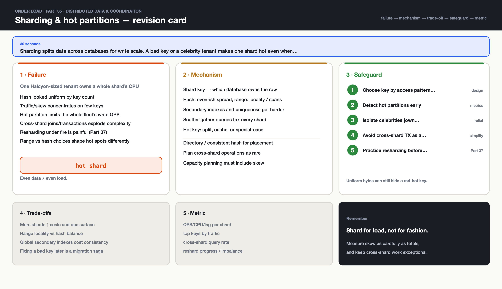
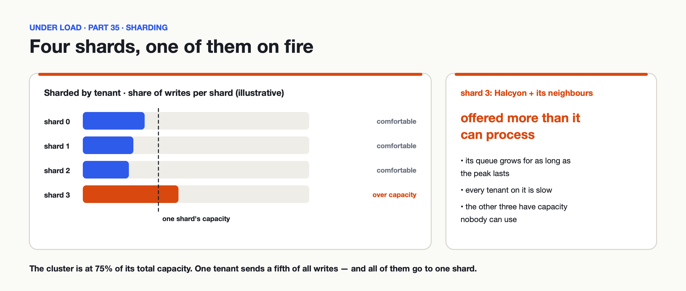
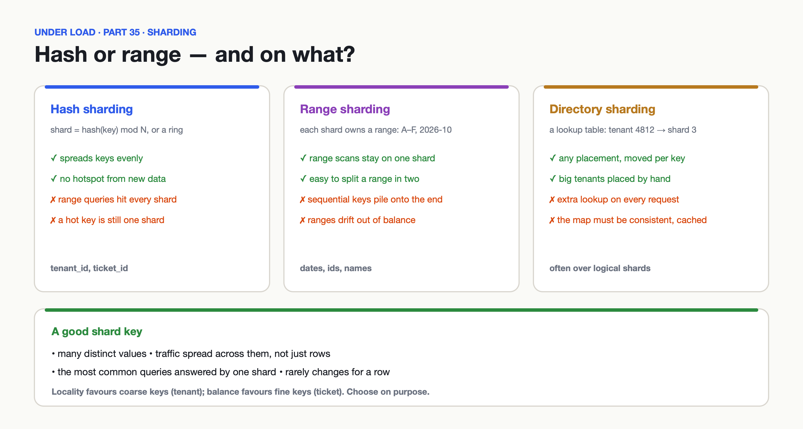
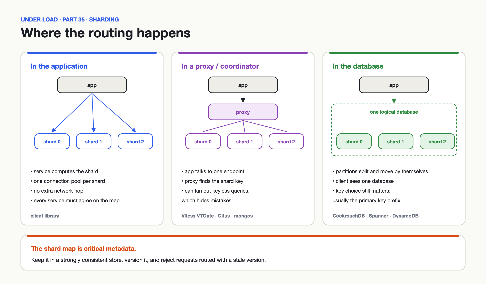
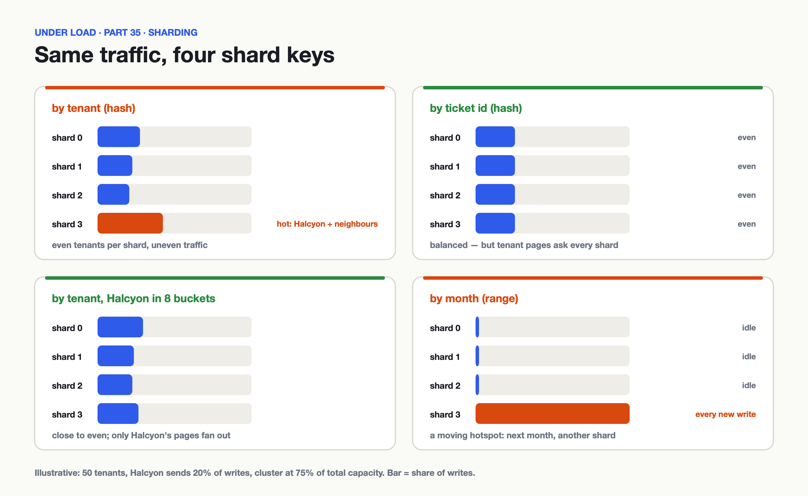
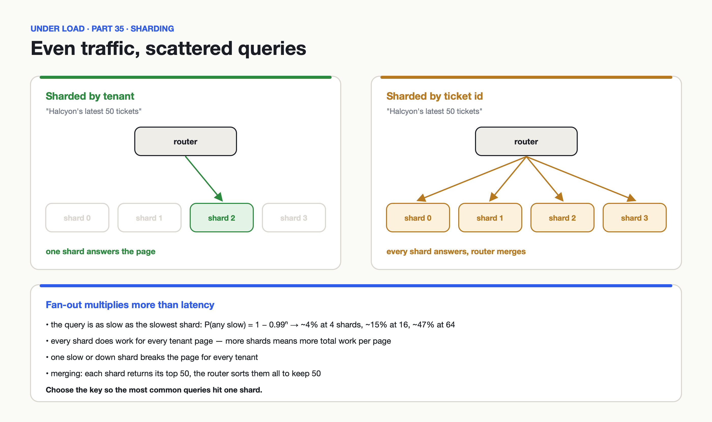
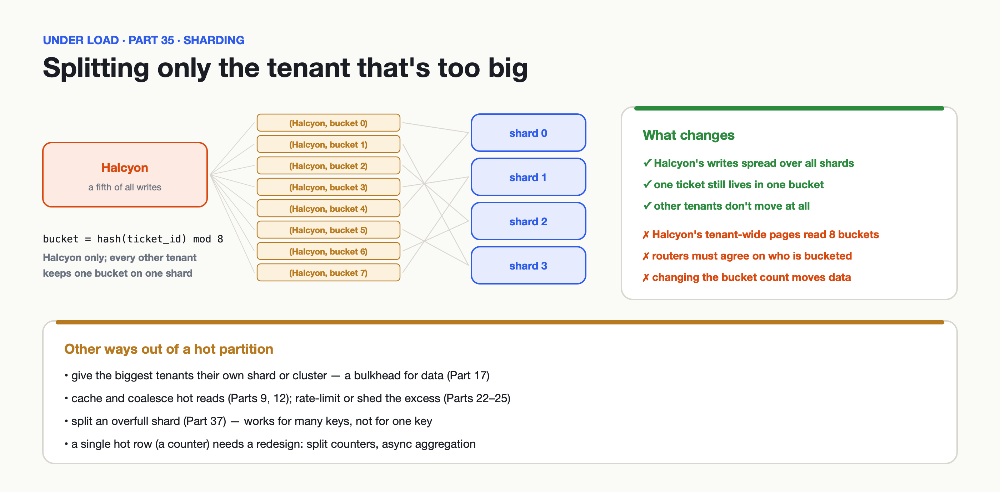
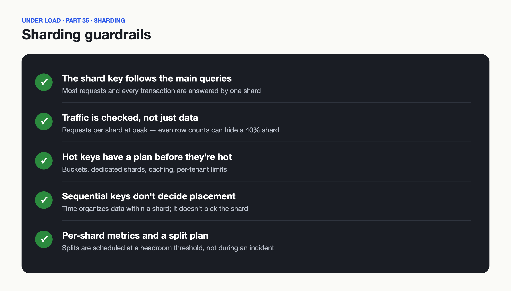

# Sharding & Hot Partitions

### Sharding and hot partitions: spreading data and traffic across databases so writes can scale — how the shard key decides everything, why even data can still mean uneven traffic, and what to do with the tenant that's too big.

*Under Load · Part 35 · Distributed Data*

---

The ticket database finally hits the wall that replicas can't fix: **writes**. Every reply, status change and SLA timer update lands on one primary, and during the working day that primary's CPU and disk are saturated. Replicas (Part 33) copy every write, so adding more of them adds read capacity and nothing else. The plan: split the data across **four databases** — four **shards** — by tenant. Each tenant's tickets live on exactly one shard, and four primaries share the write load.

The migration goes smoothly. On the first busy Monday, three shards run at a comfortable utilization. The fourth is in trouble: write latency climbs from milliseconds to seconds, a queue of pending writes keeps growing, and every customer on that shard sees a slow product. That shard holds **Halcyon**, the biggest customer — about a fifth of all traffic on its own — plus the tenants that happened to hash next to it.

The cluster as a whole has plenty of capacity. One shard has none.

Sharding multiplied the capacity of the cluster by four. It didn't multiply the capacity available to any single tenant at all. That gap — between how much the system can do in total and how much any one partition can do — is what this article is about.

---

## What sharding is

**Sharding**, also called **horizontal partitioning**, splits a dataset across several independent databases. Each one — a **shard** — holds a subset of the rows and handles all the reads and writes for that subset. Together the shards hold everything; individually, each carries only part of the load. ("Horizontal" because the table is cut between rows; **vertical partitioning**, by contrast, splits columns or whole tables apart — tickets in one database, billing in another.)

It's the step that comes after a single primary runs out of write throughput, storage or memory. The difference from replication is worth stating precisely:

- **Replication** copies **all** the data to more servers. It adds read capacity and redundancy; write capacity stays that of one machine, because every replica must apply every write.
- **Sharding** gives **different** data to different servers. It adds write capacity, storage and memory, at the cost of everything that needs data from more than one shard.

The two combine. In practice each shard is itself a small replicated cluster — a primary with its own replicas — so a sharded system is N shards × M copies each.

### Before reaching for it

Sharding is a one-way door for most teams. Application code, migrations, backups, analytics and on-call runbooks all become shard-aware, and very little of that is easy to undo. Several cheaper moves usually come first:

- **A bigger machine.** Vertical scaling buys time with no code change, and modern servers are very large.
- **Moving work off the primary.** Reads to replicas (Parts 33–34), hot reads to a cache (Part 9), heavy reporting to a separate analytics store fed by change data capture (Part 30).
- **Splitting by feature.** If billing, audit logs and tickets share one database, giving each its own is a vertical split — simpler than sharding any of them.
- **Archiving cold data.** If most rows are closed tickets nobody reads, moving them elsewhere shrinks the working set.
- **Making each write cheaper.** Fewer indexes (Part 1), batched writes, fewer updates per ticket event.

When writes still outgrow the largest practical machine, or the dataset no longer fits on one, sharding is the remaining direction. That's where the support product is.

---

## The shard key decides everything

Every request has to know which shard holds the data it needs. The **shard key** (or **partition key**) is the column, or combination of columns, that decides it. Choosing it is the central design decision; almost every later problem — hotspots, slow pages, painful migrations — traces back to it.

There are three common ways to turn a key into a shard.

**Hash sharding.** Compute a hash of the key and map the hash to a shard: `hash(tenant_id) mod 4`, or a position on a hash ring (Part 36). A good hash function scatters keys uniformly regardless of their values, so new data doesn't pile up in any particular place. The price: neighbouring keys end up on unrelated shards, so a query over a range of keys — "all tickets created this week" — has to ask every shard. And hashing spreads **keys**; a single key that's very busy still lives on exactly one shard.

**Range sharding.** Each shard owns a contiguous range of key values: tenants A–F, ticket IDs 0–10 million, the month of October. Range scans stay on one shard, and a range that grows too large can be split into two neighbouring ranges. The price: ranges drift out of balance as data arrives unevenly, and keys that grow over time — dates, sequential IDs — send every new write to the **last** range. Bigtable, HBase, CockroachDB and Spanner partition by key range and their documentation warns against exactly this.

**Directory (lookup) sharding.** A small table maps each key, or each group of keys, to a shard: "tenant 4812 → shard 3." Placement is completely flexible — a big customer can be moved by updating one row — at the price of an extra lookup on the request path and a mapping that must be highly available and cached everywhere.

Real systems often layer these. A common pattern hashes keys into a large, fixed number of **logical shards** (say 1,024 buckets), then uses a directory to place logical shards on physical databases. Adding a machine means moving some buckets, not re-hashing every key — the subject of Parts 36 and 37.

### What makes a good key

Whatever the mapping, a good shard key has four properties:

- **High cardinality.** Many distinct values, so the data can be cut finely enough to fill many shards. A key with ten distinct values can never use more than ten shards.
- **Even access.** Traffic, not just rows, spread across those values.
- **Query locality.** The most common queries can be answered by **one** shard, because everything they need shares a key.
- **Stability.** A row's key value rarely changes, because changing it means physically moving the row to another shard.

These goals pull against each other. Locality favours coarse keys like `tenant_id`: one tenant's tickets, comments and agents all live together, and every screen in the product touches one shard. Even access favours fine keys like `ticket_id`: millions of values, none of them much busier than the rest. Most of this article is about living with that tension.

---

## How a request finds its shard

The mapping has to live somewhere, and every component that talks to the database needs it. Three common arrangements:

- **In the application**, as a library. Each service computes the shard from the key and holds a connection pool per shard. No extra hop, but every service in every language must implement the same mapping, and changing it means coordinating a deploy everywhere.
- **In a proxy or coordinator** that speaks the database protocol. The application connects to one endpoint; the proxy parses the query, finds the shard key and forwards it. Vitess (VTGate) does this for MySQL, Citus's coordinator for PostgreSQL, `mongos` for MongoDB. Applications stay simple, and queries without a shard key can still be fanned out by the proxy — which also makes them easy to write by accident.
- **In the database itself.** Distributed databases such as CockroachDB, Spanner, YugabyteDB or DynamoDB split and place partitions internally; the client sees one database. The shard key still matters — it's usually the primary key's prefix — but splitting and moving are automatic.

Whatever holds it, the **shard map** is critical metadata. If two routers disagree about where tenant 4812 lives, writes can land on the wrong shard. Production systems keep the map in a strongly consistent store, version it, and have routers reject or redirect requests that arrive with a stale version.

---

## Same traffic, four shard keys

To see how the key decides the load, take one illustrative workload and four choices. There are 50 tenants. Halcyon sends 20% of all writes; the other 49 share the remaining 80% with a long tail — a few large customers, many small ones. Four shards, each able to absorb a fixed number of writes per second. The total offered load is 75% of the cluster's combined capacity: on paper, a healthy margin.

**By tenant (hashed).** Each tenant lands on one shard. Halcyon's shard gets Halcyon's 20% plus roughly a quarter of everybody else's 80% — about 20% more — so around **40% of all writes** go to one shard that was sized for 25%. With the cluster at 75% average utilization, that shard is offered about 1.6 × 75% ≈ 120% of what it can process. Its queue doesn't just get long, it grows without bound for as long as the load lasts, and every tenant on that shard waits behind it. The other three shards sit around 60–70% utilization, with capacity to spare that nobody can use.

**By ticket ID (hashed).** Every tenant's tickets are scattered across all four shards, Halcyon's included. Each shard gets almost exactly a quarter of the writes, regardless of who sends them. Load is perfectly even — and the next section shows what that costs.

**By tenant, with Halcyon split into buckets.** Explained in detail below: the tenant key for everyone, except that the one tenant too big for a shard is spread across several. Shares end up close to even, with some lumpiness from where the buckets happen to land.

**By month (range).** Every new ticket is created "now," so every write goes to the shard that owns the current month. One shard does 100% of the work; three are idle. Next month, a different shard is the only one working. This is a **moving hotspot**: the hot partition isn't a fixed place that can be given more hardware, it travels.

### Uniform data is not uniform traffic

The tenant-sharded cluster passes the usual balance checks. Each shard holds roughly a dozen tenants and, depending on who they are, a similar number of rows. But load follows **requests**, not row counts or tenant counts. In a "tenants per shard" report, a tenant generating a fifth of all traffic counts as one row.

Two things make this worse than it looks:

1. **Busy is not proportional to big.** A tenant's request rate depends on how many agents it has and how active they are, not on how many historical tickets it stores. Halcyon's import made it large; its 2,000 agents make it busy. Storage-based balancing can't see the second.
2. **Latency is not linear in load.** A shard at 60% utilization and one at 95% don't differ by a third in response time; the second can be many times slower, because queueing delay rises steeply as utilization approaches 100% (Part 24). Above 100%, latency is limited only by timeouts.

Capacity planning for a sharded system therefore has to look at **requests per shard and per key**, and at peak, not average. A cluster at 75% average is only as healthy as its busiest shard.

---

## Even traffic, scattered queries

Sharding by ticket ID balances writes perfectly. It also breaks the query the product runs most: "show this tenant's latest tickets." With tickets spread across all shards, each shard holds some of Halcyon's, so the router must ask **all four**, wait for every answer, and merge the results. This is a **scatter-gather** (or **fan-out**) query.

On an idle system, the extra milliseconds are small. The multipliers are not:

- **The query is as slow as the slowest shard.** If each shard has a 1% chance of a slow response at any moment, a query that needs all n shards is slow with probability 1 − 0.99ⁿ: about 4% at four shards, about 15% at sixteen, almost half at sixty-four. Part 18 covered how tail latency compounds this way.
- **Every shard works for every page.** One tenant view becomes four queries instead of one. As shards are added for capacity, each page load costs more total work — the opposite of what sharding was for.
- **Availability is the product, not the average.** One shard down or slow now breaks the page for **every** tenant, not just for the quarter that live on it.
- **Merging is not free.** "Latest 50 across all shards" means each shard returns its own top 50 and the router sorts 200 rows to keep 50. Deep pagination makes it worse: page 20 means every shard returns 1,000 rows (Part 8).

### Cross-shard writes, joins and constraints

Reads that span shards are slow. Writes that span shards are hard.

- **Transactions.** Moving a ticket from one tenant to another, when the two tenants live on different shards, is no longer one database transaction. It needs a distributed transaction (two-phase commit, which blocks if the coordinator fails at the wrong moment), or a saga with compensating steps (Part 31), or a product decision that such moves are rare enough to handle as an offline job.
- **Joins.** A join between tables sharded on different keys requires shipping rows between shards. The usual answers: shard related tables on the same key so their rows live together (**co-location** — tickets, comments and attachments all by `tenant_id`), and copy small, rarely changing tables such as plan definitions to every shard (Citus calls these **reference tables**).
- **Uniqueness.** A unique index is checked per shard. "Each email address belongs to at most one user, globally" can't be enforced by a shard that doesn't see the others. It needs a separate lookup table that is itself the authority for that key, or a key design where the unique value *is* the shard key.
- **Secondary indexes.** An index on a non-key column — tickets by `external_ref`, say — can be **local** (each shard indexes its own rows, so a lookup asks every shard) or **global** (a separate index partitioned by the indexed value, which is fast to read but updated asynchronously or with a cross-shard write). DynamoDB's global secondary indexes, for example, are eventually consistent.
- **IDs.** An auto-incrementing sequence on one database can't hand out unique IDs across four. Sharded systems use IDs that are unique without coordination: UUIDs (UUIDv7 keeps them roughly time-ordered), or Snowflake-style IDs that combine a timestamp, a machine number and a counter.

So the key is a trade-off. **Tenant** keeps nearly every query and transaction on one shard and risks hot tenants. **Ticket** balances load and scatters the main queries. Many multi-tenant products keep the tenant key and deal with hot tenants explicitly. That's the route this story takes.

---

## Splitting only the tenant that's too big

A hot partition — one shard or key receiving a disproportionate share of traffic — is a problem of a few keys, not of the key design as a whole. So the fix can target those keys.

**Bucketing**, also called **salting**, keeps the tenant key for everyone and splits only the tenants too big for one shard. For Halcyon, the shard key becomes `(tenant_id, bucket)` with `bucket = hash(ticket_id) mod 8`; every other tenant has exactly one bucket. Halcyon's eight buckets hash to different places, so its writes spread across all four shards. A single ticket still lives entirely in one bucket, so everything about that ticket — its comments, its history — stays together.

What it costs:

- **Halcyon's tenant-wide queries fan out.** "Halcyon's latest tickets" now reads eight buckets. That's a scatter-gather, but only for the one tenant that needed it; every other tenant still reads one shard.
- **Routing needs metadata.** The router must know which tenants are bucketed and into how many buckets, and every router must agree. This is a small entry in the shard map, with the same consistency requirements.
- **The bucket must be derivable.** With `bucket = hash(ticket_id) mod 8`, a request for one ticket goes straight to its bucket. A **random** salt — append a random number at write time — spreads writes just as well but forces every read of a specific item to try all buckets. Random salting fits append-only data that's always read in aggregate, like event counters; derived salting fits everything else.
- **Changing the bucket count moves data.** Going from 8 to 16 buckets re-hashes Halcyon's tickets. Choosing a generous count up front, or splitting buckets in a way that only halves existing ones, keeps that rare.

Even with buckets, the shares won't be perfectly equal: eight buckets on four shards land wherever their hashes fall, and the other 49 tenants stay exactly where they were. More buckets, or placing buckets deliberately through a directory instead of by hash, evens it out further.

### Other ways out of a hot partition

- **A dedicated shard for the largest tenants.** Putting the biggest customers on their own shard, or their own cluster, is common in B2B SaaS. It isolates noisy tenants from everyone else, gives the big customer its own capacity to plan, and simplifies enterprise requirements like data residency. It's the bulkhead idea (Part 17) applied to data.
- **Reduce the hot traffic itself.** Cache and coalesce hot reads (Parts 9 and 12), limit each tenant's request rate (Parts 22–23), shed low-priority work under overload (Part 25). Sharding spreads load; these remove it.
- **Split the shard.** When a shard is simply too full — too many tenants, too much data — move some of its tenants or half of its range to a new shard (Part 37). This works for an overloaded shard of many keys, not for one key that's too hot on its own.

### When the hot spot is a single row

Bucketing a tenant spreads its *many* rows. Sometimes the heat is in *one* row: a counter of open tickets per workspace, updated on every ticket change; a global sequence; a status row everyone polls. No shard key can split one row across machines. The row itself has to be redesigned:

- **Split the counter.** Keep N sub-counters, increment a random one, sum them when reading (sometimes called a **sharded counter**). Writes spread; reads do a little more work.
- **Aggregate asynchronously.** Record events and update the total in batches, accepting that the number is a few seconds old.
- **Stop writing it.** Many "hot rows" are derived values that can be computed on read or cached.

Managed stores make the limit explicit. DynamoDB documents a per-partition throughput ceiling (on the order of a thousand writes per second per partition); a single key can't exceed it no matter how much capacity the table has. Adaptive capacity can shift capacity between partitions, and DynamoDB can split a busy partition, but a single item still lives on a single partition, so the design advice remains to spread writes across keys.

---

## Time-based and sequential keys

Range-sharding by time, or by an auto-incrementing ID, sends every new row to the last range. The current shard does all the writing; the others hold history. In a range-partitioned store that splits automatically, the newest range keeps splitting, and each new piece is again the only one receiving writes.

The fix is to separate the two jobs a timestamp is asked to do:

- **Placement** — which shard holds the row — should use a key with even access: tenant, a hash of the ID, or a bucket.
- **Organization over time** — dropping old data, archiving, scanning recent rows — can use time **within** each shard. PostgreSQL's declarative partitioning by month inside each shard, for example, makes dropping last year's tickets a fast `DROP` of a partition instead of a huge `DELETE`.

The same applies to IDs. Sequential IDs are pleasant for humans and efficient for B-trees, but as a range shard key they create a hotspot. Hashing them for placement, or prefixing them with a bucket, keeps the order useful locally without concentrating writes globally.

---

## Shipping it without an outage

Going from one database to N is a data migration under live traffic. A common, safe sequence:

1. **Introduce the routing layer first**, with every key mapped to the one existing database. All code goes through it; nothing moves yet. Any query that can't name its shard key shows up now, while it's still cheap to fix.
2. **Make the schema shard-ready.** Every sharded table carries the shard key, primary keys include it or are globally unique, and cross-tenant foreign keys and joins are removed or rewritten.
3. **Start with many logical shards** — hundreds or thousands — even when there are only four machines. Moving a logical shard later is an ordinary operation; re-sharding to a different key is a project.
4. **Copy, then catch up.** Copy a group of tenants to its new shard, then replay ongoing changes using change data capture (Part 30) or the database's logical replication until the copy is current.
5. **Cut over in small groups.** Briefly pause writes for those tenants, confirm the copy is fully caught up, flip their entry in the shard map, resume. Small tenants first; Halcyon last, with extra care and a rehearsed rollback.
6. **Verify and clean up.** Compare row counts and checksums between source and destination, then delete the moved data from the old location only after the new one has served traffic for a while.

### Plan the next split now

Shards fill up: data grows, tenants grow, traffic grows. Splitting a shard or moving partitions takes time and consumes the very resources that are scarce — disk, network and CPU on the busy shard (Part 37 is about doing it safely). So the plan to split has to start long before a shard hits its limit. A useful rule is a **headroom threshold**: when any shard's peak utilization or storage crosses a set level well below its limit, the next split is scheduled, not debated.

---

## Guardrails that prevent the next one

1. **The shard key follows the main queries.** Most requests — and every transaction — are answered by one shard. A new query that can't name its shard key is a design review, not a code review comment.
2. **Traffic is checked, not just data.** Balance is judged by requests per shard at peak, alongside storage. Even row counts can hide a shard carrying 40% of the load.
3. **Hot keys have a plan before they're hot.** Bucketing for tenants above a threshold, dedicated shards for the largest customers, caching for hot reads, per-tenant limits for bursts.
4. **Sequential keys don't decide placement.** Time and auto-increment IDs organize data within a shard; they don't pick the shard.
5. **Per-shard metrics and a split plan exist before any shard is full.** Splitting is scheduled at a headroom threshold, not during an incident.

---

## What to keep on the dashboard

- **Requests per second per shard**, and each shard's share of the total — the first place a hot partition shows up.
- **p99 latency, CPU, error rate, connections and queue depth per shard.** A cluster-wide average hides the one shard on fire.
- **Top keys (tenants) by traffic on each shard**, to see who is making it hot. Many proxies and databases can sample this; DynamoDB's Contributor Insights does it directly.
- **Storage per shard and its growth rate**, to schedule splits before a shard is full.
- **Peak utilization of the busiest shard**, not the average — that's the real headroom of the cluster.
- **Scatter-gather rate, fan-out per query and its latency**, to catch new queries that forgot their shard key.
- **Cross-shard transactions or sagas** in flight, and their failure and compensation rates.

---

## Recap

### What is sharding, and when is it needed?
Splitting data across independent databases, each storing a subset of the rows and handling all reads and writes for it. It's needed when one primary runs out of write throughput, storage or memory after cheaper options — a bigger machine, replicas, caching, archiving, splitting by feature — are exhausted. Replicas add read capacity but copy every write.

### What makes a good shard key?
High cardinality, traffic spread evenly across its values, the most common queries and transactions answerable by one shard, and values that rarely change. These conflict — coarse keys like tenant give locality, fine keys like ticket ID give balance — so the choice is a deliberate trade-off.

### Hash vs range sharding?
Hash sharding spreads keys evenly and avoids hotspots from new data, but range queries must ask every shard and a hot key still lives on one shard. Range sharding keeps range scans local and is easy to split, but drifts out of balance, and sequential keys send all new writes to the last range. Directory sharding adds a lookup table for full placement control.

### Why can a shard be hot even when data is evenly distributed?
Load follows requests, not rows or tenants. A tenant that sends a fifth of all traffic is one tenant in a placement table, so the shard holding it can get around 40% of writes while holding a quarter of the data. And because queueing delay rises steeply near saturation, that shard can be many times slower while the others idle.

### How do you handle a celebrity or very large tenant?
Split only that tenant into buckets, derived from a stable ID so single-item reads still go to one place, so it spreads across shards while everyone else stays on one. Or give it a dedicated shard. Reduce its hot traffic with caching, coalescing and per-tenant rate limits. A single hot row needs a redesign of the row itself, such as split counters.

### What changes when a query needs data from many shards?
It becomes a scatter-gather: every shard does work for every call, the query waits for the slowest shard (tail risk grows as 1 − 0.99ⁿ), one bad shard affects every caller, and results must be merged. Cross-shard writes need two-phase commit or sagas; global uniqueness and global secondary indexes need separate mechanisms.

### Why are sequential or time-based keys dangerous?
As a range shard key they create a moving hotspot: all current writes go to the newest range while older shards sit idle, and next month the hot spot moves. Use time to organize data within a shard, and something evenly accessed to choose the shard.

### When should rebalancing and splitting be planned?
Before any shard approaches its limits. Moving data consumes the busy shard's own disk, network and CPU, so it must happen with headroom. Starting with many logical shards makes later moves routine.

### What should be monitored?
Per-shard request rate and share, p99 latency, CPU, error rate and queue depth; top keys per shard; storage and growth per shard; the busiest shard's peak utilization; scatter-gather rate and fan-out; and cross-shard operations.

---

## Next

- **Lab (run + measured write-up):** [35-sharding](https://github.com/b-basoglu/under-load/tree/main/35-sharding)
- **Next:** [Consistent Hashing](../36-consistent-hashing/article.md) — Going from 4 shards to 5 with `hash mod N` moves 80% of the data. A hash ring moves 20% — and virtual nodes keep it even.
