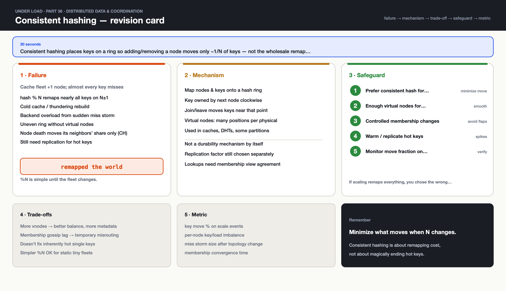
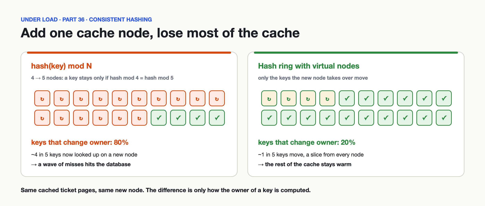
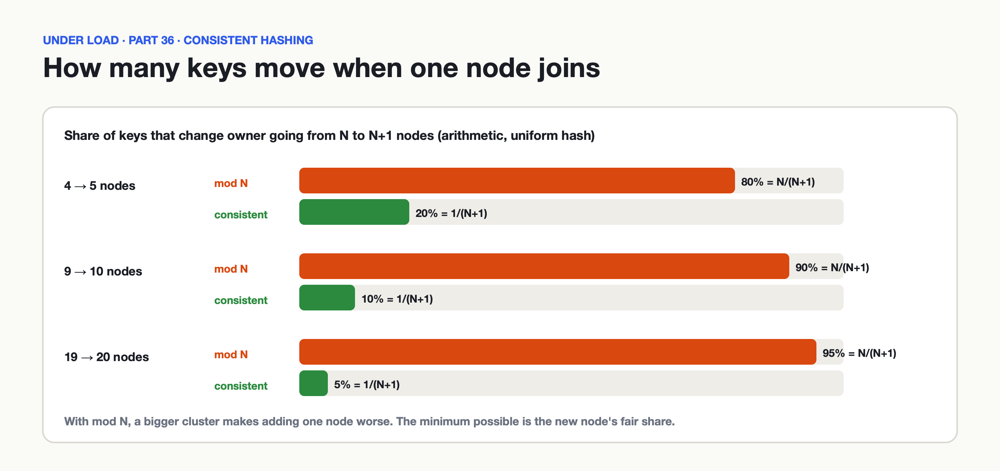
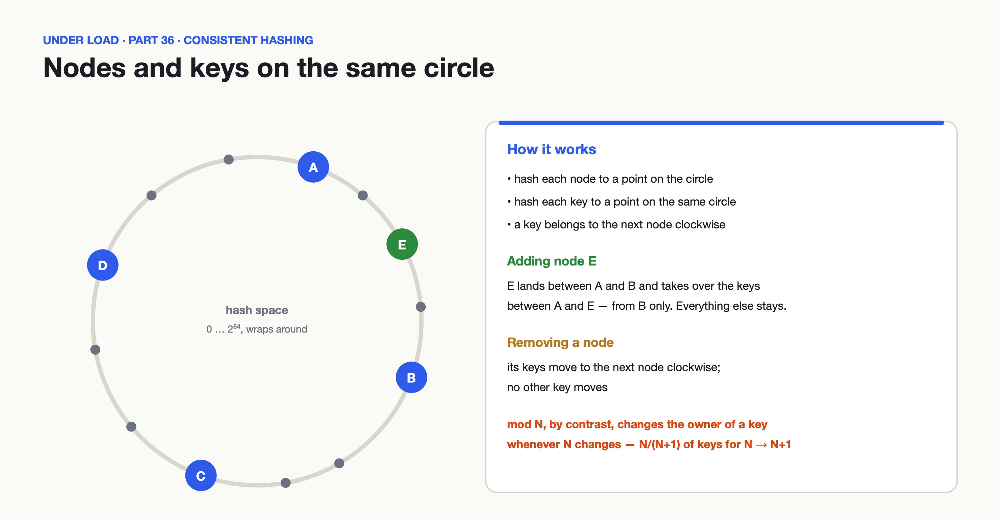
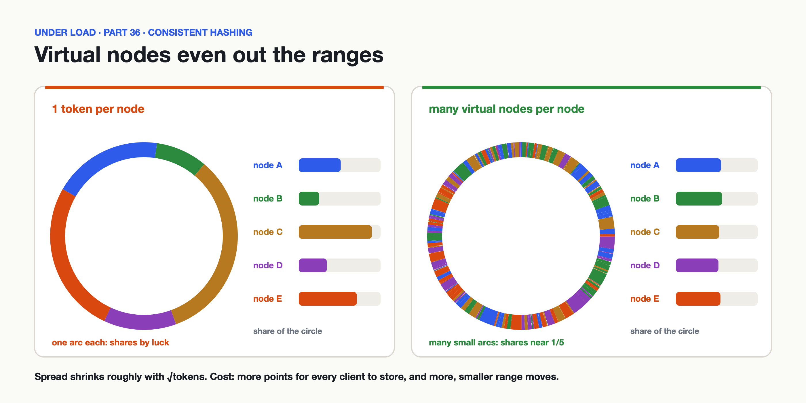
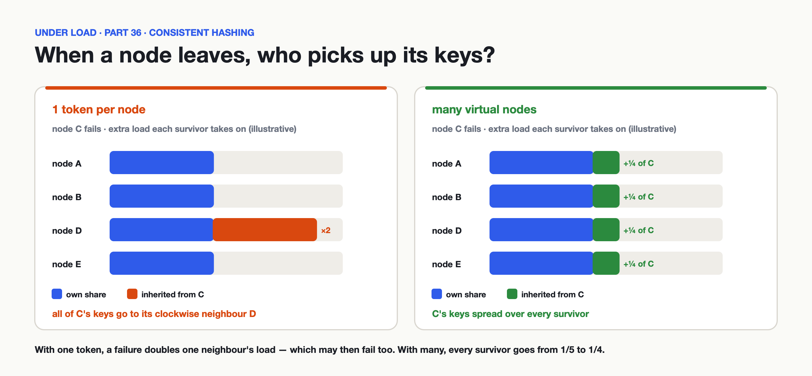
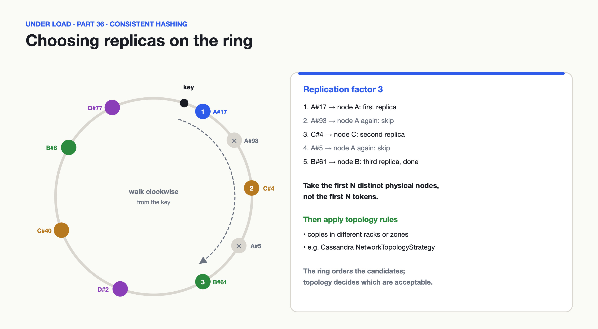
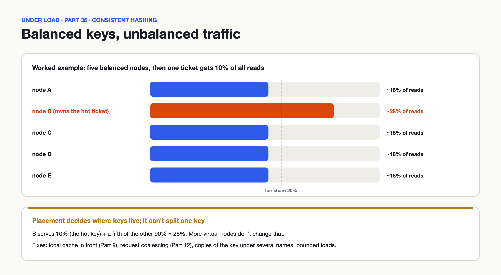
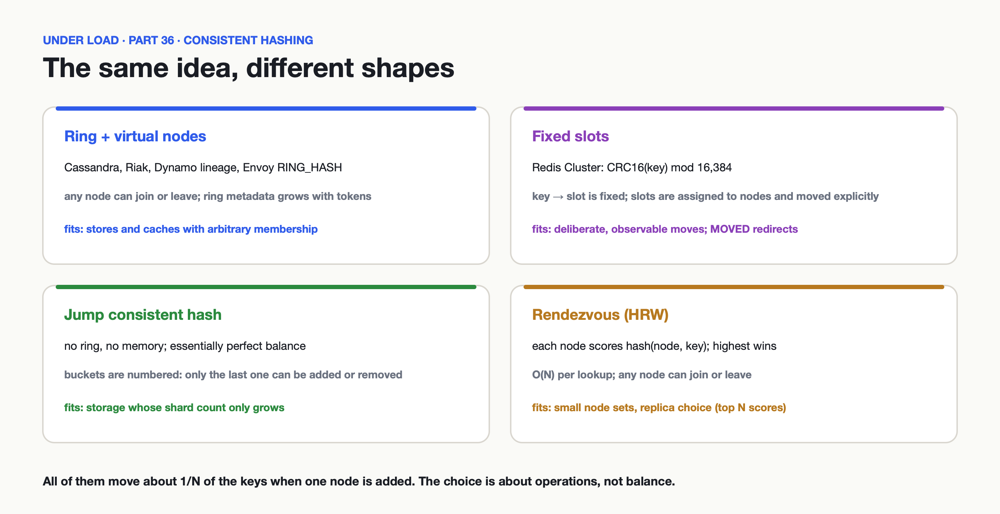
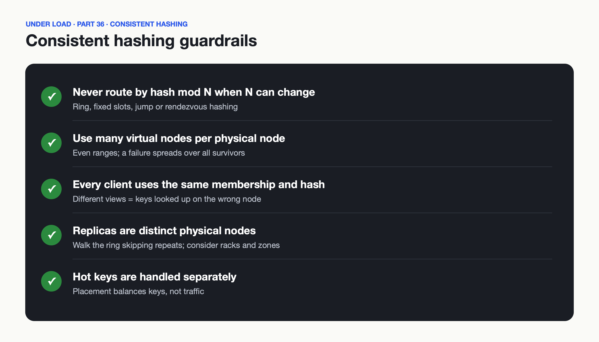

# Consistent Hashing

### Consistent hashing: assigning keys to nodes so that adding or removing a node moves only the keys it must — hash rings, virtual nodes, replica placement, and the alternatives.

*Under Load · Part 36 · Distributed Data*





---

The rendered ticket pages are cached on four Redis nodes. The application decides which node holds which page with one line:

```python
node = nodes[hash(key) % len(nodes)]
```

(`%` is the remainder after division: `hash(key) % 4` is always 0, 1, 2 or 3, which picks one of four nodes.)

It spreads keys perfectly evenly, it's fast, and nobody thinks about it again. Then Halcyon's agents start working through their backlog, cache memory runs short, and someone adds a fifth node during a busy afternoon. Within seconds the cache hit rate collapses. Pages that were cached a moment ago are now looked up on the wrong node, miss, and get rebuilt from the database — all at once. The database, which the cache existed to protect, is flooded with the same expensive queries. The node added to *reduce* load caused an incident.

Nothing was broken. The data was still in the cache, on the old nodes. The application just stopped looking for it there, because the one line that decides placement gives a different answer for almost every key when the number of nodes changes.

This article is about the family of techniques that fix that: **consistent hashing** and its relatives. They're inside most distributed caches, partitioned databases such as Cassandra and DynamoDB, load balancers like Envoy and HAProxy, and Part 35's sharded databases.

---

## Why `hash mod N` moves almost everything

A **hash function** turns a key — a string like `ticket:48213:page` — into a large number that looks random: the same key always gives the same number, and different keys are spread uniformly across the range. Taking that number modulo N turns it into a node index.

The trouble is that the result depends on N. A key stays on the same node after N changes from 4 to 5 only if `hash mod 4` equals `hash mod 5`. Both remainders are determined by `hash mod 20`, and they agree for only 4 of the 20 possible values (0, 1, 2 and 3). So about **1 key in 5 stays put, and 4 in 5 move**.

In general, going from N to N+1 nodes moves about **N/(N+1)** of the keys: 80% going from 4 to 5, 90% from 9 to 10, 95% from 19 to 20. The bigger the cluster, the *worse* adding one node gets — exactly backwards.



What that costs depends on what's being placed:

- **A cache** loses most of its hit rate at once. Every miss goes to the database, which usually can't handle the full uncached load (Part 11 covers this kind of cache stampede).
- **A sharded database or partitioned queue** has to physically copy most of its data between servers, for a change meant to add a little capacity.
- **Sticky routing** — sending each user or session to the same backend so local state stays warm — breaks for nearly every user.

And it doesn't only happen when nodes are added on purpose. When a node fails and clients drop it from their list, N changes from 5 to 4, and 80% of the keys move again — on top of the failure itself.

The minimum any scheme can do is move only the keys the new node should own: with N+1 equal nodes, that's **1/(N+1)** of them. Removing a node should move only the keys it held. Consistent hashing achieves both.

---

## The hash ring

Consistent hashing was introduced by Karger and colleagues in 1997, for spreading web caches over a changing set of servers. The core trick is to hash **nodes and keys into the same space**.



Picture the range of possible hash values — 0 up to 2⁶⁴ − 1, say — bent into a circle so the largest value wraps around to 0. Then:

1. Hash each **node**, by its name or address, to a point on the circle.
2. Hash each **key** to a point on the same circle.
3. A key belongs to the **first node clockwise** from it.

Each node therefore owns the **arc** between its predecessor and itself.

**When a node joins**, it lands at one point on the circle — say between nodes A and B. It takes over the keys on the arc between A and itself, which used to belong to B. Every other key still finds the same first node clockwise, so nothing else moves.

**When a node leaves**, its arc is absorbed by the next node clockwise. Again, no other key moves.

Finding a key's owner is fast: keep the node positions in a sorted array and binary-search for the first position greater than the key's hash, wrapping to the start if there is none. That's O(log n) in the number of points, microseconds in practice.

### The problem with one point per node

With one point per node, each node's share of the keys equals the length of its arc — and arc lengths depend on where the hashes happen to land. With few nodes they're very uneven. Points dropped at random on a circle leave gaps of quite different sizes; for a handful of nodes, the largest arc is typically around twice the average, and the smallest can be a small fraction of it.

That causes two problems:

- **Uneven load.** The node with the biggest arc holds, and serves, a multiple of what the smallest does. The cluster has to be sized for its busiest node.
- **Unpredictable moves.** A new node takes over whatever arc its hash lands on. It might take a fifth of the keys, or twice that, or very little — and all of them come from one neighbour.

### Virtual nodes

The standard fix, popularized by Amazon's Dynamo paper (2007), is to give each physical node **many** points on the circle. These are **virtual nodes**, also called **vnodes** or **tokens**. Node A appears as `A#0`, `A#1`, … `A#199`, each hashed to a different place, so A owns two hundred small arcs scattered around the circle instead of one big one.



The sum of many small random arcs is much closer to the average than one random arc. As a rule of thumb, the relative spread of a node's share shrinks roughly with the square root of its token count: a hundred tokens per node brings the typical deviation down to around a tenth of the average, a few hundred tokens to a few percent.

Virtual nodes buy more than balance:

- **A joining node takes a little from everyone.** Its many tokens land in many places, so it takes small slices from every existing node, close to the ideal 1/(N+1) overall.
- **A failed node's keys spread across all survivors** instead of landing on one neighbour (next section).
- **Heterogeneous hardware is easy.** A machine with twice the memory gets twice the tokens and twice the share.

The cost is **metadata and movement complexity**. A ring of 5 nodes × 200 tokens is 1,000 points that every client must have and agree on. And a membership change is now a thousand small range transfers rather than one big one, which streaming and repair tools have to track. Cassandra is a useful illustration of the trade-off: its default was 256 tokens per node for years; Cassandra 4.0 lowered the default to 16, paired with a token-allocation algorithm that places tokens deliberately rather than randomly, because very high token counts made repair and streaming operations heavier.

### When a node leaves



Virtual nodes change what a failure does to the survivors.

- **One token per node:** every key the failed node held moves to its single clockwise neighbour. That neighbour suddenly owns two arcs — often roughly doubling its load at the worst possible moment. If it was already busy, it can be the next to fail, and its own neighbour inherits three arcs. This is how one failure turns into a cascade around the ring.
- **Many tokens per node:** the failed node's many small arcs each have a different clockwise neighbour, spread across all the other physical nodes. Each survivor absorbs a roughly equal slice. In a five-node cluster, losing one node raises everyone else's share from a fifth to a quarter — a known, survivable step that can be planned for.

---

## Replicas on the ring

Storage systems keep several copies of each key, and the ring needs a separate rule for choosing where the extra copies go. The rule Dynamo introduced and Cassandra and Riak follow: the key's **replica set** (Dynamo calls it the **preference list**) is the first N **distinct physical nodes** found walking clockwise from the key.



"Distinct" matters once there are virtual nodes. Walking clockwise from a key might hit `A#17`, then `A#93`, then `C#4`. Taking the first three tokens would put two of the three copies on the same machine — so the walk skips any token belonging to a node already chosen, and continues until it has N different machines.

Production systems add one more layer: **failure domains**. Three copies on three servers in the same rack, or the same availability zone, can all be lost together. Cassandra's `NetworkTopologyStrategy` places replicas across racks and data centers; DynamoDB replicates across availability zones. The ring decides the order of candidates; the topology rules decide which candidates are acceptable.

---

## Consistent hashing balances keys, not traffic



Part 35's lesson applies here too. Consistent hashing spreads **keys** evenly. It knows nothing about how often each key is read.

Take a worked example. Five cache nodes, well balanced by virtual nodes, each serving about a fifth of reads. Then one ticket — a major incident at Halcyon that hundreds of agents keep reopening — starts receiving 10% of all reads. Its node now serves that 10% plus its fifth of the remaining 90% (18%): about **28%** of all reads, while each of the others serves about 18%. The ring is perfectly balanced; one node is half again as busy as the rest. With a hotter key, it gets worse, and no number of virtual nodes helps, because one key always lives at exactly one point on the circle.

Hot keys need their own handling:

- **A small local cache** in each application instance, in front of the shared cache (Part 9). The hottest keys are served from process memory and barely reach the network.
- **Request coalescing**, so concurrent misses for the same key turn into one fetch (Part 12).
- **Replicating the key itself**: store it under several names — `ticket:48213#0` … `#7` — which hash to different nodes, and read a random copy. Writes must update all copies.

There's also a variant of consistent hashing designed for load rather than keys: **consistent hashing with bounded loads** (Mirrokni, Thorup and Zadimoghaddam, 2016). Each node is given a capacity cap — say 1.25× the average current load — and a request whose node is at its cap moves on clockwise to the next node with room. It trades a little stability for a hard limit on imbalance. HAProxy implements it as `hash-balance-factor`, and it's well suited to load balancing, where any backend can serve any request but locality is a bonus.

---

## The same idea, different shapes

The ring isn't the only way to get stable assignment. Four designs are in common use:



- **Ring with virtual nodes.** Any node can join or leave; ownership is whatever the token positions say. Cassandra, Riak and the Dynamo lineage, and Envoy's `RING_HASH` load-balancing policy.
- **Fixed hash slots.** Redis Cluster maps every key to one of **16,384 slots** with `CRC16(key) mod 16384` — a mapping that never changes — and keeps a small table saying which node owns each slot. Adding a node means explicitly **migrating some slots** to it; clients that ask the wrong node get a `MOVED` redirect telling them the new owner. Separating "which slot" (fixed) from "which node owns the slot" (a small, explicit table) makes every move deliberate and observable. Hash tags — the part of a key inside `{…}` — let related keys share a slot.
- **Jump consistent hash** (Lamping and Veach, Google, 2014). A few lines of code that map a key to one of N numbered buckets with essentially perfect balance, the minimal 1/N movement when N grows, and no ring or table at all. The catch: buckets are numbered 0 to N−1, so only the **last** bucket can be added or removed. It suits storage systems whose shard count only grows, not caches whose arbitrary members can fail.
- **Rendezvous hashing**, also called highest-random-weight hashing (Thaler and Ravishankar, 1996). For each key, every node computes a score — `hash(node, key)` — and the highest score wins. Any node can join or leave, movement is minimal, balance is excellent, and there's no ring to store. Each lookup costs O(N), though, so it fits small node sets: choosing which of a dozen servers handles a session, or which few nodes hold replicas (take the top N scores).

Google's **Maglev** hashing, used in its network load balancers and available in Envoy as `MAGLEV`, is a fifth shape: it builds a fixed-size lookup table filled so that every backend gets an almost equal number of entries, giving fast O(1) lookups and near-minimal disruption.

All of them move about 1/N of the keys when one node is added. The choice is mostly about operations: who holds the mapping, whether membership changes are arbitrary or append-only, how many nodes there are, and whether moves should happen automatically or one explicit step at a time.

---

## Every client must agree

Consistent hashing is often done **client-side**: the application computes the owner itself, as in the one-line example at the top. That only works if every client uses the **same hash function**, the **same token layout** and the **same membership list**.

Disagreement is easy to create:

- **Different libraries.** Two services in two languages, each with its own ring implementation, can hash node names differently, use different token counts, or break ties differently. Both are "consistent hashing"; they put keys in different places. (Memcached clients standardized on the Ketama algorithm for exactly this reason.)
- **Different moments.** During a rollout of a new membership list, some clients use the old list and some the new one. For a cache, that means misses and duplicate entries. For a database, it can mean writes on the wrong shard.
- **Different views of failure.** If each client decides independently that a node is down, the cluster can be split into groups routing by different rings.

The defences:

- **Membership from one source**: a configuration service, a coordination store like etcd or ZooKeeper, or the cluster itself (Redis Cluster and Cassandra gossip their topology to clients).
- **Versioned membership.** Every view carries a version number; servers reject requests routed with an older one, and clients refresh when they see a newer one.
- **Server-side routing where correctness matters.** A cache can tolerate a client with a stale view; a database usually should not, so its servers check ownership and redirect, as Redis Cluster's `MOVED` does.
- **A shared, tested library**, with a cross-language test vector suite — known keys and their expected owners.

---

## Shipping a membership change safely

Even with minimal movement, a change moves a real fraction of the keys — a fifth when going from four nodes to five. Some practical rules:

- **Add capacity before it's needed.** Adding a node to a cache that's already overloaded means a wave of misses on top of the overload.
- **Warm the new node.** For a cache, read-through on miss will fill it, but a burst of misses still hits the database; some teams pre-populate the hottest keys, or add the node with few tokens and increase them step by step.
- **Move data gradually.** For storage, the moving is its own operation with its own throttles and checks — the subject of Part 37.
- **Change one node at a time**, and watch hit rate, latency and moved keys before the next.

---

## Guardrails that prevent the next one



1. **Never route by `hash mod N` when N can change.** Use a ring, fixed slots, jump or rendezvous hashing.
2. **Use many virtual nodes per physical node** — or deliberately allocated tokens — so ranges are even and a failure spreads over all survivors.
3. **Every client uses the same membership and the same hash**, distributed from one versioned source and tested with shared test vectors.
4. **Replicas land on distinct physical nodes**, and on distinct racks or zones.
5. **Hot keys are handled separately.** Placement balances keys, not traffic: local caches, coalescing, key replication or bounded loads.

---

## What to keep on the dashboard

- **Keys and requests per node**, side by side. Uneven keys point to bad token layout; uneven requests with even keys point to hot keys.
- **Top keys by request rate**, to find the hot ones before they overload a node.
- **Cache hit rate around membership changes.** The dip after adding or removing a node shows how much actually moved.
- **Keys or bytes moved, and rebalance duration**, for every membership change.
- **Membership version per client**, to catch clients routing with an old view.
- **Redirects** (`MOVED`, `ASK` or equivalent) per second — a rise means clients are routing with stale ownership.

---

## Recap

### What is consistent hashing?
A way of assigning keys to nodes so that changing the set of nodes moves only a small fraction of the keys. Nodes and keys are hashed onto the same circle, and each key belongs to the first node clockwise. A joining node takes keys from its neighbour's arc; a leaving node's keys go to the next node.

### Why is `hash(key) % N` disruptive when N changes?
Because almost every key's remainder changes: going from N to N+1 nodes moves about N/(N+1) of the keys — 80% from four nodes to five. A cache loses most of its hit rate at once and floods the database; a store has to copy most of its data. A node failure that changes N does the same.

### How much moves with consistent hashing?
Only the keys the new node takes over — about 1/(N+1) — or, on removal, only the keys the departed node held. With virtual nodes, those keys come in small slices from every node rather than from one neighbour.

### What problem do virtual nodes solve?
With one point per node, arc sizes are uneven, so nodes hold very different shares, a new node takes an unpredictable slice from one neighbour, and a failed node dumps everything on one neighbour. Many tokens per node even out the shares, spread joins and failures across all nodes, and allow weighting by capacity — at the cost of more metadata and more, smaller range movements.

### How are replicas placed?
Walk clockwise from the key and take the first N distinct physical nodes, skipping further tokens of a node already chosen. Topology rules then ensure the copies sit in different racks or zones.

### Does consistent hashing solve hot keys?
No. It balances keys, not traffic, and one key always lives on one node. A key receiving a tenth of all reads makes its node noticeably busier than the rest. Hot keys need local caches, request coalescing, replication of the key under several names, or a load-aware variant such as consistent hashing with bounded loads.

### What are the alternatives to a hash ring?
Fixed hash slots assigned to nodes (Redis Cluster's 16,384), jump consistent hash (no state, perfect balance, but only the last bucket can change), rendezvous hashing (excellent balance and arbitrary membership, O(N) per lookup) and Maglev's lookup table. All move about 1/N of the keys when a node is added.

### What can go wrong with client-side consistent hashing?
Clients with different hash functions, token layouts or membership lists look for keys on different nodes — misses for a cache, misplaced writes for a store. Membership should come from one versioned source, servers should reject or redirect stale routing, and libraries should be checked against shared test vectors.

### What should be monitored?
Keys and requests per node, top keys, hit rate around membership changes, keys moved and rebalance duration, membership version per client, and redirect rates.

---

## Next

- **Lab (run + measured write-up):** [36-consistent-hashing](https://github.com/b-basoglu/under-load/tree/main/36-consistent-hashing)
- **Next:** [Rebalancing Partitions](../37-rebalancing/article.md) — The new node is in the ring; now a fifth of the data has to actually move — while every one of those keys keeps taking reads and writes.
