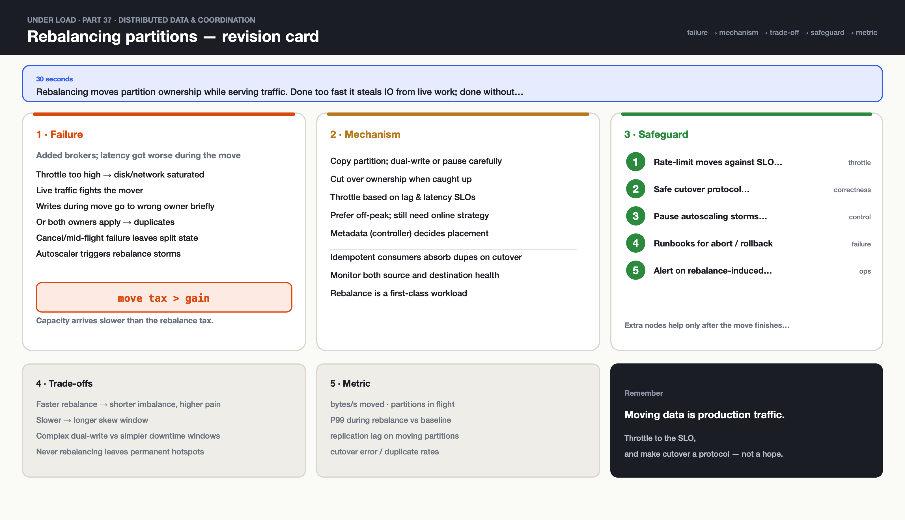
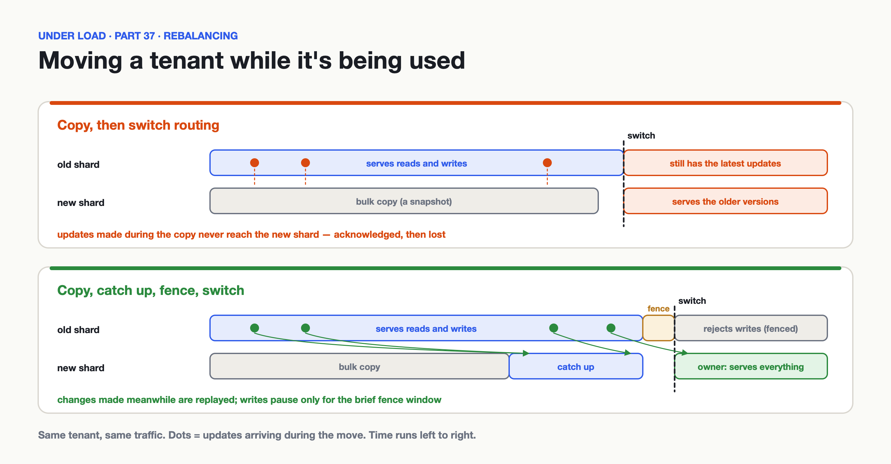
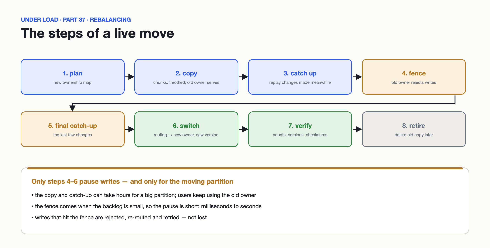
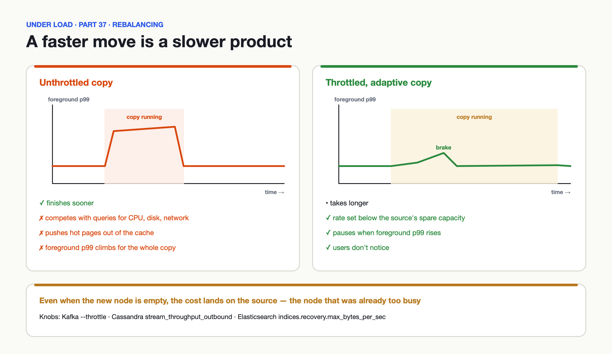
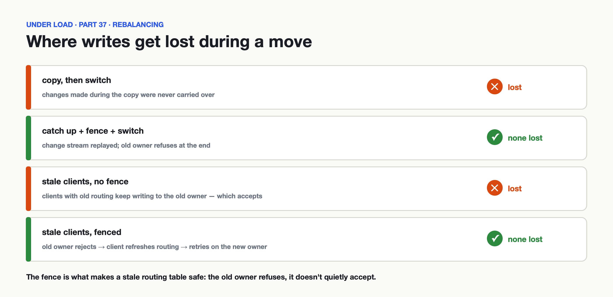
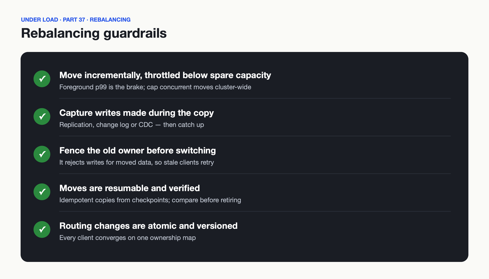

# Rebalancing Partitions

### Partition rebalancing: moving data between nodes while it keeps serving reads and writes — throttled copies, catching up with concurrent changes, fencing the old owner, and switching ownership without losing a write.

*Under Load · Part 37 · Distributed Data*

---

The shard that held Halcyon in Part 35 still needs relief, and a fifth shard has been added. The ring from Part 36 says which tenants should now live there. What the ring doesn't do is move anything. The new shard is empty, and empty capacity is useless: until data actually moves to it, it serves no requests at all.

The first tenant to move is a large one — a few hundred thousand tickets, with agents reading and updating them all day. The first attempt is a script: copy the tenant's rows to the new shard, then point the routing at the new shard. It finishes quickly and looks perfect. The next morning, agents report that some of their recent changes have "reverted": a ticket closed yesterday afternoon is open again; a reply is missing.

Nothing crashed, and no error was logged. Every update made **while the copy was running** went to the old shard — and if the row had already been copied, the update stayed behind. When the routing switched, the new shard served the older version. The writes had been acknowledged to users and then silently thrown away.

Moving data is easy. Moving data that's being used, without losing a write and without slowing the product down, is the subject of this article.

---

## What rebalancing is

**Rebalancing** redistributes partitions — and the ownership of them — across nodes. (A **partition** is whatever unit the system moves: a key range, a hash-ring token range, a Redis Cluster slot, a tenant, a Kafka topic partition.) It's needed whenever the current layout no longer fits:

- **A node is added.** It has capacity but no data. Until some partitions move to it, it doesn't help.
- **A node is removed or fails.** Its partitions need new owners, or at least new replicas, before redundancy is restored.
- **Load is uneven.** Some nodes hold more data or more traffic than others, because tenants grew at different rates or ranges filled unevenly.

Every rebalance has two halves:

1. **Deciding the new ownership** — which partitions go where. This is the job of the partitioning scheme: ranges, consistent hashing and its tokens, rendezvous hashing, fixed slots. Parts 35 and 36 covered how to keep the required movement close to the minimum, and how to choose source and destination so the move actually evens things out.
2. **Moving the data** — copying it to its new owner while it continues to be read and written, then switching ownership so that every client agrees who owns it. This half is where outages and lost writes come from.

Databases with built-in partitioning — Cassandra, CockroachDB, MongoDB, Elasticsearch, Kafka, Vitess — implement the second half internally, with variations of the steps below. Application-level sharding, like the tenant shards in this series, has to implement it explicitly. Either way, knowing the steps explains the knobs these systems expose and the failure modes they guard against.

---

## The steps of a live move

A safe move follows the same shape almost everywhere:

1. **Plan.** Compute the new ownership map and the minimum set of partitions to move. Pick sources and destinations so no node ends up overloaded.
2. **Copy.** Stream the partition's existing data to the new owner in bounded chunks. The old owner keeps serving all reads and writes normally.
3. **Catch up.** Apply the changes made to the partition *during* the copy, from a change stream, repeatedly, until the remaining backlog is small.
4. **Fence.** Make the old owner **reject** writes to the partition from this point on.
5. **Final catch-up.** Apply the last few changes that arrived before the fence.
6. **Switch.** Update the routing metadata, atomically and with a new version, so clients send the partition's traffic to the new owner.
7. **Verify.** Compare the two copies — counts, per-row versions, checksums.
8. **Retire.** Delete the old copy, after a safety period.

The important property is in steps 4–6: they are the only ones that pause writes, they pause writes **only for the moving partition**, and because the backlog was already small, they take very little time — typically milliseconds to a few seconds, depending on how quickly the final backlog drains and the routing update propagates. The copy itself, which can take hours for a large partition, happens while users work normally.

Each step answers a specific way a move can go wrong. The rest of the article goes through them.

---

## Copying without hurting users

The copy reads every row of the partition from the source and writes every row on the destination. It uses the same CPU, disk bandwidth, network and memory that user requests need — and the **source** is, by definition, the node that was too busy, which is why the move is happening in the first place.

That's why adding capacity can make latency **worse** before it makes it better. A copy at full speed:

- **Competes for disk and CPU** on the source, so foreground queries wait longer.
- **Pollutes the cache.** Reading a whole partition sequentially pushes hot pages out of the database's buffer cache and the operating system's page cache, so ordinary queries that were served from memory start reading from disk.
- **Saturates the network** between source and destination, slowing replication traffic that shares the link — and replicas that fall behind make reads staler (Part 33).
- **Loads the destination.** Even an empty node pays for writing, indexing and replicating incoming data, and if it also starts serving traffic early, it does both at once.

The conclusion holds even when the new node is completely empty: the throttle protects the **source** and the shared network, not just the destination.

### Throttle, and let latency be the brake

The fix is to make the copy deliberately slower than it could be:

- **Bounded chunks.** Copy in batches of a few thousand rows, each in its own short transaction, rather than one enormous query. Short transactions hold locks briefly and don't keep old row versions alive (Part 3's MVCC cleanup depends on that).
- **A rate limit**, in rows or bytes per second, set well below the source's spare capacity.
- **Limited parallelism.** A few streams at a time across the whole cluster, not one per partition.
- **Adaptive throttling.** Watch foreground p99 latency and error rate on the source; when they rise above a threshold, slow down or pause the copy. Foreground traffic gets priority, always.
- **Copy from a replica** where possible, so the bulk reads land on a node that isn't serving the main write load.

The production systems expose exactly these knobs. Kafka's partition reassignment takes a `--throttle` for replication bandwidth. Cassandra limits streaming throughput per node (`stream_throughput_outbound`). Elasticsearch caps recovery bandwidth (`indices.recovery.max_bytes_per_sec`) and the number of concurrent shard recoveries per node. CockroachDB rate-limits the snapshots it sends when moving ranges. Defaults are conservative on purpose.

A slower copy means a longer move, and that's the trade: the cluster runs unbalanced a little longer, in exchange for users not noticing. That trade is easy to make if the move started early — another reason Part 35 recommended splitting at a headroom threshold rather than at the limit.

### Resumable and idempotent

A long copy will be interrupted: a deploy, a node restart, the migration process itself crashing. Restarting from zero wastes hours and doubles the load the move puts on the cluster.

So the copy records a **checkpoint** — the last key it copied — after each chunk, and resumes from the checkpoint after an interruption. A checkpoint is usually written a little behind the actual progress, so a resumed copy re-copies some rows. That's only safe if writes to the destination are **idempotent**: applying the same row twice gives the same result as applying it once. In SQL, that means an upsert — `INSERT … ON CONFLICT (id) DO UPDATE` — rather than a plain `INSERT`, which would fail on the duplicate, or create one if there's no unique key.

Idempotence also protects the catch-up phase, which may replay a change that was already included in the copy. With every row carrying a **version** (an update counter or a commit position), the destination can keep whichever version is newer and ignore the stale one.

---

## Catching up with concurrent writes

A copy is a snapshot of a moving target. While rows are being copied, agents keep updating tickets. A change to a row that has already been copied modifies the source, not the copy. That was the bug in the first attempt.

There are four common ways to capture those changes, and real systems use all of them:

- **Replication from the source.** The new owner subscribes to the source's replication stream or change data capture feed (Part 30), filtered to the moving partition, and applies changes continuously. It's the most general approach, and the one most built-in systems use: Vitess's VReplication, MongoDB's chunk migration, Kafka's reassignment (the new replica is simply another follower), CockroachDB adding a Raft replica.
- **A change log on the source.** The application or a trigger records which rows changed while the move is in progress; the mover re-copies those rows.
- **Dual writes.** The application writes to both old and new owners during the move. Simple to describe, but if one of the two writes fails, the copies diverge silently — Part 29's dual-write problem in a new place.
- **Forwarding.** The old owner accepts writes for the moving partition and forwards them to the new owner, which shortens the window but makes the old owner part of every write path until the switch.

The mechanics of catch-up: after the bulk copy, apply everything that changed since the copy began; that takes a little time, during which more changes arrive; apply those; repeat. Each pass is shorter than the last, because each one covers a shorter interval. But under continuous writes the backlog never reaches zero on its own. Something has to stop new writes for a moment. That's the fence.

### Fence, final catch-up, switch

When the backlog is small enough to drain in milliseconds, the mover **fences** the old owner: it marks the partition as moving, and from then on the old owner **rejects** any write to it with an error that says, in effect, "not here any more." The last few changes that arrived before the fence are applied to the new owner — now the backlog genuinely is zero, because nothing new can arrive. Then the routing switches.

Writes that hit the fence during that short window get an error. The client, or the routing layer, refreshes its view of the ownership map and retries on the new owner. To users it looks like a slightly slow request. No acknowledged write is lost, because a write is only acknowledged by whichever node is the owner at that moment, and there's never a moment with two.

This is the answer to "what happens to writes while a partition is moving": during the copy they go to the old owner as usual and are carried over by catch-up; during the brief fence window they are rejected and retried; after the switch they go to the new owner.

---

## Where writes get lost during a move

The fence has a second job, just as important: it protects against clients that haven't heard about the switch yet.

In a real system the routing map isn't updated everywhere at the same instant. Application instances cache it; some refresh on a timer, some only after an error; a process that was paused during the switch wakes up with an old copy. So for a few seconds after the switch, some clients still send writes to the old owner.

- **Without a fence**, the old owner still accepts those writes. They succeed, the users see "saved" — and the data is gone, because the old copy is no longer the owner and nothing reads from it. The more often clients refresh, the smaller the loss, but it's never zero.
- **With a fence**, the old owner refuses. The stale client gets an error, refreshes its routing and retries on the new owner. Nothing is lost.

The principle — a former owner must **refuse**, not quietly accept — is general. It returns in Part 41 on split brain and Part 42 on fencing tokens. A rebalance is a change of ownership, and every ownership change needs a way to stop the previous owner from acting.

Built-in systems implement exactly this. Redis Cluster nodes answer a request for a slot they no longer own with a `MOVED` redirect naming the new owner, and with `ASK` while a slot is mid-migration. That classic migration moves keys one batch at a time, so a slot is split between two nodes for the whole move; Valkey 9.0 added **atomic slot migration** (`CLUSTER MIGRATESLOTS`), which copies a slot in the background, keeps streaming its new writes, and hands ownership over in one step at the end. MongoDB shards check the routing version attached to each request and reject stale ones. Vitess's `SwitchTraffic` stops writes on the source before redirecting them.

### Switching the routing atomically

The switch is a metadata change, and it must be **atomic** and **versioned**: one write, in a strongly consistent store, from "partition P is owned by shard 3 (version 41)" to "partition P is owned by shard 5 (version 42)." Clients carry the version they routed with; servers reject requests with an older version than they know. Gossiped or eventually consistent routing state can be used for speed, but the authority on who owns what has to be single and linearizable, usually a coordination service such as etcd or ZooKeeper, or the database's own metadata range.

### Verify before retiring

Before deleting the old copy, compare it with the new one. Row counts are a start; per-row versions, or checksums over chunks of the key range, catch the subtler misses. Vitess ships a `VDiff` tool for exactly this. Keep the old copy for a while after the switch — hours or days, depending on size — because it's the rollback plan if something was missed. Some systems go further and keep a **reverse replication** stream from the new owner back to the old one after the switch, so traffic can be switched back without losing the writes made in between.

---

## What makes moves harder

- **Failures during the move.** If the destination dies mid-copy, nothing is lost — the source still owns the data — and the move restarts from its checkpoint, perhaps to a different destination. If the source dies after the fence but before the switch, the partition can't accept writes until the move completes or rolls back. That window must be short and the decision automatic, recorded in the same metadata store as ownership, so a recovering process knows which side owns the partition.
- **Moving too much at once.** When a node fails, every one of its partitions needs a new home. Rebuilding all of them simultaneously can saturate the survivors, which then slow down, look unhealthy, trigger more moves, and fail in turn — a cascading overload. Moves need a **cluster-wide** concurrency limit, not just a per-move throttle.
- **Moving too eagerly.** A node that disappears for thirty seconds during a restart doesn't need all its data rebuilt elsewhere. Elasticsearch, for example, waits a configurable delay (one minute by default) before reallocating a departed node's shards. Fully automatic rebalancing triggered by failure detection is risky: a slow node misjudged as dead starts a massive move that makes everything slower.
- **Redundancy during the move.** The new copy should get its replicas **before** it becomes the owner. Otherwise, for a while, the moving partition has fewer copies than the rest of the data — exactly when the system is under extra stress. Many systems add the new replica first, then remove the old one, so the replica count only ever goes up during a move.
- **Hot partitions stay hot.** Moving a hot partition moves its load too. If one tenant is the problem, it needs splitting (Part 35's buckets), not relocating. Even data distribution after a rebalance doesn't mean even traffic.
- **Disagreeing clients.** Covered above: versioned routing in one authoritative store, with fencing to cover the gap while clients converge.

---

## Shipping a rebalance safely

A few habits that make moves boring:

- **Rehearse on a small partition first**, with the same tooling, and compare before and after.
- **Move one partition at a time** at first; increase concurrency only while foreground latency stays flat.
- **Schedule large moves off-peak**, but never rely on that alone — the throttle must still work at peak, because failures don't wait for quiet hours.
- **Expose progress.** Every move reports rows or bytes copied, rate, backlog and an estimated time to completion. A move that nobody can see is a move nobody can safely stop.
- **Make every step stoppable.** Pausing the copy, aborting before the fence, and switching back after the switch should each be a single, tested command.

---

## Guardrails that prevent the next one

1. **Move incrementally, throttled below spare capacity**, with foreground p99 as the brake and a cluster-wide limit on concurrent moves.
2. **Capture writes made during the copy** — replication, change log or CDC — and catch up before switching.
3. **Fence the old owner before switching**, so stale clients are rejected and retry instead of writing to a copy nobody reads.
4. **Moves are resumable and verified**: idempotent copies from checkpoints, and a comparison before the old copy is retired.
5. **Routing changes are atomic, versioned and observable**, so every client converges on one ownership map.

---

## What to keep on the dashboard

- **Bytes or rows moved, copy rate and ETA** for each move in progress.
- **Foreground p99 and error rate** on the source and the destination during the move — the brake signal.
- **Disk, network and CPU saturation** on both nodes, and cache hit ratio on the source.
- **Catch-up backlog** — changes captured but not yet applied to the new owner. If it grows instead of shrinking, the copy can never finish.
- **Writes rejected by the fence** — normally a brief spike at the switch. A continuing stream means some clients aren't refreshing routing.
- **Routing map version per client**, to find stragglers.
- **Replica health and replication lag** for the moving partitions.
- **Partition skew** across nodes — data and traffic — before and after, to confirm the move helped.

---

## Recap

### What is partition rebalancing?
Redistributing partitions and their ownership across nodes when nodes are added, removed or fail, or when load is uneven. Deciding the new ownership is the easier half; moving live data and switching ownership without losing writes or hurting latency is the hard half.

### What happens to writes while a partition is moving?
During the copy, the old owner keeps accepting them, and changes are captured — replication, CDC, a change log, dual writes or forwarding — and replayed on the new owner. Then the old owner is fenced, the final changes are applied, and routing switches. Writes arriving during the brief fence window are rejected and retried on the new owner. Copying and switching without catch-up silently loses every update made during the copy.

### Why can adding capacity temporarily make latency worse?
The new node is useless until data moves to it, and moving it uses the CPU, disk, network and cache that user requests need — mostly on the source, which is usually the node that was already too busy. Throttling the copy below spare capacity, with foreground p99 as the brake, avoids it.

### Why should rebalancing be throttled even when the new node is empty?
Because the cost lands mainly on the source and the shared network: bulk reads compete with queries, push hot data out of caches, and slow replication. An empty destination doesn't make the source any less busy.

### Why must the old owner be fenced?
Clients don't all learn about the switch at the same moment. Without a fence, clients with stale routing keep writing to the old owner, those writes are acknowledged and then lost. With a fence, they're rejected, refresh their routing and retry.

### How do you make a partition migration resumable?
Copy in bounded chunks, record a checkpoint after each, and write idempotently — upserts keyed by ID, keeping the newer version — so a resumed copy can overlap what was already copied without duplicates or regressions.

### How do consistent hashing and rebalancing relate?
Consistent hashing, tokens or fixed slots minimize **how much** data must move when membership changes. Rebalancing is **how** that data moves safely. Both are needed: a minimal plan is useless if executing it loses writes or overloads the cluster.

### What can go wrong during a rebalance?
Node failures mid-move, overload from moving too much at once or too eagerly after a brief outage, reduced redundancy if the new copy has no replicas yet, hot partitions carrying their heat to a new node, and clients disagreeing about ownership.

### What should be monitored?
Data moved, rate and ETA; foreground p99 and errors on both nodes; saturation and cache hit ratio; catch-up backlog; fence rejections; routing versions per client; replica health; and partition skew before and after.

---

## Next

- **Lab (run + measured write-up):** [37-rebalancing](https://github.com/b-basoglu/under-load/tree/main/37-rebalancing)
- **Next:** [Clock Skew](../38-clock-skew/article.md) — Two servers disagree about what time it is by 300 milliseconds. Which ticket update was last? Why "latest timestamp wins" quietly throws writes away.
