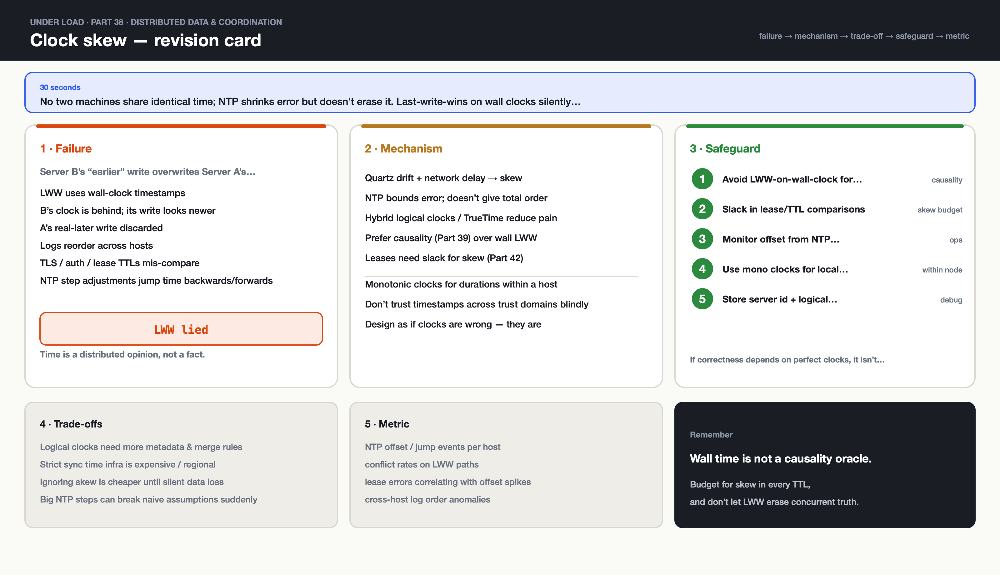
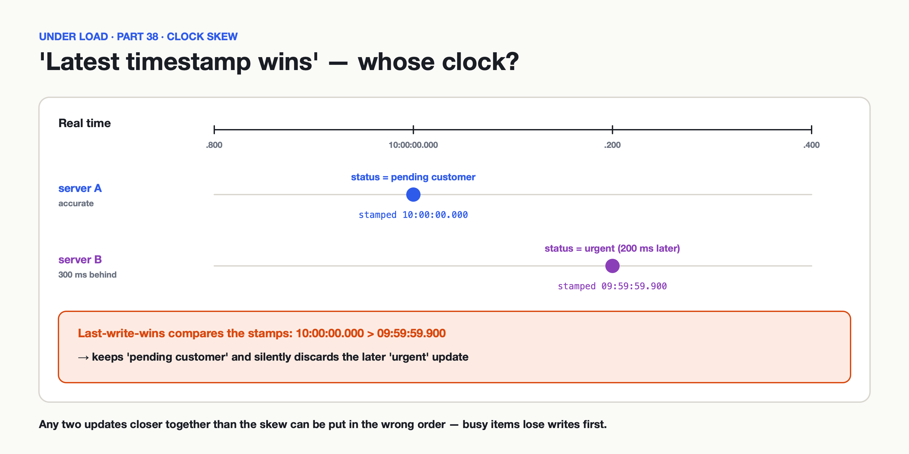
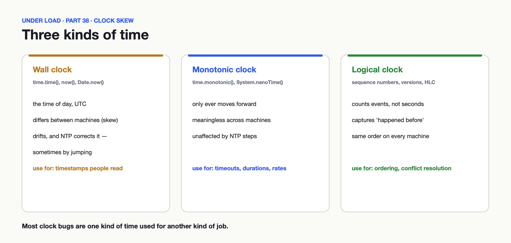
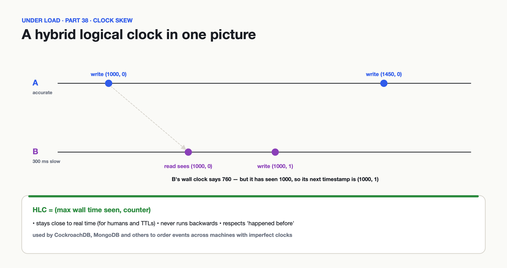
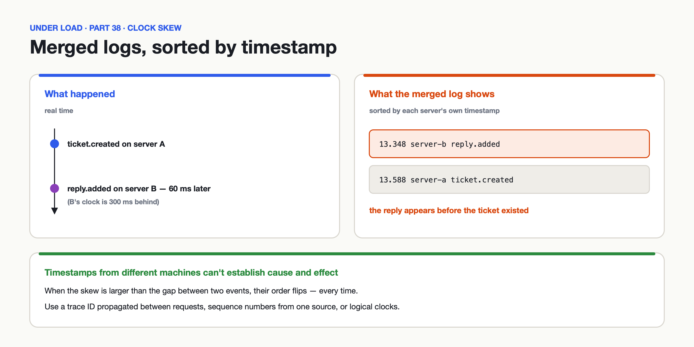
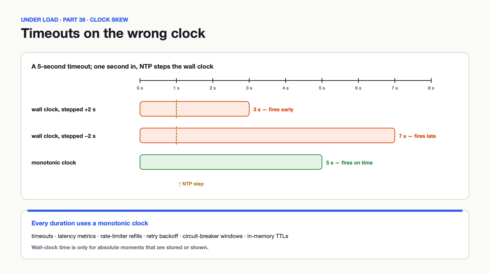
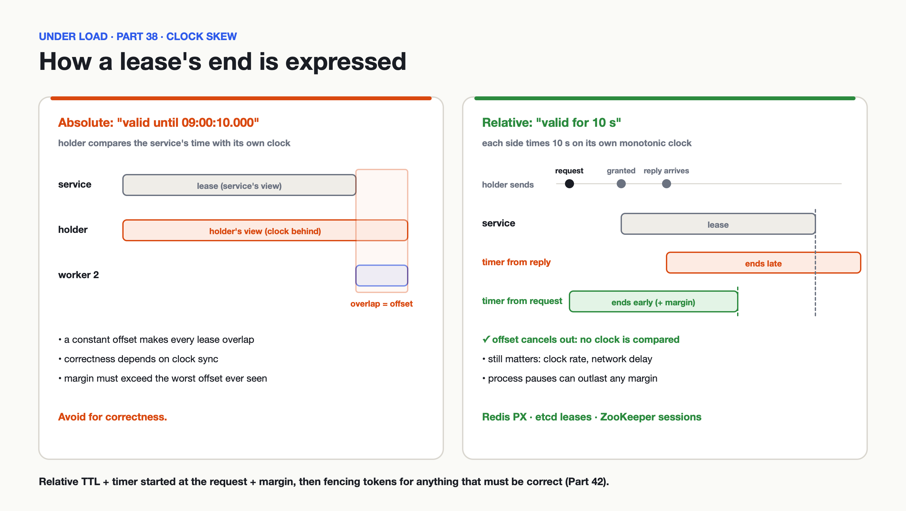
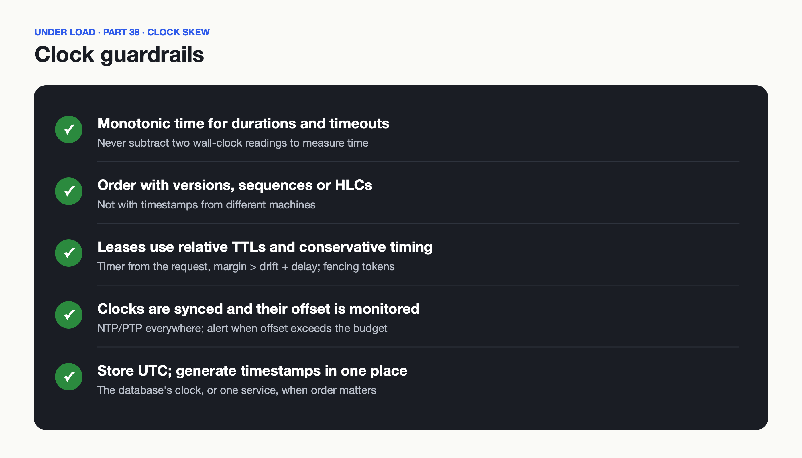

# Clock Skew

### Clock skew: why no two machines agree on the time, how that silently discards writes, reorders logs, breaks timeouts and stretches leases — and the three kinds of time that fix it.

*Under Load · Part 38 · Coordination & Time*

---

Two support agents work the same escalated Halcyon ticket. One changes the status to "pending customer." A moment later, the other — who has just heard back from the customer — sets it to "urgent" and adds a tag. The two requests are handled by different app servers. Each server stamps its update with the current time, and the database keeps whichever update has the **latest timestamp**. That rule is called **last-write-wins**, and it's everywhere: replicated key-value stores, sync engines, caches, and countless hand-written `UPDATE … WHERE updated_at < :new_ts` statements.

The second agent's request landed on a server whose clock was 300 milliseconds behind. Its update, made later in real time, carried an *earlier* timestamp. The database compared the two, decided the "urgent" update was stale, and discarded it. The ticket stayed "pending customer," the customer waited, and nothing anywhere recorded that a write had been thrown away.

Nobody's code was wrong in an obvious way. Every server had NTP enabled. The bug was an assumption: that "now" means the same thing on two machines.

This article is about why it doesn't, what breaks because of it, and how to pick the right kind of time for each job.

---

## Clocks never agree

Every server keeps time with a quartz crystal oscillator, counting its vibrations. No two crystals vibrate at exactly the same rate, and the rate changes with temperature and age. A typical server clock is off by tens of **parts per million** (ppm) — 20 ppm is about 1.7 seconds a day. Left alone, two servers drift apart by seconds within a day.

**NTP**, the Network Time Protocol, corrects this. A daemon (`chronyd` or `ntpd`) periodically asks time servers what time it is, estimates the network delay of each exchange, and adjusts the local clock. It works well, and it still leaves an error, for reasons built into how it works:

- **It can only estimate the network delay.** NTP assumes the request and the reply took equal time. When they don't — queueing on one direction, an asymmetric route — the error goes straight into the clock.
- **It corrects periodically.** Between corrections the clock drifts at its own rate.
- **It has bounds, not guarantees.** With good time sources nearby, offsets inside one data center are commonly well under a millisecond. Across regions, over the public internet, or with a struggling or misconfigured setup, tens or hundreds of milliseconds happen. With sync broken entirely, the drift accumulates unchecked.

Three terms describe the result:

- **Clock skew** (or **offset**) — the difference between two clocks at the same instant.
- **Drift** — the *rate* at which a clock moves away from true time, in ppm.
- **Jumps** — sudden changes. NTP usually **slews** a clock (runs it slightly faster or slower until it catches up), but when the offset is large it **steps** it, moving it instantly forward or back; `ntpd`'s default step threshold is 128 ms, and chrony's behaviour is set by its `makestep` directive. Virtual machines that are paused, snapshotted or live-migrated can wake with a clock that's seconds off, and then get stepped. An administrator can set the clock by hand. Leap seconds — occasionally inserted to keep UTC aligned with the Earth's rotation — have caused outages; large providers now "smear" them over many hours instead.

Better hardware narrows the error but doesn't remove it. **PTP** (Precision Time Protocol), with hardware timestamping in network cards and switches, reaches microseconds, and major clouds now offer time services built on it. Some systems go further and make the error explicit: Google Spanner's **TrueTime** returns an interval — "the time is somewhere between *earliest* and *latest*" — typically a few milliseconds wide, and AWS publishes ClockBound, a daemon that reports an error bound alongside the time.

So the question is never whether clocks disagree, only by how much — and whether the code knows.

---

## Three kinds of time

Most clock bugs come from using one kind of time for a job that needs another. There are three kinds:

- **Wall-clock time** — the time of day: `time.time()` in Python, `Instant.now()` in Java, `Date.now()` in JavaScript, `now()` in SQL. It's what people read, what schedules ("send the digest at 09:00") and retention ("delete after 90 days") need, and what gets stored. It **differs between machines**, and on any one machine it **can jump**, forwards or backwards.
- **Monotonic time** — a counter that only ever moves forward: `time.monotonic()`, `System.nanoTime()`, `performance.now()`, Linux `CLOCK_MONOTONIC`. Its absolute value is meaningless (often "time since boot") and it can't be compared between machines, but NTP steps and manual changes don't affect it. (On Linux, NTP *slewing* still adjusts its rate slightly; `CLOCK_MONOTONIC_RAW` ignores even that, and `CLOCK_BOOTTIME` also counts time spent suspended.) It's the right tool for **durations**: timeouts, latency, rate limits, backoff, lease timers.
- **Logical time** — counters that track the **order of events** rather than seconds: sequence numbers, row versions, log positions, Lamport clocks, vector clocks (Part 39), hybrid logical clocks. It's the right tool for **ordering** and conflict resolution across machines. It tells nothing about how much real time passed between two events.

The rules that follow are short: store and display wall-clock time in **UTC**; measure every duration with a **monotonic** clock; decide **order** with logical time, or with one authority's clock — never by comparing wall clocks from different machines.

---

## Ordering with timestamps from different machines

### Last-write-wins discards later writes

Last-write-wins (LWW) on wall-clock timestamps is correct only if clocks are perfect. With skew, it fails in one specific way: when two updates to the same item happen **closer together in real time than the skew between the machines that stamped them**, the order of their timestamps can be the opposite of the order they happened in, and the later one is discarded.

A worked example, with server B 300 ms behind server A:

1. At real time 10:00:00.000, an update arrives on A and is stamped **10:00:00.000**.
2. At real time 10:00:00.200 — 200 ms later — an update arrives on B. B's clock reads 09:59:59.900, so it's stamped **09:59:59.900**.
3. LWW keeps the update with the larger timestamp: A's. B's newer update is thrown away.

Any pair of updates less than 300 ms apart, with the earlier one on A, loses the later one. That makes the damage concentrated exactly where it hurts: on **busy** items. An escalated ticket that several agents touch every few seconds, a shared document, a counter, a user's settings synced from two devices. The quiet items, updated once an hour, never notice. And LWW gives no signal: the discarded write simply isn't there.

This is not a hypothetical design. Cassandra resolves conflicting writes to a cell by timestamp, and those timestamps are often set by the client. DynamoDB global tables resolve concurrent writes across regions with last-writer-wins. Both document it; both make clock discipline part of correctness.

There are three ways out, depending on the system:

- **Let one authority order the writes.** If all writes to an item go through one database primary, let it decide: each update reads the row's **version** and writes `… WHERE version = :read_version`, retrying if the version changed (optimistic concurrency, Part 5). Or the database assigns a sequence number. Time plays no part in deciding which write is newer, so skew can't affect it.
- **Use a hybrid logical clock** when timestamps must be generated on many machines but must respect causality (below).
- **Detect true conflicts** instead of picking a winner, when two writes genuinely didn't know about each other — the job of vector clocks in Part 39.

### Hybrid logical clocks

A **hybrid logical clock (HLC)**, described by Kulkarni and colleagues in 2014, is a timestamp made of two parts: a wall-clock time and a small counter. Each node keeps the **largest timestamp it has seen**, and every new timestamp it issues is larger than that:

- **Issuing a timestamp:** if the local wall clock is ahead of the largest timestamp seen, use the wall clock with counter 0. Otherwise keep the largest seen time and add one to the counter.
- **Receiving a timestamp** — in a message, a replication stream, or by reading a row: raise the largest seen to it.

Replay the worked example with an HLC. The agent on server B opens the ticket before changing it — the UI always reads first — so B reads the row and sees its timestamp, (10:00:00.000, 0). B's own clock says 09:59:59.900, behind what it has seen, so B's update gets (10:00:00.000, 1). That's larger than A's timestamp; the newer update wins.

An HLC keeps three useful properties at once:

- It stays **close to real time** — within the clock skew — so it still works for TTLs, retention and humans reading logs.
- It **never goes backwards** on a node, even if the wall clock is stepped back.
- It respects **"happened before"**: if event A could have influenced event B (B's node had seen A, directly or through a chain of messages), A's timestamp is smaller.

CockroachDB, MongoDB (for its cluster time) and YugabyteDB use HLCs to order events across nodes whose clocks disagree.

What an HLC can't do is order two updates that **didn't see each other** — two agents editing at the same moment on different servers, neither having read the other's change. Those are **concurrent**. An HLC will still pick one as "larger," but that choice says nothing about what the users meant. Detecting concurrency, rather than hiding it, is the subject of Part 39.

### Logs sorted by timestamp lie

The same problem shows up during incidents. A ticket is created on server A; the first reply, a fraction of a second later, is handled by server B. An engineer merges both servers' logs and sorts by timestamp. If B's clock is behind by more than the gap between the two events, the reply appears **before** the ticket it replies to. With a gap of tens of milliseconds and a skew of hundreds, it appears that way every time.

An engineer reading that timeline can spend hours chasing a bug that doesn't exist — "how did a reply get written for a ticket that didn't exist yet?" Timestamps from different machines can show roughly *when* things happened; they can't prove *what caused what*. That needs causal information:

- A **trace ID** propagated from request to request (distributed tracing), so the reply's log line points to the creation.
- **Sequence numbers or log positions** from one source, such as the database's commit order.
- **Logical clocks** carried in messages.

Two correct-looking timestamps can still give a misleading order, because each is only correct relative to its own machine.

---

## Timeouts and durations on the wrong clock

A request has a 5-second timeout, implemented as `deadline = time.time() + 5` and checked with `time.time() > deadline`. One second in, NTP steps the wall clock:

- **Stepped forward by 2 s:** the check passes 2 seconds early; the timeout fires after about **3 seconds**.
- **Stepped backward by 2 s:** it fires after about **7 seconds**.
- **Stepped backward by an hour** (a VM restored from a snapshot, a bad manual change): the request effectively never times out.

With `time.monotonic()`, the timeout fires after 5 seconds regardless of what happens to the wall clock.

The same applies to everything that measures elapsed time:

- **Latency metrics.** `end - start` on the wall clock produces negative durations, or huge spikes, when the clock is stepped.
- **Rate limiters.** A token bucket (Part 22) that refills based on elapsed wall time can suddenly grant hours' worth of tokens, or none.
- **Retry backoff and circuit breakers** (Parts 15–16), whose waits and windows are durations.
- **Cache TTLs held in memory** — "expire 60 seconds from now."

The rule is simple and absolute: **every duration is measured with a monotonic clock.** Wall-clock time is only for absolute moments that must be stored or shown.

---

## Leases on the wrong clock

A **lease** is a lock with an expiry (Part 42 covers them in depth): a lock service grants a worker the right to run the "send SLA reminders" job for 10 seconds, and the worker must stop before those 10 seconds end, unless it renews. Two parties — the service and the holder — each have to decide when the lease ends. If they decide differently, there's a window in which the service believes the lease is free and hands it to a second worker, while the first still believes it holds it.

How clocks affect that depends entirely on **how the lease's end is expressed**.

**An absolute expiry time.** The service says "valid until 09:00:10.000," by its own clock, and the holder compares that with *its* clock. Now a constant offset matters directly: if the holder's clock is 500 ms behind the service's, the holder believes it has 500 ms left when the service has already given the lease away. Every lease overlaps by the offset. This design ties correctness to clock synchronization, and it needs a safety margin larger than the worst offset the system will ever see — which is hard to promise.

**A relative duration (TTL).** The service says "valid for 10 s"; each side times those 10 seconds with its own **monotonic** clock. This is how Redis `SET key value NX PX 10000`, etcd leases and ZooKeeper session timeouts work. A constant offset between the two clocks **cancels out completely**: neither side ever compares its clock with the other's, so it doesn't matter what time each one thinks it is. What still matters:

- **Clock rate.** If the holder's clock runs 0.5% slow, its 10 seconds last 10.05 real seconds — 50 ms longer than the service's. Drift is usually far smaller than that, but a margin should cover it.
- **Network delay.** The service starts its timer when it grants the lease. If the holder starts its timer when the *reply arrives*, it starts late by however long the reply took to travel. The fix is for the holder to start its timer when it **sends the request** — before the service could possibly have granted anything — so its view of the end is always earlier than the service's. Google's Chubby lock service paper describes exactly this conservative client-side timing.
- **Process pauses.** A garbage-collection pause, a VM being descheduled or migrated, a laptop lid closing: the holder stops running entirely, then resumes and continues as if no time had passed. A pause can be longer than any margin.

So the defences stack. Relative TTLs remove the dependence on clock *offset*. Starting the timer at the request and stopping well before the end — a margin larger than drift plus delay — covers rate and network. And because pauses can exceed any margin, anything where correctness matters (writing to storage, charging a card, sending an invoice) also needs **fencing tokens**, which make the *resource* reject a stale holder. That's Part 42.

### Expiry and sessions

Tokens and sessions have expiry times too, often produced on one machine and checked on another: a JWT issued by an identity service with an `exp` claim, checked by an API server. A checking server whose clock is ahead rejects fresh tokens as expired; one whose clock is behind keeps accepting tokens after they should have died — including tokens that were meant to stop working quickly. JWT libraries let a **leeway** be configured for this, usually a few seconds. It should be larger than the expected skew between issuer and checker, and no larger, because every second of leeway is a second of extra life for a revoked or stolen token. And the alerting on clock offset should fire well before the skew approaches it.

---

## When correctness depends on time

Some systems genuinely need real time to be consistent across machines — for example, a database that promises that a transaction committed after another, anywhere in the world, gets a later timestamp. They pay for it explicitly:

- **Spanner** waits out the uncertainty. After choosing a commit timestamp, it holds the commit until TrueTime guarantees that timestamp is in the past everywhere — the **commit wait**, a few milliseconds per transaction.
- **CockroachDB** doesn't have specialized hardware, so it assumes a maximum clock offset (500 ms by default) and treats values written within that **uncertainty interval** of a read's timestamp as possibly in the future, sometimes restarting the read. A node whose measured offset from its peers gets close to the maximum shuts itself down rather than risk violating consistency.

The second point is the general lesson: **correctness should degrade safely when clocks disagree.** A system that relies on a skew bound should measure the skew and stop, loudly, when the bound is at risk, rather than quietly produce wrong answers. And the wider the area the clocks span — across regions rather than racks — the larger the uncertainty, and the more expensive any time-based coordination becomes.

---

## Guardrails that prevent the next one

1. **Monotonic time for durations, timeouts and lease timers.** Never subtract two wall-clock readings to measure elapsed time.
2. **Order with versions, sequences or HLCs**, not with wall-clock timestamps from different machines.
3. **Leases use relative TTLs and conservative timing** — timer started at the request, a margin larger than drift plus network delay — and fencing tokens where correctness matters.
4. **Clocks are synced, and their offset is monitored**: NTP or PTP everywhere, an alert well before the offset reaches any budget the system relies on, and components that refuse to run when it does.
5. **Store UTC, and let one authority stamp time when time decides order** — the database's clock, or a single service.

---

## What to keep on the dashboard

- **Clock offset per host** against the time source, from the time daemon (`chronyc tracking`, `ntpq -p`) — with an alert threshold below whatever skew the system's correctness assumes.
- **Synchronization status** — hosts that have lost their time sources or stopped converging.
- **Clock steps**, which time daemons log, especially after VM migrations or restores.
- **Discarded or overwritten writes** in any last-write-wins path, where the store can expose them.
- **Negative or impossible durations** in latency metrics — a sign that wall clocks are being used for measurement.
- **Token-expiry rejections by host**, which spike on a server whose clock has drifted.
- **Lease expirations, renewal failures and fencing rejections** (Part 42).

---

## Recap

### What is clock skew, and why can't NTP eliminate it?
The difference between two machines' clocks at the same instant. Crystals drift by tens of ppm, and NTP corrects them periodically over a network whose delay it can only estimate, so a residual error always remains — often sub-millisecond inside one data center, far more across regions or when sync breaks. Clocks can also jump when stepped, after VM pauses, or by hand.

### NTP is enabled everywhere. Why still design for skew?
Because NTP bounds the error statistically, not absolutely: asymmetric network paths, lost time sources, VM migrations and steps all produce offsets larger than usual, without warning. Code that is only correct with perfect clocks will eventually be wrong; code that uses the right kind of time is correct at any offset.

### Why is last-write-wins with wall-clock timestamps dangerous?
When two updates to the same item happen closer together than the skew between the machines that stamped them, the later one can carry the smaller timestamp and is silently discarded. Busy items lose writes most often. Versions with optimistic concurrency, sequences from one authority, or HLCs avoid it.

### Can timestamps alone establish causality?
No. Timestamps from different machines are offset by the skew, so an effect can appear before its cause in a merged log. Two individually correct timestamps can still give a misleading order. Causality needs logical information: trace IDs, sequence numbers, logical or vector clocks.

### Why should timeout code use a monotonic clock?
Wall clocks can be stepped forward or back by NTP, snapshots or administrators. A 5-second timeout computed on the wall clock fires after about 3 or 7 seconds across a 2-second step, or never after a large backward step. A monotonic clock only moves forward, so the timeout lasts 5 seconds.

### What problem do hybrid logical clocks solve?
They provide timestamps that stay close to real time but never go backwards and respect "happened before": a node that has seen a timestamp issues larger ones, even if its own clock is behind. They can't order truly concurrent events meaningfully — that needs vector clocks.

### How do you order writes without relying on clocks?
Let one authority order them: row versions with optimistic concurrency, a database sequence, a single leader's log position. Logical order is the same on every machine, though it says nothing about elapsed real time.

### How does skew affect leases?
With an absolute expiry time, a constant offset between holder and service makes every lease overlap by that offset. With a relative TTL timed on monotonic clocks, as in Redis `PX`, etcd and ZooKeeper, the offset cancels out; what matters is clock rate, network delay and process pauses. Starting the timer at the request and keeping a margin covers rate and delay; pauses can exceed any margin, so correctness needs fencing tokens.

### What should be monitored?
Clock offset per host and sync status, clock steps, discarded writes in last-write-wins paths, negative durations, token-expiry rejections by host, and lease expirations and fencing rejections.

---

## Next

- **Lab (run + measured write-up):** [38-clock-skew](https://github.com/b-basoglu/under-load/tree/main/38-clock-skew)
- **Next:** [Vector Clocks](../39-vector-clocks/article.md) — Two agents edit the same ticket offline, on two devices. Neither edit came "first." How a system can tell that — and what it does next.
