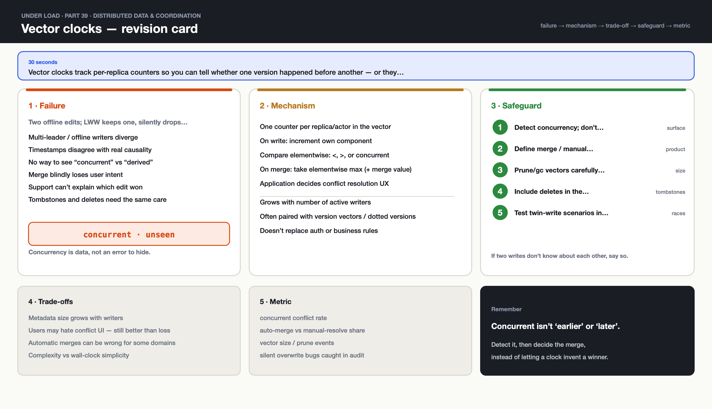
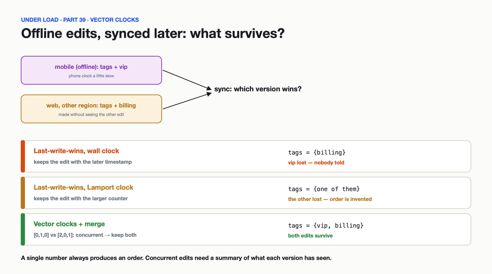
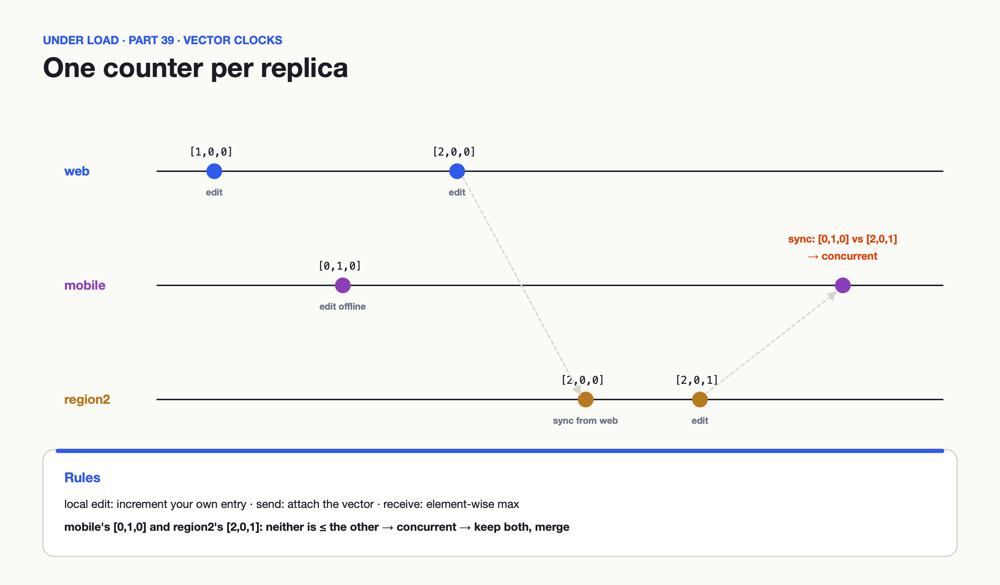
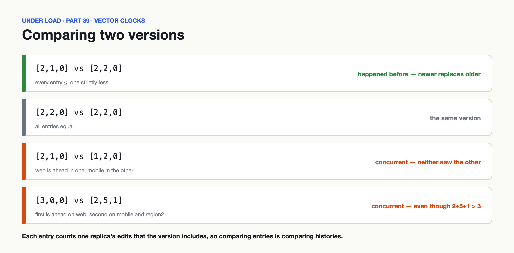
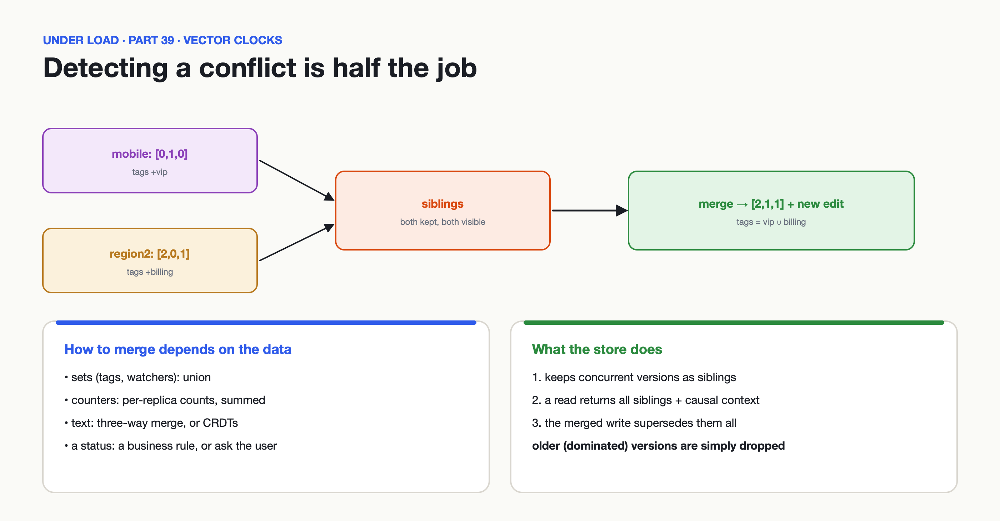
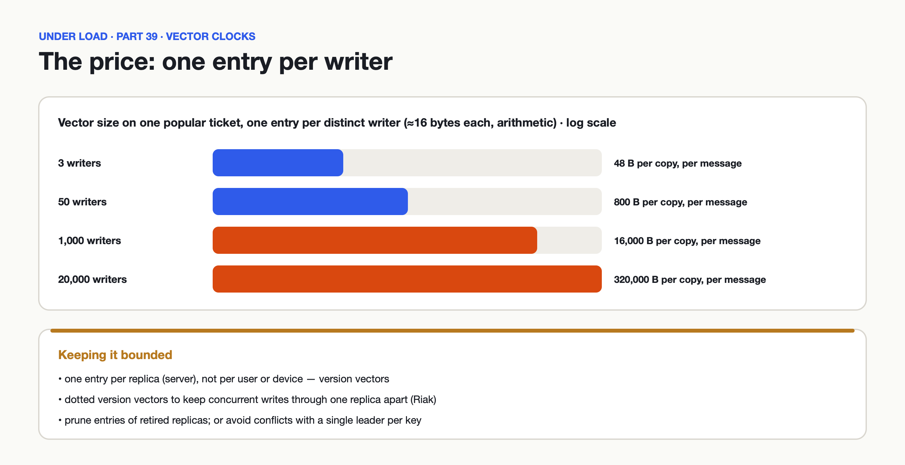
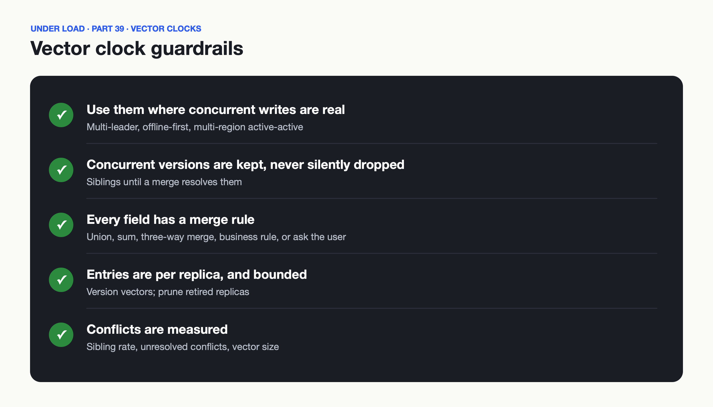

# Vector Clocks

### Vector clocks: how replicas that accept writes independently can tell whether one version replaced another or the two happened concurrently — and why "latest wins" silently throws away work.

*Under Load · Part 39 · Coordination & Time*

---

The support team's mobile app works offline. An agent on a train opens a Halcyon ticket and adds the tag "vip." At about the same time, a colleague at a desk adds the tag "billing" to the same ticket through the web app, which writes to a server in another region. When the train leaves the tunnel, the phone syncs its version of the ticket.

Which version wins? With the usual rule — keep the version with the **latest timestamp** — the answer is whichever device had the later clock, and the other agent's edit disappears. Neither is told. Part 38 showed how clock skew makes "latest" unreliable even for edits that clearly happened in order. Here the problem runs deeper: **neither edit came first**. Each was made without any knowledge of the other. Picking a "latest" one doesn't find the right answer; it just picks which agent's work to lose.

The ticket should end up with both tags. To get there, the system first has to *know* that the two edits were independent — that this is a conflict, not an update. That's what vector clocks are for.

---

## The question every sync has to answer

When several replicas accept writes — offline-capable apps, multi-leader databases, active-active regions — two versions of the same item eventually meet. There are exactly three possibilities:

1. **A happened before B.** B was made by someone who had already seen A. B replaces A.
2. **B happened before A.** A replaces B.
3. **They're concurrent.** Neither was made with knowledge of the other. Neither should simply replace the other: they need to be **merged**, or the conflict shown to a person.

"Happened before" here means **causally**, in the sense Leslie Lamport defined in 1978: A happened before B if A could have influenced B — because they happened in sequence on the same replica, or because information about A reached B's replica, directly or through a chain of syncs, before B was made. It has nothing to do with the time on anybody's watch. An edit made a full minute after another, on a device that hadn't synced, is still **concurrent** with it.

### Why a single number can't answer it

A timestamp is one number, and comparing two numbers always produces an order. So timestamps make **every** pair of versions look ordered — including the concurrent ones. Last-write-wins on timestamps doesn't fail only when clocks are skewed; it fails whenever two edits are concurrent, because it quietly turns "these conflict" into "this one is newer."

A **Lamport clock** fixes the skew part but not the concurrency part. Each replica keeps a counter, increments it for every event, attaches it to everything it sends, and on receiving a counter larger than its own jumps past it. That guarantees one direction: if A happened before B, A's counter is smaller than B's. The converse doesn't hold. If A's counter is smaller, A may have happened before B — or the two may be concurrent and the counters just happen to differ. A Lamport clock, or a hybrid logical clock (Part 38), produces a consistent **total order**, which is very useful, but it can't tell the difference between "replaced" and "conflicted." Used for last-write-wins, it still silently drops one of every pair of concurrent edits.

To distinguish the two cases, a version has to carry more than one number: a summary of **which edits it has already seen**.

---

## How vector clocks work

A **vector clock** keeps **one counter per replica**. With three replicas — `web`, `mobile` and `region2` — every version carries a vector such as `[2, 1, 0]`, meaning: "this version includes the first 2 edits made on web, the first edit made on mobile, and nothing made on region2."

The rules are short:

- **On a local edit,** a replica increments its **own** entry. Web's first edit produces `[1,0,0]`, its second `[2,0,0]`.
- **When sending a version** — syncing, replicating, answering a read — attach its vector.
- **When receiving a version,** take the **element-wise maximum** of the received vector and the local one. The receiver now knows everything both histories contain. Its next local edit increments its own entry on top of that.

Follow the picture. Web makes two edits, reaching `[2,0,0]`. Region2 syncs from web and receives `[2,0,0]`, then makes its own edit: `[2,0,1]`. Meanwhile the mobile app, offline the whole time, made one edit: `[0,1,0]`. When mobile and region2 finally sync, they compare `[0,1,0]` with `[2,0,1]`.

### Comparing two vectors

The comparison is entry by entry:

- **A happened before B** when every entry of A is less than or equal to the matching entry of B, and at least one is strictly less. `[2,1,0]` happened before `[2,2,0]`: the second version has seen everything the first has, plus one more mobile edit.
- **They're the same version** when all entries are equal.
- **They're concurrent** when neither is ≤ the other: A is ahead in some entry and B is ahead in another. `[2,1,0]` and `[1,2,0]` are concurrent. So are mobile's `[0,1,0]` and region2's `[2,0,1]`: mobile has an edit region2 never saw, and region2 has edits mobile never saw. And so are `[3,0,0]` and `[2,5,1]`, even though the second has a much larger total — the sum means nothing.

This test is exact. Each entry records how many of a replica's edits the version includes, so comparing entries is comparing histories: "≤ everywhere" means "has seen everything the other has seen." A vector clock is a compact, precise summary of a version's causal history — which is exactly what deciding "replace or conflict" needs.

### Version vectors and vector clocks

Two closely related names float around. Strictly, a **vector clock** tracks the causal history of *events* in a whole system, while a **version vector** tracks the history of *versions of one data item* across the replicas that store it. For replicated data, version vectors are what's actually stored next to each item, and "vector clock" is often used loosely for both. The comparison rules are the same.

---

## Detecting a conflict is half the job

Knowing that two versions are concurrent doesn't decide what the result should be. A vector clock says *that* there's a conflict; something else must say *how* to resolve it.

The common pattern, used by Riak and described in Amazon's Dynamo paper, works like this:

1. **Keep both.** When a replica receives a version concurrent with one it holds, it stores **both**. Concurrent versions of one item are called **siblings**.
2. **Return all of them.** A read of the item returns every sibling, together with a **causal context** — the merged vector of everything the reader has seen.
3. **Write back a merge.** The application, or a merge function, combines the siblings into one value and writes it with that context. The replica gives the new version a vector that is the element-wise maximum of the siblings' vectors, plus an increment for itself — so it happened after **both** siblings, and replaces them everywhere it travels.

For the ticket in the story: siblings `[0,1,0]` (tags + vip) and `[2,0,1]` (tags + billing); the merge produces tags = {vip, billing} with vector `[2,1,1]`, then one more increment for the replica that wrote it. Both agents' work survives.

### How to merge depends on the data

- **Sets** — tags, watchers, followers: take the union. (If removals must be possible, a plain union would bring removed items back; remove-aware set types track additions and removals separately.)
- **Counters** — keep one count per replica and sum them, rather than storing one total that two replicas would both overwrite.
- **Text** — a three-way merge against a common ancestor, as version control does, or a CRDT that merges automatically.
- **A single value**, such as a ticket's status — a business rule ("escalated beats pending," "closed beats open unless reopened later") or ask a person, showing both versions.

**CRDTs** (conflict-free replicated data types) are data structures designed so that any two concurrent versions merge deterministically into the same result, whatever order the merges happen in. They build the merge rule into the type, and many use version vectors or similar metadata internally to do it. Where a CRDT exists for the data — sets, counters, registers, maps, collaborative text — it removes the need for hand-written merge code.

### Keeping siblings from piling up

A version that happened before another is discarded as soon as the newer one arrives, and every merge produces a version that supersedes the siblings it merged. That's what keeps the number of siblings small. But siblings that nobody reads and merges can accumulate on frequently updated items — a known operational problem in Dynamo-style stores, where a hot key can collect dozens of siblings and every read gets slower. Sibling counts should be monitored, capped, and resolved automatically where a merge rule exists.

---

## The price: metadata

A vector has one entry per participant that has ever written to the item. Each entry is an identifier and a counter — say 16 bytes. With three replicas, that's 48 bytes per version: nothing.

If the "participants" are clients — users or devices — instead of servers, it grows with them:

- **50 writers:** 800 bytes per version.
- **1,000 writers** — every agent who ever touched a popular ticket: 16 KB on **every** copy of the item and in every sync message about it.
- **20,000 writers:** over 300 KB.

Membership also changes. Devices are replaced, users leave, replicas are added and retired, and each leaves a permanent entry in every vector it touched. Naive per-client vectors are therefore expensive both in size and in the bookkeeping of who is still a participant.

The common ways to keep it bounded:

- **Entries per replica, not per client.** Clients write *through* a replica, which stamps the version with its own entry. Replicas are few and change rarely, so the vector stays a handful of entries.
- **Dotted version vectors.** Per-replica entries have a subtle flaw: two clients writing concurrently through the **same** replica can end up looking ordered, and one write is lost. A **dotted version vector** adds a "dot" — the replica and counter of the individual write — so concurrent writes through one replica are still recognized as concurrent. Riak adopted them for exactly this reason.
- **Pruning.** Entries for replicas that have been retired, and that every live version has already incorporated, can be removed. Pruning too aggressively — dropping entries still needed for a comparison — creates false conflicts or lost updates, so it must be conservative.
- **Avoiding concurrency altogether.** A single leader per item (Part 40), or a version column checked by one database (Part 5), means writes are ordered as they happen. No concurrency, no vectors needed.

---

## Where vector clocks fit

Vector clocks and version vectors are for systems where **concurrent writes to the same item really happen and must not be lost**:

- **Offline-first apps** that sync later: mobile clients, field-service tools, note-taking and collaborative editors.
- **Multi-leader or active-active replication** across regions, where each region accepts writes for the same data.
- **Leaderless, Dynamo-style stores**, where any replica can accept a write. The Dynamo paper used vector clocks; Riak and Voldemort followed. Notably, Cassandra chose per-cell timestamps with last-write-wins instead, trading conflict detection for simplicity — a deliberate, documented design choice.
- **Sync protocols** between devices, which use version vectors to work out which changes each side is missing.

They're unnecessary — and pure overhead — where one authority orders all writes to an item: a single primary database (Part 33), a leader per partition, or an optimistic version check in one place.

They also have limits worth stating plainly:

- **No total order.** Vector clocks capture only causality, which is a **partial** order: concurrent versions are simply incomparable. That's the point — it refuses to invent an order that doesn't exist — but anything needing a single sequence (a log, a deterministic tiebreak for display) must add one, for example by replica ID.
- **No physical time.** A vector says nothing about when an edit happened or how long ago. Systems that need both often carry a vector for conflict detection and a wall-clock or hybrid timestamp for display and expiry.
- **Detection, not resolution.** As above, deciding the merged value is still application work.

---

## Introducing them without breaking sync

Moving an existing offline-sync path from last-write-wins to version vectors touches clients, servers and stored data at once. A few practices keep the change safe:

- **Start by detecting, not resolving.** Ship version vectors alongside the existing timestamps and *log* every case where the vectors say "concurrent" but last-write-wins silently picked a winner. That count is the size of the data loss that's been happening all along, and it tells which fields need merge rules first.
- **Write merge rules per field, and test them as properties.** A merge must give the same result regardless of the order in which siblings are merged, and merging a version with itself must change nothing. Property-based tests that merge random siblings in random orders catch most mistakes before users do.
- **Keep a human path.** For fields with no safe automatic merge — a ticket's assignee, a refund amount — show both versions to the agent and let them choose, rather than inventing a rule that's right most of the time.
- **Version the metadata format.** Old app versions in the field will keep sending versions without vectors for months. The server should treat a write that arrives without a vector as concurrent with the stored version, so it produces a conflict instead of a silent overwrite.
- **Watch the sibling counts during rollout.** A sudden rise in conflicts usually means a client is forgetting to send the causal context it received on read, so each of its writes looks concurrent with everything.

---

## Guardrails that prevent the next one

1. **Use them where concurrent writes are real** — multi-leader, offline-first, active-active — and avoid concurrency instead where a single authority can order writes.
2. **Concurrent versions are kept, never silently dropped**, as siblings until a merge resolves them.
3. **Every field has a merge rule**: union, per-replica sums, three-way merge, a CRDT, a business rule, or a person.
4. **Entries are per replica and bounded**: version vectors or dotted version vectors, with retired replicas pruned conservatively.
5. **Conflicts are measured**: sibling rate, unresolved conflicts, vector size.

---

## What to keep on the dashboard

- **Conflict (sibling) creation rate**, per item type — a sudden rise points to a sync bug or a new concurrent write path.
- **Items with unresolved siblings**, and the maximum sibling count per item.
- **Merge latency** — how long conflicts stay unresolved, especially those waiting for a person.
- **Vector size per item**, at the median and the maximum.
- **Replication divergence** — items whose versions still differ between replicas after sync has completed.
- **Edits overwritten** in any path that still uses last-write-wins, if it can be counted.

---

## Recap

### What can a vector clock tell that a wall-clock timestamp cannot?
Whether one version causally happened before another, or whether the two are concurrent. A timestamp always produces an order, even between edits that never saw each other, so last-write-wins on timestamps silently discards one side of every conflict.

### How does a vector clock work?
One counter per replica. A local edit increments the replica's own entry; every version carries its vector; a receiver takes the element-wise maximum of what it has and what it receives. The vector summarizes exactly which edits a version includes.

### How do you determine whether two vector clocks are concurrent?
A happened before B if every entry of A is ≤ the matching entry of B and at least one is strictly smaller. If neither A ≤ B nor B ≤ A — each is ahead somewhere — they're concurrent. Totals mean nothing: `[3,0,0]` and `[2,5,1]` are concurrent.

### Why isn't a Lamport clock enough?
It guarantees that causally earlier events get smaller numbers, but a smaller number doesn't prove "earlier": the events may be concurrent. It gives a total order, not conflict detection, so last-write-wins on Lamport clocks still loses concurrent edits.

### What happens after a conflict is detected?
The concurrent versions are kept as siblings and returned on read with their causal context. A data-specific merge — union, per-replica sums, three-way merge, a CRDT — or a person produces one value, written back with a vector that supersedes all siblings.

### Why don't vector clocks provide a total ordering?
They record only causality, which is a partial order. Concurrent versions are incomparable by design; a total order needs an extra tiebreak, which is exactly the decision vector clocks avoid making silently.

### What happens to metadata as the number of writers grows?
It grows linearly: one entry per writer, on every copy and every sync message — around 16 KB per version at a thousand writers. Per-replica version vectors, dotted version vectors and conservative pruning of retired replicas keep it small.

### When should vector clocks be used?
Where several replicas accept writes to the same item and concurrent edits must not be lost: offline-first apps, multi-leader replication, leaderless stores and device sync. Where one authority can order writes, that's simpler and cheaper.

---

## Next

- **Lab (run + measured write-up):** [39-vector-clocks](https://github.com/b-basoglu/under-load/tree/main/39-vector-clocks)
- **Next:** [Leader Election](../40-leader-election/article.md) — Incoming support emails must become tickets exactly once, but the ingester runs on three servers. How a group of servers agrees on a leader — and what happens in the seconds when two of them think they are.
