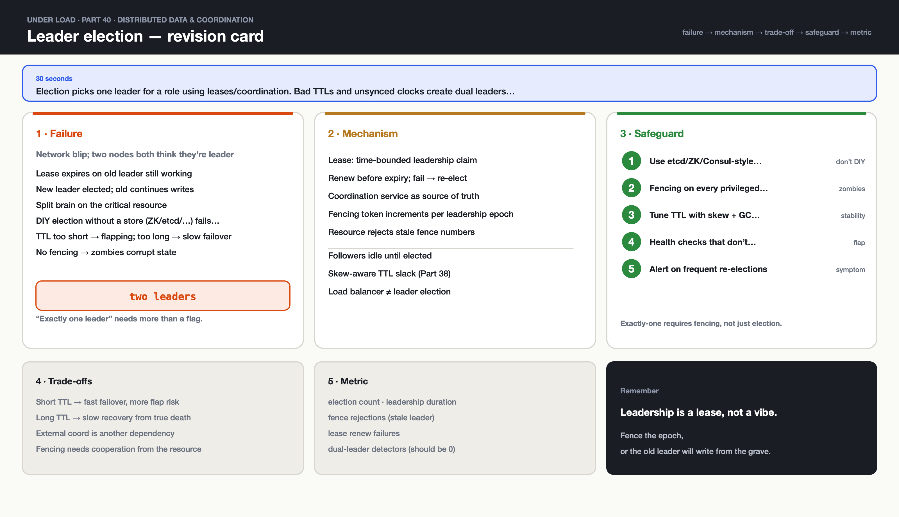
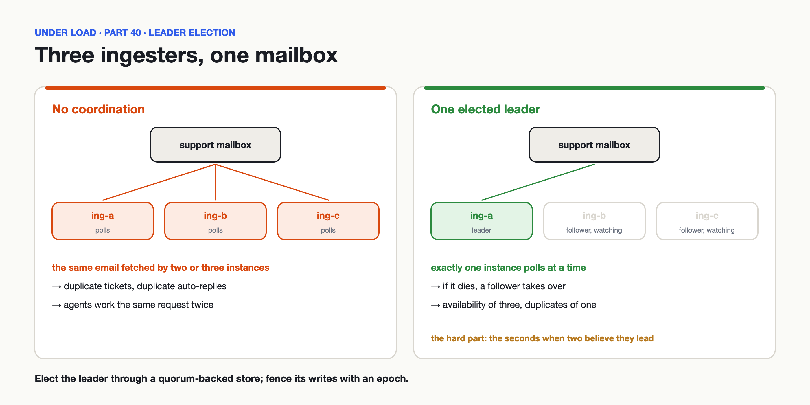
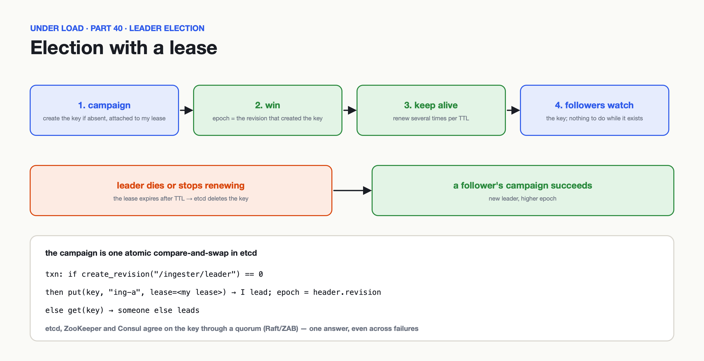
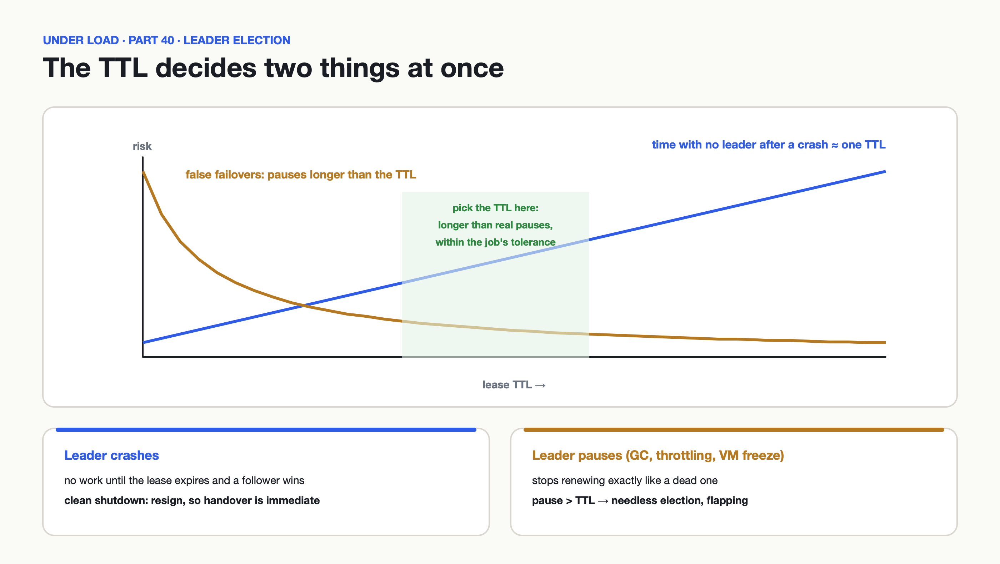
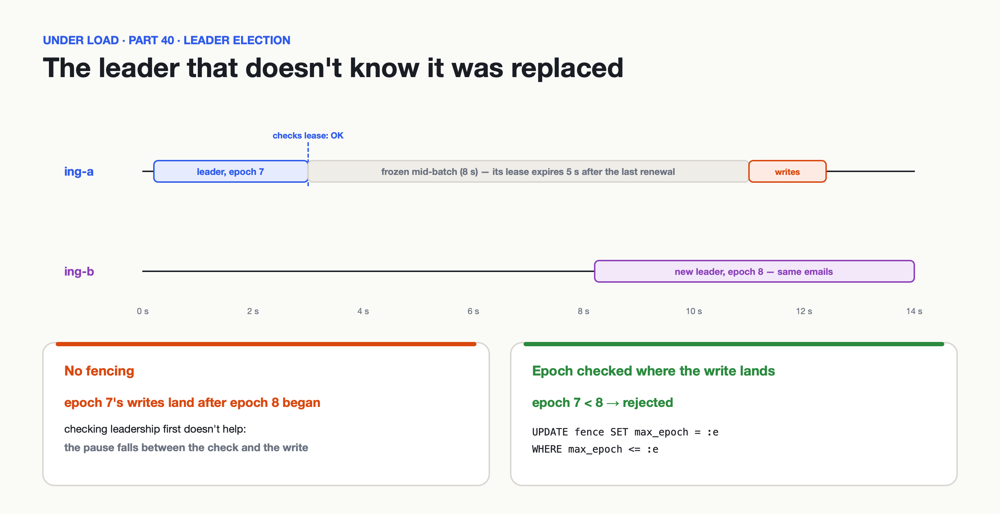
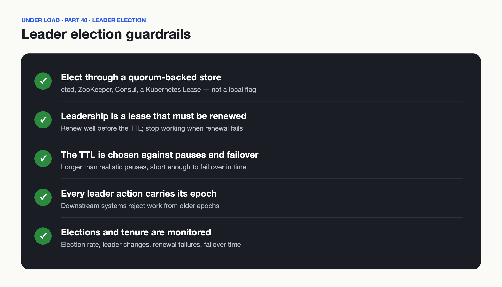

# Leader Election

### Leader election: getting a group of servers to agree that exactly one of them does a job — leases, keepalives and TTLs, failover time vs false alarms, and the stale leader that keeps working after it's been replaced.

*Under Load · Part 40 · Coordination & Time*

---

Customers email `support@halcyon.example`, and those emails become tickets. A small service called the **ingester** connects to the shared mailbox every few seconds, fetches new messages, creates a ticket for each one, and marks the message as processed. For availability, the ingester runs as **three instances** in different zones — if one dies, the others carry on.

The first deploy did exactly what it was told: all three instances polled the mailbox. Most of the time they raced and one won, but often two or three fetched the same message before any of them had marked it processed. Customers got two or three "We've received your request" replies with different ticket numbers; agents worked duplicate tickets; SLA reports counted each one.

The obvious fixes — "run it on one machine," "use a cron on the first instance" — trade duplicates for a single point of failure. What the team wants is both: **three instances for availability, exactly one doing the work at any moment**, and a quick, automatic handover when that one fails.

That's leader election. And the hard part, it turns out, isn't picking a leader. It's what happens in the seconds when two instances both believe they are one.

---

## What leader election is

**Leader election** lets a group of processes agree that one of them — the **leader** — performs a particular role, while the others — **followers** — stand by, ready to take over if it fails.

Many systems need a single coordinator for some piece of work:

- **Periodic and singleton jobs** — polling a mailbox, sending a nightly digest, expiring trials.
- **Partition ownership** — one consumer per queue partition, one owner per shard range (Parts 35–37).
- **Metadata management** — the component that decides which node owns what, as in Kafka's controller.
- **Database primaries** — the one replica allowed to accept writes (Part 33).

Every election mechanism has to satisfy two requirements that pull against each other:

- **Safety:** at most one leader acting at a time.
- **Liveness:** when the leader fails, a new one is chosen, quickly.

The difficulty is that **a follower can't tell a dead leader from a slow or unreachable one.** From the outside, a crashed process, a process frozen in a garbage-collection pause, and a process behind a broken network link look identical: it stopped answering. Failure detection is never instantaneous and never certain. Every election design is, at bottom, a choice about how long to wait before assuming the worst — and what to do if that assumption turns out wrong.

### Elect through something that already agrees

Agreeing on one leader, when any member can fail and any message can be lost or delayed, is an instance of the **consensus** problem. It's solved by algorithms such as **Paxos** and **Raft**, which only decide something once a **majority** — a **quorum** — of members agree. A majority is what makes the answer unique: two different majorities of the same group always share at least one member, so two conflicting decisions can't both be accepted.

Raft itself contains a leader election: each node waits a **randomized** election timeout (the Raft paper suggests a range like 150–300 ms) without hearing from a leader, then asks the others for votes in a new **term**; a node that gets votes from a majority leads that term. The randomization makes it unlikely that two candidates split the vote repeatedly.

Implementing consensus correctly in application code is notoriously hard. The standard approach is to borrow it from a **coordination service** that already implements it — **etcd** (Raft), **ZooKeeper** (its own protocol, ZAB), **Consul** (Raft) — or from something built on one, such as a **Kubernetes Lease** object stored in etcd. The application doesn't run an election protocol. It competes for a key in a store that guarantees a single, consistent answer.

What *not* to use: a flag in a local file, a row in a database replicated asynchronously, a "first instance by hostname" rule, or anything else that two halves of a network partition could each answer differently. Those are exactly the setups that elect two leaders.

---

## Election with a lease

Most election libraries — etcd's `concurrency.Election`, Kubernetes client-go's `leaderelection`, ZooKeeper recipes in Apache Curator — implement the same pattern:

1. **Campaign.** Each instance tries to create a well-known key, say `/ingester/leader`, with its own name — but only if the key doesn't exist yet. In etcd that's one atomic transaction: *if the key's creation revision is 0, put it; otherwise return the current value*. Exactly one campaign succeeds.
2. **Attach a lease.** The key is created under a **lease**: a timer kept by the coordination service, with a **TTL** (time to live). If the lease isn't renewed before the TTL runs out, the service deletes every key attached to it.
3. **Keep alive.** The leader renews its lease regularly, typically a few times per TTL. As long as renewals arrive, the key stays and the instance remains leader.
4. **Followers watch.** Followers see that the key exists and do nothing but watch it. When it disappears, they campaign again.
5. **Epoch.** The revision at which the key was created is a number that only increases: each new leader gets a higher one. That number is the leader's **epoch** — also called the **term** or **generation**. It will matter more than anything else here.

ZooKeeper expresses the same thing with **ephemeral sequential znodes**: each candidate creates a node that disappears automatically when its session ends, the one with the lowest sequence number leads, and each other candidate watches only the node just before its own, so a leader's death wakes one successor rather than the whole group (avoiding a thundering herd of re-campaigns).

If the leader crashes, it stops renewing, the lease expires, the key is deleted, and a follower's next campaign succeeds. If the leader shuts down cleanly — a deploy, a scale-down — it should **resign**: delete the key or revoke its lease explicitly, so the handover happens immediately instead of after a full TTL.

---

## The TTL decides two things at once

The lease TTL is the knob that trades liveness against safety — and it sets both at the same time.

### How long nothing runs after a crash

When the leader dies, no one does the work until its lease expires and a follower wins the next campaign. The gap is roughly the TTL, minus the time since the last renewal, plus a little for the watch notification and the campaign itself. With a 10-second TTL, emails wait up to about 10 seconds longer to become tickets. For an ingester, that's harmless. For a database primary, every second of failover is a second of failed writes.

(Coordination services set a floor. etcd, for instance, refuses TTLs shorter than a minimum derived from its own election timeout — a couple of seconds with default settings — because a lease shorter than the time etcd itself needs to fail over could expire during etcd's own leader change.)

### How often a pause looks like a crash

A leader that **pauses** stops renewing exactly like a dead one. Pauses are common in practice:

- **Garbage-collection pauses** in managed runtimes, sometimes seconds long on large heaps.
- **CPU throttling** of a container that hit its CPU limit, slowing everything including the keepalive thread.
- **Virtual-machine pauses** during live migration or host contention.
- **Slow I/O** — a process blocked writing to a saturated disk.
- **A network hiccup** between the leader and the coordination service, while the leader is otherwise fine.

If the pause is longer than the TTL, the lease expires and another instance is elected — a **false failover**. The cluster has paid for an election and a handover, the old leader will need to step down when it resumes, and if this happens often, leadership flaps between instances.

So a short TTL gives fast failover and false alarms; a long TTL gives stability and slow failover. The TTL should be **longer than realistic pauses** — taken from the platform's own GC and scheduling metrics, not guessed — and **no longer than the job can tolerate going undone**. Kubernetes' built-in controllers use a 15-second lease duration by default, renewing with a 10-second deadline and retrying every 2 seconds: a deliberate lean towards stability over speed.

### Renew early, and stop when renewal fails

Two rules for the leader itself:

- **Renew well before the TTL** — at a third or a quarter of it — so one slow renewal doesn't cost leadership.
- **Stop working as soon as a renewal fails or the renewal deadline passes**, before the lease could have expired on the server. A leader that keeps working "until it hears otherwise" will, by definition, keep working after it was replaced. Kubernetes' `RenewDeadline` exists for exactly this: if the leader can't renew within it, it gives up leadership on its own.

These rules shrink the dangerous window. They can't close it, for the reason the next section explains.

---

## The leader that doesn't know it was replaced

A paused process doesn't know it was paused. When it resumes, it continues exactly where it left off — and if it was in the middle of work, it finishes that work.

Walk through it with a 5-second TTL:

1. The ingester `ing-a` is leader with epoch 7. It fetches a batch of emails and checks that it still holds the lease. It does.
2. Before creating the tickets, `ing-a` freezes — a long GC pause, or its VM is migrated — for 8 seconds.
3. After 5 seconds without renewals, the lease expires. `ing-b` campaigns, wins with epoch 8, fetches the same unprocessed emails, and creates their tickets.
4. `ing-a` wakes up. From its point of view, no time has passed: it just checked that it was leader. It creates its tickets too. Duplicates again — exactly what the election was meant to prevent.

Checking "am I still the leader?" immediately before each write doesn't fix this, because the pause can happen **between** the check and the write. Nothing on the leader's side can close that gap: the leader cannot reliably detect its own pause in time. Two processes **believing** they lead, for a moment, is unavoidable in any system with pauses and unreliable networks.

### Fencing with the epoch

What *can* be prevented is the old leader **acting**. The fix moves the check from the leader to wherever the leader's work lands:

- **Every write carries the leader's epoch.**
- **The downstream system remembers the highest epoch it has seen, and rejects writes from older ones.**

For the ingester, the tickets table's database can do it: a small `fence` row holds the highest epoch seen, and each batch starts with `UPDATE fence SET max_epoch = :my_epoch WHERE max_epoch <= :my_epoch`, inside the same transaction as the inserts. If `ing-b` (epoch 8) has already written, `ing-a`'s update matches no row, its transaction does nothing, and it learns it's no longer leader. Storage systems that support it take the epoch directly as a condition on the write. This is called **fencing**, and the epoch used this way is a **fencing token**.

(For the ingester specifically, an idempotency key — the email's `Message-ID` as a unique column, Part 14 — would also stop duplicate tickets. Fencing is the general mechanism, for work that isn't naturally idempotent.)

This is the single most important idea about leader election: **being elected and being allowed to change state are separate.** Election decides who *should* act. The epoch lets every system the leader touches *verify* it, at the moment it matters. The same idea appears as the fence on a moved partition in Part 37, and as fencing tokens for locks in Part 42.

Not every election library provides this. The Kubernetes client-go documentation states plainly that its leader election does not guarantee only one client acts as leader at a time — there is no fencing — and that it's meant for cases where a brief overlap is tolerable. That's an honest and useful statement: it tells users exactly where they must add their own epoch checks.

---

## Split brain, and how election avoids it

The worst case of two leaders is **split brain**: a network partition divides the group, each side can't see the other, and each side elects its own leader, which then acts for minutes or hours, not moments. Both halves are healthy; both are wrong.

A quorum-backed election avoids it by construction. With five coordination nodes split three and two, only the side with three can form a majority, renew leases and grant new leadership. A leader stranded on the minority side can no longer renew its lease; its keepalives fail, and if it follows the "stop when renewal fails" rule, it steps down. The minority side becomes unavailable for that role, deliberately: refusing to elect is the price of never electing two. Fencing then covers the window before the stranded leader notices.

That's also why election needs an **odd number** of coordination nodes spread across failure domains, typically three or five. Part 41 is entirely about split brain — what it looks like across data centers, and why preventing it means choosing which side stops.

---

## Leader election vs a distributed lock

The two are built from the same parts — usually a lease on a key in a coordination store — and differ in how they're used:

- A **distributed lock** protects a short **critical section**: acquire, do one thing, release. Many processes contend for it, and contention is the normal case.
- **Leadership** is a long-lived **role**: one process holds it for minutes or days, renewing continuously, and others take over only on failure.

Both share the stale-holder problem, and both need fencing when correctness matters. Part 42 goes deep on locks and leases.

### Failover costs, and the bottleneck risk

Two operational costs come with a single leader:

- **Failover reduces availability briefly.** Between the old leader's failure and the new one starting, the role is unfilled. New leaders also often need to warm up: load state, rebuild caches, catch up on a log. Both belong in the failover budget.
- **A leader can become a throughput bottleneck.** If all ingestion, scheduling or coordination funnels through one process, it caps the system. The usual answer is to **partition** the work and elect one leader per partition — one ingester per mailbox, one scheduler per tenant shard — so many leaders each own a slice, as Kafka does with a leader per topic partition.

---

## Guardrails that prevent the next one

1. **Elect through a quorum-backed store** — etcd, ZooKeeper, Consul or a Kubernetes Lease — never through a local flag, an async replica or a hand-rolled protocol.
2. **Leadership is a lease that must be renewed** early, and the leader **stops working** as soon as renewal fails or its deadline passes; clean shutdowns resign immediately.
3. **The TTL is chosen against pauses and failover requirements**: longer than realistic pauses, short enough for the role's tolerance for a gap.
4. **Every leader action carries its epoch**, and downstream systems reject work from older epochs.
5. **Elections and tenure are monitored**: election rate, leadership changes, renewal failures and failover time.

---

## What to keep on the dashboard

- **Elections per hour, and the current leader and epoch** for each role. Frequent elections mean the TTL is too short, or leaders are struggling.
- **Leader tenure** — how long each leader held the role. Short tenures are flapping.
- **Lease renewal latency and failures** on the leader, the early warning before a lost lease.
- **Failover duration** — the gap during which no leader was acting, measured from the work itself (last batch processed), not only from the election.
- **Fenced (rejected) writes** downstream — rare, and each one is a stale leader caught in the act.
- **Pause indicators on leader processes**: GC pause times, CPU throttling, VM steal time.
- **Coordination service health**: quorum size, its own leader changes, request latency.

---

## Recap

### What is leader election?
A mechanism by which a group of processes agrees that exactly one of them performs a role — a singleton job, a partition, metadata management, a database primary — and picks a new one when it fails, so the work is neither duplicated nor left undone.

### How does a lease-based election work?
Each candidate atomically creates a key attached to a lease with a TTL; one succeeds and becomes leader, with the key's creation revision as its epoch. The leader renews the lease; followers watch the key. If renewals stop, the lease expires, the key is deleted, and a follower's campaign succeeds.

### Why use a coordination service instead of implementing election?
Election is a consensus problem. etcd, ZooKeeper and Consul implement consensus with majority quorums, so they give one answer even when members fail or the network splits. Hand-rolled schemes and asynchronously replicated flags tend to elect two leaders under partitions.

### How do you choose the TTL?
It sets both failover time (roughly one TTL after a crash) and sensitivity to pauses (any pause longer than the TTL causes a false failover). Choose it longer than realistic GC, throttling and VM pauses, and within the role's tolerance for a gap; renew several times per TTL.

### What happens if an old leader resumes after a long pause?
It continues as if it were still leader and can complete writes after a new leader has taken over. Checking leadership before writing can't prevent it, because the pause can fall between the check and the write.

### How do you avoid split brain?
Elect only through a majority quorum, so a minority partition can't renew or grant leadership; make leaders stop when renewal fails; and fence every write with the epoch, so a leader that hasn't noticed yet is rejected downstream.

### How do you stop two leaders from acting at once?
Two processes may briefly *believe* they lead, but the old one can be prevented from *acting*: every write carries the epoch, and downstream systems reject epochs older than the newest seen. Being elected and being allowed to mutate state are separate.

### What is the difference between leader election and a distributed lock?
A lock protects a short critical section that many processes contend for; leadership is a long-lived role renewed continuously and changed on failure. Both are typically leases on a key, and both need fencing against stale holders.

### What should be monitored?
Election count, current leader and epoch, leader tenure, renewal latency and failures, failover duration, fenced writes, pause indicators on leaders, and the coordination service's own health.

---

## Next

- **Lab (run + measured write-up):** [40-leader-election](https://github.com/b-basoglu/under-load/tree/main/40-leader-election)
- **Next:** [Split Brain](../41-split-brain/article.md) — The network between two data centers breaks. Both halves are healthy. Both think the other one died. What stops them from both accepting writes?
