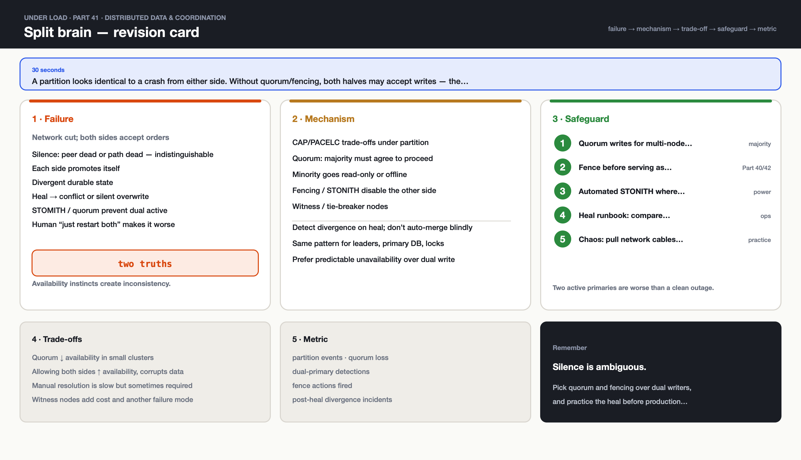
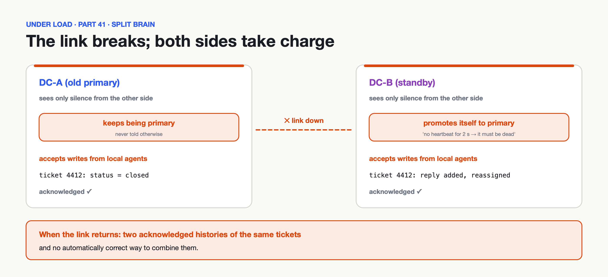
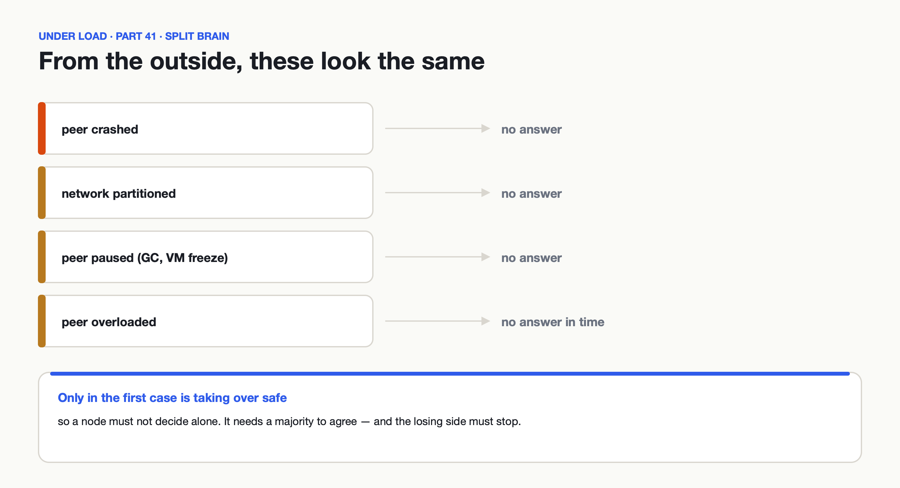
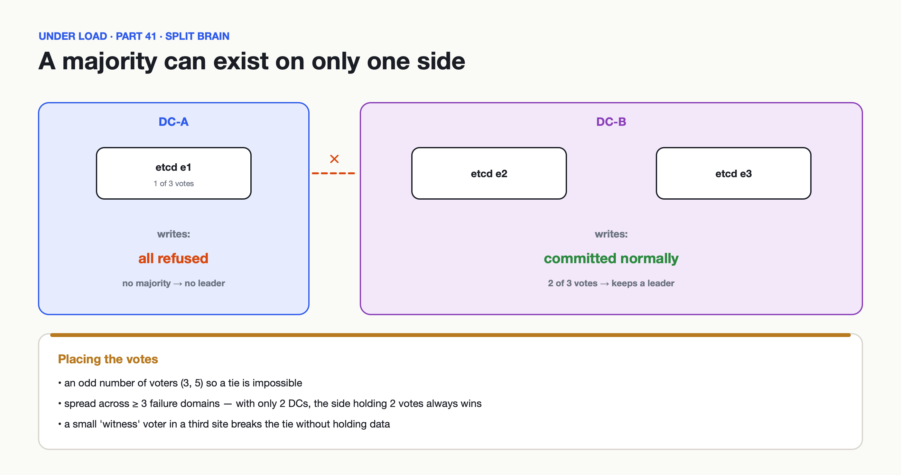
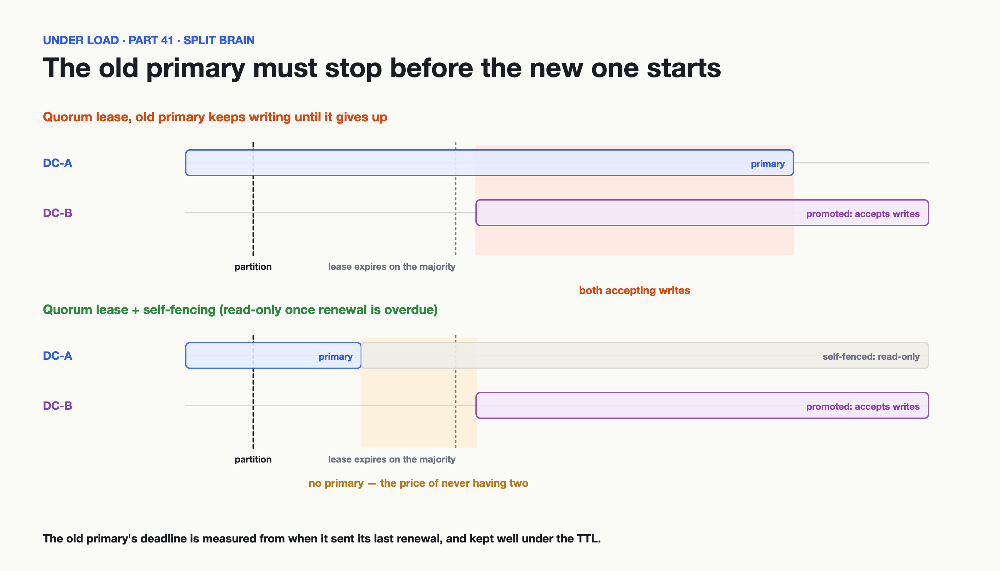
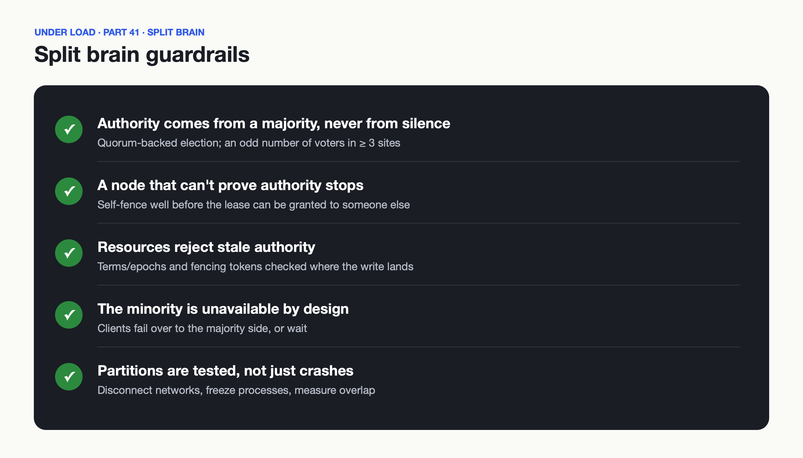

# Split Brain

### Split brain: when a network partition leaves two halves of a system each convinced it's in charge — why a node can't tell a dead peer from an unreachable one, how quorums prevent two leaders, and why the losing side must stop on its own.

*Under Load · Part 41 · Coordination & Time*

---

The ticket database runs in two data centers. DC-A holds the **primary**, which accepts writes; DC-B holds a **standby**, replicating from it and ready to take over if DC-A fails. A small failover agent on each side checks the other every few hundred milliseconds. The rule looks sensible: if the other side hasn't answered for a couple of seconds, assume it's dead — and if it was the primary, take over.

Then the link between the two data centers fails. Both data centers are fine. Both databases are fine. Application servers in both data centers keep serving agents, each through its local database. All each failover agent can see is that the other side stopped answering. DC-B's agent does what it was designed to do and promotes its standby. DC-A's primary never stopped being primary.

Now both databases accept writes. An agent in DC-A closes a Halcyon ticket; an agent in DC-B, routed to the other data center, adds a reply to the same ticket and reassigns it. Both changes are acknowledged. For as long as the partition lasts, the two databases drift apart — every busy ticket collects changes on both sides.

When the link comes back, there are two histories of the same tickets, both acknowledged to users, and no correct way to combine them. This is **split brain**: parts of a system lose contact, and more than one of them acts as the authority.

---

## Why a node can't tell what happened

A node that stops hearing from its peer has no way to know why. All of these produce exactly the same symptom — silence:

- The peer **crashed**.
- The **network** between them is partitioned, while the peer is perfectly healthy.
- The peer is **paused** — a long garbage-collection pause, a frozen VM — and will resume as if nothing happened.
- The peer is **overloaded**, and its answers arrive too late to count.

Only in the first case is taking over safe. In all the others the peer is alive, and it will keep acting as itself. Any rule a node applies **on its own** — "no heartbeat for two seconds means it's dead" — will sometimes be wrong. Making the timeout longer doesn't fix that; it only changes how often the wrong decision is made and how long a real failure takes to handle.

This is why heartbeats alone can't establish authority. A heartbeat says "I can hear you" or "I can't hear you." It can never say "you are dead," and it certainly can't say "therefore I'm in charge." The way out is to make sure no node ever decides **alone** that it's in charge.

---

## A majority can exist on only one side

A **quorum** is a majority of a fixed group of voters. Its key property is simple arithmetic: two groups that don't overlap can't **both** contain a majority of the same set. With five voters, a majority is three; a partition into three and two leaves exactly one side with three. If authority requires a majority, then after any partition **at most one side has authority**. The other side — the **minority** — can't elect a leader, can't commit decisions, and knows that it can't.

That's what makes a quorum more useful than a heartbeat. A heartbeat is one node's local opinion. A quorum is agreement that's provably unique: if a decision was made by a majority, no conflicting decision could have been made by another majority, because the two majorities would have shared at least one voter, and that voter would have refused the second.

Consensus protocols are built on it. **Raft** (used by etcd, Consul, CockroachDB, TiKV and many others) and **Paxos**-family protocols (used in systems such as Spanner and Chubby) only commit an entry, or recognize a leader, once a majority has accepted it. Each leadership period has a number — a **term** in Raft, a **ballot** or **epoch** elsewhere — that only increases, so every message can be checked against the current authority. ZooKeeper's protocol, ZAB, does the same with its own epochs.

Put the ticket database's failover behind one of these and the partition plays out differently. Say there are three coordination nodes: one in DC-A, two in DC-B. When DC-A is cut off, its single node is a minority: it can't reach a leader, can't elect one, and refuses every write. The two nodes in DC-B are a majority and keep operating normally. The minority side becomes **unavailable** rather than **wrong**.

That's a deliberate trade, and it's the heart of the **CAP theorem**'s choice during a partition: a system can keep every side **available**, or keep one **consistent** history, but not both. Split-brain prevention chooses consistency, and accepts that the minority side stops serving writes until the partition heals.

### Placing the votes

Where the voters sit decides which failures the system survives:

- **Use an odd number of voters** — three or five. With an even number, a partition can split them exactly in half, and neither side has a majority. Four voters tolerate no more failures than three.
- **Spread them over at least three failure domains.** With only two data centers, one of them must hold the majority. If the link breaks, that side wins — fine. But if **that whole data center** is lost, the other side holds a minority and can't take over, even though nothing is wrong with it.
- **A witness breaks the tie.** A small voter in a third site — a cheap VM in another region, holding no data — lets either main data center survive the loss of the other: whichever side can still reach the witness has the majority.
- **Five voters tolerate two failures, three tolerate one.** More voters mean more messages and slower commits, so few systems use more than five or seven.

---

## Quorum alone isn't enough: the old primary must stop

Move the failover decision into a quorum-backed store, as in Part 40: the "primary" role is a lease on a key in etcd, and the database on each side is writable only while its agent believes it holds that lease. DC-A's agent holds the lease when the partition begins. Its local etcd node is in the minority.

### Without self-fencing

DC-A's agent can no longer renew its lease: its etcd node can't reach a majority, so every renewal fails. On the majority side, the lease expires after its TTL, DC-B's agent wins the election, and DC-B's database is promoted.

But suppose DC-A's agent, as written, keeps its database writable until it has *repeatedly* failed to renew — say, until it gives up after several retries. For that whole stretch, both databases accept writes. The quorum worked: only one side **won the election**. The old primary just didn't know it had lost, and went on acting on authority it no longer had. It's the stale-leader problem from Part 40, at the scale of a data center.

### With self-fencing

The fix is for a primary that can't **prove** its authority to stop on its own: **self-fencing**. As soon as DC-A's agent has gone too long without a successful renewal, it makes its database read-only — or stops it accepting connections, or kills it — without waiting to be told.

The timing is the whole design. The old primary must stop **before** the lease can expire on the majority side:

- The lease expires on the coordination service one TTL after the last renewal it **received**.
- The agent measures its own deadline from when it **sent** that renewal, on its monotonic clock (Part 38). Since sending happens before receiving, the agent's deadline always falls earlier than the service's.
- Choosing a **renew deadline well under the TTL** — a third or a half of it — leaves a margin for clock-rate drift and scheduling delays.

With that, the old primary is read-only before a new primary can exist, and the overlap is zero. The cost is a short window in which **neither** side accepts writes — from the moment the old primary fences itself until the new one is promoted. That gap is the price of never having two.

This is exactly how mature failover tools behave. Patroni, a widely used high-availability manager for PostgreSQL, keeps the leader's identity in a key with a TTL in etcd, Consul or ZooKeeper, and demotes its own PostgreSQL primary if it can't update that key in time. It can also arm a hardware or kernel **watchdog**, so that if Patroni itself hangs and can't demote the database, the whole machine is reset. Redis Sentinel offers a weaker but related setting: a primary configured with `min-replicas-to-write` stops accepting writes when it can't see enough replicas, which limits how much a partitioned primary can accept.

### Fencing where the writes land

Self-fencing relies on the old primary noticing in time, and a paused process can't notice anything (Part 40). So robust designs add a second layer at the resource itself:

- **Terms or tokens on every write.** Every leadership term has a number that only grows. The primary attaches it to what it writes, and storage — a shared disk, an object store, a downstream service — rejects writes from an older term. A stale primary that wakes up after a pause is turned away, even though it still believes it leads. Part 42 covers these **fencing tokens** in detail.
- **STONITH** — "shoot the other node in the head." Before taking over, the new primary forcibly isolates the old one through a channel that doesn't depend on the broken network: powering it off through its management controller, cutting its access to shared storage, or removing it from the load balancer. Cluster managers such as Pacemaker are built around this.

Layered together — majority to decide, self-fencing to stop quickly, tokens or STONITH to stop the ones that didn't notice — they make "two primaries acting at once" impossible rather than merely unlikely.

---

## Where split brain hides

Split brain isn't only a database-failover problem. The same pattern — a component deciding alone that it's in charge — shows up in many places:

- **Clustered search and storage systems.** Older Elasticsearch versions required operators to set `minimum_master_nodes` to a majority; a cluster left at the default could elect two masters during a partition. Elasticsearch 7 replaced that setting with an automatically managed voting configuration, precisely because the manual one was so often wrong.
- **Leader-based jobs** (Part 40): two schedulers both running the job.
- **Distributed locks without fencing** (Part 42): two workers both believing they hold the lock.
- **Caches and sessions in active-active regions**, each side assuming it holds the latest state.
- **Kubernetes controllers** using leader election without fencing, during the brief overlap their documentation warns about.

Anywhere authority is inferred from "I didn't hear otherwise," split brain is possible.

---

## After the partition heals

When the network returns, the minority side must rejoin as a **follower**, not as a peer:

- **With quorum-based systems**, the minority never committed anything, so there's nothing to reconcile. A Raft node that was cut off discards any log entries it couldn't commit and catches up from the majority's log; its stale term is replaced by the current one. This is the protocol's guarantee, and it's the main reason to use one.
- **After a real split brain**, there are two acknowledged histories. Some writes from one side must be discarded or merged by hand — the conflicting ticket updates in the opening story have no automatically correct answer. A typical recovery picks one side as the truth, extracts the other side's writes from its log, and replays or reviews them one by one. It takes forensics, not configuration, and it should be rehearsed before it's needed.

Some systems accept writes on both sides **on purpose** — **multi-primary** or active-active designs, offline-first apps. That isn't split brain if it was designed for: the data is made mergeable with version vectors and merge rules (Part 39) or CRDTs, and conflicts are expected and resolved. The failure is accepting concurrent writes **without** a way to reconcile them.

---

## Testing for it

Split brain only appears under partitions, and most test environments never partition. Crash tests — killing a node — exercise the easy case, where the node really is dead. The dangerous cases need deliberate practice:

- **Cut the network between sites** while both stay up, and check that exactly one side accepts writes.
- **Freeze a primary** (send the process `SIGSTOP`, or pause its VM) for longer than the lease TTL, resume it, and check that its writes are rejected.
- **Make the network asymmetric** — A can reach B, B can't reach A — and watch what each side decides.
- **Count the overlap**: any interval in which two nodes both accepted writes is a failed test, however short.

Tools such as Jepsen have found split-brain behaviour in many real databases precisely this way: by partitioning them on purpose and checking whether acknowledged writes survived.

---

## Guardrails that prevent the next one

1. **Authority comes from a majority, never from silence.** Quorum-backed election, with an odd number of voters in at least three failure domains.
2. **A node that can't prove its authority stops** — self-fence on a deadline that falls well before the lease could be granted to someone else.
3. **Resources reject stale authority**: terms, epochs and fencing tokens checked where the write lands, or STONITH before takeover.
4. **The minority side is unavailable by design**; clients fail over to the majority side or wait.
5. **Partitions are tested, not just crashes**: cut links, freeze processes, and measure any overlap.

---

## What to keep on the dashboard

- **Number of nodes that believe they're primary**, per role or shard — should never exceed one. Alert on two, even briefly.
- **Quorum health**: voters reachable from each node, and the identity of the cluster's leader.
- **Term or epoch changes** — each one is a leadership change that should have an explanation.
- **Election rate and leader churn.**
- **Self-fencing events**: nodes that made themselves read-only, and for how long.
- **Rejected stale-term or stale-token operations** at storage — each one is a split brain prevented.
- **Replication divergence** between sites after any network event.
- **Conflict incidents** — any case where two histories had to be reconciled.

---

## Recap

### What is split brain?
A failure in which parts of a system lose contact and more than one acts as the authority — for example, two primaries both accepting writes for the same data. When the partition heals, there are two acknowledged, conflicting histories.

### Why can a network partition produce split-brain risk?
Because each side sees only silence from the other, and silence looks the same whether the peer crashed or the link failed. A side that decides on its own that the other is dead, and takes over, creates a second authority while the first is still acting.

### Why can't a node know whether its peer crashed or the network failed?
A crash, a partition, a long pause and overload all produce the same symptom: no answer. Any decision a node makes alone from timeouts will sometimes be wrong; longer timeouts only change how often.

### How does quorum prevent two leaders from safely committing?
Authority requires a majority of a fixed set of voters, and two non-overlapping groups can't both hold a majority. After a partition, at most one side can elect a leader or commit; the minority refuses. That makes a quorum far more useful than a heartbeat, which is only one node's local view.

### Why isn't quorum-based election alone enough?
The old leader may not know it lost. Until it notices, it can keep accepting writes on authority it no longer has, even though the majority has already elected someone else.

### What is self-fencing, and why does its timing matter?
A leader that can't renew its authority stops on its own — making its database read-only or shutting it down. It must stop before the lease can expire on the majority side: measuring the deadline from when the renewal was sent, and keeping it well under the TTL, guarantees zero overlap at the cost of a brief window with no primary.

### What problem do fencing tokens solve?
A paused process can't fence itself in time. With a monotonically increasing term or token on every write, the resource rejects writes from an older authority even if the old leader is still running and still believes it leads.

### Why can split-brain prevention intentionally sacrifice availability?
Because the alternative is inconsistency. During a partition, the minority side refuses writes so that only one history exists. That side is unavailable by design; the CAP trade-off is made explicitly.

### How should voters be placed?
An odd number — three or five — across at least three failure domains, so either of two main data centers can fail without losing the majority. A small witness voter in a third site is enough.

### What should be monitored?
Nodes that believe they're primary, quorum health, term changes, election rate, self-fencing events, rejected stale operations, replication divergence and conflict incidents.

---

## Next

- **Lab (run + measured write-up):** [41-split-brain](https://github.com/b-basoglu/under-load/tree/main/41-split-brain)
- **Next:** [Distributed Locks vs Leases](../42-locks-vs-leases/article.md) — A worker takes a lock to generate Halcyon's monthly invoice, freezes in a long garbage-collection pause, and wakes up still holding it — as far as it knows. Why TTLs aren't enough, and how fencing tokens make locks safe.
