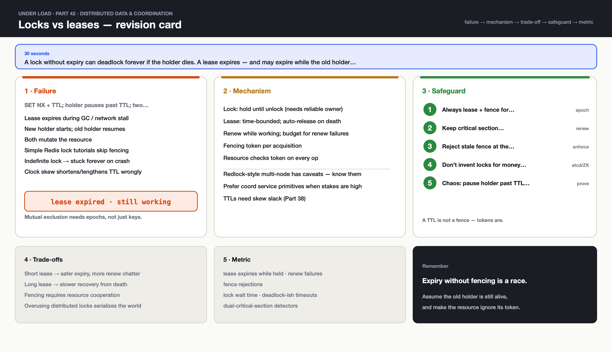
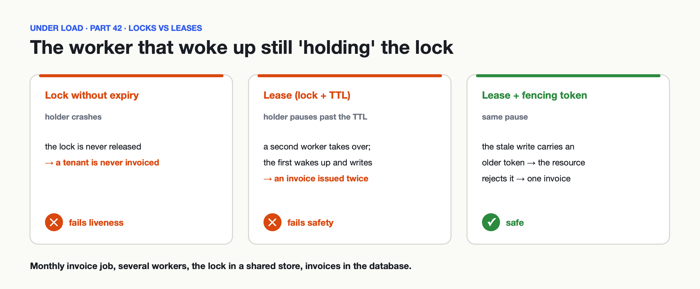
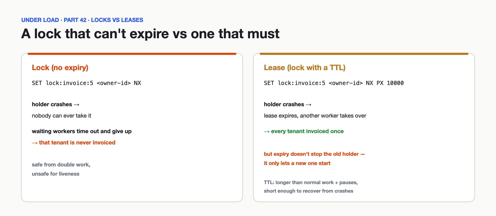
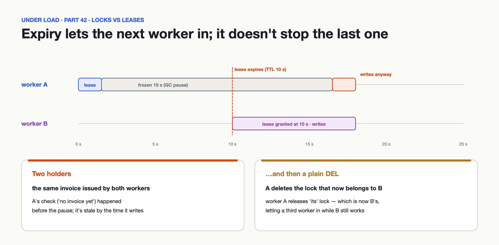
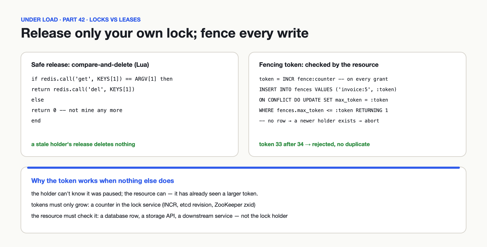
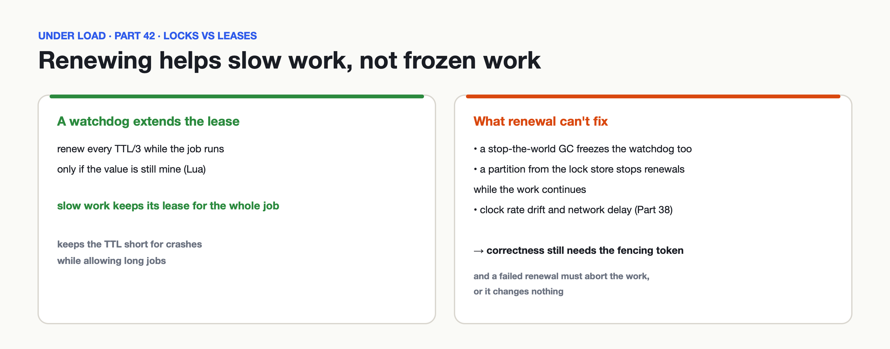
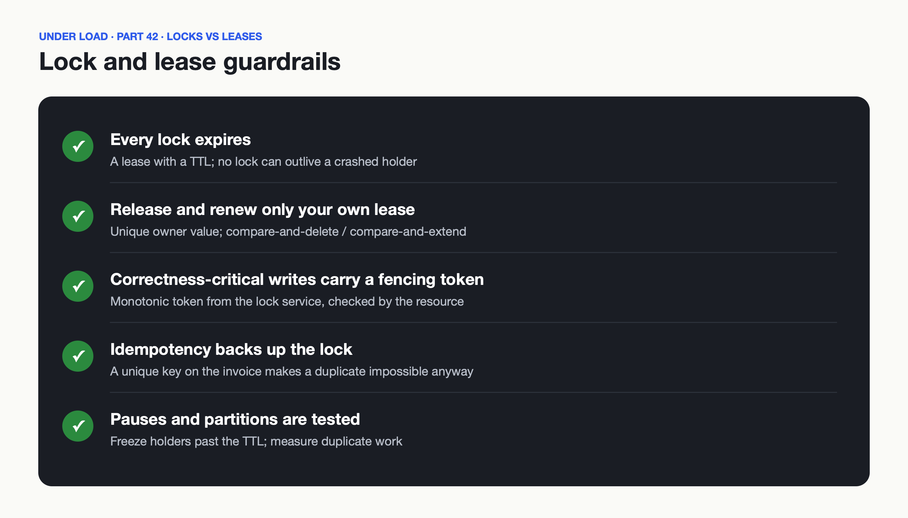

# Distributed Locks vs Leases

### Locks vs leases: why a distributed lock without expiry deadlocks, why a lease with expiry still lets two holders act at once, and how safe release and fencing tokens make mutual exclusion actually safe.

*Under Load · Part 42 · Coordination & Time*





---

On the first of each month, a billing job issues an invoice to every tenant. Several workers share the job. To make sure each tenant is invoiced exactly once, a worker takes a **lock** for the tenant in Redis, checks whether this month's invoice already exists, asks the billing provider to create one, and records it.

The first version used a plain lock with no expiry. One month a worker crashed while holding the lock for a mid-sized tenant. The lock stayed taken forever; the other workers waited for it, gave up, and moved on. That tenant was never invoiced, and nobody noticed until finance closed the month.

The fix looked obvious: give the lock a **TTL** of a few seconds, so a crashed holder's lock disappears on its own.

That fix introduced the opposite bug. Next month, a worker took the lock for Halcyon, checked that no invoice existed yet — and then froze in a long garbage-collection pause on a busy node, for longer than the TTL. The lock expired. A second worker took it, saw no invoice, and issued one. Then the first worker woke up, still convinced it held the lock, and issued a **second** invoice. Halcyon's finance team called the same afternoon.

Both workers did exactly what the code said, and each was right by its own view of the world. The bug is in the assumption that holding a lock means nobody else can act. This article is about why that assumption fails across machines, and what actually makes mutual exclusion safe.

---

## Do you need a lock at all?

A lock in one process — a **mutex** — is simple: threads share memory, the operating system knows which thread holds it, and if the process dies, every thread holding it dies too. A **distributed lock** coordinates processes on different machines, through a shared store, over a network. None of those comforts survive: the store doesn't know whether the holder is alive, the holder doesn't know whether its lock is still valid, and either can be cut off from the other at any moment.

So the first question isn't how to build the lock but whether the problem needs one. Often a cheaper mechanism gives the guarantee directly:

- **A uniqueness constraint.** A unique index on `(tenant_id, billing_month)` in the invoices table makes a second invoice impossible to record, whoever tries.
- **An idempotency key** sent to the billing provider (Part 14) — say, `invoice-<tenant>-<month>` — so a repeated request returns the first result instead of creating a new invoice.
- **Compare-and-swap.** An update that only succeeds if the row is still in the state the worker read (`UPDATE … WHERE status = 'pending'`), like Part 5's optimistic concurrency.
- **Partition ownership.** Assign each tenant to exactly one worker through a queue partition or a leader per shard (Part 40), so no two workers ever compete for the same tenant.

Locks still have a place: reducing wasted duplicate work, protecting a resource that offers none of the above, or serializing access to something slow. But it helps to be honest about what they provide. A lock lowers the *probability* of two actors at once. The mechanisms above, and the fencing tokens below, make the *outcome* correct.

---

## Locks and leases

A distributed lock is usually a key in a shared store: whoever creates the key holds the lock, and deleting the key releases it. In Redis:

- **A lock without expiry** — `SET lock:invoice:5 <owner-id> NX` (create only if absent). While every holder behaves, it's safe against double work. But it's unsafe for **liveness**: a holder that crashes, loses its network, or has a bug that skips the release holds the lock forever.
- **A lease** — `SET lock:invoice:5 <owner-id> NX PX 10000` — is a lock with an expiry: ownership for a TTL (here 10 seconds), unless renewed. If the holder disappears, the lease expires and someone else can take over.



Every distributed lock should expire; a lock that can outlive its holder will eventually block a system completely. Coordination services agree: etcd attaches locks to leases, ZooKeeper locks are ephemeral nodes that vanish when the holder's session times out, Consul locks are tied to sessions with TTLs.

Choosing the TTL is a balance. It must be **longer than the normal critical section plus ordinary pauses**, or leases will expire under healthy holders. And it determines **how long a crashed holder blocks** everyone else. A short TTL recovers quickly; a long TTL tolerates slow work. Renewal (below) loosens the trade-off but doesn't remove it.

Expiry fixes liveness. It also introduces the more important problem.

---

## Expiry lets the next worker in; it doesn't stop the last one



When a lease expires, the store forgets the holder and grants the lock to the next worker. Nothing at all happens to the **old** holder. If it's still alive — paused, slow, or cut off from the store — it keeps running the code it was running, and that code assumes it holds the lock.

The billing incident, step by step, with a 10-second TTL:

1. Worker A acquires the lease for Halcyon and checks: no invoice for this month.
2. Worker A freezes — a stop-the-world GC pause — for 15 seconds.
3. Ten seconds after A acquired it, the lease expires. Worker B acquires it, checks — still no invoice — and issues one.
4. Worker A resumes. As far as its own code can tell, nothing happened between step 1 and now. It issues an invoice based on a check made 15 seconds earlier.

That's the answer to "why can a lease expire while the old holder is still executing?": expiry is decided by the store, on the store's timer, and the holder isn't consulted. The holder learns its lease is gone only the next time it talks to the store — if it ever does before acting.

Pauses like this are ordinary:

- **Stop-the-world garbage collection** in large heaps.
- **CPU throttling** of a container that reached its CPU limit.
- **Virtual-machine pauses** during live migration or snapshots.
- **Swapping**, when a node runs out of memory.
- **A network stall** between the worker and the store, while the worker itself is fine.

### What clocks do and don't change

Part 38 showed how clocks interact with leases, and the details matter here. Redis `PX`, etcd leases and ZooKeeper session timeouts are all **relative** durations: the store starts its own timer when it grants the lease, and the holder times the same duration on its own monotonic clock. A constant offset between the holder's clock and the store's clock therefore **doesn't matter at all**; neither side compares its time of day with the other's. What does matter:

- **Clock rate.** A holder clock that runs slightly slow makes the holder believe the lease lasts a little longer than the store does.
- **Network delay.** If the holder starts timing when the grant *arrives* rather than when it *sent* the request, it starts late — the store's timer was already running.
- **The store's own clock behaviour.** Redis stores a key's expiry as an absolute time computed from its own system clock, so a jump in the Redis server's clock can make keys expire early or late. etcd goes the other way: when its own leader changes, it refreshes lease TTLs so leases don't expire because of etcd's internal failover — meaning a lease can last *longer* than its holder expected.
- **Pauses.** Above all, a frozen process measures nothing.

A holder can be conservative — start its timer before sending the request, and stop work well before its own estimate of expiry. That shrinks the window, but pauses can be longer than any margin. Timing can't make a lock safe.

### A plain release makes it worse

When worker A finished, it released "its" lock with a plain `DEL lock:invoice:5`. But the key now belonged to worker B, who was still in the middle of its own job, waiting on a slow billing API. A's `DEL` deleted **B's** lock, and a third worker could acquire it while B was still working. Each stale holder that releases blindly can multiply the problem.

The fix for this part is simple: **release only your own lock**. Each acquisition stores a unique, random value — an owner ID generated per acquisition, not just a hostname — and release is a compare-and-delete that runs atomically inside Redis:

```lua
if redis.call('get', KEYS[1]) == ARGV[1] then
  return redis.call('del', KEYS[1])
else
  return 0  -- not mine any more
end
```

With compare-and-delete, worker A's late release deletes nothing. Renewal follows the same rule: extend the TTL only if the value is still yours (the same script, with `PEXPIRE` instead of `DEL`). In etcd and ZooKeeper the equivalent is built in: a lock belongs to a lease or a session, and only that lease or session can release it.

That answers "how should a client safely release or renew a lease?": with an owner identity unique to this acquisition, checked atomically by the store on every release and renewal.

---

## Fencing tokens: let the resource decide



Safe release stops the paused worker from damaging the **lock**. It does nothing for the **data**: the duplicate invoice was issued before the release. And no check the worker makes can prevent it. "Am I still the holder?" immediately before the write can't help, because the pause can happen between the check and the write. The worker cannot detect its own pause in time.

The **resource** can. A **fencing token** is a number the lock service hands out with every grant, and every grant's number is **larger than the last one**. The holder attaches its token to every write it makes, and the resource remembers the highest token it has seen and **rejects** any write that carries a smaller one:

1. Worker A acquires the lease and receives token 33.
2. Worker A pauses; the lease expires.
3. Worker B acquires and receives token 34. It writes with token 34; the resource records 34.
4. Worker A resumes and writes with token 33. The resource has already seen 34, so it **rejects** the write.

The holder never needs to know it was paused. The resource knows a newer holder exists because it has seen a newer token.

Two requirements make it work:

- **The token comes from the lock service and only grows.** A counter incremented on every grant, etcd's revision number for the lock key (the same epoch as Part 40), ZooKeeper's transaction ID (`zxid`) or a znode's sequence number. A token chosen by the client, or a timestamp, isn't safe.
- **The resource checks it.** A database can keep a `fences` row per protected item and update it with `… SET max_token = :token WHERE max_token <= :token` inside the same transaction as the real write; zero rows updated means a newer holder exists, so the transaction aborts. Storage that supports conditional writes can take the token as a condition. A downstream service can record the highest token per resource.

If the resource **can't** check a token — an external billing API that accepts any call — the lock alone can't make it safe. Then the protection has to come from the resource's own idempotency (the idempotency key above), or from a component in front of it that can check tokens.

That's the answer to "why is `SET NX` plus a TTL not always sufficient for correctness?": it gives at most one *current* holder in the store's view, but it can't stop a *former* holder from acting, and it hands out nothing the resource could use to tell them apart.

### Idempotency is the other safety net

For the billing job, the simplest and strongest defence combines both ideas: the lock reduces wasted work, a fencing token protects the internal invoices table, and an idempotency key on the billing provider call plus a unique `(tenant_id, billing_month)` constraint make a duplicate impossible no matter who holds what. Could idempotency remove the need for the lock entirely? For this job, mostly yes: with a unique constraint and an idempotent provider call, two workers racing produce one invoice and one harmless "already exists." The lock then only saves the cost of the duplicate attempt.

---

## Renewing helps slow work, not frozen work



Long-running work can't use a short TTL unless the lease is **renewed** while the work runs. The common pattern is a **watchdog**: a background thread that extends the lease every third or so of the TTL while the job is in progress — only if the key still holds this worker's value. Redisson's lock watchdog for Java does exactly this, and etcd clients keep leases alive with a keepalive stream.

Renewal keeps the TTL short enough for fast crash recovery while allowing jobs longer than the TTL. But it has costs and limits:

- **Coordination traffic.** Every held lock generates renewals; thousands of locks mean thousands of renewals per TTL.
- **A stop-the-world pause freezes the watchdog** along with the work. When the process resumes, the lease may already be gone.
- **A partition** between the worker and the store stops renewals while the work continues; the worker can't tell whether its last renewal arrived.
- **A failed renewal must stop the work.** The watchdog has to signal the job to abort — and the job has to check that signal at safe points — or renewal failures change nothing.

Renewal improves liveness for slow work. It doesn't provide safety; the fencing token still does.

---

## The store's guarantees matter too

A lock is only as strong as the store that holds it. Different stores fail differently:

- **A single Redis instance** is simple and fast, but if it restarts without persistence, every lock disappears at once.
- **Redis with a replica** replicates asynchronously. A lock acquired on the primary can be lost if the primary fails before the write reaches the replica; the promoted replica has never heard of it, and grants the same lock to someone else.
- **Redlock** acquires a lock on a majority of several independent Redis nodes, which tolerates one node failing. It doesn't address pauses — a holder that pauses past the TTL still acts on an expired lock — and it doesn't produce fencing tokens. Its safety has also been debated publicly (notably by Martin Kleppmann, with a response from Redis's author), largely over its reliance on timing.
- **etcd, ZooKeeper and Consul** replicate locks through consensus (Parts 40–41), so a granted lock survives the failure of any minority of nodes, and they provide monotonic numbers usable as fencing tokens. They're slower than Redis and add operational weight.

A rough rule: for **efficiency** locks — avoiding duplicate work where an occasional duplicate is harmless — a single Redis instance with a TTL and safe release is fine. For **correctness** locks, use a consensus-backed store, and fence the resource anyway.

### Keep the critical section short, and plan for not getting the lock

Two more practical points. Distributed locks add a network round trip to acquire and another to release, and while one is held, everyone else waits; a lock around slow work becomes a bottleneck. So do as little as possible while holding it — check, write, release — and never hold it across a call that can take arbitrarily long. And always handle **acquisition failure**: decide whether to wait with a timeout, retry with backoff and jitter (Part 15), skip the item and let another worker take it, or fail loudly. A worker that waits forever for a lock has just rebuilt the deadlock the TTL was meant to prevent.

### When a plain lease is enough

A lease without fencing is fine when **double execution is harmless or merely wasteful**: deduplicating a cache refresh (Part 12), avoiding two workers compressing the same file, reducing duplicate notifications that are idempotent anyway. It isn't enough when double execution breaks correctness: charging, invoicing, writing to storage that can't be undone.

---

## Locks, leaders and split brain

Locks, leader election (Part 40) and split-brain prevention (Part 41) are the same mechanism at different scales: a lease on a key in a coordination store, held by one process, with expiry for liveness and a monotonic number for safety. A leader is a long-held lock; a partition owner is a lock on a range; a database primary is a lock on the right to accept writes. All of them share the stale-holder problem, and all of them are made safe the same way — by having the thing being written check the number.

---

## Guardrails that prevent the next one



1. **Every lock expires.** A lease with a TTL longer than the normal critical section, so no lock outlives a crashed holder.
2. **Release and renew only your own lease**, with a per-acquisition owner value and atomic compare-and-delete or compare-and-extend.
3. **Correctness-critical writes carry a fencing token** from the lock service, checked by the resource.
4. **Idempotency backs up the lock**: a unique key on the result, and idempotency keys on external calls, make a duplicate impossible anyway.
5. **Pauses and partitions are tested**, not just crashes: freeze holders past the TTL, cut them off from the store, and count duplicate work.

---

## What to keep on the dashboard

- **Lock acquisition latency and failures**, and **contention** — waiters per lock.
- **Critical-section (hold) time** distribution, compared with the TTL.
- **Lease expirations while held** — leases that expired before their holder released them. Each one is a potential double execution.
- **Renewal failures**, and work aborted because of them.
- **Fencing rejections** at the resource — each one a stale holder caught.
- **Duplicate-work incidents** caught by idempotency keys or unique constraints.
- **Lock store health**: latency, errors, failovers.
- **Pause indicators on lock holders**: GC pauses, CPU throttling.

---

## Recap

### What is the difference between a lock and a lease?
A lock grants exclusive ownership until it's released; a lease grants it until it expires unless renewed. Without expiry, a crashed holder blocks everyone forever. A lease lets someone else take over after the TTL, at the cost of letting a still-running old holder overlap with the new one.

### Why can a lease expire while the old holder is still executing?
Expiry is decided by the store, on the store's timer. A holder that is paused, slow, or cut off from the store isn't consulted and doesn't find out; when it resumes, it continues as if it still held the lock.

### Why isn't `SET NX` plus a TTL always sufficient for correctness-critical locking?
It ensures at most one current holder in the store's view, but it can't stop a former holder from acting after a pause or partition, and it gives the resource nothing to distinguish old holders from new. Timing margins shrink the window but can't close it.

### Does clock skew break leases?
Not a constant offset, when the lease is a relative TTL as in Redis `PX`, etcd and ZooKeeper — neither side compares clocks. What matters is clock rate drift, network delay, the store's own clock behaviour, and above all process pauses.

### How should a client safely release or renew a lease?
With a unique value per acquisition stored in the lock, and an atomic compare-and-delete or compare-and-extend, so a stale holder can never remove or extend a newer holder's lock. Coordination services tie locks to leases or sessions to the same effect.

### What correctness problem do fencing tokens solve?
A stale holder writing after its lease was granted to someone else. The lock service issues an ever-increasing token with each grant; the holder sends it with every write; the resource rejects tokens older than the newest it has seen. The holder doesn't need to know it was paused.

### Could idempotency remove the need for the lock?
Often, yes. A unique constraint on the result and idempotency keys on external calls make duplicates impossible regardless of locking. The lock then only saves the cost of duplicate attempts.

### Does renewing the lease solve the problem?
It lets long jobs keep a short TTL, but a stop-the-world pause freezes the renewer too, partitions stop renewals while work continues, and renewals add coordination traffic. Renewal helps liveness; fencing provides safety.

### When is a plain lease sufficient?
When duplicate execution is harmless or merely wasteful. Not when it breaks correctness — then use a consensus-backed store, fencing tokens and idempotency.

### What should be monitored?
Acquisition latency and failures, contention, hold time against the TTL, expirations while held, renewal failures, fencing rejections, duplicate-work incidents, lock store health and pauses on holders.

---

## Next

- **Lab (run + measured write-up):** [42-locks-vs-leases](https://github.com/b-basoglu/under-load/tree/main/42-locks-vs-leases)
- **Next:** [Sampling: Temperature, Top-K and Top-P](../43-sampling/article.md) — The support assistant suggested the same reply three times in a row, then a different one that made no sense. What temperature, top-k and top-p actually do to the next token — the start of the LLM sections.
