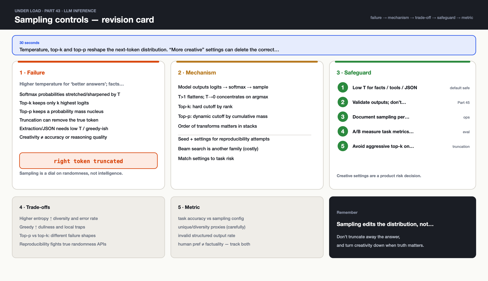
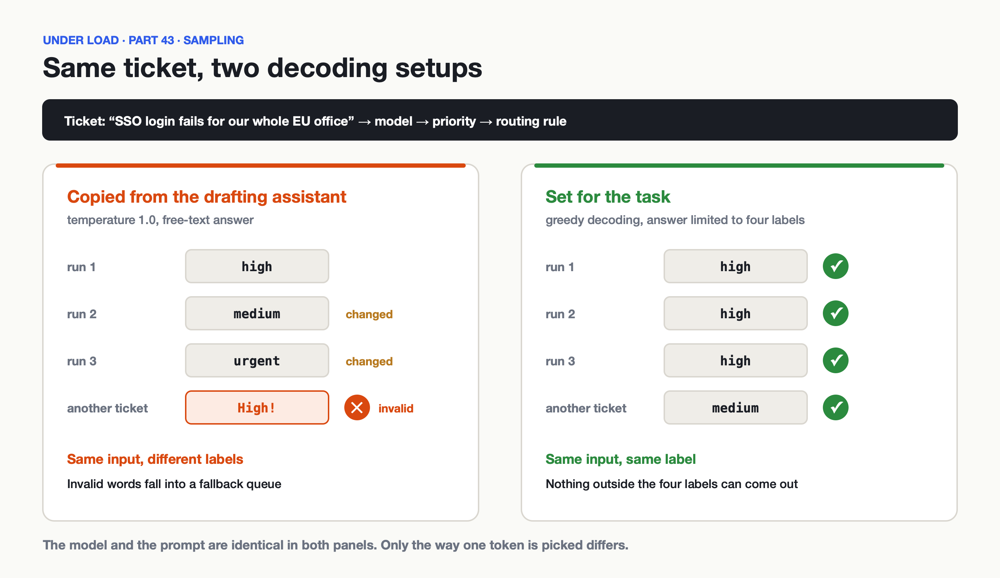
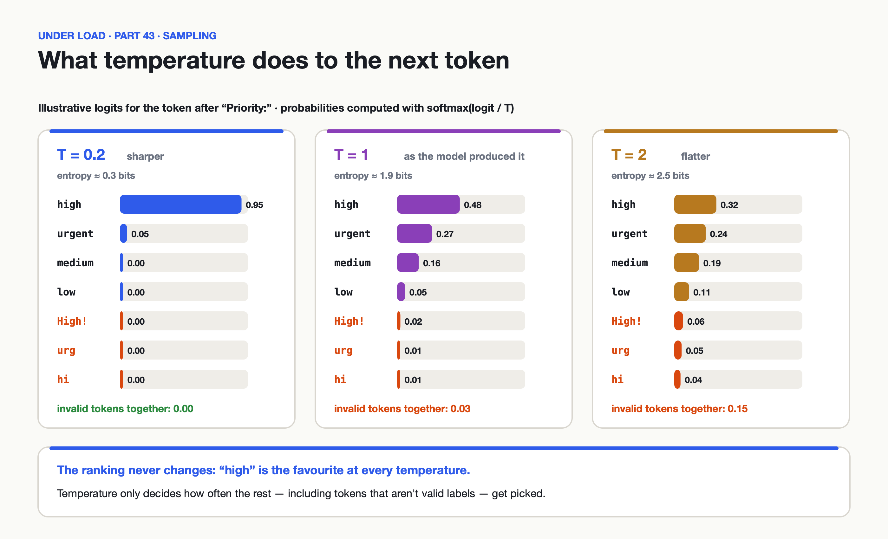
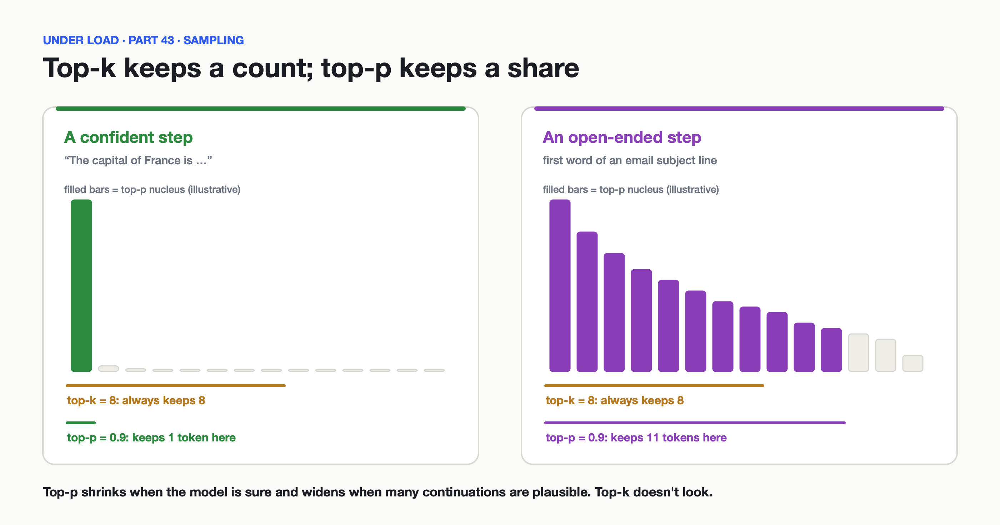
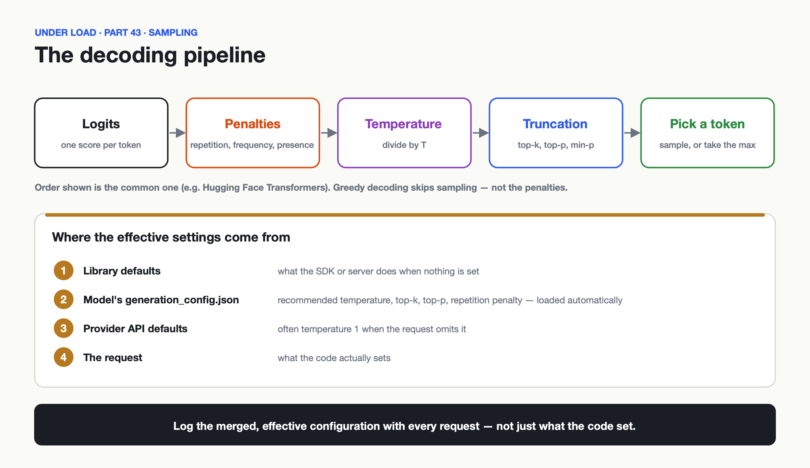
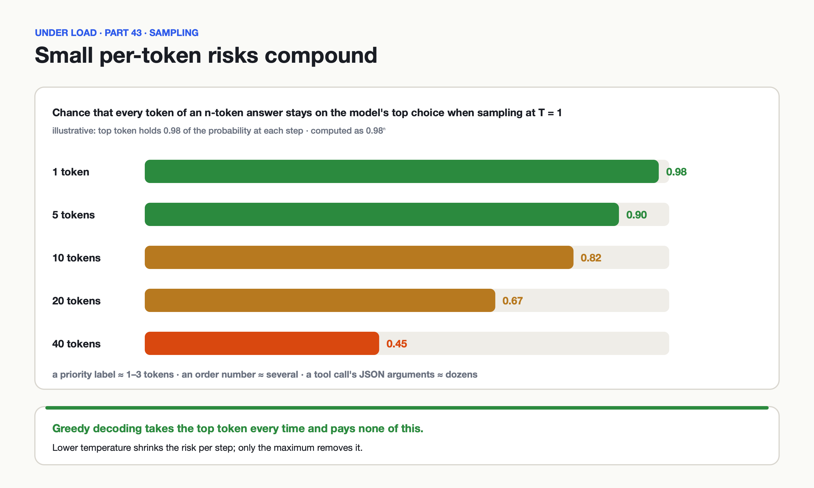
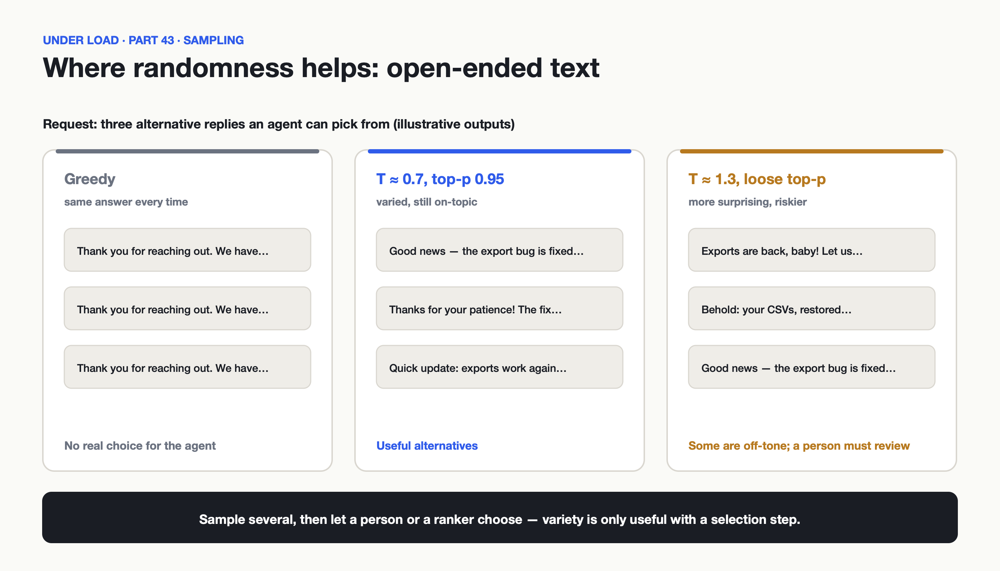
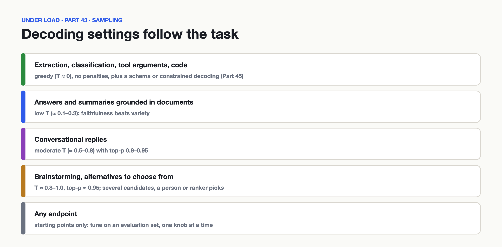
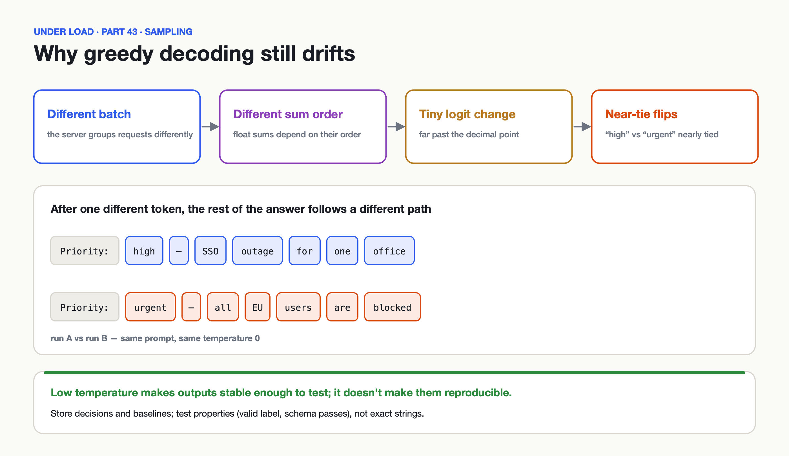
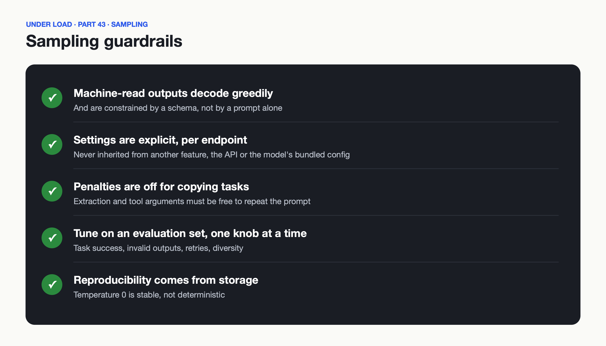

# Sampling: Temperature, Top-K and Top-P

### Sampling: how a language model picks each next token, what temperature, top-k and top-p actually change, and why "more creative" settings quietly break the outputs software depends on.

*Under Load · Part 43 · LLM Fundamentals*

---

The support product gets an AI triage step. When a ticket arrives, a language model reads it and assigns one of four priorities — `low`, `medium`, `high` or `urgent` — and routing rules act on that word: `urgent` pages the on-call agent, `low` goes to the back of the queue.

The engineer wiring it up copies the model settings from the team's reply-drafting assistant, which has been in production for months. That config includes `temperature: 1.0`, chosen because drafts "sounded more natural" with it. Nobody thinks twice. It's the same model.

Two weeks later, Halcyon — the largest customer by far — escalates. One of their tickets, "SSO login fails for our whole EU office," was triaged `high` on the first attempt, `medium` when an agent re-ran triage after editing the subject, and `urgent` on a third run. Another ticket broke routing entirely: the model answered `High!`, which matched none of the four expected words, so the ticket landed in a fallback queue nobody watched.

The model hadn't changed. The prompt hadn't changed. What changed was **how one token was picked from the model's output** — a step that's easy to treat as a cosmetic setting and that is, for software reading the answer, part of the contract.

This article explains that step from the ground up: what a model actually outputs, what temperature, top-k, top-p and penalties do to it, why randomness hurts tasks with one right answer and helps tasks with many, why "temperature 0" still isn't deterministic, and how to choose and operate these settings deliberately. No machine-learning background is assumed.

---

## How a model produces text

A language model doesn't write a sentence at once. It produces text **one token at a time**, in a loop.

A **token** is a chunk of text from a fixed list the model was trained with, its **vocabulary**. Common words are usually a single token; rarer words are split into pieces ("triage" might become "tri" + "age"); spaces, punctuation and digits are tokens or parts of tokens too. Modern vocabularies hold tens of thousands to a few hundred thousand tokens.

Each step of the loop works like this:

1. The model reads everything so far: the prompt plus every token it has generated in this answer.
2. It outputs one number per token in the vocabulary. This number is called a **logit**: a raw score for "how well would this token fit next?" Higher is better; the scale has no fixed meaning.
3. The logits are turned into **probabilities** with the **softmax** function. Each token's probability is proportional to e raised to its logit, divided by the sum of that quantity over all tokens. Two properties matter: the probabilities are all positive and add up to 1, and a logit that's higher by 1 means a probability about 2.7 times higher (e ≈ 2.718). Small differences in score become large differences in probability.
4. **One token is chosen** from that probability distribution and appended to the text.
5. The loop repeats until the model emits a special end-of-text token or hits a length limit.

This kind of generation is called **autoregressive**: each output becomes part of the input for the next step.

Step 4 is called **decoding** or **sampling**, and it's the subject of this article. Everything the model "knows" is expressed in steps 1–3. The decoding step doesn't add knowledge; it only decides how to pick from what the model already believes. That's why the same model can feel careful in one product and erratic in another: the beliefs are the same, the picking is different.

Two consequences of the loop show up throughout the article:

- **One choice changes everything after it.** Once a token is picked, the model conditions on it. If the first token of a priority label comes out as `med`, the next step is shaped by that, and the answer goes down a different path.
- **Errors compound with length.** A ten-token answer is ten separate choices. Any per-step risk is paid ten times.

### Greedy decoding and beam search

The simplest decoding rule is **greedy decoding**: at every step, pick the single most likely token. It's deterministic in principle — the same input and the same logits give the same output — and it's what "temperature 0" usually means.

Greedy decoding picks the best *next* token, which isn't always the best *sequence*. **Beam search** keeps several candidate sequences (the "beam") in parallel and extends each one, keeping the overall most likely few at every step. It's a classic choice for translation and speech recognition, where there's roughly one right output. For open-ended text, it has a well-documented problem: maximizing likelihood produces bland, repetitive text that loops on the same phrase — a finding that motivated much of the research on sampling methods below. Chat and assistant APIs today almost always sample rather than beam search.

---

## Temperature

**Temperature**, written T, divides every logit before the softmax:

> p(token) = softmax(logit / T)

That one division has a precise effect:

- **T = 1** leaves the distribution exactly as the model produced it.
- **T < 1** multiplies the gaps between logits. The favourite gets an even larger share; unlikely tokens fade toward zero. The distribution becomes **sharper**.
- **T > 1** shrinks the gaps. Probability flows from the favourites to the long tail. The distribution becomes **flatter**.
- **T → 0** concentrates all probability on the top token, which is why greedy decoding is described as temperature 0. (Mathematically, dividing by zero is undefined, so implementations treat T = 0 as a special case and switch to taking the maximum.)
- **T → ∞** makes every token equally likely: pure noise.

A worked example makes it concrete. Suppose that, for the SSO ticket, the model's logits for the next token after `Priority:` are these (illustrative values, rounded):

- `high` 2.2, `urgent` 1.6, `medium` 1.1, `low` 0.0
- and three tokens that aren't valid labels: `High!` −1.2, `urg` −1.6, `hi` −2.0

Applying softmax at three temperatures gives:

- **T = 0.2:** `high` ≈ 0.95, `urgent` ≈ 0.05, everything else practically zero.
- **T = 1.0:** `high` ≈ 0.49, `urgent` ≈ 0.27, `medium` ≈ 0.16, `low` ≈ 0.05, and the three invalid tokens together ≈ 0.03.
- **T = 2.0:** `high` ≈ 0.32, `urgent` ≈ 0.24, `medium` ≈ 0.19, `low` ≈ 0.11, invalid tokens together ≈ 0.15.

Three things in this example hold in general.

**Temperature never changes the ranking.** Dividing all logits by the same positive number keeps their order. The most likely token at T = 2 is the same one as at T = 0.2. Temperature only changes *how often* the less likely tokens get picked.

**Temperature doesn't add knowledge.** If the correct label is `urgent` and the model ranks it second, raising the temperature does make `urgent` more likely to come out — but it raises `medium`, `low` and the junk tokens just as much. There's no setting where the model "realizes" the right answer. The information is in the logits; temperature only spreads or concentrates it.

**The tail contains garbage.** A vocabulary has tens of thousands of tokens, and every one gets *some* probability. Most of them are nonsense in context: capitalization variants, word fragments, punctuation, other languages. At low temperature their combined share is negligible. As temperature rises, their combined share grows, and eventually one of them gets picked. That's where `High!` came from.

A useful number for "how spread out" a distribution is is **entropy**, measured in bits: zero when one token has all the probability, higher as probability spreads over more tokens. In the example, entropy rises from about 0.3 bits at T = 0.2 to about 1.9 at T = 1 and 2.5 at T = 2. When an evaluation shows the same input producing many different answers, rising entropy at the decision step is the mechanism.

### What providers' defaults look like

Temperature is a request parameter in every major API, and the defaults are not 0. OpenAI's Chat Completions API accepts 0 to 2 and defaults to 1. Anthropic's Messages API accepts 0 to 1 and defaults to 1.0, and its documentation recommends values near 0 for analytical and multiple-choice tasks and near 1 for creative ones. Self-hosted servers such as vLLM, and libraries such as Hugging Face Transformers, have their own defaults, and open-weight models often ship with recommended settings of their own (more on that below).

So a triage call that doesn't set temperature at all is, on most hosted APIs, sampling at T = 1 — the model's raw distribution, tail included. The incident at the top of this article doesn't require copying a config. Omitting one has the same effect.

Some providers also restrict these knobs for particular models — for example, reasoning-oriented models that ignore or reject custom temperature, or APIs that accept temperature or top-p but not both. The provider's documentation for the exact model is the source of truth; a parameter that's silently ignored is worse than one that's rejected.

---

## Top-k, top-p and min-p: cutting off the tail

Temperature reshapes the whole distribution, junk included. **Truncation** methods take a different approach: they delete the unlikely tail before sampling, so those tokens can never be picked, then renormalize the survivors so they add up to 1 again.

**Top-k** keeps the **k** most likely tokens — say 40 — and samples among them. It was popularized by research on story generation in 2018. It's simple and cheap, and it has an obvious flaw: k is fixed, while the shape of the distribution changes at every step.

- At a step where the model is nearly certain — the next token after "The capital of France is" — one token has almost all the probability. Top-k 40 still keeps 40 candidates, 39 of which make no sense. Their probabilities are tiny, but tiny isn't zero, and at a higher temperature they grow.
- At a step where many continuations are reasonable — the first word of an email subject line — dozens or hundreds of tokens are plausible. Top-k 40 may cut off perfectly good options.

**Top-p**, also called **nucleus sampling**, was introduced in 2019 to fix exactly that. Instead of a fixed count, it keeps the **smallest set of tokens whose probabilities add up to at least p** — say 0.9 — and samples among them. The set is called the nucleus.

- At the confident step, the top token alone may cover 0.9 of the probability, so the nucleus is one token, and sampling is effectively greedy.
- At the open-ended step, it might take dozens of tokens to reach 0.9, so the nucleus is wide.

Top-p adapts to the model's confidence; top-k doesn't. That's why top-p, usually between 0.9 and 0.95, is the common default for open-ended generation, often with temperature and sometimes with a top-k cap as an extra safety net.

**Min-p** is a more recent variant supported by several open-source inference stacks (including Hugging Face Transformers, vLLM and llama.cpp). It keeps every token whose probability is at least a fraction of the top token's — with min-p 0.1, anything less than a tenth as likely as the favourite is dropped. Like top-p, it tightens when the model is confident and loosens when it isn't, and it tends to behave more predictably at high temperatures.

### Order matters

These steps run in a pipeline, and the order changes the result. In common implementations — Hugging Face Transformers is a well-documented example — penalties are applied to the logits first, then temperature, then the truncation filters, and only then is a token sampled.

Because temperature runs before top-p, it changes what top-p keeps. A high temperature flattens the distribution, so it takes more tokens to reach p = 0.9, and the nucleus widens. Raising temperature and loosening top-p both push in the same direction. When an output gets noisier after a config change, both knobs are suspects.

### Truncation can remove the right answer

Truncation isn't free safety. If the correct token is unlikely but not negligible — a rare product name, an unusual spelling, an uncommon but correct label — a tight top-k or a low top-p can remove it from the candidate list entirely. No amount of retrying will bring it back, because it's no longer a possible choice. Aggressive filtering trades "never pick junk" for "never pick anything surprising," and sometimes the surprising token is the right one.

---

## Penalties and the defaults nobody set

The pipeline has one more stage that often matters more than temperature: **penalties** that adjust logits based on what has already appeared.

- A **repetition penalty**, introduced with the CTRL model in 2019 and implemented in Hugging Face Transformers as `repetition_penalty`, lowers the score of every token that has already appeared. A value of 1.0 means off; values above 1 discourage repetition. In Transformers, "already appeared" means anywhere in the input sequence — for a chat model, that includes the prompt.
- **Frequency and presence penalties**, as in OpenAI's API, subtract from the logit of tokens that have appeared in the generated text: the frequency penalty in proportion to how many times, the presence penalty once if at all. Both default to 0.

Penalties exist because long open-ended generation tends to loop. They're useful for that. They're harmful for any task whose correct answer *is* repetition: copying an order number, an email address, a product name or a JSON key from the prompt into the output. If the digits of `ORD-48213` are in the prompt and the repetition penalty lowers the score of those exact tokens, the model is nudged toward a near-miss. Penalties are logits processors, not sampling, so in libraries like Transformers they apply **even under greedy decoding** — turning sampling off doesn't turn them off.

### Bundled defaults

Hosted APIs make their defaults explicit in the docs. Self-hosted stacks are sneakier. Many open-weight models ship with a `generation_config.json` file next to the weights, holding the authors' recommended temperature, top-k, top-p and repetition penalty. Hugging Face Transformers loads that file automatically and applies its values to every `generate()` call that doesn't override them. Inference servers such as vLLM can also pick up a model's generation config as default sampling parameters.

The result is a class of bugs where the code says one thing and the model receives another. A team sets `do_sample=False`, believes it's running pure greedy decoding, and is actually running greedy decoding with a repetition penalty it never chose. Extraction quality looks worse than it should, and every experiment that varies temperature is quietly confounded by the penalty. The lesson is general and cheap to apply: **print the effective decoding configuration** — the merged result of library defaults, model defaults and the request — and log it with every request. The temperature in the code isn't the whole story.

---

## Why randomness hurts tasks with one right answer

Some tasks have exactly one correct output: a classification label, a field extracted from a document, the arguments of a tool call, a SQL query that must parse, a JSON object another service will deserialize. For these, the model's most likely answer is its best guess. Sampling can only do two things to that guess: keep it, or replace it with something the model considers *less* likely.

When the best guess is right, every departure is an error. When the best guess is wrong, sampling sometimes lands on the right answer by luck — but it lands on other wrong answers and junk at least as often, and the product now gives different answers to the same input, which users experience as unreliability even when the average quality is similar.

### Small per-token risks compound

The risk grows with the length of the output. Suppose a model copying an order number puts 0.98 of the probability on the right token at each step (illustrative). At T = 1, sampling picks the right token with probability 0.98 at each step, so the chance that *every* token of an n-token output is right is 0.98ⁿ:

- 1 token: 0.98
- 10 tokens: about 0.82
- 20 tokens: about 0.67
- 40 tokens: about 0.45

A 98% chance per token sounds safe and turns into a coin flip over a 40-token tool call. Greedy decoding pays none of this, because it takes the 0.98 token every time. Lowering temperature reduces the compounding; it doesn't remove it, because any non-zero temperature leaves some probability on the alternatives.

### Invalid outputs and retries

The second failure is format. Software expects one of four words, or valid JSON, or a number. Sampling occasionally picks a token outside that set — a capitalization variant, a trailing exclamation mark, a polite preamble ("Sure! The priority is…"). At low temperature it's rare; as temperature rises, the junk tail's share grows and it becomes routine.

The usual reaction is a retry loop: parse, and on failure, ask again. Retries hide the problem rather than fix it. Each retry costs another full call, so latency and token spend grow with the invalid-output rate, and at a non-zero temperature the retry may succeed with a *different* valid answer than the first attempt would have — so retries also add disagreement. A retry rate that creeps up after a config change is one of the clearest signals that decoding settings drifted.

### What to do instead

For machine-read outputs:

1. **Decode greedily**, or with temperature very close to 0.
2. **Turn off penalties** that fight copying, or confirm they're off.
3. **Constrain the output** rather than asking nicely. Structured-output modes and constrained decoding mask out every token that would break a schema or grammar, so an invalid label can't be produced at all. That's the topic of Part 45. Even greedy decoding can produce an invalid format if nothing constrains it — the most likely token isn't guaranteed to be a valid one.
4. **For classification, compare options instead of generating.** Many hosted APIs and most self-hosted stacks can return **log-probabilities** (logprobs) for tokens. Scoring each allowed label and taking the highest is a classifier with a fixed output set, and the scores themselves are a rough confidence signal that can route uncertain tickets to a person.

### "A little temperature helps it think" — doesn't

A common belief is that some randomness helps a model reason more creatively about hard problems. For a single answer, it doesn't: it adds noise to each choice, and the compounding above applies to every step of a reasoning chain.

There *are* techniques that use sampling to get better answers. **Self-consistency** samples several reasoning paths and takes the majority answer; **best-of-n** generates several candidates and lets a verifier, a test suite or a reward model pick one. They work because of the **selection step** that follows the sampling: diversity produces candidates, and something else decides. Without that step, the randomness is just variance.

The same reasoning answers whether higher temperature improves factual accuracy. It doesn't. Factual errors come from what the model doesn't know or misremembers (Part 44), and temperature can't fix missing knowledge. It can only make the model sample its less likely beliefs more often, and for a factual question the less likely beliefs are more often wrong.

---

## Where randomness helps: tasks with many good answers

The reply-drafting assistant that triage copied its settings from wasn't wrong to use temperature 1.0. Its task is different.

When there are many acceptable answers — a subject line, a suggested reply, a summary phrased for a customer, a list of ideas — greedy decoding has problems of its own:

- **It always produces the same output.** Asking for three alternative replies with greedy decoding produces the same reply three times, or near-identical variants. "Offer the agent three drafts to choose from" only works with sampling.
- **It's bland.** The most likely word at every step adds up to the most generic sentence. "Thank you for reaching out. We have resolved your issue." is a perfectly likely sequence and a forgettable reply.
- **It loops on long text.** Greedy and beam search on long open-ended generation are known to fall into repetition loops, where a phrase makes itself more likely each time it appears. Sampling with top-p was proposed specifically to avoid that degeneration.

For these tasks, moderate temperature with top-p gives variety without junk: the nucleus keeps the plausible continuations and drops the garbage tail. The useful pattern is to generate several candidates and let a person (the agent picking a draft) or a ranker choose — the same "sample, then select" shape that makes self-consistency work.

The cost of variety is risk. Higher temperatures produce more unusual phrasings, some good and some odd, and occasionally a reply that's off-tone. That's acceptable when a person reviews the draft before it's sent; it isn't when the text goes straight to a customer.

---

## Choosing settings per task

The right settings depend on what the output is for. Common starting points:

- **Extraction, classification, tool arguments, code that must compile:** greedy (T = 0 or close to it), no penalties, plus a schema or constrained decoding.
- **Answers and summaries grounded in documents:** low temperature, around 0.1–0.3. Faithfulness to the source matters more than variety, and fewer unusual tokens means fewer unsupported phrasings.
- **Conversational replies:** moderate temperature, around 0.5–0.8, with top-p 0.9–0.95.
- **Brainstorming and alternatives:** 0.8–1.0 with top-p around 0.95, several candidates per request, and a person or ranker choosing.

These are conventions, not laws, and models differ: some model providers publish recommended settings, and a value that works well on one model can be too hot or too cold on another. The way to settle it is an **evaluation set**: a fixed collection of real inputs with known good outputs (or a rubric for judging them). Run the endpoint over it at each candidate setting and compare task success, invalid-output rate and, for generative endpoints, diversity and repetition.

Two rules keep this tractable:

- **Change one knob at a time.** Temperature, top-p, top-k, min-p and penalties interact. Changing two at once makes the result impossible to attribute.
- **Measure the task, not the vibe.** "Sounds more natural" is how triage got T = 1. The metric for triage is correct-and-valid labels; for drafts, how often agents send the draft with few edits.

### Settings belong to the endpoint, not the model

The incident started because settings were treated as a property of "the model" and copied between features. They're a property of each **endpoint** — each place the product calls the model for a specific job. Triage and drafting call the same model with different contracts, so they need different settings, owned and reviewed separately, stored as explicit configuration rather than inherited defaults.

---

## Temperature 0 is not a determinism guarantee

Greedy decoding is deterministic *given identical logits*. In production, logits aren't always bit-for-bit identical, and that's enough to change the output.

The chain looks like this:

1. **Floating-point arithmetic isn't associative.** Adding the same numbers in a different order can give slightly different results because of rounding.
2. **The order of operations depends on the run.** Inference servers batch requests together for efficiency, and the batch size changes how the GPU kernels split and sum the work. Different hardware, driver versions and library versions also round differently. Research from 2025 traced much of LLM inference nondeterminism to exactly this: kernels whose results depend on the batch they run in.
3. **Near-ties flip.** Most of the time the top token wins by a wide margin, and a tiny numerical difference changes nothing. But when two tokens are nearly tied — `high` and `urgent` for an ambiguous ticket — a difference in the fifth decimal place can change which one is the maximum.
4. **Divergence cascades.** After one different token, every later step conditions on a different prefix, and the rest of the answer can differ completely.

On top of the numerics, hosted APIs change: model snapshots are updated, serving infrastructure changes, and some APIs don't implement T = 0 as pure greedy decoding. OpenAI offers a `seed` parameter and a `system_fingerprint` field to make repeated sampling *mostly* reproducible, and documents that determinism isn't guaranteed. Anthropic's documentation notes that even at temperature 0, results won't be fully deterministic.

The practical rule: **low temperature makes outputs stable enough to test against; it doesn't make them reproducible.** Anything that must be reproducible — a decision that was acted on, an audit trail, an evaluation baseline — should be **stored**, not regenerated. And tests of LLM features should assert on properties (valid label, correct field, schema passes) rather than exact strings.

---

## Shipping a decoding change safely

A temperature change is a one-line config diff that can change the behaviour of every request. It deserves the same treatment as a code change.

- **Make the effective config visible.** Log, with each request, the model identifier and version and the final decoding parameters after defaults are merged — temperature, top-p, top-k, min-p, penalties, max tokens, seed if any. During an incident, "what settings did this request actually use?" should be a query, not an archaeology project.
- **Version the settings with the prompt.** A prompt and its decoding settings are tuned together; store them together, review them together, roll them back together.
- **Run the evaluation set before and after.** Compare task success and invalid-output rate on the same inputs. For classification, also compare **disagreement** — how often the new settings give a different label than the old on the same input.
- **Roll out gradually.** Send a small share of traffic through the new settings, compare live metrics (invalid outputs, retries, user corrections), then expand.
- **Re-check after model upgrades.** A new model version can be more or less confident than the old one, so the same temperature can produce noticeably different behaviour. Re-run the evaluation set when the model changes, not only when the settings change.

---

## Guardrails that prevent the next one

1. **Machine-read outputs decode greedily and are constrained by a schema.** A prompt that says "answer with one word" is a request; a constrained output is a guarantee.
2. **Decoding settings are set explicitly per endpoint.** Never inherited from another feature, the API's default or a model's bundled generation config.
3. **Penalties are off for copying tasks.** Extraction, tool arguments and anything that must reproduce text from the prompt run without repetition, frequency or presence penalties.
4. **Settings are tuned on an evaluation set, one knob at a time,** measuring task success, invalid outputs, retries and — for generative endpoints — diversity and repetition.
5. **Reproducibility comes from storage, not from temperature 0.** Decisions and baselines are stored; tests assert on properties, not exact strings.

---

## What to keep on the dashboard

- **Task success rate per endpoint**, from the evaluation set and from production signals such as agent corrections or accepted drafts.
- **Invalid-output rate**: responses that fail parsing or validation. The earliest sign that decoding drifted toward the tail.
- **Retry rate and retries per request**, and the latency and token cost they add.
- **Disagreement rate**: how often re-running the same input gives a different answer, sampled from production traffic.
- **Repetition and diversity** for generative endpoints: repeated n-grams within an output, and distinct outputs per prompt when several are requested.
- **Latency and output length**: settings that cause rambling or loops show up as longer outputs and slower responses.
- **Effective decoding parameters and model version**, logged per request, so a change in any metric can be lined up with a change in configuration.

---

## Recap

### What does temperature change mathematically?
It divides every logit by T before the softmax. Below 1, the gaps between logits grow, so the top token takes more of the probability; above 1, they shrink and probability spreads to the tail. Temperature never changes the ranking of tokens and never adds knowledge; at T → 0 it becomes greedy decoding.

### What is the difference between top-k and top-p?
Top-k keeps a fixed number of the most likely tokens. Top-p keeps the smallest set whose probabilities add up to p. Top-p adapts to the model's confidence — one token at a confident step, many at an open-ended one — while top-k keeps the same count regardless. Min-p is a related method that keeps tokens at least a fraction as likely as the top one.

### Can truncation remove the correct answer?
Yes. If the right token is unlikely but not negligible, a tight top-k or low top-p removes it from the candidates entirely, and no retry can bring it back.

### Why use low temperature for structured outputs and extraction?
There's one correct answer, and the model's most likely choice is its best guess; sampling can only replace it with something the model rates lower. Per-token risks compound over long outputs, and the tail contains tokens that break the format. Greedy decoding plus a schema or constrained decoding is the reliable combination.

### Does higher temperature improve factual accuracy or reasoning?
No. It reshuffles existing probabilities without adding knowledge, and makes less likely — usually less correct — beliefs come out more often. Methods that improve answers with sampling, such as self-consistency or best-of-n, owe the gain to a selection step afterwards.

### When does randomness help?
When many outputs are acceptable: alternative drafts, subject lines, brainstorming, long open-ended text. Greedy decoding there gives the same, bland answer every time and can fall into repetition loops. Moderate temperature with top-p, several candidates and a person or ranker choosing works well.

### When should decoding be deterministic?
Whenever software consumes the output or a decision is made from it: classification, extraction, tool calls, code, routing. Even then, determinism means "stable enough to test," and important outputs are stored.

### Is temperature 0 deterministic?
Not reliably. Batch-dependent floating-point arithmetic, hardware and library differences, model updates and near-ties between tokens can all change a greedy output, and some APIs don't implement T = 0 as pure greedy.

### What hidden settings can change outputs?
API defaults (often T = 1), model-bundled generation configs that libraries apply automatically, and penalties that keep running under greedy decoding. Log the effective, merged configuration per request.

### What should be monitored?
Task success, invalid-output and retry rates, disagreement on identical inputs, repetition and diversity, latency and output length, and the decoding parameters and model version each request used.

---

## Next

- **Lab (run + measured write-up):** [43-sampling](https://github.com/b-basoglu/under-load/tree/main/43-sampling)
- **Next:** [Hallucinations & Grounding](../44-hallucinations/article.md) — Asked about a refund policy it was never given, the assistant invented one — confidently, with a percentage. Why models do this, and how retrieval, citations and "I don't know" reduce it.
