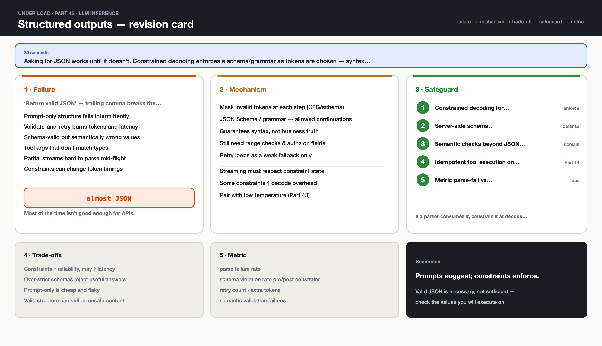
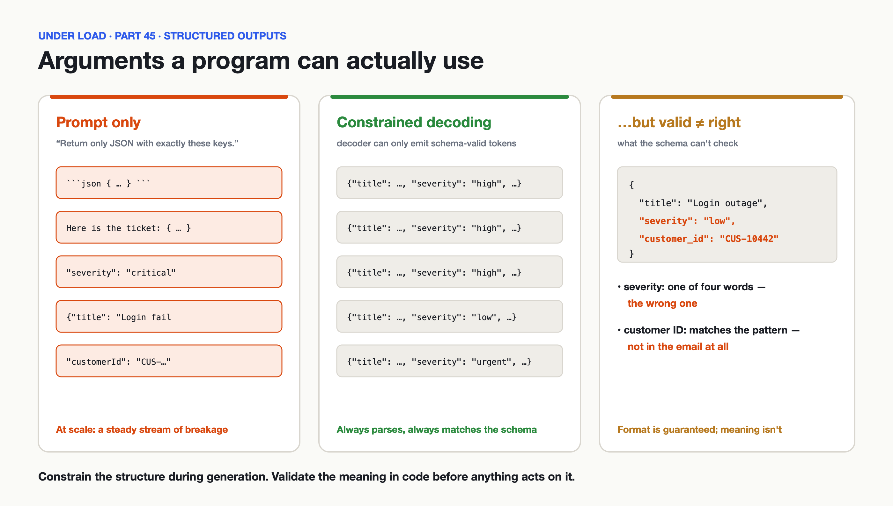
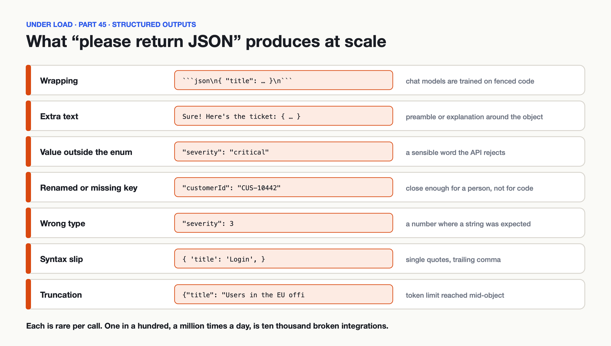
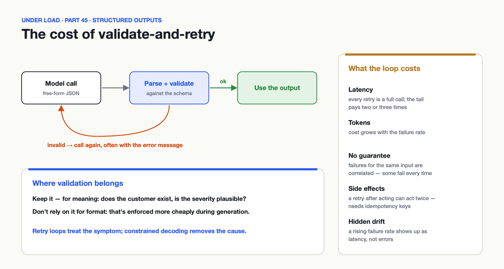
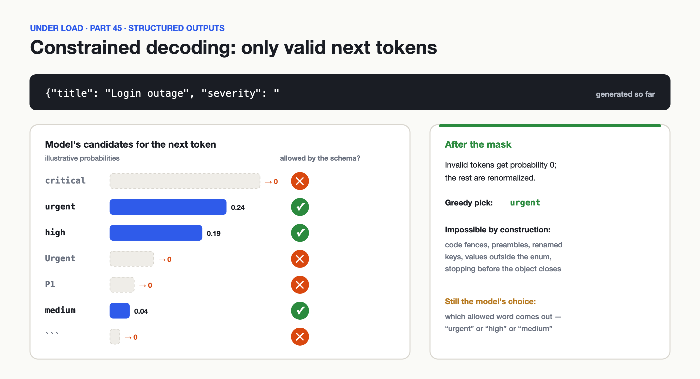
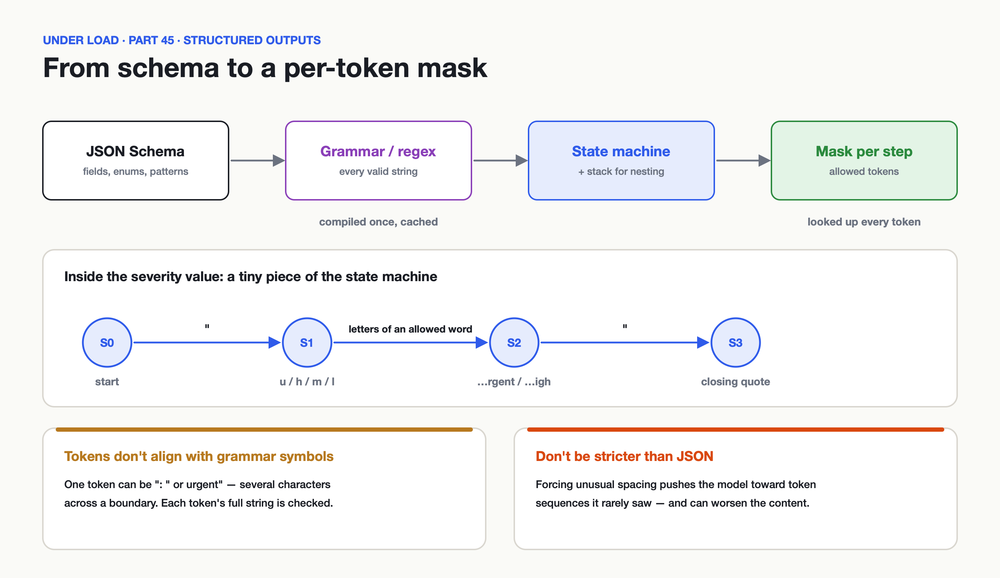
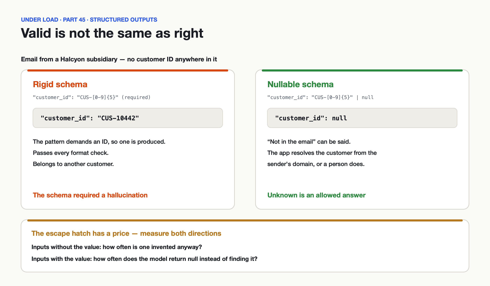
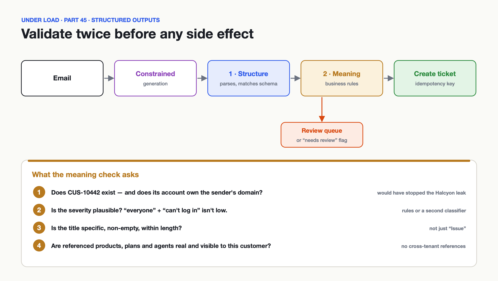
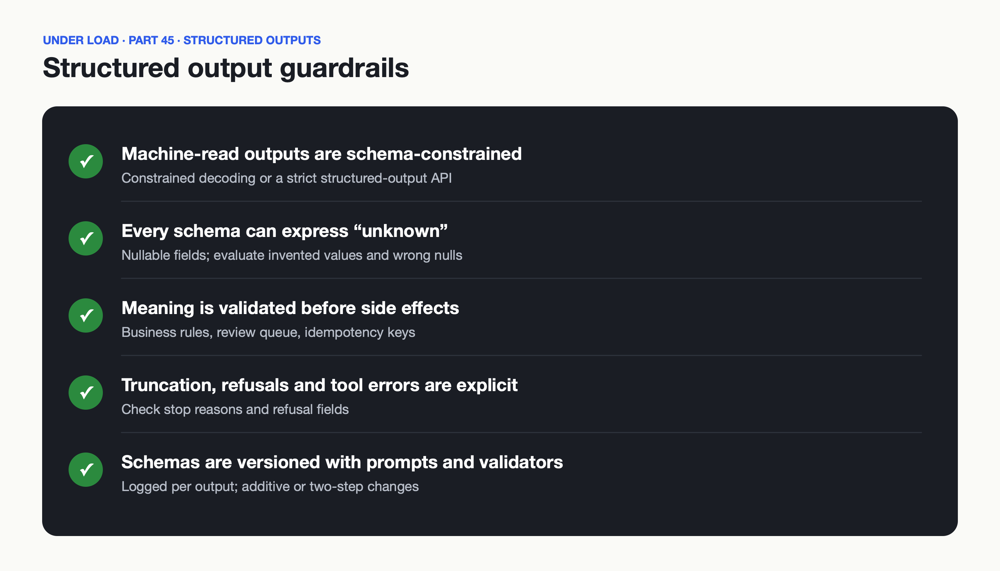

# Structured Outputs & Constrained Decoding

### Structured outputs and constrained decoding: why asking a model for JSON works most of the time, what breaks the rest, how constraining the decoder turns the format into a guarantee — and why a guaranteed format is still not a correct answer.

*Under Load · Part 45 · LLM Fundamentals*





---

The support inbox receives thousands of emails a day. An assistant reads each one and calls an internal function, `create_ticket`, with three arguments:

- a short **title**,
- a **severity**, which must be one of `low`, `medium`, `high` or `urgent`,
- the **customer ID**, which looks like `CUS-12345`.

The system prompt ends with: *"Return only JSON with exactly these keys."* The engineer tries it on a few dozen emails, every one comes back as clean JSON, and the feature ships.

At production volume, the integration starts throwing errors. Some outputs arrive wrapped in a Markdown code fence, so the JSON parser chokes on the backticks. Some begin with "Here is the ticket:". Some say `"severity": "critical"`, a perfectly sensible word that the ticketing API rejects. A few are cut off halfway through the object.

The team adds a retry loop, and the errors mostly go away. Then a worse problem surfaces. Halcyon, the largest customer, has a dozen subsidiaries that email support from their own domains, and their emails rarely include a customer ID. For those, the assistant produced IDs anyway — correctly formatted, passing every check, and belonging to *other* customers. A handful of Halcyon tickets, with their contents, landed in another company's queue.

The first set of problems is about **format**. The second is about **meaning**. This article covers both: why prompts can't guarantee format, how **constrained decoding** does, what it costs, and why a perfectly valid object can still be dangerously wrong. Only basic familiarity with JSON is assumed.

---

## Why a prompt can't guarantee a format

A language model generates text one token at a time (Part 43). At each step it assigns a probability to every token in its vocabulary, and the decoder picks one. An instruction such as "return only JSON" changes those probabilities: it makes a JSON-shaped continuation far more likely than anything else. It doesn't make anything else *impossible*. Every token still has some probability, and over enough calls, unlikely continuations happen.

That's the core asymmetry. A prompt changes what's **likely**. Only the decoder controls what's **possible**.



At production volume, prompt-only structured output fails in a handful of recurring ways:

- **Wrapping.** The JSON arrives inside a Markdown code fence (` ```json … ``` `), because chat models are trained on vast amounts of text where code is fenced. The object inside is fine; the whole output isn't JSON.
- **Extra text.** A preamble ("Sure! Here's the ticket:") or an explanation afterwards.
- **Values outside an enum.** `critical`, `P1`, `Urgent` with a capital U, `high priority`. Each is a reasonable answer in English and an invalid one for the API.
- **Missing, extra or renamed keys.** `customerId` instead of `customer_id`; an added `notes` field; a missing `title` when the email had no subject.
- **Wrong types.** `"severity": 3`, or a customer ID as a number.
- **Syntax slips.** Trailing commas, single quotes, comments, unescaped quotes inside the title — JSON is stricter than the JavaScript it resembles.
- **Truncation.** The output hits the maximum token limit in the middle of the object.

Each is rare on a single call. Rare isn't good enough at scale: an integration that fails one call in a hundred and runs a million times a day breaks ten thousand times a day. And the failures aren't stable — a model update, a prompt tweak or a different temperature can change which mode dominates.

### Lenient parsing

The first workaround is a forgiving parser: strip code fences, cut out the first `{…}` block, fix trailing commas. It rescues many outputs, and it's a reasonable stopgap. But it's a guess about where the JSON is and what was meant. It can't fix a wrong enum value or a missing key, it can pick the wrong block when the output contains two, and every new failure mode needs a new rule.

### Validate and retry



The second workaround is to validate the output against the schema and, on failure, call the model again — often with the validation error appended ("`severity` must be one of low, medium, high, urgent"). This works better than lenient parsing, and it's how many systems ran before stronger tools existed. Its costs are structural:

- **Latency and tokens.** Each retry is a full model call. Average latency rises with the failure rate, and tail latency rises much more, because the unlucky requests pay two or three times.
- **No guarantee.** A model that wrapped its answer in a fence once is likely to do it again for the same input; the retries are correlated, not independent coin flips. Some inputs fail every attempt.
- **Side effects.** If the output drives an action and the failure is detected *after* the action, a retry may repeat it. Retries of anything with side effects need an idempotency key (Part 14).
- **Masked drift.** A retry loop hides a rising failure rate until it becomes a latency problem.

Validation stays essential — it's the second half of the design below. As the *only* mechanism for format, it treats the symptom.

---

## Constrained decoding



**Constrained decoding** enforces the structure *during* generation instead of checking it afterwards. It works on the one step a prompt can't touch: the choice of each token.

The procedure:

1. **Describe every valid output.** The schema is turned into a formal description of all strings it allows — a **regular expression** for simple, flat formats, or a **grammar** (a set of rules that can describe nested structures such as JSON objects inside arrays inside objects). For the ticket, roughly: an opening brace, `"title"` with a string of 3–80 characters, `"severity"` with exactly one of four words, `"customer_id"` with `CUS-` followed by five digits, a closing brace.
2. **Track where generation is.** As tokens are produced, the decoder keeps track of the current position in that description — "inside the severity string, after `ur`."
3. **Mask invalid tokens.** Before each token is chosen, every candidate is checked: would appending it keep the text a **valid prefix** — the beginning of at least one complete valid output? Tokens that wouldn't get their probability set to zero.
4. **Choose among the rest.** Ordinary decoding (greedy, or sampling with temperature and top-p) picks from the surviving tokens, renormalized.
5. **Stop when complete.** Generation ends when the text is a complete valid output; the end-of-text token is only allowed at that point.

Take the step where the model has just written `"severity": "`. Its favourite next token might be `critical`. The mask removes it, along with `Urgent`, `P1` and every other token that can't begin one of the four allowed words. The model's best remaining choice — `urgent` or `high` — is chosen instead. The code fence, the preamble and the renamed key never happen, because none of them is a valid prefix at the point where they would start.

### From schema to mask



The hard part is making step 3 fast. A vocabulary has tens of thousands of tokens or more, and checking each against the grammar at every step would be slow. Practical implementations **compile** the schema ahead of time:

- For regular formats, the regular expression becomes a **finite-state machine**: a set of states ("expecting a key", "inside the severity value") with transitions on characters. For each state, the set of allowed vocabulary tokens can be precomputed, so masking at runtime is a lookup. This is the approach popularized by the Outlines library.
- For nested formats such as general JSON, a finite-state machine isn't enough — matching braces requires a stack — so libraries use **pushdown automata** (state machines with a stack) or incremental parsers. XGrammar, the default structured-output backend in recent versions of vLLM, precomputes as much of the mask as possible and handles the context-dependent part at runtime. llama.cpp accepts grammars in its own GBNF notation.

One detail makes this harder than it looks: **tokens don't align with grammar symbols.** A single token can be `": "` or `{"` or `urgent"` — several grammar characters at once, crossing the boundary between a key and its value. The mask must check each token's *full string* against the automaton, not just its first character. A second detail matters for quality: if the grammar is stricter than JSON itself — for example, requiring exactly one space after every colon — it can force the model into token sequences it rarely produces, which nudges it away from what it learned and can make the *content* worse. Grammars should allow whatever JSON allows, including flexible whitespace, and constrain only what the application actually cares about.

### Where it's available

- **Self-hosted inference**: vLLM, SGLang, llama.cpp and TensorRT-LLM support schema- or grammar-constrained generation, typically through libraries such as XGrammar, Outlines or llguidance.
- **Hosted APIs**: the major providers offer **structured output** modes that accept a JSON Schema and enforce it on their side, and **strict tool schemas** that guarantee a function call's arguments match its declared parameters. OpenAI's Structured Outputs is a well-documented example: with `strict: true`, outputs are guaranteed to match the supplied schema.
- **JSON mode** — an older, weaker option on some APIs — guarantees syntactically valid JSON but *not* that it matches a particular schema. It fixes fences and trailing commas, not missing keys or invalid enums.

Support differs. Each runtime implements a **subset** of JSON Schema: some don't support certain keywords, some require every property to be listed as required and represent optional fields as nullable instead, some cap nesting depth or enum size. A schema that works on one provider may be rejected, or silently loosened, by another. The documentation for the exact model and runtime is the contract.

### What it costs

Constrained decoding is usually cheap, but not free:

- **Compilation.** Turning a schema into an automaton takes time. Libraries and providers cache compiled schemas, so the cost is paid once per schema — but the first request with a new schema can be noticeably slower. Generating schemas dynamically per request defeats the cache.
- **Masking per token.** A small amount of work per step, typically small relative to the model's own computation, and larger for very big enums, deep nesting or complex patterns.
- **Saved tokens.** Constrained outputs skip preambles, fences and explanations, so they're often *shorter* than unconstrained ones — which can offset the masking cost entirely.

Keeping schemas small and flat helps both speed and accuracy. A schema with hundreds of fields and five levels of nesting is harder for the model to fill correctly, not just slower to enforce; splitting a large extraction into several smaller calls is often better on both counts.

---

## What constrained decoding still doesn't handle

A guaranteed format removes a whole class of failures. A few remain, and they need explicit handling:

- **Truncation.** If the output hits the maximum token limit, generation stops mid-object, constraint or not. Always check the API's stop reason (for example, a finish reason of `length` rather than a normal stop), size the limit generously for the schema, and treat a truncated output as a failure rather than parsing what's there.
- **Refusals.** A model may decline a request for safety reasons. A refusal doesn't fit a ticket schema, so some APIs return it in a separate field instead of forcing it into the structure. Code should check for that field rather than assuming the object is always present.
- **Degenerate fills.** Within the rules, the model can still produce junk: a title of `"Issue"`, a whitespace-only string, an array repeated until the limit. Weaker JSON-only modes have been documented to emit long runs of whitespace when the prompt doesn't mention JSON at all. Length limits, patterns and a prompt that explains the task still matter.
- **Tool errors.** A perfectly formed `create_ticket` call can still fail at the API: the service is down, the customer is suspended, a rate limit is hit. Those errors need handling as data returned to the model or to the caller, not as format failures (Part 47).
- **Field order and reasoning.** Generation is left to right, so the model commits to fields in the order the schema lists them. If `severity` comes before a field where the model summarizes the problem, it chooses the severity *before* it has "thought" about the email. Putting explanatory or reasoning fields before the decision fields — or extracting first and classifying in a second step — lets the decision benefit from the text before it. Some studies have also reported that forcing strict formats on reasoning-heavy tasks can lower answer quality; a common mitigation is to let the model reason freely first and constrain only the final answer.

---

## Valid is not the same as right



Constrained decoding guarantees **syntax**: the output parses and every field has an allowed shape. It says nothing about **meaning**. A schema-valid ticket can still have:

- **The wrong severity.** `low` for "none of our agents can log in." The mask guaranteed one of four words; which word is the model's judgement, and the model can be wrong.
- **A value that isn't in the input at all.** Which leads back to Halcyon.

### When the schema requires a hallucination

The ticket schema said `customer_id` is a required string matching `CUS-` plus five digits. For an email that contains no customer ID, there is no correct output that satisfies that schema. Constrained decoding doesn't know that. It forces the model to produce *something* matching the pattern, and the model produces the most plausible-looking ID it can — sometimes one it has seen elsewhere in the context, sometimes digits that happen to belong to a real customer.

This is a hallucination (Part 44) that the schema didn't merely permit but **required**. And it's the most dangerous kind, because it passes every format check and looks exactly like real data.

The fix is in the schema: let the field express **unknown**. Make `customer_id` nullable — a string matching the pattern, *or* `null` — and say in the prompt that `null` means the email doesn't contain an ID. The application then resolves the customer some other way (from the sender's domain, from the email thread) or routes the ticket to a person.

The escape hatch has a price. A model that's allowed to say "unknown" will sometimes say it when the value *is* present but harder to find — buried in a signature, written with a space (`CUS 10442`), or mentioned only in a quoted earlier message. An overly rigid schema turns "I don't have this" into fabricated data; an overly permissive one turns real data into nulls. Neither failure shows up in a parse-rate metric.

So a nullable field needs to be evaluated in both directions:

- On inputs that **don't** contain the value: how often does the model invent one anyway?
- On inputs that **do**: how often does it return `null` instead of the real value?

The evaluation set needs examples of both. A sudden drop in the null rate after a model or prompt change is a warning sign that the model has started filling in values it doesn't have.

The same reasoning applies to enums. A severity enum without an `unknown` or `needs_review` option forces a guess on emails that are ambiguous, spam or in a language the model handles poorly. Whether to add one is a product decision; the schema should make it deliberately rather than by omission.

---

## Validate twice before any side effect



The robust design has two layers, and both are required:

1. **Structure, enforced during generation.** Constrained decoding or a strict structured-output API guarantees that the output parses into the expected type. No lenient parsing, no retry loop for format.
2. **Meaning, validated in application code before acting.** The parsed object is checked against business rules:
   - Does `CUS-10442` exist? Does its account own the domain the email came from?
   - Is the severity plausible — does an email that says "everyone" and "can't log in" really deserve `low`? Rule-based cross-checks or a second classifier can flag disagreements.
   - Is the title non-empty, not generic, and within length?
   - Are all referenced entities — products, plans, agents — real and visible to this customer?

Outputs that fail the second layer don't create tickets. They go to a review queue, or get created with a "needs review" flag and no customer attached, depending on the risk. Only after both layers pass does the side effect happen, and it carries an **idempotency key** derived from the email's message ID, so a retried call never creates two tickets.

In the Halcyon incident, the second layer alone would have stopped the leak: the invented customer ID existed, but its account didn't own the sender's domain.

---

## Versioning schemas in production

A schema is an **interface contract** between the model call and the code that consumes it, and it changes like any interface. Treat it that way:

- **Give every schema a version** and log it with every output, alongside the prompt version and model version. When the schema-valid rate or a field's null rate changes, the logs show which change caused it.
- **Version the schema, prompt and validator together.** A new field needs a prompt that explains it and a validator that checks it; shipping one without the others creates mismatches.
- **Prefer additive changes.** Adding an optional (nullable) field is backward-compatible for consumers that ignore unknown fields. Renaming a field, changing an enum's values or tightening a pattern is a breaking change.
- **Make breaking changes in two steps.** Ship the new version alongside the old, let consumers handle both, move traffic, then retire the old one — the same expand-and-contract pattern used for database migrations.
- **Re-run the evaluation set on every change.** Field-level correctness, not just parse rate, before and after. A schema change can shift how the model fills *other* fields too.
- **Keep compiled schemas stable.** Since compiled grammars are cached, a stable set of versioned schemas is faster than schemas assembled on the fly.
- **Agents with many tools** have one schema per tool. The same rules apply to each, and tool descriptions are part of the contract: changing a description can change which tool the model picks (Part 47).

---

## Guardrails that prevent the next one



1. **Machine-read outputs are schema-constrained** — constrained decoding or a strict structured-output API, never a prompt alone.
2. **Every schema can express "unknown"** where the input may not contain the value, and the evaluation checks both invented values and wrongly dropped ones.
3. **Meaning is validated before side effects,** by business rules after parsing, with failures sent to review and actions protected by idempotency keys.
4. **Truncation, refusals and tool errors are handled explicitly,** using the API's stop reason and refusal signals, not by parsing whatever came back.
5. **Schemas are versioned with their prompts and validators,** logged with every output, and changed additively or in two steps.

---

## What to keep on the dashboard

- **Parse success rate** and **schema-valid rate** per endpoint and schema version — near 100% with constraints; anything less points at truncation or a runtime that isn't enforcing the schema.
- **Semantic validation failures** by field and rule: which business checks fail, and how often.
- **Retries** caused by invalid output, and the latency and tokens they cost.
- **Null or "unknown" rate per field**, watched for sudden drops as well as rises.
- **Truncations and refusals**, from stop reasons and refusal fields.
- **Tool-call success** and **downstream error rate**: API rejections and failures after the model's output was accepted.
- **Latency overhead** of constrained decoding per schema, including first-request compilation time for new schemas.

---

## Recap

### Why is prompting "return valid JSON" weaker than constrained decoding?
A prompt makes valid output likely; it doesn't make invalid output impossible. Every token keeps some probability, so at scale code fences, preambles, invalid enum values, renamed keys and truncation all happen. Constrained decoding makes invalid tokens impossible at each step.

### How can a decoder enforce a JSON Schema or grammar?
The schema is compiled into a regular expression or grammar, then into a state machine (with a stack for nested JSON). At each step, the decoder masks every token that wouldn't keep the text a valid prefix, picks among the rest, and only allows stopping when the output is complete.

### What does validate-and-retry cost?
Extra calls, latency (especially in the tail) and tokens; no guarantee, since failures for the same input are correlated; and the risk of repeating side effects if a failure is caught after acting. Validation remains essential for meaning, not as the mechanism for format.

### Does constrained decoding slow generation down?
Slightly. Schemas are compiled once and cached, and per-token masking is usually small next to the model's own computation; skipped preambles and fences often make outputs shorter. Very large enums, deep nesting and per-request schemas raise the cost.

### What can still go wrong after the output is syntactically valid?
The values: a wrong severity, a plausible but nonexistent or wrong customer ID, a generic title. Truncation, refusals and tool errors also still need handling. Structure is guaranteed; meaning has to be validated by business rules before any side effect.

### How can a schema cause hallucinations?
By requiring a value the input doesn't contain. A mandatory customer-ID pattern forces the model to invent an ID that passes every format check. Nullable fields fix that, at the risk of nulls where the value was present, so both directions must be measured.

### How would you version schemas in a production agent system?
Version each schema with its prompt and validator, log the versions with every output, prefer additive changes, make breaking ones in expand-and-contract steps, keep compiled schemas stable, and re-run field-level evaluations on every change.

### What should be monitored?
Parse and schema-valid rates, semantic validation failures by field, retries, null rates per field, truncations and refusals, tool-call success and downstream errors, and the latency overhead of constraints.

---

## Next

- **Lab (run + measured write-up):** [45-structured-outputs](https://github.com/b-basoglu/under-load/tree/main/45-structured-outputs)
- **Next:** [Retrieval-Augmented Generation: Chunking & Retrieval](../46-rag/article.md) — The assistant answers from the help center now. Except when the answer is split across two chunks, or buried under a better-matching but wrong article. How chunking and retrieval decide what the model gets to see.
