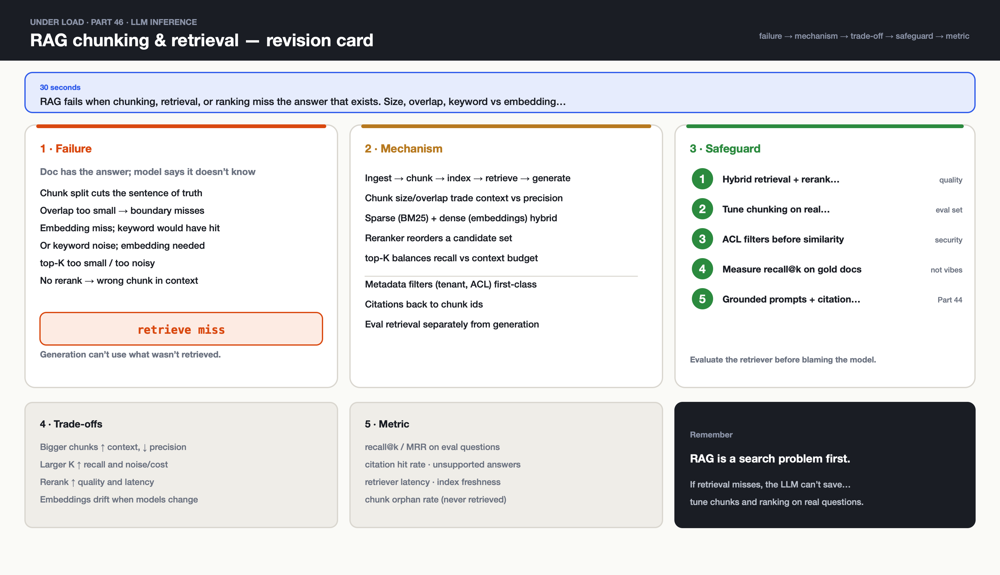
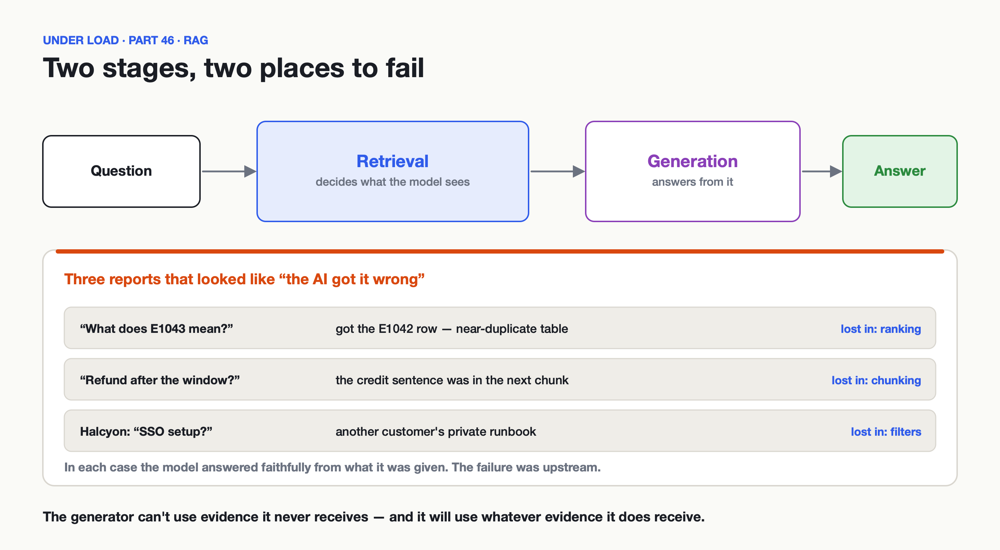
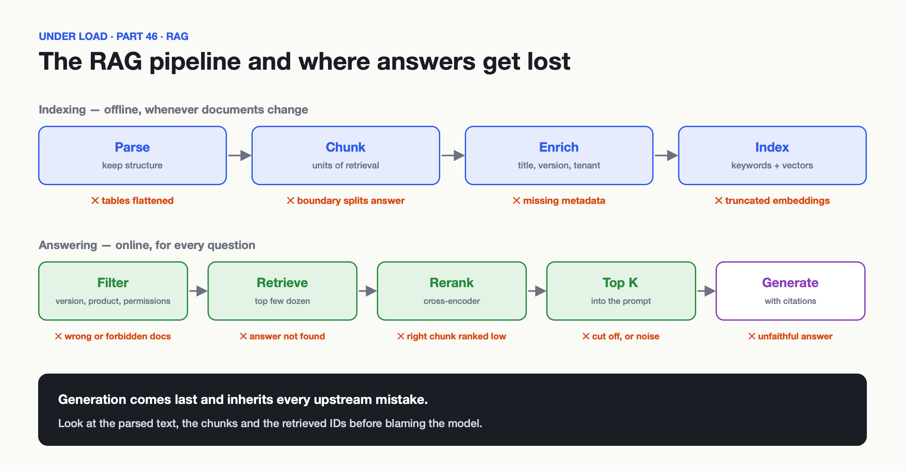
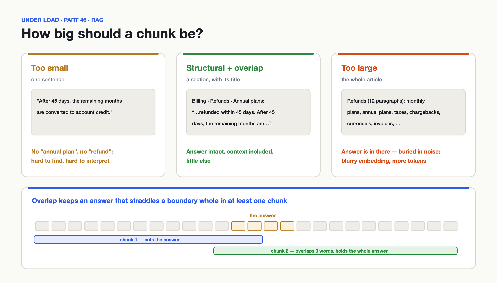
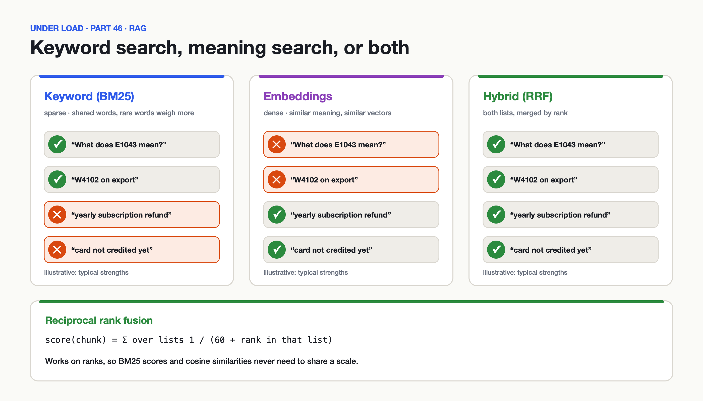
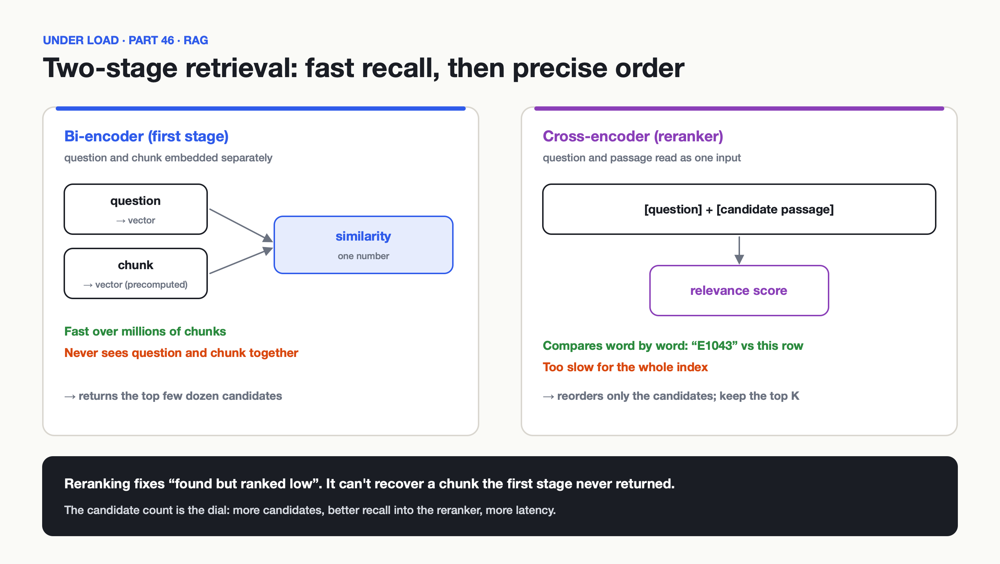
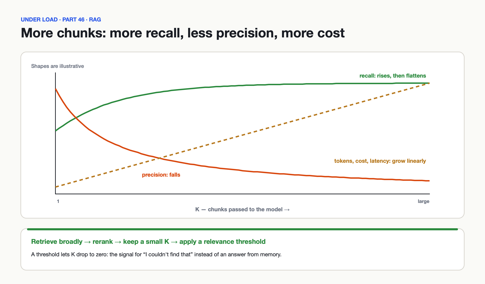
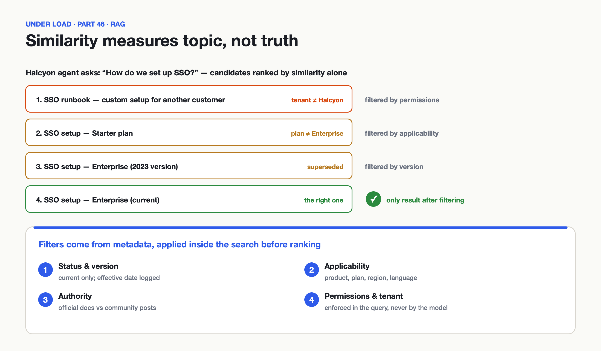
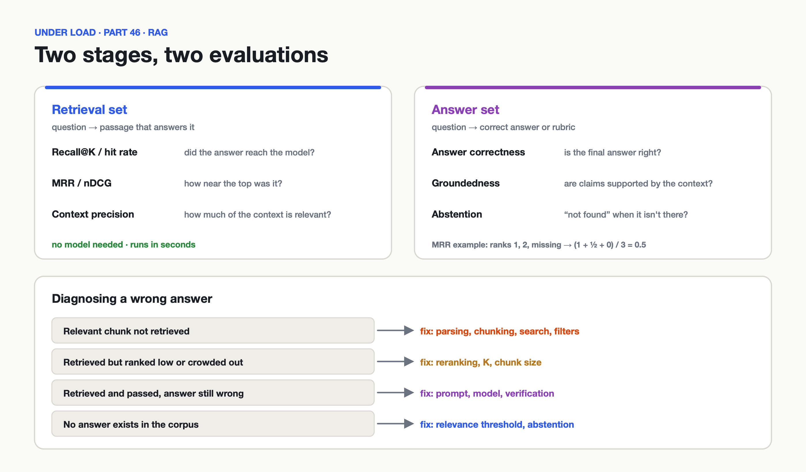
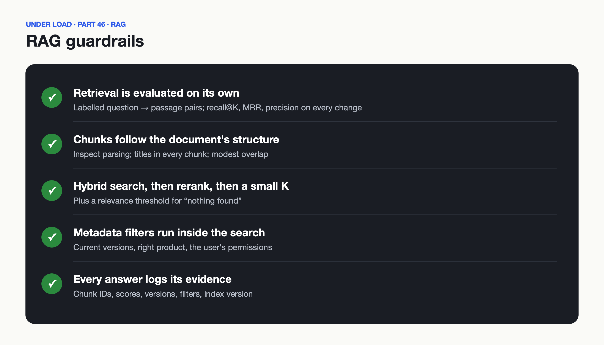

# Retrieval-Augmented Generation: Chunking & Retrieval

### RAG chunking and retrieval: how documents are split, searched and ranked before a model ever sees them — chunk size and overlap, keyword versus embedding search, hybrid retrieval, reranking, top-K, metadata, and how to measure retrieval on its own.

*Under Load · Part 46 · LLM Fundamentals*

---

After the refund incident in Part 44, the support assistant stopped answering from memory. For every question it now searches the help center, puts the best-matching passages into the prompt, and answers from them, with citations. That design has a name: **retrieval-augmented generation**, or **RAG**.

For a few weeks it looks like the problem is solved. Then the reports start again, and they're stranger than before:

- A customer asks what error **E1043** means and gets a confident explanation of **E1042**, a different error that happens to sit in the same table.
- Someone asks whether an annual plan can be refunded after the 45-day window. The assistant says no and stops. The help center's next sentence — that the remaining months become account credit — never reached the model, because it was in a different chunk.
- An agent at Halcyon, the largest customer, asks about SSO configuration and gets steps that cite an internal runbook written for a *different* customer's custom setup — a document Halcyon's users should never have been able to see.

Each report reads as "the AI got it wrong." None of them is a generation problem. In every case the model answered faithfully from what it was given; what it was given was wrong, incomplete or forbidden. **The generator can't use evidence it never receives** — and it will use whatever evidence it does receive.

This article is about the half of RAG that decides what the model gets to see: how documents are parsed and split into chunks, how those chunks are searched and ranked, how many to pass along, how metadata keeps wrong and forbidden passages out, and how to measure retrieval separately from the answers built on top of it.

---

## How RAG works

A RAG system has an offline half and an online half.

**Indexing (offline, whenever documents change):**

1. **Parse** each source document into clean text, keeping its structure: titles, headings, lists, tables, code blocks.
2. **Split** the text into **chunks** — the units that will be searched and, if chosen, sent to the model.
3. **Enrich** each chunk with **metadata**: which document and section it came from, the product and plan it applies to, its version and effective date, its language, and who is allowed to see it.
4. **Index** the chunks for search: a keyword index, a vector index of **embeddings**, or both. An embedding is a list of numbers (a vector) produced by an embedding model so that texts with similar meaning end up with similar vectors.

**Answering (online, for every question):**

5. **Filter** the candidates by metadata: only current documents, only this customer's product, only documents this user may read.
6. **Retrieve** the best-scoring chunks for the question — typically a few dozen candidates.
7. **Rerank** the candidates with a more accurate (and slower) model, optionally.
8. **Select the top K** and place them in the prompt with the question.
9. **Generate** an answer from them, with citations and checks (Part 44).

The answer can be lost at almost every step: a table that parsed as gibberish, a chunk boundary through the middle of the answer, a chunk too vague to be found, an embedding that can't tell two error codes apart, a filter that excludes the right document or fails to exclude the wrong one, a ranking that puts the answer at position 12 when only 3 are kept. Generation comes last and inherits every upstream mistake.

### Parsing is the first place answers disappear

Help centers, contracts and runbooks arrive as HTML, PDF, Markdown and word-processor files. Parsing them is less glamorous than embedding models and causes more failures than it gets credit for:

- **Tables** flattened into a stream of cells lose the link between an error code and its meaning — which is how E1043 ends up next to E1042's explanation.
- **PDFs** carry page headers, footers and multi-column layouts that interleave unrelated text.
- **Navigation, cookie banners and "related articles" boxes** scraped from HTML pages pollute every chunk with the same boilerplate.
- **Code blocks and configuration snippets** lose their line breaks.

The rule is simple and tedious: **look at the parsed text** for a sample of every document type before tuning anything downstream. Tables are usually best converted to one row per line with the header repeated ("Error E1043: the export file exceeds the size limit") so each row stands on its own.

---

## Chunking: what the unit of retrieval should be

A **chunk** is the piece of text that gets a score and, if it scores well, goes into the prompt. Its size is a trade-off with costs on both sides.

**Chunks that are too small lose context.** A single sentence — "After 45 days, the remaining months are converted to account credit" — doesn't mention annual plans or refunds. It's hard to find with a question about refunds, and if found, it's hard for the model to interpret alone. Small chunks also split answers that span two sentences.

**Chunks that are too large add noise.** A whole help-center article will usually contain the answer, so retrieval looks good. But the model receives the answer surrounded by everything else on the page, much of it about other cases. That costs tokens on every request, dilutes the relevant sentence, and gives the model more opportunities to answer from the wrong paragraph. A large chunk also produces a blurrier embedding: one vector has to represent many topics at once, so it matches none of them strongly.

There's no universal right size, but there are reliable principles:

- **Follow the document's structure.** Split on headings, sections and paragraphs first, and use a size limit only as a cap. A section titled "Refunds for annual plans" is a natural chunk; a 300-token window that starts mid-sentence isn't.
- **Give every chunk its context.** Prefix each chunk with the document title and section heading ("Billing › Refunds › Annual plans: …"). The chunk becomes findable and interpretable on its own. Some teams go further and generate a one-sentence summary of where the chunk sits in the document and prepend it before embedding — a technique sometimes called contextual retrieval.
- **Overlap windows modestly.** When fixed-size windows are used, repeating the last part of one chunk at the start of the next — commonly 10–20% — keeps answers that straddle a boundary intact in at least one chunk. Overlap costs some index size and duplicate results, which reranking or deduplication cleans up.
- **Respect the embedding model's input limit.** Many embedding models accept only a few hundred tokens and **silently truncate** anything longer. A chunk that's longer than the limit is indexed by its first part only; whatever is at the end can never be found by meaning.
- **Keep small things whole.** A table row, a code snippet, a numbered procedure or a definition list loses its meaning when split.

A common pattern resolves the size trade-off by using two sizes: **search on small chunks, return larger ones**. Small chunks (a paragraph) give precise matches; when one matches, the system sends the model its surrounding section ("parent document" or "small-to-big" retrieval). Precision of search and completeness of context stop competing.

The right settings depend on how the documents are written and how people ask. A few hundred tokens per chunk is a common starting point for help-center prose; the only way to confirm it is to measure retrieval on real questions, described below.

---

## Keyword search, meaning search, or both

There are two families of retrieval, and they fail in opposite ways.

### Keyword search (sparse retrieval)

**Keyword search** scores chunks by the words they share with the question. The standard scoring function is **BM25**, used by default in Elasticsearch, OpenSearch, Lucene and most search engines. It rewards a chunk for containing the question's words, gives more weight to **rare** words (an error code appears in few documents, so a match on it counts heavily; "the" counts for nothing), and dampens the effect of repetition and of long documents. It's called **sparse** retrieval because each text is represented by the handful of words it contains out of a huge vocabulary.

Keyword search is exact, fast, explainable and very good at identifiers: error codes, SKUs, API parameter names, product names, people's names. It's blind to meaning: "yearly subscription" doesn't match "annual plan," "my card hasn't been credited" doesn't match "refund processing time," and a question in German doesn't match an English article.

### Embedding search (dense retrieval)

**Embedding search** converts the question and every chunk into vectors with the same embedding model, and ranks chunks by how close their vectors are to the question's — usually by **cosine similarity**, the angle between the vectors. It's called **dense** retrieval because every dimension of the vector carries some information. The chunk vectors are computed once at indexing time; at question time, only the question is embedded.

Dense retrieval handles paraphrases, synonyms and, with multilingual models, other languages. It struggles with exactly what keyword search is good at. To an embedding model, "E1043" and "E1042" are nearly the same string in nearly the same context, so their vectors are nearly the same. Rare identifiers, negations ("can't" versus "can") and precise numbers are weak spots.

Searching millions of vectors exactly is slow, so vector databases use **approximate nearest-neighbour** indexes such as HNSW, which trade a small amount of recall for large speedups. That's usually the right trade, but it's another place a relevant chunk can quietly drop out, and its parameters belong in the evaluation.

### Hybrid search

Because the two fail differently, production systems commonly run both and merge the results: **hybrid search**. The scores aren't comparable — a BM25 score and a cosine similarity live on different scales — so the merge usually works on **ranks**. The most common method is **reciprocal rank fusion (RRF)**: each chunk earns 1 / (k + rank) from each list it appears in, with k conventionally 60, and the sums are sorted. A chunk ranked first by keywords and fifth by meaning beats one ranked tenth by both. RRF needs no tuning of score scales, which is why Elasticsearch, OpenSearch and many vector databases offer it built in.

Hybrid search keeps the error codes that keyword search finds and the paraphrases that embeddings find. For a support corpus full of codes, product names and plain-language questions, it's a strong default.

### Rewriting the question

Questions are often worse search queries than the documents they should match: short, vague, full of pronouns from earlier in the conversation ("does that apply to us too?"). Two common fixes are **query rewriting** — using a model to turn the conversation into a standalone, explicit search query — and generating several query variants and merging their results. Both add a model call before retrieval, so they're used where questions are conversational.

---

## Reranking

Embedding search compares two vectors computed **separately**: the question's and the chunk's. The model that produced the chunk's vector never saw the question. That's what makes it fast — chunk vectors are precomputed — and also what limits its accuracy. Models built this way are called **bi-encoders**.

A **cross-encoder** reads the question and a candidate passage **together**, as one input, and outputs a single relevance score. Because it can compare them word by word — "E1043" in the question against "E1043" in this row of the table, "after the window" against "after 45 days" — it's considerably more accurate. It's also far too slow to run over a whole index: every question would require a model pass over every chunk.

So retrieval is done in two stages:

1. **First stage, for recall:** hybrid or dense search returns the top few dozen candidates quickly. Its job is to make sure the answer is somewhere in that set.
2. **Second stage, for precision:** the cross-encoder reranks only those candidates, and the top few go to the model.

Reranking helps most in the very common situation where the first stage gets the right chunk into the candidates but not to the top: E1042 and E1043 both appear in the top 20, and only a model that reads the question and the row together reliably puts E1043 first. It can't help when the first stage misses the answer entirely; that's a chunking, parsing or search problem.

Reranking costs latency — typically tens to hundreds of milliseconds, depending on the model, the hardware and the number of candidates — and either a hosted reranking API or a model to serve. The number of candidates passed to it is the main dial: more candidates mean better recall into the reranker and more time spent in it.

---

## Top-K: how much evidence to pass

After ranking, the system passes the top **K** chunks to the model. K trades three things against each other:

- **Recall** rises with K, quickly at first and then barely: if the answer isn't in the top 5, it's rarely at position 15.
- **Precision** — the share of the passed context that's actually relevant — falls with K, because every additional chunk is less likely to be on topic.
- **Cost and latency** rise linearly with K: every chunk is tokens in the prompt, paid on every request, and processed before the first output token (Part 48).

More context isn't free for quality either. Irrelevant passages can distract the model, near-duplicates of the wrong answer can outvote the right one, and models are known to use information in the middle of long contexts less reliably than information at the beginning or end ("lost in the middle"). How much this matters depends on the model; stronger long-context models are more robust, but none is immune.

A common pattern gets most of both worlds: **retrieve broadly, rerank, then keep a small K**. The first stage casts a wide net for recall; the reranker orders it; only the best few chunks reach the prompt. Adding a **minimum relevance score** on top lets K shrink to zero — the signal for "nothing relevant found," which should route to "I couldn't find that" rather than an answer from memory (Part 44).

The right K, like the right chunk size, is found by measuring answer quality and cost at several values on real questions — not by assuming more is better.

---

## Similar is not the same as correct

Every retrieval method above measures **similarity to the question**. None of them measures whether a passage is **current**, **authoritative**, **applicable** or **permitted**. Two refund articles — last year's and this year's — are equally similar to a refund question. An Enterprise-plan SSO guide and a Starter-plan one are equally similar to an SSO question. And a private runbook written for one customer is very similar to another customer's question about the same feature.

That information has to come from **metadata**, and it has to be applied as a **filter before ranking**, not as a hope that the model will notice:

- **Status and version.** Each document carries whether it's current or superseded and its effective date. Superseded versions are excluded from the index used for answers — or at least filtered out — and the version is logged with each answer.
- **Applicability.** Product, plan, region and language, so the Enterprise question gets the Enterprise answer.
- **Authority.** Official documentation, internal runbooks, community posts and past tickets have different trust levels. Policy questions should be answered only from authoritative sources.
- **Permissions and tenancy.** In a multi-tenant product, every chunk carries the tenant and access rules of its source, and every query is filtered by the asking user's permissions **inside the search itself**. Retrieving forbidden text and then telling the model to ignore it is not access control: the text is already in the prompt, and it can leak through the answer, the citations or prompt injection.

The Halcyon runbook incident is the last case. The runbook was indexed with everything else, nothing filtered by tenant, and its similarity to Halcyon's question was excellent.

A practical detail: in vector databases, filtering can happen **before** the nearest-neighbour search or **after** it. Post-filtering — find the top K, then drop the ones that fail the filter — can return fewer than K results, or none, when the filter is selective. Pre-filtering or filtered search support in the database avoids that; the documentation of the specific database says which it does.

---

## Evaluate retrieval separately

The most important habit in running RAG is measuring **retrieval** and **generation** separately. Answer quality alone can't say which half failed, and the two halves are fixed in completely different ways.

### The retrieval evaluation set

Build a set of real questions — from search logs, tickets and agent feedback — and label, for each one, which document or chunk contains the answer. Labelling the **source passage** rather than a chunk ID keeps the labels valid when chunking changes. Include the hard cases on purpose: error codes, near-duplicate articles, questions whose answer spans two sentences, questions with no answer in the corpus, and questions where the right document depends on the customer's plan.

Then compute:

- **Recall@K** (also called **hit rate** when each question has one gold passage): the share of questions where a relevant chunk appears in the top K. It answers "did the answer reach the model at all?"
- **MRR** (mean reciprocal rank): for each question, 1 divided by the rank of the first relevant chunk — 1 if first, 0.5 if second, about 0.33 if third, 0 if absent — averaged. It rewards putting the answer near the top. For example, ranks of 1, 2 and "not found" over three questions give (1 + 0.5 + 0) / 3 = 0.5.
- **nDCG** (normalized discounted cumulative gain): like MRR, but it handles several relevant chunks with different degrees of relevance, discounting each by how far down it appears.
- **Context precision**: the share of the passed context that's relevant. It captures the noise side of the chunk-size and top-K trade-offs.

These metrics need no model to compute, run in seconds, and don't change when the generating model changes. That makes them the right tool for iterating on parsing, chunking, search, reranking and filters.

### The answer evaluation set

Separately, label the correct answer (or a rubric) for each question and measure **answer correctness** and **groundedness** — whether the answer's claims are supported by the retrieved text (Part 44).

### Diagnosis

When an answer is wrong, the two layers say where to look:

- **The relevant chunk wasn't retrieved** → fix parsing, chunking, search, reranking or filters.
- **It was retrieved but ranked low or crowded out** → reranking, K or chunk size.
- **It was retrieved and passed, and the answer is still wrong** → prompt, model or verification.
- **The question has no answer in the corpus** → the system should have said so; check the relevance threshold and abstention behaviour.

In production, the same diagnosis requires **logging the retrieved chunk IDs, their scores, their document versions and the filters applied** for every answer. When a customer disputes an answer, "what did the model see?" should be a query.

---

## Shipping retrieval changes safely

Retrieval has many dials — parser, chunk size, overlap, embedding model, BM25 parameters, fusion, reranker, candidate count, K, thresholds, filters — and changing any of them changes which evidence every answer is built on.

- **Version the index.** Each index build records the parser, chunker, embedding model and settings that produced it. Answers log the index version.
- **Re-embed on model change.** Vectors from different embedding models aren't comparable. Changing the embedding model means re-embedding the whole corpus and switching indexes atomically, not mixing old and new vectors.
- **Compare on the evaluation set before switching.** Recall@K, MRR and context precision on the retrieval set; correctness and groundedness on the answer set; latency and tokens per question.
- **Build new indexes alongside old ones** and switch traffic gradually, so a regression can be rolled back by switching back.
- **Keep the index fresh.** Documents change; re-index on change rather than on a schedule where possible, remove superseded versions, and alert when a source hasn't been indexed for longer than expected.

---

## Guardrails that prevent the next one

1. **Retrieval is evaluated on its own,** with labelled question-to-evidence pairs and recall@K, MRR and context precision on every change.
2. **Parsing is inspected and chunks follow the document's structure,** with titles and headings in every chunk and modest overlap where windows are used.
3. **Hybrid search, then rerank, then a small K:** keywords for exact terms, embeddings for meaning, a cross-encoder for order, a relevance threshold for "nothing found."
4. **Metadata filters apply inside the search, before ranking:** current versions only, the right product and plan, and the asking user's permissions.
5. **Every answer logs its evidence:** chunk IDs, scores, versions, filters and index version.

---

## What to keep on the dashboard

- **Recall@K and MRR** (or nDCG) on the retrieval evaluation set, per index version.
- **Context precision** and **context tokens per question**, which drive both noise and cost.
- **Answer correctness** and **groundedness** on the answer evaluation set.
- **"No relevant result" rate** — questions where the best score falls below the threshold — and what the assistant did with them.
- **Retrieval latency** by stage (first-stage search, reranker) alongside **generation latency**.
- **Token cost per answer**, split into retrieved context and the rest of the prompt.
- **Index freshness:** time since each source was last indexed, superseded documents still retrievable, and permission-filter coverage.

---

## Recap

### Why can RAG fail when the answer exists?
The model only sees what retrieval returns. The answer can be lost to bad parsing, a chunk boundary, a chunk too vague to find, an embedding that can't distinguish exact identifiers, a filter that excludes it, or a ranking that puts it below the cutoff. Wrong or forbidden passages can also outrank it if metadata doesn't filter them.

### How do you choose chunk size and overlap?
Split along the document's structure with a size cap, put the title and section heading in every chunk, keep table rows and procedures whole, stay within the embedding model's input limit, and use modest overlap (commonly 10–20%) for fixed windows. Small chunks lose context; large ones add noise and cost. Searching small chunks and returning their surrounding section avoids the trade-off. Confirm with recall@K on real questions.

### Keyword vs embedding search?
Keyword search (BM25) is exact and excels at identifiers, codes and names but misses paraphrases. Embedding search captures meaning and paraphrases but blurs exact tokens such as error codes. Hybrid search merges both, commonly with reciprocal rank fusion.

### When does reranking help?
When the first stage gets the right chunk into the candidates but not to the top — near-duplicates, tables, subtle wording. A cross-encoder reads question and passage together and orders them far more accurately than vector similarity, at the cost of latency. It can't recover chunks the first stage missed.

### How do you choose top-K?
Higher K raises recall with diminishing returns, lowers precision, and raises cost and latency linearly; too much irrelevant context can also distract the model. Retrieve broadly, rerank, keep a small K, apply a relevance threshold, and pick values by measuring answers and cost.

### Is similarity the same as correctness?
No. Similarity measures topic, not version, authority, applicability or permission. Those come from metadata applied as filters inside the search, before ranking — especially tenant and permission filters, which can't be delegated to the model.

### How do you evaluate retrieval separately?
Label real questions with the passages that answer them, including hard cases and unanswerable ones, and compute recall@K, MRR or nDCG and context precision without involving the generator. Measure answer correctness and groundedness separately, and log retrieved chunk IDs, scores and versions in production.

### Does RAG eliminate hallucinations?
No (Part 44). It reduces them when retrieval is good; the remaining failures move to retrieval quality, document freshness, and how faithfully the model uses the evidence.

---

## Next

- **Lab (run + measured write-up):** [46-rag](https://github.com/b-basoglu/under-load/tree/main/46-rag)
- **Next:** [Tool Calling, MCP and RAG: Which One When](../47-tool-calling-mcp/article.md) — Should the assistant look up the customer's plan by retrieving documents, by calling an API, or through an MCP server? Three ways to give a model information, and when each is the right one.
