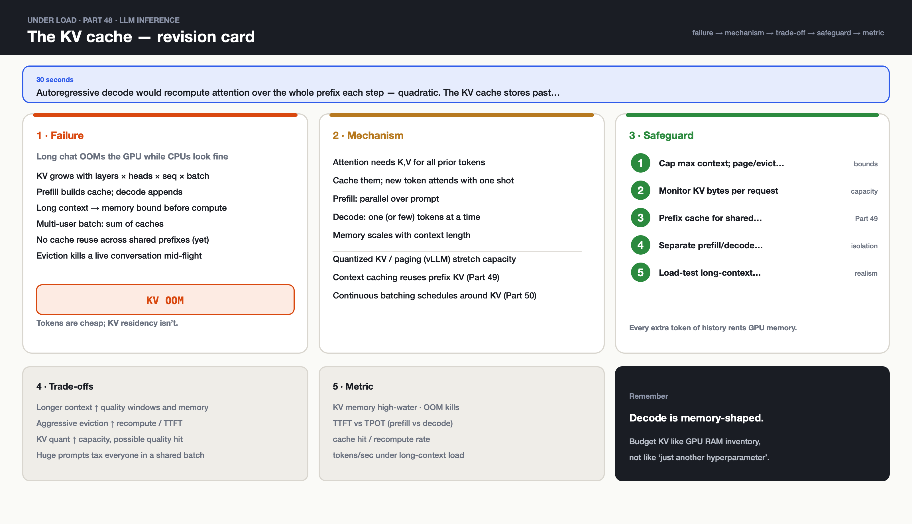
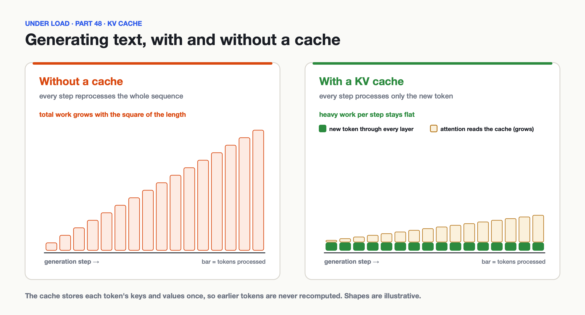
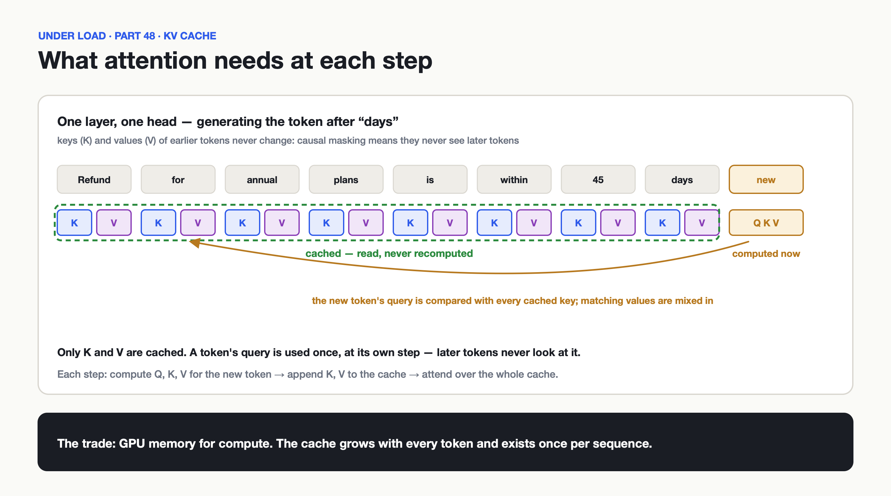
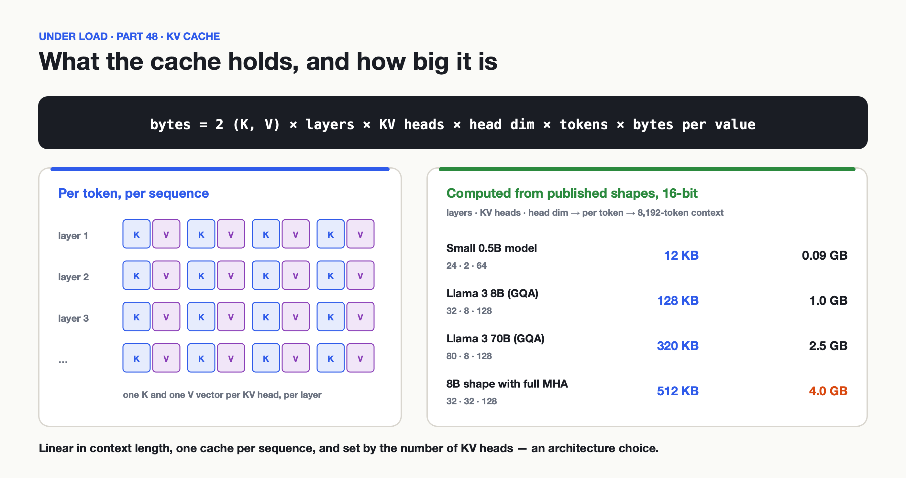
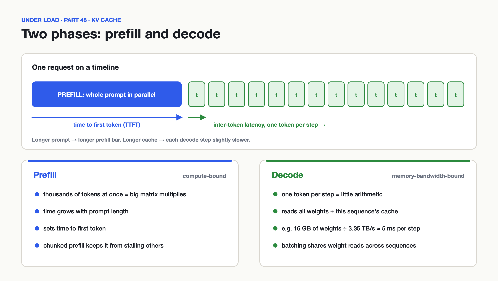
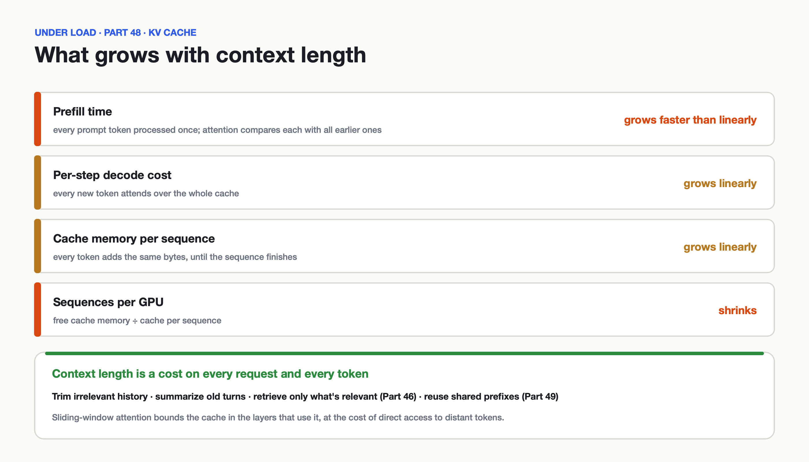
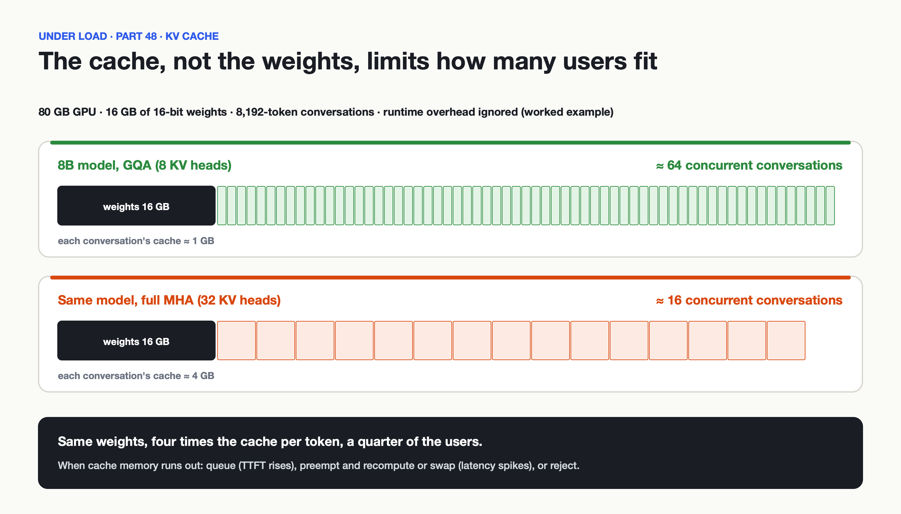
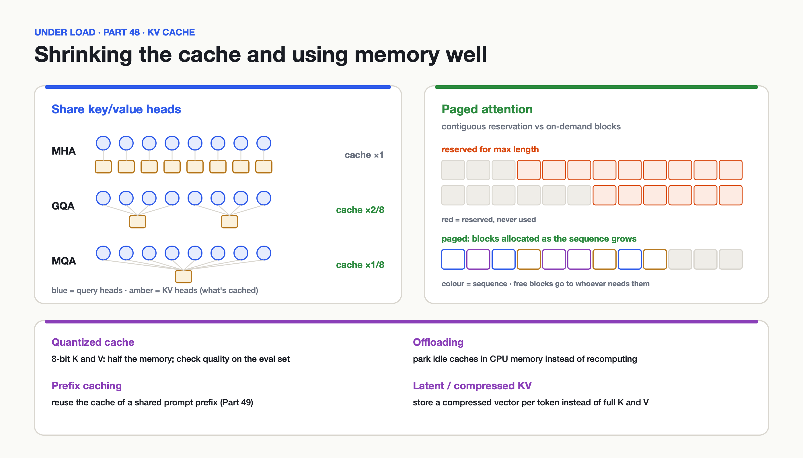
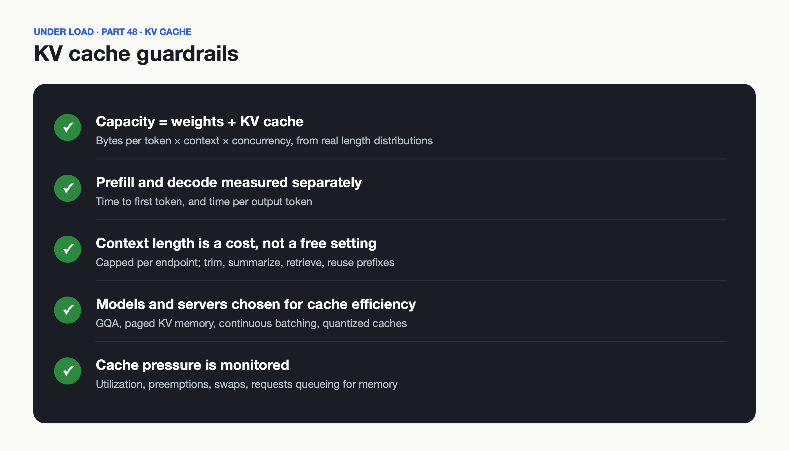

# The KV Cache

### The KV cache: why generating text token by token would be quadratic without it, what exactly is stored, how it splits inference into prefill and decode, and why its size — not the model's — decides how many users one GPU can serve.

*Under Load · Part 48 · LLM Inference Infrastructure*

---

The support product now runs its own model for the assistant, on a small pool of GPU servers. The assistant streams its answers, and users notice two different waits: a pause before the first word appears, and then the pace at which the rest arrives.

Halcyon, the largest customer, asks for a feature: when an agent opens a ticket, the assistant should read the **whole** ticket history — every email, every internal note, sometimes months of back-and-forth — before suggesting a reply. The team ships it. Three things happen at once:

- On Halcyon's long tickets, the pause before the first word grows from a blink to several seconds.
- Once the words start, they arrive almost as fast as before.
- On Monday morning, when Halcyon's agents all log in, the inference servers start rejecting and stalling requests with out-of-memory pressure — even though the model's weights fit on each GPU with plenty of room to spare, and the GPUs' compute is far from saturated.

All three observations come from one mechanism: the **KV cache**. This article builds it up from how a transformer generates text, explains exactly what's stored and how big it is, why it splits inference into two phases with different bottlenecks, and why it — not the model — is usually what limits how many users a GPU can serve. Some familiarity with the idea of a neural network helps; nothing more is assumed.

---

## How a transformer generates text

A language model generates text one **token** at a time (Part 43): it reads the sequence so far, predicts a distribution over the next token, one token is chosen and appended, and the loop repeats. The model that does this, in practically every modern LLM, is a **transformer**: a stack of identical **layers** (a few dozen in typical models), each of which updates a vector representation of every token in the sequence.

Inside each layer, the step that lets tokens influence each other is **attention**. For every token, the layer computes three vectors from the token's current representation:

- a **query** (Q) — roughly, *what this token is looking for*;
- a **key** (K) — *what this token offers to be matched against*;
- a **value** (V) — *the information this token contributes when it's matched*.

To update a token, the layer compares its query with the keys of the tokens it's allowed to see, turns those comparison scores into weights (with a softmax), and takes the weighted mix of their values. A token about "refund" can pull in information from "annual plan" twenty tokens earlier because the query of one matches the key of the other.

Two details make the KV cache possible:

- **Causal masking.** In a generative model, each token may attend only to itself and the tokens **before** it, never after. That's what lets the model be trained to predict the next token without seeing it.
- **Multiple heads.** Each layer runs attention several times in parallel with different learned projections — **attention heads** — each producing its own queries, keys and values of a smaller dimension (the **head dimension**, commonly 64 or 128).

### The redundancy

To generate token 101, the model must run the whole stack over the sequence, and each layer's attention needs the keys and values of tokens 1 to 100.

Here's the point: those keys and values are **exactly the same** as they were when generating token 100. Because of causal masking, tokens 1 to 100 never saw token 101 and never will, so nothing about their representations changes when it's added. Recomputing them at every step is pure waste.

Without reuse, step *t* reprocesses all *t* tokens of the sequence. Generating *n* tokens means processing 1 + 2 + … + *n* ≈ *n*²/2 token positions through every layer. Each new token is slower than the last, and the total work grows with the **square** of the length.

---

## The KV cache

The **KV cache** is the obvious fix: store each token's keys and values, for every layer and every head, the first time they're computed, and reuse them for every later step.

With the cache, each generation step:

1. runs the stack for **only the new token**, computing its Q, K and V in every layer;
2. **appends** the new K and V to the cache;
3. compares the new token's query against **all cached keys** and mixes the cached values.

The expensive parts of each layer — the large matrix multiplications that produce Q, K and V and the feed-forward block that follows attention — now run on one token per step instead of the whole sequence. The per-step work stops growing with the history, apart from attention itself, which still has to look at every cached key. The trade is the classic one: **memory for compute**. The cache spends memory to avoid recomputation.

Only keys and values are cached, not queries. A token's query is needed only once, at the step when that token is being processed; later tokens never look at earlier queries. Keys and values, by contrast, are looked at by every later token.

### What's actually stored, and how big it is

For each token in each sequence, the cache holds one key vector and one value vector **per layer, per key/value head**. Its size follows directly from the model's shape:

> **KV cache bytes = 2 × layers × KV heads × head dimension × tokens × bytes per value**

The 2 is for keys and values. "KV heads" is the number of distinct key/value heads, which can be smaller than the number of query heads (more on that below). "Bytes per value" is 2 for 16-bit formats (FP16 or BF16), the usual serving precision, or 1 for 8-bit caches.

A worked example with a published model shape: Llama 3 8B has 32 layers, 8 KV heads and a head dimension of 128. In 16-bit precision:

> 2 × 32 × 8 × 128 × 2 bytes = 131,072 bytes ≈ **128 KB per token** (1 KB = 1,024 bytes)

So one conversation with 8,192 tokens of context holds about **1 GB** of cache. A 32,000-token context holds about 4 GB. The same formula gives about 320 KB per token for a 70B model of the same family (80 layers, 8 KV heads, head dimension 128), and about 12 KB per token for a small 0.5B-parameter model with 24 layers, 2 KV heads and head dimension 64.

Three properties of this number drive everything that follows:

- It grows **linearly with context length**: every token of prompt and every generated token adds the same amount.
- There's **one cache per sequence**: ten concurrent conversations hold ten caches.
- It depends on the **number of KV heads**, which is an architecture choice — and the main lever model designers have used to shrink it.

---

## Two phases: prefill and decode

With a cache, serving one request splits into two phases with very different behaviour.

### Prefill

**Prefill** processes the entire prompt at once: system prompt, retrieved documents, conversation history, the ticket thread. All prompt tokens are known in advance, so the model processes them **in parallel** in one pass, computes their keys and values in every layer, and fills the cache. The pass also produces the distribution for the first output token.

Processing thousands of tokens in parallel is a big batch of matrix multiplications — exactly what GPUs are built for. Prefill is **compute-bound**: its speed is limited by arithmetic throughput, and its time grows with prompt length (roughly linearly for the matrix multiplications, faster for attention at long lengths, since every prompt token attends to every earlier one).

Prefill time is most of the **time to first token (TTFT)**, the pause before the first word appears.

### Decode

**Decode** then generates one token per step, each step running the stack for a single new token. That's very little arithmetic. But each step must read **all of the model's weights** from GPU memory, and **the whole KV cache** of that sequence, to compute one token. Decode is **memory-bandwidth-bound**: its speed is limited by how fast bytes can move from GPU memory to the compute units, not by arithmetic.

A rough lower bound shows the scale. An 8B model in 16-bit precision has about 16 GB of weights. A high-end data-center GPU reads memory at a few terabytes per second (an NVIDIA H100 SXM is specified at about 3.35 TB/s). Reading 16 GB at 3.35 TB/s takes about **5 ms** — so a single sequence can't decode much faster than about 200 tokens per second on that GPU, no matter how fast its arithmetic is.

Decode speed is measured as **time per output token (TPOT)** or **inter-token latency** — the pace of the stream after the first word.

### Why batching matters so much for decode

Because decode is limited by reading the weights, serving several sequences in the same step is almost free in arithmetic terms: the weights are read once and applied to every sequence in the batch. That's why inference servers batch aggressively and why **continuous batching** — adding new requests to the running batch and removing finished ones at every step, rather than waiting for a whole batch to finish — is standard in servers such as vLLM, SGLang and TensorRT-LLM.

But each sequence's KV cache is its own, and each step must read it. As the batch grows and contexts lengthen, cache reads grow until they rival the weights. And every sequence in the batch needs its cache **resident in GPU memory**. Batching is limited by cache memory long before it's limited by compute.

### What the support team saw

The three observations from the incident line up with the two phases:

- Reading Halcyon's whole ticket history made prompts many times longer, so **prefill** — and the time to first token — grew with them.
- Once decoding started, each step processed one token as before; it only had a longer cache to attend over, so the stream slowed slightly.
- Every one of those long conversations held a large cache in GPU memory, and Monday morning put many of them on the GPUs at once.

Because the two phases have different bottlenecks, they're measured separately and increasingly managed separately. **Chunked prefill** splits a long prompt into pieces interleaved with other requests' decode steps, so one huge prompt doesn't stall everyone else's stream. Large deployments go further with **disaggregated prefill and decode**: separate pools of machines for each phase, with caches transferred between them, so each pool can be sized and tuned for its own bottleneck. This is no longer exotic — vLLM (still marked experimental), SGLang, NVIDIA Dynamo and llm-d all support it.

---

## Long context is still expensive

The KV cache removes *recomputation*. It doesn't remove *attention*. Long context stays costly in three ways:

1. **Prefill grows with the prompt.** Every prompt token must be processed once, and attention during prefill compares every token with every earlier one, so its cost grows with the square of the prompt length. Techniques such as FlashAttention make this computation much faster and more memory-efficient, but the work is still there.
2. **Every decode step attends over the whole cache.** The new token's query is compared with every cached key, and every cached value is read. Longer context means more bytes per step and a slower stream.
3. **Memory grows linearly, per sequence.** A long conversation holds a large cache for as long as it's generating, which reduces how many other sequences fit beside it.

Some architectures limit the growth. **Sliding-window attention**, used by some models in some or all layers, lets each token attend only to a fixed number of recent tokens, so the cache for those layers stops growing beyond the window. It trades away direct access to distant tokens in those layers.

The practical consequence for a product: **context length is a cost, paid on every request and every token**, not a free setting. Sending the whole ticket history "just in case" makes every request slower and reduces how many users each GPU can serve. Trimming irrelevant history, summarizing old turns, retrieving only the relevant parts (Part 46) and reusing shared prefixes (Part 49) all reduce it.

---

## The cache, not the weights, limits how many users fit

On a GPU, the model's weights are loaded once and shared by every request. The KV cache is **per sequence**. So GPU memory divides into three parts: the weights, a working area for activations and runtime overhead, and whatever is left for caches. The number of sequences that can be served at once is roughly:

> concurrent sequences ≈ memory left for the cache ÷ (cache bytes per token × tokens per sequence)

A worked example, ignoring runtime overhead: an 8B model in 16-bit precision on an 80 GB GPU uses about 16 GB for weights, leaving about 64 GB. At 128 KB per token, an 8,192-token conversation needs about 1 GB, so about **64** such conversations fit at once. If the same model used one KV head per query head — 32 instead of 8 — the cache would be four times larger, and only about **16** would fit.

The weights didn't change in that comparison; only the cache did. That's why the incident looked like a memory problem on a GPU that was "big enough for the model": the model was never the problem.

### When the cache is full

When cache memory runs out, a server has a few options, all of which show up as latency:

- **Queue** new requests until memory frees up, which raises time to first token.
- **Preempt** running sequences — pause them, free their cache, and later either recompute it from the tokens (another prefill) or swap it back from CPU memory.
- **Reject** requests outright.

A server that's preempting often is running out of cache memory; the fix is fewer or shorter contexts per GPU, a smaller cache per token, or more GPUs.

---

## Making the cache smaller and better used

Because the cache determines serving capacity, a lot of engineering goes into shrinking it and using memory efficiently.

### Share key/value heads: MQA and GQA

In original **multi-head attention (MHA)**, every query head has its own key and value head. **Multi-query attention (MQA)**, proposed in 2019, shares a single key/value head across all query heads, shrinking the cache by the number of heads — at some cost in quality. **Grouped-query attention (GQA)**, proposed in 2023, is the middle ground: query heads are divided into groups, and each group shares one key/value head. With 32 query heads and 8 KV heads, the cache is four times smaller than MHA, with quality close to it.

GQA is used by most current open-weight model families; it's why the Llama 3 8B example above has 8 KV heads rather than 32. Newer designs go further — for example, DeepSeek's **multi-head latent attention** stores a compressed latent vector per token instead of full keys and values.

Another approach is to stop giving every layer a full cache. **Hybrid attention** models mix layer types. Gemma 3 puts five **local** layers, which attend only to the last 1,024 tokens, between each pair of global layers; a local layer's cache stops growing at its window. Models such as Qwen3-Next replace most attention layers with **linear-attention** layers (Gated DeltaNet) that keep a fixed-size state instead of a per-token cache, and keep full attention in only one layer out of four. In both cases only the full-attention layers grow with context, so the cache cost per token is a fraction of what the layer count suggests — and a capacity estimate has to read the model's layer layout, not just its config's layer count.

These are **model architecture** choices, fixed when the model is trained. For a team choosing a model to serve, the KV heads, layers and head dimension in the model's configuration determine its cache cost per token, and are worth comparing alongside quality and parameter count.

### Use memory without waste: paged attention

Early serving systems reserved one contiguous block of memory per sequence, sized for the maximum possible length, because they couldn't know how long each answer would be. Most of that reservation went unused, and the gaps between blocks fragmented memory. The paper that introduced **PagedAttention** and the vLLM server reported that such systems wasted a large majority of their KV cache memory this way.

**Paged attention** borrows the idea of virtual memory from operating systems: the cache is stored in small fixed-size **blocks** (pages) allocated on demand as a sequence grows, and a per-sequence block table maps token positions to blocks, which don't need to be contiguous. Waste drops to a fraction of the last block per sequence. Blocks can also be **shared** between sequences — for example, several sampled answers to the same prompt, or many requests with the same system prompt — with copy-on-write when they diverge. Paged KV memory is now standard in major inference servers.

### Store fewer bits: quantized caches

Keys and values can be stored in 8-bit formats (such as FP8 or INT8) instead of 16-bit, halving the cache, and some systems go lower. Major serving stacks support 8-bit KV caches. The cost is a small, model-dependent loss of accuracy that should be checked on the product's own evaluation set (Part 52 covers quantization in depth).

### Move or reuse it: offloading and prefix caching

**Offloading** moves the caches of idle or paused sequences to CPU memory or local storage and brings them back when needed — slower than keeping them on the GPU, much faster than recomputing a long prefill. **Prefix caching** keeps the cache of a common prompt prefix — a long system prompt, a policy document, a shared ticket history — and reuses it across requests that start with the same tokens, skipping their prefill entirely. That's the subject of Part 49.

---

## Planning and operating it safely

- **Plan capacity as weights plus cache.** For each model and GPU type, compute cache bytes per token from the model's configuration, multiply by realistic context lengths and target concurrency, and add the weights and runtime overhead. Size from the distribution of real prompt lengths, including the long tail — the biggest tenant's longest tickets, not the median.
- **Cap context length per endpoint.** A maximum context that's set deliberately for each feature, with history trimming or summarization beyond it, keeps one feature from consuming the cache budget of all the others.
- **Test at the long tail.** Load tests with short prompts say little about a Monday morning of long ones. Replay realistic length distributions and watch time to first token, inter-token latency and preemptions together.
- **Separate the phases in metrics.** A regression in time to first token points at prefill — prompt length, chunking, prefix caching. A regression in inter-token latency points at decode — batch size, cache size, memory bandwidth.
- **Watch cache utilization and preemption.** They're the earliest signals that the GPU pool is near its real limit, long before compute utilization says so.

---

## Guardrails that prevent the next one

1. **Capacity is planned as weights plus KV cache:** bytes per token × context length × concurrent sequences, from real length distributions.
2. **Prefill and decode are measured separately:** time to first token, and time per output token.
3. **Context length is a cost, not a free setting:** capped per endpoint, with trimming, summarization, retrieval and prefix reuse.
4. **Models and servers are chosen for cache efficiency:** GQA or similar, paged KV memory, continuous batching, and quantized caches where quality allows.
5. **Cache pressure is monitored:** utilization, preemptions, swaps and requests queueing for memory.

---

## What to keep on the dashboard

- **Time to first token (TTFT)** at p50 and p99, broken down by prompt length.
- **Inter-token latency / time per output token** at p50 and p99.
- **Throughput:** output tokens per second per sequence and per GPU.
- **KV cache utilization:** the share of cache memory in use, and its peak.
- **Preemptions, swaps, offloads and evictions** of running sequences.
- **Queueing time** for requests waiting for cache space, and rejected requests.
- **Prompt and output length distributions** per endpoint, which drive everything above.
- **Accelerator memory** split between weights, cache and overhead.

---

## Recap

### Why does the KV cache speed up decoding?
Each new token's attention needs the keys and values of all earlier tokens, and those never change because of causal masking. Caching them means each step computes Q, K and V only for the new token instead of reprocessing the whole sequence, turning a total cost that grows with the square of the length into one where the heavy per-token work stays roughly constant.

### What is actually stored?
A key vector and a value vector per token, per layer, per KV head — not queries. The size is 2 × layers × KV heads × head dimension × tokens × bytes per value: about 128 KB per token for an 8B model with 32 layers, 8 KV heads and head dimension 128 in 16-bit precision.

### Why does the KV cache trade compute for memory?
It spends GPU memory, growing linearly with context and multiplied by the number of concurrent sequences, to avoid recomputing keys and values at every step.

### What are prefill and decode?
Prefill processes the whole prompt in parallel and builds the cache; it's compute-bound and sets the time to first token. Decode generates one token per step; it reads all weights and the sequence's cache each step, so it's memory-bandwidth-bound and sets the time per output token.

### Why is long-context inference still expensive?
Prefill grows with prompt length (attention faster than linearly), every decode step still attends over the entire cache, and the cache's memory grows linearly per sequence, reducing how many sequences fit on a GPU.

### Why does the cache, not the weights, limit concurrency?
Weights are shared by all requests; caches are per sequence. With long contexts, the caches of many concurrent conversations exceed the weights, so free memory for caches — not model size or compute — sets how many users one GPU can serve.

### How do GQA, MQA and paged attention help?
MQA and GQA share key/value heads across query heads, shrinking the cache by the sharing factor (GQA with 8 KV heads for 32 query heads: four times smaller). Paged attention stores the cache in on-demand blocks, eliminating over-reservation and fragmentation and enabling sharing. Quantized caches and offloading reduce memory further.

### What should be monitored?
Time to first token and inter-token latency by prompt length, throughput, KV cache utilization, preemptions and swaps, queueing for cache memory, prompt and output length distributions, and accelerator memory split.

---

## Next

- **Lab (run + measured write-up):** [48-kv-cache](https://github.com/b-basoglu/under-load/tree/main/48-kv-cache)
- **Next:** [Context Caching](../49-context-caching/article.md) — Every request starts with the same 3,000-token system prompt and policy text. Why compute its cache again for every user?
