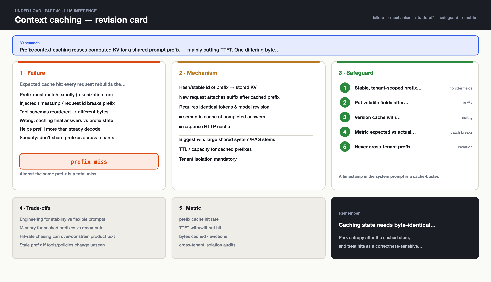
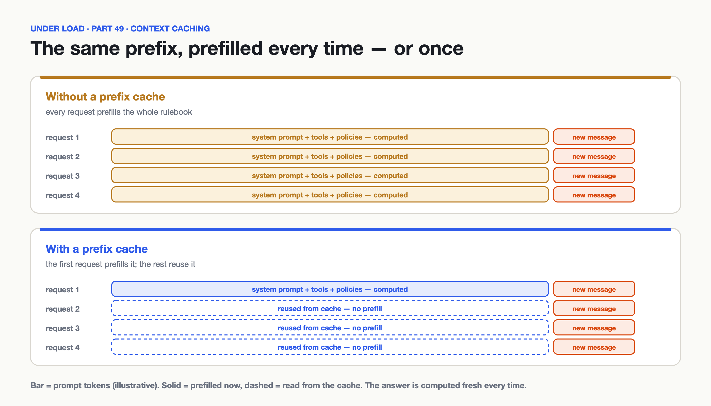
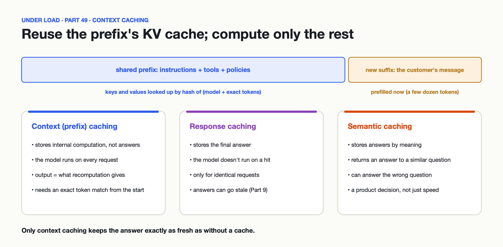
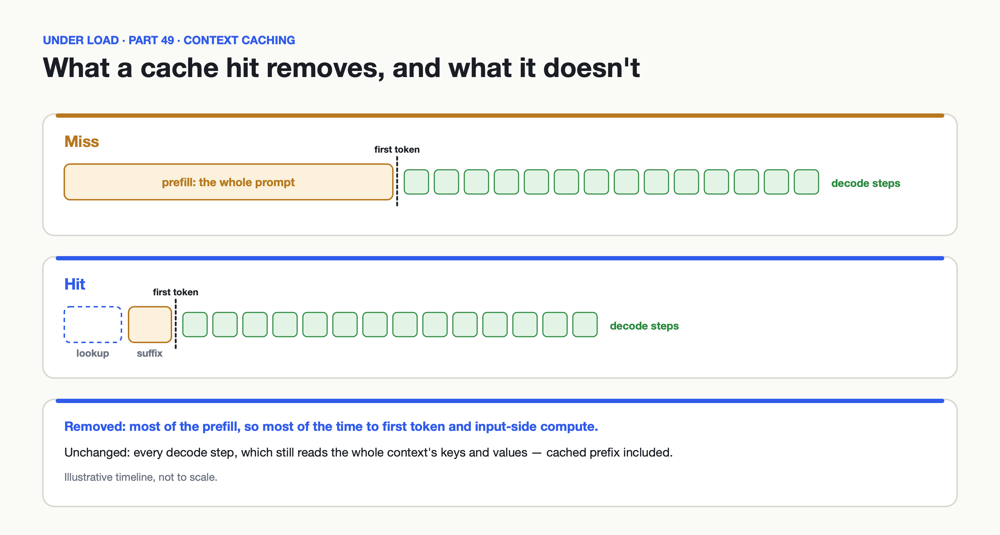
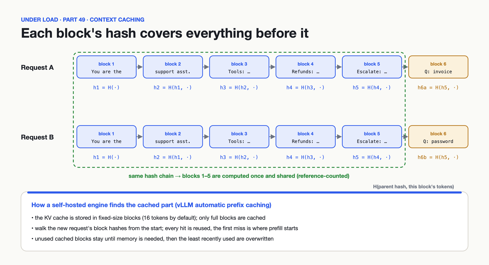
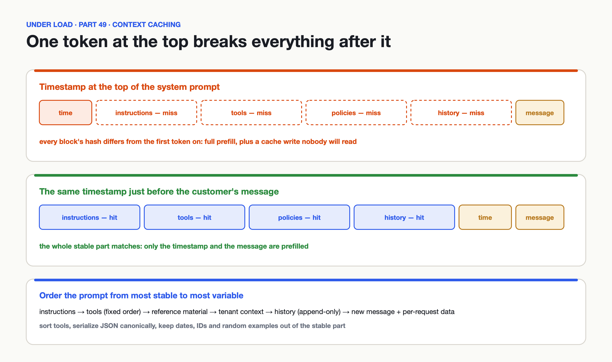
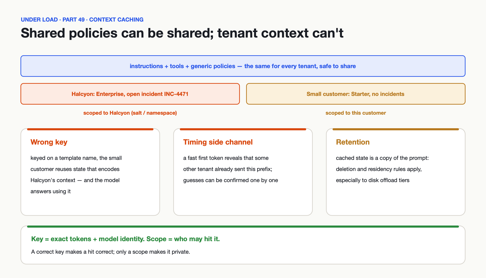
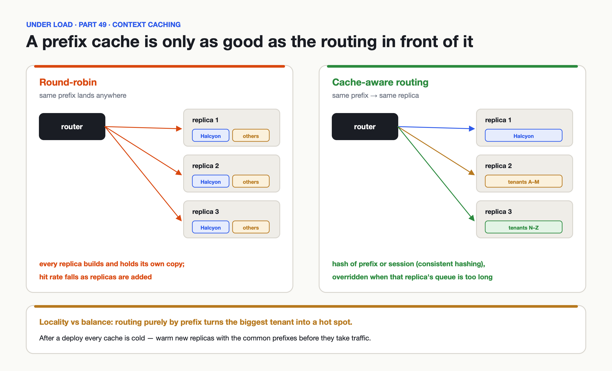
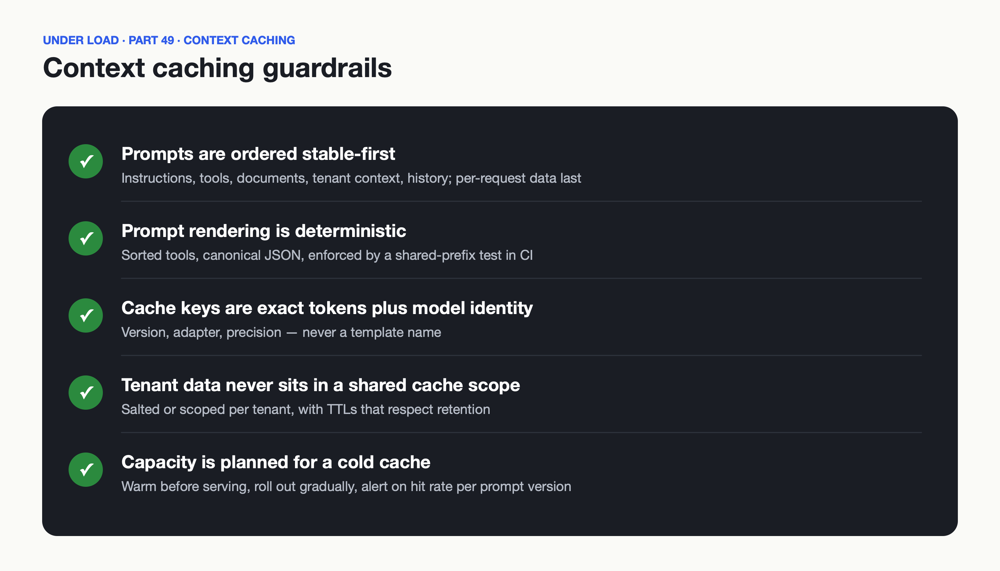

# Context Caching

### Context caching: reusing the computed state of a prompt prefix that every request shares — how prefix caching works, why one misplaced timestamp turns every hit into a miss, what it costs in memory and money, and how to keep cached state from crossing tenants.

*Under Load · Part 49 · LLM Inference Infrastructure*

---

The support product's AI assistant answers agents' and customers' questions about tickets. Every request it sends to the model starts the same way: a system prompt describing the assistant's role, the definitions of a dozen tools it may call, and the support policies it must follow — refund rules, escalation paths, what it may never promise. Together that's a few thousand tokens, identical on every request. After it comes something short and different every time: "Can I get a refund for the duplicate charge on invoice 4471?"

Part 48 showed what happens before the first word of the answer appears. The model must **prefill** the prompt: run every prompt token through every layer and compute the **keys and values** — the per-token vectors that attention looks back at — and store them in the **KV cache**. Only then can it start **decoding**, producing output tokens one at a time. For this assistant, almost all of the prefill work is the same on every request. The model reads the same rulebook, from the first word, thousands of times an hour.

The fix is old and obvious in hindsight: compute the rulebook once and keep the result. That's **context caching**. It's offered by every major model API, built into the popular self-hosted serving engines, and it's one of the cheapest large wins in LLM serving.

It is also easy to break silently. A few weeks after the assistant launched with caching enabled, the team shipped a small prompt fix: the model kept getting "within 14 days of purchase" wrong because it didn't know today's date, so a line was added at the very top of the system prompt — `Current time: 2026-10-25 06:41:13 UTC`. The date bug went away. So did the cache. Time to first token roughly doubled for every customer, the model-API bill jumped, and no test failed, because every answer was still correct.

This article explains why one line at the top destroyed the cache, how the cache works from the ground up, what it costs, and how to run it without leaking one tenant's context into another's.

---

## What context caching is

**Context caching** — also called **prompt caching** or **prefix caching** — stores the computed attention state of a prompt **prefix** (its beginning) and reuses it when a later request begins with **exactly the same tokens**. On a hit, the server skips prefill for the cached part and processes only the new **suffix** — the part after the shared beginning — before it starts decoding.

### Why the beginning of a prompt can be reused

A language model doesn't read text; it reads **tokens** — pieces of words, each mapped to an integer ID by the model's **tokenizer**. In a decoder-only transformer (the architecture behind essentially every chat model), each token can only attend to itself and the tokens before it. This is called **causal attention**: the model is trained to predict the next token, so it must never look ahead.

That restriction has a useful consequence. The keys and values computed for token 500 depend on tokens 1 through 500 and nothing after them. So if two prompts share their first 3,000 tokens, the keys and values of those 3,000 tokens are the same in both prompts, whatever follows. Computing them once and copying them is mathematically the same as computing them again.

The same property explains the main limitation: reuse works **only for a prefix**. Change token 7, and the keys and values of token 8 onwards change too, because every one of them looked back at token 7. There is a second reason, which matters later: each cached key also encodes the token's **position** in the sequence (most current models use **rotary position embeddings**, which rotate keys and queries by an angle that depends on position). A block of text that appears at position 3,000 in one prompt and position 5,000 in another doesn't produce the same cached state, even if the text is identical.

### What it saves: the prefill, not the decode

LLM inference has two phases with very different costs:

- **Prefill** processes all prompt tokens in parallel. It's dominated by arithmetic: a forward pass costs roughly **2 × (number of parameters)** floating-point operations per token, so prefilling 3,000 tokens through an 8-billion-parameter model is on the order of 50 trillion operations before attention is counted. Prefill time is what the user waits for before the first token — the **time to first token (TTFT)**.
- **Decode** generates output tokens one by one. Each step is small in arithmetic but must read all the model's weights and the whole KV cache from GPU memory, so it's limited by **memory bandwidth**. Its speed is what the user sees as the stream of words — the **inter-token latency**.

A cache hit removes most of the prefill: the prefix's keys and values are already there, and only the suffix needs to be computed. For a prompt that is mostly shared prefix, that's most of the TTFT and most of the input-side compute.

It does **not** make decoding cheaper. Every output token still attends over the entire context — the cached prefix included — so each decode step still reads the prefix's keys and values from memory. A response of 400 tokens still takes 400 decode steps. Context caching is a fix for **repeated prompts**, not for long answers. That's why its effect shows up so clearly in TTFT and input-token cost, and barely at all in the time to finish a long response.

### What it is not: response caching and semantic caching

Three different things get called "caching" around LLMs, and they make very different promises.

- **Response caching** (the cache-aside pattern of Part 9, applied to model calls) stores a **final answer** and returns it when an identical request arrives. The model doesn't run at all. It's only safe when an identical request genuinely deserves an identical answer — rare in a support conversation, where the same words mean different things for different customers and different days.
- **Semantic caching** stores answers keyed by an **embedding** of the question (a vector that represents its meaning) and returns a stored answer when a new question is "close enough." It saves the whole model call but can return the answer to a *different* question — "How do I cancel my plan?" and "How do I cancel my order?" can land close together. It's a product decision with a quality risk, not a pure optimization.
- **Context caching** stores **internal computation**, not answers. The model still runs on every request and produces a fresh answer for the full prompt, including the new suffix. Done correctly, the output is the same as without the cache (numerically it can differ in the last digits, the same way results shift slightly with batch composition on a GPU, but no differently than recomputation would).

That last property is what makes context caching easy to adopt: it is an optimization of *how* the answer is computed, not a change to *what* the answer is.

### Where it pays off

- **A long, stable system prompt and tool definitions** — the support assistant's case, and the most common one.
- **A document reused across many questions**: a contract, a product manual, a codebase that several questions are asked about. The document goes first, the question last.
- **Multi-turn conversations**: turn 12's prompt is turn 11's prompt plus one reply and one new message. If the history is only ever appended to, each turn can reuse the cache of the conversation so far.
- **Agents**: an agent loop calls the model again after every tool result, with the whole trajectory so far as the prompt. Most of each call is a prefix of the next one.
- **Few-shot prompts and batch jobs**: the same examples or instructions in front of thousands of different inputs.

It doesn't help unrelated prompts. If every request starts differently, there's nothing to reuse.

---

## How the cache is actually kept

There are two broad families of implementation: self-hosted serving engines, which manage KV memory on the GPU directly, and hosted model APIs, which expose caching as a billing and API feature.

### Self-hosted engines: blocks and hashes

Part 48 described **paged attention**, introduced by vLLM: instead of one contiguous buffer per request, the KV cache is stored in fixed-size **blocks** (16 tokens per block by default in vLLM), like pages of virtual memory. Prefix caching builds directly on this.

vLLM's **automatic prefix caching** gives every full block an identity: a hash of the tokens in that block **plus the hash of the block before it** (plus a few extra keys, such as which LoRA adapter is active). Because each hash includes its parent's, a block's hash effectively covers the entire prefix up to and including that block. Two requests that share their first 3,000 tokens produce the same chain of block hashes for those tokens; the first point where they differ produces a different hash, and so does every block after it.

When a request arrives, the scheduler walks its block hashes from the start and looks each one up. Every hit is a block whose keys and values are already in GPU memory and can simply be referenced; the first miss is where computation starts. Blocks are **reference-counted**: a cached block used by ten running requests is stored once. When no running request uses a block, it isn't thrown away immediately — it stays in a pool of evictable blocks, and is reused if a later request needs it, or overwritten when memory is needed, least recently used first.

**SGLang** reaches the same result with a different data structure, **RadixAttention**: a radix tree (a compressed prefix tree) of token sequences whose nodes point to KV memory. Finding the longest cached prefix of a new request is a walk down the tree, and eviction removes least-recently-used leaves.

Two details follow from this design:

- **Only full blocks are cached.** The last partial block of a prefix is recomputed. With 16-token blocks, that's a rounding error.
- **The cache competes with running requests for the same memory.** Cached-but-unused blocks occupy GPU memory that could hold the KV caches of active requests. Engines handle this by treating cached blocks as evictable: they never block admission of new work, they just get overwritten.

Some systems extend the cache beyond GPU memory, offloading blocks to CPU memory or local SSD and loading them back on a hit — LMCache with vLLM is one example. Loading a block over PCIe is usually much faster than recomputing it for long prefixes, but it's another tier to size and monitor.

### Hosted APIs: two styles

The major model providers all offer prompt caching, but the details differ and change over time, so the current documentation is the source of truth. The broad shapes are:

- **Automatic caching.** OpenAI caches prompt prefixes automatically for prompts above a minimum length (1,024 tokens), matching in fixed-size increments; the response's usage section reports how many input tokens were served from cache, and cached tokens are billed at a discount. Requests are routed to cache-holding machines based on a hash of the beginning of the prompt, and an optional cache-key parameter can influence that routing. Cached prefixes are typically dropped after minutes of inactivity.
- **Explicit breakpoints.** Anthropic's API lets the caller mark **cache breakpoints** (`cache_control`) at the end of the segments that should be cached — after the tools, after the system prompt, after the conversation so far. The cache follows the prompt's order: tools, then system, then messages. A prefix must meet a minimum length, from about a thousand to a few thousand tokens depending on the model, to be cached. The default lifetime is five minutes, refreshed every time the entry is used, with a longer one-hour option. Writing to the cache costs more than a normal input token (1.25× for the five-minute cache, 2× for the one-hour cache), and reading from it costs a tenth of the normal price. The response reports `cache_creation_input_tokens` and `cache_read_input_tokens` separately.
- **Explicit cache objects.** Google's Gemini API offers both implicit caching on recent models and explicit **context caches**: the caller uploads content once, receives a cache name with a chosen **time to live (TTL)**, and references it in later requests, paying for storage per hour that the cache exists.

Whatever the provider, two things are constant: a hit requires an exact prefix match, and the cache is short-lived unless it keeps being used.

### The economics, worked through

With write-premium pricing, caching is a bet that a prefix will be reused before it expires. Take illustrative multipliers of 1.25× to write and 0.1× to read, relative to normal input price, and a 3,000-token prefix:

- **Without caching**, ten requests pay for 30,000 prefix tokens at full price: 10 units of cost, counting one full-price prefix as 1 unit.
- **With caching**, the first request writes the cache (1.25 units) and the next nine read it (9 × 0.1 = 0.9). Total: about **2.15 units** — roughly a fifth of the original.
- **One request and no reuse**: 1.25 units instead of 1. Caching a prefix that nobody reads within its lifetime **costs 25% more** than not caching it.

So the pattern that matters is reuse **within the TTL**. A busy shared system prompt is hit many times a minute and is almost free after the first write. A small tenant whose custom policy document is sent twice an hour, with gaps longer than five minutes, pays the write premium every time and never gets a read. That's a reason to cache the shared part by default, and the tenant-specific part only where traffic justifies it — or with the longer TTL.

---

## One token at the top breaks everything after it

Back to the incident. The system prompt used to begin with "You are the support assistant for…". After the fix, it began with "Current time: 2026-10-25 06:41:13 UTC". The time changes every second, so the first few tokens of the prompt were different on essentially every request.

Because every block's identity covers everything before it, a difference in the first block makes **every** block different. Nothing matched, so every request prefilled the entire rulebook from scratch — and on the hosted API, every request also paid the cache-write premium for a cache entry that would never be read. Worse than no caching at all.

The fix moved the timestamp to the end of the prompt, in front of the customer's message: "(sent 2026-10-25 06:41:13 UTC) Can I get a refund for…". Same information, same answer quality, and the whole rulebook matched again.

The general rule is to **order the prompt from most stable to most variable**:

1. **Instructions** — the role, the rules, the output format.
2. **Tool definitions**, always in the same order and serialized the same way.
3. **Reference material** — policies, documents, examples that are the same for many requests.
4. **Tenant- or user-specific context** that is stable for a while (the customer's plan, their custom policies).
5. **Conversation history**, append-only.
6. **The new message**, and anything per-request — timestamps, request IDs, the user's name, retrieved documents — last.

### Things that silently break the prefix

Most cache breakage isn't a timestamp. It's a change nobody thought of as a prompt change:

- **Per-request values early in the prompt**: dates, request IDs, trace IDs, a random greeting, the user's display name inserted into the system prompt's first sentence.
- **Tool definitions in an unstable order.** Tools usually come first, so reordering them invalidates everything. Building the tool list from a hash map can produce a different order on each process start or even each request — Go maps and some other languages randomize iteration order deliberately. Sort tools by name before sending.
- **Unstable serialization.** The same JSON schema with keys in a different order, different whitespace or different number formatting is a different token sequence.
- **Rotating few-shot examples**, chosen randomly or by similarity to the current question, placed before the stable instructions.
- **History rewriting.** A conversation trimmed with a sliding window — "keep the last 20 messages" — removes the oldest message on every turn, so the prefix changes on every turn and nothing is ever reused. Summarizing old history has the same effect each time the summary changes. Prefer append-only history, and when it must be compacted, compact rarely and in large steps.
- **Retrieved documents** (Part 46) in front of the instructions, or in an order that depends on tiny differences in similarity scores.
- **Feature flags and A/B tests** that change a sentence of the system prompt per user: each variant is its own cache, and a 50/50 split halves the reuse of each.
- **Model, template or tokenizer changes**: a new model version, a changed chat template or a different tokenizer produces different tokens or different keys and values, so everything is a miss.

None of these produce an error. The answer is still correct; it just takes longer and costs more. That's why hit rate needs its own monitoring and alerting, and why prompt changes deserve a check of cache behaviour before they ship.

---

## What must match before reuse is safe

A cached prefix may only be reused when recomputing it would produce exactly the same keys and values. That means all of these must be the same:

- **The exact token IDs**, from the first token, not just the same text: a different tokenizer, or a template that inserts a different special token, changes them.
- **The model and its exact weights**: the version, any fine-tuning, any **LoRA adapter** (a small set of extra weights layered on a base model per task or per customer), and the numeric format — a quantized model (Part 52) computes different values from the full-precision one.
- **Anything that changes how keys and values are computed**: position-encoding settings, the precision of the KV cache itself, and for multimodal models the exact images or audio the prompt contains (vLLM, for example, hashes multimodal inputs into the block keys).

Sampling settings like temperature don't matter — they affect how the next token is picked from the model's output, not the cached state of the prompt.

Engines that key on exact token hashes get this right by construction for tokens, and include adapter and multimodal identifiers in the key. The danger comes from caches built **above** the engine with a weaker key.

### The template-name key

Suppose an application keeps its own cache of precomputed prompt state — or of anything derived from the prompt — and keys it on something convenient: `"support-prompt-v3"`, or a tenant's plan name. The support prompt for Halcyon includes a customer-context section: "Customer: Halcyon. Plan: Enterprise. Open incident: INC-4471, data export failing since Tuesday." The prompt for a small customer has the same template name and a different context section. Keyed on the template name, the small customer's request reuses state that encodes Halcyon's context — and the model, which has no idea the state was borrowed, will answer using it. It might mention the open incident. It might apply Enterprise refund rules.

The rule is the same as for any cache: **the key must cover everything the cached value depends on.** For prompt state, that's the exact tokens plus the model identity — never a label.

---

## Isolation: who may hit whose cache

Content-addressed caching — keying on the exact tokens — guarantees that a hit returns state that is correct for *this* prompt. It does not answer a different question: **should this request be allowed to learn that someone else sent the same prefix?**

A cache hit is observable. It makes TTFT shorter, and on hosted APIs it shows up in the usage numbers. In a cache shared across tenants, an attacker who can send prompts can test guesses: "Does any other customer's prompt begin with *Customer: Halcyon, open incident: …*?" A fast response says yes. This is a **timing side channel**, and it's not hypothetical: a 2025 audit of commercial model APIs (Gu et al., "Auditing Prompt Caching in Language Model APIs") used exactly this kind of timing measurement to detect caches shared across users at several providers.

The defences are about **scope**, not keys:

- **Share only what is genuinely public within the scope.** The assistant's instructions, tool definitions and generic policies are the same for every tenant and safe to share. Tenant context and conversations are not.
- **Partition the cache per tenant for anything tenant-specific.** Hosted providers scope caches at least per organization. A self-hosted engine can be given a per-tenant **cache salt** — vLLM accepts one per request — which is mixed into the first block's hash so that identical text from two tenants never shares cache entries. The cost is that tenants no longer share the common prefix either, so a common design is a shared prefix for the public part and tenant-scoped caching after it, or a dedicated cache per large tenant.
- **Keep sensitive data out of long-lived caches.** Cached state is a copy of the prompt in another form. Data-retention rules — "customer content is deleted after N days," "this tenant's data never leaves region X" — apply to it too. Short TTLs and in-memory-only caches make this easy; disk offload tiers make it a real question.
- **Invalidate on model and template changes** — not because a correct engine would serve wrong state, but because application-level caches and long-TTL explicit caches might.

---

## Running it across many replicas

So far the cache has lived on one server. Real deployments run many replicas of the model behind a load balancer, and each replica's GPU memory holds its own cache. A request that lands on a replica that has never seen its prefix is a miss, even if ten other replicas have it cached.

With plain round-robin load balancing across N replicas, every replica has to build and keep its own copy of every popular prefix. For one shared system prompt, that's fine — N copies, N cold misses, then hits everywhere. For thousands of distinct prefixes — per-tenant contexts, long conversations — the per-replica hit rate falls as N grows, and each replica's memory fills with copies the others also hold.

**Cache-aware routing** fixes this by sending requests with the same prefix to the same replica:

- **Hash-based routing**: hash the first part of the prompt, or a session or conversation ID, and map it to a replica with **consistent hashing** (Part 36), so adding or removing a replica only moves a fraction of prefixes. Hosted providers do a version of this internally, which is why their docs suggest stable cache keys and similar-shaped requests.
- **Cache-aware load balancers** that know, or estimate, what each replica holds — SGLang's router, and KV-aware routing in projects such as NVIDIA Dynamo and llm-d, follow this pattern — and pick the replica with the longest cached match, as long as it isn't overloaded.

The trade-off is the classic one between locality and balance. Routing purely by prefix sends all of Halcyon's traffic to one replica, which becomes a hot spot while others idle. Practical routers combine both: prefer the replica with the cache, unless its queue is significantly longer than the alternatives, in which case pay the miss somewhere less busy.

### Cold caches after a deploy

A model rollout, an engine restart or a scale-up event starts with empty caches. For a few minutes, every request is a miss: TTFT jumps, prefill compute spikes, and if capacity was planned assuming the usual hit rate, queues build. It's the LLM version of the cache stampede from Part 11.

Two habits prevent it from becoming an incident:

- **Plan capacity for misses.** The cache is an optimization, not a capacity guarantee. The system must survive a cold cache at peak, even if slower.
- **Warm before serving.** After a new replica or model version starts, send it the common prefixes (a single request per popular prefix is enough) before the load balancer gives it real traffic, and roll out gradually so only part of the fleet is cold at a time.

---

## What it costs

- **Memory.** A cached prefix is a full KV cache for those tokens. Using the formula from Part 48, an 8B model with grouped-query attention needs about 128 KB per token in 16-bit precision, so a 3,000-token prefix is about **375 MB**, and a 12,000-token prefix about 1.5 GB. One shared prefix is cheap. A thousand cached tenant contexts are not, and every gigabyte of cached prefixes is a gigabyte that isn't holding the KV caches of running requests, which is what decides how many users fit (Part 48). Engines treat cached blocks as evictable for this reason; hosted APIs handle it with short TTLs.
- **Eviction policy.** Least-recently-used is the default. It works well for a few hot prefixes and poorly for many lukewarm ones, which evict each other before they're reused. Watching the eviction rate against the hit rate shows when the cache is thrashing.
- **Money, on hosted APIs.** Write premiums mean a cache that's written and never read costs more than no cache. Reuse within the TTL is what pays.
- **The first request still pays full price**, and so does every request after an eviction, a deploy or a prompt change.
- **Only exact prefixes.** A document that appears in the middle of different prompts — after different instructions — isn't reused by a prefix cache. Research systems explore reusing non-prefix chunks with partial recomputation, but mainstream engines and APIs reuse prefixes only.
- **Design constraints on the prompt.** Stable-first ordering is usually free, but sometimes it isn't: models can follow instructions better when key information is near the end, and putting retrieved documents last can be at odds with the format a model was tuned on. Test answer quality after reordering, not just hit rate.

---

## Shipping it safely

Caching should change cost and latency, never answers. Rolling it out — or changing a cached prompt — is still a production change:

1. **Measure first.** Group recent requests by prefix and estimate how much of the input is shared, and how often each prefix recurs within the cache lifetime. That predicts the benefit before anything is built.
2. **Restructure the prompt** to stable-first order, with deterministic tool order and serialization. Ship that change alone and confirm that answer quality is unchanged on the evaluation set.
3. **Enable caching** (breakpoints on a hosted API, prefix caching in the engine) and verify the hit rate and cached-token counts against the estimate.
4. **Gate prompt changes on cache behaviour.** A CI check that renders the prompt for two different requests and asserts that they share the expected prefix catches "timestamp at the top" before production does.
5. **Watch hits by prompt version** after every prompt or model rollout, and alert when it drops.

---

## Guardrails that prevent the next one

1. **Prompts are ordered stable-first**: instructions, tools, documents, tenant context, history, and per-request data last.
2. **Prompt rendering is deterministic**: tools sorted, JSON serialized canonically, no random or time-based content before the variable section — enforced by a test.
3. **Cache keys are the exact tokens plus the model identity**: version, adapter, precision — never a template name or a label.
4. **Tenant data never sits in a shared cache scope**: shared prefixes are public by construction; tenant-specific parts are salted or scoped per tenant, with TTLs that respect data-retention rules.
5. **Capacity is planned for a cold cache**: new replicas are warmed before taking traffic, rollouts are gradual, and hit rate is monitored per prompt version.

---

## What to keep on the dashboard

- **Cache hit rate** and **cached share of input tokens**: the share of prompt tokens served from cache, overall and per prompt version.
- **TTFT for hits and misses separately**: an overall TTFT increase can mean the miss path got slower or the hit rate dropped, and the fix is different.
- **Prefill compute or prefill time per request**, the work the cache is supposed to remove.
- **Cache memory in use** and **evictions per second**; evictions rising with a falling hit rate means the cache is thrashing.
- **Cost per request**, with cache writes, cache reads and uncached input reported separately on hosted APIs. A rising write share with a flat read share is the incident from the top of this article.
- **Hit rate per replica**, to see whether routing keeps prefixes together.

---

## Recap

### What is context caching?
Reusing the computed keys and values of a prompt prefix that later requests share, so only the new suffix is prefilled. It works because in causal attention each token's state depends only on the tokens before it, so identical beginnings produce identical state.

### How is context caching different from caching the final LLM response, or semantic caching?
Response caching returns a stored answer for an identical request, and semantic caching returns a stored answer for a similar one — both skip the model and risk serving an answer that doesn't fit. Context caching still runs the model and produces a fresh answer; it only reuses internal computation for the common beginning, so the output is the same as without it.

### Why does it mainly help time to first token, rather than every part of decoding?
It removes prefill work for the cached tokens, and prefill is what the user waits for before the first token. Decoding still runs one step per output token, and each step still reads the whole context's keys and values, cached prefix included. Long answers take as long as before.

### What must match before a cached prefix can be reused safely?
The exact token IDs from the first token, the exact model — version, weights, adapter, numeric precision — and anything that affects how keys and values are computed, including multimodal inputs. The key must be derived from all of these, never from a template name.

### What turns an expected cache hit into a miss?
Any difference early in the prompt: a timestamp or request ID at the top, tools in a different order, unstable JSON serialization, rotating examples, a sliding-window history, a prompt A/B test, or a model or template change. Also a cache entry that expired, was evicted, or lives on a different replica than the one that got the request.

### How should prompts be structured for caching?
From most stable to most variable: instructions, tool definitions in a fixed order, reference material, tenant context, append-only history, and the new message with per-request data last.

### What are the memory and privacy trade-offs?
Each cached prefix holds a full KV cache — hundreds of megabytes for a few thousand tokens of an 8B model — in memory that could serve running requests. A cache shared across tenants leaks, through timing, whether someone else sent a prefix, so tenant-specific content must be scoped or salted per tenant, and cached state is subject to the same retention rules as the prompt.

### When is caching not worth it?
When prefixes aren't reused within the cache lifetime: on hosted APIs with a write premium, a cache entry written and never read costs more than no cache. Also when prompts share little, or when reordering the prompt for caching hurts answer quality.

### How does it work with many replicas?
Each replica has its own cache, so requests with the same prefix should be routed to the same replica — by hashing the prefix or session with consistent hashing, or with a cache-aware load balancer — balanced against queue length so one tenant doesn't create a hot spot. After a deploy, warm the cache before serving traffic.

### What should be monitored?
Hit rate and cached share of input tokens per prompt version, TTFT for hits and misses, prefill time, cache memory and evictions, cost per request split by cache writes and reads, and hit rate per replica.

---

## Next

- **Lab (run + measured write-up):** [49-context-caching](https://github.com/b-basoglu/under-load/tree/main/49-context-caching)
- **Next:** [Continuous Batching](../50-continuous-batching/article.md) — One GPU, a hundred users, requests that finish at different times. Why waiting for a whole batch to finish wastes most of the hardware, and how serving engines keep it full.
