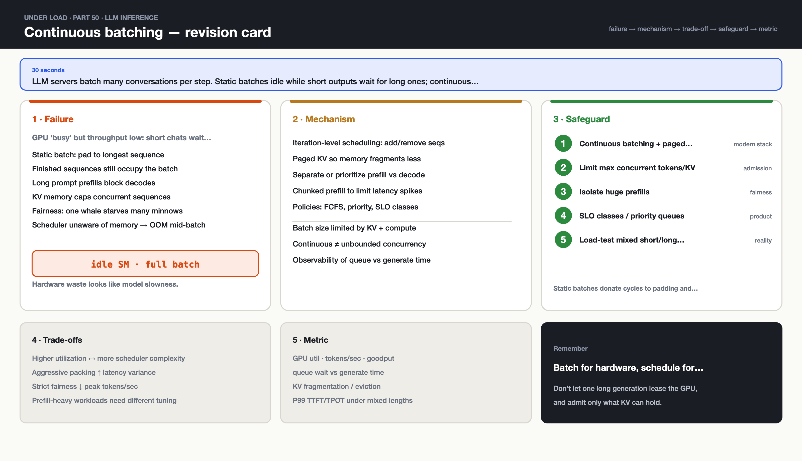
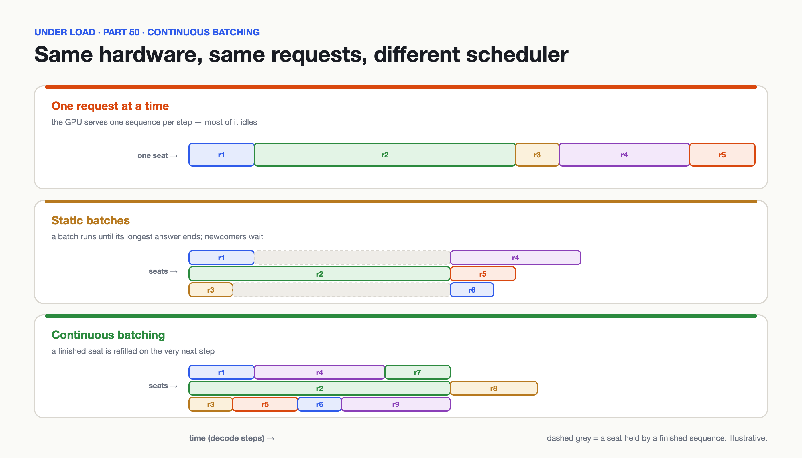
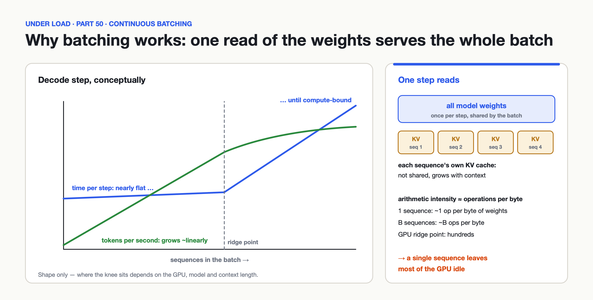
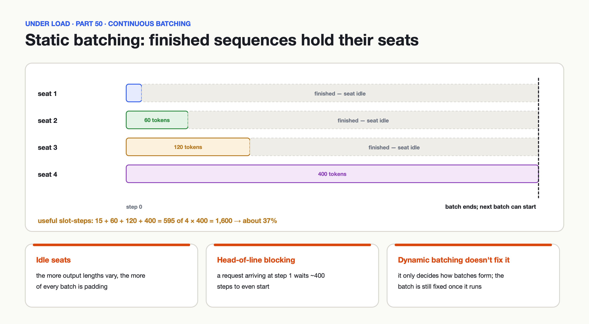
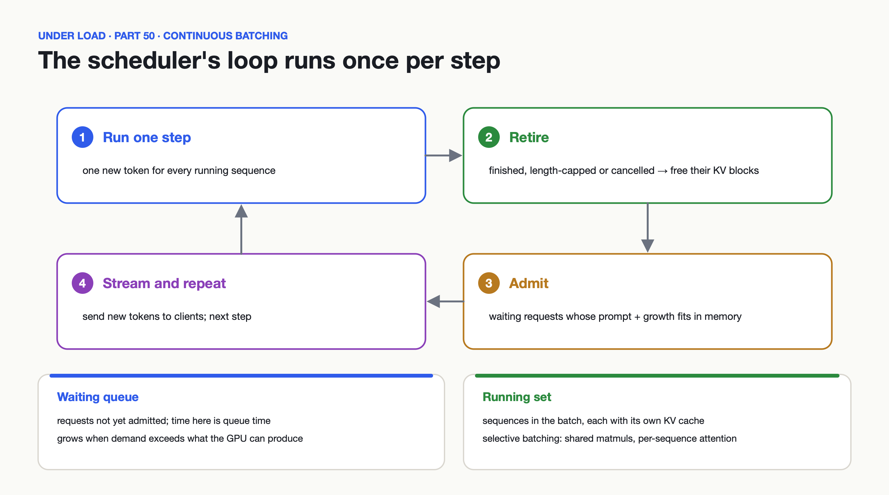
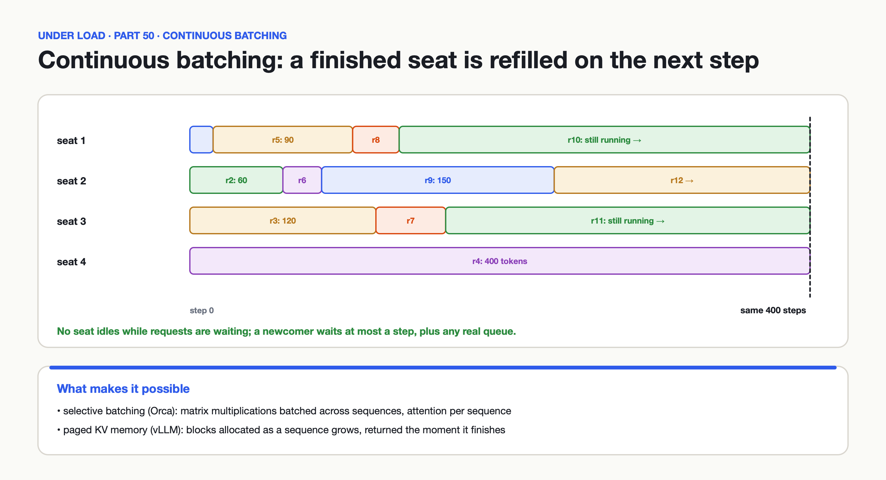
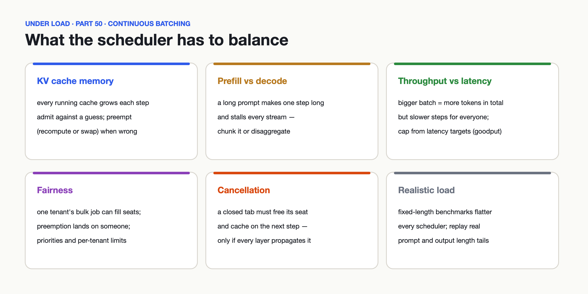
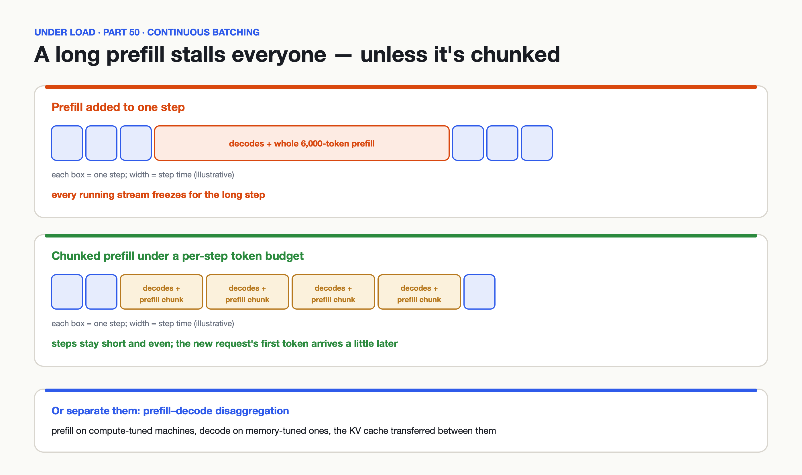
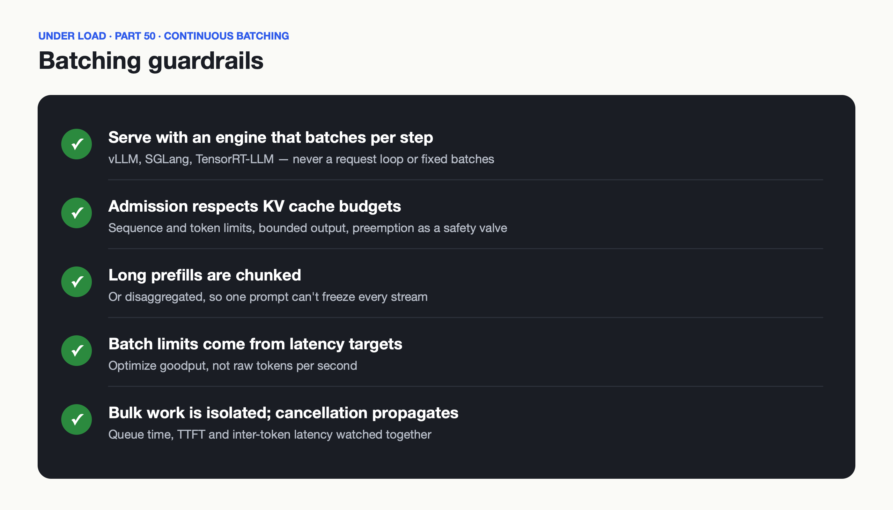

# Continuous Batching

### Continuous batching: why LLM servers batch many conversations into each step, how static batches waste most of the hardware when outputs differ in length, and how per-step scheduling keeps it busy without wrecking latency.

*Under Load · Part 50 · LLM Inference Infrastructure*

---

The support assistant's traffic grew, and the team decided to self-host an open-weights model instead of paying per token. The first inference server was the obvious loop: take a request off the queue, generate its whole answer, take the next one. The GPU's utilization graph looked busy, but tokens per second were low, and at the afternoon peak the queue grew faster than it drained.

The second version batched. It collected 16 requests, generated all of their answers together, returned them, and collected the next 16. Throughput went up noticeably. Then the complaints changed: "thanks, that fixed it" — a one-line reply the assistant should produce in a second — sometimes took a minute to appear, and the delay seemed random.

It wasn't random. Each of those short replies had been batched with a request asking the assistant to draft a long policy explanation, and the batch didn't return until the longest answer was finished. Meanwhile, every new request waited for the whole batch to end before it could start.

Both versions made the same mistake in different ways: they scheduled work **per request**, while the hardware works **per step**. This article explains why batching is so effective for LLM inference, why the naive kind wastes most of what it gains, and how **continuous batching** — the scheduling strategy behind essentially every modern LLM serving engine — keeps the GPU full without making users wait for each other.

---

## Why batching works: decode is memory-bound

Part 48 split inference into two phases. **Prefill** processes the whole prompt in parallel and builds the **KV cache** — the stored keys and values that attention looks back at. **Decode** then produces the answer one token at a time; each **decode step** runs the model once to produce one more token for a sequence.

A decode step for a single sequence does surprisingly little arithmetic for the data it moves. To produce one token, the GPU must read every weight of the model from its memory: for an 8-billion-parameter model in 16-bit precision, about 16 GB per step. The arithmetic for one token is roughly 2 floating-point operations per parameter — about 16 billion operations. A modern data-center GPU can do hundreds of trillions of operations per second but read only a few terabytes per second from memory, so for a single sequence, the step's time is set almost entirely by **memory bandwidth**. The compute units spend most of the step waiting for weights to arrive.

The useful measure here is **arithmetic intensity**: operations performed per byte read from memory. Each GPU has a **ridge point** — the intensity at which it stops being limited by memory and starts being limited by compute. It's the peak operations per second divided by memory bandwidth, and for current data-center GPUs it's in the **hundreds** of operations per byte. A single-sequence decode step has an intensity of about **1** (2 operations per parameter, 2 bytes per parameter). It's far on the memory-bound side.

Now batch. If a step advances **B** sequences at once, the weights are read once and used B times. The arithmetic grows B-fold; the weight traffic doesn't grow at all. Arithmetic intensity rises roughly in proportion to B, and until it approaches the ridge point, **the step takes about the same time whether it serves 1 sequence or dozens**. Throughput — tokens per second across all users — grows almost linearly with the batch.

Two qualifications keep this honest:

- **The KV cache doesn't share.** Each sequence attends over its own cached keys and values, which must also be read every step. That part of the work grows with batch size and with context length, and it stays memory-bound regardless of batching. For long conversations it can dominate the step.
- **Eventually the step becomes compute-bound.** Past the ridge point, adding sequences makes each step proportionally slower. Throughput flattens, and every user's **inter-token latency** — the time between consecutive tokens of one answer — grows.

The conclusion still stands: serving one sequence at a time leaves most of an expensive GPU idle. The question isn't whether to batch, but **how**.

---

## Static batching: everyone waits for the longest

The second server used **static batching**, also called request-level batching: form a batch of requests, run prefill for all of them, then decode until all of them are finished, and only then return results and start the next batch.

The problem is that LLM output lengths vary enormously and aren't known in advance. A "you're welcome!" is a handful of tokens; a drafted refund-policy explanation is hundreds. A batch runs until its **longest** sequence produces its end-of-sequence token or hits its maximum length.

Take a batch of four requests whose answers turn out to be 15, 60, 120 and 400 tokens long. The batch runs for 400 decode steps. It has 4 × 400 = 1,600 **slot-steps** (one seat in the batch for one step), but only 15 + 60 + 120 + 400 = 595 of them produce a token. About 37% of the batch's capacity does useful work; the rest is seats held by sequences that are already done, still carried through every step (or masked out, which saves nothing on memory traffic).

Three separate costs come from this:

- **Idle slots.** Finished sequences keep their place until the batch ends. The more output lengths vary, the worse it gets, and a support workload — mostly short replies, occasionally a long draft — varies a lot.
- **Head-of-line blocking** (Part 26) inside the GPU. A request that arrives one step after a batch starts waits for the entire batch — up to the longest answer in it — before its own prefill can begin. The short "thanks" reply wasn't slow to generate; it was slow to *start*.
- **Late returns.** In the simplest implementations, results are returned when the batch completes, so even the 15-token answer is delivered after 400 steps. Streaming fixes delivery, but not the waiting.

There's also a smaller waste at the front: naive static batching pads all prompts to the length of the longest prompt in the batch, so prefill computes attention over padding tokens.

**Dynamic batching**, common in classic model serving (Triton Inference Server's dynamic batcher, for example), improves how batches are *formed*: it waits up to a short deadline for requests to accumulate, then launches whatever has arrived. That's the right tool for models that answer in one forward pass, like a classifier or an embedding model, where every item in a batch takes the same time. For text generation, it fixes only the start: once generation begins, the batch is still fixed until its longest member finishes.

---

## Continuous batching: schedule every step

**Continuous batching** — also called **iteration-level scheduling** or **in-flight batching** — makes the scheduling decision at **every decode step** instead of once per batch. The idea was introduced for transformer serving by the Orca system (Yu et al., OSDI 2022), and is now the default in vLLM, SGLang, TensorRT-LLM and essentially every production LLM engine. (Hugging Face's TGI used it too, but it has been in maintenance mode since December 2025 and its repository is archived; Hugging Face points new deployments to vLLM or SGLang.)

The server keeps two sets: **waiting** requests and **running** sequences. Every iteration:

1. **Run one step** for all running sequences: one new token each.
2. **Retire** sequences that just produced their end token, hit their length limit, or were cancelled, and free their KV cache immediately.
3. **Admit** waiting requests into the freed capacity, if their prompt and some room to grow fit in memory, and include their prefill in the next step.
4. Stream new tokens to their clients and repeat.

The same four requests now look different. The 15-token reply leaves after 15 steps, and its seat goes to the next waiting request on step 16. A new request never waits for a whole batch — at most for one step, plus whatever queue exists because the server is genuinely full. Slot-steps are spent on sequences that are still generating, so the GPU's capacity turns into tokens instead of padding.

The gain is largest exactly where static batching hurts most: **highly variable output lengths under steady load**. The vLLM paper (Kwon et al., SOSP 2023) combined continuous batching with paged KV memory and reported throughput several times higher than earlier serving systems at the same latency; the exact factor depends on the workload, the model and the baseline, and against request-at-a-time serving the gap is larger still.

### Why this needed a new kind of batching

Batching sequences that are at different points of generation isn't trivial. One sequence is at token 3 with a 200-token prompt; another is at token 350 with a 4,000-token prompt; a third is being prefilled right now. Their attention computations have completely different shapes.

Orca's answer was **selective batching**: the operations that don't depend on sequence length — the large matrix multiplications in the feed-forward layers and the projections that compute queries, keys and values — are batched across all sequences by concatenating their tokens. Only the attention itself is computed per sequence, against each one's own KV cache. Since the matrix multiplications are where the weights are read, the batching benefit is preserved.

The other half of the solution is memory. If each sequence needed one contiguous buffer reserved for its maximum possible length, sequences of unpredictable length couldn't join and leave freely without fragmenting memory. **Paged attention** (Part 48) stores the KV cache in small fixed-size blocks allocated on demand, so a sequence that grows takes another block, and a sequence that finishes returns its blocks to the pool for the next admission.

---

## What the scheduler has to balance

Continuous batching turns serving into a scheduling problem. The engine runs one loop, but every iteration decides who gets the GPU, and several constraints pull in different directions.

### KV cache memory

Every running sequence holds a KV cache that **grows by one token every step**. Part 48's arithmetic — about 128 KB per token for an 8B model with grouped-query attention — means a few hundred long conversations can fill a GPU's spare memory. Admission therefore isn't "is there a free seat?" but "will this sequence's cache, and the growth of everything already running, still fit?"

Because output lengths are unknown, the scheduler is admitting against a guess. When it guesses wrong and memory runs out mid-generation, it must **preempt**: pick a running sequence (typically the most recently admitted), free its cache, and put it back in the queue. Later it's resumed either by **recomputing** its cache — another prefill over its prompt and the tokens generated so far — or, in engines that support it, by **swapping** the cache to CPU memory and back. Either way the user sees a pause, and the GPU does work twice. Occasional preemption is the price of admitting aggressively; frequent preemption means the server is overcommitted.

The levers are the engine's limits — in vLLM, for example, the maximum number of concurrent sequences, the maximum number of tokens processed per step, and the share of GPU memory reserved for the cache — plus per-request **max output tokens**, which bound how far any single sequence can grow.

### Prefill versus decode

Admitting a request means running its prefill, and prefill is a different kind of work. A 6,000-token prompt is 6,000 tokens of computation in one go; a decode step for 64 running sequences is 64 tokens. If the scheduler simply adds a long prefill to the next step, that step takes many times longer than usual — and every one of the 64 running conversations stalls while it runs. Users see the stream of words freeze for a moment whenever someone else sends a long prompt.

Two techniques address this:

- **Chunked prefill** (introduced in the Sarathi and Sarathi-Serve work, now standard in vLLM and others) splits a long prefill into chunks and mixes one chunk into each step alongside the running decodes, under a per-step **token budget**. Decode steps stay short and predictable; the new request's time to first token grows a little, because its prefill is spread over several steps.
- **Prefill–decode disaggregation** (DistServe, Splitwise and similar designs) runs prefill and decode on **separate GPUs or machines**, sized independently, and transfers the KV cache between them. Prefill machines are tuned for compute, decode machines for memory and batch size. It removes the interference completely, at the cost of a KV transfer per request and a more complex deployment.

### Throughput versus interactive latency

A bigger batch produces more tokens per second in total. Past the point where the step becomes compute-bound — or where the KV reads of many long sequences dominate — each step gets slower, and every user's words stream more slowly. For a background job (summarizing yesterday's tickets overnight) that's fine. For an agent watching an answer appear, it isn't.

So batch size is capped by **latency targets**, not maximized: the target inter-token latency (say, fast enough to stay ahead of reading speed) and time to first token decide how many sequences and tokens per step a GPU may carry. The metric that captures this is **goodput** — requests per second that meet their latency targets — rather than raw throughput. A configuration that doubles tokens per second while pushing half the requests past their targets has lower goodput.

Many deployments split traffic by its needs: interactive requests on servers with conservative batch limits, offline batch work on servers tuned for throughput (or on discounted batch APIs).

### Fairness and starvation

The default policy is usually first-come, first-served admission. Within that, problems appear at the edges:

- **Long requests can be starved** under some policies — for example, if the scheduler prefers whatever fits, a request with a huge prompt may keep losing to smaller ones.
- **Preemption hits someone.** If the most recently admitted sequence is always preempted first, a tenant that sends many requests at peak may see most of the pauses.
- **One tenant can fill the batch.** Halcyon's nightly bulk-summarization job, sent through the same endpoint as interactive traffic, can occupy most of the seats. Priorities and per-tenant concurrency limits (Part 25 on load shedding, Part 17 on bulkheads) apply here exactly as they do anywhere else.

### Cancellation

A user who closes the tab, or an upstream timeout that gives up, should free the seat and the KV cache **on the next step**. If the server doesn't notice the disconnect, it keeps generating hundreds of tokens for nobody, holding memory that a waiting request needed. Engines abort requests when the client disconnects, but only if the layers in between — gateways, proxies, application code — propagate the cancellation instead of swallowing it.

---

## Where it breaks

Continuous batching is the right default, but it moves the failure modes rather than removing them:

- **Memory overcommit.** Too many admitted long-output sequences lead to preemption storms: sequences are evicted and recomputed repeatedly, throughput drops and latency becomes erratic. Visible as rising preemption counts with flat or falling tokens per second.
- **Prefill interference.** Without chunked prefill, a burst of long prompts — a tenant pasting entire documents — freezes everyone's streams. Visible as inter-token latency spikes correlated with prompt length.
- **Latency creep at high load.** The scheduler keeps admitting as long as memory fits, so batch size rises with load, and inter-token latency rises with it. Nothing fails; everything gets slower. Visible as inter-token latency rising while throughput looks healthy.
- **Queueing still exists.** When demand exceeds what the GPUs can produce, requests wait for admission, and the queue grows exactly as in Part 24. Continuous batching raises capacity; it doesn't remove the need for backpressure and load shedding.
- **Unrealistic benchmarks.** Load tests with fixed prompt and output lengths make every scheduler look good. Real traffic has long tails in both, and the tail is where batching decisions matter.

---

## Shipping it safely

Moving from a request-at-a-time or static-batching server to a continuous-batching engine is mostly a matter of adopting the engine. Operating it well is a matter of limits and evidence:

1. **Benchmark with the real distribution.** Replay recorded prompt and output lengths — including the long tail and the occasional enormous prompt — at realistic arrival rates, not a fixed "512 in, 128 out."
2. **Set limits from latency targets.** Pick target time to first token and inter-token latency, then raise concurrent sequences and the per-step token budget until one of them is at risk. Back off from there.
3. **Enable chunked prefill** if the engine doesn't by default, and bound prompt length at the API.
4. **Bound output length** with per-request max tokens, so a single runaway generation can't hold memory indefinitely.
5. **Propagate cancellation** end to end, and test it: close a client mid-stream and watch the sequence disappear from the running set.
6. **Separate interactive and bulk traffic**, by deployment or by priority class.

---

## Guardrails that prevent the next one

1. **Serve with an engine that batches per step** — vLLM, SGLang, TensorRT-LLM — never a request-per-call loop or fixed batches.
2. **Admission respects KV cache budgets**: concurrent-sequence and token limits, bounded output length, preemption only as a safety valve.
3. **Long prefills are chunked** (or disaggregated) so they don't stall every decoding sequence.
4. **Batch limits come from latency targets**, and the target metric is goodput, not raw tokens per second.
5. **Bulk work is isolated from interactive traffic**, cancellation is propagated end to end, and queue time, TTFT and inter-token latency are watched together.

---

## What to keep on the dashboard

- **Output tokens per second** and **requests per second** per GPU — and **goodput**, the share of requests meeting their latency targets.
- **Time to first token** and **inter-token latency**, at p50 and p99. TTFT rising means waiting or prefill; inter-token latency rising means the batch is too big or prefills are interfering.
- **Queue time** before admission, separately from processing time.
- **Running and waiting sequences** per step.
- **KV cache occupancy**: how full the block pool is.
- **Preemptions per minute**, the clearest sign of memory overcommit.
- **Latency by prompt length, output length and tenant**, to catch starvation and interference.
- **Cancelled requests** and how quickly their memory is released.

---

## Recap

### Why batch LLM requests at all?
Decode steps are memory-bound: each step reads all the model's weights whether it advances one sequence or many. Batching reuses one read of the weights for many sequences, so throughput grows almost linearly with batch size until the step becomes compute-bound.

### Why do variable output lengths waste capacity in static batches?
A static batch runs until its longest sequence finishes. Shorter sequences that are already done keep their seats for every remaining step, and new requests can't start until the whole batch ends. With outputs of 15, 60, 120 and 400 tokens, only about 37% of the batch's slot-steps produce a token.

### How is continuous batching different from ordinary dynamic batching?
Dynamic batching decides how to *form* a batch — wait briefly, then launch what arrived — but the batch is fixed once generation begins. Continuous batching reschedules at every decode step: finished or cancelled sequences leave immediately and waiting requests join in their place.

### How does KV cache memory constrain the scheduler?
Every running sequence's cache grows by one token per step, and output lengths aren't known in advance. The scheduler admits only what it expects to fit; when it's wrong, it must preempt a sequence and later recompute or swap its cache. Engine limits on concurrent sequences, tokens per step and output length keep this rare.

### Why do long prompts hurt other users, and how is that fixed?
A long prefill added to one step makes that step far longer, stalling every running conversation. Chunked prefill spreads it across steps under a token budget; prefill–decode disaggregation runs the two phases on separate machines.

### How do you balance throughput against interactive latency?
Bigger batches mean more total tokens but slower steps for everyone. Cap batch size and per-step tokens from latency targets, measure goodput instead of raw throughput, and run bulk work separately from interactive traffic.

### Which metrics show whether batching is helping or hurting?
Throughput and goodput rising with TTFT and inter-token latency within targets means it's helping. Rising preemptions, inter-token latency spikes tied to prompt length, growing queue time, or latency concentrated in one tenant or length class mean it's hurting.

---

## Next

- **Lab (run + measured write-up):** [50-continuous-batching](https://github.com/b-basoglu/under-load/tree/main/50-continuous-batching)
- **Next:** [Speculative Decoding](../51-speculative-decoding/article.md) — A small model guesses the next few tokens; the big model checks them all in one step. How guessing makes generation faster without changing what the big model would have said.
