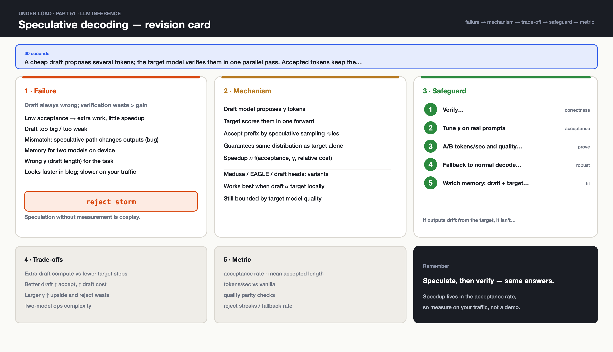
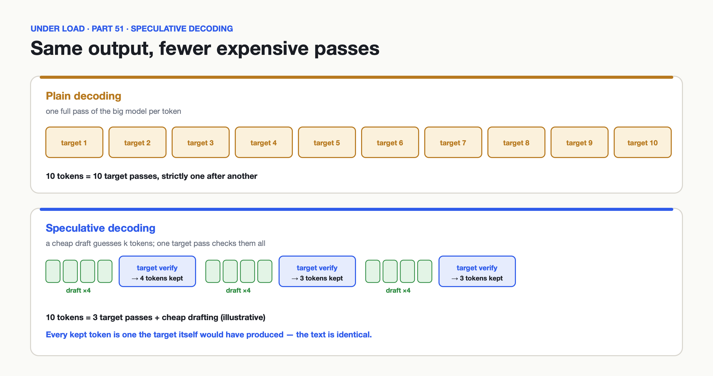
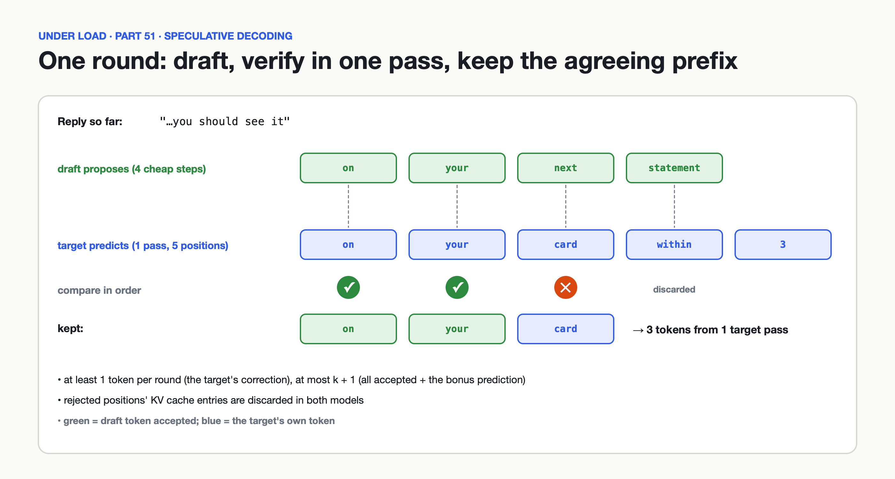
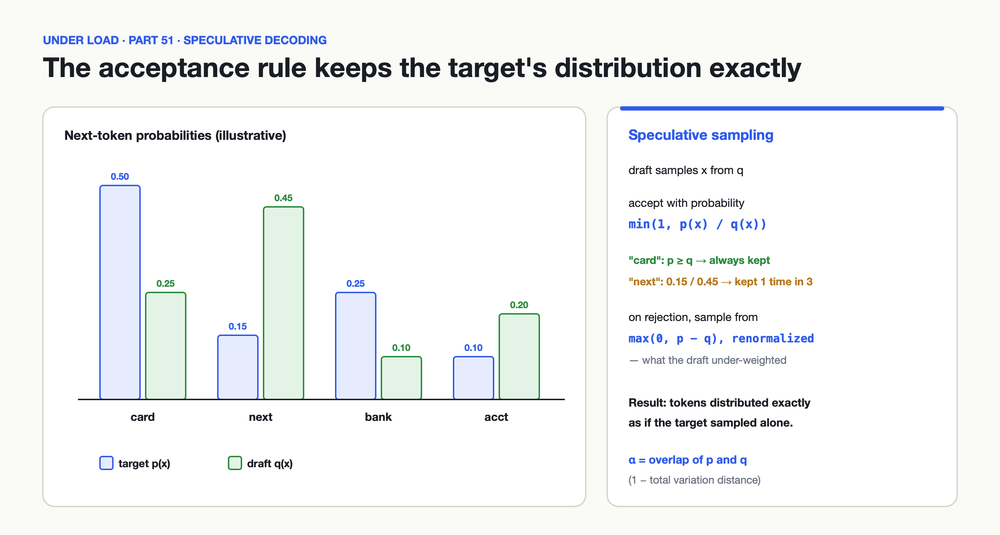
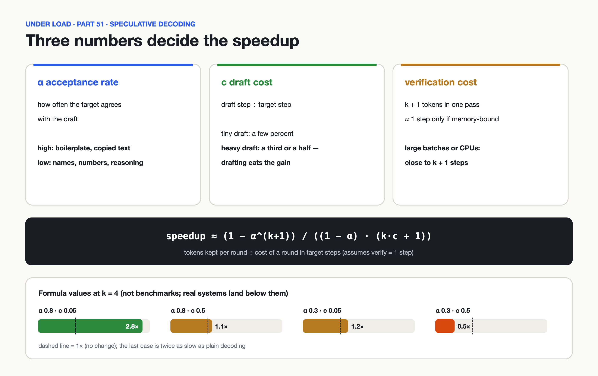
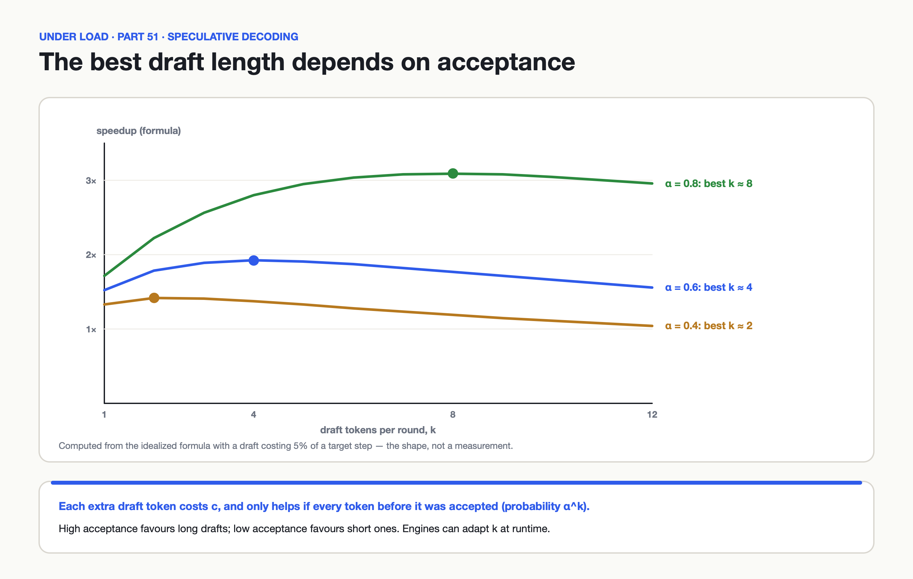
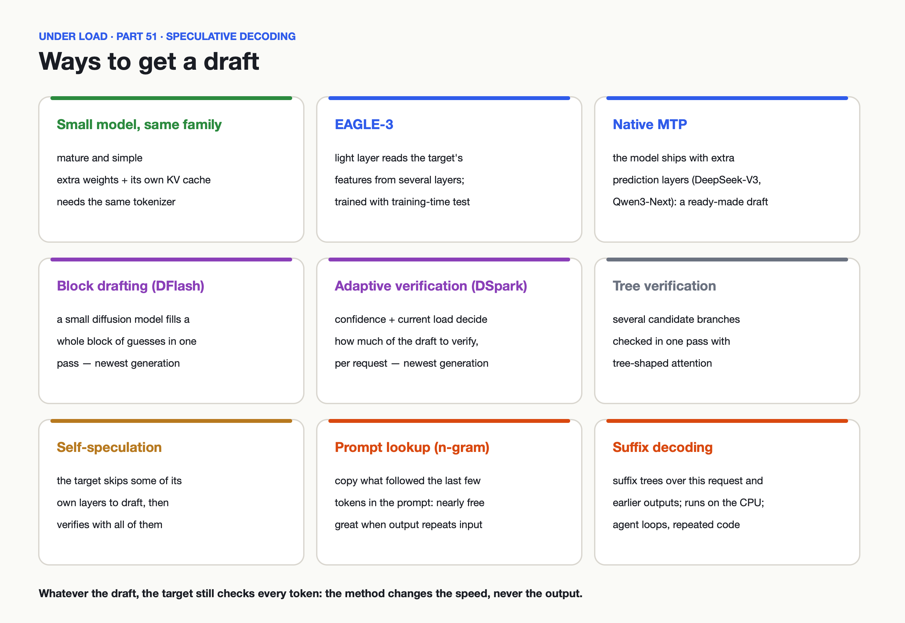
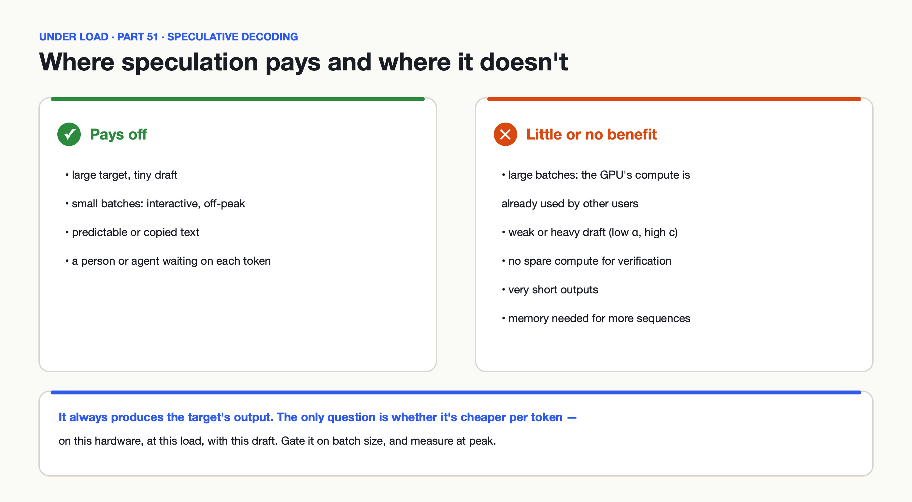
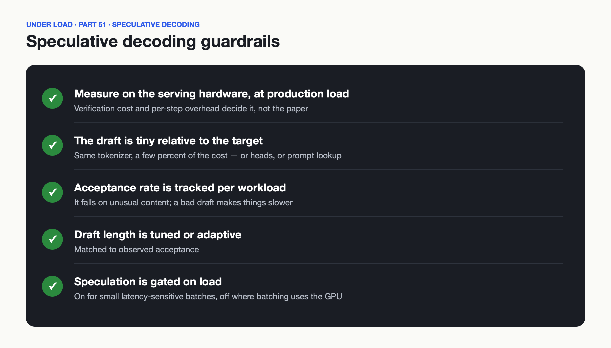

# Speculative Decoding

### Speculative decoding: letting a cheap draft propose several tokens and the real model check them all in one pass — why the output is guaranteed not to change, and the three numbers that decide whether it's faster at all.

*Under Load · Part 51 · LLM Inference Infrastructure*

---

The support product's drafting assistant writes full replies for agents to review: an apology, an explanation of the refund policy, the steps the customer should take. It moved to a larger model this quarter, and the replies got noticeably better. They also got slower. Every token of a reply costs one full pass through the big model, and a 300-token reply is 300 passes, strictly one after another. Agents watch the text crawl onto the screen.

Someone proposes **speculative decoding**: let a small model guess the next few tokens, have the big model check all of them at once, and keep the ones it agrees with. The research papers report two to three times faster generation with **exactly the same output** as the big model alone.

The first rollout went badly. The team paired the big model with a mid-sized sibling as the draft, turned speculation on for all traffic, and at the afternoon peak latency got *worse*. Nothing was broken. Every reply was still exactly what the big model would have written. Speculative decoding was doing precisely what it promises — and the conditions under which that's faster weren't there.

This article explains how speculative decoding works, why it cannot change the output, and the three numbers that decide whether it speeds anything up.

---

## Why one token at a time is wasteful

Part 48 split generation into **prefill**, which processes the prompt in parallel, and **decode**, which produces one token per forward pass of the model. A decode step for one sequence is **memory-bound**: it reads every weight of the model from GPU memory to do a small amount of arithmetic, so the GPU's compute units mostly wait. Part 50 used that slack by **batching** many users into each step.

Speculative decoding uses the same slack differently, for a **single** sequence. The key observation: a transformer can score **several** positions in one forward pass — that's exactly what prefill does. Feeding it five tokens instead of one reads the weights once and does five times the arithmetic, which on a memory-bound step costs little more than feeding it one. The model computes, at each of the five positions, what it would have predicted next.

If there were a way to know the *right* next five tokens in advance, one pass could confirm all five. There isn't. But a cheap guess that's usually right is almost as good.

---

## Guess cheaply, check in one pass

The technique was introduced independently by Leviathan, Kalman and Matias ("Fast Inference from Transformers via Speculative Decoding," ICML 2023) and by Chen et al. at DeepMind ("Accelerating Large Language Model Decoding with Speculative Sampling," 2023). It uses two models:

- the **target** — the large model whose output is wanted;
- the **draft** — something much cheaper that predicts the target's next tokens, usually a small model from the same family with the same **tokenizer** (the component that maps text to token IDs; both models must agree on what each token ID means).

Each round:

1. **Draft.** The draft generates the next **k** tokens one at a time — say k = 4. Its steps are cheap because it's small.
2. **Verify.** The target runs **one** forward pass over the text so far plus all k draft tokens. It produces its own prediction at each of the k positions, plus one more after the last draft token.
3. **Accept.** Walk through the draft tokens in order. Keep each one the target agrees with. At the first disagreement, discard that draft token and everything after it, and use the **target's own token** for that position instead.
4. **Repeat** from the new end of the text.

Every round therefore produces **at least one** token — if the very first draft token is rejected, the target's correction is still a valid next token — and **at most k + 1**: all k drafts accepted, plus the target's prediction after the last one, which the verify pass computed anyway.

A concrete round. The reply so far is "I've refunded the duplicate charge, and you should see it". The draft proposes " on your next statement". The target's predictions at those four positions are " on", " your", " card", " within". The first two match and are kept; " next" doesn't match " card", so the round ends with " on your card": three tokens from one target pass, where plain decoding would have needed three.

One bookkeeping detail: the verify pass writes keys and values (Part 48's KV cache) for all k draft positions. When drafts are rejected, those cache entries must be discarded too, in both the target's and the draft's caches. Serving engines handle this; it's one of the reasons speculation adds implementation complexity.

---

## Why the output cannot change

This is what makes speculative decoding unusual among optimizations: done correctly, it changes **how many target passes** it takes to produce the text, never **which text** comes out. No quality evaluation is needed, because there is no quality change to evaluate.

### Greedy decoding

With **greedy decoding** — always picking the most likely token — the target's "prediction" at each position is a single token. A draft token is kept only if it's exactly that token. Every token in the final output is, by construction, the token the target would have chosen at that position given the text before it. The output is token-for-token what the target alone would produce.

### Sampling

With **sampling** (Part 43), the target doesn't have a single answer at each position; it has a probability distribution, and the output is a random draw from it. "Keep the draft token if it matches" no longer makes sense. The papers' **speculative sampling** rule handles this:

- Let **q(x)** be the probability the draft assigned to the token x it proposed, and **p(x)** the probability the target assigns to the same token.
- **Accept** x with probability **min(1, p(x) / q(x))**. If the target likes the token at least as much as the draft did, it's always kept. If the draft was overconfident, it's kept only sometimes.
- On **rejection**, sample a replacement from the **residual distribution**: the parts of the target's distribution where the draft under-weighted tokens, max(0, p − q), renormalized to sum to one.

The proof in both papers shows that tokens produced this way are distributed **exactly** as if the target had sampled them itself. Intuitively: the acceptance step keeps the overlap between the two distributions, and the residual step adds back precisely what the draft missed. The draft can be arbitrarily bad; a bad draft just gets rejected more often.

The expected probability that a draft token is accepted, written **α** (alpha), turns out to be the overlap between the two distributions — one minus their **total variation distance**. A draft that closely imitates the target has high α; one that doesn't, low α.

### A floating-point footnote

The guarantee is mathematical. In real implementations, verifying k tokens in one pass uses different matrix shapes than decoding them one at a time, and GPU arithmetic in different shapes can round differently in the last bits. In rare near-ties — two tokens almost equally likely — that can flip a choice. Serving engines document this: speculative decoding is lossless in theory, and outputs can occasionally differ for the same numerical reasons that batching can change them. It's not a quality change, but tests that compare outputs byte-for-byte should expect it.

---

## Three numbers decide the speedup

Speculative decoding always does **more total work** than plain decoding: the draft runs on every round, and the target scores tokens that get thrown away. It's faster only when that extra work is cheap and the target passes it saves are expensive. Three quantities decide it.

### 1. Acceptance rate

With per-token acceptance α and k draft tokens, the expected number of tokens produced per round is

**(1 − α^(k+1)) / (1 − α)**

At α = 0.8 and k = 4, that's (1 − 0.8⁵) / 0.2 ≈ **3.4 tokens** per round — 3.4 tokens for one target pass. At α = 0.3, the same round yields about **1.4 tokens**: most rounds end at the first or second draft token.

Acceptance depends on how well the draft imitates the target, and on the content:

- **Same family, same training data** helps. A small model distilled from the target, or trained on the target's own outputs, agrees more.
- **Predictable text** is accepted more: boilerplate ("Thanks for reaching out"), text copied from the prompt, closing formulas, code syntax.
- **Unpredictable text** is accepted less: names, numbers, the actual decision in a reasoning chain — exactly the tokens where a small model and a large one differ most.
- **Sampling temperature** matters: with greedy decoding acceptance is a simple match; at higher temperatures both distributions spread out and acceptance usually falls.

### 2. Draft cost

The draft's step cost relative to the target's, written **c**. A draft that's a tenth the cost of the target (c = 0.1) can propose four tokens for 0.4 target steps. A draft that's half the cost (c = 0.5) spends two full target steps on every four-token proposal before verification even starts — the mistake in the team's first rollout.

Parameter count is only a rough guide. At batch size one, each step also pays fixed costs — launching GPU kernels, synchronizing, framework overhead — that don't shrink with the model. A model with a tenth of the parameters may cost noticeably more than a tenth of the time. That's why production setups pick drafts that are dramatically smaller than the target (a 1B draft for a 70B target is a ratio of roughly 70), or avoid a separate model entirely (see "Draft mechanisms" below).

### 3. Verification cost

The whole idea rests on the target scoring k + 1 tokens for about the price of one. That's true when the step is memory-bound with compute to spare — a large model on a GPU, serving a small batch. It stops being true when compute is the bottleneck:

- **At large batch sizes**, continuous batching (Part 50) has already filled the GPU's spare compute with other users' tokens. Verifying four extra tokens per sequence multiplies the arithmetic of a step that's already compute-bound, and the step gets proportionally slower.
- **On hardware with little spare compute**, such as CPUs, scoring five tokens costs close to five times one, and the premise collapses.

### Putting them together

With these three quantities, the papers' idealized speedup — assuming verification costs one target step — is

**speedup ≈ (1 − α^(k+1)) / ((1 − α) × (k·c + 1))**

The numerator is tokens per round; the denominator is the cost of a round in target steps: k draft steps at cost c each, plus one verify pass. Some worked cases at k = 4:

- **Good draft, tiny draft** (α = 0.8, c = 0.05): 3.36 / 1.2 ≈ **2.8×**.
- **Good draft, heavy draft** (α = 0.8, c = 0.5): 3.36 / 3.0 ≈ **1.1×** — almost all of the gain eaten by drafting.
- **Weak draft, tiny draft** (α = 0.3, c = 0.05): 1.43 / 1.2 ≈ **1.2×**.
- **Weak draft, heavy draft** (α = 0.3, c = 0.5): 1.43 / 3.0 ≈ **0.5×** — twice as slow as not speculating.

These are formula values, not benchmarks, and real systems land below them: verification costs somewhat more than one step, and running two models adds scheduling and cache-management overhead. But the shape is reliable, and it explains the first rollout: a heavy draft, at peak batch sizes where verification wasn't free.

### How many tokens to draft

The draft length k has a sweet spot. Each extra draft token costs c, and it's only useful if every token before it was accepted, which happens with probability α^k. Short drafts leave speedup on the table when acceptance is high; long drafts waste work when it's low.

From the same formula with a tiny draft (c = 0.05): at α = 0.8, speedup keeps rising up to about k = 8; at α = 0.6, it peaks around k = 4 and then falls; at α = 0.4, the best k is 2 or 3. Higher acceptance and cheaper drafting favour longer drafts.

Since acceptance varies with content — high in boilerplate, low in reasoning — a fixed k is a compromise. Serving engines let k be configured per deployment, and some adapt it at runtime from recently observed acceptance, drafting more aggressively while the draft is on a winning streak.

---

## Draft mechanisms

A separate small model is the original design, but not the only one, and often not the best.

- **A small model from the same family.** Simple to deploy if one exists with the same tokenizer. It costs extra GPU memory for its weights and its own KV cache, and its acceptance depends on how closely it imitates the target. (Some implementations can bridge different tokenizers by converting text between them, at extra cost.)
- **Extra prediction heads on the target itself.** **Medusa** (Cai et al., 2024) adds several small heads to the target that each predict a token further ahead, and verifies a **tree** of candidate continuations in one pass using a special attention mask. These need training but no second model.
- **EAGLE and EAGLE-3.** **EAGLE** (Li et al., 2024) trains a light draft layer that reads the target's internal features rather than only its tokens — it sees what the target is "thinking," so it imitates it far better than a separate small model. **EAGLE-3** (NeurIPS 2025) changes two things. Instead of predicting the target's next internal feature and turning that into a token, it predicts tokens directly; and instead of reading only the top layer, it fuses features from several of the target's layers. It's also trained with **training-time test**: during training, the draft layer runs several drafting steps on its own outputs, exactly as it will at inference, so it learns to recover from its own small mistakes instead of only ever seeing perfect inputs. The result is a draft that keeps improving as more training data is added. EAGLE-3 drafts are supported by vLLM and SGLang, and frameworks such as SGLang's SpecForge exist to train them for a given model. Today it's one of the strongest general-purpose choices.
- **Native multi-token prediction (MTP).** Some models are trained from the start to predict more than one token ahead: **DeepSeek-V3** and **Qwen3-Next** ship with extra **MTP** layers. In ordinary decoding those layers can be ignored; in speculative decoding they become a ready-made draft — no second model, no extra training. Serving engines enable it directly (vLLM's `"method": "mtp"`). The draft is only as deep as the layers the model was trained with: DeepSeek-V3 has a single MTP layer, so asking it to draft several tokens ahead gives no quality guarantee, and projects such as FastMTP fine-tune the head for longer drafts. When a model comes with MTP layers, they're usually the first thing to try.
- **Parallel block drafting (DFlash).** Most drafts above produce their guesses one after another, so drafting k tokens takes k small steps (Medusa's heads are the exception, each guessing a fixed position ahead). **DFlash** (ICML 2026) replaces that with a small **block diffusion** model: it starts from a block of empty positions and fills them all in **one pass**, conditioned — like EAGLE — on the target's internal features. The target then verifies the block as usual, so the output guarantee doesn't change; what changes is that drafting cost no longer grows step by step with k. Follow-up work (DDTree) builds a tree of candidate blocks from the same predictions and verifies all of it at once. This is new research with early support in SGLang, and worth watching rather than a default yet.
- **Tree verification.** Instead of one chain of k guesses, propose several branches ("on your card" and "on your next statement") and verify the whole tree at once with tree-shaped attention, as in SpecInfer and Medusa. More of the tree is wasted, but the chance that *some* branch is accepted is higher.
- **Self-speculation.** The target drafts for itself by skipping some of its own layers (for example, the LayerSkip work), then verifies with the full model. No extra weights at all.
- **Prompt lookup (n-gram) drafting.** Find the last few generated tokens somewhere in the **prompt**, and propose whatever followed them there. It costs almost nothing and needs no model, and it works remarkably well when the output repeats the input: summaries, rewrites, extracting fields, editing code, quoting the customer's message. For a support assistant that restates ticket details in a handoff note, it's an easy first experiment.
- **Suffix decoding.** A stronger model-free variant. **SuffixDecoding** (Snowflake's Arctic Inference, usable from vLLM) keeps **suffix trees** — compact indexes of every continuation seen so far — built from the current request's prompt and output and from the outputs of previous requests. When an agent repeats a tool-call format, a self-refinement loop rewrites the same code, or many users get similar answers, the tree already knows long continuations and can propose them. It runs on the CPU, so it takes nothing from the GPU. Its weakness is the same as every speculation scheme's: at high concurrency the GPU has little spare compute, and it can do worse than plain n-gram lookup there.

### Adaptive verification

A separate line of work attacks the question of *how much* to verify. A fixed draft length k is a compromise: too long under load, too short for easy text. **DSpark** (2026) adds a small **confidence head** that estimates, for each draft position, how likely it is to survive verification, and a scheduler that combines those estimates with the server's current load to choose a verification length **per request, per step**. Under light load it verifies long drafts; under heavy load it verifies only the positions very likely to be accepted, so speculation stops competing with batching for compute. Tokens are still accepted only if the target agrees, so the output guarantee is unchanged. vLLM has integrated this approach; independent benchmarks are still scarce, so it's best treated as promising rather than proven.

### Choosing a draft method

- **A small model from the same family:** mature and simple, when a compatible small model exists.
- **EAGLE-3:** a strong general-purpose choice for serving, if a trained draft exists or can be trained.
- **Native MTP:** the first thing to try when the model ships with MTP layers.
- **DFlash and DSpark:** the newest generation — parallel block drafting and load-aware verification — worth evaluating, not yet defaults.
- **Prompt lookup and suffix decoding:** nearly free; best when output repeats input or earlier outputs, as in code editing, summaries and agent loops.

Whatever the method, the three numbers from earlier still decide the outcome: how often the target accepts the draft, what the draft costs, and what verification costs at the load the server actually runs.

---

## Where it pays off — and where it doesn't

Speculative decoding is a **latency** optimization for **memory-bound** decoding. It pays off when:

- **The target is large** and the draft is tiny, so c is small.
- **Batches are small** — interactive traffic, off-peak hours, dedicated low-latency deployments — so the GPU has compute to spare for verification.
- **Acceptance is high**: the draft is well matched, the text is predictable, or the output copies the input.
- **Per-user speed matters**: streaming replies a person is watching, agents whose next step waits on the previous answer.

It provides little or no benefit — or makes things worse — when:

- **The server runs large batches.** Continuous batching already converts spare compute into throughput; speculation competes for the same compute, and at high load it can reduce total throughput. Engines and operators commonly disable or scale back speculation above a certain load.
- **The draft is weak or heavy.** Low α or high c, as in the worked cases above.
- **The hardware has no spare compute** for multi-token verification.
- **Outputs are very short.** A ten-token classification label leaves little to speculate on.
- **Memory is the binding constraint.** A draft model's weights and KV cache take memory that could hold more concurrent sequences (Part 48).

The deciding question is never "does speculative decoding work?" — it always produces correct output — but "on this hardware, at this load, with this draft, is it cheaper per token?"

---

## Shipping it safely

Because the output doesn't change, the risks of speculative decoding are all about performance and operations:

1. **Benchmark on the serving hardware at realistic load.** Measure per-request latency and total throughput at the batch sizes production actually sees, including peak. The paper's speedup describes the paper's setup.
2. **Measure acceptance on real traffic**, broken down by endpoint and content type. Replay a sample of recent prompts through target and draft offline to estimate α before deploying.
3. **Choose the draft for cost, not just accuracy.** A draft that agrees more but costs a third of the target can lose to one that agrees less but costs a fiftieth. Prompt lookup and trained heads are worth testing before a separate model.
4. **Tune k, or let the engine adapt it** — newer schemes such as DSpark choose the verification length per request from confidence and current load.
5. **Gate it on load.** Enable speculation for latency-sensitive, small-batch traffic, and disable or reduce it when batch sizes grow.
6. **Expect rare floating-point differences** in outputs, and make output-comparison tests tolerant of them.
7. **Account for memory.** Size the KV cache budget (Part 50) with the draft's weights and cache included.

---

## Guardrails that prevent the next one

1. **Measure on the serving hardware, at production load** — verification cost and per-step overhead decide the outcome, not the paper.
2. **The draft is tiny relative to the target**, with the same tokenizer: a cost ratio far below a half, ideally a few percent — or a trained head or prompt lookup instead of a second model.
3. **Acceptance rate is tracked per workload**, because it falls on unusual content, and a bad draft makes generation slower.
4. **Draft length is tuned or adaptive**, matched to observed acceptance.
5. **Speculation is gated on load**: on for small, latency-sensitive batches; off where batching already uses the GPU.

---

## What to keep on the dashboard

- **Acceptance rate** and **accepted tokens per round**, by endpoint and content type.
- **Target forward passes per generated token**: below 1 means speculation is saving passes; close to 1 means it's only adding draft work.
- **Inter-token latency** and **tokens per second per request**, with speculation on and off (keep a small control slice).
- **Total throughput per GPU** at peak, to catch speculation competing with batching.
- **Draft step time** and its share of each round.
- **Batch size and GPU utilization**, the context that says whether speculation should be on.
- **Memory used by the draft** — weights and KV cache.

---

## Recap

### What is speculative decoding?
A cheap draft proposes several next tokens; the target model verifies all of them in one forward pass, keeps the prefix it agrees with, and supplies its own token at the first disagreement. Each expensive target pass can then yield several tokens instead of one.

### Why can it be faster even though it does extra draft work?
Decode steps of a large model at small batch sizes are memory-bound: scoring several tokens in one pass costs about as much as scoring one. If the draft is cheap and usually right, several tokens come out of each expensive pass, and the saved passes outweigh the drafting.

### How can it preserve the target model's output?
With greedy decoding, a draft token is kept only if it's exactly the target's choice. With sampling, a draft token x is accepted with probability min(1, p(x)/q(x)), and a rejection is replaced by sampling from the residual max(0, p − q); this provably yields exactly the target's distribution. Implementations can still differ in rare floating-point near-ties.

### What controls acceptance rate and speedup?
Acceptance depends on how closely the draft imitates the target and on how predictable the text is. Speedup depends on acceptance α, the draft's cost relative to the target c, and the cost of verification: roughly (1 − α^(k+1)) / ((1 − α)(k·c + 1)) when verification costs one step.

### What determines the optimal number of draft tokens?
The trade between the chance that a longer draft keeps being accepted (α^k) and the cost of each extra draft token (c). High acceptance and cheap drafting favour longer drafts; low acceptance favours short ones. Tune k on real traffic, or let the engine adapt it.

### When does it provide little or no benefit?
When the draft is weak or not much cheaper than the target, when large batches have already used the GPU's spare compute, on hardware without spare compute for verification, for very short outputs, or when the draft's memory would be better spent on more concurrent sequences.

### What kinds of drafts exist?
A small model from the same family; extra prediction heads trained onto the target (Medusa, EAGLE-3); native multi-token prediction layers that some models ship with (DeepSeek-V3, Qwen3-Next); parallel block drafting with a small diffusion model (DFlash); self-speculation by skipping layers; and model-free drafts — prompt lookup and suffix decoding — that copy continuations seen before and work best when output repeats input. Separately, adaptive verification (DSpark) chooses how much of a draft to verify per request, based on confidence and load.

### What should be monitored?
Acceptance rate and accepted tokens per round per workload, target passes per generated token, inter-token latency and per-request speed with and without speculation, throughput at peak, draft step time, batch size, and draft memory.

---

## Next

- **Lab (run + measured write-up):** [51-speculative-decoding](https://github.com/b-basoglu/under-load/tree/main/51-speculative-decoding)
- **Next:** [Quantization](../52-quantization/article.md) — The same model in 4 bits instead of 16: a quarter of the memory. Why it isn't four times faster, and where the quality goes.
